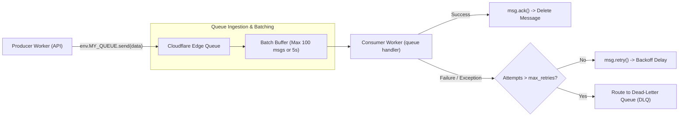
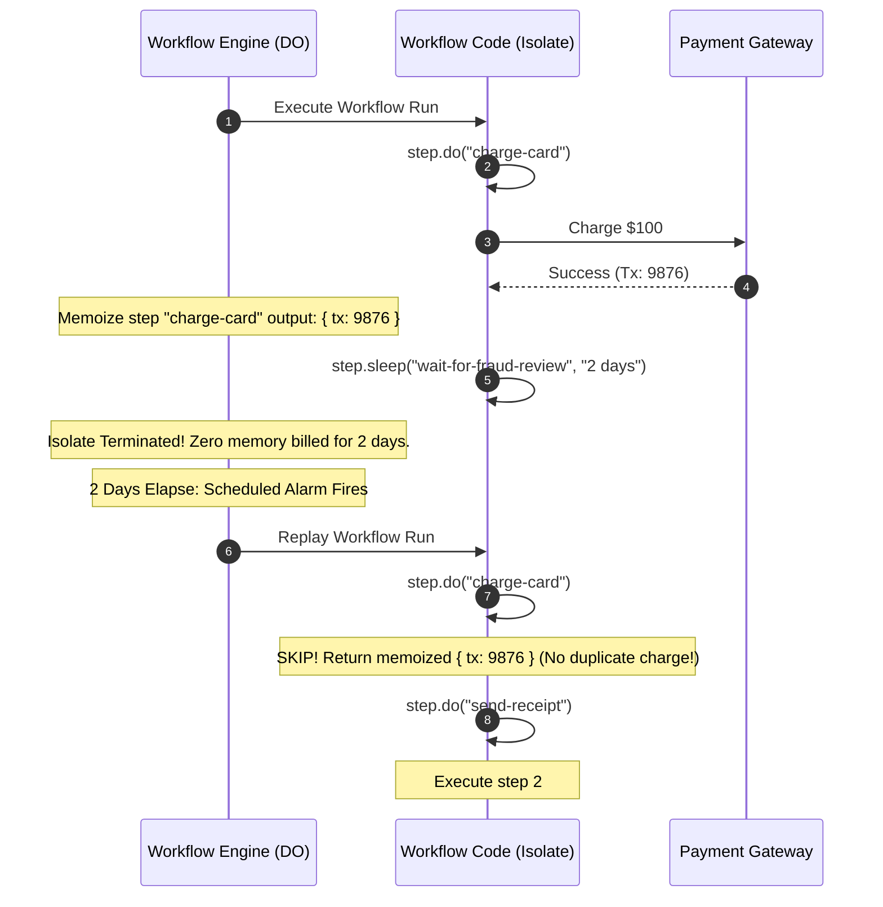

# Module 09: Queues and Durable Workflows

Asynchronous event processing and stateful orchestration are essential for resilient distributed architectures. Decoupling synchronous user-facing API handlers from long-running background tasks requires two core primitives: **Cloudflare Queues** (a distributed message broker delivering at-least-once message queues with batching and dead-letter routing) and **Cloudflare Workflows** (a durable execution engine that orchestrates multi-step, human-in-the-loop business logic with deterministic step replay).

---

## 1. Cloudflare Queues: At-Least-Once Messaging Architecture

Cloudflare Queues provides decoupled asynchronous message buffering directly within the edge runtime.



### Ingress and Egress Configuration in `wrangler.jsonc`

```jsonc
{
  "name": "payment-processor",
  "queues": {
    "producers": [
      { "binding": "AUDIT_QUEUE", "queue": "audit-events" }
    ],
    "consumers": [
      {
        "queue": "audit-events",
        "max_batch_size": 50,
        "max_batch_timeout": 5,
        "max_retries": 3,
        "dead_letter_queue": "audit-events-dlq",
        "max_concurrency": 20
      }
    ]
  }
}
```

### Producing Messages

```typescript
export interface Env {
  AUDIT_QUEUE: Queue<AuditEvent>;
}

export interface AuditEvent {
  userId: string;
  action: string;
  timestamp: number;
}

export default {
  async fetch(request: Request, env: Env, ctx: ExecutionContext): Promise<Response> {
    const event: AuditEvent = {
      userId: "user_101",
      action: "PASSWORD_RESET",
      timestamp: Date.now()
    };

    // Buffer to queue asynchronously without delaying HTTP response
    ctx.waitUntil(env.AUDIT_QUEUE.send(event));

    return new Response("Event accepted", { status: 202 });
  }
};
```

---

## 2. Consumer Batching and Partial Acknowledgments

Queues delivers messages in batches to the `queue()` export. Understanding error isolation requires utilizing **per-message acknowledgments**.

```typescript
export default {
  async queue(batch: MessageBatch<AuditEvent>, env: Env, ctx: ExecutionContext): Promise<void> {
    for (const msg of batch.messages) {
      try {
        await processAuditEvent(msg.body);
        // Explicitly acknowledge successful message
        msg.ack();
      } catch (err) {
        console.error(`Failed to process message ${msg.id}:`, err);
        // Explicitly schedule retry with exponential backoff delay
        msg.retry({ delaySeconds: Math.min(300, Math.pow(2, msg.attempts) * 5) });
      }
    }
  }
};
```

### The Unhandled Batch Exception Hazard
- If an unhandled exception escapes the `queue()` handler without per-message `msg.ack()`, Cloudflare Queues assumes the **entire batch failed**.
- All messages in that batch—including those that already processed successfully—are marked for redelivery.
- **Rule**: Always wrap per-message processing inside `try/catch` blocks and invoke `msg.ack()` or `msg.retry()` explicitly to avoid redundant work.

---

## 3. Cloudflare Workflows: Durable Execution and Replay Mechanics

While Queues excels at stateless message buffering, multi-day business processes (such as customer onboarding, multi-step payments, order fulfillment, and AI agent coordination) require **Durable Execution**.

Cloudflare Workflows (GA April 2025) allows developers to write standard TypeScript code that can execute over hours, days, or weeks. Workflows survive isolate evictions, system crashes, and network partitions by leveraging **deterministic step replay** backed by Durable Objects.



---

## 4. Writing Workflows: `step.do`, `step.sleep`, and Determinism Rules

```typescript
import { WorkflowEntrypoint, WorkflowEvent, WorkflowStep } from "cloudflare:workers";

export interface OrderPayload {
  orderId: string;
  userId: string;
  amount: number;
}

export class OrderFulfillmentWorkflow extends WorkflowEntrypoint<Env, OrderPayload> {
  async run(event: WorkflowEvent<OrderPayload>, step: WorkflowStep): Promise<void> {
    const { orderId, userId, amount } = event.payload;

    // 1. Step 1: Charge customer with automatic retry policy
    const chargeResult = await step.do(
      "charge-customer",
      {
        retries: { limit: 3, delay: "5 seconds", backoff: "exponential" },
        timeout: "30 seconds"
      },
      async () => {
        return await processPaymentGateway(userId, amount);
      }
    );

    // 2. Step 2: Durable Sleep (isolate is evicted; zero compute cost during sleep)
    await step.sleep("wait-for-inventory-allocation", "1 hour");

    // 3. Step 3: Fulfill physical shipment
    const trackingNumber = await step.do("ship-order", async () => {
      return await reserveWarehouseItem(orderId, chargeResult.transactionId);
    });

    // 4. Step 4: Await External Webhook / Event
    const approval = await step.waitForEvent("customer-confirmation", {
      timeout: "7 days"
    });

    console.log(`Workflow complete for order ${orderId}, tracking: ${trackingNumber}`);
  }
}
```

### The Rule of Determinism
Because Workflows resume by replaying code from the top:
1. **Never generate non-deterministic state outside `step.do`**: Functions like `Math.random()`, `crypto.randomUUID()`, or `Date.now()` called outside a step will evaluate to a **different value** on every replay.
2. **Move side effects into `step.do`**: Database queries, network requests, and external API calls must be wrapped inside `step.do`. The return value must be JSON-serializable.

---

## 5. Cron Triggers: Scheduled Edge Tasks

For recurring cron jobs (e.g., hourly database vacuuming, nightly log aggregation), Workers supports **Cron Triggers** configured in `wrangler.jsonc`.

```jsonc
{
  "name": "nightly-cleanup",
  "triggers": {
    "crons": ["0 0 * * *", "*/15 * * * *"]
  }
}
```

### The `scheduled` Event Handler

```typescript
export default {
  async scheduled(event: ScheduledEvent, env: Env, ctx: ExecutionContext): Promise<void> {
    console.log(`Cron triggered at ${new Date(event.scheduledTime).toISOString()}`);
    console.log(`Cron pattern matched: ${event.cron}`);

    ctx.waitUntil(performDatabaseMaintenance(env));
  }
};
```

---

## 6. Then vs Now: Asynchronous Edge Execution

| Dimension | Then (Cron Workers & Queues Launch 2022) | Now (Cloudflare Workflows 2026) | Why It Changed |
| --- | --- | --- | --- |
| Multi-Step Orchestration | Complex DIY state machines on KV/DO with manual alarms | Cloudflare Workflows with native `step.do` and `step.sleep` | Manual actor state machines required hundreds of lines of fragile persistence and retry boilerplate. |
| Message Failures | Whole-batch failures triggered total redelivery | Partial batch acknowledgments (`msg.ack()`, `msg.retry()`) | Redelivering entire batches under single-message failures caused massive message duplication. |
| Workflow Replay | Not supported in standard Workers | Deterministic memoized replay backed by Durable Objects | Enables multi-day workflows that survive isolate crashes and platform maintenance seamlessly. |
| Compliance Scoping | Global placement only | Jurisdiction-Restricted Workflows (`eu`, `us`, `fedramp`) | Regulatory compliance (GDPR/FedRAMP) mandates restricting stateful workflow execution to specific regions. |

---

## 7. Production Gotchas and Edge Failure Modes

1. **Non-Serializable Step Return Payloads**: Passing circular structures, raw `Response` streams, or class instances as the return value of `step.do()` will throw a serialization error. Step outputs must be JSON-serializable.
2. **Missing DLQ on Queue Consumers**: Without configuring a `dead_letter_queue` in `wrangler.jsonc`, messages that persistently fail consumption will be discarded after `max_retries` are exhausted, resulting in lost data.
3. **Re-executing Code Outside `step.do`**: Writing a database `INSERT` outside `step.do` will cause that insert to execute again every time the workflow sleeps and resumes, corrupting database records.

---

## 8. Architectural Case Study: Resilient Order Pipeline with Queues and Workflows

```typescript
export interface Env {
  ORDER_WORKFLOW: Workflow;
}

export default {
  // Ingest incoming queue messages and trigger durable workflow instances
  async queue(batch: MessageBatch<OrderPayload>, env: Env, ctx: ExecutionContext): Promise<void> {
    for (const msg of batch.messages) {
      try {
        const order = msg.body;
        // Launch a discrete, durable workflow instance per order
        await env.ORDER_WORKFLOW.create({
          id: `order_${order.orderId}`,
          params: order
        });
        msg.ack();
      } catch (err) {
        console.error("Failed to launch workflow for order:", err);
        msg.retry({ delaySeconds: 10 });
      }
    }
  }
};
```

---

## Interview Drill

<details><summary>1. Explain the difference between Cloudflare Queues delivery guarantees and why consumers must be designed idempotently.</summary>

Cloudflare Queues provides at-least-once message delivery. Under network partitions, isolate evictions, or node restarts, a message may be delivered to a consumer more than once before an acknowledgment is committed. Consumers must be designed to be idempotent—for example, by checking whether an order ID has already been recorded in D1 SQL or Durable Object storage before applying a mutation—to ensure that duplicate message deliveries do not create duplicate business transactions.

</details>

<details><summary>2. How does partial batch acknowledgment in Cloudflare Queues prevent redundant message reprocessing?</summary>

When a Worker processes a batch of messages (e.g., 50 messages), an error in a single message can cause the entire batch to fail if unhandled. By default, Queues will redeliver all 50 messages. With partial batch acknowledgment, the consumer iterates over messages, calling `msg.ack()` on successfully processed items and `msg.retry({ delaySeconds })` on failed ones. Queues records these granular states, deleting the successful messages and redelivering only the failed ones, preventing wasted compute and duplicate work.

</details>

<details><summary>3. Describe the replay mechanics of Cloudflare Workflows and why non-deterministic logic outside `step.do` is forbidden.</summary>

Cloudflare Workflows implements durable execution via event replay backed by Durable Objects. When a workflow sleeps (`step.sleep()`) or fails, the isolate is evicted. When it resumes, the engine re-executes the code from line 1. When it encounters a previously completed `step.do()`, the engine skips executing the closure and immediately returns the memoized output from storage. If non-deterministic code (like `Math.random()` or `Date.now()`) exists outside `step.do`, it generates different values during the replay, altering control flow branches and corrupting the workflow state machine.

</details>

<details><summary>4. What underlying infrastructure manages the sleep state of a Cloudflare Workflow during a 7-day `step.sleep()`?</summary>

Cloudflare Workflows is built directly on top of Durable Objects. When `step.sleep("7 days")` is invoked, the workflow records its current step state in embedded SQLite storage, configures a Durable Object Alarm for the exact wake-up timestamp 7 days in the future, and evicts its V8 isolate from host memory. During the 7-day sleep, the workflow consumes zero CPU cycles and zero memory duration billing. At the scheduled time, the alarm fires, wakes the actor, and re-triggers the workflow replay.

</details>

<details><summary>5. What role does a Dead-Letter Queue (DLQ) serve, and how should an edge operations team handle DLQ messages?</summary>

A Dead-Letter Queue (DLQ) is a designated fallback queue where messages that repeatedly fail consumption after exhausting the configured `max_retries` threshold are automatically routed. This prevents poison-pill messages (e.g., malformed JSON or unhandled null payloads) from blocking the main queue indefinitely. Operations teams attach specialized alert Workers or tail pipelines to the DLQ to log diagnostic traces to external SIEMs and execute manual redrive scripts once bugs are resolved.

</details>
