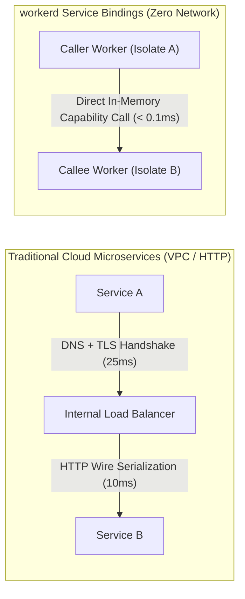
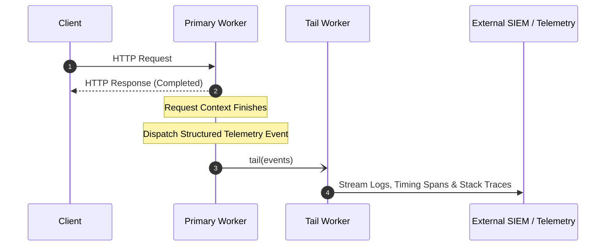

# Module 10: Service Bindings and Composition

Modern cloud systems are rarely monolithic; they are partitioned into specialized microservices. In traditional clouds, inter-service communication traverses virtual private clouds (VPCs), internal load balancers, DNS resolution steps, and TLS handshakes, incurring 20 ms to 50 ms of avoidable network latency. In `workerd`, **Service Bindings** connect multiple discrete Workers directly within the runtime. By utilizing **`WorkerEntrypoint` RPC**, Workers communicate with zero HTTP serialization overhead, sub-millisecond execution times, and strict capability security.

---

## 1. Service Bindings Architecture: Zero-Network RPC

A Service Binding links a caller Worker to a callee Worker within the same Cloudflare account.



### Architectural Properties

- **Zero Public Internet Exposure**: Callee Workers do not require public DNS routes or `workers.dev` URLs. They can remain completely private, accessible exclusively via Service Bindings.
- **In-Process Optimization**: When the caller and callee execute on the same physical host, `workerd` passes arguments via structured cloning in memory without network hops.
- **Independent Lifecycles**: Each Worker maintains its own discrete `wrangler.jsonc`, compatibility flags, versioning, and environment secrets.

---

## 2. Modern RPC with `WorkerEntrypoint`

Historically, Service Bindings required constructing synthetic `Request` objects (`await env.AUTH.fetch(new Request(...))`). Modern `workerd` provides native **Remote Procedure Calls (RPC)** via `WorkerEntrypoint`.

### The Callee Service (`auth-service`)

```typescript
import { WorkerEntrypoint } from 'cloudflare:workers';

export interface UserSession {
  userId: string;
  role: string;
  valid: boolean;
}

export class AuthService extends WorkerEntrypoint<Env> {
  // Directly exposed typed RPC method
  async validateToken(token: string): Promise<UserSession> {
    if (!token.startsWith('tok_live_')) {
      return { userId: '', role: 'anonymous', valid: false };
    }

    // Query private KV or D1 bound to this auth worker
    const userData = await this.env.AUTH_KV.get(`session:${token}`);
    if (!userData) {
      return { userId: '', role: 'anonymous', valid: false };
    }

    const parsed = JSON.parse(userData);
    return { userId: parsed.id, role: parsed.role, valid: true };
  }

  // Standard HTTP entrypoint for public requests (optional)
  async fetch(request: Request): Promise<Response> {
    return new Response('Auth Service Private RPC Interface', { status: 200 });
  }
}

export default AuthService;
```

### The Caller Service (`api-gateway`)

```typescript
import { WorkerEntrypoint } from 'cloudflare:workers';
import type { AuthService } from '../../auth-service/src/index.ts';

export interface Env {
  AUTH_SERVICE: Service<AuthService>;
}

export default {
  async fetch(request: Request, env: Env, ctx: ExecutionContext): Promise<Response> {
    const authHeader = request.headers.get('Authorization');
    const token = authHeader?.replace('Bearer ', '') ?? '';

    // Invoke remote method directly with native TypeScript typing
    const session = await env.AUTH_SERVICE.validateToken(token);

    if (!session.valid) {
      return new Response(JSON.stringify({ error: 'Unauthorized' }), {
        status: 401,
        headers: { 'Content-Type': 'application/json' },
      });
    }

    return Response.json({ status: 'authorized', userId: session.userId, role: session.role });
  },
};
```

---

## 3. Tail Workers: Observability Pipelines

A **Tail Worker** is a background Worker attached to a producer Worker to ingest logs and unhandled errors asynchronously.



### Implementing a Tail Worker

```typescript
export default {
  async tail(events: TraceItem[], env: Env, ctx: ExecutionContext): Promise<void> {
    for (const event of events) {
      const payload = {
        scriptName: event.scriptName,
        outcome: event.event?.status ?? 'unknown',
        cpuTimeMs: event.cpuTime,
        wallTimeMs: event.eventTimestamp,
        logs: event.logs.map((l) => ({ level: l.level, message: l.message })),
        exceptions: event.exceptions.map((e) => ({ name: e.name, message: e.message })),
      };

      // Ship telemetry to Datadog or Splunk via background subrequest
      ctx.waitUntil(
        fetch('https://http-intake.logs.datadoghq.com/api/v2/logs', {
          method: 'POST',
          body: JSON.stringify(payload),
          headers: { 'Content-Type': 'application/json', 'DD-API-KEY': env.DATADOG_KEY },
        }),
      );
    }
  },
};
```

---

## 4. Workers for Platforms: Multi-Tenant Dispatch Namespaces

SaaS providers frequently allow their enterprise customers to upload custom JavaScript plugins or logic (e.g., Shopify custom scripts or Zapier edge automations). Running customer-supplied code inside a shared global Worker is dangerous.

**Workers for Platforms** introduces **Dispatch Namespaces**:

- **Dynamic Worker Deployment**: The SaaS host dynamically creates, updates, and deletes tenant Workers programmatically via API calls without redeploying the core platform.
- **Dynamic Ingress Dispatch**: The host Worker inspects the incoming hostname or request header and dynamically dispatches to the tenant's isolated Worker:
  ```typescript
  export interface Env {
    DISPATCH: DispatchNamespace;
  }

  export default {
    async fetch(request: Request, env: Env): Promise<Response> {
      const tenantId = request.headers.get('x-tenant-id') ?? 'default';

      // Programmatically obtain customer-specific isolate stub
      const customerWorker = env.DISPATCH.get(tenantId);
      return await customerWorker.fetch(request);
    },
  };
  ```
- **Strict Quotas**: Each customer Worker executes inside its own discrete 128 MB isolate sandbox with dedicated CPU limits.

---

## 5. Cloudflare Containers (GA April 2026)

While V8 isolates provide sub-millisecond execution for standard web APIs and JavaScript, legacy workloads often require specialized runtimes (such as Python data science libraries, FFmpeg, LibreOffice, or custom C++ binaries).

In April 2026, Cloudflare launched **Cloudflare Containers (Sandboxes GA)**:

- **Durable Object–Fronted Containers**: Containers are managed and invoked through Durable Objects.
- **Fast Micro-Container Boot**: Sandboxes boot within seconds directly at the edge, scaling down to zero when idle.
- **Unified Capability Mesh**: Containers communicate with edge Workers over internal Service Bindings.

---

## 6. Then vs Now: Microservice Composition

| Dimension | Then (Monolithic Workers 2019) | Now (Service Bindings & RPC 2026) | Why It Changed |
| --- | --- | --- | --- |
| Inter-Worker Calls | Public HTTP fetches (`fetch("https://worker.dev/api")`) | Native `WorkerEntrypoint` RPC over Service Bindings | Public fetches added 30 ms of DNS/TLS latency and exposed internal APIs to the internet. |
| Data Serialization | JSON stringification inside `Request`/`Response` | Structured clone algorithm across in-memory isolates | Parsing JSON on every microservice hop consumed unnecessary CPU-time quotas. |
| Multi-Tenancy | Unsafe `eval()` in shared isolate | Dynamic Dispatch Namespaces | `eval()` permitted cross-tenant memory leakage and catastrophic security vulnerabilities. |
| Observability | Synchronous console log wrappers in handler | Asynchronous decoupled Tail Workers | Synchronous logging bloated request execution time and complicated core application logic. |

---

## 7. Production Gotchas and Edge Failure Modes

1. **Circular Service Binding Invocations**: Configuring Worker A to invoke Worker B, which in turn invokes Worker A on the same request context, will trigger a fatal recursive cycle and terminate with a subrequest limit exception.
2. **Exceeding the 6 Outbound Connection Limit**: When chaining multiple Service Bindings concurrently, remember that `workerd` throttles concurrent outbound connection states.
3. **Structured Clone Serialization Failures**: While `WorkerEntrypoint` RPC supports objects, arrays, and buffers, passing non-cloneable objects (such as active TCP streams or DOM nodes) will throw a serialization error across the isolate boundary.

---

## 8. Architectural Case Study: Modular E-Commerce Gateway with RPC

```typescript
import { WorkerEntrypoint } from 'cloudflare:workers';
import type { PaymentService } from '../../payment-service/src/index.ts';
import type { InventoryService } from '../../inventory-service/src/index.ts';

export interface Env {
  PAYMENT_RPC: Service<PaymentService>;
  INVENTORY_RPC: Service<InventoryService>;
}

export default {
  async fetch(request: Request, env: Env, ctx: ExecutionContext): Promise<Response> {
    if (request.method !== 'POST') return new Response('Method Not Allowed', { status: 405 });

    const { itemId, paymentMethod, amount } = await request.json<{
      itemId: string;
      paymentMethod: string;
      amount: number;
    }>();

    // 1. Check inventory via direct RPC stub (< 1 ms latency)
    const available = await env.INVENTORY_RPC.checkStock(itemId);
    if (!available) {
      return Response.json({ error: 'Item Out of Stock' }, { status: 409 });
    }

    // 2. Execute payment via direct RPC stub
    const paymentResult = await env.PAYMENT_RPC.charge(paymentMethod, amount);
    if (!paymentResult.success) {
      return Response.json(
        { error: 'Payment Declined', reason: paymentResult.error },
        { status: 402 },
      );
    }

    // 3. Confirm inventory reservation asynchronously
    ctx.waitUntil(env.INVENTORY_RPC.decrementStock(itemId));

    return Response.json({ status: 'success', transactionId: paymentResult.transactionId });
  },
};
```

---

## Interview Drill

<details><summary>1. How do Service Bindings with `WorkerEntrypoint` eliminate network and serialization overhead?</summary>

Traditional microservices communicate over HTTP/REST or gRPC, which requires opening TCP connections, negotiating TLS, formatting HTTP headers, and serializing payloads to JSON or protobuf. Service Bindings connect two Workers directly inside the `workerd` runtime fabric. Calls to methods on a `WorkerEntrypoint` class execute in-process via structured cloning in memory. The runtime passes JavaScript native objects (buffers, primitives, dates, maps) directly between isolates without network serialization, DNS lookup, or TLS handshakes, achieving sub-millisecond execution.

</details>

<details><summary>2. Explain the security advantages of keeping callee Workers unrouted and accessible only via Service Bindings.</summary>

When a Worker is deployed without a public route or `workers.dev` subdomain, it has no public IP address and cannot be accessed over the internet. It can only be invoked by another Worker that holds an explicit Service Binding capability configured in `wrangler.jsonc`. This creates a zero-trust network boundary at the software layer, eliminating the need for internal API gateway keys, complex firewall rules, or mTLS configurations, and guaranteeing that private microservices cannot be probed by external attackers.

</details>

<details><summary>3. What is a Tail Worker, and how does it prevent logging pipelines from impacting API response latency?</summary>

A Tail Worker is a specialized Worker configured to consume execution telemetry, console logs, and unhandled exceptions from producer Workers. Instead of spending active CPU time formatting and shipping logs to external logging platforms inside the primary request handler, the primary Worker returns its response to the client immediately. Cloudflare's runtime then emits a trace event to the Tail Worker, which executes independently in its own isolate to process and stream logs to SIEMs (like Datadog or Splunk) without delaying the user's response.

</details>

<details><summary>4. What architectural problem does Workers for Platforms (Dispatch Namespaces) solve for SaaS application architectures?</summary>

SaaS platforms that allow end users to upload custom scripts (e.g., automated webhooks or e-commerce discount logic) cannot safely run untrusted code using `eval()` in a shared environment without risking cross-tenant data theft or memory crashes. Workers for Platforms provides Dispatch Namespaces, allowing the SaaS host to programmatically deploy and isolate thousands of customer Workers. The host gateway dynamically routes incoming traffic to the appropriate customer isolate, enforcing isolated memory bounds and independent CPU quotas per tenant.

</details>

<details><summary>5. How do Cloudflare Containers (Sandboxes) integrate with the Workers serverless ecosystem?</summary>

Cloudflare Containers (GA April 2026) bridges the gap between lightweight V8 isolates and legacy containerized software. Containers run full Linux environments to execute non-JavaScript runtimes (such as Python, FFmpeg, or C++ binaries). They are fronted by Durable Objects for stateful actor coordination and connect to surrounding Workers over Service Bindings, allowing edge architectures to combine sub-millisecond V8 isolates for API routing with on-demand container sandboxes for heavy computation.

</details>
