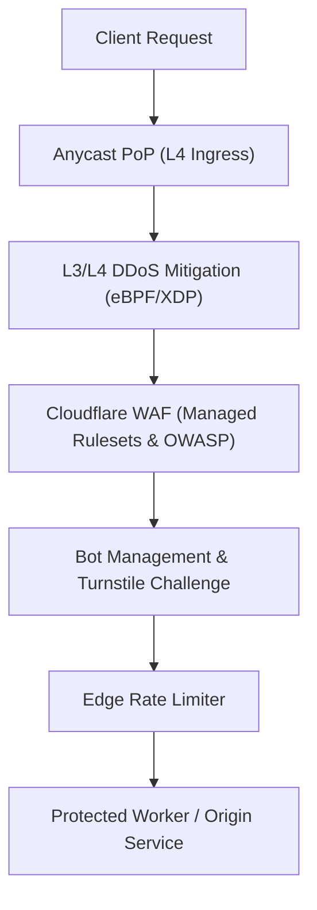
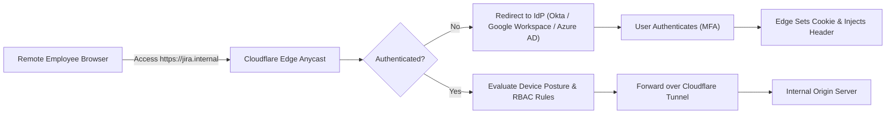
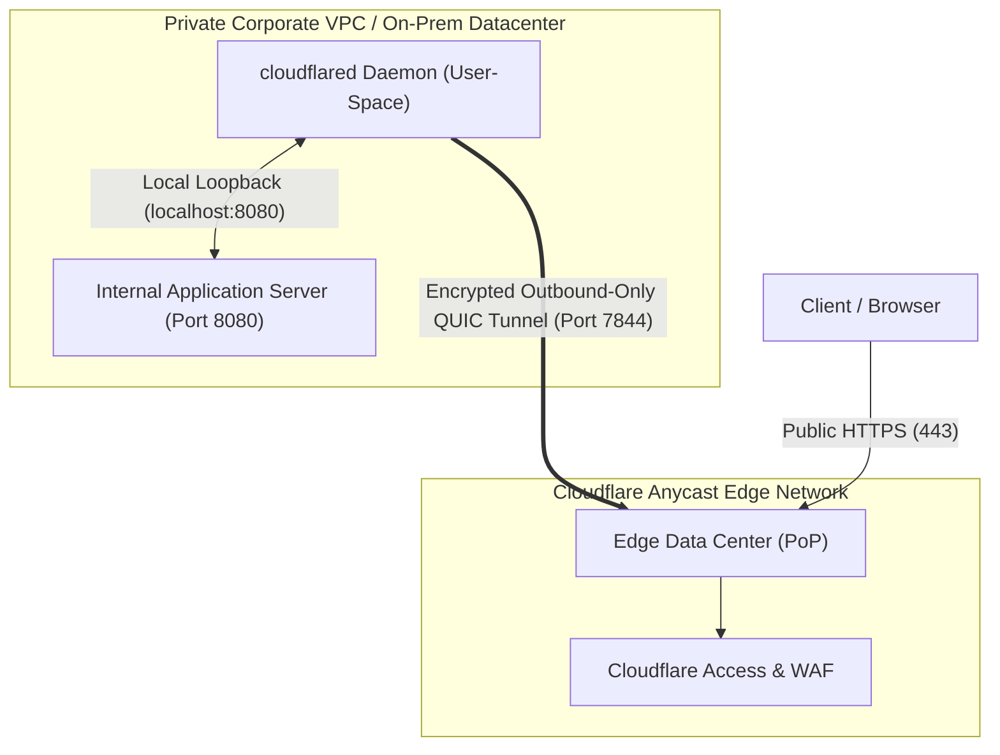
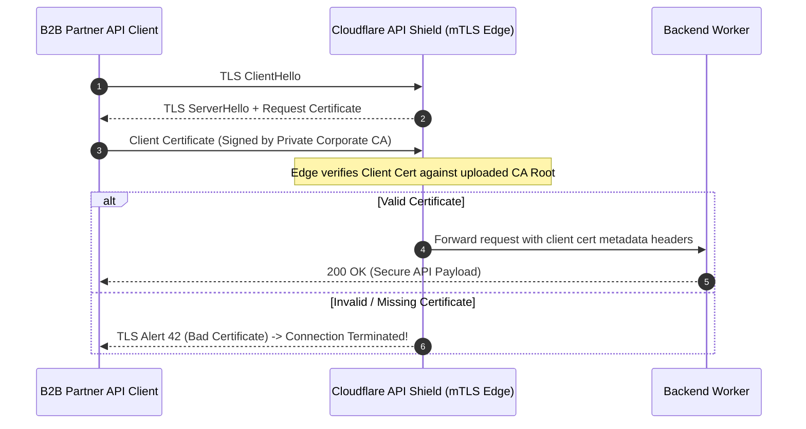

# Module 11: Security and Zero Trust

Security in modern distributed systems has migrated from static network perimeters (firewalls, VPNs, private subnets) to identity-aware edge proxies and cryptographically verified micro-tunnels. Cloudflare's security architecture operates at two distinct tiers: **Application Security** (WAF, DDoS mitigation, API Shield, Turnstile) and **Zero Trust Infrastructure** (Cloudflare Access, Cloudflare Tunnel, and WARP). This module explores how to secure edge Workers and origin infrastructure using these tools.

---

## 1. Application Security: Edge WAF, Rate Limiting, and Turnstile

Edge security evaluates traffic directly at Anycast ingress points before malicious requests consume origin bandwidth or Worker compute quotas.



### Turnstile Bot Mitigation

Cloudflare Turnstile replaces traditional interactive CAPTCHAs (image identification) with non-interactive cryptographic proof-of-work and behavioral signals.

- **Client Integration**:
  ```html
  <div class="cf-turnstile" data-sitekey="0x4AAAAAAABBBBBB12345"></div>
  ```
- **Worker Verification**:
  ```typescript
  export async function verifyTurnstileToken(
    secretKey: string,
    token: string,
    ip: string,
  ): Promise<boolean> {
    const formData = new FormData();
    formData.append('secret', secretKey);
    formData.append('response', token);
    formData.append('remoteip', ip);

    const res = await fetch('https://challenges.cloudflare.com/turnstile/v0/siteverify', {
      method: 'POST',
      body: formData,
    });

    const outcome = await res.json<{ success: boolean }>();
    return outcome.success;
  }
  ```

---

## 2. Cloudflare Access: Identity-Aware Proxy (IAP)

Cloudflare Access implements the BeyondCorp Zero Trust security model. Instead of relying on a slow, vulnerable corporate VPN, Access places an authentication gate directly at Cloudflare's Anycast edge in front of internal web apps, APIs, and SSH servers.



### Cryptographic JWT Verification in Workers

When a request passes Cloudflare Access, edge proxies attach an identity assertion JWT in the `Cf-Access-Jwt-Assertion` header. Applications and Workers must cryptographically verify this token to ensure requests were not spoofed by bypassing the proxy.

```typescript
import { createRemoteJWKSet, jwtVerify } from 'jose';

export interface Env {
  ACCESS_TEAM_NAME: string; // e.g. "mycompany"
  ACCESS_POLICY_AUD: string; // The Application AUD tag
}

export default {
  async fetch(request: Request, env: Env, ctx: ExecutionContext): Promise<Response> {
    const jwt = request.headers.get('Cf-Access-Jwt-Assertion');

    if (!jwt) {
      return new Response('Missing Cloudflare Access JWT Assertion', { status: 401 });
    }

    try {
      // Fetch public keys directly from Cloudflare Access JWKS endpoint
      const jwksUrl = new URL(
        `https://${env.ACCESS_TEAM_NAME}.cloudflareaccess.com/cdn-cgi/access/certs`,
      );
      const JWKS = createRemoteJWKSet(jwksUrl);

      // Verify signature, expiration, and audience tag
      const { payload } = await jwtVerify(jwt, JWKS, {
        issuer: `https://${env.ACCESS_TEAM_NAME}.cloudflareaccess.com`,
        audience: env.ACCESS_POLICY_AUD,
      });

      console.log(`Authenticated corporate user: ${payload.email}`);
      return new Response(`Welcome, ${payload.email}! Internal API Access Granted.`);
    } catch (err) {
      console.error('JWT Verification Failed:', err);
      return new Response('Invalid Security Assertion', { status: 403 });
    }
  },
};
```

---

## 3. Cloudflare Tunnel (`cloudflared`): Outbound-Only Micro-Tunnels

Exposing internal origin servers to the public internet requires opening firewall ports (80/443), exposing public static IP addresses, and risking direct-to-origin DDoS attacks. **Cloudflare Tunnel** eliminates public ingress completely.



### Core Architecture of `cloudflared`

1. **Outbound-Only Connectivity**: The `cloudflared` daemon runs inside the private network. It initiates outbound connections over UDP port 7844 (QUIC) or TCP port 443 (HTTP/2) to the nearest Cloudflare data centers.
2. **Zero Open Inbound Ports**: Corporate firewalls can block **all incoming TCP/UDP connections**. No public IP addresses are mapped to the origin machine.
3. **Automatic Reconnection and Multi-Route Failover**: If an edge link degrades, `cloudflared` automatically establishes redundant connections to neighboring edge data centers.

---

## 4. Mutual TLS (mTLS) and API Shield

For automated machine-to-machine (B2B) APIs, passwords and standard bearer tokens are vulnerable to interception and replay. **Mutual TLS (mTLS)** establishes cryptographic proof of client identity during the initial TLS handshake.



### Inspecting Client Certificates in Workers

In a Worker, client certificate metadata is accessible on the `request.cf` object:

```typescript
export default {
  async fetch(request: Request): Promise<Response> {
    const cert = request.cf?.tlsClientAuth;

    if (!cert || cert.certVerified !== 'SUCCESS') {
      return new Response('mTLS Authentication Required', { status: 403 });
    }

    const clientSubject = cert.certSubjectDN;
    console.log(`Verified mTLS Client DN: ${clientSubject}`);

    return new Response(`Authenticated B2B Client: ${clientSubject}`);
  },
};
```

---

## 5. Secrets Management and Mandated Host Boundaries

Workers execute inside secure software isolates. To prevent secret exfiltration:

- Secrets are encrypted at rest using envelope encryption and injected strictly into the `env` object at isolate runtime instantiation.
- Secrets must never be committed to git repositories or hardcoded in `wrangler.jsonc`.
- **Host Mandates**: All external API calls containing bearer tokens or credentials must enforce strict HTTPS host allowlists to prevent Server-Side Request Forgery (SSRF) data leaks.

---

## 6. Then vs Now: Edge Security Architecture

| Dimension | Then (Traditional VPN & Firewall 2018) | Now (Cloudflare Zero Trust 2026) | Why It Changed |
| --- | --- | --- | --- |
| Remote Access | Corporate IPSec / OpenVPN gateways | Identity-Aware Proxy (Cloudflare Access) | VPNs granted full subnet access upon breach; Access enforces least-privilege per-application identity policies. |
| Ingress Exposure | Open inbound firewall ports (80/443) and static public IPs | Outbound-only encrypted tunnels (`cloudflared`) | Open firewall ports were constantly scanned and targeted by zero-day vulnerability exploits. |
| Bot Mitigation | Annoying image CAPTCHA puzzles | Non-interactive cryptographic Turnstile | Interactive CAPTCHAs degraded user conversion rates and collected invasive user tracking data. |
| Machine Auth | Static API keys in HTTP headers | Mutual TLS (mTLS) with API Shield schema validation | API keys leaked frequently in code and logs; mTLS authenticates cryptographically at Layer 4/7. |

---

## 7. Production Gotchas and Edge Failure Modes

1. **Relying on Unverified `Cf-Access-Authenticated-User-Email` Headers**: Cloudflare Access injects plaintext identity headers (`Cf-Access-Authenticated-User-Email`). If your Worker or origin can be reached via an alternate domain or unauthenticated route, an attacker can spoof this header. Always cryptographically verify `Cf-Access-Jwt-Assertion`.
2. **Tunnel Daemon Network Congestion**: If `cloudflared` is deployed on an under-provisioned virtual machine without sufficient file descriptors (`ulimit -n`), high-concurrency traffic will cause tunnel drops and 502 Bad Gateway errors.
3. **Accidental WAF Rule Evaluation Order**: Placing a rate-limiting rule before an IP allowlist rule will inadvertently throttle trusted corporate webhooks or automated monitoring bots.

---

## 8. Architectural Case Study: Zero-Trust Administrative Bastion

```typescript
import { createRemoteJWKSet, jwtVerify } from 'jose';

export interface Env {
  TEAM_DOMAIN: string;
  APP_AUD: string;
  ADMIN_DO: DurableObjectNamespace;
}

export default {
  async fetch(request: Request, env: Env, ctx: ExecutionContext): Promise<Response> {
    // 1. Enforce mTLS or Access JWT
    const jwt = request.headers.get('Cf-Access-Jwt-Assertion');
    if (!jwt) {
      return new Response('Unauthorized Zero Trust Access', { status: 401 });
    }

    // 2. Validate cryptographic signature
    const JWKS = createRemoteJWKSet(
      new URL(`https://${env.TEAM_DOMAIN}.cloudflareaccess.com/cdn-cgi/access/certs`),
    );
    const { payload } = await jwtVerify(jwt, JWKS, {
      issuer: `https://${env.TEAM_DOMAIN}.cloudflareaccess.com`,
      audience: env.APP_AUD,
    });

    // 3. Enforce corporate email domain authorization
    const email = payload.email as string;
    if (!email.endsWith('@company.com')) {
      return new Response('Forbidden: Domain unauthorized', { status: 403 });
    }

    // 4. Dispatch to stateful administration actor
    const adminStub = env.ADMIN_DO.get(env.ADMIN_DO.idFromName('cluster-admin'));
    return await adminStub.fetch(request);
  },
};
```

---

## Interview Drill

<details><summary>1. Why is checking plaintext Access headers (such as `Cf-Access-Authenticated-User-Email`) insufficient for security, and how does `Cf-Access-Jwt-Assertion` resolve this?</summary>

Plaintext headers like `Cf-Access-Authenticated-User-Email` are set by Cloudflare Access after user login. However, if an attacker discovers a secondary route, bypasses the proxy, or crafts a direct request to the Worker or origin, they can trivially forge these plaintext headers. The `Cf-Access-Jwt-Assertion` header contains a cryptographically signed JSON Web Token (JWT) signed by Cloudflare's private key. The Worker verifies this JWT against Cloudflare's public certificates (JWKS), verifying the signature, expiration timestamp, and audience tag to prove the request genuinely passed through Access.

</details>

<details><summary>2. Explain the network security advantages of deploying Cloudflare Tunnel (`cloudflared`) over traditional port forwarding.</summary>

Traditional origin architectures require opening inbound ports (80/443) on border firewalls and advertising public static IP addresses. This exposes origin infrastructure to port scans, zero-day HTTP exploits, and direct-to-origin DDoS attacks that bypass CDN protections. Cloudflare Tunnel runs an outbound-only daemon (`cloudflared`) inside the private network that connects out to Cloudflare edge PoPs over QUIC or HTTP/2. The firewall can drop all incoming connection requests, eliminating public ingress and ensuring all traffic is filtered by Cloudflare WAF and Access before reaching the origin.

</details>

<details><summary>3. How does Cloudflare Turnstile detect automated bots without subjecting users to interactive puzzle challenges?</summary>

Turnstile uses non-interactive cryptographic challenges and browser behavioral telemetry. When embedded on a webpage, Turnstile runs a series of lightweight JavaScript proof-of-work calculations, checks browser environment execution markers, detects automation frameworks (like headless Puppeteer or Selenium), and analyzes network telemetry. Legitimate human users pass automatically in milliseconds without identifying distorted text or clicking fire hydrants, preserving privacy while blocking automated abuse.

</details>

<details><summary>4. What role does Mutual TLS (mTLS) play in API Shield, and at what layer of the networking stack does it enforce authentication?</summary>

Mutual TLS enforces cryptographic identity verification during the TLS handshake at Layer 4/7 before any HTTP application payload is processed. Both the client and server present X.509 digital certificates. Cloudflare API Shield validates the client's certificate against an uploaded authoritative Certificate Authority (CA) root. If the client certificate is missing, expired, or not signed by the trusted CA, the connection is aborted immediately at the Anycast edge, shielding backend Workers and origins from unauthenticated requests.

</details>

<details><summary>5. How does the BeyondCorp Zero Trust model implemented by Cloudflare Access differ from a traditional perimeter VPN?</summary>

A traditional corporate VPN uses a perimeter security model: once a user authenticates and enters the private network, they are granted broad Layer 3 network access to entire subnets, enabling lateral movement if their laptop is compromised. Cloudflare Access implements the BeyondCorp Zero Trust model, where no perimeter exists. Every corporate application is treated as public-facing, and every individual HTTP request is evaluated at the edge for user identity, multi-factor authentication (MFA), group membership, and device security posture before access to that specific application is granted.

</details>
