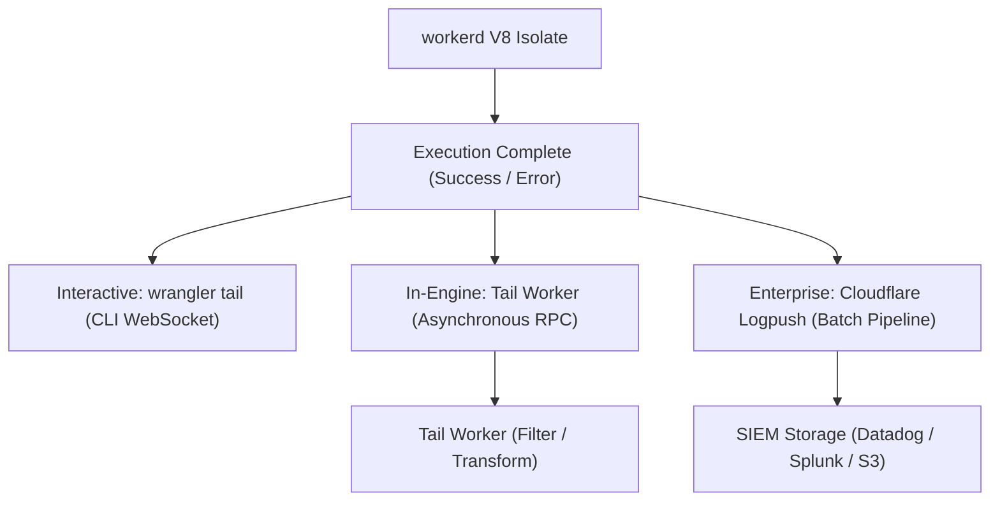
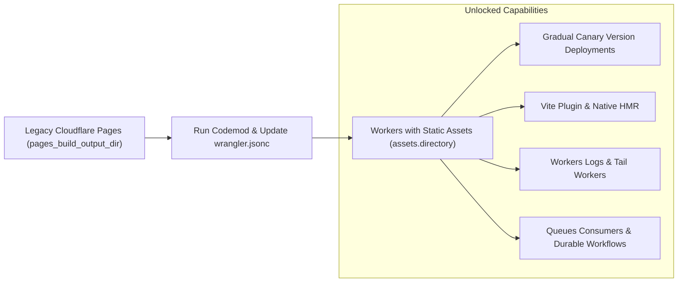

# Module 12: Observability, Limits, and Cost

Operating mission-critical systems at the edge requires rigorous observability, disciplined capacity planning against platform limits, and an accurate understanding of serverless economic models. This module details Cloudflare's telemetry pipelines (Workers Logs, Logpush, OpenTelemetry distributed tracing), platform resource quotas, the Workers Paid pricing model, the complete migration playbook from legacy Cloudflare Pages to modern Workers with Static Assets, and the historical architectural evolution of the platform.

---

## 1. Observability: Workers Logs, Logpush, and Distributed Tracing

Observability in an isolate-based edge runtime spans three distinct telemetry tiers:

1. **Interactive Real-Time Logs (`wrangler tail`)**: Streams live console logs and unhandled exceptions directly to developer terminals.
2. **Workers Logs & Tail Workers**: Automated ingestion of structured execution events and unhandled errors into customer-managed Workers or storage sinks.
3. **Cloudflare Logpush**: Enterprise high-throughput streaming pipelines that ship batched JSON log events to external SIEMs (Datadog, Splunk, BigQuery, Snowflake, AWS S3) in near real-time.



### Distributed Tracing (OpenTelemetry)

Modern Workers support distributed tracing via OpenTelemetry (OTel). Trace contexts (`traceparent` headers per W3C Trace Context) propagate seamlessly across edge subrequests, enabling end-to-end distributed span visualization.

```typescript
export default {
  async fetch(request: Request, env: Env, ctx: ExecutionContext): Promise<Response> {
    const traceparent = request.headers.get('traceparent');

    // Initiate or continue distributed span
    const spanContext = parseTraceparent(traceparent);

    const childHeaders = new Headers(request.headers);
    if (spanContext) {
      childHeaders.set('traceparent', generateChildTraceparent(spanContext));
    }

    const response = await fetch('https://api.internal/v1/orders', {
      headers: childHeaders,
    });

    return response;
  },
};
```

---

## 2. Platform Resource Quotas and Limits

Architecting resilient edge services requires designing within `workerd`'s hard resource boundaries.

| Resource / Quota | Free Plan | Paid Standard / Enterprise Plan | Failure Outcome When Exceeded |
| --- | --- | --- | --- |
| Max Isolate Memory Heap | 128 MB | 128 MB per isolate | V8 OOM: Error 1102 (`Worker Exceeded Resource Limits`) |
| CPU-Time Quota per Request | 10 ms active CPU | 30 s default (up to 5 min for Workflows/Queues) | Runtime termination: Error 1102 |
| Wall-Clock Execution Time | Capped only by client timeout | Capped only by client timeout | Client connection reset or 524 Gateway Timeout |
| Subrequests per Request | 50 subrequests | 1,000 subrequests (up to 10,000 on Enterprise) | Runtime exception: Subrequest quota exceeded |
| Max Concurrent Outbound Sockets | 6 connections | 6 connections waiting for headers | Outbound fetches queue silently, spiking TTFB |
| Script Bundle Size (Uncompressed) | 1 MB | 64 MB uncompressed (`workerd` bundled limit) | Deployment rejection during `wrangler deploy` |
| Script Bundle Size (Compressed) | 1 MB | 10 MB gzipped upload limit | Deployment rejection during `wrangler deploy` |
| Startup Time Limit | 100 ms | 400 ms (up to 1 s on Enterprise) | Isolate instantiation failure |

---

## 3. Serverless Economic Model: Cost and Quota Optimization

Cloudflare Workers differs from traditional cloud compute (AWS Lambda / EC2) by billing active **CPU-milliseconds** rather than total wall-clock execution duration.

### Cost Model Components

1. **Request Invocations**: Billed per million requests.
2. **CPU-Time (Duration)**: Billed per million CPU-milliseconds consumed by the isolate. Time spent awaiting external I/O (database queries, network subrequests) consumes **0 ms CPU** and incurs no compute cost.
3. **Durable Objects Billing**:
   - Active compute duration (GB-seconds of memory allocated while the DO isolate is awake).
   - Storage volume (GB-months of SQLite storage).
   - Read/write storage units.
4. **WebSocket Hibernation Savings**:
   - Holding 10,000 idle WebSockets open with traditional compute costs hundreds of dollars per month in memory duration.
   - With WebSocket Hibernation, idle connections consume **$0.00 in memory duration**, waking the actor only when messages arrive.

---

## 4. Migration Playbook: Legacy Cloudflare Pages to Workers with Static Assets

Cloudflare Pages has unified under the Cloudflare Workers platform. Migrating existing static sites and full-stack Pages Functions to modern Workers with Static Assets provides access to the Vite plugin, gradual version deployments, Workers Logs, and unified bindings.



### Step-by-Step Migration Checklist

1. **Update `wrangler.jsonc`**: Replace the legacy Pages configuration with the `assets` block:
   ```jsonc
   {
     "name": "corporate-portal",
     "compatibility_date": "2026-11-01",
     "compatibility_flags": ["nodejs_compat"],
     "assets": {
       "directory": "./dist",
       "binding": "ASSETS",
       "not_found_handling": "single-page-application",
       "run_worker_first": false,
     },
     "main": "src/index.ts",
   }
   ```
2. **Port Routing and Ports**:
   - Local dev server moves from legacy port `8788` (`wrangler pages dev`) to standard port `8787` (`wrangler dev`).
   - Static asset exclusion is configured via `.assetsignore` rather than custom build scripts.
3. **Custom Domain Prerequisite**:
   - Pages permitted external DNS CNAME pointing to Pages custom domains.
   - Workers custom domains require the apex zone to be hosted on Cloudflare authoritative nameservers. Ensure DNS delegation is complete prior to cutover.

---

## 5. Architectural Evolution: Version History and Feature Timeline

| Version / Date | Milestone | Architectural Significance |
| --- | --- | --- |
| **2018-02** | Workers Launch | Introduced V8 isolates at the edge; sub-millisecond cold starts replacing container microVMs. |
| **2019-05** | Workers KV Launch | Distributed key-value store with eventual consistency and Anycast edge caching. |
| **2021-06** | Durable Objects GA | Actor model at the edge providing globally unique, single-threaded state and strong consistency. |
| **2022-05** | `workerd` Open Source | Open-sourced the V8-based application server powering Cloudflare Workers under Apache 2.0. |
| **2022-09** | Cloudflare R2 GA | S3-compatible zero-egress object storage eliminating cloud vendor egress fees. |
| **2022-11** | Cloudflare Queues Launch | At-least-once distributed message broker with native batching and dead-letter routing. |
| **2023-05** | D1 Relational SQL Beta | Distributed serverless SQLite with single-primary writes and global read replicas. |
| **2023-09** | Hyperdrive GA | Global connection pooling and query acceleration for regional PostgreSQL and MySQL databases. |
| **2024-04** | D1 GA & SQLite in DO | D1 reached General Availability; Durable Objects transitioned from KV to embedded SQLite storage. |
| **2024-08** | `@cloudflare/vitest-plugin` | Replaced legacy `vitest-pool-workers`, enabling native `workerd` integration testing in Vitest 5+. |
| **2025-04** | Cloudflare Workflows GA | Durable execution engine with `step.do`, `step.sleep`, and deterministic replay backed by Durable Objects. |
| **2026-04** | Cloudflare Containers GA | Durable Object-fronted Linux containers at the edge for non-JavaScript runtimes and legacy binaries. |
| **2026-10** | Jurisdiction Workflows & v5 Terraform | Added EU/US jurisdiction controls for Workflows; stabilized Stainless-generated Terraform Provider v5. |

---

## 6. Then vs Now: Operational Paradigms

| Dimension | Then (Edge Operations 2018) | Now (Modern Observability 2026) | Why It Changed |
| --- | --- | --- | --- |
| Logging Pipelines | Ephemeral console logging in dashboard only | Workers Logs + Logpush streaming to SIEMs + Tail Workers | Enterprise compliance and security forensics require durable, searchable audit logs. |
| Deployment Safety | Instant 100% global traffic cutover | Canary Version Deployments with sub-second rollbacks | Atomic global updates risked enterprise outages if edge code had regression bugs. |
| Static Sites | Disjointed Cloudflare Pages platform | Unified Workers with Static Assets | Fragmented tooling confused developers; unification brings the full power of Workers to static sites. |
| Trace Propagation | Ad-hoc custom correlation IDs | Native OpenTelemetry W3C Trace Context propagation | Enables seamless distributed tracing across microservices, databases, and third-party APIs. |

---

## 7. Production Gotchas and Edge Failure Modes

1. **Memory Ceiling (128 MB) During Log Serialization**: Accumulating massive execution traces in memory and attempting to serialize a 20 MB JSON log object in a Tail Worker will exhaust the 128 MB V8 heap limit. Stream logs in smaller chunks.
2. **Subrequest Limit Violations on Batch Processing**: Iterating through 2,000 records in a queue batch and issuing a separate `fetch()` or D1 query for each item will violate the 1,000 subrequest ceiling. Batch database queries using `db.batch()`.
3. **Zod <4.5 Prototype Exhaustion**: Using legacy Zod schema libraries causes high memory allocation during type parsing, risking premature Error 1102 terminations in tight memory envelopes.

---

## 8. Architectural Case Study: Enterprise Logpush Pipeline with Masking

```typescript
export interface Env {
  AUDIT_LOGS: AnalyticsEngineDataset;
}

export default {
  async fetch(request: Request, env: Env, ctx: ExecutionContext): Promise<Response> {
    const startTime = Date.now();
    const cfRay = request.headers.get('cf-ray') ?? 'unknown';

    const response = await fetch(request);

    // Asynchronously record sanitized execution telemetry to Logpush / Analytics Engine
    ctx.waitUntil(
      recordExecutionTelemetry(env, {
        cfRay,
        path: new URL(request.url).pathname,
        status: response.status,
        durationMs: Date.now() - startTime,
        clientIp: maskIp(request.headers.get('cf-connecting-ip') ?? '0.0.0.0'),
      }),
    );

    return response;
  },
};

function maskIp(ip: string): string {
  // Anonymize IP to comply with GDPR data minimization
  const parts = ip.split('.');
  if (parts.length === 4) {
    return `${parts[0]}.${parts[1]}.0.0`;
  }
  return 'masked-ipv6';
}

async function recordExecutionTelemetry(env: Env, data: Record<string, unknown>): Promise<void> {
  // Ships structured metric points to Cloudflare Analytics Engine
  env.AUDIT_LOGS.writeDataPoint({
    blobs: [data.cfRay as string, data.path as string, data.clientIp as string],
    doubles: [data.status as number, data.durationMs as number],
  });
}
```

---

## Interview Drill

<details><summary>1. Differentiate between CPU time and wall-clock time in Cloudflare Workers pricing and limits.</summary>

CPU time measures the actual clock cycles consumed by the server CPU while executing the Worker's JavaScript code. Wall-clock time measures the total elapsed real-world time from when the request was received until the response concluded. On the Workers Paid plan, compute billing is calculated strictly on CPU-milliseconds consumed. Time spent waiting for external network responses (such as a database query or external API fetch) consumes zero CPU cycles and incurs zero compute cost, subject only to client connection timeouts.

</details>

<details><summary>2. What is the operational purpose of Cloudflare Logpush, and how does it differ from `wrangler tail`?</summary>

`wrangler tail` is an interactive debugging tool that streams live console logs via a temporary WebSocket connection directly to a developer's terminal. It is sampled, ephemeral, and unsuited for compliance or auditing. Cloudflare Logpush is a fully managed enterprise streaming pipeline that batches structured JSON execution logs from all global edge data centers and pushes them reliably to external SIEMs and cloud storage (e.g., Datadog, Splunk, BigQuery, AWS S3) within seconds, guaranteeing complete audit trails for security and operational analysis.

</details>

<details><summary>3. Why did Cloudflare deprecate `vitest-pool-workers` in favor of `@cloudflare/vitest-plugin`?</summary>

`vitest-pool-workers` implemented a custom test pool runner that was tightly coupled to Vitest 4 internal APIs. When Vitest 5 was released, the custom pool model broke, causing dependency conflicts and preventing developers from upgrading. Cloudflare rebuilt the integration as `@cloudflare/vitest-plugin`, which integrates cleanly as a standard Vite/Vitest plugin. It supports Vitest 5+, executes tests natively inside `workerd`, and provides isolated per-test storage environments with higher stability.

</details>

<details><summary>4. What are the key migration steps when transitioning a project from Cloudflare Pages to Workers with Static Assets?</summary>

Migration involves: (1) Updating `wrangler.jsonc` by replacing `pages_build_output_dir` with the `assets` object specifying `"directory": "./dist"` and `"binding": "ASSETS"`; (2) Switching the local development port from `8788` to `8787`; (3) Porting Pages Functions into standard Worker `fetch` handlers or `WorkerEntrypoint` RPC classes; (4) Ensuring the custom domain's DNS is managed on Cloudflare authoritative nameservers, as Workers custom domains require Cloudflare-managed DNS zones unlike legacy Pages external CNAME setups.

</details>

<details><summary>5. What resource limits trigger an Error 1102, and what architectural refactorings resolve it?</summary>

Error 1102 is triggered when an isolate exceeds its active CPU-time limit (10 ms on Free, 30 s default on Paid) or exceeds the 128 MB V8 heap memory ceiling. To resolve CPU exhaustion, heavy synchronous compute (such as complex image processing or catastrophic regexes) should be refactored into streaming WebAssembly or offloaded to Cloudflare Containers. To resolve memory heap exhaustion, large payloads must be processed as chunks using `TransformStream` rather than buffered in `ArrayBuffer` instances, and dependencies like Zod should be upgraded to version 4.5.0+ to reduce prototype allocation overhead.

</details>
