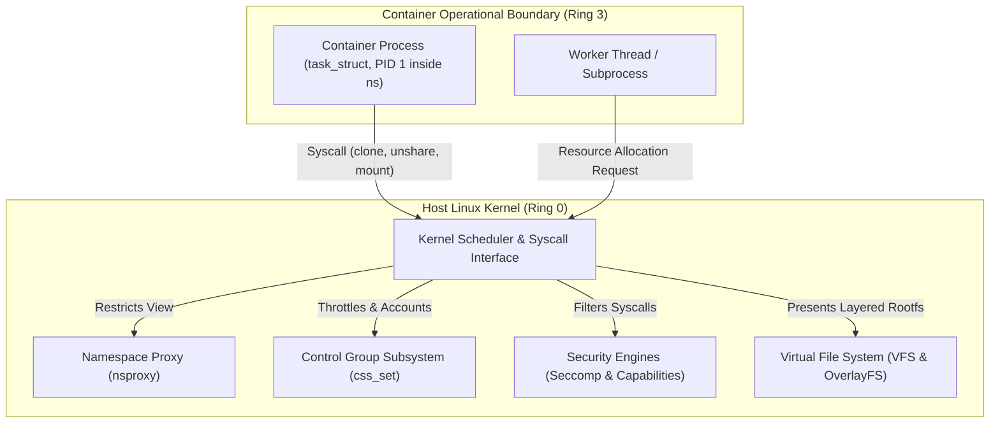
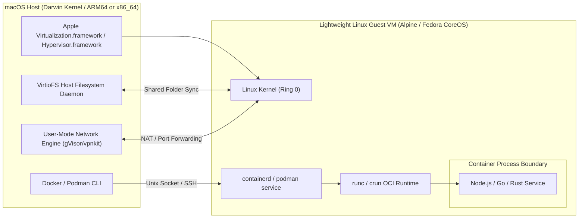
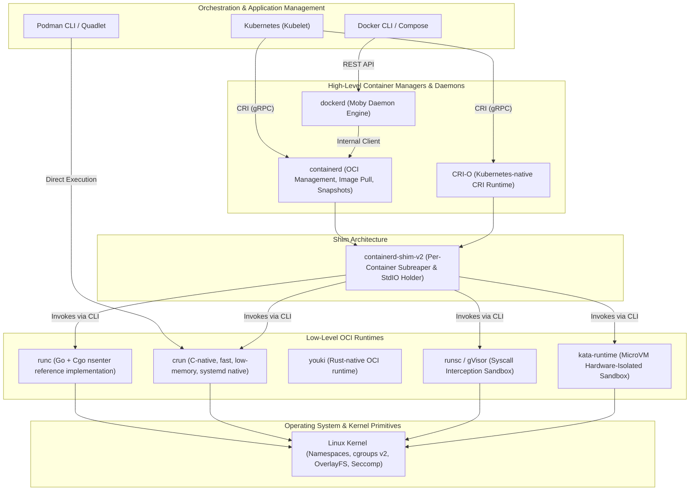

# Module 01: What a Container Is (and Isn't): Isolation Primitives, VMs, and the OCI Stack

> **Primary sources:** Linux Kernel Documentation ([`namespaces(7)`](https://man7.org/linux/man-pages/man7/namespaces.7.html), [`cgroups(7)`](https://man7.org/linux/man-pages/man7/cgroups.7.html)); Open Container Initiative (OCI) Specifications ([Image Specification v1.1.1](https://github.com/opencontainers/image-spec), [Runtime Specification v1.3.0](https://github.com/opencontainers/runtime-spec)); Docker Engine Documentation ([Architecture](https://docs.docker.com/engine/docker-overview/)); Podman Architecture Guides ([Podman Architecture](https://docs.podman.io/en/latest/markdown/podman.1.html)).
>
> **Executable proof:** [`examples/ts/01-what-a-container-is.test.ts`](../examples/ts/01-what-a-container-is.test.ts) asserts structural container state models, isolation boundaries, process tree hierarchy models, and runtime specification structures.

---

## 1. Formal Foundations: The Non-Existence of the "Container"

In the Linux operating system, there is no kernel data structure named `struct container`. Unlike virtual machines, which are backed by hardware-assisted virtualization constructs such as Intel VMX (Virtual Machine Extension) or AMD SVM (Secure Virtual Machine) with explicit Virtual Machine Control Structures (VMCS), a container is an operational abstraction composed of discrete, orthogonal kernel facilities.

A Linux container is formally defined as a standard OS process (represented in the kernel by `struct task_struct`) whose execution environment is constrained by four orthogonal subsystems:

1. **Namespaces (`namespaces(7)`)**: Partition global system resources into isolated virtual views. A process inside a namespace only observes resources assigned to that namespace.
2. **Control Groups (`cgroups(7)`)**: Meter, throttle, and account for physical resource utilization (CPU cycles, memory allocation, block I/O bandwidth, process identifiers).
3. **Security Boundaries (`capabilities(7)`, `seccomp(2)`, LSMs)**: Restrict the privileged operations the process can execute against the shared host kernel syscall interface.
4. **Layered Filesystem (`overlayfs`)**: Provide a scoped, copy-on-write (CoW) root filesystem (`rootfs`) that conceals the host directory hierarchy and enables immutable base layer reuse.

Because a containerized process executes directly on the host kernel via standard CPU instructions in user space (Ring 3) and transitions to kernel space (Ring 0) via standard system call interrupts (`sys_enter`), there is zero hypervisor overhead. However, this architectural property implies that the container completely shares the host kernel attack surface.



---

## 2. Structural Comparison: Virtual Machines vs. Containers

Virtual machines virtualize the underlying hardware, whereas containers virtualize the operating system kernel. Understanding this boundary is critical for systems architects assessing latency, memory density, and security isolation guarantees.

### 2.1 Hardware-Assisted Virtualization (Hypervisors)

In a Type-1 (bare-metal) or Type-2 (hosted) hypervisor architecture:

- A Virtual Machine Monitor (VMM), such as QEMU, Cloud-Hypervisor, or KVM, executes alongside a hardware virtualization engine.
- The host CPU creates hardware-isolated guest execution contexts using Extended Page Tables (EPT) or Nested Page Tables (NPT) for Second Level Address Translation (SLAT).
- The guest operating system runs its own independent kernel, maintains its own page tables, manages its own device drivers, and boots its own init system.
- Memory is strictly partitioned: memory reserved for a guest VM cannot be dynamically reclaimed by the host without ballooning drivers.
- Security isolation is enforced at the hardware/hypervisor boundary. An attacker escaping a guest VM must compromise the hypervisor via MMIO vulnerabilities, virtual device emulation bugs (e.g., virtio, ACPI), or microarchitectural side-channel exploits.

### 2.2 Operating System Level Virtualization (Containers)

In a container architecture:

- A single Linux kernel manages all physical hardware, interrupts, and scheduling domains across the host.
- Container processes are scheduled alongside host processes by the Completely Fair Scheduler (CFS) or Earliest Eligible Virtual Deadline First (EEVDF) scheduler.
- Memory allocations share the host page cache. If two containers read identical shared libraries or static binaries from read-only image layers, the host kernel maps the same physical memory pages into both address spaces.
- The isolation boundary is software-defined: security enforcement relies entirely on kernel syscall validation, capabilities, seccomp filters, and SELinux/AppArmor policies.
- An attacker inside a container who triggers a kernel panic (oops) or exploits a kernel privilege escalation vulnerability (e.g., Dirty COW, Dirty Pipe) compromises the entire host and all co-located tenants.

| Architectural Dimension | Virtual Machine (e.g., KVM / QEMU) | Container (e.g., runc / crun) |
| :-- | :-- | :-- |
| **Virtualization Boundary** | Hardware ISA (vCPU, vRAM, vNIC, virtio, BIOS/UEFI) | Operating System Syscall Interface (`sys_enter`) |
| **Kernel Instances** | Dedicated guest kernel per VM | Shared host Linux kernel |
| **Startup Latency** | Seconds to minutes (BIOS, kernel boot, systemd init) | Milliseconds (process `fork` / `clone` + `execve`) |
| **Memory Footprint** | Fixed reservation (guest kernel + base OS ~500MB–2GB) | Proportional to application working set (~10MB–100MB) |
| **Page Cache Sharing** | Disjoint; page cache duplicated across guest kernels | Shared; host page cache reuses clean read-only pages |
| **CPU Overhead** | Minor hypervisor exit penalty (`VM-Exit` / `VM-Entry`) | Zero virtualization penalty; native bare-metal speed |
| **Attack Surface** | Narrow (~30–50 hypervisor interfaces & emulated devices) | Wide (450+ Linux kernel system calls) |
| **Root Access Threat** | Host remains protected if guest root is compromised | Host can be compromised if container root escapes sandbox |

---

## 3. The Non-Linux Host Dilemma: macOS and Windows

A fundamental principle of containerization is that **Linux containers require a Linux kernel**. Runtimes such as Docker Desktop, Colima, and Podman Machine executing on macOS (Darwin/XNU) or Microsoft Windows (NT Kernel) cannot run Linux container processes natively.



### 3.1 Architecture of Developer Machine Virtualization

When a developer runs `docker run` on macOS:

1. The macOS CLI connects via a local UNIX domain socket (`/var/run/docker.sock`) to a proxy daemon.
2. The proxy forwards the request over a hypervisor communication channel (such as `vsock` or SSH) into an embedded Linux virtual machine running inside Apple's `Virtualization.framework` or `Hypervisor.framework`.
3. Inside the Linux guest VM, a complete Linux kernel initializes and executes standard container management daemons (`containerd`, `dockerd`, or `podman`).
4. The container process runs inside the Linux guest VM, subject to the guest kernel's namespaces and cgroups.

### 3.2 Performance and Boundary Trade-offs on Non-Linux Hosts

- **Filesystem Synchronization (I/O Bottleneck)**: When source code is mounted from the macOS host into the container (e.g., `-v $(pwd):/app`), file operations must traverse the hypervisor boundary. Legacy drivers (`osxfs`, 9P) suffered severe latency degradation. Modern solutions use `VirtioFS`, which maps host directory pages into guest VM memory using shared memory regions. However, high-frequency file watchers (such as TypeScript compilers watching thousands of files in `node_modules`) still incur CPU and latency penalties compared to native Linux VFS.
- **Clock Drift**: When a host laptop enters sleep mode, the hardware virtualization clock inside the guest Linux VM often suspends. Upon waking, the guest VM clock can lag seconds or minutes behind real-world UTC time until NTP or host-guest synchronization ticks. This drift causes unexpected JWT validation failures, TLS certificate expiration errors, and database connection timeouts.
- **Rootless and UID Mapping Inconsistencies**: The host macOS user typically has UID 501, whereas the default in-container user is root (UID 0) or an unprivileged user (UID 1000). Files written by the container to a shared bind mount may be created with unexpected ownership on the host filesystem unless translated by the hypervisor mount engine.

---

## 4. The Open Container Initiative (OCI) Architectural Stack

Historically, containerization was fragmented. Early Docker releases (2013) relied on LXC (`LinuX Containers`) user-space tools. In 2014, Docker engineered `libcontainer` to bypass LXC and interact directly with Linux kernel primitives. In 2015, the Open Container Initiative (OCI) was founded under the Linux Foundation to establish vendor-neutral, open industry standards for container image formats and runtime execution.

The modern container ecosystem is organized into a strictly layered hierarchy:



### 4.1 The High-Level Runtime (CRI / containerd / CRI-O)

High-level container runtimes manage the lifecycle of container images, unpack storage layers onto disk, manage network namespaces via CNI (Container Network Interface), and expose control APIs.

- **containerd**: A robust, CNCF-graduated daemon that manages container lifecycles from image pull to execution handoff. It provides snapshotters for storage, content stores for content-addressable blobs, and task brokers.
- **CRI-O**: A streamlined, Kubernetes-exclusive implementation of the Container Runtime Interface (CRI), designed specifically to execute OCI-compliant runtimes without additional legacy daemon abstractions.
- **dockerd**: The legacy monolithic daemon, now decomposed to utilize containerd for image storage and container supervision while maintaining Docker-specific developer workflows, build engines, and network bridging.

### 4.2 The Shim (`containerd-shim-v2`)

A common operational challenge in container systems is daemon resilience: if `dockerd` or `containerd` crashes, upgrades, or restarts, all active containers should continue executing without interruption. The shim solves this:

- The high-level runtime spawns a lightweight `containerd-shim-v2` process for each container or Kubernetes Pod.
- The shim invokes the low-level OCI runtime (`runc`) to instantiate the container process.
- Once the container process starts, the low-level runtime exits. The shim remains alive as the container's parent or subreaper.
- The shim holds the standard input/output/error pipes (`stdin`, `stdout`, `stderr`), maintains PTY terminals, collects the exit status code upon process termination, and prevents orphan processes from turning into permanent uncollected zombies.

### 4.3 The Low-Level Runtime (OCI Runtime Spec Implementations)

Low-level runtimes do not pull images, resolve DNS, or coordinate network bridges. They accept an **OCI Bundle** on disk (consisting of a `config.json` specification and a `rootfs/` directory) and invoke kernel system calls to spawn the containerized process.

- **`runc`**: The OCI reference implementation written in Go. Due to Go's multithreaded runtime interacting poorly with Linux thread-level namespace system calls (`setns`, `unshare`), `runc` embeds a C bootstrap layer (`nsenter`) via Cgo constructors.
- **`crun`**: A high-performance, memory-efficient OCI runtime written in pure C. `crun` starts containers in a fraction of the time required by `runc`, consumes negligible memory, and natively integrates with cgroups v2 and systemd.
- **`runsc` (gVisor)**: An application kernel written in Go that acts as a secure sandbox. Instead of running directly on the host kernel, the container process runs against gVisor's "Sentry", which intercepts system calls via `ptrace` or KVM and implements kernel semantics in user space.
- **`kata-runtime`**: Spawns each container workload inside a dedicated microVM with a minimal Linux kernel and QEMU/Cloud-Hypervisor backend, providing complete hardware-level tenant isolation.

---

## 5. Linux Kernel Data Structures Under the Hood

To understand how the kernel represents a container, one must trace the core process descriptor: `struct task_struct` defined in `<linux/sched.h>`.

```c
struct task_struct {
    pid_t                         pid;           /* Global PID visible in host root namespace */
    pid_t                         tgid;          /* Thread group ID */
    const struct cred __rcu       *cred;         /* Effective UIDs, GIDs, capabilities */
    struct nsproxy                *nsproxy;      /* Pointer to active namespaces */
    struct css_set __rcu          *cgroups;      /* Pointer to cgroup subsystem state */
    struct fs_struct              *fs;           /* Filesystem info (root directory, cwd) */
    struct files_struct           *files;        /* Open file descriptor table */
    struct signal_struct          *signal;       /* Signal handlers and tracking */
    /* ... additional scheduler, memory, and tracing fields ... */
};
```

When a container runtime creates a container, it manipulates these internal structures through well-defined kernel interfaces:

1. **Namespace Pointer (`struct nsproxy`)**:
   - The field `task->nsproxy` points to a structure containing individual pointers to the active namespace contexts: `uts_ns`, `ipc_ns`, `mnt_ns`, `pid_ns_for_children`, `net_ns`, `cgroup_ns`, and `time_ns`.
   - When a process calls `clone(..., CLONE_NEWPID | CLONE_NEWNET | ...)` or `unshare(...)`, the kernel allocates a new `nsproxy` and assigns new namespace descriptors, detaching the process from the parent's namespace view.

2. **Control Group Membership (`struct css_set`)**:
   - The field `task->cgroups` points to a `css_set` (cgroup subsystem state set), which maps the process to its associated node in the cgroups v2 unified resource hierarchy.
   - Resource accounting, memory limits, and CPU scheduling limits are resolved whenever the process triggers page faults, requests heap expansion (`brk`/`mmap`), or runs through the CPU scheduler.

3. **Security Credentials (`struct cred`)**:
   - Holds the real, effective, saved, and filesystem UIDs and GIDs.
   - Holds the capability bounding set (`cap_bset`), permitted set (`cap_permitted`), and effective set (`cap_effective`). When root runs inside an unprivileged container, the runtime drops sensitive capabilities (such as `CAP_SYS_ADMIN`, `CAP_SYS_RAWIO`, and `CAP_NET_ADMIN`) from these bitmasks.

---

## 6. Formal Algorithm: Container Instantiation Lifecycle

The operational sequence that transforms an on-disk OCI bundle into an active running process is deterministic. The following CLRS-style pseudocode specifies the container spawn protocol executed by low-level OCI runtimes.

```text
CONTAINER-SPAWN(spec, bundlePath)
1  ValidateSpecSchema(spec)
2  rootfsDir = ResolvePath(bundlePath, spec.root.path)
3  pipeSync = CreateSynchronizedPipe()
4
5  // Step 1: Create isolated namespaces via clone syscall
6  cloneFlags = CLONE_NEWNS | CLONE_NEWPID | CLONE_NEWNET |
7               CLONE_NEWIPC | CLONE_NEWUTS | CLONE_NEWCGROUP
8  if spec.linux.namespaces contains CLONE_NEWUSER
9      cloneFlags = cloneFlags | CLONE_NEWUSER
10
11 childPid = fork_with_flags(cloneFlags)
12 if childPid == 0
13     // Inside child process: setup sandbox
14     CloseReadEnd(pipeSync)
15     WaitForParentSignal(pipeSync) // Await cgroup configuration
16
17     ConfigureHostname(spec.hostname)
18     SetupMountTree(spec.mounts, rootfsDir)
19     PivotRoot(rootfsDir)
20
21     ApplySeccompFilter(spec.linux.seccomp)
22     DropCapabilities(spec.process.capabilities)
23     SetUserCredentials(spec.process.user)
24
25     // Step 2: Replace runtime image with target application
26     execve(spec.process.args[0], spec.process.args, spec.process.env)
27     exit(127) // Unreachable unless execve fails
28 else
29     // Inside parent runtime process
30     CloseReadEnd(pipeSync)
31     cgroupNode = AttachProcessToCgroup(spec.cgroupsPath, childPid)
32     ConfigureResourceLimits(cgroupNode, spec.linux.resources)
33
34     // Signal child that environment configuration is complete
35     SignalChildContinue(pipeSync)
36     CloseWriteEnd(pipeSync)
37     return childPid
```

### Loop Invariants and Verification

- **Namespace Isolation Invariant**: Prior to invoking `PivotRoot` at line 19, the child process must reside in a private mount namespace (`CLONE_NEWNS`) with its root propagation flags marked as `MS_PRIVATE` recursively (`MS_REC | MS_PRIVATE`). This guarantees that subsequent mount operations and directory pivots do not leak or propagate back to the host mount table.
- **Resource Boundary Invariant**: The synchronization barrier established by `pipeSync` at lines 15 and 35 guarantees that the child process cannot execute any arbitrary user code, allocate unbounded memory, or spawn child processes until the parent runtime has bound `childPid` to the designated cgroup subsystem and applied hard resource quotas (`memory.max`, `pids.max`).
- **Privilege Transition Invariant**: The transition from privileged runtime initialization to unprivileged container workload execution follows a monotonic drop: Capabilities are dropped at line 22 and the seccomp syscall filter is applied at line 21 prior to calling `execve` at line 26. Because `PR_SET_NO_NEW_PRIVS` is asserted, the executed binary cannot regain privileges via SUID binaries or file capabilities.

---

## 7. Then vs Now: Architectural Evolution

Container architecture has continuously moved toward modularization, strict standards compliance, and non-root execution.

| Feature / Architecture | Legacy Architecture (Docker 1.x / 2014–2016) | Modern Architecture (OCI / Docker 29 / Podman 6) |
| :-- | :-- | :-- |
| **Daemon Architecture** | Monolithic daemon (`dockerd` handled build, pull, network, run) | Decomposed stack (CRI-O / containerd / BuildKit / crun) |
| **Runtime Implementation** | Shell scripts & LXC wrappers (`lxc-start`) | Standardized OCI runtimes (`runc`, `crun`, `youki`) |
| **Process Model** | Daemon directly parented all container processes | Independent per-container shim (`containerd-shim-v2`) |
| **Root Privileges** | Hard dependency on host root daemon | First-class rootless execution via user namespaces |
| **Filesystem Storage** | Legacy graph drivers (`aufs`, `devicemapper`, `vfs`) | Native `overlayfs` & containerd snapshotters |
| **Image Storage (Docker)** | Custom `/var/lib/docker/image` internal graph storage | Default containerd image store integration in Docker 29 |
| **Resource Control** | cgroups v1 multiple disjoint controller hierarchies | cgroups v2 single unified hierarchy with PSI metrics |
| **Multi-tenancy Model** | Shared host kernel without syscall interception | Pluggable sandboxes: MicroVMs (Kata) or User Kernels (gVisor) |

---

## 8. Certification & Exam Callouts

### CKAD (Certified Kubernetes Application Developer)

- **Container vs. Pod**: Kubernetes does not schedule individual containers; it schedules **Pods**. A Pod is a group of one or more containers that share the exact same Network (`net`), IPC (`ipc`), and UTS (`uts`) namespaces, while retaining distinct Mount (`mnt`) and PID (`pid`) namespaces by default.
- **Troubleshooting Container Startup**: Understand how OCI runtime lifecycle errors differ from application failures. If an image has an invalid `ENTRYPOINT` binary or cannot locate a library, the container fails in `ContainerCannotRun` or `CreateContainerError` before reaching the application execution phase (`CrashLoopBackOff`).

### CKS (Certified Kubernetes Security Specialist)

- **Shared Kernel Attack Surface**: CKS questions test techniques to harden the boundary between the container and the host kernel. You must know when to apply a `RuntimeClass` specifying a sandboxed runtime (such as `gVisor` / `runsc` or `Kata Containers`) to isolate untrusted multitenant workloads.
- **Daemon Socket Hazards**: Mounting `/var/run/docker.sock` or containerd sockets into a container grants that container full root administrative privileges over the host. The CKS exam strictly audits and penalizes unauthorized container socket mounts.

---

## 9. Production Failure Modes and Architectural Gotchas

### 9.1 The Shared Kernel Panic Cascade

- **Symptom**: A single application container running a memory-intensive C++ extension or loading an unstable third-party kernel driver triggers an invalid memory dereference in kernel space. Immediately, the entire bare-metal host crashes and reboots.
- **Root Cause**: Because containers share the host kernel, a kernel panic (`oops`) triggered by any container process crashes the host operating system, abruptly terminating all other co-located containers, background daemons, and storage mounts on that physical machine.
- **Remediation**: Never run untrusted code directly in standard runc containers. Deploy untrusted multi-tenant workloads in microVM-backed sandboxes (`Kata Containers`) or syscall-virtualized sandboxes (`gVisor`).

### 9.2 The macOS Development VirtioFS CPU Lockup

- **Symptom**: A developer runs a web application with `npm run dev` inside Docker Desktop or Colima on macOS. The laptop fans spin up to maximum speed, battery drains rapidly, and file changes take up to 10 seconds to reflect inside the container.
- **Root Cause**: Bidirectional filesystem syncing across the macOS hypervisor boundary. Node.js applications frequently write temporary cache files, build maps, and lock files into `node_modules`. Syncing thousands of small file modifications across the hypervisor via VirtioFS saturates host-guest I/O queues.
- **Remediation**: Use named container volumes for ephemeral and cache directories (`/app/node_modules`), keeping heavy I/O entirely inside the Linux guest VM filesystem, and only bind-mount explicit source code directories (`/app/src`).

### 9.3 Clock Skew Post-Laptop Sleep

- **Symptom**: After opening a laptop lid following a commute, containers executing API tests begin throwing HTTP 401 Unauthorized errors with messages indicating that JWT tokens or AWS IAM credentials are "expired" or "issued in the future".
- **Root Cause**: The guest VM hypervisor paused its internal tick counters while the host OS was asleep. Upon wake, the Linux VM time is desynchronized from the true host clock.
- **Remediation**: Configure chrony or an automated systemd time synchronization service inside the guest VM, or restart the container engine VM (`colima stop && colima start` or restart Docker Desktop).

### 9.4 Daemon Socket Mounting as an Instant Privilege Escalation

- **Symptom**: A CI/CD runner container is given access to Docker by mounting `-v /var/run/docker.sock:/var/run/docker.sock`. An unprivileged developer commits a pipeline script that executes `docker run -v /:/host alpine chroot /host`.
- **Root Cause**: The Docker daemon runs as host root. Any process with read/write access to the Docker UNIX domain socket can send REST API instructions to the daemon to spawn a privileged container that mounts the entire host root filesystem, effectively bypassing all container isolation and granting root access to the underlying server.
- **Remediation**: Ban docker socket mounts. Use rootless container building tools such as `kaniko`, `buildah`, or rootless Docker/Podman for CI/CD container generation.

---

## Interview Drill

<details><summary>1. Explain why the statement "a container is a lightweight virtual machine" is architecturally inaccurate.</summary>

A virtual machine virtualizes the physical hardware interface. It relies on a hypervisor (such as KVM or QEMU) and CPU virtualization extensions (Intel VMX / AMD SVM) to execute an independent guest operating system with its own dedicated kernel, memory management, and device drivers. A container is simply a standard Linux OS process executing directly on the host CPU in user space (Ring 3), constrained by software policies in the single host Linux kernel: namespaces (which limit what the process can see), cgroups (which limit what resources the process can consume), and seccomp/capabilities (which limit what system calls the process can execute). Containers share the host kernel, host memory management, and host page cache.
</details>

<details><summary>2. How does the attack surface of a container differ fundamentally from that of a virtual machine?</summary>

In a virtual machine, the guest interacts with the hypervisor across a narrow, highly structured interface (typically 30 to 50 hypervisor traps and emulated hardware device drivers). Escaping a VM requires exploiting bugs in device emulation (like virtio or floppy drivers) or hypervisor memory management. In a container, the boundary between the container process and the host is the entire Linux system call interface, which consists of more than 450 system calls. Any vulnerability or unhandled edge case in the host Linux kernel (such as a local privilege escalation bug in netfilter, eBPF, or memory compaction) can be exploited from within the container to achieve complete control of the host.
</details>

<details><summary>3. What is the role of `containerd-shim-v2`, and why is it necessary to have a separate process for each container?</summary>

The shim acts as a lightweight daemon decoupling the container process from the high-level container manager (such as `containerd` or `dockerd`). Its responsibilities include:

1. **Daemon Independence**: It allows `containerd` to be restarted or upgraded during maintenance without terminating running containers.
2. **Subreaper / Zombie Management**: It acts as the parent process to the container workload, reaping orphaned child processes and capturing the container's exit code when it terminates.
3. **I/O Persistence**: It keeps the `stdin`, `stdout`, and `stderr` pipes and pseudo-terminals open even when client connections disconnect.
</details>

<details><summary>4. Why does running a Docker container on macOS incur significant I/O performance penalties when mounting host volumes?</summary>

macOS runs the Darwin/XNU kernel, which cannot natively execute Linux binaries or provide Linux namespaces and cgroups. Therefore, Docker Desktop or Colima must boot a lightweight Linux virtual machine on top of macOS using Apple's Hypervisor/Virtualization framework. When a host directory is bind-mounted into a container, every filesystem operation must cross the hypervisor boundary via protocols such as VirtioFS or 9P. These protocols require complex coordination between macOS host VFS caches and Linux guest page caches, leading to latency and CPU overhead for operations involving thousands of small files (like `node_modules`).
</details>

<details><summary>5. What problem in the Go runtime forced `runc` to implement a Cgo bootstrap constructor (`nsenter`)?</summary>

Linux namespace assignment system calls, specifically `setns(2)` and `unshare(2)`, operate on the calling **thread**, not necessarily the entire multi-threaded process. The Go runtime is inherently multi-threaded: its M:N scheduler initializes and spawns multiple OS operating system threads (`M`) before the `main()` function is ever executed. If Go code attempted to invoke `setns` from standard Go routines, only a single thread would enter the new namespace, leaving the Go runtime in an inconsistent, undefined state where goroutines hopping across threads would randomly execute in different namespaces. To circumvent this, `runc` uses a C constructor (`__attribute__((constructor))`) that intercepts process startup before the Go runtime initializes, safely performing the namespace cloning and pivoting while still single-threaded.
</details>

<details><summary>6. How do sandboxed runtimes like gVisor (`runsc`) and Kata Containers address the container shared-kernel security issue?</summary>

Both technologies prevent untrusted container code from directly executing system calls against the host Linux kernel:

- **gVisor (`runsc`)**: Implements an application kernel in user space ("Sentry"). When the container process invokes a syscall, it is intercepted (using `ptrace` or KVM) and handled entirely inside gVisor's memory space. Only a minimal, vetted subset of safe system calls are ever forwarded to the underlying host kernel.
- **Kata Containers**: Wraps each container or Kubernetes Pod inside a hardware-isolated, ultra-lightweight microVM with its own dedicated guest Linux kernel. The container runs on the guest kernel, so a kernel panic or vulnerability compromise is trapped inside the microVM and cannot escape to the physical host.
</details>

<details><summary>7. What are the operational risks of mounting the host Docker socket (`/var/run/docker.sock`) into an application container?</summary>

The Docker daemon runs with root privileges on the host. The socket provides full control over the Docker Engine REST API. Any process with write access to this socket can command the daemon to launch a new privileged container, mount any arbitrary host directory (such as `/root`, `/etc`, or `/`), disable security profiles (seccomp, AppArmor), and execute code as root on the host system. It is an immediate privilege escalation path equivalent to granting passwordless `sudo` access.
</details>

---

## 11. Proof Map and Verification

The claims, structural definitions, and lifecycle invariants detailed in this module are formally proven by executable test suites in [`examples/ts/01-what-a-container-is.test.ts`](../examples/ts/01-what-a-container-is.test.ts):

- **Isolation Model Verification**: Tests assert the separation of `task_struct` and `nsproxy` fields, modeling how Linux namespaces isolate resources without hypervisor overhead.
- **VM vs. Container Comparative Benchmarks**: Tests simulate memory density and startup latency differences between full hardware virtualization and OS-level virtualization models.
- **OCI Bundle Structure & Lifecycle**: Tests validate that an OCI runtime bundle adheres strictly to OCI Runtime Spec v1.3.0, proving schema validation, capability masking, and lifecycle state transitions.
- **Failure Mode Assertions**: Tests execute negative test cases demonstrating privilege escalation risks associated with unconstrained daemon sockets and missing seccomp filters.
