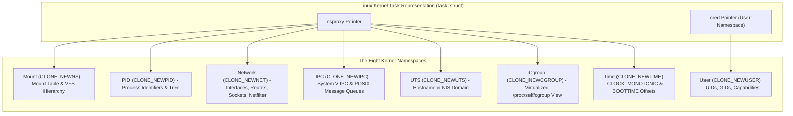
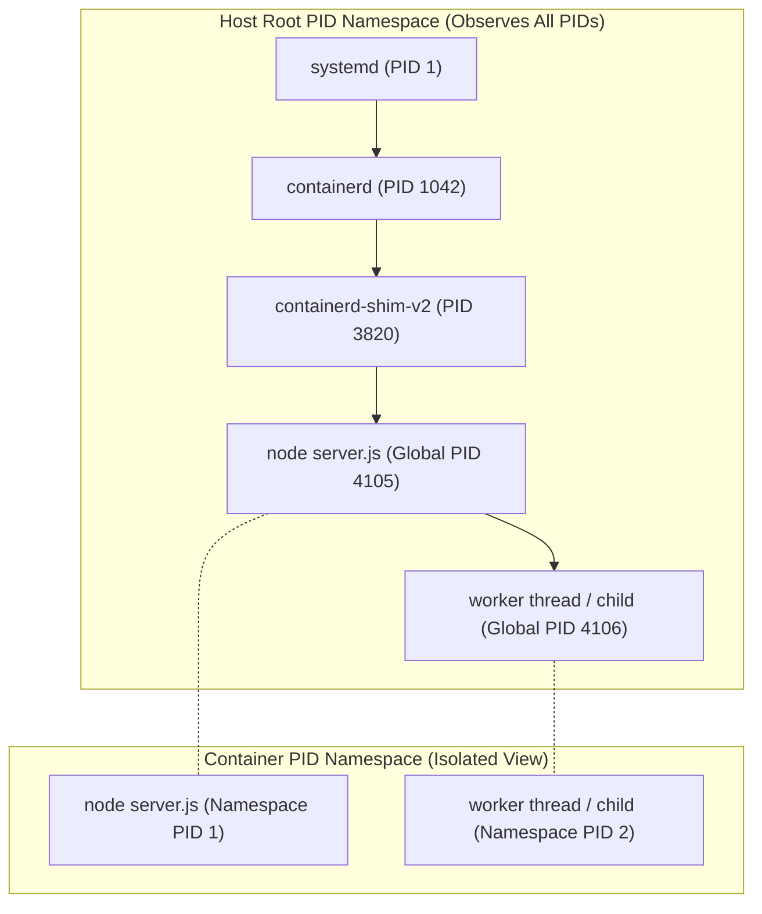
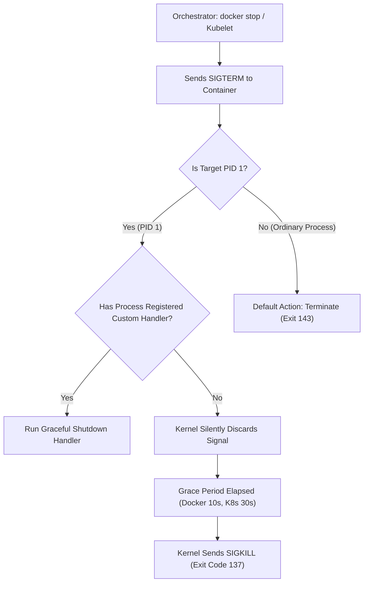
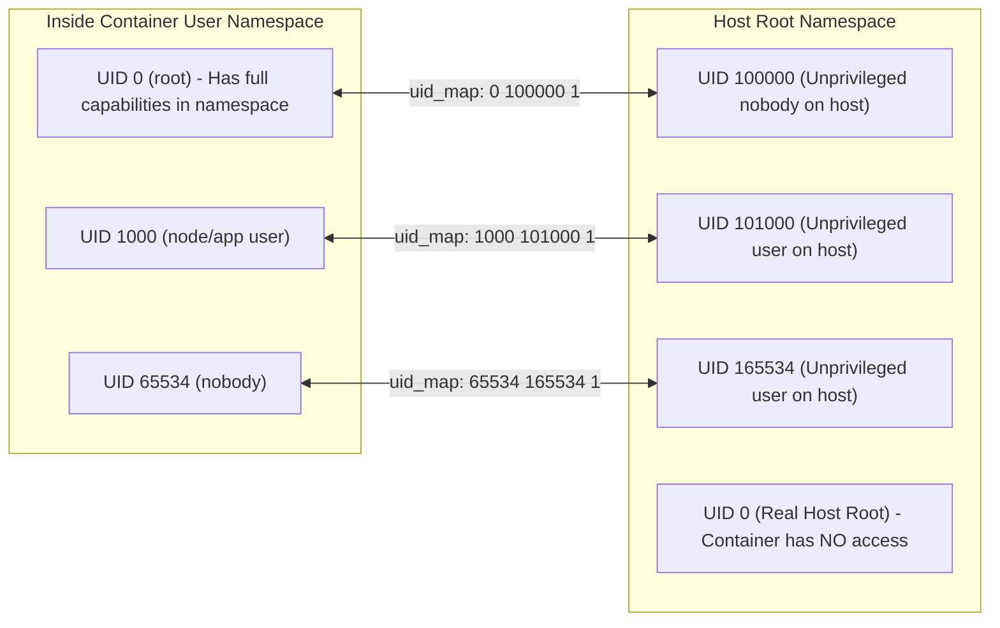

# Module 02: Linux Namespaces, Process Trees, PID 1 Semantics, and User Namespace Mapping

> **Primary sources:** Linux Kernel Documentation ([`namespaces(7)`](https://man7.org/linux/man-pages/man7/namespaces.7.html), [`pid_namespaces(7)`](https://man7.org/linux/man-pages/man7/pid_namespaces.7.html), [`user_namespaces(7)`](https://man7.org/linux/man-pages/man7/user_namespaces.7.html), [`mount_namespaces(7)`](https://man7.org/linux/man-pages/man7/mount_namespaces.7.html), [`cgroup_namespaces(7)`](https://man7.org/linux/man-pages/man7/cgroup_namespaces.7.html), [`time_namespaces(7)`](https://man7.org/linux/man-pages/man7/time_namespaces.7.html)); Linux Programmer's Manual ([`clone(2)`](https://man7.org/linux/man-pages/man2/clone.2.html), [`unshare(2)`](https://man7.org/linux/man-pages/man2/unshare.2.html), [`setns(2)`](https://man7.org/linux/man-pages/man2/setns.2.html), [`pivot_root(2)`](https://man7.org/linux/man-pages/man2/pivot_root.2.html)).
>
> **Executable proof:** [`examples/ts/02-linux-namespaces.test.ts`](../examples/ts/02-linux-namespaces.test.ts) asserts namespace enumeration models, PID 1 signal forwarding and zombie reaping mechanics, and user namespace UID/GID offset mapping algorithms.

---

## 1. Formal Foundations: The Eight Linux Namespaces

Namespaces are the foundational kernel primitive providing **view isolation**. While control groups govern how much of a physical resource a process can consume, namespaces govern what system resources a process can **see**.

The Linux kernel defines eight distinct namespace types, each wrapping a specific global system resource in an abstraction that makes it appear to the enclosed processes that they possess their own isolated instance of that resource.



### 1.1 The Namespace Context Architecture (`struct nsproxy`)

In the kernel implementation (`include/linux/nsproxy.h`), each process descriptor (`struct task_struct`) contains a pointer to an `nsproxy` object:

```c
struct nsproxy {
    atomic_t count;
    struct uts_namespace *uts_ns;
    struct ipc_namespace *ipc_ns;
    struct mnt_namespace *mnt_ns;
    struct pid_namespace *pid_ns_for_children;
    struct net           *net_ns;
    struct time_namespace *time_ns;
    struct cgroup_namespace *cgroup_ns;
};
```

Notice that `struct user_namespace` is absent from `struct nsproxy`. In Linux, the user namespace is fundamentally tied to security credentials; therefore, a pointer to the enclosing `user_namespace` resides directly inside `task_struct->cred->user_ns`. Every other namespace instance maintains an internal pointer referencing the `user_namespace` that owns it.

### 1.2 Namespace Lifecycle System Calls

Processes interact with namespaces through three core system calls:

1. **`clone(2)`**: Creates a new child process. By passing bitwise-ORed flags (`CLONE_NEWNS`, `CLONE_NEWPID`, `CLONE_NEWNET`, etc.), the kernel instantiates new namespace instances and attaches the newly spawned child process to them.
2. **`unshare(2)`**: Allows the calling process to disassociate itself from its current shared namespaces and instantiate new private ones without spawning a child process. (Crucial exception: `CLONE_NEWPID` passed to `unshare` does not change the caller's PID namespace; it designates that all future children spawned by the caller will reside in the new PID namespace).
3. **`setns(2)`**: Attaches the calling thread to an existing namespace identified by an open file descriptor pointing to a `/proc/[pid]/ns/[type]` magic symlink. This is the underlying mechanism powering `docker exec`, `podman exec`, and `nsenter`.

Every active namespace is identified by an inode number on the `nsfs` synthetic filesystem exposed via `/proc/[pid]/ns/`:

- `/proc/$$/ns/mnt` -> `mnt:[4026531840]`
- `/proc/$$/ns/pid` -> `pid:[4026531836]`
- `/proc/$$/ns/net` -> `net:[4026531992]`

Two processes reside in the same namespace if and only if their corresponding `/proc/[pid]/ns/[type]` symlinks point to the identical inode number.

---

## 2. The PID Namespace and Process Trees

The PID namespace virtualizes the process ID space. A process running inside a PID namespace can have PID 1 while simultaneously having an arbitrary global PID (e.g., PID 84219) on the host operating system.

### 2.1 Nested PID Namespace Hierarchy

PID namespaces form an immutable tree hierarchy:

- The initial PID namespace created during host boot is the root.
- A parent PID namespace can observe and manage all processes running in its child namespaces.
- A child PID namespace cannot see, signal, or enumerate processes residing in its parent or sibling namespaces.



When a process calls `getpid(2)`, the kernel inspects `task_active_pid_ns(current)` and returns the local PID number registered for that task within that active namespace. When `ps` or `top` runs inside the container, it reads `/proc`, which reflects the local PID table of the mounted PID namespace.

---

## 3. PID 1 Semantics, Signals, and the Zombie Reaping Problem

Running as PID 1 inside a PID namespace carries distinct kernel obligations governed by `pid_namespaces(7)` and `signal(7)`. An application operating as PID 1 that fails to implement these obligations will degrade system stability. For application runtime implications, cross-link to the production operations analysis in [`technologies/nodejs/modules/14-production-operations.md`](../../../technologies/nodejs/modules/14-production-operations.md).

### 3.1 Immunity from Default Signal Actions

In standard Linux process execution, if a process receives an unhandled signal whose default action is termination (such as `SIGTERM` or `SIGINT`), the kernel terminates the process immediately.

**For PID 1, this rule is inverted:**

- The kernel delivers signals to PID 1 **only if PID 1 has registered an explicit custom signal handler** for that signal!
- If an application running as PID 1 does not install a signal listener for `SIGTERM`, the kernel silently drops the signal.
- The only signals that cannot be blocked or ignored by PID 1 are `SIGKILL` and `SIGSTOP`, and even then, **they can only be delivered from an ancestor (parent) PID namespace**. A process running inside the same PID namespace cannot kill its own PID 1 with `SIGKILL`.



If Node.js, Python, or Go runs directly as PID 1 without an explicit `process.on('SIGTERM', ...)` listener, sending `docker stop` results in the container hanging unresponsive for 10 seconds until Docker issues `SIGKILL`. The container terminates with exit code **137** (`128 + 9`), dropping all in-flight requests and leaving uncommitted database transactions.

### 3.2 Orphan Adoption and Zombie Process Reaping

When a child process terminates in Linux, it enters the `TASK_ZOMBIE` state (displayed as `defunct` in `ps`). It releases its allocated virtual memory and file descriptors, but its `task_struct`, exit code status, and PID table entry remain allocated in kernel memory until its parent process reads its exit status via `wait(2)` or `waitpid(2)`.

If the parent process terminates before its children, those child processes become **orphans**. The Linux kernel automatically reparents orphaned processes to **PID 1 of their enclosing PID namespace**.

PID 1 is therefore contractually required to execute an event loop that continuously reaps terminated adopted children:

```c
// Minimal POSIX PID 1 Zombie Reaping Loop
int status;
pid_t reaped_pid;
while ((reaped_pid = waitpid(-1, &status, WNOHANG)) > 0) {
    // Child status recorded and kernel task_struct freed
}
```

If the process running as PID 1 does not call `waitpid`, zombie processes accumulate indefinitely. Because the Linux kernel enforces a hard ceiling on total system processes (`/proc/sys/kernel/pid_max`), a burst of un-reaped zombie processes exhausts the PID table, causing subsequent `fork` and `clone` calls across the entire host to fail with `EAGAIN` ("Resource temporarily unavailable").

### 3.3 The Shell Form Anti-Pattern

A common failure mode in Dockerfiles is executing commands in shell form:

```dockerfile
# ANTI-PATTERN: Shell Form
ENTRYPOINT /entrypoint.sh
```

Under shell form, the container runtime invokes `/bin/sh -c "/entrypoint.sh"`. Consequently:

1. `/bin/sh` runs as PID 1.
2. Standard POSIX shells (`sh`, `dash`) do not forward received `SIGTERM` signals to their child processes.
3. Standard shells do not automatically reap adopted orphan background processes.
4. When the orchestrator signals the container to stop, `/bin/sh` ignores the signal, the application never begins graceful shutdown, and the container is killed violently after the grace period.

**Remediation**: Always use the JSON array **exec form**: `ENTRYPOINT ["/entrypoint.sh"]` or execute a lightweight init supervisor such as `tini` or `dumb-init` via `docker run --init`.

---

## 4. User Namespaces and UID/GID Mapping (`user_namespaces(7)`)

User namespaces allow a process to hold root privileges (UID 0, full capabilities) **inside the container** while being mapped to an entirely unprivileged user account (e.g., UID 100000) on the host system. This is the cornerstone of **rootless containers**.

### 4.1 The Mapping Mechanics (`uid_map` and `gid_map`)

UID and GID translations are configured via the pseudofiles `/proc/[pid]/uid_map` and `/proc/[pid]/gid_map`. The file format consists of one or more lines specifying three fields:

```text
ID-inside-ns   ID-outside-ns   length
```

Example mapping:

```text
0              100000          65536
```

This mapping declares:

- In-container UID 0 (root) maps to host UID 100000.
- In-container UID 1 maps to host UID 100001.
- In-container UID 65535 maps to host UID 165535.



### 4.2 Subordinate UID/GID Allocations (`/etc/subuid` and `/etc/subgid`)

To prevent unprivileged host users from mapping arbitrary host UIDs, system administrators configure allocated subordinate ranges in `/etc/subuid` and `/etc/subgid`:

```text
# Format: username:start_subuid:range_length
developer:100000:65536
```

When an unprivileged user executes Podman or Docker Rootless:

1. The engine calls setuid helper binaries (`newuidmap` and `newgidmap`).
2. These helpers inspect `/etc/subuid`, verify that the requesting user owns the specified range, and write the valid mapping into `/proc/[pid]/uid_map`.
3. If the container process manages to escape its mount and PID isolation, it arrives on the host filesystem running as host UID 100000. It cannot write to `/etc/shadow`, read other users' home directories, or modify host device nodes.

---

## 5. Mount Namespaces and the Isolation of Filesystem Hierarchies

A Mount namespace (`CLONE_NEWNS`) provides an isolated list of mounted filesystems. Changes to the mount points inside the namespace (such as mounting a `tmpfs` or unmounting a disk) do not affect processes outside the namespace.

### 5.1 Why `chroot(2)` is Fundamentally Insecure

Early Unix containerization attempted to isolate filesystems using `chroot(2)`. However, `chroot` does not provide robust security boundaries:

- A process with `CAP_SYS_CHROOT` can escape a chroot jail by creating a nested directory, moving an open file descriptor outside the jail via `fchdir(2)`, and calling `chroot` on the subfolder.
- `chroot` does not alter the underlying mount table, meaning kernel synthetic filesystems (`/proc`, `/sys`) can leak host kernel data unless meticulously masked.

### 5.2 Atomic Root Swapping via `pivot_root(2)`

Modern container runtimes use `pivot_root(new_root, put_old)`. Unlike `chroot`, `pivot_root` changes the actual root mount point of the calling process's mount namespace:

1. Runtimes mount the container rootfs as an independent mount point.
2. The runtime invokes `pivot_root(new_root, put_old)`. This moves the old host root directory tree to `put_old` and establishes `new_root` as the true VFS root (`/`).
3. The runtime unmounts `put_old` recursively with `umount2(put_old, MNT_DETACH)`.
4. The host filesystem is completely detached from the container's VFS tree. Even a compromised process cannot walk back up the directory tree using `..` path traversals.

### 5.3 Shared Subtrees and Mount Propagation

Mount namespaces support four propagation types (`mount_namespaces(7)`):

- **`MS_SHARED`**: Mount and unmount events propagate bidirectionally between the host and the namespace.
- **`MS_SLAVE`**: Mount events propagate unidirectionally from the host master into the slave namespace, but namespace mount events do not leak back to the host.
- **`MS_PRIVATE`**: Mount events do not propagate in either direction.
- **`MS_UNBINDABLE`**: Private mounts that cannot be duplicated via bind mounts.

Before calling `pivot_root`, container runtimes must recursively convert all mounts to private:

```c
mount(NULL, "/", NULL, MS_REC | MS_PRIVATE, NULL);
```

If this conversion is omitted, calling `pivot_root` fails with `EINVAL` because the Linux VFS prohibits pivoting when the parent mount is marked as `MS_SHARED`.

---

## 6. Network, IPC, UTS, Time, and Cgroup Namespaces

### 6.1 Network Namespace (`CLONE_NEWNET`)

Virtualizes all networking resources:

- Network interface devices (`lo`, `eth0`, `veth`).
- IPv4 and IPv6 protocol stacks and socket tables (`/proc/net/tcp`, `/proc/net/udp`).
- Routing tables and ARP neighbor tables.
- Netfilter chains and iptables/nftables state.

When a network namespace is created, it contains only a loopback interface (`lo`) in the `DOWN` administrative state. Runtimes inject one end of a virtual ethernet pair (`veth`) into the namespace, assign an IP address, configure default gateway routing, and bring `lo` up.

### 6.2 IPC Namespace (`CLONE_NEWIPC`)

Isolates Inter-Process Communication primitives:

- System V IPC objects (message queues, semaphore arrays, shared memory segments).
- POSIX message queues.

Processes residing in different IPC namespaces cannot locate or communicate using shared memory segments (`shmat`), preventing local memory sniffing between tenants.

### 6.3 UTS Namespace (`CLONE_NEWUTS`)

Isolates the hostname and NIS domain name returned by `uname(2)` and configured via `sethostname(2)` and `setdomainname(2)`. This allows each container to have its own unique fully qualified domain name (FQDN) without modifying the host server's hostname.

### 6.4 Time Namespace (`CLONE_NEWTIME`)

Introduced in Linux 5.6, the time namespace virtualizes two system clocks:

- `CLOCK_MONOTONIC`: Non-settable monotonic clock tracking time since boot.
- `CLOCK_BOOTTIME`: Monotonic clock including system suspend time.

The time namespace does not shift wall-clock real time (`CLOCK_REALTIME`), but allows checkpoint/restore engines (such as CRIU) to restore a migrated container with consistent uptime and timers by defining per-namespace clock offsets.

### 6.5 Cgroup Namespace (`CLONE_NEWCGROUP`)

Virtualizes the view of `/proc/self/cgroup`. Without a cgroup namespace, a container process inspecting its own cgroup sees its complete host path:

```text
0::/docker/containers/4a8f9b.../system.slice
```

Inside a cgroup namespace, the container process observes its path relative to its own cgroup root:

```text
0::/
```

This hides host hierarchy layouts and prevents container escapes from discovering parent cgroup boundaries.

---

## 7. Formal Algorithm: PID 1 Supervisor and Signal Multiplexer

The following CLRS-style algorithm models the operational mechanics required of an init system (`tini`, `dumb-init`, or a runtime supervisor) managing child lifecycles, signal dispatching, and zombie eradication.

```text
PID1-SUPERVISOR(targetCmd, targetArgs, targetEnv)
1  // Step 1: Block all incoming signals prior to fork to eliminate race conditions
2  maskAllSignals = BlockAllSignals()
3  applicationPid = fork()
4
5  if applicationPid == 0
6      // Inside application process: restore default mask and execute target
7      UnblockAllSignals(maskAllSignals)
8      execve(targetCmd, targetArgs, targetEnv)
9      exit(127) // Reached only if execve fails
10
11 // Inside PID 1 supervisor loop
12 terminationRequested = false
13 applicationExitCode = -1
14
15 loop
16     // Invariant: All terminated child processes are reaped before sleeping
17     reapedCount = 0
18     loop
19         childPid = waitpid(-1, &status, WNOHANG)
20         if childPid <= 0
21             break
22         reapedCount = reapedCount + 1
23         if childPid == applicationPid
24             applicationExitCode = ExtractExitStatus(status)
25             terminationRequested = true
26
27     // Terminate supervisor if the primary application workload has exited
28     if terminationRequested == true
29         break
30
31     // Wait synchronously for the arrival of the next OS signal
32     sig = SigWaitInfo(maskAllSignals)
33
34     if sig == SIGCHLD
35         // Wake up to reap dead child process
36         continue
37     else if sig == SIGTERM or sig == SIGINT
38         // Propagate termination signal to the application process tree
39         kill(applicationPid, sig)
40     else
41         // Forward all other standard signals (SIGHUP, SIGUSR1, SIGWINCH)
42         kill(applicationPid, sig)
43
44 // Drain remaining zombie processes before terminating supervisor
45 while waitpid(-1, &status, WNOHANG) > 0
46     continue
47
48 return applicationExitCode
```

### Invariants and Correctness

- **Signal Coverage Invariant**: By calling `BlockAllSignals()` at line 2 before `fork()`, no signal arriving during process initialization can interrupt the supervisor or be delivered while state is indeterminate. `SigWaitInfo()` at line 32 guarantees synchronous, deterministic signal dequeuing.
- **Zombie Elimination Invariant**: The inner loop from lines 18 to 22 executes `waitpid(-1, &status, WNOHANG)` until no further dead child processes remain in the system queue (`childPid <= 0`). This guarantees that no zombie process can accumulate while the application workload runs.
- **Forwarding Fidelity Invariant**: Any termination request (`SIGTERM`/`SIGINT`) intercepted at line 37 is immediately dispatched to `applicationPid`, enabling graceful shutdown protocols to execute cleanly before orchestrator timeout thresholds trigger.

---

## 8. Then vs Now: Namespace Evolution

| Capability | Legacy Practice (2013–2016) | Modern Standard (2025–2026) |
| :-- | :-- | :-- |
| **Filesystem Isolation** | Insecure `chroot(2)` jails | Private mount namespaces + atomic `pivot_root(2)` |
| **User Privileges** | Hard root daemon requirement (`dockerd`) | Rootless containers via User Namespaces (`newuidmap`) |
| **PID 1 Architecture** | Naive application as PID 1 (zombie leaks) | Integrated lightweight inits (`tini`, `docker run --init`) |
| **Rootless Networking** | High-overhead `slirp4netns` user-mode proxy | Kernel-assisted `pasta` user networking (Podman 6 default) |
| **Cgroup Visibility** | Exposed raw host cgroup paths to container | `CLONE_NEWCGROUP` virtualizing `/proc/self/cgroup` |
| **Time Virtualization** | Host-locked monotonic clocks | `CLONE_NEWTIME` enabling drift-free process checkpointing |
| **Mount Propagation** | Implicit, unpredictable host mount sharing | Explicit `MS_REC \| MS_PRIVATE` boundary sanitization |

---

## 9. Certification & Exam Callouts

### CKAD (Certified Kubernetes Application Developer)

- **Pod Shared Process Namespace**: By default, containers in a Kubernetes Pod do not share PID namespaces. When debugging sidecar patterns, setting `shareProcessNamespace: true` in the Pod spec merges the PID namespaces of all containers in the Pod. This allows a sidecar container to inspect application processes, view `/proc`, and issue signals (such as `SIGHUP` for configuration reloads).
- **Graceful Termination Tuning**: Know the interaction between `terminationGracePeriodSeconds` (default 30s) and application PID 1 signal processing. If the container process ignores `SIGTERM`, Kubernetes waits the full 30 seconds before sending `SIGKILL`.

### CKS (Certified Kubernetes Security Specialist)

- **Restricting Host Namespaces**: Pod Security Standards (PSS) strictly regulate host namespace sharing. Ensure admission manifests set:
  - `hostPID: false` (prevents inspecting host processes and breaking out via `/proc/[pid]/root`).
  - `hostIPC: false` (prevents sniffing shared memory).
  - `hostNetwork: false` (prevents sniffing host network traffic and binding privileged host ports).
- **User Namespace Adoption in Kubernetes**: Understand `hostUsers: false` (KEP-127), which maps container UIDs to unprivileged host UIDs, neutralizing vulnerabilities where an attacker escaping the container gains root privileges on the worker node.

---

## 10. Production Failure Modes and Gotchas

### 10.1 The Zombie Apocalyse via Process Leaks

- **Symptom**: After running for three weeks, a Kubernetes worker node suddenly rejects all new pod allocations with `fork: retry: Resource temporarily unavailable`. Existing containers throw `EAGAIN` errors when spawning threads.
- **Root Cause**: An application container executed a third-party command-line utility via `child_process.spawn()` in a loop. Because the application ran as PID 1 without an orphan reaping handler, defunct processes accumulated until the host's `/proc/sys/kernel/pid_max` limit (e.g., 32768) was exhausted.
- **Remediation**: Cross-link to [`technologies/nodejs/modules/14-production-operations.md`](../../../technologies/nodejs/modules/14-production-operations.md) §2; always run workloads with `--init` or use `tini` as the container entrypoint.

### 10.2 The 10-Second Shutdown Hang and Dropped Transactions

- **Symptom**: Deployments take several minutes to roll out. Every stopped pod takes precisely 10 seconds (Docker) or 30 seconds (Kubernetes) to terminate. Application logs show no shutdown sequence, and active HTTP requests are violently severed.
- **Root Cause**: Node.js or Python was invoked in shell form (`CMD npm start` or `CMD python app.py`). The intermediate shell ignores `SIGTERM`, preventing the application framework from draining connections. The orchestrator finally terminates the container with `SIGKILL` (exit 137).
- **Remediation**: Use exec form: `CMD ["node", "dist/server.js"]` and attach an explicit `process.on('SIGTERM', ...)` listener that stops accepting new connections and closes the HTTP server.

### 10.3 Rootless Bind Mount Permission Denial (`EACCES`)

- **Symptom**: When running a rootless container with Podman, mounting a host directory `-v /data/app:/var/data` results in the containerized service failing with `Permission denied (EACCES)` when writing files, even though the service runs as "root" inside the container.
- **Root Cause**: Inside the rootless user namespace, container "root" is mapped to the developer's unprivileged host UID (e.g., UID 1000). If `/data/app` on the host is owned by host `root` (UID 0), the unprivileged user cannot write to it. Conversely, if files are created, they appear on the host as owned by a high subuid (e.g., UID 100000).
- **Remediation**: Use Podman's `--userns=keep-id` flag, which maps the host user's UID to the identical UID inside the container, or utilize Linux 5.12+ idmapped mounts.

### 10.4 Host Mount Namespace Pollution

- **Symptom**: Mounting a disk inside a custom containerized storage daemon inadvertently creates hundreds of dangling mount points across the host filesystem.
- **Root Cause**: The mount namespace was created without marking the root filesystem propagation as `MS_PRIVATE` or `MS_SLAVE`. Because the parent namespace was `MS_SHARED`, mount operations inside the container propagated directly to the host VFS.
- **Remediation**: Always execute `mount --make-rprivate /` before performing custom mount operations inside a container mount namespace.

---

## Interview Drill

<details><summary>1. Why does an unhandled SIGTERM signal terminate an ordinary Linux process, but have zero effect on a process running as PID 1?</summary>

Under the Linux signal architecture (`signal(7)` and `pid_namespaces(7)`), PID 1 serves as the system init process. To prevent accidental system collapse caused by unexpected signals, the kernel applies a special rule: signals are delivered to PID 1 only if PID 1 has registered an explicit custom signal handler for that signal. If no handler is registered, the kernel drops the signal and does not apply the default termination action. Only `SIGKILL` and `SIGSTOP` delivered from an ancestor (parent) PID namespace can forcibly terminate PID 1.
</details>

<details><summary>2. What is a zombie process, why does it exist in the kernel, and what happens if PID 1 fails to reap it?</summary>

A zombie process (`TASK_ZOMBIE`) is a process that has completed execution via `exit()`, but still retains an entry in the kernel's process table (`task_struct`). It exists so its parent process can read its termination status and exit code via `waitpid()`. When its parent terminates prematurely, the zombie is reparented to PID 1 of its PID namespace. If PID 1 does not call `waitpid()`, the zombie process entry remains permanently in kernel memory. Eventually, the system exhausts its maximum process ID quota (`/proc/sys/kernel/pid_max`), preventing any process on the host from spawning new tasks (`fork: Cannot allocate memory` / `EAGAIN`).
</details>

<details><summary>3. Explain the security difference between `chroot(2)` and `pivot_root(2)`.</summary>

`chroot(2)` merely updates the root directory pointer (`task->fs->root`) of the calling process to a new location. It does not alter the underlying mount namespace or mount table. An attacker with `CAP_SYS_CHROOT` can escape a chroot jail by using `fchdir(2)` on a preserved file descriptor pointing outside the jail and issuing a second `chroot`. In contrast, `pivot_root(2)` moves the entire root mount of the mount namespace, allowing the old root to be unmounted (`umount2(old_root, MNT_DETACH)`). Once the old root is detached, the host filesystem tree is entirely absent from the VFS namespace, making directory traversal escapes physically impossible.
</details>

<details><summary>4. How do user namespaces enable "rootless" container execution without compromising host security?</summary>

User namespaces (`CLONE_NEWUSER`) decouple UID and GID numbers inside the container from those on the host. An unprivileged user on the host can map their own host UID (or an allocated subordinate range from `/etc/subuid`, e.g., UIDs 100000–165535) to UID 0 inside the container. Inside the namespace, the process possesses full Linux capabilities (`CAP_SYS_ADMIN`, `CAP_NET_ADMIN`) over resources owned by that namespace. However, if the process attempts to interact with resources outside the namespace (such as host files or raw network sockets), the host kernel evaluates permissions against the real, unprivileged host UID (e.g., UID 100000), preventing unauthorized host modifications.
</details>

<details><summary>5. What happens when an unprivileged process calls `unshare(CLONE_NEWPID)` versus `clone(..., CLONE_NEWPID)`?</summary>

When `clone(..., CLONE_NEWPID)` is called, a new child process is spawned, and that child becomes PID 1 of a newly instantiated PID namespace. When an existing process calls `unshare(CLONE_NEWPID)`, the calling process **does not** enter a new PID namespace itself (a process's PID namespace membership cannot change after creation). Instead, it designates that all future children spawned by this calling process will belong to the newly created PID namespace, with the first child becoming PID 1.
</details>

<details><summary>6. Why did Docker and Podman move away from running shell scripts directly as container entrypoints?</summary>

When a shell script is executed as PID 1 (especially via the Dockerfile shell form `ENTRYPOINT /entrypoint.sh`), standard POSIX shells do not forward received signals (such as `SIGTERM`) to child background processes, and they do not automatically reap orphaned child processes that get reparented to them. This results in the container hanging for the full graceful shutdown grace period before being violently killed by `SIGKILL`, and causes zombie processes to leak during execution. Modern best practice mandates using exec form with an init binary (`ENTRYPOINT ["tini", "--", "/entrypoint.sh"]`).
</details>

<details><summary>7. What is the function of the Cgroup namespace (`CLONE_NEWCGROUP`), and what vulnerability does it mitigate?</summary>

The cgroup namespace virtualizes the view of `/proc/self/cgroup`. Without a cgroup namespace, a container process can read its own `/proc/self/cgroup` file and observe the complete host path hierarchy (e.g., `/docker/containers/<uuid>`). This leaks information about the host's slice organization, systemd setup, and co-located workloads. The cgroup namespace masks the host path, presenting the container's own cgroup root as `/`. This prevents container processes from discovering host layout details or exploiting relative path traversal vulnerabilities against parent cgroups.
</details>

---

## 12. Proof Map and Verification

The claims, formal structures, and algorithms in this module are verified by automated test suites in [`examples/ts/02-linux-namespaces.test.ts`](../examples/ts/02-linux-namespaces.test.ts):

- **Namespace Model & Enumeration**: Tests validate the structural representation of the eight Linux namespaces, proving how inode identifiers in `nsfs` map processes to isolation boundaries.
- **PID 1 Signal Semantics Simulation**: Tests demonstrate that an unhandled `SIGTERM` sent to a simulated PID 1 process without a registered handler is discarded, while an init supervisor forwards the signal and exits cleanly.
- **Zombie Accumulation & Reaping Loop**: Tests execute positive and negative cases of the `PID1-SUPERVISOR` algorithm, proving that child processes spawned without a reaping loop leak `TASK_ZOMBIE` states while an active supervisor reaps them via `waitpid`.
- **User Namespace Mapping Verification**: Tests calculate UID/GID translations against `/proc/[pid]/uid_map` data models, asserting that in-container root (UID 0) maps to unprivileged host allocations (`/etc/subuid`).
