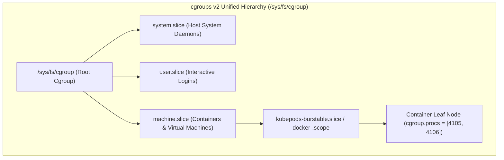
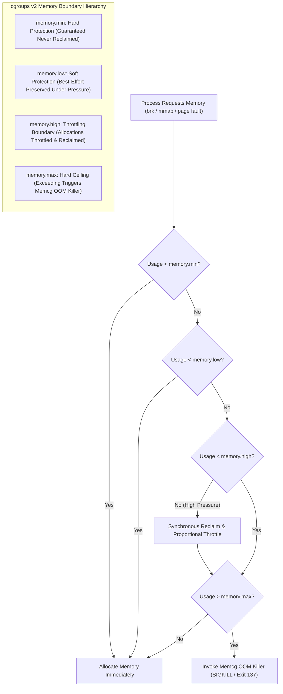
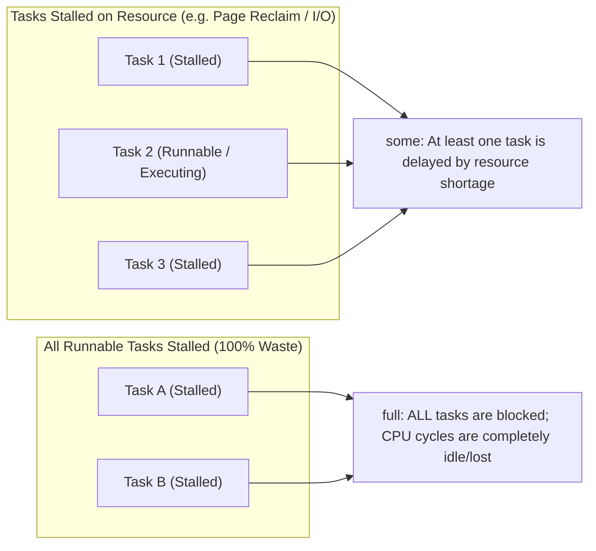
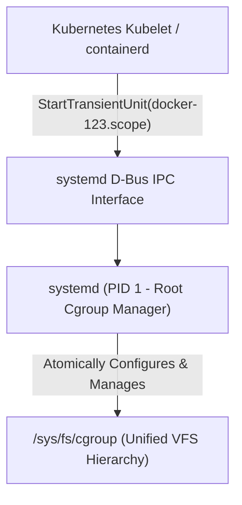

# Module 03: Control Groups v2: Unified Hierarchy, Resource Controllers, PSI, and OOM Mechanics

> **Primary sources:** Linux Kernel Documentation ([Control Group v2](https://docs.kernel.org/admin-guide/cgroup-v2.html), [`cgroups(7)`](https://man7.org/linux/man-pages/man7/cgroups.7.html), [Pressure Stall Information](https://docs.kernel.org/accounting/psi.html)); systemd Documentation ([`systemd.resource-control(5)`](https://www.freedesktop.org/software/systemd/man/systemd.resource-control.html)); Kubernetes Documentation ([Cgroup Drivers](https://kubernetes.io/docs/setup/production-environment/container-runtimes/#cgroup-drivers)).
>
> **Executable proof:** [`examples/ts/03-cgroups-v2.test.ts`](../examples/ts/03-cgroups-v2.test.ts) asserts unified hierarchy traversal, CFS bandwidth quota throttling calculations, PSI metric parsing, and memcg OOM event state verification.

---

## 1. Formal Foundations: The cgroups v2 Unified Hierarchy

Control Groups (cgroups) are the Linux kernel subsystem responsible for **resource distribution, accounting, and enforcement**. While namespaces control what a process can see, cgroups control what physical resources a process can consume: CPU bandwidth, physical memory, swap space, block I/O bandwidth, network priority, and process table slots.

### 1.1 The Architectural Failure of cgroups v1

In the legacy cgroups v1 architecture (designed in 2007):

- Each resource controller (memory, cpu, blkio, pids, devices) maintained its own completely independent directory hierarchy under `/sys/fs/cgroup/`.
- A process could reside in `/sys/fs/cgroup/memory/groupA` for memory management while residing in `/sys/fs/cgroup/blkio/groupB` for storage I/O.
- Because these controllers operated in disjoint hierarchies, the kernel could not coordinate cross-subsystem operations. The most notorious failure was **buffered I/O writeback**: dirty memory pages generated by a process in `groupA` were written to disk by kernel flusher threads belonging to the root blkio cgroup, making it mathematically impossible to throttle disk writes against the memory-consuming container that initiated them.
- Inconsistent controller semantics, arbitrary hierarchy nesting, and lock contention made cgroups v1 fragile under modern container densities.

### 1.2 The cgroups v2 Unified Design

Introduced by Tejun Heo and merged into the Linux kernel in version 4.5, **cgroups v2** replaces the disjoint hierarchies with a single, unified tree structure mounted at `/sys/fs/cgroup`:



### 1.3 Core Invariants of cgroups v2

1. **Single Hierarchy Invariant**: Every process in the operating system belongs to exactly one cgroup in the unified tree. Membership is tracked via `task_struct->cgroups` pointing to a `struct css_set`.
2. **"No Internal Processes" Rule**: With the sole exception of the root cgroup, a cgroup node **cannot simultaneously host processes and enable controllers for child cgroups**. A cgroup must be either:
   - An **Interior Node**: Contains child cgroup directories and enables controllers in `cgroup.subtree_control`. Its own `cgroup.procs` file must be empty.
   - A **Leaf Node**: Contains running processes (`cgroup.procs`), but cannot have child cgroups or enable controllers in `cgroup.subtree_control`.
3. **Subtree Control Inheritance**: A child cgroup cannot enable a controller unless that controller was enabled in the parent's `cgroup.subtree_control`. Controllers are enabled by writing to `cgroup.subtree_control`:
   ```bash
   echo "+cpu +memory +io +pids" > /sys/fs/cgroup/machine.slice/cgroup.subtree_control
   ```
4. **Thread Mode (`cgroup.type == "threaded"`)**: In standard domain mode, all threads of a multi-threaded process (`tgid`) must reside in the same cgroup. In threaded mode, individual OS threads (`struct task_struct`) can be partitioned across sibling cgroups to allocate independent CPU shares while sharing a common memory and I/O domain.

---

## 2. Resource Controllers in Depth

Controllers are the functional engines attached to the unified tree. Each controller exposes declarative pseudofiles for limit configuration, telemetry, and event notifications.

### 2.1 The Memory Controller (`memory.*`)

The cgroup v2 memory controller provides multi-tier memory protection, reclaim coordination, and allocation boundaries. Application memory sizing and V8 garbage collection boundaries are analyzed in [`technologies/nodejs/modules/10-v8-memory-and-gc.md`](../../../technologies/nodejs/modules/10-v8-memory-and-gc.md).



#### Memory Pseudofiles

- `memory.current`: Current total physical memory consumed by the cgroup and its descendants (bytes). Includes anonymous memory, mapped files, page cache, socket memory, and kernel slab structures.
- `memory.min`: Hard memory protection floor. If total system memory is constrained, memory belonging to a cgroup operating below `memory.min` will **never be reclaimed** by the kernel.
- `memory.low`: Soft protection threshold. If the host experiences memory pressure, the kernel attempts to reclaim page cache from unconstrained or above-`memory.low` cgroups before reclaiming from this cgroup.
- `memory.high`: Proportional throttle limit. When usage exceeds `memory.high`, the kernel does not invoke the OOM killer. Instead, it forces allocating processes within that cgroup into synchronous page reclaim and throttles their CPU execution, slowing down memory allocation rates.
- `memory.max`: Hard upper ceiling. If memory consumption reaches `memory.max` and synchronous page cache reclaim cannot free sufficient memory, the kernel invokes the **memcg OOM killer**.
- `memory.swap.max`: Hard limit on the maximum amount of swap space that the cgroup can utilize. Setting this to `0` prevents the container from thrashing host swap.
- `memory.oom.group`: When set to `1`, the kernel terminates **all processes** within the cgroup simultaneously when an OOM event triggers, preventing partial-failure zombie states where an application process dies but its supervisor lingers in a corrupted state.
- `memory.events`: Exposes event counters: `low`, `high`, `max`, `oom`, `oom_kill`, and `oom_group_kill`.

### 2.2 The CPU Controller (`cpu.*`)

The CPU controller manages CPU resource allocation using the Completely Fair Scheduler (CFS) bandwidth control engine.

#### CPU Pseudofiles

- `cpu.max`: Enforces hard bandwidth quotas. Formatted as `$QUOTA $PERIOD`:
  ```text
  200000 100000
  ```
  This setting configures a quota of 200,000 microseconds per 100,000 microsecond period, granting the cgroup exactly 2.0 cores of CPU compute time. If set to `max 100000`, the cgroup has no upper bandwidth limit.
- `cpu.weight`: Proportional CPU share weighting (range 1–10000, default 100). When the CPU is saturated, compute cycles are distributed proportionally across competing cgroups according to their relative weights.
- `cpu.stat`: Telemetry counters tracking execution and throttling:
  - `usage_usec`: Total CPU time consumed by processes in this cgroup.
  - `user_usec`: CPU time consumed in user space.
  - `system_usec`: CPU time consumed in kernel space (syscalls, page faults).
  - `nr_periods`: Total number of enforcement periods that have elapsed.
  - `nr_throttled`: Number of periods in which processes in this cgroup were throttled due to exceeding `cpu.max`.
  - `throttled_usec`: Total time processes were suspended in a throttled state.

#### The CFS Quota Throttling Mechanism

A critical production pitfall occurs when multi-threaded applications run under tight `cpu.max` limits. The CFS quota is accounted across **all active threads cumulatively**.

If an application with 8 active worker threads is configured with `cpu.max: "100000 100000"` (1.0 core):

- All 8 threads run simultaneously across 8 physical CPU cores.
- Within 12.5 milliseconds of wall-clock time, the 8 threads consume `8 * 12.5ms = 100ms` of CPU quota.
- The kernel's CFS bandwidth timer detects that the period's quota is exhausted.
- **The kernel deschedules and pauses all 8 threads for the remaining 87.5 milliseconds of the period!**
- This results in high tail latencies (p99 spikes of 80–100ms) even though average CPU utilization appears low.

### 2.3 The PIDs Controller (`pids.*`)

The PIDs controller enforces boundaries on the number of concurrent tasks (threads and processes) that can exist within a cgroup tree.

- `pids.max`: Hard limit on the number of processes and threads. Setting this prevents fork bomb attacks and runaway thread creation from crashing the host kernel.
- `pids.current`: Current count of tasks in the cgroup.
- `pids.events`: Exposes `max`, the number of times `clone()` or `fork()` calls failed with `EAGAIN` because the cgroup reached `pids.max`.

### 2.4 The I/O Controller (`io.*`)

The I/O controller manages disk access using proportional weighting and byte/IOPS rate limiting against specific block devices.

- `io.max`: Configures maximum read/write bytes per second and IOPS per block device:
  ```text
  8:0 rbps=20971520 wbps=10485760 riops=1000 wiops=500
  ```
  This throttles device major:minor `8:0` (/dev/sda) to 20MB/s read, 10MB/s write, 1000 read IOPS, and 500 write IOPS.
- `io.weight`: Proportional I/O time scheduling (range 1–10000).
- `io.stat`: Reports cumulative I/O operations and bytes transferred per device.

Because cgroups v2 integrates memory and I/O tracking, when an application writes to a buffered file, the kernel accurately accounts the dirty page cache flush to that container's `io.max` limit when the kernel flusher daemon writes it to disk.

---

## 3. Pressure Stall Information (PSI)

Historically, operators relied on utilization metrics (CPU %, Memory MB, Disk IOPS) to assess system health. However, utilization metrics cannot distinguish between a system that is fully utilized but operating efficiently, and a system that is experiencing severe resource starvation.

The Linux kernel introduced **Pressure Stall Information (PSI)** (`/proc/pressure/{cpu,memory,io}` and per-cgroup `*.pressure`) to measure **lost execution time caused by resource shortages**.



### 3.1 The Formal Definition of `some` vs. `full`

PSI computes resource pressure across moving time windows (10 seconds, 60 seconds, 300 seconds) and tracks cumulative stall time:

```text
some avg10=0.00 avg60=0.00 avg300=0.00 total=0
full avg10=0.00 avg60=0.00 avg300=0.00 total=0
```

- **`some`**: The percentage of wall-clock time during which **at least one non-idle task** was delayed waiting for that resource (e.g., waiting for memory page reclaim or block I/O completion). `some` indicates that resource contention is beginning to impact throughput.
- **`full`**: The percentage of wall-clock time during which **all non-idle tasks** were stalled on that resource simultaneously. When `memory.pressure` reports `full > 0`, the CPU is completely starved of work because every runnable task is blocked waiting for memory allocation or swap.
- _Note on CPU PSI_: `/proc/pressure/cpu` only exposes `some`. By definition, CPU contention cannot produce a `full` state because at least one task is actively executing instructions on the CPU core.

### 3.2 Real-Time Event Triggers via PSI

Instead of periodically polling `/proc/pressure/`, orchestrators and auto-scalers can register real-time threshold notifications by opening the pressure file, writing a trigger definition, and monitoring the file descriptor with `epoll(2)` or `select(2)`:

```c
// Configure trigger: wake up if memory.pressure 'some' exceeds 20ms within a 100ms window
int fd = open("/sys/fs/cgroup/machine.slice/app.scope/memory.pressure", O_RDWR | O_NONBLOCK);
write(fd, "some 20000 100000", 17);
// Pass fd to epoll_wait() -> wakes immediately upon high memory pressure before OOM occurs!
```

This allows applications or sidecars to implement proactive **load shedding** or cache eviction before the kernel's destructive OOM killer triggers.

---

## 4. OOM Killer Mechanics and Exit Code 137

When a containerized process allocates memory that exceeds its `memory.max` boundary and the kernel's page reclaim engine cannot free enough clean page cache to satisfy the request, the kernel triggers the **Memory Cgroup (memcg) Out-Of-Memory (OOM) Killer**.

### 4.1 System OOM vs. Memcg OOM

- **System OOM**: Occurs when total physical host RAM and swap are exhausted. The global kernel OOM killer evaluates every process across the entire server, computes an heuristic badness score based on memory consumption and `/proc/[pid]/oom_score_adj`, and terminates the highest-scoring process on the machine.
- **Memcg OOM**: Occurs when a specific container cgroup exceeds its local `memory.max`, even if the physical host has hundreds of gigabytes of free RAM remaining! The kernel restricts its termination candidate search strictly to processes residing within that container's cgroup subtree.

### 4.2 Deconstructing Exit Code 137

In Linux container operations, exit code **137** is mathematically calculated as: $$\text{Exit Code} = 128 + \text{Signal Number} = 128 + 9 (\text{SIGKILL}) = 137$$

Because `SIGKILL` cannot be caught or handled by an application process, an exit code of 137 indicates that the process was killed from the outside. However, **Exit 137 does not always mean the container was OOM-killed!**

A container exits with code 137 under two distinct scenarios:

1. **Memcg OOM Killer**: The kernel sent `SIGKILL` because the cgroup exceeded `memory.max`.
2. **Orchestrator Grace Period Timeout**: The container manager (`docker stop` or Kubernetes Kubelet) sent `SIGTERM`, the application failed to terminate within the grace period (10s or 30s), and the orchestrator escalated to `SIGKILL`.

#### How to Disambiguate OOM Kills

To verify whether a termination was caused by a true memory exhaustion:

1. Inspect `memory.events`: Check if `oom_kill` is greater than 0.
2. Inspect the Docker engine status:
   ```bash
   docker inspect <container_id> --format '{{.State.OOMKilled}}'
   ```
3. Inspect the host kernel ring buffer:
   ```bash
   dmesg -T | grep -E -i "oom_cgroup|killed process"
   ```
   If a memcg OOM occurred, `dmesg` outputs an explicit kernel log such as: `Memory cgroup out of memory: Killed process 4105 (node) total-vm:1845120kB, anon-rss:512400kB, file-rss:328kB`.

---

## 5. Systemd as the Production Cgroup Manager

A frequent architectural misconfiguration in production environments is selecting the wrong **cgroup driver**. Container runtimes support two cgroup management drivers: `cgroupfs` and `systemd`.

### 5.1 The Split-Brain Conflict with `cgroupfs`

When the `cgroupfs` driver is used:

- The container runtime (`containerd`, `dockerd`, or `runc`) creates and deletes directories directly inside `/sys/fs/cgroup/` using raw filesystem calls (`mkdir`, `rmdir`).
- However, on modern Linux systems, **systemd is PID 1 and owns the host cgroup hierarchy**. Systemd expects to manage all cgroup creation via its D-Bus API (`org.freedesktop.systemd1`).
- When a system administrator executes `systemctl daemon-reload` or modifies system slices, systemd scans the `/sys/fs/cgroup/` hierarchy. Finding directories that were not registered through its internal unit database, systemd may attempt to prune them, relocate processes, or reset resource controllers.
- This creates split-brain state, causing random container resource allocation resets or container termination during host maintenance.

### 5.2 The `systemd` Driver Architecture

In modern production setups (and mandatory in Kubernetes 1.25+ and Kubernetes 1.35+):

- The container manager connects to systemd over the local D-Bus IPC socket.
- Runtimes request the creation of transient `.scope` or `.slice` units via `systemd-run` or direct D-Bus API calls (`StartTransientUnit`).
- Systemd creates the cgroup directories, applies the resource configurations, and integrates container logging and lifecycle events directly into `journald` and `systemctl status`.



---

## 6. Formal Algorithm: CFS Bandwidth Quota Accounting

The following CLRS-style algorithm models the Completely Fair Scheduler (CFS) bandwidth quota enforcement engine implemented in the Linux kernel (`kernel/sched/fair.c`).

```text
CFS-ENFORCE-BANDWIDTH-QUOTA(cgroup, periodLengthUs, quotaLimitUs)
1  cgroup.quotaRemaining = quotaLimitUs
2  cgroup.isThrottled = false
3  periodTimer = InitializeTimer(periodLengthUs)
4
5  loop
6      // Event: CFS period timer expires
7      wait_for_event(PERIOD_EXPIRED or THREAD_SCHEDULED or THREAD_EXEC_TICK)
8
9      if event == PERIOD_EXPIRED
10         // Refill quota bucket at the start of each new enforcement period
11         cgroup.stat.nr_periods = cgroup.stat.nr_periods + 1
12         cgroup.quotaRemaining = quotaLimitUs
13         if cgroup.isThrottled == true
14             // Unthrottle all suspended threads in the cgroup
15             for each thread in cgroup.runnableThreads
16                 WakeUpThread(thread)
17             cgroup.isThrottled = false
18         ResetTimer(periodTimer, periodLengthUs)
19
20     else if event == THREAD_EXEC_TICK
21         // Measure elapsed CPU runtime across all active cores
22         cpuTicksConsumed = event.elapsedTicksUs
23         cgroup.stat.usage_usec = cgroup.stat.usage_usec + cpuTicksConsumed
24
25         if cgroup.quotaRemaining != INFINITY
26             cgroup.quotaRemaining = cgroup.quotaRemaining - cpuTicksConsumed
27
28             if cgroup.quotaRemaining <= 0
29                 // Quota exhausted within this period: throttle the entire cgroup
30                 cgroup.quotaRemaining = 0
31                 cgroup.isThrottled = true
32                 cgroup.stat.nr_throttled = cgroup.stat.nr_throttled + 1
33
34                 for each thread in cgroup.activeThreads
35                     DescheduleAndSuspendThread(thread)
36                     cgroup.stat.throttled_usec = cgroup.stat.throttled_usec + (periodLengthUs - CurrentPeriodElapsedUs())
```

### Invariants and Mathematical Properties

- **Bandwidth Bound Invariant**: Within any arbitrary discrete enforcement window $[T_k, T_k + \text{periodLengthUs})$, the cumulative CPU runtime consumed across all threads in the cgroup satisfies: $$\sum_{t \in \text{threads}} \text{runtime}(t) \le \text{quotaLimitUs}$$
- **State Monotonicity**: Once `cgroup.quotaRemaining` reaches zero at line 28, `cgroup.isThrottled` remains `true`, and all runnable threads are suspended at line 35 until line 12 executes at the beginning of the subsequent period.
- **Fairness Guarantee**: Unthrottling all suspended threads at line 16 simultaneously ensures that no thread within the cgroup suffers starvation relative to sibling threads inside the same container.

---

## 7. Then vs Now: cgroups v1 vs. cgroups v2

| Feature / Dimension | cgroups v1 (Legacy Standard) | cgroups v2 (Current Production Baseline) |
| :-- | :-- | :-- |
| **Directory Structure** | Disjoint hierarchies per controller (`/sys/fs/cgroup/cpu`, `/memory`, etc.) | Single unified hierarchy (`/sys/fs/cgroup/`) |
| **Process Assignment** | Process could be in different cgroups for memory vs. CPU | Single unified process membership per cgroup |
| **I/O Writeback** | Broken: buffered writes charged to root cgroup | Integrated: buffered page cache writeback charged to originating cgroup |
| **Process Nesting** | Arbitrary processes allowed in interior routing nodes | Strict "No Internal Processes" rule (processes only in leaves) |
| **Memory Control** | Simple limit (`memory.limit_in_bytes`), coarse OOM | Multi-tier: `min` (protection), `low`, `high` (throttle), `max` (OOM) |
| **OOM Handling** | Single random task killed; partial failure corruption | Atomic cgroup OOM: `memory.oom.group` kills all processes |
| **Contention Metrics** | Coarse CPU % and memory byte counters only | Pressure Stall Information (PSI): `some` vs. `full` stall time |
| **Rootless Support** | Insecure and severely restricted | First-class unprivileged delegation via systemd user slices |
| **Tooling Deprecation** | Podman 6.0 completely removed v1; K8s 1.35 introduces `FailCgroupV1` | Default standard across all modern Linux distributions |

---

## 8. Certification & Exam Callouts

### CKAD (Certified Kubernetes Application Developer)

- **Requests vs. Limits Mapping**:
  - `resources.limits.memory` maps directly to `memory.max`. If the container working set exceeds this limit, the pod is terminated with `OOMKilled` (exit code 137).
  - `resources.requests.memory` maps to `memory.min` or `memory.low` on cgroup v2 systems, reserving physical node memory and protecting the container from reclaim during host memory pressure.
  - `resources.limits.cpu` maps to `cpu.max` CFS quota. Setting a CPU limit introduces the risk of CFS throttling, which can cause latency spikes in multi-threaded runtimes.
  - `resources.requests.cpu` maps to `cpu.weight`, governing proportional CPU distribution during periods of host CPU saturation.

### CKS (Certified Kubernetes Security Specialist)

- **Configuring the Systemd Cgroup Driver**: The CKS curriculum tests node-level hardening. Verify that the Kubelet configuration file (`/var/lib/kubelet/config.yaml`) explicitly specifies `cgroupDriver: systemd`. Using `cgroupfs` in production causes node instability.
- **Defending Against Resource Starvation**: Unrestricted containers can execute fork bombs or consume unlimited memory, denying resources to critical node daemons (`kubelet`, `containerd`). Ensure every Kubernetes namespace enforces a `LimitRange` and `ResourceQuota` requiring explicit bounds on memory, CPU, and `pids.max`.

---

## 9. Production Failure Modes and Gotchas

### 9.1 Multi-Threaded CPU Throttling on Underutilized Nodes

- **Symptom**: An API service experiences p99 latency spikes of 100ms. Monitoring tools indicate that average CPU utilization is only 30% of its allocation.
- **Root Cause**: The application runs on a runtime that initializes large thread pools (e.g., Go with `GOMAXPROCS=32` matching host cores, or Java ForkJoinPool). When a burst of requests arrives, all 32 threads execute simultaneously. With a limit of `cpu.max: 100000 100000` (1 core = 100ms quota), the 32 threads burn through the 100ms quota in just `100 / 32 = 3.125ms` of real time. The container is throttled for the remaining 96.875ms of the period.
- **Remediation**: Set thread pool sizes to match the container's CPU allocation rather than the host CPU count (e.g., configure `GOMAXPROCS=1` or `GOMAXPROCS=2` using `go.uber.org/automaxprocs`).

### 9.2 Legacy Runtimes Reading cgroups v1 Files Under cgroups v2

- **Symptom**: A container with a 1GB memory limit running on an older runtime version (Node.js < 16, Java < 8u372) crashes with an OOM error when allocating 1.2GB, yet the internal application runtime never attempted garbage collection.
- **Root Cause**: Legacy runtimes inspect memory limits by reading `/sys/fs/cgroup/memory/memory.limit_in_bytes`. On a cgroups v2 system, that file does not exist. The runtime assumes it has unlimited memory and sets its internal heap limits (such as V8's `--max-old-space-size` or JVM `-XX:MaxRAMPercentage`) against the **total host physical RAM** (e.g., 128GB). When the process allocates past 1GB, the kernel kills it via memcg OOM. Cross-link to [`technologies/nodejs/modules/10-v8-memory-and-gc.md`](../../../technologies/nodejs/modules/10-v8-memory-and-gc.md) §7.
- **Remediation**: Upgrade the application runtime to a version with native cgroups v2 support, or explicitly configure runtime heap limits via environment flags (`NODE_OPTIONS="--max-old-space-size=800"`).

### 9.3 Uncapped Swap Thrashing Lockup

- **Symptom**: A container experiencing memory pressure does not terminate via OOM killer. Instead, the entire host server experiences a catastrophic I/O freeze, with load average climbing to 200+ and all disk I/O stalled.
- **Root Cause**: The container cgroup configured `memory.max`, but omitted `memory.swap.max`. When memory pressure occurred, the kernel swapped anonymous memory to the host swap partition. The container began thrashing swap at thousands of operations per second, saturating host NVMe bus queues.
- **Remediation**: Explicitly set `memory.swap.max: 0` to disable swap for latency-critical containers, or ensure swap bandwidth is bounded by the cgroup I/O controller.

### 9.4 Silent Fork Failures via Unadjusted `pids.max`

- **Symptom**: A containerized microservice running normally suddenly begins logging `Error: spawn ENOMEM` or `fork: Resource temporarily unavailable`, despite having gigabytes of free RAM and low CPU usage.
- **Root Cause**: The orchestrator or runtime configured a restrictive `pids.max` (e.g., `pids.max: 100`). The application spawned background worker threads or child processes that exceeded this cap. Subsequent `fork(2)` and `clone(2)` system calls failed immediately.
- **Remediation**: Monitor `pids.events` for `max` increments. Baseline thread and process consumption under peak load before setting hard PID limits.

---

## Interview Drill

<details><summary>1. How does the "No Internal Processes" rule in cgroups v2 prevent the resource allocation ambiguities present in cgroups v1?</summary>

In cgroups v1, a cgroup directory could host running processes while simultaneously containing child sub-cgroups. This created fundamental ambiguities when applying resource limits: if an interior node had a 2GB limit and its two child cgroups had 1GB limits each, it was ambiguous how processes running in the parent node competed with the child trees for memory and scheduling bandwidth. cgroups v2 eliminates this ambiguity by enforcing that only leaf nodes can contain processes (`cgroup.procs`), while interior nodes can only contain child directories and enable controllers via `cgroup.subtree_control`. This guarantees that resource distribution follows a strict, well-defined tree hierarchy.
</details>

<details><summary>2. Explain the operational difference between `memory.high` and `memory.max` in cgroups v2.</summary>

`memory.max` is the absolute hard limit. If a cgroup exceeds `memory.max` and page cache reclaim cannot free sufficient memory, the kernel immediately triggers the memcg OOM killer to terminate processes. In contrast, `memory.high` is a soft throttling boundary. When usage crosses `memory.high`, the kernel does not kill processes; instead, it forces allocating processes within that cgroup into synchronous page reclaim and proportionally throttles their CPU allocation. This slows down the rate of memory allocation, providing the application an opportunity to stabilize or allowing external supervisors to trigger proactive auto-scaling.
</details>

<details><summary>3. Why is CPU throttling under CFS quota often observed in containers whose average CPU utilization is well below their allocated limit?</summary>

CFS quota enforcement operates over discrete periodic windows (typically 100 milliseconds). If an application uses multiple threads (for example, 16 worker threads on a host with 16 cores), all 16 threads can run simultaneously. If the container has a limit of 1.0 CPU core (100ms of quota per 100ms period), the 16 threads running concurrently will consume the entire 100ms quota in only `100 / 16 = 6.25ms` of real wall-clock time. For the remaining 93.75ms of that period, the kernel deschedules and freezes all 16 threads. Even though average utilization over a 1-minute window appears low, the application experiences severe latency spikes during the throttled portion of each 100ms cycle.
</details>

<details><summary>4. How does Pressure Stall Information (PSI) differentiate between high resource utilization and actual resource starvation?</summary>

Utilization metrics simply measure whether a resource is busy (e.g., 95% CPU or 90% memory used), which often reflects healthy, efficient system utilization. PSI measures **lost execution time**:

- `some` measures the percentage of time during which at least one runnable task was blocked waiting for memory reclaim, swap, or disk I/O.
- `full` measures the percentage of time during which **all** runnable tasks were blocked on that resource, meaning the CPU was completely idle and compute capacity was 100% wasted.

A system with 98% memory usage and 0% memory PSI is operating with optimal cache efficiency; a system with 70% memory usage and 40% `full` memory PSI is in critical thrashing collapse.
</details>

<details><summary>5. When a container terminates with exit code 137, how can you definitively determine whether it was killed by the kernel memcg OOM killer or by an orchestrator timeout?</summary>

Exit code 137 simply indicates termination by `SIGKILL` ($128 + 9 = 137$). To determine the root cause:

1. Read `/sys/fs/cgroup/.../memory.events` and check whether the `oom_kill` counter is greater than 0.
2. In Docker, execute `docker inspect <id> --format '{{.State.OOMKilled}}'`; if `true`, the kernel OOM killer terminated the container.
3. Inspect `dmesg -T` on the host node for explicit `Memory cgroup out of memory: Killed process` messages.

If these indicators are absent, the container was killed by an external signal, typically an orchestrator (`docker stop` or Kubernetes Kubelet) sending `SIGKILL` after the application failed to exit within its graceful shutdown grace period following an initial `SIGTERM`.
</details>

<details><summary>6. Why did buffered file I/O throttling fail in cgroups v1, and how does cgroups v2 solve this architectural defect?</summary>

In Linux, writes to disk are buffered in the kernel page cache (dirty pages) and written to physical storage asynchronously by kernel background flusher threads (`kworker`). In cgroups v1, because the `memory` and `blkio` controllers were in separate hierarchies, the kernel flusher threads had no mechanism to associate dirty pages with the specific blkio cgroup that generated the write. All asynchronous writebacks were attributed to the root cgroup, bypassing container I/O throttles. In cgroups v2, the unified hierarchy ensures that memory pages track the cgroup ownership of their allocating process; when flusher threads write those pages to disk, the I/O operations are charged directly against the originating cgroup's `io.max` and `io.weight` limits.
</details>

<details><summary>7. What is the danger of using the `cgroupfs` driver instead of the `systemd` cgroup driver in production Kubernetes clusters?</summary>

On systemd-managed Linux systems, systemd is PID 1 and maintains authoritative control over the `/sys/fs/cgroup/` hierarchy. When container runtimes use the `cgroupfs` driver, they bypass systemd and directly manipulate cgroup directories on disk. This results in a split-brain state: systemd does not recognize these directories as managed units. When system maintenance occurs (such as package upgrades, `systemctl daemon-reload`, or slice adjustments), systemd scans the tree and may unexpectedly remove, throttle, or reorganize unmanaged cgroups, causing unexplained container crashes and node instability.
</details>

---

## 11. Proof Map and Verification

The formal cgroup invariants, controller semantics, and algorithms described in this module are proven by automated test suites in [`examples/ts/03-cgroups-v2.test.ts`](../examples/ts/03-cgroups-v2.test.ts):

- **Unified Hierarchy & "No Internal Processes" Invariant**: Tests validate tree traversal data structures, asserting that interior cgroup nodes reject task assignments when child controllers are active.
- **CFS Bandwidth Quota Simulation**: Tests execute the `CFS-ENFORCE-BANDWIDTH-QUOTA` algorithm, calculating quota burn rates across multi-threaded workloads and verifying throttling onset and period resets.
- **PSI Metric Parsing & Trigger Verification**: Tests parse simulated `/proc/pressure/memory` files, distinguishing between `some` and `full` contention states and evaluating auto-scaling trigger thresholds.
- **Memcg OOM & Exit 137 Disambiguation**: Tests evaluate container termination state models, verifying that `memory.events` counters and kernel log regexes accurately differentiate between true OOM kills and graceful shutdown timeouts.
