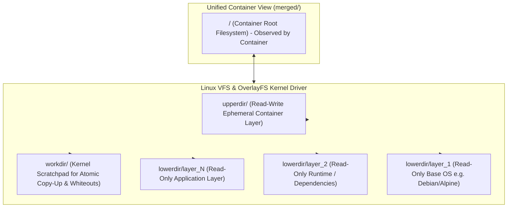
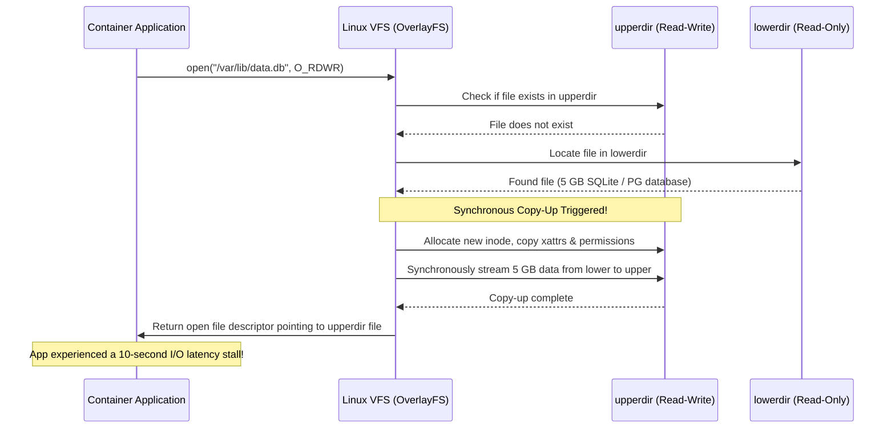
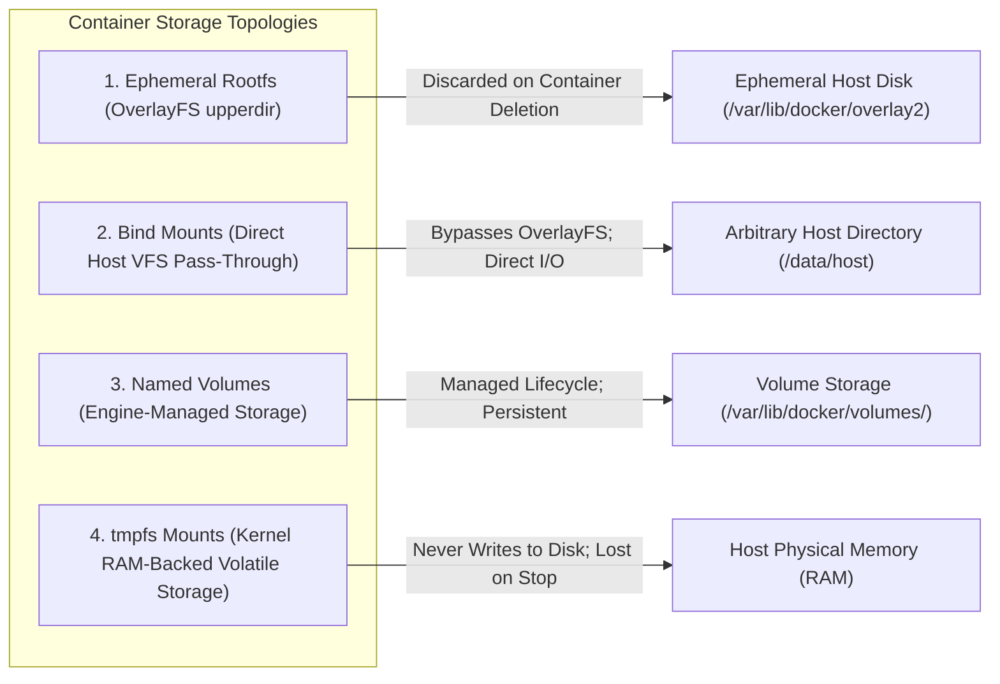
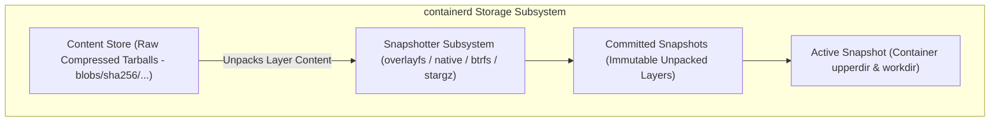
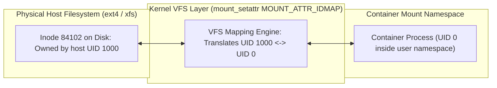

# Module 04: Filesystems and Storage: OverlayFS, Snapshotters, Volumes, and Idmapped Mounts

> **Primary sources:** Linux Kernel Documentation ([Overlay Filesystem](https://docs.kernel.org/filesystems/overlayfs.html), [`mount_setattr(2)`](https://man7.org/linux/man-pages/man2/mount_setattr.2.html), [`mount(2)`](https://man7.org/linux/man-pages/man2/mount.2.html)); containerd Documentation ([Snapshotters](https://github.com/containerd/containerd/blob/main/docs/snapshotters/README.md)); SELinux Project ([Container SELinux](https://github.com/containers/container-selinux)).
>
> **Executable proof:** [`examples/ts/04-filesystems-and-storage.test.ts`](../examples/ts/04-filesystems-and-storage.test.ts) asserts OverlayFS directory layer merge algorithms, copy-up size and latency models, whiteout masking logic, and idmapped mount translation matrices.

---

## 1. Formal Foundations: The Linux OverlayFS Architecture

In container systems, spinning up a new container cannot involve copying gigabytes of operating system binaries and libraries from disk. Instead, containers rely on **Union Mount Filesystems**, predominantly the Linux kernel's **OverlayFS** (`Documentation/filesystems/overlayfs.rst`).

OverlayFS combines multiple directory trees into a single, merged virtual filesystem presentation. It presents the unified view to the container process while keeping the underlying image layers completely immutable.



### 1.1 The Four Essential OverlayFS Directories

An OverlayFS mount requires four distinct directory paths specified during the `mount(2)` system call:

1. **`lowerdir`**: A colon-separated list of read-only directories containing the immutable image layers:
   ```text
   lowerdir=/layers/app:/layers/node:/layers/debian
   ```
   The kernel searches these directories from left to right. The leftmost directory has highest precedence, shadowing files of the same name in rightward lower layers.
2. **`upperdir`**: A single read-write directory. Any new file created, existing file modified, or file deleted by the container is recorded exclusively inside `upperdir`.
3. **`workdir`**: An internal scratch directory utilized by the kernel driver to prepare atomic directory maneuvers, copy-up staging, and whiteout device node creation before linking them into `upperdir`.
   - **Crucial Kernel Invariant**: `workdir` and `upperdir` **must reside on the exact same underlying filesystem** (same mount and superblock). If they reside on different filesystems, invoking `mount -t overlay` fails immediately with `EXDEV` ("Invalid cross-device link").
4. **`merged`**: The target mount point directory where the unified VFS tree is presented to the container's mount namespace.

---

## 2. OverlayFS Mechanics: Copy-Up, Whiteouts, and Opaque Directories

OverlayFS provides standard POSIX filesystem semantics on top of disjoint directory branches through three specialized kernel mechanisms: **Copy-Up**, **Whiteout Nodes**, and **Opaque Attributes**.

### 2.1 The Copy-Up Mechanism and the Latency Penalty

Because layers in `lowerdir` are mounted strictly read-only, when a containerized process attempts to open an existing lower-layer file with write intent (`O_WRONLY`, `O_RDWR`, or `truncate`), the kernel cannot modify the underlying file directly.

Instead, the OverlayFS driver executes a synchronous **Copy-Up**:

1. The kernel allocates a new inode inside `upperdir`.
2. It duplicates the file's metadata: ownership (UID/GID), POSIX permissions (`mode`), extended attributes (`xattrs`), and access/modification timestamps.
3. It copies the entire data payload from the file in `lowerdir` to the new file in `upperdir`.
4. It directs the process's file descriptor to the newly created replica in `upperdir`.



#### The Copy-Up Latency Penalty

The copy-up operation is synchronous: the calling thread is blocked inside the `open(2)` or `truncate(2)` system call until the entire file content has been copied.

If an application image includes a 2GB database file, a large ML model, or a heavy cache inside an image layer, the very first write operation against that file—even if modifying a single 4-byte integer—triggers a full 2GB data copy. This results in disk space amplification and massive tail latency stalls. For deep storage engine implications, cross-link to the operating system I/O and buffer management analysis in [`architecture/data-systems/modules/04-buffer-management-and-operating-system-io.md`](../../../architecture/data-systems/modules/04-buffer-management-and-operating-system-io.md).

### 2.2 File Deletions and Whiteout Device Nodes

When a containerized process calls `unlink("/etc/nginx/nginx.conf")`, the kernel cannot delete the file from the read-only `lowerdir`.

To maintain POSIX directory consistency:

1. The kernel creates a special character device node in `upperdir` with major number 0 and minor number 0:
   ```bash
   mknod /upperdir/etc/nginx/nginx.conf c 0 0
   ```
2. In Linux VFS semantics, a character device node with numbers `0/0` is recognized by OverlayFS as a **Whiteout Marker**.
3. When `readdir(3)` or `stat(2)` traverses the directory in the merged mount, OverlayFS detects the whiteout in `upperdir` and suppresses the corresponding entry from the `lowerdir`. To the container process, the file appears completely deleted.

### 2.3 Opaque Directories (`trusted.overlay.opaque`)

When a container deletes an entire directory tree (e.g., `rm -rf /usr/share/doc`) and then recreates a new directory at that exact path, creating individual whiteout nodes for every historical file would be computationally prohibitive.

Instead, OverlayFS uses extended attributes (`xattrs`):

- The kernel creates the new directory inside `upperdir`.
- It sets the extended attribute:
  ```text
  trusted.overlay.opaque="y"
  ```
  (In unprivileged rootless mounts, this attribute is formatted as `user.overlay.opaque="y"`).
- When resolving path lookups, the VFS inspects this attribute. If present, it treats the directory as **opaque**, stopping directory traversal immediately and refusing to merge any entries from underlying lower layers.

---

## 3. Container Storage Models: Ephemeral vs. Persistent

Container storage is classified into four operational categories:



### 3.1 Ephemeral Container Layer (OverlayFS `upperdir`)

- **Lifecycle**: Tied directly to the container lifecycle. When `docker rm` or `podman rm` runs, `upperdir` and `workdir` are deleted recursively.
- **Use Case**: Ephemeral scratch data, temporary files, process stdout/stderr logs.
- **Limitation**: Suffers from copy-up penalties; performance degrades under high-frequency writes.

### 3.2 Bind Mounts

- **Mechanism**: A directory or file from the host filesystem is mounted directly into the container mount namespace via `mount --bind /host/path /container/path`.
- **Performance**: Completely bypasses OverlayFS. Disk I/O occurs at native bare-metal host filesystem speeds without copy-up overhead.
- **Trade-off**: Strongly couples the container to the host filesystem layout; introduces file permission and UID/GID ownership mismatches.

### 3.3 Named Volumes

- **Mechanism**: Dedicated directories allocated and tracked by the container manager outside the container's rootfs (e.g., `/var/lib/docker/volumes/<vol_name>/_data`).
- **Lifecycle**: Decoupled from container lifecycles. Removing a container leaves the volume untouched on disk.
- **Isolation**: Stored in isolated directories with default secure permissions, managed via the container engine API (`docker volume create`, `podman volume ls`).

### 3.4 `tmpfs` Mounts

- **Mechanism**: Memory-backed volatile filesystem mounted via `mount -t tmpfs tmpfs /container/cache`.
- **Security & Speed**: Operates at memory bus speeds. Data written to a `tmpfs` mount is stored in host RAM and is never committed to persistent disk or swap partitions (when configured with `noswap`).
- **Use Case**: Storing sensitive API tokens, cryptographic private keys, or micro-benchmarking scratch files.

| Storage Type | Survives Container Deletion? | Bypasses OverlayFS? | Shared Across Containers? | Typical Production Use Case |
| :-- | :-- | :-- | :-- | :-- |
| **Ephemeral Rootfs** | No | No (Uses upperdir) | No | OS binaries, temporary application caches |
| **Bind Mount** | Yes | Yes (Direct VFS) | Yes | Developer hot-reload (`src/`), host config files |
| **Named Volume** | Yes | Yes (Direct VFS) | Yes | PostgreSQL / MySQL database files, persistent storage |
| **tmpfs Mount** | No (Lost on stop) | Yes (RAM-backed) | No | Secrets, Vault tokens, short-lived session caches |

---

## 4. Storage Drivers vs. containerd Snapshotters

Historically, container runtimes managed storage using **Graph Drivers**. Modern architectures have transitioned to **containerd Snapshotters**.

### 4.1 The Legacy Graph Driver Architecture (`overlay2`, `devicemapper`, `btrfs`)

In legacy Docker engines:

- The graph driver managed both image layer downloads and the mounting of the container rootfs.
- Docker maintained an internal layer database in `/var/lib/docker/image/overlay2/layerdb/`.
- Graph drivers were tightly bound to the Docker daemon process. If the daemon upgraded, the graph driver lock could corrupt intermediate layer references.

### 4.2 The Modern containerd Snapshotter Architecture

In containerd (and the default configuration in Docker 29+ and Kubernetes CRI):

- Storage is cleanly partitioned into two orthogonal subsystems:
  1. **Content Store**: A content-addressable store (`/var/lib/containerd/io.containerd.content.v1.content/`) containing raw, compressed layer tarballs verified by cryptographic SHA-256 digests.
  2. **Snapshot Store**: A pluggable snapshotter interface that unpacks content blobs into concrete directory trees on disk.



#### Snapshotter Lifecycle: Committed vs. Active

- **Committed Snapshot**: An immutable, read-only filesystem layer corresponding to a downloaded image layer. Committed snapshots are identified by cryptographically verified key hashes and can be shared concurrently across hundreds of running containers.
- **Active Snapshot**: A mutable, read-write working directory allocated for a specific container instance. The snapshotter creates an active snapshot with the container's top image layer as its parent, establishing the `upperdir` and `workdir` targets for OverlayFS.
- **Pluggable Drivers**: Containerd supports specialized snapshotters such as `stargz` (which enables **lazy pulling**, allowing containers to start before the image layers have finished downloading by streaming files over HTTP Range requests) and native `btrfs`/`zfs` subvolume snapshotters.

---

## 5. SELinux Relabeling (`:z` vs. `:Z`) and Kernel Idmapped Mounts

Security boundaries and user isolation create complex filesystem permission interactions when host directories are mounted into containers.

### 5.1 SELinux Multi-Category Security (MCS) and Volume Flags

On SELinux-enforcing distributions (RHEL, Fedora, CentOS, Rocky Linux), the container engine confines container processes within an unprivileged SELinux domain:

- Running containers are assigned the process label `system_u:system_r:container_t:s0:c123,c456`.
- Standard host files and directories carry specific host labels, such as `user_home_t` or `var_log_t`.
- By default, the SELinux policy strictly forbids `container_t` from accessing files labeled with general host context, resulting in instant `Permission denied (EACCES)` errors even if UNIX permissions (`rwxrwxrwx`) allow access.

Container engines solve this via volume mount flags:

- **`:z` (Shared Context)**: Instructs the engine to relabel the host path to `system_u:object_r:container_file_t:s0`. This allows **any** container running on the system to read and write to the directory.
- **`:Z` (Private / Exclusive Context)**: Instructs the engine to relabel the host path with the container's unique Multi-Category Security (MCS) category pair:
  ```text
  system_u:object_r:container_file_t:s0:c123,c456
  ```
  Only the specific container instance allocated those categories can access the files. All other containers are blocked by SELinux.

> [!CAUTION]
> Never use the `:Z` flag on system host directories! Running `docker run -v /var/log:/var/log:Z` or `-v /etc:/host_etc:Z` recursively relabels critical host system files to `container_file_t`. Host daemons (such as `systemd-journald` or `sshd`) will immediately lose access to their own configuration and log files, causing system failure.

### 5.2 The Rootless UID Dilemma and Linux 5.12+ Idmapped Mounts

When running rootless containers (via Podman or rootless Docker):

- The user inside the container runs as root (UID 0 inside the user namespace), but is mapped to host UID 100000.
- If a host directory owned by developer host UID 1000 is bind-mounted into the container, the container process cannot write to it because `100000 != 1000`.
- Historically, runtimes attempted to solve this by executing recursive `chown` commands across the host directory, or by running `chown` inside an entrypoint script. This corrupts file ownership for the host developer and is prohibitively slow for directories containing large projects.

#### The Modern Solution: Idmapped Mounts (`mount_setattr(2)`)

Introduced by Christian Brauner in Linux 5.12, **Idmapped Mounts** allow the kernel VFS layer to rewrite UID and GID representations dynamically at the mount point boundary without altering the underlying physical filesystem inodes:



Using `mount_setattr(dir_fd, "", AT_EMPTY_PATH, &attr, sizeof(attr))` with the `MOUNT_ATTR_IDMAP` flag:

- The host directory remains permanently owned by host UID 1000 on physical disk.
- When accessed through the idmapped mount point inside the container, the kernel VFS maps host UID 1000 to in-container UID 0.
- When the container writes a new file, the kernel writes the physical inode to disk with owner UID 1000!
- Zero recursive `chown` latency, zero corruption of host developer permissions.

---

## 6. Formal Algorithm: OverlayFS Merged Directory Resolution

The following CLRS-style pseudocode specifies the directory traversal and whiteout masking algorithm executed by the Linux kernel VFS during `readdir(2)` operations over an OverlayFS union mount.

```text
OVERLAY-MERGE-READDIR(upperDir, lowerDirs)
1  mergedEntries = CreateEmptyDictionary()
2  whiteoutMask = CreateEmptySet()
3
4  // Step 1: Scan the mutable upper directory
5  upperEntries = ReadPhysicalDirectory(upperDir)
6  for each entry in upperEntries
7      if entry.type == CHARACTER_DEVICE and entry.major == 0 and entry.minor == 0
8          // Detected whiteout node: record in mask to hide underlying lower files
9          whiteoutMask.Add(entry.name)
10     else
11         mergedEntries[entry.name] = entry
12
13 // Step 2: Check if upper directory is marked opaque
14 if GetExtendedAttribute(upperDir, "trusted.overlay.opaque") == "y"
15     // Opaque boundary asserted: stop traversal; do not inspect lower directories
16     return ExtractValues(mergedEntries)
17
18 // Step 3: Traverse lower directories in left-to-right precedence order
19 for each lowerDir in lowerDirs
20     lowerEntries = ReadPhysicalDirectory(lowerDir)
21     for each entry in lowerEntries
22         // Invariant: Entries masked by whiteouts or already present in upper are skipped
23         if whiteoutMask.Contains(entry.name) == false
24             if mergedEntries.ContainsKey(entry.name) == false
25                 mergedEntries[entry.name] = entry
26
27         if entry.type == DIRECTORY
28             if GetExtendedAttribute(entry.path, "trusted.overlay.opaque") == "y"
29                 // Opaque sub-directory: prevent deeper lower layers from merging here
30                 whiteoutMask.Add(entry.name + "/*")
31
32 return ExtractValues(mergedEntries)
```

### Invariants and Mathematical Correctness

- **Masking Completeness Invariant**: For any file $f$ where a whiteout node is identified at line 7, $f \in \text{whiteoutMask}$. By the condition at line 23, no entry matching $f$ from any lower layer $\text{lowerDir}_k$ can ever be inserted into $\text{mergedEntries}$.
- **Precedence Order Invariant**: Because `lowerDirs` is traversed sequentially from left to right ($k = 1, 2, \dots, N$) and line 24 checks `mergedEntries.ContainsKey(entry.name) == false`, the first encountered version of an identical filename establishes the definitive inode representation for the merged presentation.
- **Opaque Boundary Invariant**: When an upper directory contains the `opaque` extended attribute at line 14, the algorithm returns immediately at line 16, ensuring that zero deleted files from lower layers leak through to the container user space.

---

## 7. Then vs Now: Container Storage Evolution

| Storage Dimension | Legacy Graph Drivers (2013–2018) | Modern Snapshotters & VFS (2025–2026) |
| :-- | :-- | :-- |
| **Driver Implementation** | Daemon-embedded (`aufs`, `devicemapper`, `overlay`) | Modular containerd snapshotters (`overlayfs`, `stargz`) |
| **Default Driver** | `devicemapper` (loop-lvm corruption) or `aufs` | Standard kernel `overlayfs` across all distributions |
| **Image Store (Docker)** | Custom `/var/lib/docker/image/` metadata DB | Standard containerd image store (default in Docker 29) |
| **Rootless Permission Fixes** | Brittle `chown -R` on container startup scripts | Kernel-native Idmapped Mounts (`mount_setattr`) |
| **SELinux Integration** | Manual policy authoring or disabling SELinux | Automated `:z` (shared) and `:Z` (private) relabeling |
| **Image Pull Latency** | Full image must download completely before start | Lazy pulling via `stargz` / `nydus` snapshotters |
| **Database Storage** | Accidental persistence inside container rootfs | Mandated dedicated named volumes or CSI storage drivers |

---

## 8. Certification & Exam Callouts

### CKAD (Certified Kubernetes Application Developer)

- **Volume Types and Configurations**:
  - `emptyDir`: Scratch storage whose lifecycle matches the Pod. Backed by the node's local disk, or backed by node RAM when configured with `emptyDir.medium: Memory` (creates a `tmpfs` mount).
  - `persistentVolumeClaim` (PVC): Decoupled request for storage consumed by applications. Must know how to attach PVCs to deployment manifests and specify `mountPath` and `subPath`.
  - `readOnlyRootFilesystem: true`: Security posture configuring the entire container rootfs as an unmodifiable read-only OverlayFS view. Forces the application to explicitly mount writable volumes for any path requiring write access (e.g., `/tmp`, `/app/cache`).

### CKS (Certified Kubernetes Security Specialist)

- **Auditing and Restricting `hostPath`**: Mounting raw `hostPath` directories into containers allows attackers to escape the container sandbox and compromise the Kubernetes worker node (e.g., mounting `/etc`, `/var/run/docker.sock`, or `/`). The CKS exam tests authoring Admission Controller policies (Kyverno, OPA/Gatekeeper, or Pod Security Standards) that reject pods defining unvetted `hostPath` mounts.
- **SELinux Category Isolation**: Know how Kubernetes sets SELinux options in `securityContext.seLinuxOptions` (`level: "s0:c123,c456"`) to enforce Multi-Category Security across co-located pods sharing host storage.

---

## 9. Production Failure Modes and Gotchas

### 9.1 The Database Copy-Up Collapse

- **Symptom**: An unoptimized Dockerfile copies a 10GB database file or search index into an image layer. In production, the database service experiences 30-second query timeouts immediately after starting, and disk usage on the host suddenly jumps by 10GB.
- **Root Cause**: The database engine wrote a single transaction record to the database file. Because the file resided in a read-only lower layer, the kernel was forced to copy the entire 10GB file from `lowerdir` to `upperdir` synchronously before allowing the write to proceed.
- **Remediation**: Cross-link to [`architecture/data-systems/modules/04-buffer-management-and-operating-system-io.md`](../../../architecture/data-systems/modules/04-buffer-management-and-operating-system-io.md) §3; never store writable database files or append-only write-ahead logs (WAL) in image layers. Always mount a dedicated named volume or bind mount for database storage.

### 9.2 The Catastrophic Host Relabel (`-v /etc:/etc:Z`)

- **Symptom**: A developer attempts to mount the host's `/etc` directory to debug a networking issue, executing `podman run -v /etc:/etc:Z my-debug-tool`. Immediately, SSH connections to the host drop, `sudo` stops functioning, and all system services crash.
- **Root Cause**: The `:Z` flag instructed Podman to recursively relabel the entire host `/etc` directory to `container_file_t:s0:c...`. Host daemons operating under strict SELinux policies (such as `sshd_t` or `systemd_t`) are explicitly prohibited from reading files labeled as container data, instantly disabling host authentication and process management.
- **Remediation**: Never use `:Z` or `:z` on root host directories (`/`, `/etc`, `/var`, `/usr`). If host files must be inspected, mount them read-only without relabeling (`-v /etc:/host_etc:ro`).

### 9.3 Orphaned Workdir Corruption Post-Kernel Crash

- **Symptom**: Following an abrupt power failure or bare-metal host reboot, containers fail to start with the error `mount: /var/lib/docker/overlay2/.../merged: structure needs cleaning` or `no such device or address`.
- **Root Cause**: OverlayFS requires `workdir` to be completely empty and consistent during mount initialization. An unclean host shutdown interrupted an in-progress copy-up or whiteout creation, leaving orphaned temporary inodes in `workdir`.
- **Remediation**: The container engine must clean or recreate `workdir` directories upon host boot before attempting to remount OverlayFS layers.

### 9.4 Missing Inotify Events on Lower Layer Updates

- **Symptom**: An application monitoring a configuration file using `inotify` (such as a Node.js development server watching for code edits) fails to detect changes when files on the host are updated.
- **Root Cause**: If a file exists in `lowerdir`, modifying the underlying host directory directly bypasses the active OverlayFS mount. The kernel VFS generates `inotify` events for the lower directory's inode, but these events do not bubble up or translate to inotify watchers attached to the `merged` directory mount inside the container.
- **Remediation**: Never modify active `lowerdir` files directly on disk while an OverlayFS mount is active. Use direct bind mounts for files requiring real-time `inotify` event propagation.

---

## Interview Drill

<details><summary>1. Explain the four directory components required to establish an OverlayFS union mount and state the critical filesystem invariant between them.</summary>

An OverlayFS mount requires:

1. `lowerdir`: One or more read-only directories containing base filesystem layers (searched left-to-right).
2. `upperdir`: A single read-write directory capturing all file creations, writes, and modifications.
3. `workdir`: An internal scratch directory utilized by the kernel to stage atomic operations (such as copy-up and whiteout creation) before linking them into `upperdir`.
4. `merged`: The mount target directory exposing the unified VFS presentation.

**Critical Invariant**: `workdir` and `upperdir` must reside on the exact same underlying physical filesystem (same superblock). If they span different filesystem mounts, creating the OverlayFS mount fails with `EXDEV` ("Invalid cross-device link") because the kernel cannot perform atomic directory renaming between them.
</details>

<details><summary>2. What is an OverlayFS "whiteout", how is it physically represented on disk, and why is it necessary?</summary>

A whiteout is a tombstone marker used to simulate file deletion in a union mount. Because the underlying image layers in `lowerdir` are mounted strictly read-only, the kernel cannot physically erase inodes from lower layers when a container deletes a file. Instead, the kernel creates a special character device node in `upperdir` with major number 0 and minor number 0 (`0/0`) possessing the identical filename. When directory listing system calls (`readdir`, `getdents64`) traverse the union mount, the OverlayFS driver detects the `0/0` character device in `upperdir` and masks the file from the merged directory listing, making it appear deleted.
</details>

<details><summary>3. Describe the "copy-up" operation in OverlayFS and explain why running a database engine inside an image layer causes catastrophic performance degradation.</summary>

Copy-up occurs when an application attempts to write to or modify an existing file that currently resides in a read-only `lowerdir`. Before the write can execute, the kernel synchronously copies the file's entire metadata, permissions, extended attributes, and data payload from `lowerdir` into `upperdir`. If a database engine (such as PostgreSQL or SQLite) operates on a 10GB database file stored within an image layer, the very first write operation halts execution while the kernel synchronously duplicates the entire 10GB file to the container's writable layer. This leads to massive disk I/O thrashing, storage amplification, and multi-second latency freezes.
</details>

<details><summary>4. How do Linux 5.12+ idmapped mounts solve the permission mismatch problem in rootless containers without requiring recursive `chown`?</summary>

In rootless containers, the container process runs as UID 0 inside its user namespace, but is mapped to an unprivileged subordinate UID (e.g., UID 100000) on the host. When mounting a host directory owned by developer host UID 1000, standard UNIX permission checks fail (`100000 != 1000`). Idmapped mounts (`mount_setattr(2)` with `MOUNT_ATTR_IDMAP`) configure the kernel VFS layer to dynamically translate UID and GID representations specifically at the mount point boundary. The physical files on disk remain owned by UID 1000, but when accessed through the idmapped mount, the kernel presents them as owned by UID 0 inside the container. This eliminates the need for slow, destructive recursive `chown` operations on host directories.
</details>

<details><summary>5. What is the operational difference between the `:z` and `:Z` volume mount flags on an SELinux-enforcing host?</summary>

Both flags configure automatic SELinux relabeling of host directories mounted into containers:

- `:z` applies the shared container label `system_u:object_r:container_file_t:s0`. This allows multiple distinct container instances running on the host to concurrently read and write to the mounted directory.
- `:Z` applies the private container label with the specific container's unique Multi-Category Security (MCS) category pair (e.g., `container_file_t:s0:c123,c456`). This restricts access exclusively to that single container instance. Using `:Z` on shared directories or host system paths (like `/etc` or `/var/log`) can break host services by locking out host daemons.
</details>

<details><summary>6. How does containerd's snapshotter architecture differ fundamentally from Docker's legacy graph drivers?</summary>

Legacy Docker graph drivers coupled image layer management, layer downloading, and rootfs mounting into a single monolithic driver tightly bound to the Docker daemon. Containerd decomposes this into two modular systems:

1. **Content Store**: A content-addressable store containing immutable, cryptographically verified layer blobs (compressed tarballs).
2. **Snapshotter Subsystem**: A pluggable interface that unpacks content blobs into concrete on-disk filesystem trees, managing parent-child committed (read-only) snapshots and active (read-write container) snapshots. This allows containerd to swap storage drivers (e.g., `overlayfs`, `btrfs`, `zfs`) and support advanced snapshotters like `stargz` for lazy pulling without altering the underlying image content storage.
</details>

<details><summary>7. Why is `securityContext.readOnlyRootFilesystem: true` considered a premier container hardening standard, and how does it interact with application storage?</summary>

Configuring `readOnlyRootFilesystem: true` instructs the container runtime to mount the root OverlayFS filesystem (`/`) without an active, writable `upperdir`. Any attempt by an attacker or malware to modify system binaries, install rootkits, inject persistence scripts into `/etc`, or alter shared libraries is immediately rejected by the kernel with `EROFS` ("Read-only file system"). However, applications that require write access for temporary files, caches, or logs must explicitly define and mount external writable volumes (such as `emptyDir` or `tmpfs` at `/tmp` and `/var/run`), forcing explicit architectural boundaries around mutable state.
</details>

---

## 11. Proof Map and Verification

The formal storage behaviors, OverlayFS directory resolution rules, and algorithms established in this module are verified by test suites in [`examples/ts/04-filesystems-and-storage.test.ts`](../examples/ts/04-filesystems-and-storage.test.ts):

- **OverlayFS Directory Traversal Simulation**: Tests execute the `OVERLAY-MERGE-READDIR` algorithm, validating that whiteout character devices (`0/0`) properly mask lower-layer files and verifying opaque directory cutoffs.
- **Copy-Up Performance and Space Modeling**: Tests simulate the latency and storage amplification of synchronous copy-up operations on files of varying sizes, proving the necessity of external volume mounts for mutable database workloads.
- **Idmapped Mount Translation Matrix**: Tests validate VFS mapping models, asserting that UID 1000 host permissions map bidirectionally to UID 0 container execution without physical inode modification.
- **SELinux Context Validation**: Tests verify that `:z` and `:Z` label transformations correctly apply shared and exclusive category constraints, preventing host directory contamination.
