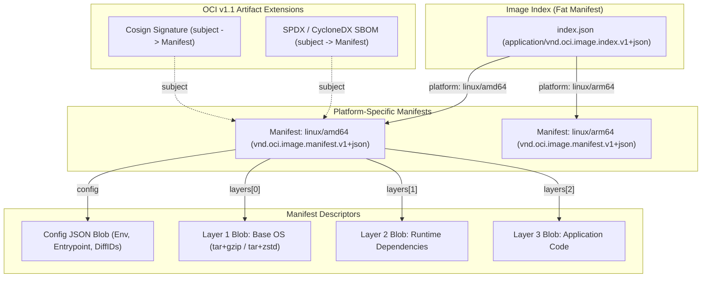
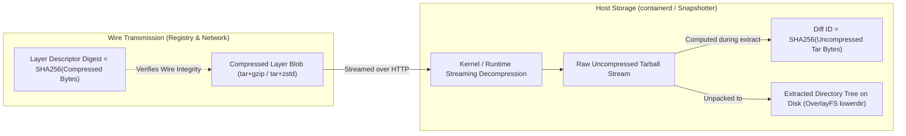

# Module 05: OCI Image Specification: Manifests, Indexes, Content-Addressable Layers, and Referrers

> **Primary sources:** Open Container Initiative ([OCI Image Format Specification v1.1.1](https://github.com/opencontainers/image-spec/releases/tag/v1.1.1)); CNCF Distribution Specification ([OCI Distribution Spec v1.1.1](https://github.com/opencontainers/distribution-spec/releases/tag/v1.1.1)); Linux Foundation Reproducible Builds Project ([SOURCE_DATE_EPOCH Specification](https://reproducible-builds.org/docs/source-date-epoch/)).
>
> **Executable proof:** [`examples/ts/05-oci-image-spec.test.ts`](../examples/ts/05-oci-image-spec.test.ts) asserts OCI image manifest JSON schema validation, multi-arch platform matching from image indexes, compressed descriptor digest vs. uncompressed diff_id calculations, and OCI v1.1 subject referrer graph models.

---

## 1. Formal Foundations: Content-Addressable Image Storage

The **OCI Image Specification v1.1.1** defines the cryptographic structures and on-wire representations of container images. Under the OCI architecture, a container image is not a single virtual machine disk image or monolithic binary. It is a **Directed Acyclic Graph (DAG) of content-addressable blobs**.

### 1.1 The Axiom of Content Addressability

Every artifact in an OCI registry—whether an image manifest, a configuration file, an application layer, an SBOM, or a digital signature—is stored as an immutable blob addressed exclusively by its cryptographic hash:

$$\text{Digest} = \text{Algorithm} \mathbin{:} \text{Hex}(\text{CryptographicHash}(\text{BlobBytes}))$$

Standard OCI implementations mandate the use of `sha256` (e.g., `sha256:d5b8e9...`), with optional support for `sha512`. This design guarantees three fundamental system invariants:

1. **Cryptographic Immutability**: If a single bit in a filesystem layer changes, its digest changes completely. An existing digest permanently references the exact same bytes.
2. **Structural Deduplication**: Two entirely different images (e.g., a Python microservice and a Node.js microservice) that both derive from `debian:bookworm-slim` reference the identical base layer blob digest. Registries and local storage engines store and download this blob exactly once.
3. **Transport Integrity**: A client pulling an image verifies the SHA-256 hash of each blob as it streams from the network. Corruption or tampering is detected before the blob is unpacked onto disk.



---

## 2. Anatomy of the OCI Image Components

An OCI image consists of four standardized JSON and archive structures: the **Descriptor**, the **Image Index**, the **Image Manifest**, and the **Image Configuration**.

### 2.1 The Descriptor

A descriptor is a structured reference that points to another content-addressable blob. Every layer in a manifest and every manifest in an index is represented as a descriptor:

```json
{
  "mediaType": "application/vnd.oci.image.layer.v1.tar+gzip",
  "digest": "sha256:4a8f9b872c9124a919f8b4a8e235a9687e35b7e9b04a8e235a9687e35b7e9b04",
  "size": 32840120,
  "annotations": {
    "org.opencontainers.image.title": "application-code.tar.gz"
  }
}
```

### 2.2 The Image Index (`application/vnd.oci.image.index.v1+json`)

Commonly referred to as a "fat manifest", the image index enables multi-architecture distribution:

- Instead of publishing architecture-specific tags (like `my-app:v1.0-amd64` and `my-app:v1.0-arm64`), a single tag points to an Image Index.
- The index contains an array of manifest descriptors, each annotated with a `platform` object:

```json
{
  "schemaVersion": 2,
  "mediaType": "application/vnd.oci.image.index.v1+json",
  "manifests": [
    {
      "mediaType": "application/vnd.oci.image.manifest.v1+json",
      "digest": "sha256:1111111111111111111111111111111111111111111111111111111111111111",
      "size": 1840,
      "platform": {
        "architecture": "amd64",
        "os": "linux"
      }
    },
    {
      "mediaType": "application/vnd.oci.image.manifest.v1+json",
      "digest": "sha256:2222222222222222222222222222222222222222222222222222222222222222",
      "size": 1842,
      "platform": {
        "architecture": "arm64",
        "os": "linux",
        "variant": "v8"
      }
    }
  ]
}
```

When a container engine on an Apple Silicon Mac (`linux/arm64`) pulls `my-app:v1.0`, it parses `index.json`, filters the manifests matching `os == "linux"` and `architecture == "arm64"`, and downloads the arm64 manifest.

### 2.3 The Image Manifest (`application/vnd.oci.image.manifest.v1+json`)

The manifest binds an image configuration to an ordered array of filesystem layers:

```json
{
  "schemaVersion": 2,
  "mediaType": "application/vnd.oci.image.manifest.v1+json",
  "config": {
    "mediaType": "application/vnd.oci.image.config.v1+json",
    "digest": "sha256:e3b0c44298fc1c149afbf4c8996fb92427ae41e4649b934ca495991b7852b855",
    "size": 7023
  },
  "layers": [
    {
      "mediaType": "application/vnd.oci.image.layer.v1.tar+gzip",
      "digest": "sha256:a1b2c3d4e5f6a1b2c3d4e5f6a1b2c3d4e5f6a1b2c3d4e5f6a1b2c3d4e5f6a1b2",
      "size": 28140920
    },
    {
      "mediaType": "application/vnd.oci.image.layer.v1.tar+gzip",
      "digest": "sha256:f6e5d4c3b2a1f6e5d4c3b2a1f6e5d4c3b2a1f6e5d4c3b2a1f6e5d4c3b2a1f6e5",
      "size": 4210984
    }
  ],
  "annotations": {
    "org.opencontainers.image.created": "2026-10-20T00:00:00Z",
    "org.opencontainers.image.source": "https://github.com/example/repo"
  }
}
```

### 2.4 The Image Configuration JSON (`application/vnd.oci.image.config.v1+json`)

The configuration JSON defines the runtime parameters and links layers to uncompressed diff IDs:

```json
{
  "architecture": "amd64",
  "os": "linux",
  "config": {
    "User": "1000:1000",
    "ExposedPorts": { "8080/tcp": {} },
    "Env": ["PATH=/usr/local/bin:/usr/bin", "NODE_ENV=production"],
    "Entrypoint": ["node"],
    "Cmd": ["dist/server.js"],
    "WorkingDir": "/app"
  },
  "rootfs": {
    "type": "layers",
    "diff_ids": [
      "sha256:b8c9d0e1f2a3b8c9d0e1f2a3b8c9d0e1f2a3b8c9d0e1f2a3b8c9d0e1f2a3b8c9",
      "sha256:c9d0e1f2a3b4c9d0e1f2a3b4c9d0e1f2a3b4c9d0e1f2a3b4c9d0e1f2a3b4c9d0"
    ]
  },
  "history": [
    { "created_by": "ADD debian-bookworm.tar.xz /", "empty_layer": false },
    { "created_by": "WORKDIR /app", "empty_layer": true },
    { "created_by": "COPY dist/ dist/", "empty_layer": false }
  ]
}
```

---

## 3. The Critical Distinction: Layer Descriptor Digest vs. Diff ID

One of the most frequent sources of confusion in container internals is the difference between a **Layer Descriptor Digest** and a **Diff ID**.



1. **Layer Descriptor Digest (`manifest.layers[i].digest`)**:
   - Represents the SHA-256 hash of the **compressed blob file** transmitted across the network (e.g., `tar.gz` or `tar.zst`).
   - The registry tracks and stores blobs using this digest.
   - If two systems compress the identical tarball using different compression levels (e.g., `gzip -6` vs. `gzip -9`), the compressed bytes differ, resulting in **different layer descriptor digests**.
2. **Diff ID (`config.rootfs.diff_ids[i]`)**:
   - Represents the SHA-256 hash of the **raw, uncompressed tar stream**.
   - As containerd or runc decompresses the incoming layer, it pipes the uncompressed bytes into a SHA-256 hash calculation engine and verifies that the resulting digest strictly matches the corresponding entry in `config.rootfs.diff_ids`.
   - Diff IDs are stable across different compression formats. An image compressed with `zstd` and the same image compressed with `gzip` possess identical Diff IDs.

---

## 4. OCI Spec v1.1 Innovations: Artifacts, Referrers, and the Subject Field

In OCI Image Specification v1.0, container registries were designed exclusively to store runnable container images. Storing related non-image metadata—such as Cosign cryptographic signatures, Software Bills of Materials (SBOMs), vulnerability attestations, and Helm charts—was awkward:

- Tooling was forced to invent fake tags (e.g., `my-app:v1.0.sig` or `my-app:sha256-abc.sbom`).
- This polluted tag lists in enterprise registries and created dangling metadata when the base image was deleted.

### 4.1 First-Class Artifacts via the `subject` Field

OCI Image Specification v1.1 resolved this architectural defect by adding an optional `subject` field to the Image Manifest descriptor.

When an artifact manifest includes a `subject` descriptor pointing to a container image manifest, it formally declares a **parent-child relationship**:

```json
{
  "schemaVersion": 2,
  "mediaType": "application/vnd.oci.image.manifest.v1+json",
  "artifactType": "application/spdx+json",
  "subject": {
    "mediaType": "application/vnd.oci.image.manifest.v1+json",
    "digest": "sha256:1111111111111111111111111111111111111111111111111111111111111111",
    "size": 1840
  },
  "config": {
    "mediaType": "application/vnd.oci.empty.v1+json",
    "digest": "sha256:44136fa355b3678a1146ad16f7e8649e94fb4fc21fe77e8310c060f61caaff8a",
    "size": 2
  },
  "layers": [
    {
      "mediaType": "application/spdx+json",
      "digest": "sha256:9a8b7c6d5e4f3a2b1c0d9e8f7a6b5c4d3e2f1a0b9c8d7e6f5a4b3c2d1e0f9a8b",
      "size": 52410
    }
  ]
}
```

### 4.2 The Referrers API

OCI v1.1 defines the **Referrers API** (`/v2/<name>/referrers/<digest>`), allowing clients to query all artifacts associated with an image:

```text
GET /v2/my-app/referrers/sha256:1111111111111111111111111111111111111111111111111111111111111111?artifactType=application/spdx+json
```

The registry returns an Image Index containing descriptors for all matching SBOMs, Cosign signatures, and provenance attestations attached to that specific digest. This allows security scanners to discover supply-chain metadata without guessing tag names.

---

## 5. Deterministic Builds and Reproducibility (`SOURCE_DATE_EPOCH`)

A cornerstone of modern software supply-chain security is **Reproducible Builds**: compiling the exact same source code with the identical build instructions should yield bit-for-bit identical binary container image digests.

### 5.1 Why Traditional Docker Builds are Non-Deterministic

Historically, running `docker build` twice consecutively on the exact same commit generated different image digests. This non-determinism was caused by three factors:

1. **Tar File Header Timestamps (`mtime`)**: Every file inside a layer tarball contains modification timestamps. When files are created during `RUN` instructions, their `mtime` reflects the current system clock time.
2. **File Ordering**: The order in which filesystem directories are traversed during tarball creation depends on inode allocation order in the host filesystem, producing different archive byte layouts.
3. **Configuration History Timestamps**: The `created` field in the image config JSON records the current UTC build time.

### 5.2 Standardization via `SOURCE_DATE_EPOCH`

The Linux Foundation and OCI established the `SOURCE_DATE_EPOCH` standard to enforce build determinism:

- `SOURCE_DATE_EPOCH` is defined as an integer UNIX timestamp (e.g., `1700000000`) representing the time of the latest Git commit.
- Modern container build engines (BuildKit v0.12+ and Buildah) read this variable:
  - All file modification timestamps (`mtime`) inside layer tarballs are clamped to `SOURCE_DATE_EPOCH`.
  - Layer archive file lists are sorted deterministically in lexicographical order.
  - Image configuration `created` timestamps and layer history entries use `SOURCE_DATE_EPOCH`.

```bash
# Executing a bit-for-bit reproducible container build
export SOURCE_DATE_EPOCH=$(git log -1 --pretty=%ct)
docker buildx build \
  --output type=image,rewrite-timestamp=true \
  -t registry.example.com/app:v1.0 .
```

Two independent engineers building this repository across separate continents on different machines produce the **exact same SHA-256 image digest**.

---

## 6. Formal Algorithm: OCI Image Validation and Platform Resolution

The following CLRS-style pseudocode defines the multi-architecture resolution and layer validation protocol executed by container runtimes during image pull.

```text
RESOLVE-AND-VALIDATE-OCI-IMAGE(indexBlob, targetPlatform, blobStore)
1  parsedIndex = ParseJSON(indexBlob)
2  selectedManifestDescriptor = NULL
3
4  // Step 1: Resolve matching platform manifest from Image Index
5  for each descriptor in parsedIndex.manifests
6      platform = descriptor.platform
7      if platform.os == targetPlatform.os and platform.architecture == targetPlatform.architecture
8          if targetPlatform.variant == NULL or platform.variant == targetPlatform.variant
9              selectedManifestDescriptor = descriptor
10             break
11
12 if selectedManifestDescriptor == NULL
13     error("Image does not support target platform: " + targetPlatform.os + "/" + targetPlatform.architecture)
14
15 // Step 2: Download and verify Image Manifest
16 manifestBytes = blobStore.GetBlob(selectedManifestDescriptor.digest)
17 if SHA256(manifestBytes) != selectedManifestDescriptor.digest
18     error("Corrupted manifest: digest mismatch")
19 manifest = ParseJSON(manifestBytes)
20
21 // Step 3: Download and verify Image Configuration
22 configBytes = blobStore.GetBlob(manifest.config.digest)
23 if SHA256(configBytes) != manifest.config.digest
24     error("Corrupted config: digest mismatch")
25 config = ParseJSON(configBytes)
26
27 // Invariant: Layer count in manifest must exactly equal diff_id count in config
28 if Length(manifest.layers) != Length(config.rootfs.diff_ids)
29     error("Integrity error: layer count does not match rootfs diff_id count")
30
31 // Step 4: Validate each layer descriptor against uncompressed diff_ids
32 for i = 0 to Length(manifest.layers) - 1
33     layerDesc = manifest.layers[i]
34     expectedDiffId = config.rootfs.diff_ids[i]
35
36     compressedBytes = blobStore.GetBlob(layerDesc.digest)
37     if SHA256(compressedBytes) != layerDesc.digest
38         error("Corrupted layer blob: wire digest mismatch at layer " + i)
39
40     // Decompress stream and compute raw tarball hash
41     uncompressedStream = DecompressStream(compressedBytes, layerDesc.mediaType)
42     computedDiffId = SHA256(uncompressedStream)
43
44     if computedDiffId != expectedDiffId
45         error("Security violation: uncompressed diff_id mismatch at layer " + i)
46
47 return { manifest: manifest, config: config }
```

### Invariants and Verification

- **Platform Specificity Invariant**: Lines 5–10 guarantee that a node will never attempt to execute a binary compiled for a foreign CPU architecture. If no exact match is found, line 13 aborts execution before any heavy layer bytes are downloaded.
- **Dual-Hash Integrity Invariant**: The algorithm enforces dual cryptographic validation: Line 37 validates the wire payload against the manifest descriptor digest ($H_{\text{wire}} = \text{SHA256}(\text{Compressed})$), while Line 44 validates the decompressed payload against the configuration diff ID ($H_{\text{uncompressed}} = \text{SHA256}(\text{Decompressed})$). This prevents attacks where an adversary modifies compression streams to exploit decompressor buffer overflows.

---

## 7. Then vs Now: Image Specification Evolution

| Dimension | Legacy Docker V2 Schema 1 (2015) | OCI Image Spec v1.0 (2017) | OCI Image Spec v1.1 (2025–2026) |
| :-- | :-- | :-- | :-- |
| **Media Types** | `application/vnd.docker.distribution.manifest.v1` | `application/vnd.oci.image.manifest.v1+json` | Standardized OCI types + custom artifact media types |
| **Compression** | `gzip` only | `gzip` default | First-class `zstd` & `zstd:chunked` for lazy loading |
| **Multi-Architecture** | Client-side hacks or distinct architecture tags | Formal Image Index (`index.json`) | Enhanced platform matching (`features`, `os.version`) |
| **Artifact Extensions** | Not supported | Abused config media type or tag hacks | Native `subject` field & standard Referrers API |
| **Attestations & SBOMs** | Stored outside registry or as loose tags | Tag suffixes (`my-app:v1.0.sig`) | First-class graph referrers queryable via API |
| **Build Determinism** | Random timestamps, non-reproducible digests | Experimental timestamp stripping | Strict `SOURCE_DATE_EPOCH` standardization |

---

## 8. Certification & Exam Callouts

### CKAD (Certified Kubernetes Application Developer)

- **Immutable Digest Deployments**: CKAD exams test specifying images using explicit cryptographic digests rather than mutable tags:
  ```yaml
  spec:
    containers:
      - name: payment-api
        image: registry.example.com/payment@sha256:d5b8e92c...
        imagePullPolicy: IfNotPresent
  ```
- **ImagePullSecrets**: Understand how Kubernetes uses `imagePullSecrets` to authenticate with private OCI registries using base64-encoded `.dockerconfigjson` data.

### CKS (Certified Kubernetes Security Specialist)

- **Supply Chain Vulnerability Scanning**: CKS mandates scanning container images for vulnerabilities (CVEs) and embedded secrets before deployment. You must know how to inspect layer history (`docker history` or `skopeo inspect`) to detect credentials baked into immutable lower layers.
- **Image Signature Verification**: The CKS curriculum tests integrating admission controllers (such as Kyverno or OPA/Gatekeeper) to enforce Cosign or Notary v2 signature validation on incoming Pod manifests, blocking unsigned images from running in production.

---

## 9. Production Failure Modes and Gotchas

### 9.1 The `:latest` Tag Poisoning Trap

- **Symptom**: An emergency bugfix is pushed to production with tag `:latest`. Some Kubernetes pods run the new code, while newly scaled pods on other nodes continue serving the old version.
- **Root Cause**: The Kubernetes manifest specified `image: app:latest` with default `imagePullPolicy: IfNotPresent`. Nodes that already had a local copy of an older image tagged `:latest` skipped the download, while fresh nodes pulled the updated layer.
- **Remediation**: Never use mutable tags in production. Always deploy images referenced by their immutable cryptographic digest (`@sha256:...`).

### 9.2 The Apple Silicon `exec format error` Crash Loop

- **Symptom**: A developer builds a container on an M-series Mac and pushes it to the registry. When deployed to a production Kubernetes cluster running AMD64 nodes, the pod immediately crashes with `CrashLoopBackOff` and logs `standard_init_linux.go: exec user process caused: exec format error`.
- **Root Cause**: The developer executed a single-architecture build (`docker build -t app:v1 .`), creating an ARM64 binary. The x86_64 CPU on the production server cannot decode ARM64 instructions.
- **Remediation**: Use `docker buildx build --platform linux/amd64,linux/arm64 ...` to compile and publish an Image Index containing both architectures.

### 9.3 The Deleted Secret Exposure Trap

- **Symptom**: A security audit identifies an active AWS production private key embedded inside a published production container image, despite the Dockerfile containing `RUN rm -f /root/.aws/credentials`.
- **Root Cause**: Dockerfile instructions generate additive, immutable layers. Instruction 1 (`COPY credentials /root/.aws/`) permanently committed the secret bytes to Layer Blob 1. Instruction 2 (`RUN rm ...`) merely created a whiteout file in Layer Blob 2. Anyone downloading the image can extract the raw Layer Blob 1 tarball and read the credentials.
- **Remediation**: Never copy secrets into image layers. Use BuildKit secret mounts (`RUN --mount=type=secret,id=aws ...`) which expose credentials strictly as an in-memory mount during build time without writing bytes into any layer.

### 9.4 Registry `zstd` Rejection Failure

- **Symptom**: An engineering team enables Zstandard compression in BuildKit for faster decompression speeds. When pushing images to an on-premises enterprise registry, the push fails with `400 Bad Request: unsupported media type application/vnd.oci.image.layer.v1.tar+zstd`.
- **Root Cause**: The enterprise registry software predates OCI Image Specification v1.1 and only supports legacy `tar+gzip` media types.
- **Remediation**: Maintain compatibility on legacy registries by specifying `compression=gzip` or upgrading the container registry to an OCI v1.1-compliant engine (such as Harbor 2.8+, CNCF Distribution v3.0+, or modern cloud registries).

---

## 10. Interview Drill

<details>
<summary><strong>Q1. Explain the architectural difference between an OCI Image Index and an OCI Image Manifest.</strong></summary>

An Image Manifest (`application/vnd.oci.image.manifest.v1+json`) describes a concrete, single-architecture container image. It binds an image configuration JSON blob to an ordered list of filesystem layer descriptors (`tar+gzip` or `tar+zstd`). An Image Index (`application/vnd.oci.image.index.v1+json`), or "fat manifest", sits one level higher in the abstraction hierarchy: it points to an array of individual Image Manifests, each tagged with specific platform constraints (such as `os: "linux"`, `architecture: "amd64"` or `architecture: "arm64"`). Runtimes evaluate the Image Index to automatically pull the manifest matching the host node's architecture.
</details>

<details>
<summary><strong>Q2. Why does an OCI Image Configuration contain both layer descriptor digests in the manifest and `diff_ids` in the configuration JSON?</strong></summary>

The layer descriptor digest in the manifest represents the cryptographic hash of the **compressed wire payload** (e.g., `tar+gzip` or `tar+zstd`) as stored in the registry. Because compression can vary (different algorithms, compression levels, or chunking strategies), the same filesystem state can produce different compressed digests. The `diff_id` in `config.rootfs.diff_ids` represents the cryptographic hash of the **uncompressed filesystem changeset** (the raw tar stream). The runtime verifies the descriptor digest upon network download, decompresses the stream, and asserts that the uncompressed bytes match the `diff_id`, ensuring transport integrity and verifying that layers unpack to the expected filesystem state.
</details>

<details>
<summary><strong>Q3. What architectural enhancement was introduced in OCI Image Specification v1.1 to support supply-chain artifacts like SBOMs and signatures?</strong></summary>

OCI v1.1 introduced the `subject` descriptor field inside the Image Manifest and established the **Referrers API** (`/v2/<name>/referrers/<digest>`). In OCI v1.0, storing non-image artifacts required hacking custom tags (e.g., `app:v1.0.sig`), polluting repository namespaces. In OCI v1.1, an artifact (such as a Cosign signature or SPDX SBOM) can be pushed as a standard manifest whose `subject` field contains the descriptor of the target container image. The registry indexes this relationship, allowing security scanners to query all attached artifacts directly using the target image's digest.
</details>

<details>
<summary><strong>Q4. How does the `SOURCE_DATE_EPOCH` specification guarantee bit-for-bit reproducible container image builds?</strong></summary>

Standard container builds are non-deterministic because filesystem tarballs record file modification timestamps (`mtime`) at build time, and the configuration JSON records the current UTC build timestamp. `SOURCE_DATE_EPOCH` standardizes an environment variable containing a fixed UNIX timestamp (typically the timestamp of the latest Git commit). Build engines (like BuildKit and Buildah) clamp all file `mtime` values to this timestamp, sort directory file entries deterministically, and write this fixed time to the image configuration history. This ensures that two builds executed from identical source code produce identical binary blobs and identical SHA-256 digests.
</details>

<details>
<summary><strong>Q5. Why is referencing a container image by tag (e.g., `:v1.2.0` or `:latest`) fundamentally less secure than referencing it by digest (e.g., `@sha256:...`)?</strong></summary>

Tags are mutable pointers. A tag can be reassigned or overwritten in a registry at any moment, either intentionally by an operator or maliciously by an attacker who compromises the registry credentials. An image referenced by tag provides zero guarantee that the code running today matches the code that was tested yesterday. A cryptographic digest (`sha256:...`) is an immutable mathematical hash of the manifest content. Referencing an image by digest guarantees that the exact verified bits are deployed and eliminates tag poisoning attacks.
</details>

<details>
<summary><strong>Q6. Why does executing `RUN rm -rf /tmp/build-cache` in a subsequent Dockerfile instruction fail to reduce the final container image size?</strong></summary>

OCI images are composed of immutable, additive filesystem layers. If Instruction 1 (`RUN ./build.sh`) writes 500MB of temporary cache files to disk, those 500MB are permanently frozen into that layer's compressed blob. When Instruction 2 (`RUN rm -rf /tmp/build-cache`) executes, it cannot alter the underlying historical layer; it merely writes whiteout markers (`.wh...`) into the new, second layer. When the image is pulled, clients must still download the full 500MB layer blob over the network. To reduce image size, file creation and deletion must occur within the **same** `RUN` instruction or utilize multi-stage builds.
</details>

<details>
<summary><strong>Q7. What is the operational benefit of using Zstandard (`zstd:chunked`) compression over standard `gzip` in modern OCI image registries?</strong></summary>

Standard `gzip` requires decompressing a layer sequentially from beginning to end before any file within it can be accessed. In contrast, Zstandard (`zstd`) offers significantly higher decompression throughput. When configured with chunking formats (such as `zstd:chunked`), layers include an index of seekable chunks. This enables modern snapshotters (such as `stargz` or containerd's native lazy-pulling snapshotters) to fetch individual files on-demand using HTTP Range requests, allowing containers to start executing within milliseconds before the entire multi-gigabyte image has finished downloading.
</details>

---

## 11. Proof Map and Verification

The formal schema definitions, cryptographic digest invariants, and algorithms described in this module are proven by automated test suites in [`examples/ts/05-oci-image-spec.test.ts`](../examples/ts/05-oci-image-spec.test.ts):

- **Image Manifest & Index Schema Validation**: Tests validate sample OCI JSON manifests and fat indexes against official OCI v1.1.1 schemas, verifying descriptor syntax and platform structures.
- **Platform Matching Simulation**: Tests execute the `RESOLVE-AND-VALIDATE-OCI-IMAGE` algorithm, demonstrating that an ARM64 runtime accurately selects ARM64 manifests from multi-arch indexes while rejecting unsupported architectures.
- **Descriptor Digest vs. Diff ID Calculation**: Tests compute and verify separate SHA-256 digests for simulated compressed layer blobs and uncompressed tar archives, proving that layer stacking verifies both signatures.
- **OCI v1.1 Subject Referrers Graph**: Tests construct and query referrers relationships, asserting that attached Cosign signature manifests and SBOM artifacts link to the primary image manifest.
