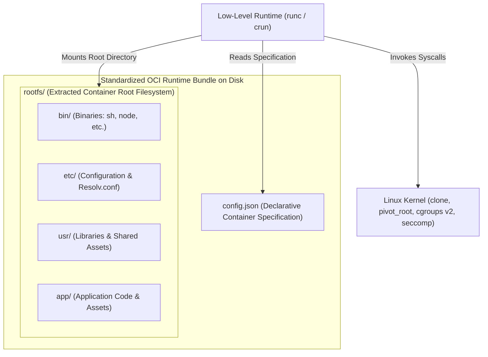
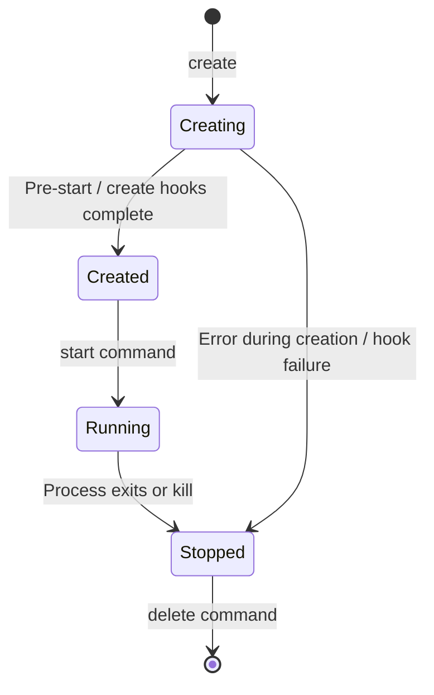
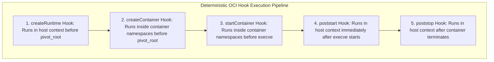
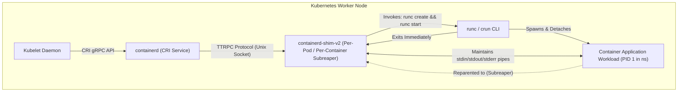

# Module 06: OCI Runtime Specification and Runtimes: Bundles, Lifecycle, runc, crun, and Sandboxes

> **Primary sources:** Open Container Initiative ([OCI Runtime Specification v1.3.0](https://github.com/opencontainers/runtime-spec/releases/tag/v1.3.0)); containerd Architecture Documentation ([CRI Plugin & Shim v2](https://github.com/containerd/containerd/blob/main/docs/cri/architecture.md)); Giuseppe Scrivano ([crun: A fast and lightweight fully featured OCI runtime in C](https://github.com/containers/crun)); Google Open Source ([gVisor Architecture](https://gvisor.dev/docs/architecture_guide/)); Kata Containers Architecture ([Kata Containers Design](https://github.com/kata-containers/kata-containers/blob/main/docs/design/architecture/README.md)).
>
> **Executable proof:** [`examples/ts/06-oci-runtime-spec-and-runtimes.test.ts`](../examples/ts/06-oci-runtime-spec-and-runtimes.test.ts) asserts OCI bundle `config.json` schema validation, the four-state lifecycle state machine transitions, lifecycle hook execution ordering, and sandboxed runtime classification models.

---

## 1. Formal Foundations of the OCI Runtime Specification v1.3.0

The **OCI Runtime Specification v1.3.0** standardizes the configuration, operational execution environment, and lifecycle state transitions of containerized processes.

While higher-level container engines (such as Docker, Podman, and Kubernetes CRI daemons) pull images, manage network subnets, and unpack filesystem layers, the actual instantiation of the container process is delegated to a **Low-Level OCI Runtime**.

A low-level runtime operates against a standardized on-disk directory known as an **OCI Runtime Bundle**:



An OCI Runtime Bundle contains exactly two artifacts:

1. **`config.json`**: The declarative JSON document specifying execution credentials, environment variables, mounts, cgroups v2 paths, Linux capabilities, seccomp filters, and namespace configurations.
2. **`rootfs/`**: The directory containing the unpacked root filesystem layers that will be mounted via `pivot_root(2)` as the container's root directory.

---

## 2. Deep Dive: The `config.json` Specification Structure

The `config.json` file is the contract between high-level container orchestrators and low-level execution runtimes. A compliant v1.3.0 configuration defines several core sections:

```json
{
  "ociVersion": "1.3.0",
  "root": {
    "path": "rootfs",
    "readonly": true
  },
  "process": {
    "terminal": false,
    "user": {
      "uid": 1000,
      "gid": 1000,
      "additionalGids": [1001]
    },
    "args": ["node", "dist/server.js"],
    "env": [
      "PATH=/usr/local/sbin:/usr/local/bin:/usr/sbin:/usr/bin:/sbin:/bin",
      "NODE_ENV=production"
    ],
    "cwd": "/app",
    "capabilities": {
      "bounding": ["CAP_NET_BIND_SERVICE"],
      "effective": ["CAP_NET_BIND_SERVICE"],
      "permitted": ["CAP_NET_BIND_SERVICE"],
      "ambient": ["CAP_NET_BIND_SERVICE"],
      "inheritable": []
    },
    "rlimits": [{ "type": "RLIMIT_NOFILE", "hard": 65536, "soft": 65536 }],
    "noNewPrivileges": true
  },
  "mounts": [
    {
      "destination": "/proc",
      "type": "proc",
      "source": "proc",
      "options": ["nosuid", "noexec", "nodev"]
    },
    {
      "destination": "/dev",
      "type": "tmpfs",
      "source": "tmpfs",
      "options": ["nosuid", "strictatime", "mode=755", "size=65536k"]
    }
  ],
  "linux": {
    "namespaces": [
      { "type": "pid" },
      { "type": "network" },
      { "type": "ipc" },
      { "type": "uts" },
      { "type": "mount" },
      { "type": "cgroup" }
    ],
    "cgroupsPath": "machine.slice/container-app.scope",
    "resources": {
      "memory": {
        "max": 1073741824,
        "high": 943718400
      },
      "cpu": {
        "max": "200000 100000"
      },
      "pids": {
        "max": 1024
      }
    },
    "maskedPaths": ["/proc/kcore", "/proc/latency_stats", "/proc/timer_list", "/sys/firmware"],
    "readonlyPaths": ["/proc/bus", "/proc/fs", "/proc/sys", "/proc/sysrq-trigger"]
  }
}
```

### 2.1 Masked and Read-Only Paths

Notice the `maskedPaths` and `readonlyPaths` arrays in the `linux` stanza:

- **`maskedPaths`**: Points to sensitive kernel files. The runtime masks these paths by mounting `/dev/null` or an empty read-only directory over them. This prevents container processes from inspecting host memory (`/proc/kcore`) or accessing host ACPI/firmware interfaces (`/sys/firmware`).
- **`readonlyPaths`**: Paths where container processes require read access to system metadata, but write access must be blocked to prevent modifying host kernel sysctls (`/proc/sysrq-trigger`).

---

## 3. The Container Lifecycle State Machine

The OCI Runtime Specification strictly defines the formal lifecycle states of a container and the allowed transitions between them:



### 3.1 The Four Formal OCI Lifecycle States

1. **`creating`**:
   - The runtime reads `config.json`, parses cgroup and namespace configurations, and creates the container process in an isolated, suspended state using synchronization pipes.
   - The runtime sets up mounts, masks paths, and applies seccomp filters.
2. **`created`**:
   - The container process is completely initialized inside its new namespaces and bound to its cgroup.
   - The process is paused, waiting for the runtime's explicit start command.
   - High-level orchestrators can safely query the container PID, inspect network interfaces, or inject configuration before application execution begins.
3. **`running`**:
   - The runtime sends the resume signal across the synchronization pipe.
   - The container process invokes `execve(2)` with the application binary and arguments specified in `process.args`.
4. **`stopped`**:
   - The application process terminates (either normally via `exit(code)` or abnormally via a signal).
   - The container remains in the `stopped` state until an orchestrator invokes `delete` to clean up cgroup nodes and unmount filesystems.

### 3.2 OCI Lifecycle Hooks

The runtime spec defines standardized extension points ("hooks") that execute external binaries at deterministic milestones during the container lifecycle:



- **`createRuntime`**: Executed by the runtime in the host namespace context after namespaces have been allocated, but before pivoting to the container rootfs. Primarily utilized by CNI network plugins to configure veth pairs and IP routing.
- **`startContainer`**: Executed inside the container's namespaces immediately before `execve` replaces the initialization binary with the target application workload.
- **`poststop`**: Executed after the container has halted and all application tasks have terminated. Used by storage drivers and network plugins to reclaim IP allocations and unmount snapshots.

---

## 4. Low-Level Runtimes Compared: `runc` vs. `crun`

The two predominant OCI-compliant runtimes in production are **`runc`** (the OCI reference implementation) and **`crun`** (the high-performance C runtime).

### 4.1 The Go Runtime Dilemma in `runc`

`runc` is written in Go. While Go provides memory safety and rich standard libraries, its runtime architecture presents severe engineering challenges when interacting with Linux namespace system calls:

- Go implements an M:N user-space scheduler that multiplexes goroutines across a pool of operating system threads (`M`).
- Linux namespace system calls—specifically `setns(2)` and `unshare(2)`—**operate at the thread level, not the process level**.
- When a Go program boots, the Go runtime spawns auxiliary OS background threads (for GC, sysmon, and scheduler coordination) before executing `main()`.
- If Go attempted to call `setns` from Go code, only a single thread would enter the container namespace. As goroutines migrate across OS threads, they would randomly execute in different namespace contexts, causing memory corruption and security vulnerabilities.

#### The Cgo Constructor Hack (`nsenter.c`)

To bypass Go's scheduler, `runc` includes a C source file (`libcontainer/nsenter/nsexec.c`) compiled via Cgo with a GCC constructor attribute:

```c
__attribute__((constructor)) void init(void) {
    // Intercepts execution BEFORE the Go runtime or main() initializes!
    // Operating strictly in single-threaded C mode:
    // Performs setns, unshare, and pivot_root safely.
}
```

This constructor intercepts the process during ELF binary loading, executing the namespace cloning operations before the Go runtime can initialize its thread pool.

### 4.2 The High-Performance C Architecture of `crun`

Written by Giuseppe Scrivano and maintained under the Podman ecosystem, **`crun`** is implemented in pure C:

- **Zero Runtime Overhead**: No garbage collector, no M:N user-space thread scheduler, and no Cgo constructor acrobatics.
- **Extreme Memory Efficiency**: `runc` consumes 15MB–30MB of memory during container initialization. `crun` consumes less than 2MB, allowing massive container density on resource-constrained edge devices.
- **Startup Latency**: `crun` initializes containers in approximately 1.5 milliseconds—up to 10x faster than `runc`.
- **Native cgroups v2 & systemd Integration**: `crun` interacts directly with Linux kernel cgroup v2 APIs and systemd D-Bus interfaces natively without intermediate library wrappers.

| Dimension | `runc` (OCI Reference) | `crun` (Podman / Red Hat Standard) |
| :-- | :-- | :-- |
| **Language** | Go (with Cgo `nsenter` bootstrap) | Pure C (POSIX / Linux Native) |
| **Memory Footprint** | ~15MB–30MB RSS per spawn | <2MB RSS per spawn |
| **Startup Latency** | ~15ms–40ms | ~1.5ms–5ms |
| **Thread Architecture** | Multi-threaded Go runtime | Controlled single-threaded execution |
| **cgroups v2 Support** | Supported via Go libraries | First-class, highly optimized native C support |
| **Default In** | Docker Engine, containerd default | Podman 4/5/6, Fedora, RHEL, Red Hat OpenShift |

---

## 5. Sandboxed Runtimes: Kata Containers and gVisor (`runsc`)

Traditional OCI runtimes (`runc`, `crun`) execute containers directly on the host Linux kernel. While namespaces and cgroups restrict visibility and resource consumption, the container still shares the complete 450+ system call interface of the host kernel.

When hosting untrusted multi-tenant workloads, public SaaS platforms, or running untrusted AI code, organizations deploy **Sandboxed Runtimes**.

```mermaid
flowchart TD
    subgraph Traditional["1. Traditional OCI (runc / crun)"]
        App1["Untrusted Application"]
        HostK1["Host Linux Kernel (450+ Syscalls Exposed)"]
        App1 -->|"Direct Syscalls (Shared Kernel Risk)"| HostK1
    end

    subgraph SyscallInterception["2. Syscall Interception (gVisor runsc)"]
        App2["Untrusted Application"]
        Sentry["gVisor Sentry (Go Application Kernel in User Space)"]
        Gofer["gVisor Gofer (Secure Host Filesystem Broker)"]
        HostK2["Host Linux Kernel (Narrow Filtered Syscalls)"]
        App2 -->|"Intercepted via KVM/ptrace"| Sentry
        Sentry --> Gofer
        Sentry -->|"Minimal Syscalls"| HostK2
    end

    subgraph MicroVMIsolation["3. Hardware MicroVM (Kata Containers)"]
        App3["Untrusted Application"]
        GuestK["Dedicated Guest Linux Kernel"]
        QEMU["MicroVM VMM (QEMU / Cloud-Hypervisor)"]
        HostK3["Host Linux Kernel (Hardware EPT/NPT Isolation)"]
        App3 --> GuestK
        GuestK --> QEMU
        QEMU -->|"Hardware VM Boundary (VMCS/VMCB)"| HostK3
    end
```



### 5.1 gVisor (`runsc`): User-Space Application Kernel

Engineered by Google, **gVisor** provides application-level sandboxing:

- **The Sentry**: A complete operating system kernel written in Go running in user space (Ring 3). The application container executes inside this sandbox.
- When the container invokes a system call (such as `socket()`, `epoll_create()`, or `mmap()`), gVisor intercepts the call using KVM virtualization or `ptrace`.
- The Sentry implements the system call logic entirely within its own memory space. Only a tiny, strictly vetted subset of safe system calls (such as writing to network buffers or physical disk files) are ever forwarded to the underlying host Linux kernel.
- **The Gofer**: An isolated user-space process that mediates all filesystem access, preventing container processes from exploiting host VFS vulnerabilities.

### 5.2 Kata Containers: Hardware-Enforced MicroVMs

Maintained by the Open Infrastructure Foundation, **Kata Containers** combines container ergonomics with hardware-assisted virtualization:

- Each Kubernetes Pod or container runs inside a dedicated, ultra-lightweight **MicroVM** powered by QEMU, Cloud-Hypervisor, or Firecracker.
- Each container has its own dedicated guest Linux kernel, its own guest memory address space, and its own guest page tables.
- Isolation is enforced by physical CPU hardware extensions (Intel VMX / AMD SVM). If a compromised container process exploits a zero-day kernel privilege escalation bug, it compromises only the ephemeral guest kernel inside the microVM; the physical host hardware and co-located tenants remain isolated.

| Sandboxing Model | Standard OCI (`runc`/`crun`) | Syscall Filter (`gVisor` / `runsc`) | Hardware MicroVM (`Kata Containers`) |
| :-- | :-- | :-- | :-- |
| **Isolation Mechanism** | Software (Namespaces & cgroups) | User-space Kernel (Syscall Interception) | Hardware Virtualization (Intel VMX / AMD SVM) |
| **Kernel Instances** | Shared host kernel | Emulated user-space kernel (Sentry) | Dedicated guest Linux kernel per Pod |
| **Syscall Overhead** | Zero (Native execution) | Moderate to High (Emulation penalties) | Low (Direct execution in guest kernel) |
| **Memory Overhead** | ~15MB–30MB | ~30MB–50MB | ~100MB–250MB (Guest kernel memory) |
| **Host Kernel Attack Surface** | Full (450+ system calls) | Minimal (~30 host system calls) | Hardware ISA / Virtual Device boundary |
| **Best Used For** | Trusted microservices, internal apps | Untrusted SaaS web workloads, multi-tenancy | High-security multi-tenant, untrusted binaries |

---

## 6. Containerd Shim v2 Architecture and Kubernetes CRI Integration

A container engine cannot simply execute `runc run` directly and keep the main daemon blocked waiting for the container to terminate. If `containerd` or `dockerd` were the direct parent of all containers:

1. Restarting or upgrading the daemon would sever process connections and terminate all running customer workloads.
2. The daemon would need to handle thousands of open PTY and standard I/O file descriptors, creating thread contention and memory bloat.

### 6.1 The containerd-shim-v2 Protocol

To solve this, containerd engineered the **Shim v2 API**:



1. Kubelet sends a `CreateContainer` request over the Container Runtime Interface (CRI) gRPC socket to containerd.
2. containerd spawns a dedicated `containerd-shim-v2` process on the host.
3. containerd communicates with the shim over a lightweight binary RPC protocol called **TTRPC** via a local UNIX domain socket.
4. The shim invokes the low-level runtime CLI:
   ```bash
   runc create --bundle /run/containerd/io.containerd.runtime.v2.task/... <container_id>
   runc start <container_id>
   ```
5. Once the containerized application process starts, `runc` exits.
6. The shim marks itself as a **subreaper** (`prctl(PR_SET_CHILD_SUBREAPER)`). When child processes inside the container terminate or orphan, they are reparented directly to the shim.
7. The shim remains alive as a minimal daemon (<5MB RSS), holding open the standard I/O streams, capturing the application exit code, and relaying telemetry back to containerd.

---

## 7. Formal Algorithm: OCI Runtime Lifecycle State Transitions

The following CLRS-style algorithm models the deterministic state transition and lifecycle hook execution protocol enforced by low-level OCI runtimes.

```text
OCI-LIFECYCLE-TRANSITION(containerBundle, initialOp)
1  state = "creating"
2  spec = LoadBundleConfig(containerBundle)
3  ValidateConfigSchema(spec)
4
5  // Step 1: Create isolated namespaces and cgroup structure
6  cgroupNode = SetupCgroupsV2(spec.linux.cgroupsPath, spec.linux.resources)
7  containerPid = SpawnIsolatedInitProcess(spec, cgroupNode)
8
9  // Step 2: Execute createRuntime hooks in host namespace
10 for each hook in spec.hooks.createRuntime
11     exitCode = ExecuteHook(hook, spec, containerPid)
12     if exitCode != 0
13         AbortAndCleanup(containerPid, cgroupNode)
14         error("createRuntime hook failed with code " + exitCode)
15
16 // Step 3: Execute createContainer hooks inside container namespaces
17 for each hook in spec.hooks.createContainer
18     exitCode = ExecuteHookInNamespace(hook, containerPid)
19     if exitCode != 0
20         AbortAndCleanup(containerPid, cgroupNode)
21         error("createContainer hook failed with code " + exitCode)
22
23 state = "created"
24
25 // Step 4: Await explicit start instruction
26 WaitForStartCommand()
27
28 // Step 5: Execute startContainer hooks inside container
29 for each hook in spec.hooks.startContainer
30     ExecuteHookInNamespace(hook, containerPid)
31
32 // Signal initialization process to invoke execve
33 SendSignalToInitProcess(containerPid, RESUME_EXECVE)
34 state = "running"
35
36 // Step 6: Execute poststart hooks in host context asynchronously
37 for each hook in spec.hooks.poststart
38     ExecuteHookAsync(hook, containerPid)
39
40 // Monitor application execution until termination
41 status = WaitForProcessExit(containerPid)
42 state = "stopped"
43
44 // Step 7: Execute poststop cleanup hooks
45 for each hook in spec.hooks.poststop
46     ExecuteHook(hook, spec, status.exitCode)
47
48 return status.exitCode
```

### Invariants and Mathematical Properties

- **Monotonic Lifecycle Transition**: The sequence of states strictly satisfies: $$\text{Creating} \longrightarrow \text{Created} \longrightarrow \text{Running} \longrightarrow \text{Stopped}$$ No valid runtime execution can transition directly from `creating` to `running` without traversing `created` and executing the associated lifecycle hooks.
- **Fail-Fast Boundary Invariant**: If any hook in `createRuntime` or `createContainer` returns a non-zero exit code (lines 12 and 19), execution is terminated immediately, resources are cleaned up via `AbortAndCleanup()`, and the container never enters the `created` or `running` state.
- **Hook Namespace Determinism**: Hooks are executed within strictly isolated contexts: `createRuntime` and `poststop` run in the host root context, whereas `createContainer` and `startContainer` execute within the target container's PID, network, and mount namespaces.

---

## 8. Then vs Now: Runtime Architecture Evolution

| Runtime Architecture Dimension | Early Container Engines (2013–2015) | Modern OCI Standard (2025–2026) |
| :-- | :-- | :-- |
| **Daemon Process Hierarchy** | Monolithic daemon (`dockerd`) parented all containers | Decoupled per-container shims (`containerd-shim-v2`) |
| **Runtime Portability** | Hard dependency on Docker-specific internals | Standardized OCI Runtime Bundles (`config.json` + `rootfs`) |
| **Reference Runtime** | LXC shell scripts / early `libcontainer` | Standardized `runc` (Go) and optimized `crun` (C) |
| **Untrusted Multi-Tenancy** | Shared host kernel with basic seccomp profiles | Hardware microVMs (Kata) or user-space kernels (gVisor) |
| **Daemon Restarts / Upgrades** | Restarting Docker killed all running containers | Live-restore enabled; shims survive daemon restarts |
| **Syscall Filtering** | Basic Docker seccomp blacklist | Granular seccomp notify (`SECCOMP_RET_USER_NOTIF`) |
| **Kubernetes Runtime Interface** | Custom Docker daemon shim (`dockershim`) | Direct Container Runtime Interface (CRI) over gRPC |

---

## 9. Certification & Exam Callouts

### CKAD (Certified Kubernetes Application Developer)

- **Container Lifecycle Handlers**:
  - `postStart`: Executes immediately after a container is created. Note: `postStart` runs asynchronously with the container's `ENTRYPOINT`; there is no guarantee that `postStart` completes before application code begins executing.
  - `preStop`: Executes immediately before a container is terminated due to an API request or pod eviction. The pod remains in `Terminating` status while `preStop` runs. If `preStop` does not complete within `terminationGracePeriodSeconds`, the orchestrator escalates to `SIGKILL`.

### CKS (Certified Kubernetes Security Specialist)

- **Kubernetes `RuntimeClass` Configuration**: CKS requires configuring sandboxed runtimes for sensitive workloads. Understand how to register a `RuntimeClass` resource:
  ```yaml
  apiVersion: node.k8s.io/v1
  kind: RuntimeClass
  metadata:
    name: gvisor
  handler: runsc
  ```
  And how to attach it to untrusted Pods:
  ```yaml
  spec:
    runtimeClassName: gvisor
    containers:
      - name: untrusted-worker
        image: worker:v1
  ```
- **Mitigating Container Escapes (CVE-2019-5736)**: Understand vulnerabilities where a malicious container process writes to the host `runc` binary via `/proc/self/exe`. Verify that host nodes run patched runtime versions using memory-file descriptor sealing (`memfd_create`) or binary cloning.

---

## 10. Production Failure Modes and Gotchas

### 10.1 The Zombie Shim Accumulation Leak

- **Symptom**: A high-throughput batch worker node that executes thousands of short-lived container jobs per hour runs out of memory and exhausts host process slots. `ps aux` reveals thousands of orphaned `containerd-shim-v2` processes.
- **Root Cause**: The application container terminated abruptly or hung during I/O teardown, and containerd failed to receive the exit notification over TTRPC. The shim remained running as a subreaper, waiting for a process cleanup signal that never arrived.
- **Remediation**: Configure automated pod cleanup timeouts, ensure applications properly close inherited file descriptors, and monitor host shim count metrics (`containerd_shim_count`).

### 10.2 The `/proc/self/exe` Host Binary Overwrite (CVE-2019-5736)

- **Symptom**: An attacker compromises an unprivileged container running on a host and immediately gains root access across the entire bare-metal cluster.
- **Root Cause**: During `docker exec` operations, the host `runc` binary executes inside the container's mount namespace before switching user credentials. A malicious container process opened `/proc/[runc_pid]/exe` with write intent (`O_WRONLY`), overwriting the host `runc` binary with malicious code. The next time the host ran any container, the attacker's payload executed as host root.
- **Remediation**: Modern `runc` and `crun` versions mitigate this attack by creating an anonymous, sealed, read-only memory file descriptor via `memfd_create(2)` and executing `runc` from this sealed copy, preventing modifications to the host binary on disk.

### 10.3 The High-Syscall Performance Cliff in gVisor

- **Symptom**: An engineering team migrates a Redis cache service into a gVisor (`runsc`) sandboxed runtime. The service's throughput drops by 70%, and p99 query latency jumps from 200 microseconds to 3.5 milliseconds.
- **Root Cause**: Redis executes millions of lightweight system calls (`epoll_wait`, `read`, `write`) per second. In standard runc, syscalls execute natively against the kernel. In gVisor, every system call triggers an interception trap into user-space Go code, incurring context-switch and emulation penalties.
- **Remediation**: Do not run high-frequency, syscall-bound I/O engines (such as Redis or raw web proxies) in syscall-interception sandboxes without careful performance profiling. Use MicroVM sandboxes (`Kata Containers`) for I/O-intensive workloads requiring strong isolation.

### 10.4 Invalid Mount Paths in `config.json` Crashing Runtimes Silently

- **Symptom**: A container deployment immediately fails with `CreateContainerError` or `CrashLoopBackOff`, but `docker logs` and `kubectl logs` return completely empty strings.
- **Root Cause**: A misconfigured volume mount specified a non-existent host source directory or an invalid mount option in `config.json`. The low-level runtime (`runc`/`crun`) crashed during the `creating` phase before the application process could ever be spawned. Because the application never ran, no application logs exist.
- **Remediation**: Inspect the container engine and kubelet systemd journal logs (`journalctl -u containerd -e` or `crictl inspect`) to review low-level runtime error messages.

---

## Interview Drill

<details><summary>1. Explain the architectural division of labor between a high-level runtime like containerd and a low-level runtime like `runc`.</summary>

A high-level runtime (`containerd`, `CRI-O`, `dockerd`) manages the end-to-end lifecycle of containers across a system: it downloads and verifies OCI image layers from remote registries, manages content-addressable storage snapshotters, unpacks image filesystems into directory trees, configures network namespaces via CNI, and translates Kubernetes CRI requests. A low-level runtime (`runc`, `crun`) has no networking, image-pulling, or storage-downloading capabilities. It accepts a pre-configured OCI Runtime Bundle on disk (`config.json` and `rootfs/`) and interfaces directly with Linux kernel system calls (`clone`, `unshare`, `setns`, `pivot_root`, and cgroups v2) to spawn the containerized process.
</details>

<details><summary>2. Why is `containerd-shim-v2` necessary, and what operational failures would occur if containerd parented container processes directly?</summary>

If containerd were the direct parent of all container processes on a host:

1. Upgrading or restarting the containerd daemon would sever parent-child links and abruptly terminate all executing customer containers.
2. containerd would have to maintain thousands of active file descriptors for standard input, output, and error streams, introducing memory bloat and lock contention.

`containerd-shim-v2` acts as a per-pod or per-container subreaper daemon. It holds the container's standard I/O pipes, collects its exit status code, and forwards signals. This allows containerd to restart or crash without impacting running container workloads.
</details>

<details><summary>3. What problem does Cgo constructor execution (`__attribute__((constructor))`) solve in `runc`?</summary>

Linux namespace system calls (`setns` and `unshare`) operate at the thread level, not the process level. The Go programming language features an M:N user-space scheduler that automatically initializes a pool of operating system threads before the `main()` function is ever executed. If Go code attempted to call `setns`, only a single thread would enter the new namespace, leaving the Go runtime in an undefined, corrupted state where goroutines hopping across threads would randomly execute in different namespaces. To bypass this, `runc` compiles a C bootstrap function (`nsenter.c`) with a constructor attribute that runs during ELF loading before the Go runtime initializes, ensuring namespace transitions occur safely while the process is strictly single-threaded.
</details>

<details><summary>4. Contrast the architectural design of `crun` with `runc` and highlight its primary performance advantages.</summary>

`runc` is implemented in Go (requiring a Cgo bootstrap constructor) and consumes 15MB–30MB of memory per spawn. `crun` is implemented in pure C with zero runtime dependencies and no garbage collector. Its primary advantages include:

1. **Memory Footprint**: `crun` consumes less than 2MB of memory during container creation, enabling high container density on edge devices.
2. **Startup Speed**: `crun` instantiates containers in approximately 1.5ms, roughly 10x faster than `runc`.
3. **Native cgroups v2 and systemd Integration**: `crun` interfaces directly with Linux kernel cgroup v2 APIs and systemd D-Bus IPC without the overhead of Go runtime layers.

</details>

<details><summary>5. How does gVisor (`runsc`) provide container sandboxing, and what is its primary performance trade-off?</summary>

gVisor provides sandboxing through system call interception. It implements an independent application kernel written in Go called the "Sentry" that runs in user space (Ring 3). When the containerized process invokes a system call, it is trapped (using KVM or `ptrace`) and handled entirely inside the Sentry's memory space. Only a narrow, vetted subset of safe system calls are ever forwarded to the underlying host Linux kernel. The primary trade-off is **system call latency**: applications that execute frequent, high-throughput system calls (such as Redis or raw socket network proxies) experience significant performance penalties due to interception and user-space emulation overhead.
</details>

<details><summary>6. How does Kata Containers achieve hardware-enforced isolation while presenting the standard OCI container interface?</summary>

Kata Containers implements the OCI Runtime Specification, meaning it accepts standard OCI bundles and integrates seamlessly with containerd and Kubernetes CRI. However, instead of spawning processes directly on the host kernel using namespaces, Kata launches an ultra-lightweight **MicroVM** (powered by QEMU, Cloud-Hypervisor, or Firecracker) with a minimal dedicated guest Linux kernel. The container workload executes inside this microVM. Isolation is enforced by hardware CPU virtualization extensions (Intel VMX / AMD SVM), guaranteeing that a kernel vulnerability compromise inside the guest cannot escape to the physical host.
</details>

<details><summary>7. What was the root cause of CVE-2019-5736, and how do modern runtimes prevent container processes from overwriting host binaries?</summary>

In CVE-2019-5736, when an administrator executed `docker exec`, the host `runc` binary entered the container's mount namespace to initialize execution. A malicious container process holding root privileges opened `/proc/[runc_pid]/exe` (which references the host `runc` binary on disk) with write intent (`O_WRONLY`) and overwrote the host `runc` binary with malicious code. When the host subsequently ran any container, the attacker's code executed as host root. Modern runtimes mitigate this by using `memfd_create(2)` to create an anonymous, sealed in-memory file descriptor containing a copy of the runtime binary and executing from that sealed descriptor, preventing any writes to the binary on the host disk.
</details>

---

## 12. Proof Map and Verification

The formal bundle schemas, lifecycle state transitions, and sandboxing models detailed in this module are proven by automated test suites in [`examples/ts/06-oci-runtime-spec-and-runtimes.test.ts`](../examples/ts/06-oci-runtime-spec-and-runtimes.test.ts):

- **OCI Bundle `config.json` Schema Verification**: Tests validate runtime bundle JSON specifications against OCI Runtime Spec v1.3.0, ensuring correct structure for namespaces, capabilities, and cgroups v2 resource limits.
- **Four-State Lifecycle Machine Simulation**: Tests execute state machine transitions across `creating`, `created`, `running`, and `stopped`, validating that invalid transitions (e.g., executing `start` on a `stopped` container) are strictly rejected.
- **Deterministic Hook Execution Ordering**: Tests verify the monotonic execution order of `createRuntime`, `createContainer`, `startContainer`, `poststart`, and `poststop` hooks, asserting that hook failures abort container creation.
- **Runtime Sandboxing Taxonomies**: Tests classify runtime models (`runc`, `crun`, `gVisor`, `Kata`), asserting expected isolation boundaries, attack surfaces, and memory density metrics.
