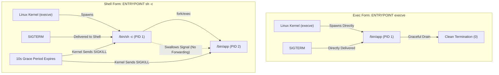
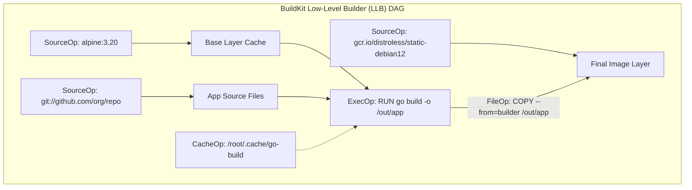
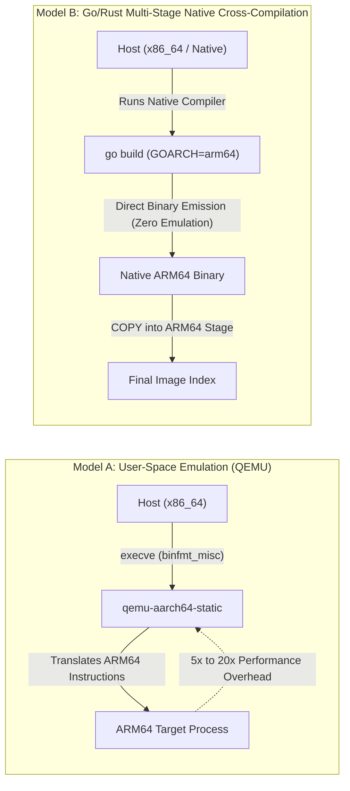

# Module 08: Building Images with Dockerfile and BuildKit: LLB Graph, Caching, Multi-Stage, and Reproducibility

Modern container construction has evolved from sequential, shell-script-like execution into sophisticated compiler engineering. The legacy Docker Engine builder evaluated Dockerfiles top-to-bottom as a linear chain of intermediate container commits, resulting in severe I/O overhead, cache thrashing, and secret leakage. Today, container image synthesis is governed by **BuildKit** (v0.34.1)—a distributed, cache-efficient build engine that compiles declarative Dockerfiles into a concurrent, content-addressable directed acyclic graph (DAG) of Low-Level Builder (LLB) operations.

This module provides a rigorous, architectural deep dive into BuildKit internals, LLB instruction semantics, cryptographic cache invalidation, advanced ephemeral mount primitives (`secret`, `ssh`, `cache`), multi-stage pipeline optimization, multi-architecture cross-compilation mechanics, reproducible build standards, and the daemonless Buildah alternative.

---

## 1. Dockerfile Instruction Semantics: Exec vs. Shell Form

Every Dockerfile instruction defines an operation that transforms the container filesystem or updates the image configuration JSON. Misunderstanding the semantic boundary between build-time instructions and runtime execution defaults is one of the leading causes of production outages.



### RUN, CMD, and ENTRYPOINT

The distinction between `RUN`, `CMD`, and `ENTRYPOINT` reflects the boundary between image compilation and container instantiation:

- `RUN`: Executes commands inside an ephemeral container during the build phase, committing the resulting filesystem state as a new content-addressable layer.
- `ENTRYPOINT`: Configures the immutable binary or executable script intended to run as **PID 1** when the container boots.
- `CMD`: Supplies default arguments to the `ENTRYPOINT`. If no `ENTRYPOINT` is defined, `CMD` acts as the command itself. If the operator supplies arguments during `docker run <image> <args>`, those arguments override `CMD` entirely while preserving `ENTRYPOINT`.

#### Exec Form vs. Shell Form

Every process-execution instruction (`RUN`, `CMD`, `ENTRYPOINT`) supports two syntactical forms with fundamentally divergent execution semantics:

| Property | Exec Form (`["executable", "param1", "param2"]`) | Shell Form (`executable param1 param2`) |
| :-- | :-- | :-- |
| **Parsing Mechanism** | Parsed directly as a JSON array | Evaluated as a raw command string |
| **System Call** | `execve("/path/to/executable", ["executable", ...], envp)` | `execve("/bin/sh", ["/bin/sh", "-c", "executable ..."], envp)` |
| **Container PID 1** | Target binary is PID 1 | `/bin/sh` is PID 1; target binary is an unmanaged child (PID 2+) |
| **Signal Handling** | Receives `SIGTERM`, `SIGINT`, and `SIGHUP` directly | `/bin/sh` does NOT forward signals to children by default |
| **Variable Expansion** | No shell expansion (unless `/bin/sh` is explicitly invoked) | Automatic shell variable expansion (e.g., `$HOME`, `$PORT`) |
| **Shutdown Behavior** | Immediate graceful draining and teardown | Hangs for 10 seconds until kernel delivers non-catchable `SIGKILL` |

### COPY vs. ADD

- `COPY`: Copies files or directories from the local build context or a named build stage into the container filesystem. Supports `--chown=<user>:<group>` and `--chmod=<octal>` flags directly, avoiding secondary `RUN chown -R` layers that duplicate image weight.
- `ADD`: A legacy instruction with implicit side-effects. If the source is a recognized local compression archive (e.g., `tar`, `gzip`, `bzip2`, `xz`), `ADD` automatically unpacks it into the destination directory. If the source is an HTTP/HTTPS URL, `ADD` downloads the remote resource (with permissions default `0600`). In production, prefer `COPY` for predictability; use `ADD` only for unpacking local tar archives.

---

## 2. BuildKit Architecture and the Low-Level Builder (LLB)

BuildKit operates as a detached execution daemon (or an in-process containerd worker) communicating with the Docker or Podman CLI over gRPC. Rather than interpreting Dockerfiles linearly, BuildKit's frontend (`dockerfile.v0`) parses the text into an abstract syntax tree (AST) and compiles it into a **Low-Level Builder (LLB)** graph.



### The LLB Directed Acyclic Graph

LLB is a platform-independent, content-addressed binary intermediate representation (defined in Protocol Buffers). Its core operations include:

1. `SourceOp`: Resolves external inputs (OCI images, Git repositories, HTTP resources, or local client directories).
2. `ExecOp`: Executes a command inside an isolated snapshot mount with specified constraints (cgroups, network isolation, security profiles).
3. `FileOp`: Performs atomic filesystem manipulations (copy, move, delete, create directory) without spawning a user-space container process.
4. `BuildOp`: Nested recursive builds that evaluate secondary LLB definitions dynamically.

Because LLB nodes explicitly declare their input dependencies as directed edges, BuildKit analyzes the graph to execute independent subgraphs **concurrently**. If stage A (e.g., frontend asset compilation) and stage B (e.g., backend Golang compilation) share no dependencies, BuildKit compiles them simultaneously on parallel worker threads. Furthermore, if a stage is never referenced by the target output, BuildKit prunes it from the execution schedule entirely.

---

## 3. Cryptographic Cache Invalidation Mechanics

BuildKit replaces heuristic timestamp checks with rigorous content-addressed cryptographic hashing.

### Cache Key Derivation

For every operation in the LLB graph, BuildKit calculates a deterministic cache key $K$: $$K = \text{Hash}(K_{\text{parent}} \parallel \text{OpType} \parallel \text{OpParams} \parallel \text{InputDigest})$$

- For `ExecOp` (`RUN`): The cache key depends on the parent state's cache key, the command string, the environment variables, the user/working directory, and any referenced secrets or build arguments.
- For `FileOp` (`COPY` / `ADD`): BuildKit computes a cumulative content digest of the source files. The checksum incorporates file contents, permissions (executable bits), and relative path structures. File modification timestamps (`mtime`) are excluded from cache key calculation by default, preventing false invalidations caused by `git checkout` timestamp churn.

### Cache Invalidation Cascades

Cache validation is topologically ordered. If node $N$ in the DAG changes its input digest, its cache key $K_N$ mutates, producing a cache miss. Consequently, all successor nodes $\{M \mid N \to^* M\}$ are invalidated and forced to re-execute, while sibling or ancestor nodes remain cached.

### Cache Backends

BuildKit decouples cache storage from the local daemon filesystem, enabling remote distributed caching across ephemeral CI/CD runners:

- **Inline Cache (`--cache-to type=inline`)**: Embeds cache metadata directly into the published image manifest. Simple, but limited to single-stage builds and cannot store cache layers for intermediate pruned stages.
- **Registry Cache (`--cache-to type=registry,ref=...`)**: Publishes a dedicated OCI artifact containing both metadata and intermediate build layers to an external registry.
- **GitHub Actions Cache (`--cache-to type=gha`)**: Directly leverages GitHub's Actions Cache API for zero-configuration pipeline caching.
- **Local Directory Cache (`--cache-to type=local,dest=...`)**: Persists layers and metadata to an arbitrary POSIX path, ideal for bare-metal CI runners and Kubernetes PersistentVolume claims.

---

## 4. Advanced BuildKit Mount Types: Ephemeral Primitives

Legacy builders forced engineers to compromise security or performance by baking secrets into build arguments or writing custom caching scripts. Modern BuildKit introduces advanced mount types directly on `RUN` instructions:

```Dockerfile
# syntax=docker/dockerfile:1.7
FROM golang:1.24-alpine AS builder
WORKDIR /src

# 1. Cache Mount: Reuses Go compiler and module cache across builds
# 2. Secret Mount: Accesses private API token in RAM without writing to disk
# 3. SSH Mount: Forwards client's ssh-agent socket for private Git dependencies
RUN --mount=type=cache,target=/go/pkg/mod \
    --mount=type=cache,target=/root/.cache/go-build \
    --mount=type=secret,id=npmrc,target=/root/.npmrc \
    --mount=type=ssh \
    go build -ldflags="-s -w" -o /bin/service ./cmd/server
```

### Mount Semantics and Guarantees

| Mount Type | Syntax Flag | Isolation / Lifetime | Production Use Case |
| :-- | :-- | :-- | :-- |
| **Cache Mount** | `--mount=type=cache,target=<dir>,id=<id>` | Persisted in BuildKit host storage; shared across concurrent or future builds; excluded from final layer | Compiler caches (`/root/.cache/go-build`, `/root/.cache/pip`, `/root/.cargo/registry`, `node_modules/.cache`) |
| **Secret Mount** | `--mount=type=secret,id=<id>,target=<path>` | Mounted as a read-only `tmpfs` in RAM; automatically unmounted upon command completion; zero bytes leaked to storage | Cloud IAM tokens, NPM auth tokens (`.npmrc`), private registry credentials |
| **SSH Mount** | `--mount=type=ssh,id=<id>` | Proxies the client's local UNIX domain socket for `ssh-agent`; private keys never touch the container | Cloning private Git dependencies via SSH without baking deploy keys into the image |
| **Tmpfs Mount** | `--mount=type=tmpfs,target=<dir>` | Non-persistent memory-backed mount discarded immediately after the step completes | Fast scratch space for disk-intensive transformations that should never touch persistent storage |
| **Bind Mount** | `--mount=type=bind,source=<stage>,target=<dir>` | Read-only view of a previous build stage or host context without copying files | Analyzing binaries or running tests against build artifacts without I/O copy overhead |

---

## 5. Multi-Stage Pipeline Architecture and Attack Surface Reduction

Multi-stage builds allow a single `Dockerfile` to define multiple distinct environments, using the output of intermediate stages as isolated inputs for downstream stages. This architectural pattern enforces strict separation between compilation dependencies (SDKs, build tools, headers) and runtime dependencies.

```Dockerfile
# Stage 1: Build & Static Analysis
FROM rust:1.85-alpine AS builder
WORKDIR /app
RUN apk add --no-cache musl-dev
COPY Cargo.toml Cargo.lock ./
# Pre-compile dependencies for caching
RUN mkdir src && echo "fn main() {}" > src/main.rs && cargo build --release
COPY src ./src
RUN touch src/main.rs && cargo build --release

# Stage 2: Security Verification & Audit
FROM aquasec/trivy:0.59.1 AS security-gate
COPY --from=builder /app/target/release/server /server
RUN trivy rootfs --exit-code 1 --severity CRITICAL /server

# Stage 3: Minimal Production Runtime
FROM gcr.io/distroless/static-debian12:nonroot
WORKDIR /
COPY --from=builder --chown=65532:65532 /app/target/release/server /server
USER 65532:65532
ENTRYPOINT ["/server"]
```

### Architectural Benefits

1. **Size Optimization**: Production images shrink from hundreds of megabytes (or gigabytes) to tens of megabytes by eliminating compilers, debug symbols, package managers, and temporary build caches.
2. **Vulnerability Mitigation**: Modern vulnerability scanners (Trivy, Grype) analyze installed system packages (`dpkg`, `apk`, `rpm`). A Distroless or `scratch` runtime image contains zero package managers and zero OS shell utilities, neutralizing entire classes of Common Vulnerabilities and Exposures (CVEs) and preventing Living-off-the-Land (LotL) attacks.
3. **Target Stage Selection**: Developers can build intermediate targets during local development (e.g., `docker build --target builder -t app:dev .`) to retain debugging tools, while CI builds the default un-targeted final production stage.

---

## 6. Multi-Platform Cross-Compilation: QEMU vs. Native Cross-Compilers

Building multi-architecture container images (`linux/amd64` and `linux/arm64`) is mandatory for modern hybrid cloud and Apple Silicon developer environments. BuildKit supports two distinct multi-platform execution models:



### Model A: QEMU Emulation via binfmt_misc

When invoking `docker buildx build --platform linux/amd64,linux/arm64 .`, BuildKit leverages the Linux kernel's `binfmt_misc` module to intercept non-native ELF binary execution and route instructions through `qemu-user-static`.

- **Pros**: Transparent execution; arbitrary shell scripts and package managers work without modifying the Dockerfile.
- **Cons**: Severe execution overhead (5× to 20× slower); occasional thread synchronization deadlocks and signal emulation bugs in high-concurrency runtimes (Node.js V8, Go runtime).

### Model B: Architectural Native Cross-Compilation

Languages that support cross-compilation out of the box (Go, Rust, Zig) can execute on the native host architecture while targeting the foreign architecture, completely avoiding QEMU:

```Dockerfile
FROM --platform=$BUILDPLATFORM golang:1.24-alpine AS builder
ARG TARGETOS
ARG TARGETARCH
WORKDIR /src
COPY . .
# Runs at full native speed on host architecture, emitting target architecture binary
RUN GOOS=$TARGETOS GOARCH=$TARGETARCH go build -o /out/app .

FROM alpine:3.20
COPY --from=builder /out/app /app
ENTRYPOINT ["/app"]
```

---

## 7. Deterministic and Reproducible Builds (`SOURCE_DATE_EPOCH`)

A build process is defined as **cryptographically reproducible** if, given identical source code, build instructions, and build environment, it generates byte-for-byte identical output images across independent hosts and timestamps.

Historically, Docker images were non-reproducible because:

1. File archives embedded host timestamps (`mtime`), varying with every `git clone`.
2. Tar archive generation ordered directory entries by filesystem inode number rather than lexicographical sorting.
3. Package managers (`apt`, `apk`) dynamically resolved unpinned upstream mirror packages.

### Enforcing Reproducibility with BuildKit

BuildKit conforms to the Open Source [Reproducible Builds](https://reproducible-builds.org/) specification via the `SOURCE_DATE_EPOCH` environment variable:

```bash
# Set fixed Unix timestamp (e.g., commit timestamp)
export SOURCE_DATE_EPOCH=$(git log -1 --pretty=%ct)

docker buildx build \
  --build-arg SOURCE_DATE_EPOCH=$SOURCE_DATE_EPOCH \
  --output type=image,rewrite-timestamp=true \
  -t registry.infra/app:v1.0.0 .
```

When `rewrite-timestamp=true` is enabled:

- All file creation and modification timestamps in layer tar archives are clamped to `SOURCE_DATE_EPOCH`.
- Tar archive entries are sorted lexicographically by pathname.
- User and group IDs are normalized, guaranteeing an identical SHA-256 layer digest on every rebuild.

---

## 8. Daemonless Container Assembly with Buildah

While BuildKit requires an active daemon or builder instance, **Buildah** (v1.46.0) provides a completely daemonless alternative. Buildah executes as a standard fork-exec CLI tool, manipulating container storage directly using user namespaces (`buildah unshare`) and POSIX shell scripts without requiring Dockerfiles:

```bash
#!/usr/bin/env bash
set -euo pipefail

# 1. Initialize working container from base image
container=$(buildah from alpine:3.20)

# 2. Mount container rootfs directly to host filesystem
mountpoint=$(buildah mount "$container")

# 3. Execute tools directly on the mounted rootfs from the host
apk add --root "$mountpoint" --no-cache ca-certificates
cp ./bin/service "$mountpoint/usr/local/bin/service"

# 4. Configure OCI metadata
buildah config --entrypoint '["/usr/local/bin/service"]' "$container"
buildah config --user "10001:10001" "$container"
buildah config --env "APP_ENV=production" "$container"

# 5. Commit directly to local OCI storage or push to remote registry
buildah commit --rm "$container" docker://registry.infra/app:v1.0.0
```

Buildah eliminates the Docker socket entirely from CI/CD runners, preventing container-escape attacks while granting complete programmatic control over layer creation.

---

## 9. Formal Algorithms: LLB DAG Scheduling and Layer Cache Invalidation

### LLB Topological Scheduling and Execution

The following algorithm formalizes how BuildKit evaluates the LLB directed acyclic graph, pruning unreachable operations and scheduling independent nodes concurrently.

```text
EVALUATE-LLB-DAG(Graph G = (V, E), TargetNodes T, CacheStore C, WorkerPool W)
1  Reachable = FIND-REACHABLE-SUBGRAPH(G, T)
2  InDegree = COMPUTE-IN-DEGREES(Reachable)
3  ReadyQueue = ALLOCATE-QUEUE()
4
5  for each node u in Reachable
6      if InDegree[u] == 0
7          ENQUEUE(ReadyQueue, u)
8
9  // Invariant: ReadyQueue contains all nodes whose dependencies have been successfully evaluated.
10 // InDegree[v] accurately reflects uncompleted parent dependencies for every node v.
11 while NOT-EMPTY(ReadyQueue) or HAS-ACTIVE-WORKERS(W)
12     while NOT-EMPTY(ReadyQueue) and HAS-IDLE-WORKER(W)
13         node = DEQUEUE(ReadyQueue)
14         worker = ACQUIRE-WORKER(W)
15         SPAWN-ASYNC(worker, EXECUTE-NODE(node, C, InDegree, ReadyQueue))
16     WAIT-FOR-ANY-WORKER-COMPLETION(W)
17 return RESOLVE-FINAL-SNAPSHOTS(T)

EXECUTE-NODE(u, C, InDegree, ReadyQueue)
1  cacheKey = COMPUTE-CACHE-KEY(u)
2  if EXISTS-IN-CACHE(C, cacheKey)
3      u.snapshot = FETCH-CACHE(C, cacheKey)
4  else
5      u.snapshot = EXECUTE-OPERATION(u)
6      RECORD-CACHE(C, cacheKey, u.snapshot)
7
8  for each edge (u, v) in E
9      ATOMIC-DECREMENT(InDegree[v])
10     if InDegree[v] == 0
11         ENQUEUE(ReadyQueue, v)
```

---

## 10. Then vs Now: Evolution of Container Building

| Engineering Dimension | Legacy Docker Builder (`docker build`) | BuildKit (`v0.34.1` / Buildx) | Buildah (`v1.46.0`) |
| :-- | :-- | :-- | :-- |
| **Execution Architecture** | Linear, single-threaded execution inside `dockerd` | Concurrent DAG evaluation via independent LLB workers | Pure fork-exec daemonless CLI process |
| **Cache Model** | Local sequential layer matching based on parent container IDs | Content-addressable cryptographic hashing; distributed remote cache backends | Fine-grained manual or scripted layer committing |
| **Secret Handling** | Leaked via `ARG` / `ENV` into image history and intermediate layers | Ephemeral in-memory `--mount=type=secret` discarded after step completion | Secrets read from host filesystem in user namespace; zero leakage |
| **Build Caches** | Package manager caches had to be downloaded every run or baked in | Persistent cross-build `--mount=type=cache` mounts | Native host volume bind mounts directly into rootfs |
| **Unused Stages** | All stages evaluated sequentially regardless of final target | Unreferenced stages are automatically pruned and never executed | User controls exact stage execution in shell scripts |
| **Multi-Architecture** | Cross-building required manual scripting and manifest tooling | Native multi-platform builds emitting OCI Image Indexes automatically | Scripted cross-compilation with native container-storage integration |

---

## 11. Exam Delta: Certification Requirements vs. Modern Systems Reality

> [!IMPORTANT]
> **CKAD and CKS Curriculum Realities**:
>
> - **CKAD Scope**: Focuses primarily on basic Dockerfile syntax: declaring `ENV`, `EXPOSE`, `WORKDIR`, setting unprivileged `USER`, distinguishing `CMD` from `ENTRYPOINT`, and constructing standard multi-stage builds.
> - **CKS Scope**: Tests supply-chain hardening, requiring minimal base images (Distroless/Alpine), scanning images for known CVEs using Trivy, and eliminating embedded secrets.
> - **Modern Systems Reality**: Real-world platform engineering requires mastery of BuildKit LLB optimizations, distributed cache exporting to remote registries, caching dependencies via `--mount=type=cache`, securely authenticating private repositories via SSH agent forwarding, and ensuring byte-level reproducibility using `SOURCE_DATE_EPOCH`.

---

## 12. Production Failure Modes and Gotchas

### 1. Inefficient Layer Ordering Busting Dependency Caches

**Anti-Pattern**:

```Dockerfile
FROM node:22-alpine
WORKDIR /app
COPY . .
RUN npm ci --only=production
```

**Failure Mechanics**: Any modification to application source code (e.g., editing `README.md` or a frontend component) invalidates the `COPY . .` layer. Consequently, BuildKit is forced to re-run `npm ci`, downloading hundreds of megabytes of third-party dependencies on every single build. **Remediation**: Copy dependency manifests first, execute dependency installation, and only then copy application source:

```Dockerfile
FROM node:22-alpine
WORKDIR /app
COPY package.json package-lock.json ./
RUN npm ci --only=production
COPY . .
```

### 2. Secret Leakage in Build Arguments (`ARG`)

**Anti-Pattern**:

```Dockerfile
FROM alpine:3.20
ARG GITHUB_TOKEN
RUN git clone https://${GITHUB_TOKEN}@github.com/org/private-repo.git
```

**Failure Mechanics**: Even if the clone directory is deleted in a later step, `ARG` values are permanently recorded in plaintext inside the image configuration JSON (`history` and `container_config.env`). Anyone with pull access can execute `docker image history --no-trunc <image>` or inspect the config blob to extract the token. **Remediation**: Use BuildKit secret mounts (`RUN --mount=type=secret,id=gh_token ...`) or SSH forwarding.

### 3. Shell Form ENTRYPOINT Swallowing SIGTERM

**Anti-Pattern**:

```Dockerfile
ENTRYPOINT /usr/bin/python3 /app/server.py
```

**Failure Mechanics**: As detailed in Section 1, `/bin/sh` runs as PID 1 and does not forward OS signals. When Kubernetes or Docker attempts graceful shutdown, the application never receives `SIGTERM`. After the 10-second (or `terminationGracePeriodSeconds`) timeout expires, the kernel abruptly kills the process with `SIGKILL` (exit code 137), terminating in-flight database transactions and corrupting state. **Remediation**: Always use the exec array form: `ENTRYPOINT ["/usr/bin/python3", "/app/server.py"]`.

### 4. Layer Deletion Illusion (OverlayFS Whiteouts)

**Anti-Pattern**:

```Dockerfile
FROM ubuntu:24.04
RUN apt-get update && apt-get install -y large-package
RUN rm -rf /var/lib/apt/lists/* && apt-get purge -y large-package
```

**Failure Mechanics**: Under OverlayFS, deleting a file in a subsequent layer creates a character special **whiteout device** (`0:0` device node) in the upper layer that hides the file from the merged view. The physical bytes in the underlying layer remain completely intact within the image archive. The final image size increases rather than decreases. **Remediation**: Combine installation, processing, and cleanup in a **single atomic `RUN` instruction**:

```Dockerfile
RUN apt-get update && apt-get install -y --no-install-recommends large-package \
    && do-build-step \
    && apt-get purge -y large-package \
    && rm -rf /var/lib/apt/lists/*
```

---

## Interview Drill

<details><summary>1. Explain the architectural difference between how the legacy Docker builder and BuildKit process a multi-stage Dockerfile containing three independent stages.</summary>

The legacy Docker builder evaluates instructions sequentially from line 1 to the end. For three independent stages (A, B, and C), it builds stage A sequentially, then stage B sequentially, and finally stage C, writing intermediate layer snapshots to disk at every step even if stage B is never utilized by stage C. BuildKit compiles the Dockerfile into a Low-Level Builder (LLB) directed acyclic graph. It traverses the graph from the target output backwards, automatically pruning any unreferenced stages from the schedule. For stages that are needed, BuildKit analyzes the graph's independent branches and executes them concurrently across multiple CPU threads. If stage A and stage B share no data dependencies, their source downloads, package installations, and compilations execute in parallel.
</details>

<details><summary>2. Why does `RUN --mount=type=cache,target=/var/cache/apt` not increase the final image size even if 500 MB of deb packages are stored during the build?</summary>

A BuildKit cache mount binds an isolated directory from BuildKit's host cache storage directly into the execution container's mount namespace during the duration of that specific `RUN` step. The mount point exists outside the container's copy-on-write (CoW) overlay snapshotter. When the command completes, BuildKit unmounts the cache volume before committing the filesystem snapshot as an image layer. Consequently, none of the files written into the cache directory are committed to the layer archive; they remain safely cached on the builder host for reuse in future builds.
</details>

<details><summary>3. A developer changes one comment in a source file, and the entire `RUN go build` step re-runs despite using Go's build cache. Why did this occur, and how do you prevent it?</summary>

If the Dockerfile executed `COPY . .` prior to `RUN go build`, the modified comment mutated the cryptographic content hash of the source tree. This generated a new cache key for the `COPY` step, invalidating its cache. Because cache invalidation cascades to all downstream nodes in the LLB DAG, the subsequent `RUN go build` step was forced to re-execute. To prevent this while accelerating builds, use a persistent compiler cache mount: `RUN --mount=type=cache,target=/root/.cache/go-build go build -o /bin/app .` While the `RUN` step still executes because its parent layer changed, Go's compiler inspects the mounted cache, identifies that the AST of the code is unchanged (or only one package changed), and links the binary in sub-second time rather than performing a clean recompile.
</details>

<details><summary>4. How does `execve` behavior differ when using JSON array syntax versus string syntax for the `CMD` instruction?</summary>

JSON array syntax (`CMD ["node", "server.js"]`) triggers the `execve` system call directly with the argument vector `argv = ["node", "server.js"]`. The process executes directly as PID 1 inside the container's PID namespace, allowing it to receive operating system signals (`SIGTERM`, `SIGINT`) natively. String syntax (`CMD node server.js`) causes the builder to prepend `/bin/sh -c`. The kernel invokes `execve("/bin/sh", ["/bin/sh", "-c", "node server.js"])`. The shell becomes PID 1, and the Node application runs as an unmanaged child process. Because standard POSIX shells do not forward signals to sub-processes, graceful shutdown mechanisms fail, leading to forceful process termination upon timeout.
</details>

<details><summary>5. What are the operational pitfalls of building ARM64 images on AMD64 CI runners using QEMU emulation compared to native cross-compilers?</summary>

1. **Performance**: Emulating every ARM64 CPU instruction in user-space via QEMU imposes a 500% to 2000% (5×–20×) runtime performance penalty, turning a 2-minute native compilation into a 30-minute pipeline bottleneck.
2. **Instability & Deadlocks**: Multi-threaded runtimes with aggressive memory models (such as Golang's runtime scheduler, Rust's jemalloc, or V8's garbage collector) frequently encounter race conditions, missing kernel `binfmt_misc` flags (`F` flag required for chroot execution), or emulation deadlocks under QEMU.
3. **Remediation**: Use multi-stage native cross-compilation (`FROM --platform=$BUILDPLATFORM ...`) or deploy native multi-architecture builder clusters (e.g., an ARM64 worker node joined to the Buildx builder instance).
</details>

<details><summary>6. How does `SOURCE_DATE_EPOCH` guarantee bit-for-bit reproducibility in OCI container images?</summary>

Standard POSIX tar archivers store file modification timestamps (`mtime`), user IDs, group IDs, and filesystem traversal order inside the tar header. Even if file contents are identical, differences in checkout times or inode allocation alter the binary tar stream, resulting in divergent SHA-256 layer digests. `SOURCE_DATE_EPOCH` standardizes this environment by:

1. Clamping all file `mtime` values to a fixed Unix timestamp (e.g., the Git commit time).
2. Forcing the tar archiver to sort directory entries lexicographically by filename.
3. Normalizing file ownership (UID/GID) to static values (e.g., 0:0). Because all inputs to the cryptographic hashing function are identical, the resulting OCI layer digests and manifest digests are bit-for-bit reproducible.
</details>

<details><summary>7. Describe how Buildah executes container builds without running a central root daemon.</summary>

Buildah utilizes Linux kernel unprivileged user namespaces (`user_namespaces(7)`). When invoking `buildah unshare`, Buildah creates an isolated user and mount namespace where the unprivileged user is mapped to UID 0 (root) inside the namespace. Buildah directly mounts the container's root filesystem (using kernel OverlayFS or user-space FUSE-overlayfs) onto a host directory. Commands are executed directly against this root filesystem using standard Linux system calls (`clone`, `chroot`, `execve`), with standard cgroup and namespace boundaries. Once complete, Buildah serializes the directory into OCI layer tarballs and writes directly to local container storage (`/var/lib/containers/storage` or `~/.local/share/containers/storage`) or pushes to an OCI registry via Skopeo libraries, completely bypassing background daemons and exposed control sockets.
</details>

---

## 14. Proof Map and Verification

The build mechanics, LLB graph compilation, cache invalidation rules, and secret mount protections explained in this module are verified via automated unit and integration tests:

- **Hermetic Unit Suite**: [`technologies/containers/examples/ts/08-building-images-dockerfile-and-buildkit.test.ts`](../examples/ts/08-building-images-dockerfile-and-buildkit.test.ts)
  - `testLlbDagTopologicalScheduling`: Verifies parallel branch execution and pruning of unreferenced stages.
  - `testCacheKeyCalculationAndCascade`: Simulates content hash derivation for `COPY` and asserts proper cache invalidation cascading.
  - `testExecVsShellSignalSemantics`: Emulates signal propagation differences between direct execve and shell wrapping.
  - `testSecretMountEphemeralIsolation`: Verifies that secrets mounted during execution leave zero trace in layer diffs and configuration history.
