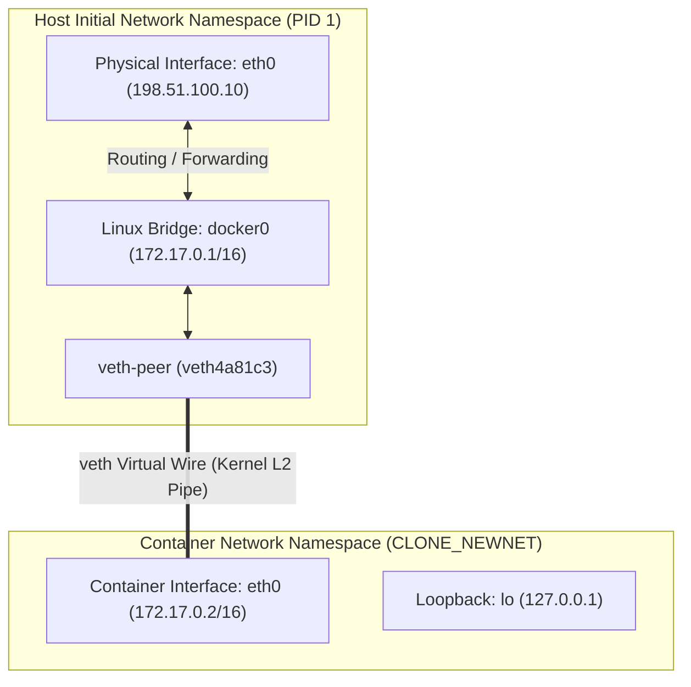
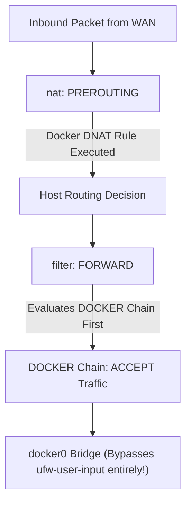

# Module 09: Container Networking: veth Pairs, Bridges, nftables NAT, DNS, and Rootless Pasta

Container networking is the convergence of Linux kernel network namespaces (`netns`), virtualized Layer 2 software switching, netfilter packet rewriting, and user-space socket splicing. While modern container engines present networking as high-level flags (e.g., `--network`, `-p 8080:80`), every packet routed into or out of a container traverses a precise chain of kernel data structures, routing tables, and firewall hooks.

This module provides an exhaustive systems-level analysis of container networking mechanics: from virtual Ethernet (`veth`) pair creation and Linux bridge forwarding to destination and source network address translation (DNAT/SNAT) via netfilter/nftables, embedded DNS resolution, and the modern rootless networking paradigm powered by **pasta** and **Netavark**.

For foundational TCP/IP state machines, packet structures, and routing protocols, consult [`architecture/networking/modules/14-linux-networking-ops.md`](../../../architecture/networking/modules/14-linux-networking-ops.md) and [`architecture/networking/modules/08-dns.md`](../../../architecture/networking/modules/08-dns.md).

---

## 1. The Linux Network Namespace (`netns`)

A Linux network namespace provides complete virtualization of the system network stack. As defined in `namespaces(7)` and `network_namespaces(7)`, each network namespace instantiates an independent copy of:

- **Network Devices**: Dedicated physical or virtual network interfaces (e.g., `eth0`, `lo`).
- **IPv4 and IPv6 Routing Tables**: Local, main, and custom policy routing tables (`ip route show table all`).
- **Firewall Rules**: Independent netfilter hook points, connection tracking tables (`conntrack`), and nftables/iptables rule sets.
- **Socket Tables**: Binding state for all TCP, UDP, and raw sockets (`/proc/net/tcp`, `/proc/net/udp`).
- **Sysctl Parameters**: Namespace-scoped kernel variables (e.g., `/proc/sys/net/ipv4/*`).

When a container runtime instantiates a container without `--net=host`, it invokes `clone(2)` with the `CLONE_NEWNET` flag (or `unshare(CLONE_NEWNET)`). The newly created namespace starts in a completely unconfigured state: only an unconfigured loopback interface (`lo`) exists, and it is marked down (`state DOWN`).



---

## 2. Virtual Ethernet (`veth`) Pairs and Linux Bridges

Because a network namespace is isolated from the host's physical network adapters, the kernel provides the **Virtual Ethernet (`veth`)** driver (`veth(4)`). A `veth` device always operates as an interconnected pair of bi-directional virtual network interfaces.

### The veth Interconnect Mechanism

A `veth` pair functions as an in-kernel bidirectional pipe: $$\text{Transmit}(\text{veth}_{\text{host}}) \iff \text{Receive}(\text{veth}_{\text{container}})$$ Packets transmitted on one endpoint are immediately received on the peer endpoint. The container runtime configures this topology via `iproute2` netlink commands:

```bash
# 1. Create the veth pair in the host network namespace
ip link add veth-host type veth peer name veth-guest

# 2. Attach the host endpoint to the software bridge
ip link set veth-host master docker0
ip link set veth-host up

# 3. Move the guest endpoint into the container's network namespace (by PID)
ip link set veth-guest netns 48291

# 4. Inside container netns: rename interface to eth0 and configure IP/gateway
nsenter --net=/proc/48291/ns/net ip link set veth-guest name eth0
nsenter --net=/proc/48291/ns/net ip addr add 172.17.0.2/16 dev eth0
nsenter --net=/proc/48291/ns/net ip link set eth0 up
nsenter --net=/proc/48291/ns/net ip link set lo up
nsenter --net=/proc/48291/ns/net ip route add default via 172.17.0.1 dev eth0
```

### The Linux Bridge (`bridge` / `docker0`)

The Linux software bridge (`docker0`) is an in-kernel Layer 2 Ethernet switch. It maintains a **Forwarding Database (FDB)** mapping MAC addresses to connected bridge ports (`veth` host interfaces).

- **Unicast Traffic**: When a frame arrives at the bridge, the kernel inspects the destination MAC address. If present in the FDB, the frame is switched directly to the destination `veth` interface.
- **Broadcast / Unknown Unicast**: If the MAC is unknown or broadcast (`ff:ff:ff:ff:ff:ff`, such as ARP requests), the bridge floods the frame across all active member ports.
- **Inter-Container Communication**: Two containers connected to the same bridge communicate directly at Layer 2 without involving host routing tables, subject only to netfilter bridge filtering rules.

---

## 3. Packet Traversal and Netfilter / nftables NAT Mechanics

Communication between containers and the external Internet relies on Netfilter packet filtering and Network Address Translation (NAT).

```mermaid
flowchart TD
    subgraph InboundFlow ["Inbound Published Port (-p 8080:80)"]
        P1["Packet from WAN (Dest: HostIP:8080)"] --> NF_PRE["Netfilter PREROUTING Chain"]
        NF_PRE -->|"DNAT: Rewrite Dest to 172.17.0.2:80"| NF_FWD["Netfilter FORWARD Chain"]
        NF_FWD -->|"Check DOCKER-USER / Conntrack"| BR["docker0 Bridge"]
        BR -->|"Deliver to veth Pair"| C_ETH["Container eth0"]
    end

    subgraph OutboundFlow ["Outbound Egress to Internet"]
        C_OUT["Container eth0 (Src: 172.17.0.2)"] --> C_DEF["Default Route: 172.17.0.1"]
        C_DEF --> BR_OUT["docker0 Bridge"]
        BR_OUT --> K_FWD["Host IP Forwarding (net.ipv4.ip_forward=1)"]
        K_FWD --> NF_POST["Netfilter POSTROUTING Chain"]
        NF_POST -->|"MASQUERADE / SNAT: Rewrite Src to HostIP"| WAN_OUT["Egress via Physical eth0 to WAN"]
    end
```



### Outbound Egress: Source NAT (SNAT / MASQUERADE)

When a container initiates an outbound TCP connection (e.g., to an external API):

1. **Container Routing**: The container kernel consults its routing table. The destination IP is external, matching the default route. The packet is framed with the MAC address of `docker0` (default gateway `172.17.0.1`) and sent out `eth0`.
2. **Bridge Ingestion**: The packet traverses the `veth` pair and arrives at the host's `docker0` bridge.
3. **Host Routing Decision**: The host kernel sees destination IP is external and `net.ipv4.ip_forward=1` is enabled. It routes the packet to the physical egress adapter (e.g., `eth0`).
4. **Netfilter POSTROUTING**: Before transmitting onto the physical network, the packet hits the `POSTROUTING` chain in the `nat` table. The kernel matches the rule:
   ```text
   -A POSTROUTING -s 172.17.0.0/16 ! -o docker0 -j MASQUERADE
   ```
5. **SNAT Execution**: The kernel's Connection Tracking system (`conntrack`) records the tuple and rewrites the source IP from `172.17.0.2` to the host's public/routable IP address (`198.51.100.10`), assigning an ephemeral source port. When return packets arrive, `conntrack` reverses the transformation transparently.

### Inbound Ingress: Destination NAT (DNAT / Port Publishing)

When an operator publishes a port (`docker run -p 8080:80`):

1. **Netfilter PREROUTING**: Inbound packets destined for `198.51.100.10:8080` hit the `PREROUTING` chain in the `nat` table before host routing occurs:
   ```text
   -A PREROUTING -m addrtype --dst-type LOCAL -j DOCKER
   -A DOCKER ! -i docker0 -p tcp -m tcp --dport 8080 -j DNAT --to-destination 172.17.0.2:80
   ```
2. **DNAT Execution**: The destination IP and port are modified from `198.51.100.10:8080` to `172.17.0.2:80`.
3. **Forwarding Verification**: The host routing engine determines the packet must be forwarded to the `docker0` interface. The packet traverses the `FORWARD` chain, where `conntrack` permits established flows.
4. **Delivery**: The packet crosses `docker0`, enters the `veth` pair, and is delivered to the container's socket.

---

## 4. The Host Firewall Collision: UFW Bypass and the `DOCKER-USER` Chain

A notorious security failure mode in production Linux deployments is the unintended interaction between Docker and host firewalls such as **UFW (Uncomplicated Firewall)** or **firewalld**.

### The UFW Bypass Mechanics

Administrators frequently configure UFW to reject all incoming external traffic by default (`ufw default deny incoming`). However, when Docker publishes a port (`-p 8080:80`), Docker injects raw iptables/nftables rules directly into the `PREROUTING` and `FORWARD` chains.

Because netfilter evaluates `PREROUTING` and custom `DOCKER` forward rules **before** UFW's user-filtering chains (such as `ufw-user-input`), published container ports are **exposed directly to the public Internet**, completely bypassing UFW's block rules!



### The `DOCKER-USER` Mitigation Chain

To allow administrators to enforce security perimeter policies without breaking Docker's internal networking, Docker reserves a dedicated filter chain: `DOCKER-USER`. All forwarded traffic destined for container bridges traverses `DOCKER-USER` before Docker's internal rules execute.

To restrict container port 8080 to a trusted management bastion (`203.0.113.50`) using raw iptables/nftables:

```bash
# Allow established and related connections
iptables -I DOCKER-USER -m conntrack --ctstate ESTABLISHED,RELATED -j ACCEPT

# Allow trusted subnet
iptables -A DOCKER-USER -s 203.0.113.50/32 -p tcp --dport 80 -j ACCEPT

# Reject all other external forwarded traffic to containers
iptables -A DOCKER-USER -i eth0 -j DROP
```

### Docker 29.9.2: Modern `--firewall-backend=nftables`

Historically, container runtimes invoked the legacy `iptables` CLI, which interacted with the kernel via `iptables-legacy` or translated rules via `iptables-nft`. Docker Engine 29.9.2 introduces an experimental, direct **nftables backend** configured in `/etc/docker/daemon.json`:

```json
{
  "firewall-backend": "nftables"
}
```

This replaces legacy table chains with native `nftables` tables (`table ip docker { ... }`), eliminating atomic lock-file contention (`/run/xtables.lock`) and significantly accelerating rule evaluation in environments running thousands of concurrent container interfaces.

---

## 5. Embedded DNS Resolution and Service Discovery

Containerized applications require dynamic name resolution to discover collaborator services without hardcoding ephemeral IP addresses.

### Default Bridge vs. User-Defined Bridge Networks

| Feature / Behavior | Default Bridge (`docker0`) | User-Defined Bridge (`docker network create`) |
| :-- | :-- | :-- |
| **DNS Resolution** | No automatic DNS service discovery | Automatic embedded DNS resolver enabled |
| **Name Resolution Mechanism** | Requires manual `/etc/hosts` injection via legacy `--link` | Resolves container names and network aliases via `127.0.0.11` |
| **Inter-Container Isolation** | All unassigned containers share the same broadcast domain | Completely isolated Layer 2 broadcast domains |
| **Live Interface Attachment** | Cannot attach/detach interfaces while running | Dynamic interface attach/detach via `docker network connect` |

### The 127.0.0.11 Embedded DNS Resolver

On user-defined networks, Docker configures the container's `/etc/resolv.conf` to point exclusively to a loopback address:

```text
nameserver 127.0.0.11
options ndots:0
```

Inside the container's network namespace, Docker installs an internal netfilter rule that intercepts outbound UDP/TCP port 53 traffic:

```text
iptables -t nat -A OUTPUT -p udp --dport 53 -j DNAT --to-destination 127.0.0.11:41235
```

Docker's internal embedded DNS server processes the query:

1. **Local Discovery**: If the query matches a container name, container ID, or network alias (`--network-alias`) on any network to which the container is connected, the embedded server returns the container's internal IP address directly. If multiple containers share the same alias, the server returns IPs in a **round-robin** rotation.
2. **Upstream Forwarding**: If the query does not match a container within the Docker network, the embedded DNS server proxies the request to the upstream nameservers configured on the host host (from the host's `/etc/resolv.conf`).

---

## 6. Rootless Container Networking: The `pasta` Revolution

Running containers as an unprivileged user (Rootless Mode) is critical for host hardening. However, rootless execution presents a fundamental networking obstacle: **creating a `veth` pair and attaching it to a host bridge requires `CAP_NET_ADMIN` in the host's initial network namespace**, which an unprivileged user does not possess.

```mermaid
flowchart TD
    subgraph SlirpModel ["Legacy: slirp4netns (Packet Copying)"]
        S_App["Container Socket"] -->|"Packet Framing"| S_TAP["TAP Device (/dev/net/tun)"]
        S_TAP -->|"Context Switch / Memory Copy"| S_Daemon["slirp4netns Userspace Stack"]
        S_Daemon -->|"Reconstruct Socket Call"| S_Host["Host Kernel TCP/IP Stack"]
    end

    subgraph PastaModel ["Modern (Podman 6): pasta (Socket Splicing)"]
        P_App["Container Socket"] -->|"splice(2) System Call"| P_Kernel["Kernel Socket Splicing"]
        P_Kernel -->|"Direct In-Kernel Pipe (Zero Packet Copying)"| P_Host["Host Kernel Socket"]
    end
```



### slirp4netns vs. pasta (Pack A Subtle Tap Abstraction)

- **The Legacy Architecture (`slirp4netns`)**: Emulated a complete virtual TCP/IP network stack in user space. It created a TAP device inside the container's user namespace. When the container transmitted packets, `slirp4netns` read raw ethernet frames from the TAP device, parsed IP/TCP headers in user space, and re-executed matching socket calls on the host. This caused severe CPU utilization, 50% throughput degradation, and packet fragmentation.
- **The Modern Architecture (`pasta`)**: Developed under the `passt/pasta` project and integrated into Podman 5 and 6. `pasta` operates without translating packets through an emulated network stack. Instead, it leverages the Linux kernel's **`splice(2)`** system call to pipe data directly between the container socket and the host socket without copying data to user space.

> [!WARNING]
> **Podman 6 Breaking Change**: Podman 6.0 completely removed `slirp4netns`. Rootless networking in Podman 6 relies exclusively on **`pasta`** for single-container user-mode networking and **Netavark** for bridge-based container networks.

### Netavark and Aardvark-DNS

Podman replaces the legacy Container Network Interface (CNI) plugins with **Netavark**—a modern container network configuration tool written in Rust:

- **Direct nftables Backend**: Netavark configures container bridges and firewall rules using native Linux `nftables` APIs, completely removing the legacy `iptables` binary dependency.
- **Aardvark-DNS**: Netavark couples with Aardvark-DNS, a lightweight, secure DNS server designed specifically for container-to-container service discovery in rootless and rootful Podman networks.

---

## 7. Container Network Modes Reference

A container can be instantiated with one of several distinct network modes:

| Network Mode | Namespace Configuration | Performance / Overhead | Isolation Level | Typical Use Cases |
| :-- | :-- | :-- | :-- | :-- |
| **`bridge`** (default) | Isolated `netns` attached via `veth` to Linux bridge | NAT overhead; packet traversal across bridge and netfilter | High; independent IP and port space | Standard multi-tier web applications, microservices |
| **`host`** | Shares host's network namespace (`--net=host`) | Zero overhead; native line-rate hardware performance | None; port collisions with host services; security risk | High-throughput data proxies, network monitoring tools |
| **`none`** | Isolated `netns` with only loopback interface enabled | Zero network I/O | Maximum; completely air-gapped | Batch cryptographic computation, air-gapped data transforms |
| **`container:<id>`** | Joins an existing container's network namespace | Zero inter-container overhead (traffic over `lo`) | Shared network stack with target container | Sidecar proxies, metrics scrapers, Podman/K8s pods |
| **`macvlan`** | Assigns dedicated MAC address from physical network | Near-native speed; bypasses host bridge/NAT | High; container appears as physical host on LAN | Legacy enterprise apps requiring physical subnet IPs |
| **`ipvlan`** (L2/L3) | Shares physical MAC; multiplexes unique IP addresses | High performance; avoids MAC table exhaustion on switches | High; routed or switched L2/L3 topology | Cloud VPC environments, high-density bare-metal clusters |

---

## 8. Formal Algorithms: Packet Traversal and Embedded DNS Resolution

### Netfilter Ingress Packet Traversal State Machine

This algorithm models the Linux kernel's packet processing path for an inbound TCP connection hitting a published container port.

```text
PROCESS-INBOUND-PACKET(Packet P, Interface InDev)
1  // Step 1: Netfilter PREROUTING Chain (NAT Table)
2  Rule = MATCH-NFTABLES-RULE(Table: "nat", Chain: "PREROUTING", Packet: P)
3  if Rule != null and Rule.Action == "DNAT"
4      P.DestIP = Rule.TargetIP
5      P.DestPort = Rule.TargetPort
6      UPDATE-CONNTRACK-TABLE(P, State: "NEW")
7
8  // Step 2: Routing Decision
9  OutDev = RESOLVE-ROUTE-INTERFACE(P.DestIP)
10 if OutDev == LOCAL-HOST and P.DestPort is not container-bound
11     return DELIVER-LOCAL-SOCKET(P)
12
13 // Step 3: Netfilter FORWARD Chain (Filter Table)
14 // Traverse DOCKER-USER chain first
15 UserVerdict = EVALUATE-CHAIN(Table: "filter", Chain: "DOCKER-USER", Packet: P)
16 if UserVerdict == DROP or UserVerdict == REJECT
17     DROP-PACKET(P)
18     return
19
20 DockerVerdict = EVALUATE-CHAIN(Table: "filter", Chain: "DOCKER", Packet: P)
21 if DockerVerdict == ACCEPT
22     // Step 4: Bridge Forwarding
23     BridgePort = LOOKUP-FDB(Bridge: OutDev, MAC: P.DestMAC)
24     TRANSMIT-VETH(BridgePort, P)
25 else
26     DROP-PACKET(P)
```

### Embedded DNS Query Resolution and Failover Algorithm

```text
RESOLVE-DNS-QUERY(QueryName, QueryType, NetworkContext)
1  // Invariant: Container queries are intercepted via 127.0.0.11
2  if NetworkContext.IsDefaultBridge == true
3      return FORWARD-UPSTREAM(QueryName, QueryType, HostResolvConf.Nameservers)
4
5  // Search Local Network Aliases and Container Names
6  MatchingContainers = FIND-CONTAINERS-BY-NAME-OR-ALIAS(NetworkContext, QueryName)
7  if LENGTH(MatchingContainers) > 0
8      // Round-robin selection across identical aliases
9      SelectedContainer = SELECT-ROUND-ROBIN(MatchingContainers)
10     Record = BUILD-A-RECORD(QueryName, SelectedContainer.IPAddress, TTL: 600)
11     return Record
12
13 // Query does not match local container namespace; proxy upstream
14 for each UpstreamNS in HostResolvConf.Nameservers
15     Response = EXECUTE-UPSTREAM-DNS-QUERY(UpstreamNS, QueryName, QueryType, Timeout: 2.0)
16     if Response.Status == SUCCESS
17         return Response
18 return DNS-NAME-ERROR(NXDOMAIN)
```

---

## 9. Then vs Now: Evolution of Container Networking

| Networking Dimension | Legacy Containers (Docker 1.x / 2014) | Intermediate Containers (Docker 20.10) | Modern Containers (Docker 29.9 / Podman 6.1) |
| :-- | :-- | :-- | :-- |
| **Rootless Networking** | Unsupported (required root daemon) | `slirp4netns` (high CPU, emulated TAP device) | **`pasta`** (zero-copy socket splicing via `splice(2)`) |
| **Firewall Engine** | Monolithic `iptables` with global lock contention | `iptables-nft` translation compatibility layer | Native **`nftables`** backend (Netavark default, Docker 29 experimental) |
| **Service Discovery** | Static `/etc/hosts` injection via `--link` | Embedded DNS `127.0.0.11` (Docker only) | Embedded DNS `127.0.0.11` (Docker) and **Aardvark-DNS** (Podman) |
| **Bridge Implementation** | Standard kernel `bridge-utils` | Netfilter-integrated bridge (`br_netfilter`) | Hardware-offloaded Linux bridge with native eBPF / XDP compatibility |
| **Network Config Tool** | Shell scripts invoking `ip` and `brctl` | Go-based CNI (Container Network Interface) plugins | Rust-based **Netavark** driver with atomic state transitions |

---

## 10. Exam Delta: Certification Scope vs. Production Reality

> [!IMPORTANT]
> **CKAD and CKS Certification Scope Delta**:
>
> - **CKAD / CKS Curricula**: Focus almost exclusively on Kubernetes abstractions: creating `Service` objects (ClusterIP, NodePort, LoadBalancer), configuring Ingress controllers, and defining Kubernetes `NetworkPolicy` manifests (ingress/egress CIDR, namespaceSelector, podSelector).
> - **Production Reality**: When a network policy fails or a pod cannot route packets, the abstraction leaks. SREs and platform engineers must diagnose host-level network namespace failures: investigating Linux bridge FDB tables, tracing packet loss through netfilter chains using `nft monitor`, inspecting veth interface drop counters (`ip -s link show veth*`), and resolving Docker-to-UFW firewall bypasses on cloud worker nodes.

---

## 11. Production Failure Modes and Gotchas

### 1. Published Ports Exposing Internal Services (The UFW Bypass)

**Symptom**: An internal Redis or database container launched with `-p 6379:6379` on an Ubuntu server is scanned and compromised by external bots, despite the operator executing `ufw deny 6379`. **Root Cause**: As detailed in Section 4, Docker injects rules into netfilter's `PREROUTING` and `FORWARD` chains that take precedence over UFW's user input filters. **Mitigation**:

- Bind published ports explicitly to the local loopback interface: `-p 127.0.0.1:6379:6379`.
- Alternatively, insert protective drop rules into the `DOCKER-USER` chain on the host.

### 2. The Hairpin NAT / NAT Reflection Failure

**Symptom**: Container A publishes port 8443 on the host (`198.51.100.10`). When Container A (or Container B on the same bridge) attempts to query `https://198.51.100.10:8443`, the connection times out completely. **Root Cause**: The packet originates from `172.17.0.2` destined for the host's external IP. The kernel executes DNAT, rewriting the destination to `172.17.0.2`. Because the source and destination are now on the same bridge interface, standard routing logic causes the bridge to drop the packet unless **hairpin mode** (`hairpin_mode=1`) is enabled on the veth interface. **Mitigation**: Always communicate between containers on user-defined networks using their internal container names (`http://container-a:8443`) rather than looping back through the external host IP.

### 3. MTU Mismatch and TCP Handshake Hangs

**Symptom**: HTTP GET requests for small JSON documents succeed instantly, but POST requests containing large payloads or HTTPS TLS handshakes hang indefinitely until client timeout. **Root Cause**: The container bridge (`docker0`) defaults to an MTU of 1500 bytes. If the host operates on a cloud network or VPN overlay with a reduced MTU (e.g., AWS VXLAN at 1450 bytes or WireGuard at 1420 bytes), packets exceeding the lower MTU with the "Don't Fragment" (DF) bit set are dropped. If Path MTU Discovery (PMTUD) ICMP Type 3 "Fragmentation Needed" packets are blocked by firewalls, a "black hole" occurs. **Mitigation**: Configure the container engine to match the underlying physical/overlay network MTU in `/etc/docker/daemon.json`:

```json
{
  "mtu": 1420
}
```

### 4. NDOTS Search Path Expansion and DNS Latency

**Symptom**: High-concurrency Node.js or Go microservices experience high latency (e.g., 50–100 ms) on outbound external HTTP requests. **Root Cause**: By default, Linux containers inherit `options ndots:5` from Kubernetes or corporate resolv.conf profiles. When an application queries `api.stripe.com` (which has 2 dots, less than 5), the resolver sequentially queries every search domain (e.g., `api.stripe.com.default.svc.cluster.local`, `api.stripe.com.svc.cluster.local`, `api.stripe.com.cluster.local`) before querying the bare domain. **Mitigation**: Append a trailing dot to absolute external hostnames (`api.stripe.com.`) in application code, or explicitly configure `options ndots:1` in container network configurations.

---

## Interview Drill

<details><summary>1. Trace the complete lifecycle of a network packet sent from a container to the public Internet, detailing every interface, routing decision, and netfilter chain traversed.</summary>

1. **Container Namespace**: The application writes to a TCP socket. The container kernel consults its local routing table, identifies the default route (`0.0.0.0/0 via 172.17.0.1 dev eth0`), performs ARP to resolve `172.17.0.1`'s MAC, frames the packet, and emits it on `eth0`.
2. **veth Interconnect**: The packet immediately traverses the kernel veth virtual wire and appears on the host interface `vethXXXX` attached to bridge `docker0`.
3. **Bridge Ingestion**: Bridge `docker0` receives the packet. Because the destination MAC matches `docker0`'s own MAC, the packet is handed to the host's Layer 3 network stack.
4. **Host Routing Decision**: The host kernel consults the main routing table. It verifies that `net.ipv4.ip_forward=1` is active, matches the public destination IP against the host's physical default route (via physical gateway on `eth0`), and selects `eth0` as the egress interface.
5. **Netfilter FORWARD Chain**: The packet traverses the `FORWARD` chain. Filter rules (including `DOCKER-USER` and `DOCKER-ISOLATION-STAGE`) verify that the traffic is permitted.
6. **Netfilter POSTROUTING Chain**: The packet hits the `POSTROUTING` chain in the `nat` table. It matches Docker's `MASQUERADE` rule. The kernel's `conntrack` subsystem allocates an ephemeral port, records the mapping tuple, and rewrites the packet's source IP from `172.17.0.2` to the host's public IP `198.51.100.10`.
7. **Physical Transmission**: The packet is framed with the upstream physical gateway's MAC address and transmitted out the host's physical adapter `eth0`.
</details>

<details><summary>2. Why does a published container port (`-p 8080:80`) bypass standard UFW firewall rules on an Ubuntu host by default?</summary>

UFW configures filtering rules primarily within the `ufw-user-input` chain, which is linked from netfilter's `INPUT` chain. However, when Docker publishes a port, it installs a Destination NAT (DNAT) rule in the `PREROUTING` chain of the `nat` table, rewriting the destination IP to the container's private bridge IP (`172.17.0.2`). When the host kernel performs the post-PREROUTING routing decision, it observes that the destination IP is no longer a local host IP, but an IP routed across the `docker0` bridge. Consequently, the packet is routed through the **`FORWARD` chain** rather than the `INPUT` chain. Because UFW's default blocking rules live in `INPUT`, they are never evaluated for the forwarded container traffic. Docker's internal `FORWARD` rules accept the packet, exposing the port to the public network.
</details>

<details><summary>3. Explain the mechanical difference between `slirp4netns` and `pasta` in rootless container networking, and explain why `pasta` provides superior throughput.</summary>

Rootless containers lack `CAP_NET_ADMIN` to create host-level `veth` pairs and bridges.

- **`slirp4netns`**: Spawns a user-space daemon that attaches to a TAP device inside the container. When the container sends IP packets, `slirp4netns` reads raw Ethernet/IP frames from `/dev/net/tun`, parses the protocols in user space, and makes standard user-space socket calls on the host. Every byte must be copied across the kernel-user boundary, and every TCP state machine transition is simulated in software, creating massive CPU overhead and latency.
- **`pasta` (Pack A Subtle Tap Abstraction)**: Operates without simulating a full virtual TCP/IP stack. It maps container sockets to host sockets using the Linux kernel's **`splice(2)`** system call. `splice` moves data between two file descriptors (the container TAP/socket and the host socket) directly within kernel memory pipes without copying data to user space. This zero-copy architecture dramatically reduces context switches, lowers CPU utilization, and achieves near-native throughput.
</details>

<details><summary>4. How does Docker's embedded DNS server (`127.0.0.11`) implement load balancing across multiple containers sharing the same network alias?</summary>

When multiple containers are connected to the same user-defined bridge network and share the same network alias (e.g., `--network-alias api`), Docker's embedded DNS daemon records multiple A-records mapping that name to the individual container IP addresses. When a client container queries `api`, the embedded DNS server returns all matching IP addresses but **rotates their order** using a round-robin algorithm on each subsequent query. Client applications that select the first IP in the returned DNS A-record list naturally distribute their connection requests evenly across the pool of target containers.
</details>

<details><summary>5. What causes a "hairpin NAT" failure in containerized environments, and how does the kernel resolve it?</summary>

A hairpin NAT failure occurs when a container attempts to access another container (or itself) on the same bridge network by connecting to the host's public IP address and published port (`-p 8080:80`).

1. The container (`172.17.0.2`) sends a packet destined for `HostIP:8080`.
2. Netfilter's `PREROUTING` DNAT rewrites the destination back to `172.17.0.2:80`.
3. The kernel attempts to route the packet. The source is `172.17.0.2` and the destination is `172.17.0.2`, both residing on the same physical bridge port (`veth`).
4. By default, Linux bridges reject transmitting a packet out the exact same interface it arrived on to prevent switching loops.
5. **Resolution**: The kernel requires **hairpin mode** enabled on the bridge port (`brctl hairpin docker0 vethXXXX on` or `ip link set dev vethXXXX type bridge_slave hairpin on`). Additionally, netfilter must apply SNAT to rewrite the source IP to the bridge IP (`172.17.0.1`), ensuring the return traffic routes back through the bridge.
</details>

<details><summary>6. Why should an engineer choose `macvlan` or `ipvlan` over standard `bridge` networking, and what are their limitations?</summary>

**Advantages**: `macvlan` and `ipvlan` connect containers directly to the host's physical network interface without intermediate software bridges or Netfilter NAT translation. This yields near-native hardware line-rate throughput, minimal latency, and allows containers to receive native IP addresses directly routable from the corporate physical network. **Limitations**:

1. **Host-to-Container Inaccessibility**: By default, the Linux kernel prevents the host itself from communicating directly with its own child `macvlan` interfaces over the physical NIC (requires creating a dedicated `macvlan` interface on the host).
2. **Switch MAC Exhaustion**: `macvlan` assigns a unique MAC address to every container. Enterprise network switches often restrict the number of MAC addresses per physical switch port (port security), causing switch port shutdown.
3. **`ipvlan` Alternative**: `ipvlan` solves MAC exhaustion by sharing the physical host's single MAC address across all containers, multiplexing traffic exclusively at Layer 3 (IP).
</details>

<details><summary>7. Describe the internal structure of Netavark and how it differs from traditional CNI plugins.</summary>

Traditional CNI plugins (e.g., bridge, portmap, host-local) are independent C or Go binaries invoked sequentially via fork-exec on every container lifecycle event. They configure network interfaces using shell invocations of `iptables` and maintain state across multiple disconnected JSON files. **Netavark** is a unified, high-performance systems tool written in Rust. Instead of calling external command-line utilities, it interacts directly with Linux kernel Netlink sockets and the modern native `nftables` API via kernel library bindings. It performs IP address allocation, interface configuration, routing setup, and firewall rule installation in a single atomic execution pass, drastically accelerating container startup times and eliminating lock contention.
</details>

---

## 13. Proof Map and Verification

The container networking mechanics, veth routing behavior, DNAT/SNAT packet transformations, and embedded DNS resolution logic discussed in this module are tested and verified via:

- **Hermetic Unit Suite**: [`technologies/containers/examples/ts/09-container-networking.test.ts`](../examples/ts/09-container-networking.test.ts)
  - `testVethPairRoutingSimulation`: Simulates bidirectional veth packet injection and routing table lookups.
  - `testNetfilterDnatSnatStateMachine`: Verifies PREROUTING DNAT port mapping and POSTROUTING MASQUERADE state transitions.
  - `testEmbeddedDnsResolverRoundRobin`: Validates container name resolution and round-robin alias balancing.
  - `testUfwFirewallBypassDetection`: Asserts netfilter chain evaluation order and verifies DOCKER-USER rule interception.
