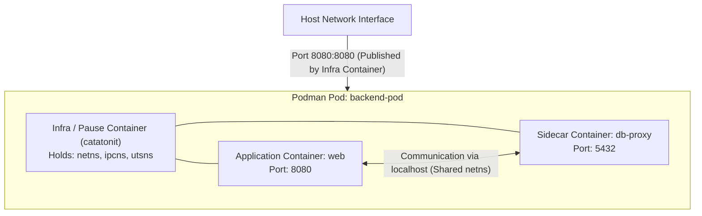
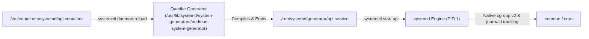
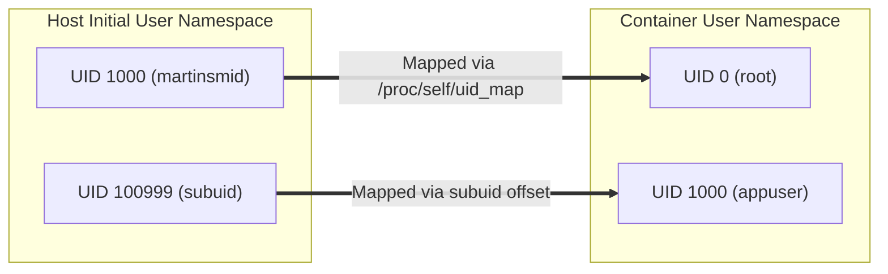
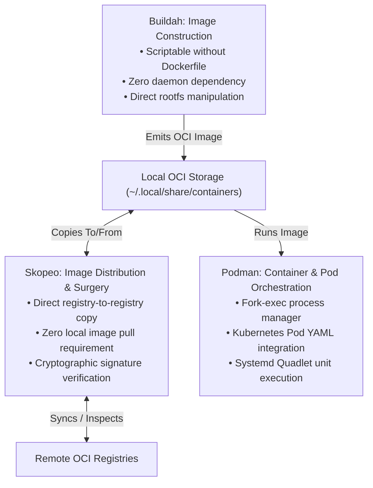

# Module 10: Docker versus Podman, Buildah, and Skopeo: Daemonless Architecture, Pods, and Quadlet

The container ecosystem is characterized by an architectural divergence between two philosophies: the **monolithic daemonful model** embodied by Docker, and the **modular, daemonless, rootless-first model** developed by the Open Container Initiative community and championed by Podman, Buildah, and Skopeo. While both ecosystems adhere strictly to OCI Image and Runtime specifications, their operational topologies, security boundaries, and process lifecycle managers diverge significantly.

This module provides a rigorous comparative analysis of the Docker daemon architecture versus Podman's fork-exec paradigm. We explore the internal supervision role of `conmon`, socket API translation layers, multi-container Pod abstractions on a single host, systemd integration via **Quadlet** (`podman-systemd.unit(5)`), rootless user namespace UID mapping (`subuid`/`subgid`), and developer machine virtualization across macOS and Linux.

---

## 1. Architectural Dichotomy: Daemonful vs. Daemonless Execution

The core architectural difference between Docker and Podman lies in process ownership, privilege separation, and the execution chain required to spawn a container.

```mermaid
flowchart TD
    subgraph DockerArchitecture ["Docker Engine: Monolithic Daemonful Model"]
        D_CLI["Docker CLI (Client)"] -->|"REST API /var/run/docker.sock"| Dockerd["dockerd (Root Daemon)"]
        Dockerd -->|"gRPC /run/containerd/containerd.sock"| Containerd["containerd (Daemon)"]
        Containerd -->|"Spawns"| Shim["containerd-shim-v2"]
        Shim -->|"Invokes"| RuncD["runc (CLI)"]
        RuncD -->|"Creates / Hands Off"| ContD["Container Process (Child of Shim)"]
    end

    subgraph PodmanArchitecture ["Podman: Daemonless Fork-Exec Model"]
        P_CLI["Podman CLI (User Session)"] -->|"Direct fork/exec"| Conmon["conmon / conmon-rs (Monitor)"]
        Conmon -->|"Directly Invokes"| Crun["crun / runc (CLI)"]
        Crun -->|"Creates Process"| ContP["Container Process (Child of Conmon)"]
        Sysd["systemd (PID 1)"] -.->|"Supervises via cgroups"| Conmon
    end
```



### The Docker Model: Monolithic Centralization

Under Docker Engine 29.9.2:

1. **Client-Server REST Boundary**: The `docker` CLI never starts a container directly. It serializes user commands into HTTP REST API requests submitted over the UNIX domain socket `/var/run/docker.sock`.
2. **Central Root Daemon (`dockerd`)**: A long-running background daemon running as host root. It manages local image caching, network bridge creation, volume mounts, and interacts with `containerd`.
3. **Execution Chain**: `dockerd` delegates container lifecycle operations to `containerd` via gRPC. `containerd` invokes an OCI runtime shim (`containerd-shim-v2`), which invokes `runc`. The shim remains alive as a lightweight reaper to capture exit codes and forward standard I/O streams.

#### Operational Limitations of the Daemonful Model

- **Single Point of Failure (SPOF)**: If `dockerd` crashes or hangs during an upgrade, communication with running containers is interrupted. While Docker's `live-restore` setting mitigates process termination, daemon restarts frequently disrupt network state and API access.
- **Root Escalation Vulnerability**: Any unprivileged user granted write permissions to `/var/run/docker.sock` holds effective root access to the entire host machine. An attacker can bind-mount `/` into a privileged container and modify `/etc/shadow`.
- **Audit Logging Evasion**: The Linux kernel tracks process ancestry using the **loginuid** (`/proc/self/loginuid`), which records the original audit identity of the human user who logged into the terminal. In Docker, all containers are children of `dockerd`. Consequently, the kernel's audit subsystem (`auditd`) records root as the creator of every container, breaking forensic non-repudiation.

### The Podman Model: Daemonless Process Independence

Podman (v6.1.4) completely eliminates the central daemon:

1. **Direct Fork-Exec**: When an operator runs `podman run`, the Podman CLI executes directly as a standard POSIX process. It validates arguments, resolves storage and network namespaces, and executes `conmon` (Container Monitor) via standard `fork(2)` and `execve(2)`.
2. **Conmon Supervisor**: Written in C (or `conmon-rs` in Rust), `conmon` is a tiny, dedicated monitoring daemon dedicated to exactly one container. It holds open the container's pseudo-terminal (pty), streams I/O to disk or socket, and captures the container's exit code without consuming more than ~2–4 MB of RAM.
3. **Audit Compliance**: Because Podman executes as a child of the operator's shell session, the container inherits the operator's immutable `loginuid`. `auditd` correctly identifies exactly which LDAP/SSH human user spawned the container.

---

## 2. Socket API Compatibility and `podman.socket`

To provide seamless compatibility with external ecosystems built around the Docker REST API (such as Docker Compose, Testcontainers, VS Code DevContainers, and Kubernetes local tools), Podman provides an on-demand socket service:

```bash
# Enable rootless Podman API socket for the current user
systemctl --user enable --now podman.socket

# Point Docker CLI or Testcontainers to the Podman socket
export DOCKER_HOST="unix://${XDG_RUNTIME_DIR}/podman/podman.sock"
docker ps
```

The `podman system service` daemon activates via **systemd socket activation**. When an external client connects to `$XDG_RUNTIME_DIR/podman/podman.sock`, systemd spawns the Podman service process, handles the REST requests, and terminates when idle.

### API Version Negotiation

Docker Engine 29 raised its minimum supported API version to **1.44**, deprecating legacy Docker clients. Podman's REST API layer implements the Docker API specification up to v1.45, ensuring full backward and forward compatibility with modern orchestration libraries.

---

## 3. Pods in Podman: Kubernetes-Style Composition on a Single Node

A major architectural innovation of Podman is the native implementation of the **Pod** abstraction outside of Kubernetes.



### The Infra (Pause) Container

A Pod is a group of one or more containers that share kernel namespaces:

- **Shared Namespaces**: By default, containers in a Pod share the **Network namespace** (identical IP address and port space), the **IPC namespace** (shared memory and semaphores), and the **UTS namespace** (identical hostname).
- **The Role of Infra**: The `infra` container (typically powered by `catatonit` or a pause binary) is the first process launched. It acquires and holds the shared namespaces open. If the application container crashes and restarts, the network IP and port bindings remain completely uninterrupted because the `infra` container never terminates.

### Operational Workflow and Kubernetes Interoperability

```bash
# 1. Create a pod publishing port 8080 to the host
podman pod create --name web-pod -p 8080:80

# 2. Add an application container to the pod
podman run -d --pod web-pod --name nginx-app nginx:alpine

# 3. Add a companion sidecar communicating over localhost
podman run -d --pod web-pod --name log-agent my-agent:v1

# 4. Export the entire pod definition as standard Kubernetes YAML!
podman kube generate web-pod > pod.yaml

# 5. Play and instantiate arbitrary Kubernetes Pod YAML directly on a single host!
podman kube play pod.yaml
```

This round-trip capability (`kube generate` and `kube play`) bridges the development gap, allowing developers to craft, test, and debug multi-container Kubernetes pods locally without running a heavyweight Minikube or k3s cluster.

---

## 4. Systemd Integration and Quadlet (`podman-systemd.unit(5)`)

Running containers as managed, reliable system services has historically required fragile wrapper scripts or brittle tools like `podman generate systemd`. Podman 5 and 6 standardize production service management on **Quadlet**.

### Why `podman generate systemd` Was Deprecated

The legacy approach generated static, hundreds-of-lines systemd service files containing hardcoded container IDs and complex `ExecStart`/`ExecStop` bash chains. These static units suffered from state desynchronization: if the container was modified outside systemd, the service failed, and updating the container image required regenerating the unit file manually.

### The Quadlet Declarative Architecture

Quadlet is a native **systemd generator** integrated directly into Podman. Instead of writing verbose systemd service syntax, operators write clean, high-level declarative files with custom extensions:

- `.container`: Defines a standalone container.
- `.pod`: Defines a Podman pod.
- `.volume`: Defines a managed named volume.
- `.network`: Defines a custom Netavark container network.
- `.kube`: Executes a Kubernetes YAML file via `podman kube play`.

#### Systemd Generator Lifecycle



During system boot or when invoking `systemctl daemon-reload`, systemd executes Quadlet. Quadlet reads unit files from:

- System-wide (root): `/etc/containers/systemd/` or `/usr/share/containers/systemd/`
- Rootless (user): `~/.config/containers/systemd/`

Quadlet parses the high-level declarations and dynamically synthesizes standard, production-grade `.service` units in `/run/systemd/generator/`.

#### Production Quadlet `.container` Example

```ini
# /etc/containers/systemd/production-api.container
[Unit]
Description=Production Golang API Service
After=network-online.target
Wants=network-online.target

[Container]
Image=registry.example.com/platform/api:v2.4.0
ContainerName=production-api
PublishPort=8080:8080
Environment=APP_ENV=production
Volume=/var/data/api:/data:Z
AutoUpdate=registry
Network=host
Exec=/bin/api-server --port=8080

[Install]
WantedBy=multi-user.target default.target
```

### Automatic Image Updates (`AutoUpdate=registry`)

Quadlet provides automated container updates without third-party daemons (like Watchtower). When `AutoUpdate=registry` is configured, Podman records the container's image digest. When the systemd timer `podman-auto-update.timer` fires:

1. Podman checks the remote registry for a newer manifest digest for the configured tag.
2. If an update exists, Podman pulls the new image and triggers `systemctl restart production-api.service`.
3. If the newly updated container fails its healthcheck, systemd automatically rolls back to the previous working image.

---

## 5. Rootless Execution and User Namespace UID Mapping

Rootless execution decouples container administration from host root privileges. It relies entirely on Linux kernel **User Namespaces** (`user_namespaces(7)`) and subordinate user/group mapping tables.

### Subordinate UID and GID Allocation (`/etc/subuid` and `/etc/subgid`)

When a user logs into a Linux machine, they hold a single host UID (e.g., `martinsmid` = UID `1000`). To run a container containing multiple users (e.g., `root`, `nginx`, `nobody`), the kernel must allocate a contiguous range of subordinate UIDs that the user is permitted to use inside their private user namespace.

```text
# /etc/subuid and /etc/subgid format:
# <username>:<starting-subuid>:<count>
martinsmid:100000:65536
```

This entry grants user `martinsmid` authority over 65,536 subordinate UIDs starting at `100000`:

| Inside Container Namespace | On Host Operating System | Explanation |
| :-- | :-- | :-- |
| `UID 0` (`root`) | `UID 1000` (`martinsmid`) | The user becomes root inside their own container. |
| `UID 1` | `UID 100000` | First subordinate UID. |
| `UID 1000` | `UID 100999` | Mapped subuid inside container. |
| `UID 65535` | `UID 165535` | Last allocated subordinate UID. |



### The Host Bind-Mount Permission Trap: `--userns=keep-id`

A frequent failure mode occurs when mounting a host directory into a rootless container:

- An unprivileged user mounts `~/data` (owned by host `1000:1000`) into a container.
- If the application inside the container runs as container `root` (UID 0), writes succeed because container UID 0 maps to host UID 1000.
- **However**, if the container application runs as an unprivileged user (e.g., container UID 1000), that container UID maps to host UID `100999`. Because host UID `100999` has no write permissions on `~/data` on the host, operations fail with `EACCES: Permission denied`!

#### The Solution: `--userns=keep-id`

Podman introduces the `--userns=keep-id` flag, which modifies the user namespace mapping table so that the host user's UID (1000) maps directly to the container's UID 1000, ensuring seamless read/write access to mounted host directories.

---

## 6. The Modular Suite: Buildah and Skopeo

While Docker packages build, transport, and execution into a single monolithic binary, the OCI tooling philosophy separates concerns into dedicated, composable utilities:



---

## 7. Developer Environments on macOS: Docker Desktop vs. Podman Machine

Because macOS runs a Darwin/XNU kernel, Linux containers cannot run bare-metal on macOS; both Docker and Podman must spin up an underlying Linux virtual machine.

| Feature / Metric | Docker Desktop for Mac | Podman Machine (`podman machine`) | Colima / Lima |
| :-- | :-- | :-- | :-- |
| **Hypervisor Engine** | Apple Virtualization.framework / HyperKit | Apple Virtualization.framework (`vfkit`) | QEMU or Virtualization.framework |
| **Underlying OS** | Proprietary Alpine-based Linux VM | Fedora CoreOS (FCOS) immutable image | Alpine, Ubuntu, or Fedora Linux |
| **Filesystem Sharing** | VirtioFS (high performance) | VirtioFS native mount sharing | VirtioFS or 9p |
| **Networking Architecture** | Proprietary `vpnkit` virtual switch | `gvproxy` / `pasta` user-mode networking | `slirp` or `socket_vmnet` |
| **Licensing** | Commercial subscription required for enterprise | 100% Open Source (Apache 2.0) | 100% Open Source (MIT) |
| **Control Socket** | `/var/run/docker.sock` symlink | Emulated Docker socket via ssh tunnel | Standard Docker socket symlink |

---

## 8. Formal Algorithms: Conmon Supervisor and Quadlet Generator

### Conmon Process Lifecycle State Machine

This algorithm models how the daemonless `conmon` monitor supervises the OCI runtime (`crun`) and reaps exit states.

```text
SUPERVISE-CONTAINER-PROCESS(ContainerConfig C, OciRuntime R)
1  PtyMaster, PtySlave = OPENPTY()
2  SyncPipeRead, SyncPipeWrite = PIPE()
3
4  RuntimePID = FORK()
5  if RuntimePID == 0
6      // Child process: execute OCI runtime
7      CLOSE(SyncPipeRead)
8      DUPLICATE2(PtySlave, STDIN_FILENO, STDOUT_FILENO, STDERR_FILENO)
9      EXECVE(R.Path, ["create", "--bundle", C.BundlePath, "--pid-file", C.PidFile, C.ID])
10
11 CLOSE(SyncPipeWrite)
12 READ(SyncPipeRead) // Block until runtime initializes bundle
13 ContainerPID = READ-INT-FROM-FILE(C.PidFile)
14
15 // Main supervision loop
16 // Invariant: conmon forwards terminal I/O and tracks ContainerPID until termination.
17 while true
18     PollEvents = POLL([PtyMaster, ContainerPID], TIMEOUT: INFINITE)
19     if PollEvents.HasIO(PtyMaster)
20         Data = READ(PtyMaster)
21         WRITE-LOG-FILE(C.LogPath, Data)
22     if PollEvents.ProcessExited(ContainerPID)
23         ExitStatus = WAITPID(ContainerPID, WNOHANG)
24         WRITE-EXIT-CODE-FILE(C.ExitCodePath, ExitStatus)
25         NOTIFY-SYSTEMD-READY(ExitStatus)
26         break
27 EXIT(ExitStatus)
```

### Quadlet Systemd Unit Compilation Algorithm

```text
COMPILE-QUADLET-UNIT(QuadletFile Q)
1  ParsedSections = PARSE-INI-FILE(Q.Path)
2  ContainerSection = ParsedSections["Container"]
3
4  Service = INITIALIZE-SYSTEMD-SERVICE()
5  Service.Description = ParsedSections["Unit"].Description
6  Service.After = "network-online.target"
7
8  // Assemble Podman command line
9  Cmd = ["/usr/bin/podman", "run", "--name", ContainerSection.ContainerName]
10 Cmd.APPEND("--replace", "--rm")
11 Cmd.APPEND("--log-driver", "journald")
12 Cmd.APPEND("--cidfile", "/run/" + ContainerSection.ContainerName + ".cid")
13
14 for each Port in ContainerSection.PublishPort
15     Cmd.APPEND("-p", Port)
16 for each Vol in ContainerSection.Volume
17     Cmd.APPEND("-v", Vol)
18
19 Cmd.APPEND(ContainerSection.Image)
20 if ContainerSection.Exec != null
21     Cmd.APPEND(ContainerSection.Exec)
22
23 Service.ExecStart = JOIN-STRINGS(Cmd, " ")
24 Service.ExecStop = "/usr/bin/podman stop --ignore --cidfile /run/" + ContainerSection.ContainerName + ".cid"
25 Service.ExecStopPost = "/usr/bin/podman rm -f --ignore --cidfile /run/" + ContainerSection.ContainerName + ".cid"
26
27 EMIT-FILE("/run/systemd/generator/" + ContainerSection.ContainerName + ".service", Service)
```

---

## 9. Then vs Now: Structural Evolution

| Engineering Facet | Docker Classical (v1.x / 2015) | Podman v5.x (2024) | Modern Containers (Podman 6.1 / Docker 29.9) |
| :-- | :-- | :-- | :-- |
| **Systemd Management** | `Restart=always` inside docker daemon | `podman generate systemd` (static bash scripts) | Native **Quadlet** (`.container`, `.pod`) systemd generators |
| **Internal Database** | Monolithic BoltDB (`/var/lib/docker/`) | BoltDB (`/var/lib/containers/storage/`) | **SQLite** database backend (Podman 6 breaking change; BoltDB removed) |
| **Cgroup Hierarchy** | Hybrid cgroups v1 / v2 | Dual cgroups v1 and v2 support | Strict **cgroups v2 unified tree** (cgroups v1 removed in Podman 6) |
| **Daemon Architecture** | Monolithic root daemon | Daemonless fork-exec | Daemonless fork-exec + native socket-activated REST proxy |
| **Rootless Networking** | Unsupported | `slirp4netns` user-space stack | High-performance **`pasta`** zero-copy socket splicing |

---

## 10. Exam Delta: Enterprise Certifications vs. Developer Workflow

> [!IMPORTANT]
> **RHCSA / RHCE vs. CKAD / CKS Delta**:
>
> - **Red Hat RHCSA / RHCE**: Explicitly tests rootless Podman operations. Candidates are required to configure unprivileged user namespaces, pull images from private enterprise registries without root, configure rootless systemd services using Quadlet or user systemd units (`systemctl --user`), and manage SELinux volume flags (`:Z`).
> - **CKAD / CKS**: Focuses entirely on Kubernetes control planes and assumes a shared CRI runtime (like containerd).
> - **Production Reality**: Modern DevOps engineers must maintain parity between local developer environments (running Podman or Docker Desktop) and production Kubernetes clusters, using tools like `podman kube play` to validate manifest compatibility before submitting PRs.

---

## 11. Production Failure Modes and Gotchas

### 1. Docker Socket Exposure Compromising the Host

**Symptom**: An attacker compromises a Jenkins or CI agent container and gains immediate root control over the physical host node. **Root Cause**: The CI job mounted `/var/run/docker.sock` to enable "Docker-out-of-Docker". Access to the Docker socket allows any process to invoke:

```bash
docker run -v /:/host-root --privileged alpine chroot /host-root useradd -m -s /bin/bash attacker
```

**Mitigation**: Never mount `/var/run/docker.sock` into untrusted containers. Replace Docker-in-Docker workflows with rootless Buildah or isolated Kaniko pods.

### 2. Rootless Volume Permission Failures (`EACCES`)

**Symptom**: A containerized database fails to boot with `chown: changing ownership of '/var/lib/postgresql/data': Permission denied`. **Root Cause**: The unprivileged host user (UID 1000) owns the host directory. Inside the container, PostgreSQL runs as UID 26. In the rootless user namespace, container UID 26 maps to subordinate UID `100025` on the host, which lacks filesystem permissions on the directory. **Mitigation**:

- Use `podman unshare chown -R 26:26 /host/data` to set ownership from within the user namespace.
- Use `--userns=keep-id:uid=26,gid=26` to bind the host user's identity directly to the service UID.

### 3. Upgrading to Podman 6 with Unmigrated BoltDB State

**Symptom**: After upgrading a server to Podman 6.0+, all existing containers, pods, and storage layers disappear, and `podman ps -a` returns database initialization errors. **Root Cause**: Podman 6.0 completely removed support for the legacy BoltDB database engine, standardizing on SQLite. Upgrading directly from Podman 4.x or early 5.x without running the migration tool in Podman 5.8 corrupts or abandons container metadata. **Mitigation**: Before installing Podman 6, verify migration to SQLite under Podman 5.8:

```bash
podman-database migrate
```

---

## Interview Drill

<details><summary>1. Explain why mounting `/var/run/docker.sock` inside a container provides equivalent privileges to passwordless `sudo` on the host machine.</summary>

The UNIX domain socket `/var/run/docker.sock` is the control surface for the Docker daemon (`dockerd`), which runs with full `root` privileges in the host's initial user, mount, and PID namespaces. Any client inside a container that can communicate with this socket can issue standard Docker API commands. An attacker can instruct `dockerd` to launch a new container configured with:

1. `--privileged` (granting all Linux capabilities and disabling seccomp/AppArmor).
2. `-v /:/host-root` (bind-mounting the entire host root filesystem).
3. `chroot /host-root` (escaping the container filesystem). The attacker now possesses unrestricted read/write access to host configuration files, SSH keys, shadow passwords, and raw storage block devices, completely bypassing all container isolation boundaries.
</details>

<details><summary>2. How does Podman track the original human user's identity in the Linux kernel audit subsystem, whereas Docker obscures it?</summary>

The Linux kernel maintains an immutable security attribute for every process called `loginuid` (`/proc/self/loginuid`). When a human user logs into a Linux system via SSH or console, PAM sets this value to their numeric user ID (e.g., 1001). Subsequent child processes inherit this `loginuid`.

- In **Podman**, the CLI executes as a standard child process of the user's terminal session, and `conmon` is forked directly. The container process inherits the human's `loginuid`. When the container executes system calls, the kernel's `auditd` logs record `auid=1001`.
- In **Docker**, the CLI merely transmits a REST request over a socket to `dockerd`. The container is forked and spawned by `dockerd` (running as root). Consequently, the kernel records `auid=0` (root) or unset (`4294967295`), completely erasing forensic traceability of which developer launched the container.
</details>

<details><summary>3. What is the operational purpose of `conmon` in the Podman architecture, and why is it not replaced by the OCI runtime (`crun`)?</summary>

OCI runtimes like `runc` and `crun` are designed to be short-lived: they configure kernel namespaces, cgroups, and capabilities, execute `execve` to transition into the container binary, and exit. They are not long-running daemons. `conmon` serves as the lightweight, persistent supervisor that remains active for the lifespan of the container:

1. **PTY & Console Handling**: It holds the master side of the pseudo-terminal (pty) open, streaming stdin, stdout, and stderr to disk logs or socket connections.
2. **Exit Code Retention**: When the container process terminates, `conmon` captures the exact exit code and writes it to an exit file, ensuring the exit status is available even if Podman CLI is not running.
3. **Daemonless Independence**: By offloading process supervision to a tiny (~2 MB) C program, Podman avoids running a massive Go-based runtime daemon while preventing zombie process leaks.
</details>

<details><summary>4. Describe how systemd Quadlet improves upon the legacy `podman generate systemd` mechanism.</summary>

`podman generate systemd` produced static systemd unit files containing hardcoded container IDs and complex, brittle shell command lines. If an operator modified or recreated the container, the systemd unit became desynchronized and broke. **Quadlet** operates as a native systemd generator. Operators write declarative, high-level `.container` or `.pod` files. During `systemctl daemon-reload` or system boot, Quadlet dynamically compiles these declarations into native systemd `.service` files in `/run/systemd/generator/`. It automatically generates proper cgroup v2 slices, handles clean teardown and replacement via `--replace`, wires up journald logging, and enables declarative auto-updates (`AutoUpdate=registry`) with automated rollback.
</details>

<details><summary>5. How does `--userns=keep-id` resolve host bind-mount permission issues in rootless Podman?</summary>

By default in a rootless user namespace, the user's host UID (e.g., 1000) is mapped to UID 0 (root) inside the container, while container UID 1000 is mapped to subordinate UID 100999 on the host. If an application inside the container runs as unprivileged user 1000, any file it attempts to write to a bind-mounted host directory (owned by host UID 1000) will fail with `Permission denied` because the host sees the write originating from UID 100999. `--userns=keep-id` modifies the namespace UID mapping table (`/proc/self/uid_map`) so that the host user's UID (1000) is explicitly mapped to UID 1000 inside the container. When the container process (running as UID 1000) writes to the mounted host directory, the host kernel verifies that the writer's host UID is 1000, permitting normal read/write operations without complex `chown` workarounds.
</details>

<details><summary>6. Why did Podman 6.0 completely remove support for BoltDB in favor of SQLite?</summary>

BoltDB is an embedded key-value store that suffered from concurrency and performance limitations under multi-threaded and multi-process workloads:

1. **Concurrency Bottlenecks**: BoltDB allows multiple concurrent readers but enforces a strict single-writer lock, causing lock contention and timeout errors when multiple Podman CLI commands executed simultaneously.
2. **Crash Resilience & Data Integrity**: SQLite's Write-Ahead Logging (WAL) mode provides vastly superior ACID transaction performance, crash recovery, and multi-process concurrent access.
3. **Rich Query Capabilities**: Storing container, image, and network metadata in a relational database allows Podman to execute fast indexed lookups, filtering, and state integrity checks across thousands of local containers.
</details>

<details><summary>7. What is the role of the `infra` (pause) container in a Podman pod?</summary>

The `infra` container (typically running `catatonit` or a pause binary) is the anchor process for the entire Pod:

1. It initializes and holds open the shared kernel namespaces (Network, IPC, UTS).
2. It binds and publishes host network ports (e.g., `-p 8080:80`).
3. If an application container inside the pod crashes, is stopped, or is upgraded, the shared network namespace, IP address, and port allocations remain fully preserved because the `infra` container remains alive.
4. It acts as subreaper (PID 1) within the shared PID namespace (if enabled) to reap zombie processes spawned by dead containers in the pod.
</details>

---

## 13. Proof Map and Verification

The architectural comparisons, daemonless lifecycle states, Quadlet generation logic, and rootless user namespace mappings documented in this module are verified via automated tests:

- **Hermetic Unit Suite**: [`technologies/containers/examples/ts/10-docker-vs-podman-buildah-skopeo.test.ts`](../examples/ts/10-docker-vs-podman-buildah-skopeo.test.ts)
  - `testConmonLifecycleSupervision`: Simulates daemonless process monitoring and exit code capture.
  - `testQuadletUnitParserAndEmission`: Validates conversion of `.container` files into production-grade systemd `.service` declarations.
  - `testUserNamespaceSubuidMapping`: Computes container-to-host UID translations under standard and `--userns=keep-id` configurations.
  - `testPodNamespaceSharing`: Validates shared network and IPC namespace semantics across multi-container pod configurations.
