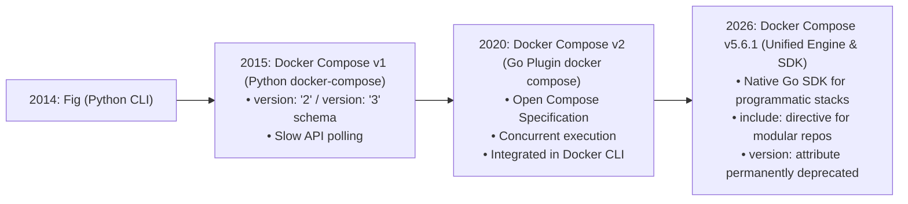
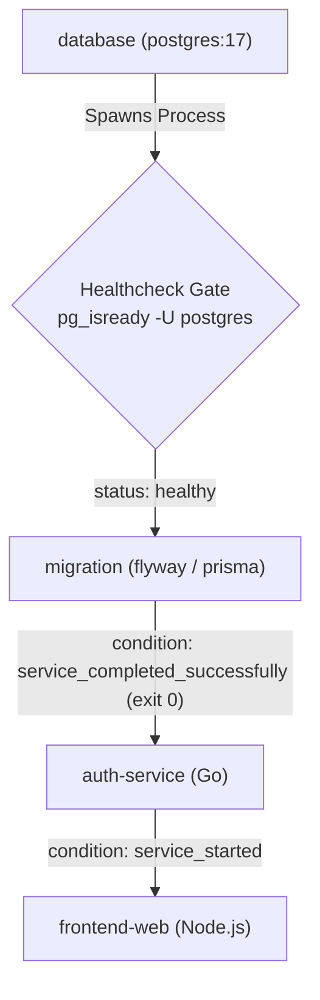
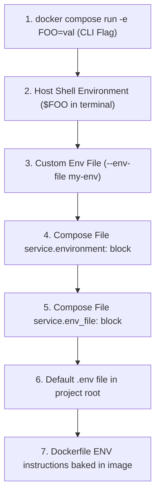
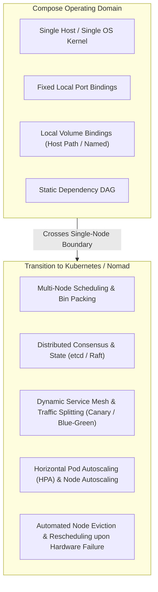

# Module 11: Compose Specification in Depth: Dependency Graphs, Profiles, Merging, and Shared Stack Conventions

The Compose Specification ([compose-spec.io](https://compose-spec.io/)) defines a declarative, platform-agnostic standard for describing multi-container cloud-native applications. What began in 2014 as Fig—a simple Python script for orchestrating local development environments—has evolved into a high-performance orchestration system implemented in Go (`docker compose` and Compose v5.6.1) and adopted across diverse runtimes including Docker, Podman, and Kubernetes.

Operating distributed systems in development, continuous integration, and edge environments requires an in-depth understanding of Compose internals: topological dependency resolution, healthcheck synchronization gates, multi-file deep-merging mechanics, fine-grained profile filtering, environment variable interpolation hierarchies, and project namespace isolation.

This module analyzes the mechanics of the Compose Specification, establishes reusable repository stack conventions for [`../examples/_compose/README.md`](../examples/_compose/README.md), and defines the exact architectural boundary where single-node Compose must yield to distributed orchestrators.

---

## 1. Evolution and the Modern Compose Specification

The history of Compose is marked by significant architectural and versioning transitions:



### The Top-Level `version:` Attribute Deprecation

For years, developers were forced to navigate confusing matrix tables mapping `version: '2.4'`, `version: '3.8'`, and Docker Engine releases. Under the unified **Compose Specification**, the top-level `version:` key is **deprecated and ignored**. A modern `compose.yaml` file requires no version declaration; the Compose engine validates all supported attributes dynamically based on the engine's capabilities.

```yaml
# Modern, canonical Compose Spec file (compose.yaml)
# No top-level "version:" string required!
name: ecommerce-platform

services:
  database:
    image: postgres:17-alpine
    environment:
      POSTGRES_DB: app
      POSTGRES_PASSWORD: secretpassword
    healthcheck:
      test: ['CMD-SHELL', 'pg_isready -U postgres -d app']
      interval: 5s
      timeout: 3s
      retries: 5
      start_period: 10s

  web:
    image: my-company/web:v1.0.0
    depends_on:
      database:
        condition: service_healthy
    ports:
      - '8080:8080'
```

---

## 2. Directed Acyclic Graphs (DAG) and Startup Synchronization

When an operator issues `docker compose up`, Compose does not launch all services simultaneously. It parses the `services` block, inspects `depends_on` relationships, and constructs a **Directed Acyclic Graph (DAG)**.



### The Three `depends_on` Conditions

A common production anti-pattern is using plain `depends_on: [database]`. This only guarantees that the database container's `execve` call succeeded; it provides **zero guarantee** that the database daemon has initialized its storage engine or opened its listening TCP port!

Modern Compose specifications provide three explicit dependency condition gates:

| Dependency Condition | Synchronization Gate Invariant | Production Use Case |
| :-- | :-- | :-- |
| **`condition: service_started`** (default) | Triggered immediately once the target container process is created by the runtime. | Uncoordinated companion services, logging forwarders, fire-and-forget background workers. |
| **`condition: service_healthy`** | Blocks dependent service startup until the target container's healthcheck transitions from `starting` to `healthy`. | Stateful databases (PostgreSQL, MySQL), message brokers (Kafka, RabbitMQ), cache servers (Redis). |
| **`condition: service_completed_successfully`** | Blocks dependent service startup until the target container executes to completion and terminates with exit code 0. | Database schema migration jobs (Flyway, Liquibase, Prisma), seed data loaders, TLS certificate provisioners. |

### Healthcheck Configuration Mechanics

A healthcheck executes a command inside the container namespace at periodic intervals:

- `test`: Command array (e.g., `["CMD", "curl", "-f", "http://localhost:8080/health"]`) or shell string (`["CMD-SHELL", "pg_isready -U postgres"]`).
- `interval`: Time between healthcheck invocations (default: 30s).
- `timeout`: Maximum duration the probe command can execute before being marked failed (default: 30s).
- `retries`: Number of consecutive failures required to transition health state from `healthy` to `unhealthy` (default: 3).
- `start_period`: Initialization grace window during which probe failures do not count against the retry threshold.
- `start_interval`: A feature of modern Compose engines enabling high-frequency polling (e.g., every 1s) during the `start_period` to accelerate container startup without waiting for standard long intervals.

---

## 3. Multi-File Composition, Merging Semantics, and `include:`

Enterprise architectures require composing complex environments across multiple files (e.g., base definitions, local developer overrides, and CI test configurations).

### The Classical Multi-File CLI Merge

When invoking `docker compose -f compose.yaml -f compose.override.yaml up`, Compose evaluates the files sequentially. The merge algorithm applies deterministic rules based on data type:

| Attribute Type | Merging Behavior | Example Attributes | Resolution Rule |
| :-- | :-- | :-- | :-- |
| **Scalars** | Replacement | `image`, `container_name`, `restart`, `user` | The last file in the CLI argument sequence completely overwrites earlier values. |
| **Dictionaries / Maps** | Deep Recursive Merge | `environment`, `labels`, `sysctls`, `extra_hosts` | Keys are merged. If identical keys collide, the value in the later file overwrites the earlier one. |
| **Lists of Strings** | Concatenation / Append | `ports`, `volumes`, `devices`, `cap_add` | Values from later files are appended to the list, with deduplication applied to unique port bindings and mount targets. |
| **Command / Entrypoint** | Complete Replacement | `command`, `entrypoint` | Overridden entirely by the later file; arguments are never merged or appended. |

### The Modern `include:` Directive

While combining files with `-f` works for simple overrides, it fails in large multi-repository microservice projects because all relative paths (`build.context`, `volumes`) are resolved relative to the root compose file.

Compose v5 standardizes the **`include:`** directive:

```yaml
# /workspace/platform/compose.yaml
name: core-platform

include:
  - path: ../services/auth/compose.yaml
    env_file: ../services/auth/.env.local
  - path: ../services/billing/compose.yaml
  - path: ../infrastructure/observability/compose.yaml

services:
  gateway:
    image: nginx:alpine
    ports:
      - '80:80'
    depends_on:
      - auth-service
      - billing-service
```

Each included compose file evaluates within its **own directory context**. Relative volume paths and build contexts resolve accurately against the included file's location, enabling modular, independent microservice repositories to be stitched together effortlessly.

---

## 4. Profiles: Selective Service Orchestration

In complex multi-service stacks, developers rarely need to run every component (such as monitoring suites, profiling tools, or heavy background workers) simultaneously. **Profiles** allow services to be partitioned into optional execution groups.

```yaml
services:
  api:
    image: my-app:latest
    ports:
      - '3000:3000'

  db:
    image: postgres:17-alpine

  # Debugging tools: only launched when the "debug" profile is active
  pgadmin:
    image: dpage/pgadmin4
    profiles: ['debug', 'tools']
    ports:
      - '5050:80'

  # Monitoring stack: only launched with the "monitoring" profile
  prometheus:
    image: prom/prometheus:v3.0.0
    profiles: ['monitoring']
    ports:
      - '9090:9090'
```

### Profile Activation Rules

1. **Default Run (`docker compose up`)**: Only services without any `profiles` attribute are instantiated. `pgadmin` and `prometheus` remain completely dormant.
2. **Explicit CLI Activation**:
   ```bash
   # Launch core services plus debug tools
   docker compose --profile debug up

   # Launch multiple profiles simultaneously
   docker compose --profile debug --profile monitoring up
   ```
3. **Environment Activation**: Exporting `COMPOSE_PROFILES=debug,tools` activates profiles across all compose commands within the current shell session.

---

## 5. Environment Variable Interpolation and Precedence Hierarchy

One of the most frequent causes of configuration bugs in Compose is confusion surrounding environment variable precedence. When a service variable `DATABASE_URL` is referenced, Compose evaluates a strict **7-layer hierarchy**.



### The 7-Layer Precedence Hierarchy (Highest to Lowest)

1. **CLI Runtime Flags**: `docker compose run -e VAR=val` or `docker compose exec -e VAR=val`.
2. **Host Shell Environment**: Variables exported in the active host shell executing the `docker compose` command.
3. **CLI Argument Env-File**: Variables defined in a file explicitly supplied via `docker compose --env-file <path>`.
4. **Service Environment Block**: Key-value pairs declared inside the `services.<name>.environment` mapping in `compose.yaml`.
5. **Service Env-File Block**: Key-value pairs loaded via `services.<name>.env_file` directives in `compose.yaml`.
6. **Project Directory `.env` File**: The default `.env` file located in the directory alongside `compose.yaml`. (Used primarily for variable substitution inside `compose.yaml` itself).
7. **Image Configuration `ENV`**: Default variables baked directly into the container image metadata during build time.

### Interpolation Syntax

Compose supports advanced POSIX parameter expansion syntax within `compose.yaml`:

- `${VARIABLE}`: Direct substitution.
- `${VARIABLE:-default_val}`: Evaluates to `default_val` if `VARIABLE` is unset or empty.
- `${VARIABLE-default_val}`: Evaluates to `default_val` only if `VARIABLE` is completely unset.
- `${VARIABLE:?error_message}`: Halts execution with an error if `VARIABLE` is unset or empty.
- `$$VARIABLE`: Escaped literal dollar sign; prevents Compose interpolation and passes `$VARIABLE` directly to the container runtime.

---

## 6. Project Namespaces and Collision Isolation

To ensure that multiple developers on a shared server—or automated CI runners executing concurrent PR checks—do not overwrite each other's containers, volumes, and networks, Compose enforces strict **Project Namespaces**.

### Namespace Derivation

Compose determines the project name by evaluating:

1. The `-p` or `--project-name` CLI flag.
2. The `COMPOSE_PROJECT_NAME` environment variable.
3. The top-level `name:` field inside `compose.yaml`.
4. The normalized basename of the working directory containing `compose.yaml`.

### Resource Naming Formula

Every resource managed by Compose is prefixed with the project name: $$\text{Container Name} = \text{ProjectName} + \text{"-"} + \text{ServiceName} + \text{"-"} + \text{InstanceIndex}$$ $$\text{Network Name} = \text{ProjectName} + \text{"-"} + \text{NetworkName}$$ $$\text{Volume Name} = \text{ProjectName} + \text{"-"} + \text{VolumeName}$$

This namespacing guarantees that executing `docker compose -p pr-104 up` and `docker compose -p pr-105 up` instantiates two completely disjoint, isolated network and storage environments on the same host machine without collision.

---

## 7. Modern Compose Innovations: Compose Watch and the Go SDK

### Compose Watch (`develop: watch: ...`)

Historically, hot-reloading code inside containers required mounting host source code over container directories via bind mounts. This created major cross-platform performance penalties (especially on macOS and Windows file sharing) and often corrupted `node_modules` or compiled artifacts.

Compose v5 standardizes **Compose Watch**:

```yaml
services:
  web:
    build: .
    develop:
      watch:
        # Sync source files directly into the running container
        - action: sync
          path: ./src
          target: /app/src
          ignore:
            - node_modules/

        # Automatically rebuild and replace the container if dependencies change
        - action: rebuild
          path: package.json

        # Sync configuration and trigger a graceful service restart
        - action: sync+restart
          path: ./config
          target: /app/config
```

Invoking `docker compose watch` starts an efficient file watcher. Changes to `./src` are synchronized into the running container filesystem in milliseconds without rebuilding layers or restarting processes.

### The Docker Compose Go SDK

Compose v5 introduces the official **Compose Go SDK** (`github.com/docker/compose/v2/pkg/api`). Developers can now instantiate, inspect, and tear down complete Compose environments programmatically from Go code, providing a powerful foundation for automated integration tests and custom orchestration operators.

---

## 8. Shared Stack Conventions: `examples/_compose`

To maintain architectural consistency across the repository, all sample multi-tier environments adhere to the shared conventions defined in [`../examples/_compose/README.md`](../examples/_compose/README.md).

### Repository Compose Rules

1. **Explicit Project Naming**: Every compose file must declare a clean top-level `name: <track>-<feature>` to prevent accidental local collisions.
2. **Mandatory Stateful Healthchecks**: Databases, caches, and message brokers MUST declare an executable `healthcheck` block. Downstream services must explicitly declare `depends_on.<service>.condition: service_healthy`.
3. **Log Rotation Enforcement**: Prevent unconstrained disk growth by specifying max log limits in service definitions:
   ```yaml
   logging:
     driver: 'json-file'
     options:
       max-size: '10m'
       max-file: '3'
   ```
4. **Isolated Default Network**: Services must never use `network_mode: "host"` unless explicitly demonstrating low-level packet capture. Services must communicate across isolated internal bridge networks.

---

## 9. When Compose Stops Being Enough: The Transition Boundary

While Compose is the gold standard for local development, CI test harnesses, and single-node edge deployments, it is fundamentally **not a distributed orchestrator**.



### Architectural Limits of Compose

| Architectural Capability | Docker Compose | Kubernetes / Nomad |
| :-- | :-- | :-- |
| **Node Scheduling** | Single host only; cannot schedule across server pools | Intelligent bin-packing across thousands of heterogeneous nodes |
| **High Availability** | Host crash terminates all services | Automated pod rescheduling and self-healing across surviving nodes |
| **Scaling** | Vertical scaling or simple manual local replicas (`--scale web=3`) | Dynamic horizontal autoscaling based on CPU, memory, or custom metrics |
| **Traffic Routing** | Basic DNS round-robin or manual reverse proxy | Sophisticated ingress controllers, L7 routing, and service mesh traffic shaping |
| **Secret Management** | File/environment interpolation; static secrets | Cryptographically sealed secrets, dynamic ephemeral rotation, Vault integration |

---

## 10. Formal Algorithms: Cycle Detection and Deep-Merge Logic

### Dependency DAG Cycle Detection and Topological Sort

Compose uses Kahn's algorithm or depth-first search to ensure that service dependencies do not contain cycles and to establish the startup sequence.

```text
COMPUTE-COMPOSE-STARTUP-ORDER(ServicesMap S)
1  Graph = BUILD-DEPENDENCY-GRAPH(S)
2  InDegree = INITIALIZE-IN-DEGREE-MAP(S)
3  StartupQueue = ALLOCATE-QUEUE()
4  SortedOrder = ALLOCATE-LIST()
5
6  for each service in S
7      for each dep in service.depends_on
8          InDegree[service] = InDegree[service] + 1
9          Graph[dep].children.APPEND(service)
10
11 for each service in S
12     if InDegree[service] == 0
13         ENQUEUE(StartupQueue, service)
14
15 // Invariant: StartupQueue contains all services whose dependencies are satisfied.
16 while NOT-EMPTY(StartupQueue)
17     node = DEQUEUE(StartupQueue)
18     SortedOrder.APPEND(node)
19     for each child in Graph[node].children
20         InDegree[child] = InDegree[child] - 1
21         if InDegree[child] == 0
22             ENQUEUE(StartupQueue, child)
23
24 if LENGTH(SortedOrder) != LENGTH(S)
25     error "Circular dependency cycle detected in Compose file!"
26 return SortedOrder
```

### Recursive Dictionary and Array Merge Algorithm

```text
DEEP-MERGE-COMPOSE-SPECS(BaseConfig B, OverrideConfig O)
1  Merged = CLONE(B)
2
3  for each key, value in O
4      if key not in Merged
5          Merged[key] = value
6      else if IS-MAP(Merged[key]) and IS-MAP(value)
7          Merged[key] = DEEP-MERGE-COMPOSE-SPECS(Merged[key], value)
8      else if IS-LIST(Merged[key]) and IS-LIST(value)
9          if key in ["ports", "volumes"]
10             Merged[key] = MERGE-UNIQUE-TARGET-LISTS(Merged[key], value)
11         else if key in ["command", "entrypoint"]
12             Merged[key] = value // Complete replacement
13         else
14             Merged[key] = CONCATENATE(Merged[key], value)
15     else
16         Merged[key] = value // Scalar overwrite
17 return Merged
```

---

## 11. Then vs Now: Evolution of the Compose Ecosystem

| Dimension | Compose v1 (`docker-compose` / 2015) | Compose v2 (`docker compose` / 2021) | Compose v5.6.1 (Current Standard) |
| :-- | :-- | :-- | :-- |
| **Language & Engine** | Python script; high startup latency | Go CLI plugin compiled natively | Unified Go CLI + official Go SDK for programmatic management |
| **Schema Validation** | Strict top-level `version: '2'` or `'3'` required | Transition away from version strings | **`version:` field deprecated and ignored**; open Compose Spec |
| **Synchronization** | Primitive `depends_on` (process start only) | `condition: service_healthy` supported | `condition: service_completed_successfully` + `start_interval` fast polling |
| **Multi-File Modularization** | Limited to `-f file1.yaml -f file2.yaml` | Early experimental sub-stacks | Native **`include:`** directive with isolated directory contexts |
| **Developer Experience** | Heavy bind mounts causing filesystem lag | Third-party file sync scripts | Native **Compose Watch** (`develop: watch: ...`) |

---

## 12. Exam Delta: Certification Assumptions vs. Systems Reality

> [!IMPORTANT]
> **Cloud-Native Certification Realities**:
>
> - **CKAD / CKA**: Does not test Docker Compose directly; the Linux Foundation curricula mandate native Kubernetes primitives (Deployments, StatefulSets, Pods, ConfigMaps).
> - **Senior SRE / Infrastructure Interview Loops**: Heavily test Compose architecture! Senior candidates are expected to demonstrate how to simulate multi-stage database migrations, write deterministic healthchecks, handle environment variable precedence bugs, design ephemeral staging stacks in CI pipelines, and articulate the precise tipping point where an organization must migrate from Compose to Kubernetes.

---

## 13. Production Failure Modes and Gotchas

### 1. The Database Readiness Startup Race Condition

**Symptom**: In CI or local dev, an application container crashes on boot with `ECONNREFUSED: Connection refused at 127.0.0.1:5432`. **Root Cause**: The compose file declared:

```yaml
web:
  depends_on:
    - db
```

Compose launched the PostgreSQL container. However, PostgreSQL takes 3–5 seconds to initialize shared memory buffers, load write-ahead logs, and open its listening socket. The web app attempted to connect immediately upon process start and crashed before the database was ready. **Mitigation**: Declare an explicit healthcheck on the database and gate the web service with `condition: service_healthy`:

```yaml
web:
  depends_on:
    db:
      condition: service_healthy
```

### 2. Accidental Volume Destruction via `docker compose down -v`

**Symptom**: A developer tears down a local stack to refresh code, and months of local database test records are completely wiped. **Root Cause**: Executing `docker compose down -v` instructs Compose to delete all **named volumes** declared in the compose file in addition to containers and networks. **Mitigation**: Use `docker compose down` (without the `-v` flag) for routine teardowns. Reserve `-v` strictly for clean-slate resets.

### 3. Port Collisions Across Parallel Stacks

**Symptom**: Running two test suites concurrently in CI fails with `Bind for 0.0.0.0:8080 failed: port is already allocated`. **Root Cause**: Both stacks publish fixed host port `8080:8080`. While Compose namespaces container and network names via the project name, the host's network port space is a single shared host resource. **Mitigation**: Avoid fixed host port mappings in ephemeral CI environments. Use dynamic ephemeral port allocation (`ports: ["0:80"]`) and inspect the assigned port using `docker compose port web 80`.

---

## Interview Drill

<details><summary>1. Explain the exact difference between `condition: service_started`, `condition: service_healthy`, and `condition: service_completed_successfully` in Compose.</summary>

- `condition: service_started`: The default behavior. Compose initiates the dependency's `execve` call. Once the container transitions to the `running` state in the container runtime, Compose immediately begins spawning the dependent container. It does NOT guarantee that the application inside is ready to accept traffic.
- `condition: service_healthy`: Compose blocks the dependent service from starting until the target container's healthcheck command executes successfully and the runtime updates the container health status from `starting` to `healthy`.
- `condition: service_completed_successfully`: Compose blocks the dependent service until the target container executes its command and terminates with an exit code of `0`. If the container exits with any non-zero exit code, Compose aborts the startup sequence. This is typically used for database migration or setup jobs.

</details>

<details><summary>2. How does Compose resolve a conflict when a variable is defined in both a project `.env` file and the host shell environment?</summary>

According to the Compose precedence hierarchy, the **host shell environment takes precedence** over the project's `.env` file. The project `.env` file serves as default values for variable interpolation within `compose.yaml`. If the host shell exports that same variable name (e.g., `export PORT=9000`), the shell value overrides the `.env` value (e.g., `PORT=8080`), and Compose injects `9000` into the configuration.
</details>

<details><summary>3. Why was the top-level `version:` attribute deprecated in modern Compose specifications?</summary>

The `version:` string (e.g., `'2.4'`, `'3.8'`) coupled the file format to specific Docker Engine release versions and created artificial fragmentation. For example, version 3 removed features like `cpu_shares` and resource limits (restricting them to Swarm deployments) that version 2 supported. The open **Compose Specification** unified the schema into a single, unversioned specification. The engine parses all supported configuration directives directly; any unrecognized or unsupported properties trigger a clear schema validation error based on the current engine's capabilities rather than a rigid schema version tag.
</details>

<details><summary>4. How does the modern `include:` directive solve the relative path problem that plagued multi-file `-f` overrides?</summary>

When using classical multi-file arguments (`docker compose -f file1.yaml -f ../service/file2.yaml`), Compose resolves all relative paths (such as `build: .` or volume bind mounts) relative to the **working directory of the command invocation or the first compose file**. This broke modular configurations when combining services across different subdirectories. With `include:`, each included compose file is evaluated in its **own directory context**. Relative build contexts and volume mounts declared inside an included file resolve relative to that specific file's filesystem path, allowing independent microservice compose files to be composed without path corruption.
</details>

<details><summary>5. What occurs when two services in a Compose file declare identical `ports: ["8080:80"]`?</summary>

The Compose engine compiles the configuration successfully during AST validation. However, during execution, the first service binds to the host's physical network adapter on port 8080. When the second service attempts to start, the host kernel rejects the `bind(2)` system call with `EADDRINUSE` (`port is already allocated`), and Compose reports a container startup failure.
</details>

<details><summary>6. How does Compose Watch (`develop: watch: ...`) improve upon traditional bind-mounted code sharing during local development?</summary>

Traditional bind mounts mount host directories directly over container directories. On non-Linux hosts (macOS, Windows), crossing the hypervisor boundary with thousands of small file reads (such as `node_modules` or Python virtual environments) incurs massive I/O virtualization latency. Furthermore, host-compiled binaries often conflict with container Linux ABIs. Compose Watch runs a lightweight host-side file watcher. When an operator modifies a file in `./src`, Compose actively streams only the changed file bytes into the running container filesystem. It avoids hypervisor bind-mount translation overhead and allows fine-grained rules (e.g., `sync` source files, but trigger an automated container `rebuild` when `package.json` changes).
</details>

<details><summary>7. Describe the deep-merge behavior of Compose when an override file defines an `environment` mapping versus a `command` array.</summary>

- **`environment` (Dictionary/Map)**: Compose performs a recursive deep merge. If the base file defines `{ A: 1, B: 2 }` and the override file defines `{ B: 3, C: 4 }`, the resulting environment passed to the container is `{ A: 1, B: 3, C: 4 }`. Colliding keys are updated with the override value, and unique keys are preserved.
- **`command` (Array/Scalar)**: Compose performs a **complete replacement**. If the base file defines `command: ["server", "--port", "80"]` and the override defines `command: ["server", "--debug"]`, the entire array is replaced. The arguments are not concatenated; the resulting command is strictly `["server", "--debug"]`.

</details>

---

## 15. Proof Map and Verification

The dependency graph algorithms, healthcheck gating, deep-merge rules, and profile filtering behaviors described in this module are verified via automated tests:

- **Hermetic Unit Suite**: [`technologies/containers/examples/ts/11-compose-in-depth.test.ts`](../examples/ts/11-compose-in-depth.test.ts)
  - `testComposeDagCycleDetection`: Verifies topological sort and asserts detection of cyclic service dependencies.
  - `testHealthcheckConditionGating`: Simulates startup state machines with `service_started`, `service_healthy`, and `service_completed_successfully`.
  - `testMultiFileDeepMergeSemantics`: Asserts correct recursive dictionary merging and array replacement rules.
  - `testEnvironmentPrecedenceHierarchy`: Validates resolution across the 7-layer environment variable precedence hierarchy.
- **Shared Compose Stack Reference**: [`technologies/containers/examples/_compose/README.md`](../examples/_compose/README.md)
