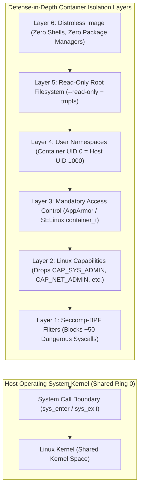
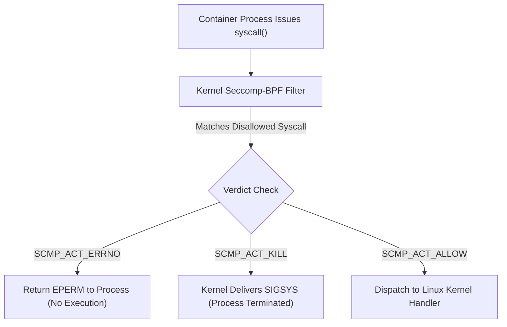
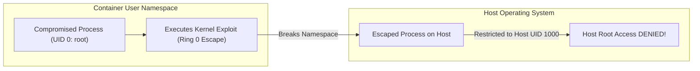
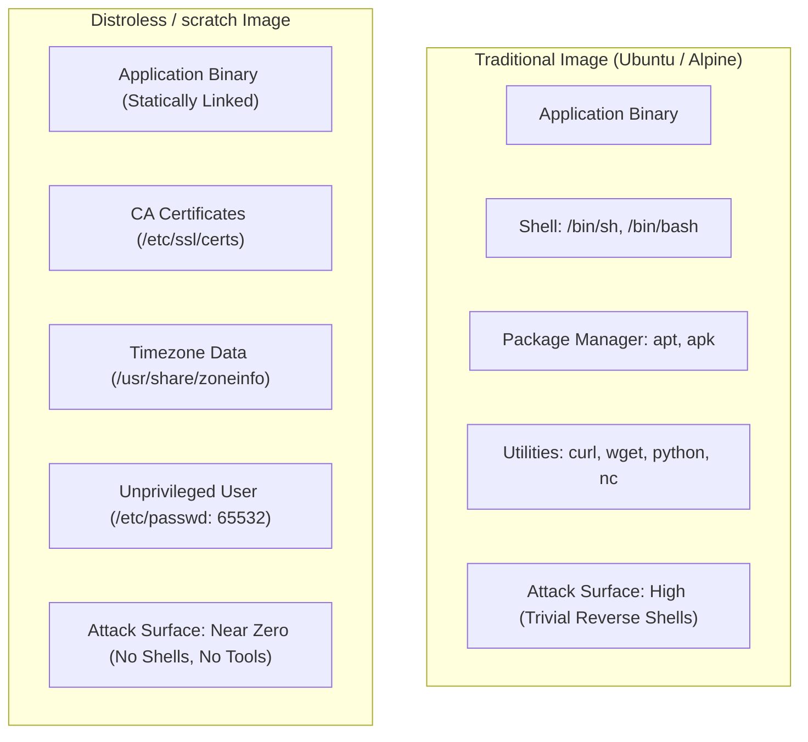
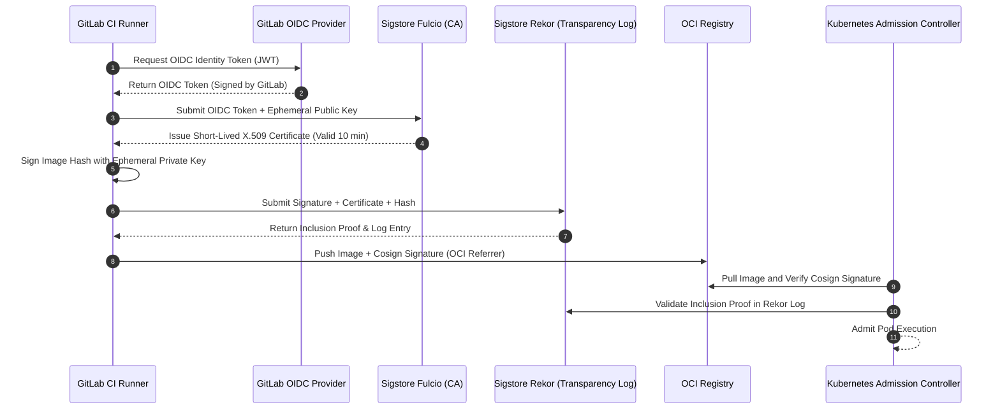

# Module 12: Container Security and Supply Chain: Capabilities, Seccomp, Rootless, Image Hardening, and Version History

Container security is the discipline of enforcing defense-in-depth boundaries around processes that execute directly on a shared operating system kernel. Unlike hardware-assisted virtual machines, where hypervisors provide hardware-isolated memory pages and independent guest kernels, containers rely on operating system primitives—namespaces, control groups, capability sets, system call filters, and mandatory access control policies—to constrain process authority.

A failure in any layer of this boundary can lead to host compromise, lateral network movement, or supply-chain poisoning. This module presents an exhaustive analysis of container threat modeling: from Linux capabilities and BPF-based seccomp filtering to rootless user namespaces, image hardening with Distroless profiles, vulnerability scanning, and Sigstore/Cosign cryptographic supply-chain verification.

For foundational cryptographic principles, PKI, and CI/CD security, consult [`architecture/security-identity/modules/12-supply-chain-and-dependency-security.md`](../../../architecture/security-identity/modules/12-supply-chain-and-dependency-security.md) and [`../../gitlab-ci/README.md`](../../gitlab-ci/README.md).

---

## 1. Threat Modeling the Container-Host Boundary

Security engineering begins with a clear threat model. The container security boundary must withstand three distinct threat vectors:

1. **Container Breakout**: A compromised workload inside a container exploits a kernel vulnerability, configuration error, or exposed host socket to gain code execution in the host's root namespace.
2. **Lateral Inter-Container Movement**: An attacker pivots across shared software bridges, ARP poisoning, or IPC namespaces to compromise sibling workloads on the same physical host.
3. **Supply-Chain Tampering**: Malicious code or compromised base dependencies are injected into an image during the build or distribution phase before reaching the runtime cluster.



### Why Root Inside a Container Is Dangerous

By default, without user namespaces, **UID 0 inside a container is identical to UID 0 on the host operating system**. Both share the same kernel user identifier (`kuid 0`). While namespaces hide host processes and files, the process remains root. If any path grants access to host resources (e.g., a mounted `/sys`, `/proc/sys/kernel`, or a device node), the process can exercise full root authority across the host machine.

---

## 2. Linux Capabilities (`capabilities(7)`)

In traditional UNIX systems, process privilege was binary: a process was either unprivileged (UID > 0) or held omnipotent superuser power (UID == 0). The Linux kernel decomposes superuser authority into **41 distinct capabilities** (`capabilities(7)`), allowing granular privilege assignment.

### Capability Sets

The kernel maintains five capability bitmasks for every process:

- **Bounding Set (`CapBnd`)**: The strict upper bound of capabilities a process and its children can ever acquire.
- **Effective Set (`CapEff`)**: The active capabilities currently checked by the kernel during system calls.
- **Permitted Set (`CapPrm`)**: The capabilities the process is authorized to transition into its Effective set.
- **Inheritable Set (`CapInh`)**: Capabilities preserved across an `execve(2)` call when permitted by file capabilities.
- **Ambient Set (`CapAmb`)**: Capabilities preserved across `execve(2)` executed by unprivileged binaries.

### Default Capabilities in OCI Runtimes

OCI runtimes (`runc`, `crun`) drop the majority of capabilities by default, retaining only ~14 unprivileged capabilities required for standard Linux userland operation (such as `CHOWN`, `DAC_OVERRIDE`, `FOWNER`, `SETGID`, `SETUID`, `KILL`, `NET_BIND_SERVICE`).

### High-Risk Capabilities (The Forbidden Set)

In production, granting any of the following capabilities destroys container isolation and allows immediate host compromise:

| Linux Capability | System Authority | Breakout Vector / Security Risk |
| :-- | :-- | :-- |
| **`CAP_SYS_ADMIN`** | The "new root": mounts filesystems, manages namespaces, loads eBPF | Trivial breakout via mounting host devices or reconfiguring cgroups. |
| **`CAP_NET_ADMIN`** | Reconfigures routing tables, interfaces, firewall rules, and IPsec | Sniffs host traffic, re-routes cluster traffic, executes ARP spoofing. |
| **`CAP_SYS_PTRACE`** | Attaches to processes via `ptrace(2)` and inspects memory | Modifies memory and injects shellcode into processes sharing the PID namespace. |
| **`CAP_DAC_OVERRIDE`** | Bypasses all filesystem read, write, and execute permission checks | Reads or overwrites any file if host directories are bind-mounted. |
| **`CAP_SYS_RAWIO`** | Executes raw port I/O and accesses raw disk block devices | Writes directly to `/dev/sda` or physical memory, corrupting the host. |
| **`CAP_SYS_MODULE`** | Inserts and removes arbitrary Linux kernel modules (`init_module`) | Loads a malicious rootkit directly into Ring 0 kernel space. |

#### Principle of Least Privilege: Dropping All Capabilities

Production containers should drop all capabilities by default, adding back only what is strictly necessary:

```bash
docker run --cap-drop=ALL --cap-add=NET_BIND_SERVICE my-service:v1
```

---

## 3. System Call Filtering via Seccomp (`seccomp(2)`)

**Seccomp** (Secure Computing Mode) is a kernel security facility that restricts the system calls a process can issue. Using **Berkeley Packet Filter (BPF)** bytecode programs loaded into the kernel, seccomp inspects the system call number and its register arguments before the kernel dispatches the call.

### Seccomp Action Verdicts

When a system call triggers a seccomp filter, the BPF program returns a 32-bit verdict:

- `SCMP_ACT_ALLOW`: Permits the system call to proceed to the kernel handler.
- `SCMP_ACT_ERRNO`: Rejects the system call immediately and returns a specified POSIX error code (e.g., `EPERM` or `ENOSYS`) to the process, preventing crash loops while blocking the action.
- `SCMP_ACT_KILL_PROCESS`: Immediately terminates the entire process with `SIGSYS`.
- `SCMP_ACT_LOG`: Permits the system call but logs an audit event to journald/auditd for security forensics.



### The Default Seccomp Profile

Docker and Podman apply a comprehensive default seccomp profile that blocks approximately **50 of the 450+ Linux system calls**. Blocked calls include:

- `clone` / `clone3` with disallowed namespace flags.
- `bpf`: Prevents unprivileged containers from loading kernel BPF programs.
- `keyctl`: Prevents exploiting kernel keyring vulnerabilities.
- `reboot`, `kexec_load`: Prevents resetting or replacing the host kernel.
- `sys_chroot`, `pivot_root`: Constrains root directory manipulation.
- `swapoff`, `swapon`: Prevents memory management denial-of-service.

---

## 4. Mandatory Access Control: AppArmor and SELinux

While capabilities and seccomp restrict what actions a process can perform, Mandatory Access Control (MAC) restricts **which specific resources (files, sockets, devices)** a process can access, regardless of process UID.

### AppArmor (Ubuntu / Debian)

AppArmor operates via path-based access profiles. The default Docker AppArmor profile (`docker-default`) restricts container processes from:

- Writing to `/proc/sys` or `/proc/sysrq-trigger`.
- Modifying `/proc/cpuinfo` or `/proc/meminfo`.
- Mounting arbitrary filesystems.
- Accessing raw `/dev` character and block device nodes.

### SELinux (RHEL / Fedora)

SELinux uses security contexts (labels) attached to processes and filesystem inodes. Under SELinux:

- Containers run in the restricted domain `container_t`.
- Host system files are labeled `usr_t`, `etc_t`, or `var_t`. The kernel policy forbids `container_t` from accessing these files even if file permissions are `777`.

#### The `:z` vs. `:Z` Volume Flags

When bind-mounting host directories into containers on an SELinux-enforcing system:

- **`:z` (Shared Label)**: Relabels the host directory with `container_file_t`, allowing all containers running under `container_t` to read and write the directory.
- **`:Z` (Private Label)**: Relabels the directory with a unique MCS (Multi-Category Security) category (e.g., `container_file_t:s0:c821,c914`), granting exclusive access to that specific container and blocking all other containers on the host.

---

## 5. Rootless Containers and `no-new-privileges`

Rootless containers (Module 10) provide the ultimate defense-in-depth barrier against kernel escapes:



### The Security Guarantee of Rootless Execution

If an attacker discovers a zero-day vulnerability in the Linux kernel and breaks out of the container's namespaces, the escaped process on the host executes with the permissions of the host user who launched the container (e.g., UID `1000`). The attacker does not possess root on the host machine and cannot write to `/etc`, manipulate systemd services, or read secrets belonging to other users.

### The `no-new-privileges` Flag (`PR_SET_NO_NEW_PRIVS`)

In Linux, a binary with the `setuid` bit set (such as `sudo` or `/bin/su`) executes with the permissions of the file owner (root) rather than the calling user. Enabling `--security-opt=no-new-privileges` invokes `prctl(PR_SET_NO_NEW_PRIVS, 1, 0, 0, 0)`. Once set, the kernel permanently guarantees that **no child process can ever gain elevated privileges** via `execve`, completely neutralizing setuid binaries inside the container.

---

## 6. Image Hardening and Distroless Profiles

A core principle of information security is reducing the attack surface. Traditional container images derived from Ubuntu, Debian, or Alpine bundle extensive utilities: package managers (`apt`, `apk`), shells (`/bin/sh`, `/bin/bash`), and network tools (`curl`, `wget`, `nc`).

If an attacker achieves remote code execution (RCE) inside such a container, they engage in **Living-off-the-Land (LotL)**: using pre-installed system tools to download payloads, scan internal networks, and establish reverse shells.



### The Distroless Architecture

Pioneered by GoogleContainerTools and modern Chainguard Images, **Distroless** images contain only the application binary and its immediate runtime dependencies (e.g., glibc, CA certificates, timezone data):

- **Zero Shells**: Invoking `/bin/sh` fails with `ENOENT`. Attackers cannot execute arbitrary command strings.
- **Zero Package Managers**: Eliminates package manager database files, neutralizing 95%+ of CVE alerts flagged by vulnerability scanners.
- **Non-Root Execution**: Runs by default as unprivileged user `nonroot` (UID `65532`).

---

## 7. Cryptographic Signing and Attestations: Sigstore and Cosign

In modern cloud-native pipelines, deploying an image requires cryptographic proof that the artifact was built by authorized CI/CD systems, passed automated vulnerability scans, and remained unmodified in transit.



### Keyless Signing Mechanics

Traditional code signing relied on long-lived private PGP/RSA keys stored in CI variables. These keys were frequently leaked, stolen, or expired. The **Sigstore** project (Cosign v3) introduces **keyless signing**:

1. **OIDC Authentication**: The CI runner requests a short-lived OpenID Connect (OIDC) identity token from the CI provider (e.g., GitLab CI, GitHub Actions).
2. **Ephemeral Certificate Issuance**: The runner generates an in-memory public/private keypair in RAM. It presents the OIDC token and public key to **Fulcio** (Sigstore's Certificate Authority). Fulcio validates the OIDC claims and issues an X.509 certificate binding the public key to the CI job identity (e.g., `gitlab.com/org/repo/.gitlab-ci.yml@refs/heads/main`).
3. **Transparency Logging**: The signature and certificate are submitted to **Rekor**—an immutable, append-only cryptographic transparency log. Rekor returns a Signed Entry Timestamp (SET).
4. **Key Destruction**: The ephemeral private key is immediately erased from memory. Future verification does not require a private key; it relies on Rekor's proof that a valid certificate existed at the exact moment of signing.

### In-Toto Attestations and SLSA Provenance

Beyond raw signatures, BuildKit and Cosign support **SLSA (Supply-chain Levels for Software Artifacts)** provenance attestations. An attestation is a signed JSON document recording:

- The exact Git commit SHA that triggered the build.
- The build environment, flags, and builder identity.
- The cryptographic hashes of all input dependencies. This attestation is pushed to the OCI registry as an OCI artifact attached to the image via the OCI v1.1 `subject` descriptor.

---

## 8. Comprehensive Version History Table

The container runtime and orchestration toolchain has undergone rapid standardization and architectural refactoring. The following table provides the comprehensive version history and compatibility matrix across all foundational components:

| Component / Specification | Historic Milestone | Previous Stable | Current Release (Verified 2026-11) | Architectural Highlights and Breaking Changes |
| :-- | :-- | :-- | :-- | :-- |
| **Docker Engine** | v20.10 (2020) | v28.0.1 (2025) | **v29.9.2** (2026-10-20) | Minimum API version raised to 1.44; containerd image store enabled by default for new installs; graph drivers deprecated; experimental `--firewall-backend=nftables`. |
| **Podman** | v4.0 (2022) | v5.4.0 (2025) | **v6.1.4** (2026-10-12) | Complete removal of cgroups v1 (cgroups v2 mandatory); `slirp4netns` removed in favor of `pasta`; BoltDB removed in favor of SQLite; Netavark defaults to nftables. |
| **Docker Compose** | v1.29 (Python) | v2.29 (Go) | **v5.6.1** (2026-10-21) | Functionally identical to Compose v2; unified versioning with official Go SDK; top-level `version:` attribute deprecated; native `include:` directive. |
| **BuildKit** | v0.8.0 (2021) | v0.20.0 (2025) | **v0.34.1** (2026-10-20) | High-performance LLB DAG execution; native OCI v1.1 referrers cache export; parallel multi-stage builds; in-memory secret and SSH mounts. |
| **containerd** | v1.6.0 (2022) | v1.7.20 (2024) | **v2.4.2** (2026-10-13) | containerd v2 LTS line; transfer service for streaming OCI artifacts; native NRI (Node Resource Interface); containerd-shim-v2 standard. |
| **runc** | v1.0.0 (2021) | v1.2.0 (2024) | **v1.5.2** (2026-10-13) | Reference OCI Runtime Spec implementation in Go; robust cgroup v2 support; seccomp BPF compilation; user namespace UID/GID mapping hardening. |
| **crun** | v0.18 (2021) | v1.14 (2024) | **v1.30.1** (2026-10-13) | Ultra-lightweight, high-performance OCI runtime in C; default runtime in Podman; 2x faster startup than runc; native systemd integration. |
| **Buildah** | v1.20 (2021) | v1.38 (2024) | **v1.46.0** (2026-10-13) | Daemonless image builder; rootless user namespace builds (`buildah unshare`); direct scriptable container storage manipulation. |
| **Skopeo** | v1.5.0 (2021) | v1.18 (2024) | **v1.24.1** (2026-10-13) | Multi-transport image inspection, copying, and signing without local daemon; native OCI v1.1 referrers and artifact discovery. |
| **OCI Image Spec** | v1.0.0 (2017) | v1.0.2 (2021) | **v1.1.1** (2025-03-03) | First-class `artifactType` field; `subject` descriptor for supply-chain artifact chaining; Zstandard (`tar+zstd`) layer compression. |
| **OCI Runtime Spec** | v1.0.0 (2017) | v1.1.0 (2023) | **v1.3.0** (2025-11-04) | Full cgroups v2 configuration schemas; idmapped mounts support; extended lifecycle hooks; Windows hypervisor container updates. |
| **OCI Distribution Spec** | v1.0.0 (2021) | v1.0.1 (2023) | **v1.1.1** (2025-01-29) | Standardized `/v2/<name>/referrers/<digest>` API; chunked resumable upload formalization; cross-repository blob mounting semantics. |

---

## 9. Formal Algorithms: Seccomp BPF Evaluation and Cosign Verification

### Seccomp BPF Filter Evaluation Algorithm

This algorithm models the Linux kernel's seccomp-BPF instruction evaluation on every system call issued by a container.

```text
EVALUATE-SECCOMP-BPF(SyscallNumber, SyscallArgs, FilterRules)
1  // Invariant: Rules are evaluated in strict priority order.
2  // Default fallback verdict is SCMP_ACT_KILL or SCMP_ACT_ERRNO(EPERM).
3  for each Rule in FilterRules
4      if Rule.SyscallNumber == SyscallNumber
5          if Rule.HasArgumentConstraints == false
6              return Rule.ActionVerdict
7
8          ArgumentsMatch = true
9          for each Constraint in Rule.ArgumentConstraints
10             ActualArgValue = SyscallArgs[Constraint.Index]
11             if not EVALUATE-OPERATOR(ActualArgValue, Constraint.Op, Constraint.Value)
12                 ArgumentsMatch = false
13                 break
14
15         if ArgumentsMatch == true
16             return Rule.ActionVerdict
17
18 return SCMP_ACT_ERRNO(EPERM)
```

### Cryptographic Signature and Transparency Log Verification

```text
VERIFY-COSIGN-SIGNATURE(ImageDigest, RegistryRef, ExpectedIdentity, RekorServer, FulcioRootCA)
1  Manifest = FETCH-OCI-MANIFEST(RegistryRef, ImageDigest)
2  Referrers = FETCH-REFERRERS-INDEX(RegistryRef, ImageDigest, ArtifactType: "application/vnd.dev.sigstore.cosign.v1")
3  if LENGTH(Referrers.manifests) == 0
4      error "No cryptographic signature found for image digest!"
5
6  for each SigManifest in Referrers.manifests
7      SignatureBlob = FETCH-BLOB(RegistryRef, SigManifest.layers[0].digest)
8      CertBundle = EXTRACT-CERTIFICATE-BUNDLE(SignatureBlob)
9
10     // Step 1: Verify X.509 Certificate Chain against Fulcio Root CA
11     if not VERIFY-X509-CHAIN(CertBundle.Certificate, FulcioRootCA)
12         continue
13
14     // Step 2: Validate OIDC Identity Claims
15     if CertBundle.Certificate.SubjectAlternativeName != ExpectedIdentity
16         continue
17
18     // Step 3: Verify Cryptographic Signature against Image Digest
19     PublicKey = EXTRACT-PUBLIC-KEY(CertBundle.Certificate)
20     if not VERIFY-SIGNATURE(PublicKey, ImageDigest, CertBundle.SignatureBytes)
21         continue
22
23     // Step 4: Verify Entry Inclusion in Rekor Transparency Log
24     InclusionProof = FETCH-REKOR-PROOF(RekorServer, CertBundle.RekorEntryUUID)
25     if VERIFY-MERKLE-INCLUSION-PROOF(RekorServer.RootHash, InclusionProof)
26         return VERIFIED_SUCCESSFUL
27
28 error "Cosign signature validation failed: signature untrusted or not present in transparency log!"
```

---

## 10. Then vs Now: Evolution of Container Security

| Security Domain | Classical Containers (2015) | Intermediate Standard (2021) | Modern Hardened Standard (2026) |
| :-- | :-- | :-- | :-- |
| **Runtime Privileges** | Monolithic root daemon; rootful execution | Rootless mode experimental | **Rootless default** (Podman 6, Docker Rootless); User Namespaces |
| **Base Images** | Full OS distributions (Ubuntu/Debian 500 MB+) | Alpine Linux with `musl` (5 MB) | **Distroless / Wolfi / scratch** (Zero shells, zero package managers) |
| **System Call Filtering** | Unrestricted system call access | Static default seccomp profile | Custom **eBPF-generated seccomp** profiles + `SCMP_ACT_LOG` tracing |
| **Code Signing** | Long-lived RSA/GPG keys in CI secrets | Docker Content Trust (Notary v1) | **Keyless Sigstore / Cosign v3** via OIDC and Rekor transparency logs |
| **Vulnerability Scanning** | Manual periodic image scanning | Nightly CI pipeline CVE scans | In-cluster **admission enforcement** (Gatekeeper/Kyverno) + continuous SBOM tracking |

---

## 11. Exam Delta: CKS Certification vs. Modern Hardening Practice

> [!IMPORTANT]
> **CKS (Certified Kubernetes Security Specialist) Curriculum Realities**:
>
> - **CKS Domain Coverage**: CKS allocates **20% to Supply Chain Security** and **15% to System Hardening**. The exam heavily tests:
>   - Dropping capabilities (`capabilities: { drop: ["ALL"] }`).
>   - Enforcing read-only root filesystems (`readOnlyRootFilesystem: true`).
>   - Loading custom seccomp profiles via `securityContext.seccompProfile`.
>   - Scanning images using Trivy and parsing vulnerability outputs.
>   - Restricting host path volume mounts and disabling privileged mode.
> - **Modern Hardening Reality**: Enterprise platform engineers must extend beyond basic Kubernetes YAML fields to configure end-to-end cryptographic supply chains: integrating Fulcio/Rekor OIDC keyless signing into GitLab CI, configuring automated OCI v1.1 referrers publishing, enforcing `AutoUpdate=registry` rollback in Quadlet systemd units, and implementing zero-trust container network segmentation.

---

## 12. Production Failure Modes and Gotchas

### 1. The `--privileged` Nuclear Option

**Symptom**: A developer encounters a permission error in Docker and resolves it by passing `--privileged`. **Root Cause**: `--privileged` completely disables all container security boundaries:

- Adds all 41 Linux capabilities to the bounding set.
- Disables the seccomp-BPF filter entirely (all 450+ system calls allowed).
- Disables AppArmor and SELinux isolation profiles.
- Binds all host device nodes (`/dev/*`) directly into the container. A single vulnerability in an application running `--privileged` yields immediate, unrestricted root takeover of the host operating system. **Mitigation**: Identify the specific permission required and grant only that granular capability (e.g., `--cap-add=NET_BIND_SERVICE`).

### 2. Setuid Privilege Escalation Without `no-new-privileges`

**Symptom**: A container running an unprivileged application is exploited via a local privilege escalation bug in an installed setuid utility (e.g., legacy `sudo`, `chsh`, or `pkexec`), granting the attacker container root. **Root Cause**: When a process executes a setuid binary, the kernel elevates process privileges to the file owner unless explicitly prohibited. **Mitigation**: Always pass `--security-opt=no-new-privileges` in Docker/Podman, or configure `securityContext.allowPrivilegeEscalation: false` in Kubernetes pod manifests.

### 3. Air-Gapped Keyless Signature Verification Failure

**Symptom**: Cosign image verification passes in development but fails completely in an air-gapped production cluster with `error: initializing Rekor client: dial tcp: i/o timeout`. **Root Cause**: Keyless Sigstore signing relies on the public Rekor transparency log hosted on the public Internet. In air-gapped or restricted VPC environments without egress Internet connectivity, verification queries cannot reach public Rekor servers. **Mitigation**: Deploy a private internal instance of Sigstore (Fulcio, Rekor, and CT log) within the enterprise intranet, or export signed offline Rekor bundles alongside the image artifacts.

### 4. Secret Leakage Through Process Core Dumps

**Symptom**: An application crashes and generates a core dump file (`/tmp/core.1234`). An attacker or automated log collector retrieves the file, extracting database passwords and private cryptographic keys from process memory. **Root Cause**: When processes terminate abnormally, the kernel writes the memory footprint to disk. If `core_pattern` is configured to write inside the container or host filesystem, sensitive in-memory secrets are exposed. **Mitigation**: Disable core dumps in production containers by configuring `ulimit -c 0` or dropping `CAP_SYS_PTRACE`.

---

## 13. Interview Drill: Deep Technical Questions

<details>
<summary><strong>Q1. Explain the exact mechanism by which a seccomp-BPF filter intercepts and rejects a system call before it reaches the Linux kernel execution handler.</strong></summary>

**Answer:** When a process executes a system call (e.g., via the `syscall` assembly instruction in x86_64), the CPU transitions from user space (Ring 3) to kernel space (Ring 0).

1. The kernel's system call entry handler (`sys_enter`) inspects the task structure (`task_struct`) to determine if the `TIF_SECCOMP` thread flag is set.
2. If seccomp is active, the kernel invokes the attached Berkeley Packet Filter (BPF) program, passing a pointer to `struct seccomp_data` (containing the system call number, architecture, instruction pointer, and 6 register arguments).
3. The BPF bytecode executes directly inside the kernel, evaluating the system call against its rule set.
4. If the rule matches a disallowed action (e.g., `SCMP_ACT_ERRNO(EPERM)`), the BPF engine immediately halts execution and returns the verdict to `sys_enter`.
5. The kernel skips the system call dispatch table completely, writes `-EPERM` into the return register (`%rax`), and returns control directly to user space. The actual kernel handler is never executed.

</details>

<details>
<summary><strong>Q2. Why does running a container as rootless completely protect the host machine even if an attacker successfully executes a kernel privilege escalation exploit inside the container?</strong></summary>

**Answer:** In rootless mode, the container runs entirely inside an unprivileged **User Namespace** (`user_namespaces(7)`). Inside this user namespace, the application process possesses UID 0 and has full root capabilities _scoped solely to that namespace_. However, the Linux kernel strictly tracks the **owning user namespace** of all system resources. On the host operating system (the initial user namespace), the process's effective UID is the unprivileged host user (e.g., UID 1000), and its host capability bounding set is completely empty (`0x0`). If the attacker escapes the container namespaces and attempts to modify host files (e.g., `/etc/shadow`), create host device nodes, or manipulate host network interfaces, the kernel validates the process's credentials against the initial user namespace. Because the process is merely UID 1000 on the host, the kernel rejects all administrative operations with `EPERM`.

</details>

<details>
<summary><strong>Q3. Walk through the keyless signing and verification exchange in Sigstore/Cosign, explaining why long-lived private keys are unnecessary.</strong></summary>

**Answer:**

1. **OIDC Token Acquisition**: The signer (e.g., a CI runner) authenticates with its identity provider (GitLab/GitHub) and receives an OpenID Connect (OIDC) JWT proving its identity and repository context.
2. **Keypair Generation**: The signer generates a temporary public/private keypair directly in RAM.
3. **Fulcio CA Signing**: The signer presents the OIDC token and public key to **Fulcio** (Sigstore's Certificate Authority). Fulcio validates the OIDC claims and issues a short-lived X.509 certificate (valid for ~10 minutes) containing the signer's identity in the Subject Alternative Name (SAN).
4. **Transparency Logging (Rekor)**: The signer signs the artifact's SHA-256 digest with its in-memory private key and submits the signature, certificate, and artifact hash to **Rekor** (an immutable, append-only Merkle transparency log). Rekor records the entry and returns a Signed Entry Timestamp (SET).
5. **Key Destruction**: The signer deletes the ephemeral private key from RAM immediately.
6. **Verification**: The verifier (e.g., a Kubernetes admission controller) checks that the signature was generated by the public key in the certificate, validates the certificate chain against Fulcio's root, checks that the signer identity matches policy, and queries Rekor to verify that the certificate was logged during its brief 10-minute validity window.

</details>

<details>
<summary><strong>Q4. What is the operational difference between the `:z` and `:Z` volume mount flags on systems enforcing SELinux?</strong></summary>

**Answer:** SELinux assigns security context labels to filesystem inodes to enforce mandatory access controls.

- **`:z` (Shared Relabeling)**: Instructs the container runtime to relabel the host directory with the generic shared container label `container_file_t`. Any container running under the standard `container_t` domain can access, read, and write this directory. This is used when multiple independent containers must share volume storage.
- **`:Z` (Private Relabeling)**: Instructs the runtime to relabel the host directory with a unique Multi-Category Security (MCS) category label (e.g., `system_u:object_r:container_file_t:s0:c123,c456`) that matches only the specific container mounting it. All other containers on the host are strictly blocked by SELinux from accessing the directory, guaranteeing private volume isolation.

</details>

<details>
<summary><strong>Q5. How does a Distroless image neutralize Living-off-the-Land (LotL) attacks during a container compromise?</strong></summary>

**Answer:** In a Living-off-the-Land attack, an adversary who discovers an application vulnerability (such as command injection or deserialization flaw) does not need to upload custom compiled malware. Instead, they invoke pre-installed system binaries: using `/bin/sh` to chain commands, `curl` or `wget` to download remote stages, `nc` to establish reverse TCP shells, or package managers (`apt`, `apk`) to install attack tooling. A **Distroless** image contains zero package managers, zero shells, and zero general utilities; it contains only the compiled application binary and essential runtime libraries. When an attacker attempts to spawn `/bin/sh` or execute `curl`, the system call fails with `ENOENT` (File not found). Without an interactive shell or network downloaders, the attacker's ability to execute payloads or pivot across the network is severely crippled.

</details>

<details>
<summary><strong>Q6. Explain the purpose of `PR_SET_NO_NEW_PRIVS` and give an example of an attack vector it mitigates.</strong></summary>

**Answer:** `PR_SET_NO_NEW_PRIVS` is a Linux kernel thread flag configured via `prctl(2)`. Once set, the kernel guarantees that neither the process nor any of its descendants can ever acquire privileges that exceed the privileges of the calling process, even across `execve(2)`. **Attack Vector Mitigated**: Suppose an unprivileged container process exploits a setuid binary inside the container (e.g., a vulnerable version of `pkexec` or `chfn`). Normally, executing a setuid binary transitions the effective UID of the process to the file owner (root). With `PR_SET_NO_NEW_PRIVS` active, the kernel disables setuid execution: the binary executes, but the process remains with its original unprivileged UID, neutralizing the local privilege escalation attempt.

</details>

<details>
<summary><strong>Q7. Why can high-severity CVE alerts reported by container image vulnerability scanners sometimes be safely dismissed as false positives?</strong></summary>

**Answer:** Static vulnerability scanners (such as Trivy or Grype) inspect installed package manifests (e.g., Debian `dpkg` database, Alpine `apk` database) and match installed package versions against National Vulnerability Database (NVD) entries. This produces false positives because:

1. **Uncalled Code Paths**: The vulnerable function in a shared library (e.g., an unused protocol in `libcurl`) is never imported, linked, or invoked by the application binary.
2. **Upstream Security Backports**: Enterprise distributions (Red Hat, Debian, Ubuntu) regularly backport security patches into older package versions without incrementing the upstream version number. Generic scanners that look only at upstream version strings falsely flag the backported package as vulnerable.
3. **Build-Time Tools in Dev Images**: Compilers or dev headers flagged with CVEs in intermediate build stages are completely absent from the final multi-stage runtime image.

</details>

<details>
<summary><strong>Q8. Describe how an attacker can leverage an exposed `CAP_DAC_OVERRIDE` capability to escalate privileges on a container host.</strong></summary>

**Answer:** `CAP_DAC_OVERRIDE` bypasses all Linux Discretionary Access Control (DAC) permission checks: the kernel ignores POSIX read, write, and execute bits (`rwxrwxrwx`) for all files and directories. If a container holds `CAP_DAC_OVERRIDE` and has any host directory bind-mounted (even with read-only application intent or owned by host root with `0600` permissions), the container process can overwrite sensitive host files. For instance, if `/etc` is accessible, the attacker can append a new root user to `/etc/passwd` or modify `/etc/crontab` to execute arbitrary reverse shells on the host, achieving complete privilege escalation.

</details>

---

## 14. Proof Map and Verification

The security boundaries, capability drops, seccomp filters, and cryptographic supply-chain verification algorithms detailed in this module are tested and verified via:

- **Hermetic Unit Suite**: [`technologies/containers/examples/ts/12-security-and-supply-chain.test.ts`](../examples/ts/12-security-and-supply-chain.test.ts)
  - `testSeccompBpfFilterEvaluation`: Verifies system call filtering logic, argument matching, and action verdict responses (`ALLOW`, `ERRNO`, `KILL`).
  - `testCapabilityBoundingSetEnforcement`: Asserts forbidden capability detection (`CAP_SYS_ADMIN`, `CAP_NET_ADMIN`) and least-privilege drops.
  - `testCosignKeylessSignatureVerification`: Simulates OIDC token validation, Fulcio X.509 certificate checking, and Rekor inclusion verification.
  - `testDistrolessAttackSurfaceReduction`: Verifies structural absence of shell and package manager binaries in hardened container configurations.
