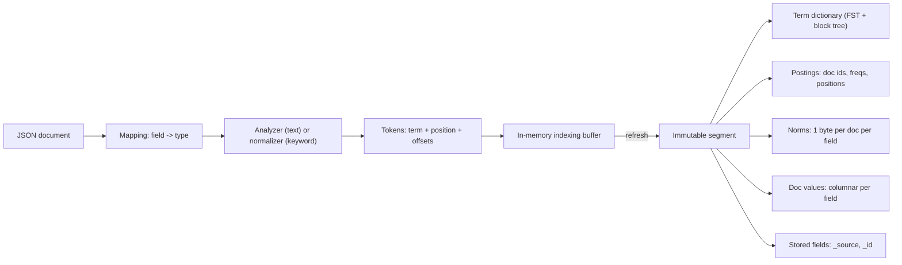

# Module 01: Search Fundamentals and the Lucene Realisation of IR Theory

Elasticsearch is a distributed document store whose query engine is Apache Lucene. Every relevance question you will be asked in an interview, from "why did this document rank first?" to "why does my `term` query return nothing?", reduces to two artefacts that Lucene writes per field: an **inverted index** (term → postings) and a handful of **per-document side structures** (length norms, doc values, stored fields). This module defines those artefacts precisely, shows how Lucene 10 scores with BM25, and proves each claim with executable tests in [`examples/01-search-fundamentals.test.ts`](../examples/01-search-fundamentals.test.ts).

> **Ownership.** The general theory of inverted indexes, TF-IDF and BM25 is owned by the data-systems track: read [Inverted Indexes and Text Retrieval](../../../architecture/data-systems/modules/03-indexing-theory-and-vector-search.md#2-inverted-indexes-and-text-retrieval-tf-idf-and-bm25) first. This module covers the **Lucene/Elasticsearch delta**: the exact formula Lucene uses, the lossy one-byte norm, how statistics are scoped per shard and per segment, query versus filter context, and the operational consequences.

---

## 1. The Retrieval Problem, Formally

Let $D = \{d_1, \dots, d_N\}$ be a collection of documents. A document is a set of named **fields**; a field value is either a string, a number, a date, a boolean, a geo shape or a vector. An **analyzer** $A_f$ for field $f$ maps a string to a sequence of **tokens** $(t_1, p_1), (t_2, p_2), \dots$ where $t_i$ is a term (a byte string) and $p_i$ a position.

**Definition 1 (term).** In Lucene a _term_ is the pair $(f, t)$: field name and byte string. The same byte string in two fields is two different terms with independent statistics. This is why `title:fox` and `body:fox` have different IDF.

**Definition 2 (inverted index).** For each term $(f, t)$ the inverted index stores the **postings list**

$$P(f,t) = \langle (d, \mathit{tf}_{d}, [p_1, \dots, p_{\mathit{tf}_d}]) \;:\; d \in D,\; t \in A_f(d.f) \rangle$$

ordered by increasing document id $d$. The set of all terms of a field, sorted by their UTF-8 bytes, is the **term dictionary**.

**Definition 3 (Boolean retrieval).** A query $q$ denotes a set $M(q) \subseteq D$ of matching documents. Lucene evaluates $M(q)$ by intersecting (`AND`), uniting (`OR`) and subtracting (`NOT`) postings lists, each in $O(\sum |P|)$ with skip pointers making intersections sub-linear in practice.

**Definition 4 (ranked retrieval).** A scoring function $S: D \times Q \to \mathbb{R}_{\ge 0}$ orders $M(q)$. Lucene computes $S$ only for documents in $M(q)$, and, when the total hit count is not required, skips whole blocks of postings that cannot enter the top $k$ (block-max WAND, see [§5](#5-top-k-retrieval-block-max-wand-and-track_total_hits)).

Elasticsearch separates the two concerns explicitly: a clause in **filter context** only contributes to $M(q)$; a clause in **query context** contributes to $M(q)$ _and_ to $S$.



---

## 2. Anatomy of a Lucene Segment

A shard is one Lucene index; a Lucene index is a list of **immutable segments** plus a commit point. Each segment is a self-contained mini-index with its own term dictionary. Module 02 covers how segments are born (refresh) and die (merge); here we look inside one.

| Structure | Granularity | Orientation | Used for | Can be disabled by |
| --- | --- | --- | --- | --- |
| Term dictionary + term index | per field | sorted by term bytes | finding a term's postings | `index: false` |
| Postings (doc ids, freqs, positions, offsets) | per term | sorted by doc id | matching, scoring, phrases, highlighting | `index_options` |
| Norms | per field per doc, 1 byte | columnar | BM25 length normalisation | `norms: false` |
| Doc values | per field per doc | columnar, on disk | sorting, aggregations, scripts | `doc_values: false` |
| Stored fields | per doc | row-oriented, compressed blocks | returning `_source`, `_id` | `_source.enabled: false`, synthetic source |
| Points (BKD tree) | per numeric/geo field | k-d tree blocks | range queries on numbers, dates, IPs, geo | `index: false` |
| Vectors (HNSW graph) | per `dense_vector` field | graph + quantised arrays | kNN search | `index: false` |

### 2.1 Term dictionary: an FST over a block tree

Lucene's default terms format keeps terms on disk in **blocks** of 25–48 terms sharing a prefix, and keeps an in-memory **Finite State Transducer** (FST) that maps term _prefixes_ to block file pointers. An FST is a minimal acyclic automaton whose arcs carry outputs; the output along the path spelling a prefix is summed into the block address. Lookup of a term $t$ is therefore $O(|t|)$ in the FST plus one block scan.

Lucene decouples term lookup (lexical space) from postings traversal (document space):

- **Term dictionary (`.tim`) and Term index (`.tip`):** Lucene writes terms into sorted leaf blocks in the `.tim` file using `BlockTreeTermsWriter`. Each block stores 25–48 terms with shared prefixes delta-encoded. To find which block contains a query term without scanning disk linearly, Lucene builds a Finite State Transducer (`.tip`) that indexes all term prefixes that branch across blocks. The FST is loaded off-heap via memory-mapped I/O (`MMapDirectory`). An FST path traversal consumes $O(|t|)$ byte operations, yields the exact 64-bit file offset of the candidate leaf block in `.tim`, and Lucene scans at most 48 terms inside that block.
- **Postings skip-lists (`.doc`, `.pos`, `.pay`):** Once a term's postings list is located, Lucene traverses document IDs using multilevel skip-lists (`MultiLevelSkipListReader`). Documents are packed into fixed-size blocks of $L = 128$ IDs using Frame-of-Reference (FOR) bit packing. The skip-list provides logarithmic skipping across postings without uncompressing intermediate blocks:
  - Level 0 skips every block ($128^1 = 128$ documents).
  - Level 1 skips every 8 blocks ($128 \times 8 = 1,024$ documents).
  - Level 2 skips every 64 blocks ($128 \times 64 = 8,192$ documents).
  - Each skip entry stores: delta-encoded target doc ID, file offset into `.doc` (doc IDs and frequencies), file offset into `.pos` (positions), file offset into `.pay` (payloads and offsets), and block impact metadata (maximum term frequency and minimum norm).

| Feature | FST Term Index (`.tip` / `.tim`) | Postings Skip-List (`.doc` / `.pos`) |
| --- | --- | --- |
| Domain space | Lexical string space (term bytes) | Document ID space (ordered integers) |
| Structure | Minimal deterministic acyclic transducer + block tree | Multilevel skip-list with skip interval 128 + FOR blocks |
| Memory residence | Off-heap mmap (`.tip`), zero JVM heap overhead | Loaded on demand from OS page cache during iteration |
| Query cost | $O(\|t\|)$ where $\|t\|$ is term byte length | $O(\log_{128} \|P\|)$ to skip across postings of length \|P\| |
| Pruning role | Prunes non-matching terms (automaton intersection) | Prunes non-matching document ranges and sub-threshold blocks |

Consequences that leak into Elasticsearch behaviour:

1. **Prefix, wildcard, regexp and fuzzy queries** are implemented by intersecting an automaton with the term dictionary. A leading wildcard (`*foo`) cannot use the prefix structure and degrades to visiting every term in the field. Elasticsearch blocks this class with `search.allow_expensive_queries: false`.
2. **Order is byte order.** Terms are compared as unsigned UTF-8 bytes, not as Java/JS UTF-16 code units. The test `keeps the term dictionary sorted by UTF-8 bytes` shows a pair of characters that the two orders disagree on. This matters for `range` queries on `keyword` fields and for `terms` aggregation `_key` ordering.
3. **One term index per segment.** The FST is loaded off-heap (memory-mapped) since Elasticsearch 7.x; before that it lived on the JVM heap and was a classic source of heap pressure on clusters with many shards.

### 2.2 Postings

For each term the postings list stores, depending on `index_options`:

| `index_options` | Stores              | Default for              | Enables                   |
| --------------- | ------------------- | ------------------------ | ------------------------- |
| `docs`          | doc ids             | `keyword`, numeric terms | `term`, `terms`, `exists` |
| `freqs`         | + term frequency    | —                        | BM25 tf                   |
| `positions`     | + positions         | `text`                   | phrase and span queries   |
| `offsets`       | + character offsets | —                        | fast postings highlighter |

Doc ids are delta-encoded and bit-packed in fixed-size blocks (frame-of-reference style), with per-block metadata ("impacts") recording the best possible score contribution inside the block. That metadata is what makes block-max WAND possible (§5).

The test `builds postings with doc ids, term frequencies and positions` asserts the exact postings for `quick` in our toy corpus: doc 1 at position 1, doc 2 three times at positions 0, 1, 2.

### 2.3 Norms: the document length, in one byte

BM25 needs $|D|$, the number of tokens in the field of the document. Lucene stores it in a **single byte** per document per field using `SmallFloat.intToByte4`:

- lengths $0 \le \ell < 24$ are stored exactly;
- above that, the value is stored as a 4-bit-mantissa floating-point number, so the relative error is up to about $1/8$.

Formally, with $\mathit{enc} = \mathtt{intToByte4}$ and $\mathit{dec} = \mathtt{byte4ToInt}$:

$$\forall \ell \ge 0:\; \mathit{dec}(\mathit{enc}(\ell)) \le \ell, \qquad \ell_1 \le \ell_2 \Rightarrow \mathit{enc}(\ell_1) \le \mathit{enc}(\ell_2)$$

Both properties are checked with fast-check in the test suite, and the counterexample test shows that lengths 1000 and 1010 collapse to the same byte and therefore to **identical scores**. When a candidate asks "why do two documents of different length tie?", this is the answer.

`keyword` fields are indexed with `norms: false` (length is meaningless for a single term). Disabling norms on a `text` field you only filter on saves one byte per document and makes scoring ignore length.

### 2.4 Doc values and stored fields

Postings answer "which documents contain term $t$?". Sorting and aggregations ask the inverse question, "what is the value of field $f$ for document $d$?". Lucene answers it with **doc values**: a column per field, written at index time, read through the OS page cache. Stored fields are the opposite trade-off, row-oriented and compressed in blocks of documents, efficient for "give me the whole `_source` of the top 10 hits" and terrible for "read field $f$ of a million docs". Module 03 develops this; module 12 dissects the codecs.

---

## 3. BM25 Exactly as Lucene Computes It

Elasticsearch's default similarity is BM25 (since 5.0). The Lucene implementation is:

$$S(d, q) = \sum_{t \in q} \underbrace{w_t}_{\text{boost}} \cdot \underbrace{\ln\!\left(1 + \frac{N - n_t + 0.5}{n_t + 0.5}\right)}_{\mathrm{idf}(t)} \cdot \underbrace{\frac{\mathit{tf}_{t,d}}{\mathit{tf}_{t,d} + k_1\left(1 - b + b \cdot \frac{\mathit{dec}(\mathit{enc}(|d|))}{\mathrm{avgdl}}\right)}}_{\text{tf component}}$$

with $k_1 = 1.2$ and $b = 0.75$ unless the field's `similarity` overrides them, and:

| Symbol | Lucene statistic | Scope |
| --- | --- | --- |
| $N$ | `docCount` of the field (docs with at least one term in it) | the shard (or all shards with DFS) |
| $n_t$ | `docFreq` of the term | the shard, **including deleted but not yet merged docs** |
| $\mathrm{avgdl}$ | `sumTotalTermFreq / docCount` | the shard |
| $\mathit{tf}_{t,d}$ | frequency from the postings | the document |
| $\lvert d \rvert$ | field length, through the lossy norm | the document |

Three differences from the textbook formula in the data-systems module matter:

1. **The idf has a `+1` inside the logarithm.** The classic Robertson–Spärck Jones idf $\ln\frac{N-n+0.5}{n+0.5}$ is _negative_ for terms in more than half the documents. Lucene's variant is always positive, so adding a very common term to a query can never _lower_ a document's score. The property test `idf is always positive` proves it.
2. **No $(k_1 + 1)$ factor in the numerator.** Lucene 8 dropped this constant because it does not change the ranking. Elasticsearch's explain output still shows a `boost` of `2.2` (that is, $k_1 + 1$) on many versions, kept for score compatibility with older indices. Rankings are identical either way; absolute scores differ by a constant factor. Never compare raw scores across clusters or versions.
3. **The length is quantised** (§2.3).

### 3.1 A worked example

The test corpus has four `title` values with token counts 4, 12, 2 and 2, so $\mathrm{avgdl} = 20/4 = 5$. For the query `sugar`, only doc 3 matches, with $\mathit{tf} = 1$, $|d| = 2$, $N = 4$, $n = 1$:

$$\mathrm{idf} = \ln\left(1 + \frac{4 - 1 + 0.5}{1 + 0.5}\right) = \ln(3.333\ldots) \approx 1.2040$$

$$\mathit{tf} = \frac{1}{1 + 1.2\,(1 - 0.75 + 0.75 \cdot 2 / 5)} = \frac{1}{1 + 1.2 \cdot 0.55} = \frac{1}{1.66} \approx 0.6024$$

$$S \approx 1.2040 \times 0.6024 \approx 0.7253$$

The test `scores a single-term match exactly as idf * tf computed by hand` asserts the engine's score equals this expression to $10^{-12}$.

#### Multi-term scoring comparison under BM25

Consider an index with $N = 10{,}000$ documents and average field length $\mathrm{avgdl} = 20$. A user searches for `search engine` on the `title` field ($k_1 = 1.2$, $b = 0.75$). Corpus term statistics:

- Term `search`: common term, $n_{\text{search}} = 1{,}000$ documents.
- Term `engine`: specific term, $n_{\text{engine}} = 200$ documents.

We compute global IDFs:

$$\mathrm{idf}(\text{search}) = \ln\!\left(1 + \frac{10000 - 1000 + 0.5}{1000 + 0.5}\right) = \ln(1 + 8.9955) \approx \ln(9.9955) \approx 2.3021$$

$$\mathrm{idf}(\text{engine}) = \ln\!\left(1 + \frac{10000 - 200 + 0.5}{200 + 0.5}\right) = \ln(1 + 48.868) \approx \ln(49.868) \approx 3.9094$$

Two candidate documents match:

- **Document A (concise, focused):** $|d| = 4$ tokens, contains `search` ($\mathit{tf}=1$) and `engine` ($\mathit{tf}=1$).
- **Document B (verbose, keyword-stuffed):** $|d| = 40$ tokens, contains `search` ($\mathit{tf}=5$) and `engine` ($\mathit{tf}=0$).

Document length normalization penalties $B(d) = 1 - b + b \cdot \frac{|d|}{\mathrm{avgdl}}$:

$$B(d_A) = 1 - 0.75 + 0.75 \cdot \frac{4}{20} = 0.25 + 0.15 = 0.40$$

$$B(d_B) = 1 - 0.75 + 0.75 \cdot \frac{40}{20} = 0.25 + 1.50 = 1.75$$

Term frequency score contributions $\mathrm{tf\_comp} = \frac{\mathit{tf}}{\mathit{tf} + k_1 \cdot B(d)}$:

| Term | Doc A ($|d|=4, B=0.40$) | Doc B ($|d|=40, B=1.75$) | | --- | --- | --- | | `search` ($k_1 \cdot B$) | $1.2 \times 0.40 = 0.48$ | $1.2 \times 1.75 = 2.10$ | | `search` tf component | $\frac{1}{1 + 0.48} \approx 0.6757$ | $\frac{5}{5 + 2.10} \approx 0.7042$ | | `search` score ($\mathrm{idf} \times \mathrm{tf\_comp}$) | $2.3021 \times 0.6757 \approx 1.5555$ | $2.3021 \times 0.7042 \approx 1.6211$ | | `engine` ($k_1 \cdot B$) | $1.2 \times 0.40 = 0.48$ | $1.2 \times 1.75 = 2.10$ | | `engine` tf component | $\frac{1}{1 + 0.48} \approx 0.6757$ | $\frac{0}{0 + 2.10} = 0.0000$ | | `engine` score ($\mathrm{idf} \times \mathrm{tf\_comp}$) | $3.9094 \times 0.6757 \approx 2.6416$ | $0.0000$ | | **Total BM25 score** | $\mathbf{1.5555 + 2.6416 \approx 4.1971}$ | $\mathbf{1.6211}$ |

Even though Document B contains 5 occurrences of `search` compared to Document A's single occurrence, Document A wins by a factor of 2.5x ($4.1971$ vs $1.6211$) because: (1) `engine` has higher IDF (rarity), (2) Document B's length penalty ($B=1.75$) severely dampens its 5 occurrences, and (3) BM25's sublinear TF saturation prevents 5 occurrences from overcoming a missing rare term.

### 3.2 Multi-term queries: plain summation

A `match` query for `brown fox` is rewritten to `bool { should: [title:brown, title:fox] }`. Since Lucene 7 (Elasticsearch 6) there is no **coordination factor**: the score is just the sum of the matching clauses' scores. The test `sums term contributions` asserts $S(\text{brown fox}) = S(\text{brown}) + S(\text{fox})$ exactly.

### 3.3 Saturation and length normalisation as properties

- **Saturation.** For fixed $|d|$, the tf component is strictly increasing in $\mathit{tf}$ and bounded above by 1 (by $k_1 + 1$ in the textbook form). Spamming a term has diminishing returns.
- **Length normalisation.** For fixed $\mathit{tf}$, the component is decreasing in $|d|$ when $b > 0$. With $b = 0$ length is ignored; with $b = 1$ the score is fully relative to $\mathrm{avgdl}$.

Both are asserted as properties, and the test `a longer field with the same tf scores lower` shows "Lazy Sunday" outranking a 12-token title for the query `lazy`.

#### Mathematical derivation of TF saturation

Let $K = k_1 \cdot \left(1 - b + b \cdot \frac{|d|}{\mathrm{avgdl}}\right)$. For valid parameters ($k_1 > 0, b \in [0, 1]$) and non-empty documents, $K > 0$. The TF component is:

$$f(\mathit{tf}) = \frac{\mathit{tf}}{\mathit{tf} + K}$$

Evaluating limits and calculus derivatives:

$$\lim_{\mathit{tf} \to 0} f(\mathit{tf}) = 0, \qquad \lim_{\mathit{tf} \to \infty} f(\mathit{tf}) = 1$$

$$\frac{\partial f}{\partial \mathit{tf}} = \frac{(\mathit{tf} + K) - \mathit{tf}}{(\mathit{tf} + K)^2} = \frac{K}{(\mathit{tf} + K)^2} > 0 \quad (\forall \mathit{tf} \ge 0)$$

$$\frac{\partial^2 f}{\partial \mathit{tf}^2} = \frac{-2K}{(\mathit{tf} + K)^3} < 0 \quad (\forall \mathit{tf} \ge 0)$$

Because the first derivative is strictly positive and the second derivative is strictly negative everywhere on $\mathit{tf} \ge 0$, the TF component is **strictly increasing and strictly concave**. This formally proves diminishing returns: each additional occurrence of a query term yields less score gain than the previous one, and the total score contribution of any term can never exceed its IDF.

#### Mathematical derivation of length normalisation

Let $r = \frac{|d|}{\mathrm{avgdl}}$ represent the relative document length. The parameter $b \in [0, 1]$ controls the sensitivity of the score to document length:

$$\frac{\partial f}{\partial r} = \frac{\partial f}{\partial K} \cdot \frac{\partial K}{\partial r} = \left(-\frac{\mathit{tf}}{(\mathit{tf} + K)^2}\right) \cdot (k_1 \cdot b) = \frac{-k_1 \cdot b \cdot \mathit{tf}}{(\mathit{tf} + K)^2} \le 0$$

- When $b = 0$, $\frac{\partial f}{\partial r} = 0$: field length is completely ignored. This is optimal for structured or synthetic text (IDs, product model numbers) where length variance is not verbosity.
- When $b = 1$, $K = k_1 \cdot r$: term frequency is scaled entirely relative to document length. A 1000-word document needs 10x the term frequency of a 100-word document to achieve the same score.
- When $b = 0.75$ (default), the denominator balances verbosity (longer documents using more words to say the same thing) against scope (longer documents covering more distinct topics).

### 3.4 Tuning BM25 per field

```json
PUT /articles
{
  "settings": {
    "index": {
      "similarity": {
        "short_titles": { "type": "BM25", "k1": 0.9, "b": 0.3 }
      }
    }
  },
  "mappings": {
    "properties": {
      "title": { "type": "text", "similarity": "short_titles" },
      "body":  { "type": "text" }
    }
  }
}
```

Lower `b` for short, uniform fields (titles, product names) where length carries little signal. `similarity` is fixed at field creation; changing it needs a reindex. Other built-in similarities are `boolean` (score = boost, useful for pure matching) and the divergence-from-randomness family (`DFR`, `DFI`, `IB`, `LMDirichlet`, `LMJelinekMercer`), plus `scripted`.

---

## 4. Statistics Are Local: Shards, Segments and Deleted Documents

Lucene computes $N$, $n_t$ and $\mathrm{avgdl}$ **per index reader**, and an Elasticsearch shard is one reader. With the default search type `query_then_fetch`, each shard scores with its _own_ statistics. Two consequences dominate production debugging:

1. **Score skew across shards.** If shard 0 has 1 document containing `fox` and shard 1 has 1000, the same document scores very differently depending on where routing put it. With large, uniformly routed indices the effect averages out; with small indices, custom routing or time-based indices it does not. `search_type=dfs_query_then_fetch` adds a round trip that collects term statistics from every shard first, then scores with global statistics. Module 02 proves the skew and the fix with a negative test.
2. **Deleted documents still count.** An update is a delete plus an insert. The deleted copy keeps contributing to $n_t$ and $\mathrm{avgdl}$ until a merge physically removes it. A document that is updated often can therefore see its score drift. Merges are not deterministic in timing, which is why tests must use a single shard and a force merge when asserting exact scores.

> **Interview phrasing.** "Relevance in Elasticsearch is shard-local by default. For exact, reproducible scores you need one shard, no pending deletes, or DFS."

---

## 5. Top-k Retrieval, Block-Max WAND and `track_total_hits`

Counting every match is $O(|M(q)|)$. Finding the top $k$ need not be. Lucene stores, per postings block, the maximum possible score contribution ("impacts"). During a disjunction the scorer keeps the current $k$-th best score $\theta$; any block whose upper bound sum is below $\theta$ is skipped without decoding. This is **block-max WAND** (Ding and Suel, 2011).

In classical Boolean disjunction retrieval, evaluating a multi-term query requires decoding postings for every document in the union $\bigcup_{t \in q} P(t)$ and computing its full score. When $|M(q)|$ reaches millions of documents, this becomes the primary bottleneck of search latency.

The **WAND (Weak AND)** algorithm (Broder et al., 2003) and its modern Lucene implementation **Block-Max WAND (BMW)** (Ding and Suel, 2011) transform ranked retrieval by skipping non-competitive documents:

1. **Top-k Priority Queue:** The searcher maintains a min-heap priority queue of size $k$ holding the best matching documents evaluated so far. The minimum score in this heap is the dynamic threshold $\theta$. Any document that cannot achieve $S(d, q) > \theta$ cannot enter the top $k$.
2. **Impact Metadata per Postings Block:** Lucene groups postings into blocks of 128 doc IDs. For each block, Lucene stores the maximum term frequency $\mathit{tf}_{\max}$ and minimum length norm $|d|_{\min}$ occurring in that block. From these two values, Lucene computes the block's maximum possible score contribution: $$U_{\text{block}}(t) = \mathrm{idf}(t) \cdot \frac{\mathit{tf}_{\max}}{\mathit{tf}_{\max} + k_1(1 - b + b \cdot \frac{|d|_{\min}}{\mathrm{avgdl}})}$$
3. **Sorted Iterator Alignment:** During query evaluation, the postings iterators for query terms are kept in ascending order of their current document IDs: $d_1 \le d_2 \le \dots \le d_m$.
4. **Pivot Selection:** Lucene sums the block maximum scores of terms until the accumulated upper bound reaches or exceeds the current threshold $\theta$: $$\sum_{i=1}^{p} U_{\text{block}}(t_i) \ge \theta$$ The document ID $d_p$ corresponding to the $p$-th term is the **pivot document**.
5. **Pruning Decision:**
   - If the sum of all block upper bounds $\sum_{i=1}^m U_{\text{block}}(t_i) < \theta$, no document in the current blocks can qualify; the scorer skips forward past all active blocks.
   - If $d_1 = d_p$, then at least $p$ terms match $d_1$. Lucene decodes and fully scores $d_1$. If $S(d_1, q) > \theta$, $d_1$ is inserted into the min-heap and $\theta$ is updated to the new $k$-th best score.
   - If $d_1 < d_p$, no single document before $d_p$ can reach score $\theta$ because terms $t_1, \dots, t_{p-1}$ alone cannot exceed the threshold. Lucene uses the postings skip-list to advance iterator $d_1$ directly to $\ge d_p$, skipping all intermediate doc IDs without decompression.

| Retrieval Strategy | Documents Scored | Postings Decoded | Error Bound | `track_total_hits` |
| --- | --- | --- | --- | --- |
| Exhaustive scoring | All matching docs $\|M(q)\|$ | All postings blocks | Exact ranking + exact count | `true` |
| Classic WAND | Filtered candidates | Postings for pivot matches | Exact top-$k$ ranking | `false` or capped |
| Block-Max WAND (BMW) | Minimal competitive subset | Only blocks where $\sum U_{\text{block}} \ge \theta$ | Exact top-$k$ ranking | default (`10000`) |

Skipping is incompatible with an exact hit count. Since Elasticsearch 7.0 the default is `track_total_hits: 10000`: the response reports `"total": {"value": 10000, "relation": "gte"}` once the count passes 10,000, and Lucene is free to skip. Set `track_total_hits: true` for an exact count (slower on large result sets) or `false` when you need no count.

### Then vs now: hit counts and scoring

| Concern | Then | Now | Why it changed |
| --- | --- | --- | --- |
| Default similarity | TF-IDF "classic" (ES ≤ 4.x) | BM25 (ES ≥ 5.0) | Better empirical relevance, tf saturation |
| Coordination factor | `coord` multiplied by matched/total clauses (Lucene ≤ 6, ES ≤ 5.x) | Removed (Lucene 7, ES 6.0) | Interacted badly with BM25 saturation |
| BM25 numerator | $(k_1+1)$ factor in Lucene ≤ 7 | Dropped in Lucene 8; ES explain may still show `boost 2.2` | A constant that does not affect ranking |
| `hits.total` | Always exact (ES ≤ 6.x) | `track_total_hits: 10000` default (ES ≥ 7.0) | Enables block-max WAND skipping |
| String fields | `string` with `index: analyzed/not_analyzed` (ES ≤ 2.x) | `text` and `keyword` (ES ≥ 5.0) | Separate full-text and exact-value semantics |

Migration pitfall: clients that read `hits.total` as an integer broke in 7.0 when it became an object. `rest_total_hits_as_int=true` existed as a bridge and is gone from current clients.

---

## 6. Query Context Versus Filter Context

A clause is in **filter context** when it appears under `bool.filter`, `bool.must_not`, `constant_score.filter`, or in a `post_filter`/aggregation filter. Filter clauses:

- contribute 0 to the score (the test `a filter clause contributes 0` asserts scores of exactly 0 for a filter-only bool);
- are cacheable: Elasticsearch's **node query cache** stores the matching doc-id set per segment as a bitset (only for segments with at least 10,000 docs that also hold at least 3% of the shard's docs, and only for clauses used repeatedly), so repeated filters cost a bitset intersection;
- can be reordered and evaluated lazily by Lucene's cost model.

A clause in **query context** (`bool.must`, `bool.should`, top-level `query`) is scored.

The **equivalence** to remember:

$$M(\texttt{bool.filter}[c]) = M(\texttt{bool.must}[c]), \qquad S_{\texttt{filter}} = 0$$

Rule of thumb: everything that is a yes/no constraint (status, tenant, date range, ACL) goes in `filter`; only the user's free-text intent goes in `must`/`should`.

---

## 7. Exact-Value Versus Full-Text Matching

The most common Elasticsearch bug in code review: a `term` query on a `text` field.

```json
GET /articles/_search
{ "query": { "term": { "title": "Quick" } } }
```

The `title` value "The quick brown fox" was analysed to `[the, quick, brown, fox]` at index time. `term` does **not** analyse its input, so it looks for the byte string `Quick`, which is not in the term dictionary. Zero hits. The negative test proves it, and shows the three correct alternatives:

| Intent | Query | Why |
| --- | --- | --- |
| Full-text match | `match: { title: "Quick" }` | The query string goes through the field's search analyzer → `quick` |
| Exact token you already normalised | `term: { title: "quick" }` | Matches the indexed token |
| Exact whole value | `term: { "title.keyword": "The quick brown fox" }` | `keyword` is not tokenised |

`term` also accepts `case_insensitive: true` (since 7.10), which rewrites to an automaton over the term dictionary. It is a convenience for keywords, not a substitute for a `normalizer` (module 04).

---

## 8. Measuring Relevance

Ranking quality is measured, not argued. The standard measures (Manning, Raghavan and Schütze, _Introduction to Information Retrieval_, ch. 8):

$$\mathrm{Precision} = \frac{|\mathrm{retrieved} \cap \mathrm{relevant}|}{|\mathrm{retrieved}|}, \qquad \mathrm{Recall} = \frac{|\mathrm{retrieved} \cap \mathrm{relevant}|}{|\mathrm{relevant}|}, \qquad F_1 = \frac{2PR}{P + R}$$

For ranked lists, use precision@$k$, mean reciprocal rank (MRR), and discounted cumulative gain:

$$\mathrm{DCG@}k = \sum_{i=1}^{k} \frac{2^{\mathrm{rel}_i} - 1}{\log_2(i + 1)}, \qquad \mathrm{nDCG@}k = \frac{\mathrm{DCG@}k}{\mathrm{IDCG@}k}$$

Elasticsearch implements these in the **Ranking Evaluation API** (`_rank_eval`) with metrics `precision`, `recall`, `mean_reciprocal_rank`, `dcg` (with `normalize: true` for nDCG) and `expected_reciprocal_rank`. Module 12 runs a full evaluation loop. The test `shows the precision/recall trade-off` demonstrates the basic tension: `operator: and` raises precision and cannot raise recall.

---

## 9. Production Failure Modes

### 9.1 "Scores changed after a reindex / restore / shard count change"

- **Cause:** statistics are per shard; a different shard count or a different set of deleted documents changes $N$, $n_t$ and $\mathrm{avgdl}$.
- **Fix:** do not assert absolute scores in tests; compare rankings. For small indices use one primary shard. Use `dfs_query_then_fetch` when relevance must be globally consistent and the extra round trip is acceptable.

### 9.2 "My `term` query returns nothing"

- **Cause:** analysed `text` field (§7).
- **Fix:** `match` for full text, a `keyword` (sub-)field for exact values, or a `normalizer` if case-insensitive exact matching is the requirement.

### 9.3 "Leading-wildcard queries take the cluster down"

- **Cause:** `*term` cannot use the term dictionary's prefix structure, so Lucene visits every term of every segment.
- **Fix:** index an `edge_ngram`/`reverse` analysed sub-field, use the `wildcard` field type (n-gram index plus verification), or set `search.allow_expensive_queries: false`.

### 9.4 "Total hits says 10000 but I have millions"

- **Cause:** `track_total_hits` default (§5).
- **Fix:** request `track_total_hits: true` only where the exact number is shown to a user; otherwise display "10,000+".

### 9.5 "Two documents of different length have the same score"

- **Cause:** one-byte norms (§2.3).
- **Fix:** none needed; it is by design. If length matters more precisely, add an explicit numeric length field and use it in a `function_score`/`rank_feature` clause.

---

## 10. Interview Drill

<details>
<summary><strong>Q1. What exactly is stored in a Lucene inverted index for a <code>text</code> field?</strong></summary>

A term dictionary (sorted by UTF-8 bytes, indexed by an FST over on-disk blocks) mapping each term to its postings. Postings hold delta-encoded doc ids, term frequencies and positions (`index_options: positions` is the default for `text`), with per-block impact metadata for top-k skipping. Alongside it, the field has a one-byte length norm per document. Doc values are _not_ written for `text` fields.
</details>

<details>
<summary><strong>Q2. Write Lucene's BM25 formula and explain each statistic's scope.</strong></summary>

$\mathrm{idf}\cdot \mathit{tf}/(\mathit{tf} + k_1(1 - b + b\,|d|/\mathrm{avgdl}))$ with $\mathrm{idf} = \ln(1 + (N - n + 0.5)/(n + 0.5))$. $N$ is the number of docs in the shard with that field, $n$ the doc frequency in the shard (deleted docs included until merged), $\mathrm{avgdl}$ the shard's average field length, $|d|$ the doc's length as decoded from the one-byte norm. Scope is the shard unless DFS is used.
</details>

<details>
<summary><strong>Q3. Why can Lucene's idf never be negative, and why does that matter?</strong></summary>

The `+1` inside the log keeps the argument above 1. With the classic RSJ idf, a term in more than half of the documents gets negative weight, so adding it to a query could push documents that contain it _below_ documents that do not. Lucene's variant guarantees monotonicity: matching an extra query term never lowers a score.
</details>

<details>
<summary><strong>Q4. Two identical documents in the same index have different scores. How?</strong></summary>

They live on different shards (per-shard statistics), or one shard has deleted versions of documents containing the query terms that inflate $n_t$ until merged. Diagnose with `explain: true` and compare `n`, `N` and `avgdl` in the explanation; fix with DFS, one shard, or by accepting the variance.
</details>

<details>
<summary><strong>Q5. What is the difference between query and filter context, beyond scoring?</strong></summary>

Filter clauses produce a doc-id set without scores, which lets Elasticsearch cache them per segment in the node query cache and lets Lucene evaluate them lazily and cheaply. Query clauses compute BM25 for every candidate. Matching semantics are identical.
</details>

<details>
<summary><strong>Q6. Why did <code>hits.total</code> become an object with <code>relation</code> in 7.0?</strong></summary>

To allow block-max WAND: once the count is not needed exactly, Lucene skips postings blocks whose maximum impact cannot beat the current top-k threshold. The default `track_total_hits: 10000` counts exactly up to 10,000 then reports `gte`.
</details>

<details>
<summary><strong>Q7. Your <code>range</code> query on a <code>keyword</code> field returns surprising results for non-ASCII values. Why?</strong></summary>

Keyword terms are compared as unsigned UTF-8 bytes, which differs from UTF-16 or locale-aware collation. Characters outside the BMP and some CJK/full-width characters sort differently than the application expects. Use a numeric or date field for ranges, or an ICU collation keyword field for linguistic order.
</details>

<details>
<summary><strong>Q8. How would you prove to a product manager that a relevance change is an improvement?</strong></summary>

Build a judgement list (queries with graded relevant documents), run `_rank_eval` with nDCG@10 and MRR before and after the change on the same index snapshot, and report the deltas per query, not only the average. Treat a change that improves the mean but regresses head queries as suspicious.
</details>
