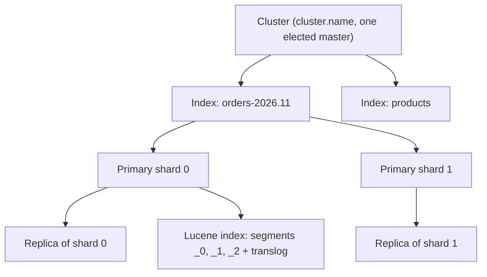
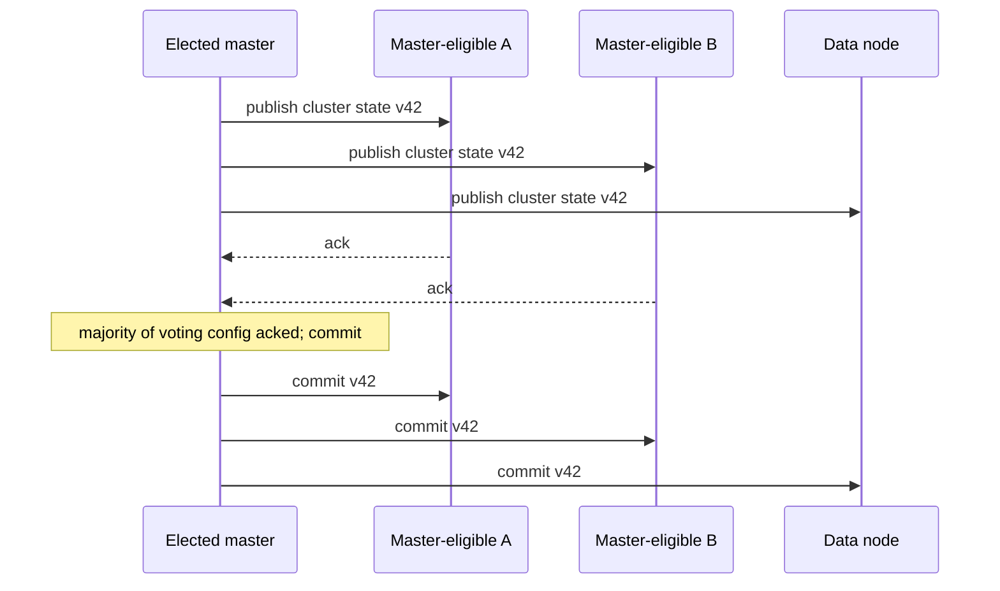
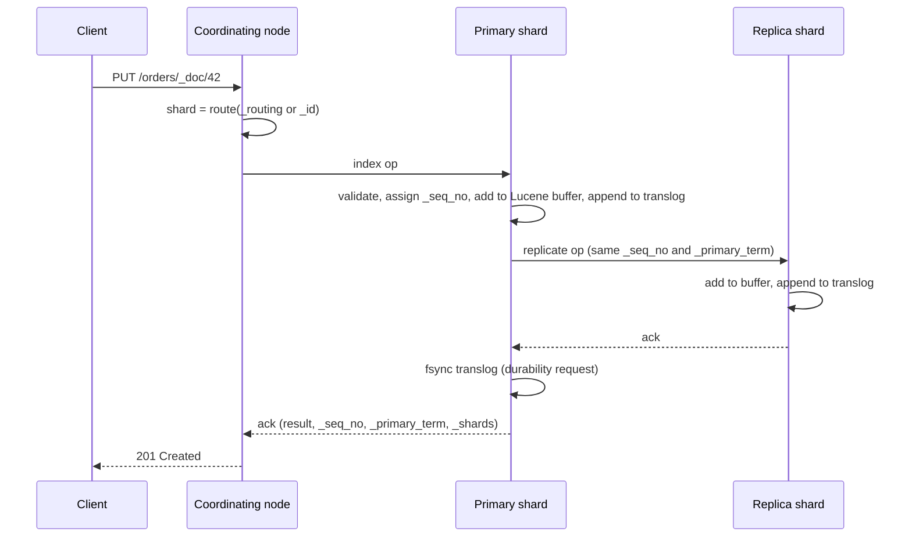
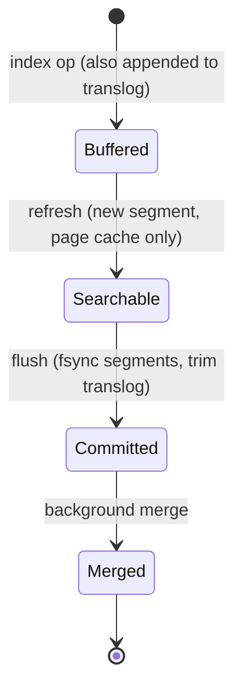
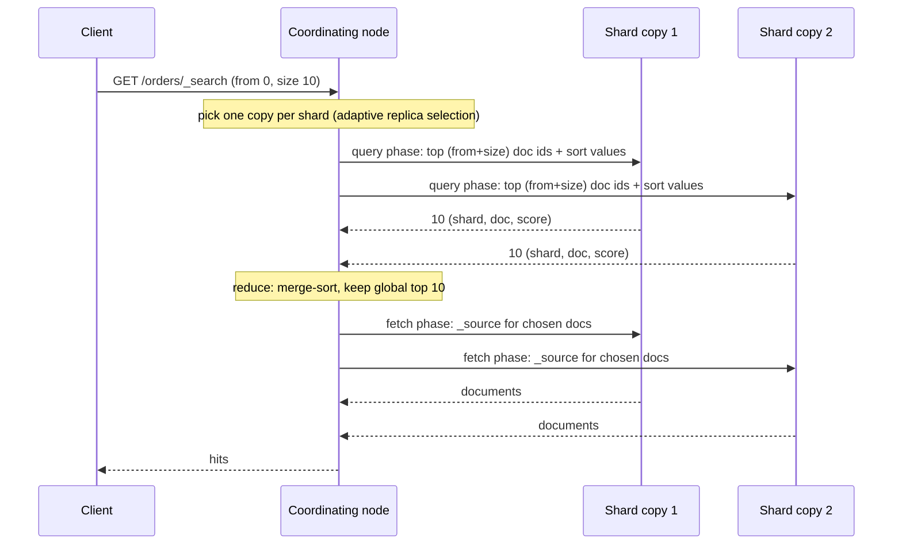

# Module 02: Cluster Architecture, the Write Path and Near-Real-Time Search

An Elasticsearch cluster is a set of JVM processes ("nodes") that cooperatively host **indices**. An index is split into **primary shards**, each replicated into zero or more **replica shards**, and each shard copy is a full Lucene index made of immutable **segments**. This module follows a document from the HTTP request to a durable, searchable segment, and a search from the coordinating node to the merged response. All claims about refresh, translog, flush, merge, deletes, sequence numbers and score skew are proven in [`examples/02-architecture-nrt.test.ts`](../examples/02-architecture-nrt.test.ts).

> **Ownership.** Log-structured storage, compaction and the LSM amplification trade-offs are owned by [Storage Engines: Append-Only LSM-Trees](../../../architecture/data-systems/modules/02-storage-engines-b-trees-and-lsm.md#3-append-only-storage-engines-log-structured-merge-trees-lsm); leader/follower replication theory by [Replication Architectures](../../../architecture/data-systems/modules/07-replication-mechanics-and-consensus.md#1-replication-architectures-single-leader-multi-leader-and-leaderless); consensus by the distributed-systems track. Here we cover how Elasticsearch and Lucene realise them.

---

## 1. The Logical Model

**Definitions.**

- **Index:** a logical namespace with one mapping, one set of settings and a fixed number of primary shards (`index.number_of_shards`, default 1 since 7.0, previously 5). The primary count can only change through `_split`, `_shrink` or reindexing (module 10).
- **Shard:** a unit of data placement. Shard $i$ holds the documents $d$ with $\mathrm{route}(d) = i$ (module 10 derives the murmur3 formula). Each shard has exactly one **primary** copy and `number_of_replicas` **replica** copies (default 1), never placed on the same node as each other.
- **Segment:** an immutable, self-contained Lucene index (module 01). A shard is the ordered set of its segments plus a commit point and a translog.
- **Document:** a JSON object identified by `_id` inside an index. Since 8.0 there are no mapping types; the endpoint is always `/{index}/_doc/{id}`.

### 1.1 Node roles

`node.roles` decides what a node does. A node with no explicit setting has every role except `voting_only`.

| Role | Responsibility | Sizing hint |
| --- | --- | --- |
| `master` | master-eligible: may be elected to manage cluster state | 3 dedicated small nodes in production |
| `voting_only` | votes in elections but is never elected | tiebreaker in two-zone setups |
| `data` | generic data role (all tiers) | — |
| `data_content` | non-time-series indices | memory and disk for search |
| `data_hot` / `data_warm` / `data_cold` / `data_frozen` | time-series data tiers (module 08) | fast disks for hot, dense disks for warm and cold |
| `ingest` | runs ingest pipelines (module 08) | CPU |
| `ml` | machine learning jobs, trained-model inference | CPU and RAM |
| `transform` | continuous transforms | CPU |
| `remote_cluster_client` | connects to remote clusters for CCS/CCR (module 10) | — |
| _(empty list)_ | **coordinating-only**: routes requests, reduces results | RAM for large aggregations |

Every node is a coordinating node for requests that reach it. Dedicated coordinating nodes help when expensive reductions (large `terms` aggregations, many shards) would otherwise run on data nodes.

Production cluster topology design principles:

- **Dedicated Master Nodes:** Always deploy exactly three master-eligible nodes (`node.roles: [master]`) in separate failure domains (availability zones). Do not assign `data` or `ingest` roles to them. This ensures cluster-state updates and heartbeat pings never stall due to heavy query aggregations, indexing I/O, or JVM garbage collection pauses.
- **Dedicated Coordinating Nodes:** For high-traffic clusters serving complex search dashboards or large `terms` aggregations, deploy coordinating-only nodes (`node.roles: []`). They absorb client HTTP traffic, parse JSON payloads, coordinate the scatter/gather phases, and perform final aggregation reductions without consuming heap on data storage nodes.
- **Dedicated Ingest Nodes:** When using computationally intensive ingest pipelines (e.g., `grok`, `script`, or ML inference models), dedicated ingest nodes (`node.roles: [ingest]`) shield search and indexing thread pools on data nodes from CPU saturation.
- **Locking JVM Memory:** Always configure `bootstrap.memory_lock: true` in `elasticsearch.yml` and `MAX_LOCKED_MEMORY=unlimited` in OS limits to prevent the Linux kernel from swapping JVM heap pages to disk, which is fatal for cluster stability.

### 1.2 Cluster state and the master

The elected master owns the **cluster state**: the node list, index metadata (mappings, settings), the routing table (which shard copy lives where, and its state), and persistent cluster settings. Only the master mutates it; it publishes each new version to every node with a two-phase publish/commit and requires acknowledgement from a quorum of master-eligible nodes.

Since 7.0 cluster coordination ("Zen2") keeps a **voting configuration** of master-eligible nodes and requires a majority of it for elections and state commits. This removes the split-brain risk of the old `discovery.zen.minimum_master_nodes` setting, which operators routinely misconfigured. With three master-eligible nodes, the cluster tolerates the loss of one; losing two makes it unavailable (by design: availability is traded for safety). Bootstrapping a brand-new cluster requires `cluster.initial_master_nodes` exactly once; leaving it in the configuration afterwards is a known source of accidentally forming a second cluster.

#### Zen2 consensus state machine

Zen2 adapts Raft-style distributed consensus to Elasticsearch's dynamic cluster topology:

1. **Pre-Vote Phase:** When a master-eligible node loses its heartbeat to the master, it enters the `pre-candidate` state. Before incrementing its election term, it polls other master-eligible nodes to confirm they also consider the current master dead. This pre-vote prevents network-isolated nodes from disrupting a healthy cluster by repeatedly triggering spurious elections with inflated terms.
2. **Election Term and Quorum:** On successful pre-vote, the node transitions to `candidate`, increments its monotonically increasing 64-bit `election_term`, and solicits votes. A node votes for at most one candidate per term, granting its vote only if the candidate's cluster state is at least as up to date as its own (measured by `(term, version)`). A candidate becomes master upon receiving a strict majority ($\lfloor n/2 \rfloor + 1$) of votes from the active voting configuration.
3. **Dynamic Voting Configurations:** Unlike static consensus groups, Zen2 maintains the voting configuration as part of the cluster state. When master-eligible nodes gracefully shut down or join, the master transitions the voting configuration.
4. **Voting Tombstones:** When a master-eligible node is permanently removed (`POST /_cluster/voting_config_exclusions`), Zen2 adds a persistent tombstone to prevent that node from ever casting a vote or forming a ghost quorum if it unexpectedly reconnects.
5. **Two-Phase Publication:**
   - **Publish Phase:** The master broadcasts a `PublishRequest` containing the cluster state diff (or full state if diff fails) to all nodes. Nodes stage the uncommitted state in memory and reply with an acknowledgement.
   - **Commit Phase:** Once the master receives acknowledgements from a majority of the voting configuration, the new state is formally committed. The master broadcasts a `CommitClusterStateRequest`, at which point nodes apply the state atomically to their active runtime.

| State Machine Phase | Initiator | Quorum Required | Failure Consequence |
| --- | --- | --- | --- |
| Pre-vote | Pre-candidate node | Majority of voting config | Aborts election; node remains follower |
| Term election | Candidate node | Majority of voting config | Election times out; exponential backoff |
| Cluster state publish | Elected master | Majority ack before commit | State change rejected; master steps down if isolated |
| Node exclusion | Operator / Auto-scaler | Committed via cluster state | Excluded node ignored in quorum calculations |

Mapping explosions (module 03) and tens of thousands of shards (module 10) are dangerous precisely because every change must be serialised and published by this one process.

---

## 2. The Write Path

Elasticsearch uses a **primary-backup** model (PacificA-style), not quorum writes:

1. **Routing:** The coordinating node hashes the document routing key (`_routing` or `_id`) using Murmur3 to determine the target primary shard.
2. **Primary Permit & Execution:** The primary acquires an index operation permit (`IndexShard.acquirePrimaryOperationPermit`). It validates the document against index mappings (if a new field is discovered, dynamic mapping updates are proposed to the elected master and committed to cluster state before indexing proceeds). The primary assigns a monotonically increasing sequence number `_seq_no` and stamps the current `_primary_term`. It then writes the document into Lucene's in-memory indexing buffer and appends the binary representation to the local translog.
3. **Parallel Replica Replication:** The primary forwards the operation as a `ReplicationRequest` in parallel to all active replica copies in the **in-sync copies set** (`IndexShardRoutingTable`). Replicas acquire a replica permit, verify that the incoming `_primary_term` matches or exceeds their own (fencing stale primaries), write to their Lucene buffer, append to their translog, advance their local checkpoint, and send an acknowledgement back to the primary containing their updated `local_checkpoint`.
4. **Primary Acknowledgement & Durability:** The primary waits for acknowledgements from all in-sync replicas. If a replica fails or times out, the primary notifies the master via an internal `ShardFailedClusterStateTaskExecutor` to drop the failed replica from the in-sync set; once the master acknowledges the drop, the write proceeds without that replica. The primary fsyncs its translog (under `request` durability) and replies to the coordinating node with `_seq_no`, `_primary_term`, and shard summary `_shards: { total, successful, failed }`.
5. **Active Shards Pre-flight:** `wait_for_active_shards` (default 1, the primary) is only a _pre-flight_ check verifying that at least $N$ shard copies are active before initiating the write. It does not enforce a quorum for write acknowledgements.

#### Sequence numbers, checkpoints and recovery modes

- **Sequence numbers (`_seq_no`):** A dense, strictly increasing 64-bit integer assigned per shard copy. Deletions and no-op updates also consume sequence numbers, ensuring no gaps exist in the operation stream.
- **Local checkpoint:** The highest consecutive sequence number for which all prior operations have been successfully processed on that specific shard copy. If sequence numbers 1, 2, 4 arrive, the local checkpoint remains 2 until operation 3 is indexed.
- **Global checkpoint:** The minimum local checkpoint across all in-sync shard copies: $$\text{Global Checkpoint} = \min_{c \in \text{InSyncCopies}} \text{Local Checkpoint}(c)$$ Any operation with $\_seq\_no \le \text{Global Checkpoint}$ is guaranteed durable and identical across all healthy copies.
- **History retention leases (`_history_retention_leases`):** Shards maintain soft-deletes and translog records above the global checkpoint. When a temporarily disconnected replica reconnects, Elasticsearch attempts **ops-based recovery**: the primary replays missing operations from the replica's local checkpoint up to the primary's current checkpoint. If the replica was offline longer than the retention threshold, Elasticsearch falls back to **file-based recovery**, copying immutable Lucene segment files directly over the network.

| Recovery Mechanism | Eligibility Precondition | Source Storage | Transport Payload | Typical Duration |
| --- | --- | --- | --- | --- |
| **Ops-based (incremental)** | Replica local checkpoint $\ge$ retention lease floor | Translog + Lucene soft-deletes | Streaming delta operations | Milliseconds to seconds |
| **File-based (full)** | Replica checkpoint pruned or brand-new shard | Lucene segment files (`.cfs`, `.si`, `.doc`) | Direct file copy over transport | Minutes to hours |

**Optimistic concurrency control.** `if_seq_no` + `if_primary_term` make a write conditional on the document not having changed since it was read. A stale pair raises `version_conflict_engine_exception` (HTTP 409), proven by the test `if_seq_no / if_primary_term reject a stale write`. These parameters arrived in 6.7 and replaced OCC through the internal `version` parameter, which 7.0 rejects for index and delete requests (external versioning with `version_type=external` still exists for sources that own their version).

---

## 3. From Buffer to Durable Segment: Refresh, Translog, Flush

Lucene can only search **segments**. Writing a segment per document would be catastrophically slow, and fsyncing one per second would be too. Elasticsearch decouples three properties:

| Property | Mechanism | Default trigger | Cost |
| --- | --- | --- | --- |
| **Searchable** | **refresh**: write the in-memory buffer as a new segment into the OS page cache and open a new reader | `index.refresh_interval: 1s`, only for shards searched in the last 30s (`index.search.idle.after`) | small segment, merge pressure |
| **Durable** | **translog** append + fsync | `index.translog.durability: request`: fsync before each ack | one fsync per request (amortised per bulk) |
| **Cheap to recover** | **flush**: Lucene commit (fsync segments) + new translog generation | `index.translog.flush_threshold_size` (10 GB in current docs) or periodic | large fsync |

### 3.1 Near-real-time (NRT) search

A document becomes visible to search after the next refresh: "near real time". The test `a document is not searchable until refresh, but GET by id is realtime` proves the asymmetry that surprises every newcomer:

- `GET /index/_doc/id` is **realtime**: it consults the live version map and, if needed, triggers a refresh of just that document's state. You can always read your own write by id.
- `_search` sees only what the last refresh published.

Controls for read-after-write in search:

| Option | Effect | Cost |
| --- | --- | --- |
| `?refresh=false` (default) | return immediately | none |
| `?refresh=wait_for` | block the response until a scheduled refresh makes it visible | latency up to `refresh_interval`; no extra segments |
| `?refresh=true` | force an immediate refresh of the affected shards | one tiny segment per call; never in a loop |
| `POST /index/_refresh` | refresh explicitly | as above; fine in tests |

### 3.2 The translog

Lucene's commit is an expensive fsync of all new segment files. Between commits, the translog is the write-ahead log: every operation is appended and, with the default `request` durability, fsynced **before** the request is acknowledged. On restart the shard opens its last Lucene commit and replays translog operations above the commit's checkpoint. Tests:

- `acknowledged but unflushed writes survive a crash via translog replay`;
- negative: with `index.translog.durability: async`, the translog is fsynced every `sync_interval` (5s) and **acknowledged writes in that window are lost on a crash**. `async` is a throughput knob for data you can replay from the source.

#### Translog disk layout and durability modes

- **`index.translog.durability: request` (default):** Elasticsearch issues a synchronous `fsync` system call on the current translog file before acknowledging every indexing, update, or delete request. Recovery Point Objective (RPO) is zero. Under bulk indexing, the cost of this fsync is amortized across all operations in the batch.
- **`index.translog.durability: async`:** Writes are appended to the translog in memory and buffered in the OS page cache. A background thread invokes `fsync` periodically based on `index.translog.sync_interval` (default 5 seconds). If a node loses power or the kernel crashes, any writes acknowledged in the preceding 5 seconds that were not yet flushed to Lucene are permanently lost.
- **Translog disk structures:** The translog directory holds generation files `translog-N.tlog` and a 20-byte checkpoint file `translog.ckp`. The checkpoint records the active generation number $N$, the byte length of the file, and the local/global sequence number checkpoints. Translog files are retained according to `index.translog.retention.size` and `index.translog.retention.age` to facilitate ops-based peer recovery.

### 3.3 Flush

A flush performs a Lucene commit and starts a new translog generation, so recovery has less to replay (test `flush trims the translog`). Elasticsearch flushes automatically by translog size and when a shard becomes inactive; manual `_flush` is rarely needed. `_flush/synced` was removed in 8.0: sequence-number-based recovery made it redundant.

#### Lucene two-phase commit during flush

1. **Flush trigger:** Initiated when translog uncommitted operations reach `index.translog.flush_threshold_size` (default 10 GB in modern versions, previously 512 MB) or periodically after 30 minutes.
2. **Two-phase Lucene commit:**
   - **`prepareCommit()`:** Lucene flushes all buffered in-memory documents to new segment files and issues synchronous `fsync` calls across all new segment files (`.cfs`, `.si`, `.fdt`, `.doc`, `.pos`).
   - **`commit()`:** Lucene updates and fsyncs the commit point file `segments_N`, atomically making the new segments part of the durable on-disk index reader generation.
3. **Translog rotation and trimming:** Elasticsearch rotates the active translog generation from $N$ to $N+1$, writes an empty `translog-(N+1).tlog`, updates `translog.ckp`, and safely unlinks generations $\le N$ whose operations fall below active history retention leases.

| Operation | Shard State Mutated | Lucene Segment Impact | OS Page Cache vs Disk | Translog Action | Search Visibility | Durability |
| --- | --- | --- | --- | --- | --- | --- |
| **Refresh** | Shard memory buffer | New segment opened | Written to OS page cache only | Untouched | Visible to `_search` | Translog only |
| **Flush** | Commit point | Lucene commit (`segments_N`) | Fsynced to persistent disk | Rotated and trimmed | Unchanged | Durable Lucene commit |
| **Merge** | Multi-segment tier | Multiple segments combined | Fsynced on completion; deletes expunged | Untouched | Atomic reader handoff | Durable new segment |

---

## 4. Segments, Deletes and Merges

Segments are immutable, so:

- a **delete** sets a bit in the segment's _live docs_ bitset;
- an **update** (including a partial `_update`) is _delete old + index new_;
- deleted documents are skipped at search time but **still occupy disk and still count in term statistics** until a merge rewrites the segment (test `deleted docs still inflate docFreq`).

**Merging.** A background merge scheduler picks segments with the `TieredMergePolicy`: segments are grouped into tiers by size, at most `segments_per_tier` (default 10) per tier, merging up to 10 at a time, preferring merges that reclaim many deletes (`index.merge.policy.deletes_pct_allowed`, default 20%). Tests `a tiered-style merge policy bounds the segment count` and `segments with more than 20% deleted docs are merged away first` model this. The cost model is the LSM write amplification discussed in the data-systems module: every document is rewritten $O(\log_{m} n)$ times.

#### TieredMergePolicy mechanics and merge throttling

The `TieredMergePolicy` evaluates candidate segment sets to minimize total write amplification while aggressively reclaiming tombstones:

- **Candidate scoring:** For candidate segment sets, Lucene calculates a heuristic merge score: $$\text{Merge Score} = \text{skew} \cdot \text{total\_size} \cdot (1.0 - \text{deletes\_ratio})$$ Lower scores are prioritized. Segments with high delete ratios produce smaller scores and are selected first.
- **Segment size thresholds:** The policy respects `index.merge.policy.max_merged_segment` (default 5 GB). Segments exceeding this size are excluded from automatic merging to prevent massive I/O storms.
- **Merge thread bounding:** `index.merge.scheduler.max_thread_count` defaults to $\min(4, \lceil \text{CPU\_cores} / 2 \rceil)$ for SSDs. If background merges cannot keep up with high-throughput indexing, Elasticsearch artificially throttles indexing threads by inserting micro-sleeps, preventing run-away segment proliferation.

**`_forcemerge`.** Merging to one segment (`max_num_segments=1`) is right for read-only indices (it maximises compression and search speed and purges all deletes). It is wrong for indices still being written: a giant segment is excluded from normal merging (the 5 GB `max_merged_segment` limit), so its future deletes linger. ILM runs force merge in the warm phase for exactly this reason.

**Point-in-time readers.** A searcher holds references to the segments it opened. Merges create new files but cannot delete the old ones while a reader uses them. The test `an open point-in-time reader keeps seeing the old view` shows the consistency this buys, and it is also why a forgotten scroll or PIT pins disk space (module 05).

---

## 5. The Read Path: Query-Then-Fetch

1. **Query phase.** Each shard runs the query locally and returns only `(doc, score, sort values)` for its top `from + size`, plus partial aggregation results.
2. **Reduce.** The coordinating node merges the per-shard lists. Cost is $O(\text{shards} \times (\text{from} + \text{size}))$, which is why deep pagination is capped (module 05).
3. **Fetch phase.** Only the final top `size` documents are loaded (stored fields, highlighting, `_source` filtering).

**Replica selection.** Since 7.0 _adaptive replica selection_ chooses the copy with the best observed response time and queue size, instead of round robin.

#### Adaptive Replica Selection (ARS) formula

ARS ranks candidate shard copies using exponentially weighted moving average (EWMA) metrics calculated by the coordinating node:

$$\text{ARS\_Score}(c) = \mu(c) + 2 \cdot \sigma(c) + q(c) \cdot \mu(c)$$

where:

- $\mu(c)$ is the exponentially weighted moving average of response latency from copy $c$;
- $\sigma(c)$ is the EWMA of latency variance from copy $c$;
- $q(c)$ is the number of active, in-flight search requests currently queued on node $c$.

The coordinator routes to the copy with the lowest `ARS_Score`. If a data node experiences a temporary GC pause or slow I/O, its service time spikes, immediately steering subsequent queries toward faster peer replicas without operator intervention.

**Batched query phase (9.5).** Historically the coordinating node sent one request per shard. Elasticsearch 9.5 sends one request per **data node**; each data node partially reduces its own shards' results and the coordinating node reduces the partial results (cluster setting `search.batched_query_phase`). This cuts transport overhead and moves reduction memory off the coordinating node. The property test `batched query phase returns the same top-k as per-shard reduce` proves why this is safe: top-$k$ selection is a commutative, associative reduction, so any grouping of shards gives the same answer. The optimisation changes cost, not semantics.

**Search types.** `query_then_fetch` scores with **shard-local** statistics. `dfs_query_then_fetch` first runs a distributed-frequency phase that collects term statistics from all shards. The negative test `two identical documents get different scores on different shards` and its fix `dfs_query_then_fetch uses global statistics` show both.

| Search Type | Phases Executed | Network Round Trips | Term Stats Accuracy | Production Use Case |
| --- | --- | --- | --- | --- |
| `query_then_fetch` (default) | 1. Query (local score), 2. Fetch | 2 (Coordinat-Shard) | Shard-local | High-throughput, uniform shard distributions |
| `dfs_query_then_fetch` | 1. DFS stats, 2. Query (global score), 3. Fetch | 3 (Coordinat-Shard) | Global exact | Small indices, custom routing, strict scoring parity |

### Then vs now: search execution

| Concern | Then | Now |
| --- | --- | --- |
| Fan-out | one request per shard (≤ 9.4) | one request per data node with node-level partial reduce (9.5, `search.batched_query_phase`) |
| Coordinating memory for large fan-out | all shard results buffered, `batched_reduce_size` partial reduces | plus node-level reduce |
| Replica choice | round robin (≤ 6.x) | adaptive replica selection (≥ 7.0) |
| Idle shards | refreshed every second | skipped after 30 s without searches (≥ 7.0); first search triggers a refresh |
| Default primaries | 5 (≤ 6.x) | 1 (≥ 7.0) |
| `_flush/synced` | used before restarts (≤ 7.x) | removed (8.0) |

---

## 6. Stateless Elasticsearch (Elastic Cloud Serverless)

Elastic Cloud Serverless runs a different storage architecture:

- **Object storage is the source of truth.** Indexing nodes write segments and translog data to an object store (S3, GCS, Azure Blob) instead of replicating to local replicas.
- **Separate indexing and search tiers** scale independently; search nodes fetch segments from the object store and cache them.
- **No shard/replica management for users**: the platform decides; many settings in this track (shard counts, ILM phases, node roles) are not exposed.

| Architectural Dimension | Classic Distributed Elasticsearch | Elastic Cloud Serverless |
| --- | --- | --- |
| Durability medium | Local translog fsync + in-sync peer replicas | Shared cloud object store (S3/GCS/Azure Blob) |
| Compute-Storage coupling | Coupled on data nodes (local disk + JVM) | Decoupled (stateless indexing & search pools) |
| Replica purpose | Redundancy, fault tolerance & search throughput | Search read-scaling only (zero indexing duties) |
| Shard management | Explicit `number_of_shards`, ILM rollover | Managed transparently by platform control plane |
| Node coordination | Zen2 voting configuration among master nodes | Cloud-managed control plane metadata service |

This matters in interviews because it inverts some classic advice: on serverless, replicas are not your durability mechanism and you do not tune `number_of_shards`.

---

## 7. Production Failure Modes

1. **"Write acknowledged, search does not see it."**
   - _Symptom:_ A client executes `PUT /index/_doc/1`, receives HTTP 201 Created, but an immediate `GET /index/_search?q=id:1` returns 0 hits.
   - _Root Cause:_ Near-real-time latency: the document is written to Lucene's in-memory buffer and translog, but the next background refresh (default 1s, or stalled due to search idleness after 30s) has not yet committed a new segment reader.
   - _Fix:_ Use `GET /index/_doc/1` for read-your-own-writes (which fetches from the realtime engine/version map), or append `?refresh=wait_for` to the write request when search UX requires immediate visibility without causing segment explosion.
2. **Segment explosion during bulk loads.**
   - _Symptom:_ Bulk indexing throughput degrades precipitously; CPU spikes across data nodes; `_cat/segments` reveals thousands of sub-megabyte segments.
   - _Root Cause:_ Default 1-second refresh interval continuously creates microscopic segment files under heavy ingestion, triggering aggressive tiered merging and write amplification.
   - _Fix:_ During initial backfills, temporarily set `index.refresh_interval: -1` and `index.number_of_replicas: 0`. Once ingestion completes, restore `refresh_interval: 1s` and `number_of_replicas: 1` (replicas will sync efficiently via file copy), followed by an optional `_forcemerge` on read-only indices.
3. **Lost writes after a crash.**
   - _Symptom:_ After a power outage or kernel panic, documents acknowledged before the crash are missing upon node reboot.
   - _Root Cause:_ `index.translog.durability` was set to `async` for raw ingestion throughput, leaving a 5-second vulnerability window where un-fsynced page cache writes evaporated.
   - _Fix:_ Keep `index.translog.durability: request` on mission-critical datasets. Use `async` only for reproducible event pipelines (Kafka, Logstash) that can rewind offsets after a failure.
4. **Disk does not shrink after deleting millions of docs.**
   - _Symptom:_ Running `DELETE /index/_delete_by_query` removes millions of documents, but disk usage reported by `_cat/allocation` remains completely unchanged.
   - _Root Cause:_ Deletions in Lucene are tombstone bitset flags. Disk space is reclaimed only when background `TieredMergePolicy` merges those segments into a new file.
   - _Fix:_ For live indices, allow normal merging to reclaim space once deletions exceed 20% (`index.merge.policy.deletes_pct_allowed`). For immutable/historical indices, invoke `POST /index/_forcemerge?only_expunge_deletes=true`.
5. **Cluster unavailable after losing two of three masters.**
   - _Symptom:_ Cluster state becomes inaccessible; nodes reject client queries; master elections loop indefinitely.
   - _Root Cause:_ Zen2 requires a strict majority of the voting configuration ($\lfloor 3/2 \rfloor + 1 = 2$). With only one master remaining, quorum cannot be reached (safety preference over split-brain).
   - _Fix:_ Restore the failed master instances. Never attempt to re-bootstrap with `cluster.initial_master_nodes` on a running cluster. In catastrophic hardware loss scenarios, use `elasticsearch-node unsafe-bootstrap` on the lone survivor as a destructive last resort.
6. **409 Version Conflict on concurrent updates.**
   - _Symptom:_ Concurrent indexing pipelines receive HTTP 409 `version_conflict_engine_exception`.
   - _Root Cause:_ Optimistic Concurrency Control failure: the document's `_seq_no` or `_primary_term` advanced between read and write phases.
   - _Fix:_ Implement client-side exponential retry loops using the updated `_seq_no`, or configure `retry_on_conflict: 3` when using the `_update` API for scripted updates.
7. **Score jitter between identical requests.**
   - _Symptom:_ Running the exact same search query repeatedly returns slightly different scores or ranking orders.
   - _Root Cause:_ Adaptive replica selection routes requests to different shard copies whose unmerged deleted document counts differ, causing temporary variance in shard-local term frequencies ($n_t$).
   - _Fix:_ Provide a consistent session identifier via `preference=<session_id>` to ensure subsequent searches from the same user land on the same shard copy, or use `dfs_query_then_fetch`.
8. **Red cluster with unassigned primary shard due to corrupt translog.**
   - _Symptom:_ Cluster status drops to `red`; primary shard fails to allocate with `CorruptIndexException` or `TranslogCorruptedException`.
   - _Root Cause:_ Abrupt power failure or bad storage blocks corrupted the trailing bytes of the active translog.
   - _Fix:_ Diagnose root cause with `GET /_cluster/allocation/explain`. If healthy replicas exist, promote one with `_cluster/reroute`. If only the primary remains, run `bin/elasticsearch-shard remove-corrupted-data --index <name> --shard-id <id>` offline to truncate corrupted records and allow shard recovery.
9. **Write thread pool exhaustion (HTTP 429 Too Many Requests).**
   - _Symptom:_ Ingest pipelines fail with `es_rejected_execution_exception` on bulk indexing.
   - _Root Cause:_ Ingestion concurrency exceeds disk I/O and CPU indexing capacity; `thread_pool.write.queue` (10,000 limit) overflows.
   - _Fix:_ Check queues with `GET /_cat/thread_pool/write?v&h=node_name,name,active,queue,rejected`. Scale bulk batch sizes (5–15 MB per batch), introduce client-side backoff, or add data nodes to distribute shard write load.

---

## 8. Interview Drill

<strong>Q1. Explain refresh, flush and translog fsync, and which one makes a write durable.</strong>

Refresh makes buffered documents searchable by writing a new segment to the page cache (not fsynced). The translog fsync (per request by default) makes the write durable before it is acknowledged. Flush is a Lucene commit that fsyncs segments and trims the translog, which only shortens recovery. Durability comes from the translog.

<strong>Q2. Why is GET by id realtime while search is near-real-time?</strong>

GET is routed to one shard and served from the live version map/translog state for that id (refreshing the needed state if necessary). Search scans segments through a reader opened at the last refresh, and a refresh is a global per-shard event with real cost.

<strong>Q3. Is Elasticsearch replication quorum-based? What does <code>wait_for_active_shards</code> guarantee?</strong>

No, it is primary-backup: the primary waits for every in-sync replica and the master removes failed replicas from the in-sync set. `wait_for_active_shards` only checks before the write starts that enough copies are active; it does not guarantee how many copies acknowledged the write.

<strong>Q4. What are _seq_no, local checkpoint, global checkpoint and primary term used for?</strong>

`_seq_no` orders operations per shard; local checkpoint is the highest contiguous seq no a copy has processed; global checkpoint is the minimum local checkpoint over in-sync copies, below which all copies agree. Primary term increments on primary failover and fences stale primaries. Together they enable OCC, ops-based recovery and replica resync after failover.

<strong>Q5. Why does disk usage not drop after a large delete_by_query?</strong>

Deletes only flip live-doc bits; segment files stay until merges rewrite them. The tiered merge policy eventually prefers segments with many deletes. For read-only indices use `_forcemerge?only_expunge_deletes=true`.

<strong>Q6. When would you use <code>dfs_query_then_fetch</code>?</strong>

When relevance must be consistent across shards and the index is small or unevenly distributed (custom routing, few docs per shard). It costs an extra round trip per search, so for large uniform indices the shard-local statistics are close enough.

<strong>Q7. What changed in 9.5's batched query phase, and why is it safe?</strong>

The coordinating node sends one query-phase request per data node instead of per shard; each node reduces its shards' results first. Top-k merge and most aggregation reductions are associative and commutative, so grouping does not change results, only network and memory cost.

<strong>Q8. How does Zen2 prevent split brain, and what is the operational cost?</strong>

Elections and cluster-state commits need a majority of the voting configuration, which the master maintains automatically as master-eligible nodes join and leave. Two disjoint majorities cannot exist. The cost is that losing a majority makes the cluster unavailable rather than diverging.

<strong>Q9. How does Adaptive Replica Selection (ARS) choose which shard copy handles a search query?</strong>

ARS calculates an EWMA score $\text{ARS\_Score}(c) = \mu(c) + 2\sigma(c) + q(c)\mu(c)$ for each candidate copy, factoring in past request latency $\mu$, latency variance $\sigma$, and active queue depth $q$. The coordinating node routes to the copy with the lowest score, routing around nodes undergoing JVM garbage collection or slow disk merges without waiting for hard timeouts.

<strong>Q10. What is ops-based peer recovery and how do retention leases make it possible?</strong>

Ops-based recovery replays missing sequence numbers from the primary's translog/soft-deletes rather than copying full segment files over the network. It requires the recovering replica's local checkpoint to be at or above the minimum sequence number pinned by an active `_history_retention_lease`. If the replica was offline beyond the retention window, recovery must fall back to file-based copying.

