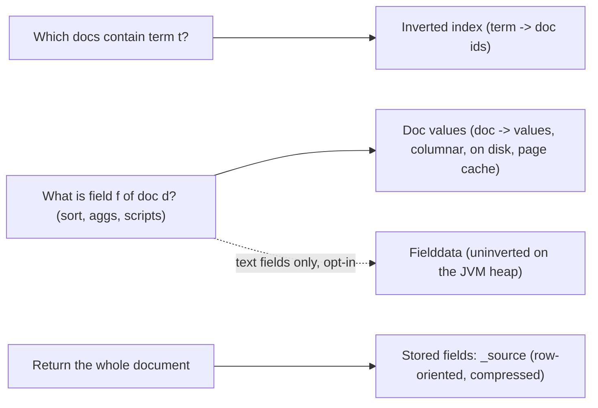
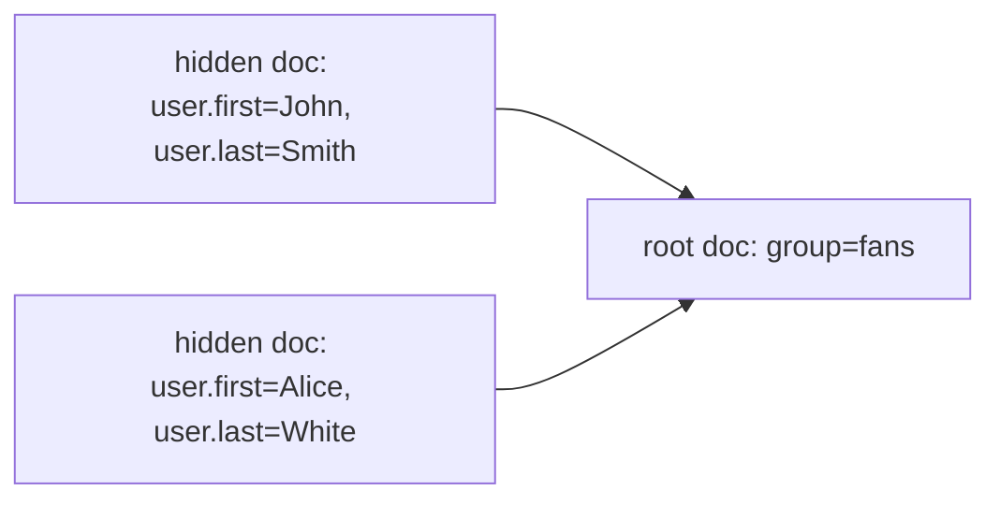
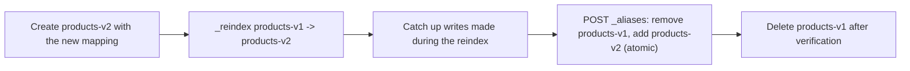

# Module 03: Mappings, Field Types, Index Templates and Runtime Fields

A **mapping** is the schema of an index: for every field path it fixes a **field type**, and the type decides which Lucene structures are written (inverted index, points, doc values, norms, vectors) and therefore which operations are possible and what they cost. Mappings are append-only: you can add fields, never retype them. Getting them right before the first document arrives is the cheapest performance work you will ever do. Tests: [`examples/03-mappings.test.ts`](../examples/03-mappings.test.ts).

---

## 1. Formal Model

**Definition 1 (mapping).** A mapping is a partial function $\mu : \mathit{Path} \rightharpoonup \mathit{FieldType} \times \mathit{Params}$ from dotted field paths to a type and its parameters, plus a `dynamic` policy for paths outside $\mathrm{dom}(\mu)$.

**Definition 2 (mapping update).** A mapping update $\mu'$ is accepted iff $\forall p \in \mathrm{dom}(\mu) \cap \mathrm{dom}(\mu'):\; \mathit{type}(\mu(p)) = \mathit{type}(\mu'(p))$ and every changed parameter is in the updatable set (e.g. `ignore_above`, adding `fields`, `search_analyzer`, `meta`). Type changes are rejected because segments written under the old type are immutable and the cluster cannot retroactively re-encode them.

**Definition 3 (field count).** The size $|\mu|$ counted by `index.mapping.total_fields.limit` (default 1000) includes leaf fields, multi-fields, object mappers, field aliases and runtime fields. The test `counts multi-fields and object mappers toward the limit` asserts that `{a: "x", o: {b: 1}}` maps to **4** mappers: `a`, `a.keyword`, `o`, `o.b`.

The mapping lives in the cluster state (module 02), so every new field is a master operation published to every node.

---

## 2. Field Types and What They Write

| Type | Inverted index | Points (BKD) | Doc values | Norms | Typical use |
| --- | --- | --- | --- | --- | --- |
| `text` | analysed terms + positions | — | no (`fielddata` off) | yes | full-text search |
| `match_only_text` | analysed terms, **no positions/freqs** | — | no | no | logs: cheaper, phrase queries verify against `_source` |
| `keyword` | one term per value (normalised) | — | yes (sorted set, ordinals) | no | filters, sorting, aggregations, exact match |
| `constant_keyword` | none (same value for all docs) | — | no | no | dataset/tenant tag of a data stream |
| `wildcard` | n-grams + compressed values | — | yes | no | grep-like queries on high-cardinality strings |
| `long`, `integer`, `short`, `byte`, `double`, `float`, `half_float`, `scaled_float`, `unsigned_long` | — | yes | yes | no | ranges, metrics |
| `date`, `date_nanos` | — | yes (epoch millis or nanos) | yes | no | time |
| `boolean` | terms `T`/`F` | — | yes | no | flags |
| `ip` | — | yes (16-byte) | yes | no | CIDR queries |
| `geo_point`, `geo_shape` | — | yes (triangle tessellation for shapes) | yes | no | geo |
| `flattened` | each leaf as a keyword term, keyed by path | — | yes | no | arbitrary user-supplied keys |
| `object` | nothing itself; children are flattened into dotted paths | — | — | — | JSON structure |
| `nested` | children indexed as **separate hidden documents** | — | — | — | arrays of objects whose fields must be matched together |
| `join` | parent/child relation within one shard | — | yes | no | many children per parent with independent updates |
| `dense_vector` | HNSW graph (module 09) | — | — | — | kNN |
| `sparse_vector`, `rank_features` | weighted terms | — | — | — | learned sparse retrieval, feature boosting |
| `semantic_text` | managed by an inference endpoint (module 09) | — | — | — | semantic search with zero config |
| `search_as_you_type` | shingles + edge n-grams sub-fields | — | — | yes | autocomplete |

Parameters that switch structures on or off:

| Parameter | Default | Effect when changed |
| --- | --- | --- |
| `index: false` | `true` | no inverted index / points; field is not searchable by `term`, but numeric/date/keyword fields with doc values can still be range-queried and sorted (slowly, by scanning doc values) |
| `doc_values: false` | `true` (except `text`) | no sorting/aggregations/scripts on the field; saves disk |
| `norms: false` | `true` for `text` | length ignored in BM25; saves 1 byte/doc |
| `index_options` | `positions` (`text`), `docs` (keyword) | trades phrase support for size |
| `store: true` | `false` | field also kept as a separate stored field (rarely needed with `_source`) |
| `ignore_above` | none (256 under dynamic mapping) | longer keyword values are not indexed or given doc values, but stay in `_source` |
| `ignore_malformed` | `false` | a bad value is skipped and recorded in `_ignored` instead of rejecting the doc |
| `copy_to` | none | values also indexed into another field (the old `_all` replacement) |
| `null_value` | none | index a replacement for explicit `null` so `exists`/`term` can find it |
| `fielddata: true` (text) | `false` | builds an on-heap uninverted index on first use; heap and circuit-breaker danger |
| `eager_global_ordinals` | `false` | build keyword ordinals at refresh instead of at first aggregation |

The tests in `inverted index vs doc values vs stored fields` prove four of these behaviours: sorting on `text` is rejected with the exact error message; `index: false` keeps a numeric field sortable and range-queryable but not term-searchable; `doc_values: false` keeps a keyword searchable but drops its column; and `ignore_above` silently skips long values in the keyword sub-field while `_source` still returns them.

### 2.1 Doc values versus fielddata versus stored fields



- **Doc values** are written at index time, column per field, read through mmap. Keyword doc values use per-segment **ordinals** (term → small int) and, for aggregations across segments, **global ordinals** built lazily per shard. A high-cardinality keyword aggregated right after every refresh pays the global-ordinals rebuild; that is what `eager_global_ordinals` moves to refresh time.
- **Fielddata** is the pre-5.0 mechanism, now only for `text` fields with `fielddata: true`: on first sort/aggregation the shard _uninverts_ the postings into an on-heap structure. Aggregating a `text` field of free-form text creates millions of entries and trips the **fielddata circuit breaker** (`indices.breaker.fielddata.limit`, 40% of heap). Use a `keyword` sub-field instead.
- **`_source`** is the original JSON, stored compressed. It powers fetch, reindex, update, highlighting and runtime fields. **Synthetic source** reconstructs `_source` from doc values and stored fields instead of storing it, saving roughly half the disk for log-like data; it changes array order, deduplicates keyword values and normalises numbers. Synthetic source is the default for `logsdb` and `time_series` index modes; it is selected with the index setting `index.mapping.source.mode` (the older `_source.mode` mapping parameter is deprecated), and outside those index modes it needs a paid license.

---

## 3. Dynamic Mapping

When a document contains an unmapped field and `dynamic` is `true`, Elasticsearch infers a type from the JSON value:

| JSON value | Dynamic type | Note |
| --- | --- | --- |
| `true`/`false` | `boolean` |  |
| integer | `long` |  |
| floating point | `float` | not `double`: precision surprise for money |
| string matching `dynamic_date_formats` | `date` | `date_detection: true` by default |
| string that looks numeric | `text` + `keyword` | unless `numeric_detection: true` |
| other string | `text` with `fields.keyword: { type: keyword, ignore_above: 256 }` | **two** indexes per string |
| object | `object` |  |
| array | type of the first non-null element |  |
| `null` | no field added |  |

The first test asserts exactly this table. Consequences:

1. **Every string is indexed twice.** Dynamic mapping is designed for exploration. For production, write an explicit mapping and choose either `text` or `keyword` per field.
2. **First value wins.** If the first `zip` seen is `12345`, the field is `long` forever and `"SW1A 1AA"` is rejected with `document_parsing_exception` (test `first value wins`). Map identifiers as `keyword` even when they look numeric: you never do arithmetic on them, and `keyword` is faster for `term` queries.
3. **Dates are detected eagerly.** A free-text field whose first value happens to look like `2026-11-04` becomes a `date`.

### 3.1 The `dynamic` policy

| Value | New field in a document | Searchable? | Mapping grows? |
| --- | --- | --- | --- |
| `true` (default) | mapped by inference | yes | yes |
| `runtime` | mapped as a **runtime field** (keyword, long, double, date, boolean) | yes, computed at query time | runtime section only |
| `false` | ignored, kept in `_source` | no | no |
| `strict` | **document rejected** (`strict_dynamic_mapping_exception`) | — | no |

`dynamic` is inherited by inner objects and can be overridden per object (test `dynamic can be set per object`). A common pattern is `strict` at the root with a single `labels` object set to `true` or typed as `flattened`.

### 3.2 Mapping explosion

When keys come from users (`{"user_<id>": ...}`, HTTP headers, metric labels), each new key adds mappers to the cluster state. Symptoms: `Limit of total fields [1000] has been exceeded` on indexing (test `user-controlled keys hit index.mapping.total_fields.limit`), slow master, large cluster state. The guard rails are:

| Setting                                 | Default   |
| --------------------------------------- | --------- |
| `index.mapping.total_fields.limit`      | 1000      |
| `index.mapping.depth.limit`             | 20        |
| `index.mapping.nested_fields.limit`     | 50        |
| `index.mapping.nested_objects.limit`    | 10000     |
| `index.mapping.field_name_length.limit` | unlimited |

Raising the limit treats the symptom. The cures are a `flattened` field (one mapper for any number of keys, test `the fix: a flattened field`), key/value arrays as `nested` pairs, or `dynamic: false`.

---

## 4. Objects, Nested and Join

### 4.1 Object flattening

Lucene documents are flat. An `object` field is flattened into dotted paths, and an **array of objects** becomes several multi-valued fields:

```json
{
  "user": [
    { "first": "John", "last": "Smith" },
    { "first": "Alice", "last": "White" }
  ]
}
```

becomes `user.first: [John, Alice]`, `user.last: [Smith, White]`. The association is gone, so a query for `first = John AND last = White` **matches** (test `object arrays are flattened: the John/White cross-match is a false positive`).

### 4.2 Nested

A `nested` field indexes each array element as a **separate hidden Lucene document** in the same block, immediately before its parent (block join). `nested` queries and aggregations join child to parent with a bitset of parent doc ids.



Costs, all asserted in the tests:

- the Lucene document count is $1 + \sum$ nested elements (3 instead of 1 above), which matters for shard sizing and `docs.count` in `_cat/indices`;
- updating any part of the document reindexes the entire block;
- `index.mapping.nested_objects.limit` (10,000 per document) rejects pathological documents (negative test).

Queries must use the `nested` query (and `nested`/`reverse_nested` aggregations, module 07) to keep conditions on the same element:

```json
GET /groups/_search
{
  "query": {
    "nested": {
      "path": "user",
      "query": { "bool": { "filter": [
        { "term": { "user.first": "John" } },
        { "term": { "user.last": "White" } }
      ] } },
      "inner_hits": {}
    }
  }
}
```

### 4.3 Join (parent/child)

The `join` type stores parent and child as **independent** documents in the same index and the same shard (children must be routed by the parent id). Children can be updated without touching the parent, unlike nested. The price is query-time joins (`has_child`, `has_parent`) that use global ordinals and are markedly slower. Use it only when children are many and change independently (e.g. answers under questions).

**Decision rule:** denormalise first; `nested` for small, bounded arrays that change with the parent; `join` for large, independently updated child sets; a separate index plus an application-side join or ES|QL `LOOKUP JOIN` (module 06) when neither fits.

---

## 5. Multi-Fields, Normalizers and `copy_to`

A single source value can be indexed several ways through `fields`:

```json
PUT /products
{
  "mappings": {
    "properties": {
      "name": {
        "type": "text",
        "analyzer": "english",
        "fields": {
          "raw":   { "type": "keyword", "ignore_above": 256 },
          "lower": { "type": "keyword", "normalizer": "lowercase_ascii" },
          "auto":  { "type": "search_as_you_type" }
        }
      },
      "all_text": { "type": "text" },
      "brand": { "type": "keyword", "copy_to": "all_text" }
    }
  }
}
```

- Multi-fields read the **parent's** value; you cannot send a different value for `name.raw`.
- Adding a multi-field to an existing field is allowed, but **existing documents are not indexed into it** until they are reindexed or touched by `_update_by_query` (test `adding a new field or a new multi-field is allowed`).
- `copy_to` copies values into another field's index (not into `_source`).

---

## 6. Runtime Fields: Schema on Read

A **runtime field** is evaluated at query time by a Painless script (or loaded directly from `_source` when no script is given). It can be defined in the mapping (`runtime` section) or per request (`runtime_mappings`):

```json
GET /logs/_search
{
  "runtime_mappings": {
    "status": {
      "type": "long",
      "script": "emit(Long.parseLong(params._source.message.splitOnToken(' ')[0]))"
    }
  },
  "query": { "range": { "status": { "gte": 500 } } },
  "fields": ["status"]
}
```

|  | Indexed field | Runtime field |
| --- | --- | --- |
| Indexing cost | paid once | zero |
| Query cost | index lookup | script per candidate document |
| Changing the definition | reindex | edit the mapping |
| Best for | hot query paths | exploration, rare queries, fixing a bad mapping without reindex |

Runtime fields support most queries and aggregations, but every evaluation reads `_source` or doc values for each candidate, so always combine them with a selective indexed filter. Promote a runtime field to an indexed one when it shows up in dashboards. The test `runtime fields` emulates the evaluation; module 08 covers Painless.

---

## 7. Index Templates and Dynamic Templates

### 7.1 Composable index templates

An **index template** applies settings, mappings and aliases to new indices whose names match `index_patterns`. Since 7.8 templates are _composable_: an `_index_template` lists reusable **component templates** in `composed_of`, merged in order, with the index template's own `template` block applied last, then any settings in the create-index request.

```json
PUT _component_template/base-settings
{ "template": { "settings": { "number_of_shards": 1, "number_of_replicas": 1 } } }

PUT _component_template/http-mappings
{ "template": { "mappings": { "properties": {
  "url":    { "type": "keyword" },
  "status": { "type": "short" },
  "@timestamp": { "type": "date" }
} } } }

PUT _index_template/http-logs
{
  "index_patterns": ["http-logs-*"],
  "composed_of": ["base-settings", "http-mappings"],
  "priority": 200,
  "data_stream": {},
  "template": { "settings": { "index.lifecycle.name": "http-logs-policy" } }
}
```

Rules worth knowing for the exam and for production:

- When several index templates match, the one with the **highest `priority`** wins; only one index template applies (component templates are how you share). Two templates with the same priority and overlapping patterns are rejected.
- Templates apply only at **index creation**; editing a template never changes existing indices. For data streams the change applies at the next rollover.
- `POST _index_template/_simulate_index/<name>` shows the resolved result.
- Built-in templates for `logs-*-*`, `metrics-*-*` and similar patterns exist at priority 100; use a higher priority or a non-overlapping pattern for your own.

### 7.2 Dynamic templates

**Dynamic templates** control how dynamically added fields are mapped. Each template has match conditions and a `mapping`; the first match wins.

```json
PUT _index_template/events
{
  "index_patterns": ["events-*"],
  "template": {
    "mappings": {
      "dynamic_templates": [
        { "ids_as_keywords": {
            "match_mapping_type": "string",
            "match": "*_id",
            "mapping": { "type": "keyword" } } },
        { "labels_flattened": {
            "path_match": "labels.*",
            "mapping": { "type": "keyword", "ignore_above": 1024 } } },
        { "strings_as_text_only": {
            "match_mapping_type": "string",
            "mapping": { "type": "text", "norms": false } } },
        { "longs_as_runtime": {
            "match_mapping_type": "long",
            "runtime": { "type": "long" } } }
      ]
    }
  }
}
```

| Condition | Matches on |
| --- | --- |
| `match_mapping_type` | the JSON-detected type (`string`, `long`, `double`, `boolean`, `date`, `object`, or `*`) |
| `match` / `unmatch` | the field **name** (wildcards, or regex with `match_pattern: regex`) |
| `path_match` / `path_unmatch` | the full dotted **path** |

The placeholders `{name}` and `{dynamic_type}` can be used inside the mapping.

---

## 8. Changing a Mapping: Reindex Behind an Alias

Because a type cannot change in place (tests `negative: an existing field type cannot be changed in place` and `... analyzer cannot be changed in place`), the procedure is:



The application always talks to the alias `products`, so the switch is atomic and invisible. Module 08 details `_reindex`, slicing and the catch-up strategies.

### Then vs now: mappings

| Concern | Then | Now |
| --- | --- | --- |
| Mapping types | several `_type`s per index (≤ 5.x), one (6.x) | none: `_doc` only (≥ 8.0) |
| String type | `string` + `index: not_analyzed` (≤ 2.x) | `text` / `keyword` (≥ 5.0) |
| Catch-all field | `_all` (removed in 7.0) | `copy_to`, `multi_match`, `query_string` with `fields` |
| Templates | legacy `_template` (deprecated in 7.8) | composable `_index_template` + `_component_template` |
| Unknown keys | `object` + raised limits | `flattened` (7.3), `dynamic: runtime` (7.11), `subobjects: false` (8.3) |
| Source storage | always stored | synthetic source via `index.mapping.source.mode` (default for logsdb/TSDS) |

Migration pitfall: legacy and composable templates can both match the same index; the composable one wins, and the legacy one is silently ignored. Remove legacy templates when migrating.

> **Exam delta (Elastic Certified Engineer, 9.3).** The exam environment is 9.3 while this track teaches 9.5. Mapping behaviour covered here is the same on both. Expect tasks phrased around index templates, dynamic templates, multi-fields and `nested`; the synthetic-source setting name and `semantic_text` defaults are the most likely places where older study material disagrees with the 9.x documentation available in the exam.

---

## 9. Production Failure Modes

1. **Doubled disk from dynamic strings.** Every log line field became `text` + `keyword`. Explicit mappings or dynamic templates that pick one.
2. **Mapping explosion** (§3.2). Flattened or strict mappings, plus an ingest pipeline that drops unexpected keys.
3. **`float` for money.** Dynamic mapping chose `float`; sums drift. Use `scaled_float` with `scaling_factor: 100` or `long` cents.
4. **Fielddata OOM.** Someone enabled `fielddata: true` on a message field to make a dashboard work. Use a keyword sub-field; cap the breaker.
5. **Nested blow-up.** A product with 20,000 variants as `nested` objects multiplies doc count and reindex cost. Model variants as separate documents.
6. **`ignore_above` surprises.** A keyword value longer than the limit is silently not searchable or aggregatable. Check the `_ignored` metadata field to find such docs.
7. **Template not applied.** The index already existed, or a higher-priority template matched. Use `_simulate_index`.

---

## Interview Drill

<details><summary>1. Why can't you change a field from <code>text</code> to <code>keyword</code> in place?</summary>

The existing segments contain an inverted index built with an analyzer and no doc values; `keyword` needs un-analysed terms and doc values. Segments are immutable and the mapping must describe all of them, so the update is rejected. Create a new index, reindex, swap an alias.
</details>

<details><summary>2. What does dynamic mapping do with a JSON string and why is that costly?</summary>

It maps it as `text` with a `keyword` sub-field (`ignore_above: 256`), unless it matches a date format. Every string is indexed twice, for full text and for exact match/aggregation. Explicit mappings pick one.
</details>

<details><summary>3. Explain object vs nested with a failing example.</summary>

Arrays of objects are flattened into parallel multi-valued fields, so a query for `first=John AND last=White` matches a doc with John Smith and Alice White. `nested` indexes each element as a hidden document in the same block and requires a `nested` query, keeping per-element conditions together at the cost of extra Lucene docs and whole-block reindexing.
</details>

<details><summary>4. What are doc values, and when would you disable them?</summary>

A columnar, on-disk doc → values structure written at index time for everything except `text`, used for sorting, aggregations and scripts. Disable them on fields you only search or display (saves disk), knowing you cannot sort or aggregate later without reindexing.
</details>

<details><summary>5. How do you protect a cluster from mapping explosion when keys come from users?</summary>

Do not let user keys become field names: use `flattened`, a nested key/value structure, `dynamic: false` or `strict` with a whitelist, and an ingest pipeline that drops unknown keys. Keep `total_fields.limit` as a guard rail, not a knob.
</details>

<details><summary>6. When are runtime fields the right tool?</summary>

For exploration, rarely used computed values, or fixing a mapping mistake without a reindex. They cost CPU per candidate per query, so combine them with selective indexed filters and promote frequently used ones to indexed fields.
</details>

<details><summary>7. Two index templates match a new index. Which one applies?</summary>

Only the composable template with the highest `priority`; equal priorities with overlapping patterns are rejected at creation. Share settings through component templates. Verify with `_simulate_index`.
</details>
