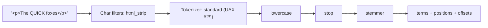

# Module 04: Text Analysis

Text analysis turns a string into the terms that the inverted index stores and the terms that a query looks up. Almost every "search does not find X" ticket is an analysis mismatch between index time and search time. This module defines the analysis chain formally, walks through each component with the exact `_analyze` output, and shows the patterns (autocomplete, synonyms, folding, stemming) and their failure modes. Tests: [`examples/04-text-analysis.test.ts`](../examples/04-text-analysis.test.ts).

---

## 1. The Analysis Chain

**Definition (analyzer).** An analyzer is a composition

$$A = F_m \circ \dots \circ F_1 \circ T \circ C_k \circ \dots \circ C_1$$

where each **char filter** $C_i : \Sigma^{\ast} \to \Sigma^{\ast}$ rewrites the character stream (and records an offset correction), exactly one **tokenizer** $T : \Sigma^{\ast} \to (\mathit{Tok})^{\ast}$ splits it into tokens, and each **token filter** $F_j : (\mathit{Tok})^{\ast} \to (\mathit{Tok})^{\ast}$ rewrites, removes or adds tokens. A token is

$$\mathit{Tok} = (\mathit{term}, \mathit{startOffset}, \mathit{endOffset}, \mathit{type}, \mathit{posInc}, \mathit{posLength})$$

The absolute position of the $i$-th token is $p_i = p_{i-1} + \mathit{posInc}_i$ with $p_{-1} = -1$.



Invariants Lucene relies on (and our property test checks for the model):

1. positions are non-decreasing ($\mathit{posInc} \ge 0$; the first token has $\mathit{posInc} \ge 1$);
2. offsets are relative to the **original** input, before char filters, so that highlighting can cut the original text;
3. $0 \le \mathit{startOffset} \le \mathit{endOffset} \le |\mathit{input}|$.

#### Lucene TokenStream lifecycle and AttributeSource

Under the hood, Lucene's analysis pipeline uses the `AttributeSource` pattern for zero-allocation streaming:

- **Single Reusable Token:** Lucene does not instantiate heap objects per token. Instead, a `TokenStream` holds a single `AttributeSource` instance that defines shared attribute slots:
  - `CharTermAttribute`: mutable character buffer holding the term UTF-8 bytes;
  - `PositionIncrementAttribute`: integer delta from the preceding token position (0 for stacked synonyms, $\ge 1$ for sequential words, $> 1$ when stop words create holes);
  - `PositionLengthAttribute`: number of positions spanned by the token in a token graph (used by multi-word synonyms);
  - `OffsetAttribute`: `startOffset()` and `endOffset()` referencing byte positions in the original raw text;
  - `TypeAttribute`: lexical category string (`<ALPHANUM>`, `<NUM>`, `SYNONYM`, `shingle`).
- **Pipeline Execution Cycle:**
  1. `tokenizer.setReader(Reader)`: attaches character input to the tokenizer.
  2. `tokenStream.reset()`: resets stream state before processing.
  3. `while (tokenStream.incrementToken())`: advances one token; each filter modifies the in-place attributes.
  4. `tokenStream.end()`: updates trailing offsets and records trailing position increments.
  5. `tokenStream.close()`: releases file handles and buffers.

### 1.1 Where analyzers apply

| Moment | Analyzer used (first that is set) |
| --- | --- |
| Indexing a `text` field | field `analyzer` → index default `analysis.analyzer.default` → `standard` |
| `match`, `match_phrase`, `multi_match`, `query_string` on that field | query `analyzer` param → field `search_analyzer` → field `analyzer` → index `default_search` → `standard` |
| `term`, `terms`, `prefix`, `wildcard`, `regexp`, `fuzzy` | **none** (only a keyword field's `normalizer` is applied) |
| `keyword` field values | its `normalizer`, if any |

### 1.2 The `_analyze` API

The single most useful debugging tool:

```json
GET /_analyze
{ "analyzer": "standard", "text": "The 2 QUICK Brown-Foxes" }

GET /products/_analyze
{ "field": "name", "text": "Quick" }

GET /_analyze
{ "tokenizer": "standard", "filter": ["lowercase", "asciifolding"], "char_filter": ["html_strip"], "text": "<b>Příbor</b>" }
```

Using `field` runs exactly the analyzer that field uses, which is what you want when debugging a mapping. Add `"explain": true` to inspect the transformation step by step:

```json
POST /_analyze
{
  "tokenizer": "standard",
  "filter": ["lowercase", "asciifolding"],
  "text": "Příbor",
  "explain": true
}
```

The response includes `detail.tokenfilters`, showing how each filter modifies terms, positions, and offsets:

```json
{
  "detail": {
    "custom_analyzer": true,
    "charfilters": [],
    "tokenizer": {
      "name": "standard",
      "tokens": [
        {
          "token": "Příbor",
          "start_offset": 0,
          "end_offset": 6,
          "type": "<ALPHANUM>",
          "position": 0
        }
      ]
    },
    "tokenfilters": [
      {
        "name": "lowercase",
        "tokens": [
          {
            "token": "příbor",
            "start_offset": 0,
            "end_offset": 6,
            "type": "<ALPHANUM>",
            "position": 0
          }
        ]
      },
      {
        "name": "asciifolding",
        "tokens": [
          {
            "token": "pribor",
            "start_offset": 0,
            "end_offset": 6,
            "type": "<ALPHANUM>",
            "position": 0
          }
        ]
      }
    ]
  }
}
```

The first test asserts the standard analyzer's output token by token: `the(0)`, `2(1) <NUM>`, `quick(2)`, `brown(3)`, `foxes(4)`, with offsets into the input. Note the hyphen: UAX #29 splits `Brown-Foxes`.

---

## 2. Char Filters

| Char filter       | Purpose                      | Example                      |
| ----------------- | ---------------------------- | ---------------------------- |
| `html_strip`      | remove tags, decode entities | `<p>a &amp; b</p>` → `a & b` |
| `mapping`         | literal replacement table    | `:)` → `_happy_`             |
| `pattern_replace` | regex replacement            | strip thousands separators   |

Because char filters change the text before tokenisation, they must record offset corrections so the final token offsets still point into the original. The test `offsets always point into the ORIGINAL text, even after a char filter rewrote it` cuts each token's offsets out of the original HTML and gets the token back. Lucene does this with `CharFilter.correctOffset`; a broken custom char filter shows up as garbled highlights.

Char filters see the _whole_ string, so they are the right place for transformations that cross token boundaries (HTML, joining hyphenated codes). They are also expensive; prefer token filters when the transformation is per token.

---

## 3. Tokenizers

| Tokenizer | Splits on | Notes |
| --- | --- | --- |
| `standard` | Unicode UAX #29 word boundaries | the default; `max_token_length` 255 |
| `letter` | non-letters | breaks `don't` into `don`, `t` |
| `lowercase` | like `letter` + lowercases |  |
| `whitespace` | whitespace only | keeps punctuation: `Hello,` |
| `keyword` | nothing: whole input is one token | used in normalizers |
| `uax_url_email` | like `standard` but keeps URLs and e-mails whole |  |
| `pattern` | a Java regex (default `\W+`) | beware catastrophic backtracking |
| `simple_pattern`, `simple_pattern_split` | Lucene regex (no backtracking) | faster, safer |
| `char_group` | listed characters |  |
| `ngram`, `edge_ngram` | character n-grams of each word | autocomplete, substring search |
| `path_hierarchy` | path prefixes | `/a/b/c` → `/a`, `/a/b`, `/a/b/c` |
| `classic` | pre-UAX #29 grammar | e-mails, hostnames, product codes |
| `icu_tokenizer` (plugin) | dictionary-based segmentation for Thai, CJK, Khmer… | needed for languages without spaces |

UAX #29 rules worth memorising (asserted in the tests): apostrophes between letters stay (`don't`), a dot between letters or digits stays (`example.com`, `v3.14`), hyphens split (`Brown-Foxes` → two tokens), and digits form `<NUM>` tokens. The standard tokenizer is not an e-mail or URL parser; use `uax_url_email` when those must stay whole.

---

## 4. Token Filters

| Filter | Effect on the stream | Position effect |
| --- | --- | --- |
| `lowercase`, `uppercase` | change case (language-aware variants for Greek, Irish, Turkish) | none |
| `asciifolding` | `Příbor` → `pribor` (Unicode to ASCII equivalents) | none (`preserve_original` stacks the original) |
| `icu_folding` (plugin) | full Unicode case and accent folding | none |
| `stop` | remove stop words | **leaves a gap** |
| `stemmer`, `snowball`, `porter_stem`, `kstem`, `hunspell` | reduce words to stems | none |
| `synonym`, `synonym_graph` | add/replace synonyms | **stacks** at the same position |
| `word_delimiter_graph` | split `PowerShot-500` into parts, catenate | stacks, graph |
| `shingle` | word n-grams (`quick brown`) | stacks |
| `edge_ngram`, `ngram` (filter form) | character n-grams per token | stacks |
| `unique` | drop duplicate tokens |  |
| `length`, `truncate`, `limit` | bound tokens |  |
| `elision` | strip `l'` in French |  |
| `keyword_marker`, `stemmer_override` | protect words from stemming |  |
| `decimal_digit`, `cjk_width`, `cjk_bigram` | script-specific normalisation |  |

### 4.1 Stop words leave holes

The stop filter removes a token but adds its position increment to the next surviving token. `quick and the fox` becomes `quick(0) fox(3)` (test `stop filter removes tokens but leaves a position gap`). Phrase queries respect positions, so `match_phrase: "quick fox"` does **not** match without `slop: 2` (test `phrase consequence`). The query side is analysed the same way, so `match_phrase: "quick and the fox"` still matches.

The default `standard` analyzer has **no** stop words (`stopwords: _none_`) since 5.0; BM25's idf already makes frequent words nearly free. Remove stop words only for a reason (index size on very large corpora, or language analyzers that do it by default).

### 4.2 Stemming

A stemmer maps inflected forms to a common stem; the stem need not be a word. The test `minimal_english (Harman S-stemmer) only strips plurals, and can produce non-words` shows Lucene's `EnglishMinimalStemmer` mapping `queries → query`, `boxes → boxe`, and `ties → ty`. That is fine as long as **the same stemmer runs at index and search time**: the test `the same analyzer must run at index and search time or recall collapses` indexes with `english` and searches with `whitespace`, and finds nothing for `queries`.

| Stemmer family | Aggressiveness | Use |
| --- | --- | --- |
| `minimal_*`, `light_*` | low (plurals, a few suffixes) | product search, names |
| `porter`, `snowball`, `english` analyzer | medium | general English text |
| `kstem` | dictionary-assisted, medium | English, fewer over-stems |
| `hunspell` | dictionary-based | languages with good dictionaries |
| `czech` analyzer / `czech_stem` | light Czech stemmer | Czech text |

Over-stemming (`university`/`universe` → `univers`) raises recall and lowers precision. A standard remedy is a multi-field: `title` (stemmed) and `title.exact` (not stemmed), queried with `multi_match` and a higher boost on `exact`.

### 4.3 Folding diacritics

For Czech and other languages with diacritics, users type with and without them (`Kopřivnice`, `Koprivnice`). `asciifolding` (or `icu_folding`) maps both to the same term. The test folds `Příbor` → `pribor`, `KOPŘIVNICE` → `koprivnice` and `Žluťoučký kůň` → `zlutoucky kun`, and checks idempotence as a property. Keep an unfolded sub-field if you want exact-diacritic matches to rank higher.

#### Unicode normalization and folding compared

- **`asciifolding`:** A coarse, lossy filter that maps Unicode alphabetic, numeric, and symbolic characters into their ASCII equivalents (first 127 code points). It works well for Western European Latin diacritics (`é` → `e`, `ř` → `r`), but fails to decompose ligatures (`æ`, `œ`, `fi`), leaves German sharp S (`ß`) untouched, and corrupts non-Latin scripts.
- **`icu_folding` (from `analysis-icu` plugin):** Implements full Unicode case folding and accent suppression according to Unicode Standard UAX #44. It correctly expands German `ß` → `ss`, expands ligatures (`fi` → `fi`), normalizes full-width CJK characters to ASCII equivalents, and strips accents across all international Unicode scripts.
- **`icu_normalizer`:** Applies standard Unicode normalization forms (NFC, NFD, NFKC, NFKD) or `nfkc_cf` (NFKC with case folding). This is essential for CJK and Arabic text where identical visual glyphs have distinct Unicode encodings.
- **`icu_collation`:** Generates language-specific collation keys on `keyword` fields (UAX #10). In Czech, the digraph `ch` is legally a distinct letter sorting between `h` and `i`. Standard UTF-8 byte comparison places `ch` before `d`; `icu_collation` with `language: cs` ensures linguistic sorting accuracy.

| Filter | Specification | Scope | Sharp S (`ß`) | Ligatures (`fi`) | Language Collation | Plugin Required |
| --- | --- | --- | --- | --- | --- | --- |
| `asciifolding` | Built-in | Latin/Cyrillic/Greek | Unchanged (`ß`) | Unchanged (`fi`) | No | Built-in |
| `icu_folding` | Unicode UAX #44 | Complete Unicode | `ss` | `fi` | No | `analysis-icu` |
| `icu_normalizer` | Unicode UAX #15 | Normalization forms | Form dependent | Decomposed in NFKC | No | `analysis-icu` |
| `icu_collation` | Unicode UAX #10 | Linguistic sorting | Locale dependent | Locale dependent | Yes (e.g. Czech `ch`) | `analysis-icu` |

### 4.4 Synonyms

A synonym filter adds tokens at the **same position** (`posInc = 0`), with type `SYNONYM` (test `synonyms are stacked at the same position`), so phrase queries keep working across synonyms.

#### Token graphs and multi-word synonyms: `synonym_graph` vs `synonym`

A token stream represents a Directed Acyclic Graph (DAG) where nodes represent positions and edges represent tokens:

- **Position Increment (`posInc`):** The distance from the start of the previous token to the start of the current token.
- **Position Length (`posLength`):** The number of positions spanned by the token in the graph.

Consider the query `fast domain name system lookup` with the multi-word synonym rule `domain name system, dns`:

```
Graph structure:
Position:      0           1          2          3          4
Tokens:     [ fast ] --> [ domain ]->[ name ]->[ system ]->[ lookup ]
                         [---------------- dns ----------------]
```

- When using `synonym_graph`, the token `dns` is assigned `posInc: 0` and `posLength: 3`. It spans from position 1 to position 4, arriving at the exact same graph node as `system`. The subsequent token `lookup` starts at position 4. A search for phrase `"dns lookup"` traverses the top path (`dns` at pos 1 spanning 3 positions to pos 4, followed immediately by `lookup` at pos 4) and matches perfectly.
- When using the legacy `synonym` filter, the graph is flattened: `dns` is emitted with `posInc: 0` and `posLength: 1`. The token `lookup` remains at position 4. A phrase query for `"dns lookup"` expects `lookup` at position 2 ($1 + 1$), but finds it at position 4; the phrase query **fails to match**. Worse, it creates phantom combinations where `"dns name"` can falsely match.
- **Why `synonym_graph` is search-time only:** Lucene's on-disk inverted index format (`.doc`, `.pos`) only stores single integer positions; it has no mechanism to store `posLength > 1`. At search time, query parsers (`match`, `match_phrase`) interpret the graph generated by `synonym_graph` and rewrite it into a `GraphQuery` / `SpanOrQuery` that correctly evaluates every alternative path.

```json
PUT _synonyms/product-synonyms
{ "synonyms_set": [
  { "id": "laptop", "synonyms": "laptop, notebook" },
  { "id": "tv",     "synonyms": "tv, television" },
  { "id": "ny",     "synonyms": "ny, new york" }
] }

PUT /products
{
  "settings": { "analysis": {
    "filter": { "prod_syn": { "type": "synonym_graph", "synonyms_set": "product-synonyms", "updateable": true } },
    "analyzer": { "prod_search": { "tokenizer": "standard", "filter": ["lowercase", "prod_syn"] } }
  } },
  "mappings": { "properties": {
    "name": { "type": "text", "analyzer": "standard", "search_analyzer": "prod_search" }
  } }
}
```

Rules:

1. **Apply synonyms at search time.** Index-time synonyms bake the list into every segment; changing it needs a reindex, and they distort term statistics. Search-time synonyms with `updateable: true` can be changed without reindexing.
2. **Use `synonym_graph` for multi-word synonyms.** `new york` → `ny` changes the number of positions. The plain `synonym` filter flattens the token graph and produces wrong phrase matches; `synonym_graph` emits a correct graph that the query parser turns into the right boolean/phrase structure. Our model refuses multi-word rules in the single-token filter (negative test).
3. **Manage synonyms with the Synonyms API** (`_synonyms`, GA in 8.x): updating a set reloads the affected search analyzers automatically. For file-based synonyms, call `POST /<index>/_reload_search_analyzers`.

---

## 5. Normalizers

A **normalizer** is an analyzer for `keyword` fields: keyword tokenizer plus only character-level filters (`lowercase`, `asciifolding`, `uppercase`, `trim`, `cjk_width`, …). Filters that change the number of tokens (stemmers, synonyms, n-grams) are rejected (negative test `a normalizer may not contain token-producing filters`).

```json
PUT /places
{
  "settings": { "analysis": { "normalizer": {
    "fold": { "type": "custom", "filter": ["lowercase", "asciifolding"] }
  } } },
  "mappings": { "properties": {
    "city": { "type": "keyword", "normalizer": "fold" }
  } }
}
```

Normalizers apply at index time **and** to `term`, `terms`, `prefix`, `range` and other term-level queries on that keyword field, and they change the values that aggregations return (`brno-kralovo pole`, not the original). Keep an un-normalised sub-field if you need the display value in aggregations.

---

## 6. Autocomplete

Three established techniques:

| Technique | Index cost | Query | Strength |
| --- | --- | --- | --- |
| `edge_ngram` analyzer at index time + `standard` at search time | large (one term per prefix) | `match` | fast, prefix-of-word |
| `search_as_you_type` field | shingles + edge n-grams sub-fields | `multi_match` type `bool_prefix` | prefix of phrases, ready-made |
| completion suggester (`completion` field) | FST in memory | `suggest` | fastest, prefix-of-whole-input only, no filters beyond contexts |

#### Shingle and edge-ngram memory and storage trade-offs

Autocomplete mechanisms trade index-time disk and CPU amplification against query latency and phrase quality:

- **Edge N-Gram Amplification:** An `edge_ngram` tokenizer with `min_gram: 2, max_gram: 10` decomposes an $L$-character word into $\min(L, 10) - 1$ distinct terms. A corpus of 1 million distinct terms balloons into 5–8 million term dictionary entries. Inverted index `.doc` postings expand proportionately because every prefix contains document postings, inflating disk usage and the term index FST in memory.
- **Shingle Amplification:** The `shingle` token filter generates overlapping token tuples (word $N$-grams). A phrase of $W$ words with `min_shingle_size: 2, max_shingle_size: 3` indexes $W$ unigrams, $W-1$ bigrams, and $W-2$ trigrams. While this quadruples postings storage, it converts expensive phrase position checks into single-term dictionary lookups, reducing query latency by up to 10x.
- **`search_as_you_type` Architecture:** Under the hood, this field type automatically provisions sub-fields: `name._index_prefix` (2–3 character edge n-grams of shingles), `name._2gram`, and `name._3gram`. Querying with `multi_match` type `bool_prefix` matches completed words as exact terms and matches the trailing token as an edge n-gram prefix.

| Autocomplete Strategy | Internal Data Structure | Storage Amplification | Ingest CPU Overhead | Query Latency | Multi-word Phrase Matching | Typo Tolerance |
| --- | --- | --- | --- | --- | --- | --- |
| `edge_ngram` (index) | Inverted index prefixes | High (3x–6x) | Moderate | Sub-10ms | Weak (per-word prefix) | No (prefix only) |
| `search_as_you_type` | Inverted index shingles + edge n-grams | Very High (5x–8x) | High | Fast (5–15ms) | Native (2/3-word shingles) | No |
| Completion Suggester | Memory-mapped FST (`.lkp`) | Low (compact FST) | Fast | Sub-millisecond | Prefix-only (whole field) | Yes (`fuzzy` option) |
| `wildcard` field | Automated n-gram BKD tree | Moderate (2x) | Low | 20–50ms | Regex, infix & wildcard patterns | No |

The key rule, proven by a positive and a negative test: **index with edge n-grams, search with a normal analyzer.** If the search analyzer also produces n-grams, the query `quic` becomes `[qu, qui, quic]` and matches `Quiet` through `qu` and `qui`.

```json
PUT /products
{
  "settings": {
    "analysis": {
      "tokenizer": { "autocomplete_tok": { "type": "edge_ngram", "min_gram": 2, "max_gram": 10, "token_chars": ["letter", "digit"] } },
      "analyzer": { "autocomplete": { "tokenizer": "autocomplete_tok", "filter": ["lowercase"] } }
    }
  },
  "mappings": { "properties": {
    "name": { "type": "text", "analyzer": "autocomplete", "search_analyzer": "standard" }
  } }
}
```

`ngram` (infix) analysis is guarded by `index.max_ngram_diff` (default 1): `min_gram: 1, max_gram: 3` is rejected (negative test). Infix search on large text explodes the term dictionary; prefer the `wildcard` field type for "contains" queries on identifiers.

---

## 7. Language Analyzers and Multilingual Content

Built-in language analyzers (`english`, `german`, `czech`, `polish`, …) bundle a tokenizer, language stop words, and a stemmer (plus elision or normalisation where needed). Each can be re-implemented as a `custom` analyzer, which is the documented way to tweak one piece (e.g. add `keyword_marker` for brand names).

Strategies for multilingual documents:

1. **Field per language** (`title.en`, `title.cs`), chosen at index time by a language detected in an ingest pipeline (`inference` with a language identification model, or upstream). Query the right field, or all with `multi_match`.
2. **Index per language** when languages differ in mapping or volume.
3. **ICU plugin** (`analysis-icu`) for `icu_tokenizer`, `icu_folding`, `icu_normalizer` and ICU collation keyword fields for language-correct sorting.

---

## 8. Multi-Valued Fields and `position_increment_gap`

For an array of text values, Lucene concatenates the token streams and inserts a gap of `position_increment_gap` (default 100) positions between values, so a phrase query cannot match across two values (`["John Smith", "Alice White"]` does not match the phrase `smith alice`). Our index model implements the same gap.

---

## 9. Then vs Now: Analysis

| Concern | Then | Now |
| --- | --- | --- |
| Default stop words in `standard` | English stop words (≤ 2.x) | none (≥ 5.0) |
| Updating synonyms | edit file on every node + close/open index | Synonyms API with automatic reload (8.x), `updateable` search analyzers |
| Multi-word synonyms | `synonym` filter, broken phrase semantics | `synonym_graph` at search time (≥ 6.4) |
| Word splitting | `word_delimiter` | `word_delimiter_graph` |
| Prefix optimisation | edge n-grams by hand | `index_prefixes` on `text`, `search_as_you_type` (≥ 7.2) |
| Contains on identifiers | `ngram` analyzers | `wildcard` field type (≥ 7.9) |

Migration pitfall: switching a field from index-time to search-time synonyms requires a reindex (the old segments contain the expanded terms).

---

## 10. Production Failure Modes

1. **Index/search analyzer mismatch.** Stemmer at index time only; recall collapses. Debug with `_analyze` using `field`.
2. **`term` on a `text` field** (module 01). Use `match`, or a normalised keyword.
3. **Edge n-grams at search time.** False positives (§6).
4. **Synonyms at index time.** List change requires a reindex; idf is distorted for synonym-heavy terms.
5. **Regex `pattern` tokenizer with catastrophic backtracking.** Indexing threads stall. Use `simple_pattern`.
6. **Huge tokens.** A base64 blob in a `keyword` field exceeds Lucene's 32,766-byte term limit and the document is rejected. Use `ignore_above` or `index: false`.
7. **Normalizer changes aggregation output.** Buckets show folded lowercase values; keep a raw sub-field for display.

---

## Interview Drill

<details><summary>1. Describe the analysis chain and where offsets and positions come from.</summary>

Zero or more char filters rewrite the string while tracking offset corrections; one tokenizer emits tokens with offsets and position increments; token filters transform the stream. Positions are the running sum of increments; offsets are corrected back to the original input so highlighting works on the stored text.
</details>

<details><summary>2. Why might <code>match_phrase</code> fail after adding a stop filter?</summary>

The stop filter leaves position gaps. A phrase whose words were adjacent in the query after stop removal may be separated in the index by the removed words' positions. Use `slop`, keep stop words, or index a shingle field.
</details>

<details><summary>3. Index-time or search-time synonyms?</summary>

Search time, with `synonym_graph` and an updateable analyzer or the Synonyms API: no reindex on change, correct multi-word handling, undistorted term statistics. Index-time synonyms can be marginally faster at query time but are rigid.
</details>

<details><summary>4. Build autocomplete for product names. What are the pitfalls?</summary>

Edge n-gram analyzer at index time, standard at search time (or `search_as_you_type` with `bool_prefix`). Pitfalls: n-grams at search time (false positives), `max_gram` too small for long words, index growth, and needing a separate un-n-grammed field for exact-match boosting.
</details>

<details><summary>5. Users search Czech place names with and without diacritics. Design the mapping.</summary>

A `text` field with a custom analyzer (`standard` tokenizer, `lowercase`, `asciifolding`, optionally `czech_stem`), plus a `keyword` sub-field with a `lowercase`+`asciifolding` normalizer for exact filters, plus an unfolded sub-field boosted higher so that correct diacritics rank first.
</details>

<details><summary>6. What is a normalizer, and why can it not contain a stemmer?</summary>

A keyword-tokenizer analyzer for `keyword` fields restricted to per-character filters, so that each value still maps to exactly one term. Stemmers, synonyms and n-grams can change the token count or produce multiple terms, which breaks the one-value-one-term contract of keyword fields and doc values.
</details>

<details><summary>7. How do you debug "document X is not found by query Y"?</summary>

`GET index/_analyze` with `field` for the document's text and for the query text; compare terms. Then `_validate/query?explain` to see the rewritten Lucene query, and `_explain` on the document id to see why it did or did not match.
</details>
