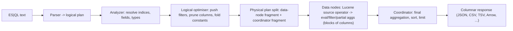

# Module 06: ES|QL, the Piped Query Language

ES|QL (Elasticsearch Query Language) is a piped, columnar query language executed by a dedicated compute engine inside Elasticsearch. It is not a translation layer on top of the Query DSL: queries are planned, optimised and run as **blocks of column vectors** flowing through **operators** on data nodes, with filters pushed down to Lucene where possible. This module defines its semantics precisely (where they differ from SQL and from the DSL), shows the commands interviewers and the exam expect, and explains when to use which language.

Proofs: [`examples/06-esql.test.ts`](../examples/06-esql.test.ts) runs every query in [`examples/fixtures/esql/`](../examples/fixtures/esql/) through a small teaching interpreter ([`examples/lib/esql.ts`](../examples/lib/esql.ts)) against [`dataset.json`](../examples/fixtures/esql/dataset.json) and asserts the exact result table. The interpreter implements a subset (FROM, ROW, WHERE, EVAL, STATS … BY, SORT, KEEP, DROP, RENAME, LIMIT, MV_EXPAND, LOOKUP JOIN); the module explains the rest.

> **Ownership.** Relational algebra and the theory of query languages belong to [Data Models and Query Languages](../../../architecture/data-systems/modules/01-data-models-and-query-languages.md). Using ES|QL for observability (Discover, dashboards, alerting rules, PromQL migration) belongs to the observability track ([technologies/observability](../../observability/README.md)).

---

## 1. Shape of a Query

```esql
FROM employees
| WHERE salary > 6000
| EVAL monthly = salary / 12
| STATS avg_salary = AVG(salary), headcount = COUNT(*) BY dept
| SORT avg_salary DESC
| LIMIT 10
```

**Definition (pipeline semantics).** A query is a **source command** $s$ followed by processing commands $c_1, \dots, c_n$. Each command is a function from tables to tables, and the query denotes

$$\llbracket s \mid c_1 \mid \dots \mid c_n \rrbracket = c_n \circ \dots \circ c_1(\llbracket s \rrbracket)$$

A **table** is an ordered list of named, typed columns and a bag of rows. Unlike SQL, the order of commands is the order of evaluation: `WHERE` after `STATS` filters groups (what SQL calls `HAVING`), and a column dropped by `KEEP` is gone for every later command (negative fixture `11-unknown-column-negative`).

| Category | Commands |
| --- | --- |
| Source | `FROM <index pattern> [METADATA _id, _index, _score]`, `ROW`, `SHOW INFO`, `TS` (time series) |
| Filtering | `WHERE`, `LIMIT`, `SAMPLE` |
| Projection | `KEEP`, `DROP`, `RENAME`, `EVAL` |
| Aggregation | `STATS … BY`, `INLINE STATS … BY` (adds aggregates to every row) |
| Ordering | `SORT … [ASC\|DESC] [NULLS FIRST\|LAST]` |
| Multi-values | `MV_EXPAND` |
| Text processing | `DISSECT`, `GROK` |
| Joins / enrichment | `LOOKUP JOIN`, `ENRICH` |
| Search and AI | `MATCH`/`:`/`QSTR`/`KQL` functions, `FORK` + `FUSE` (hybrid), `RERANK`, `COMPLETION` |
| Analytics | `CHANGE_POINT`, time-series functions with `TS` |

Comments use `//` and `/* */`. Strings use double quotes; `"""triple"""` quotes avoid escaping. Identifiers with special characters are backquoted (`` `my-field` ``).

---

## 2. Execution Model



#### Query planning phases and vectorized block execution

The ES|QL engine replaces the traditional Volcano iterator model (row-at-a-time `next()`) with a vectorized execution engine designed for high throughput over columnar doc values:

1. **Parser & AST Generation:** Converts the piped query string into an Abstract Syntax Tree (AST), checking grammar and pipeline sequence rules.
2. **Semantic Analysis:** Validates target index patterns and aliases against cluster state. Verifies that all referenced columns exist in field mappings, resolves ambiguous types across indices, and propagates static data types along pipeline commands.
3. **Logical Optimization:**
   - **Filter Pushdown:** Identifies `WHERE` predicates operating on indexed fields and translates them into Lucene queries (e.g. `TermQuery`, `PointRangeQuery`). The Lucene source operator evaluates these before any doc values are loaded, discarding non-matching documents at zero memory cost.
   - **Column Pruning (Projection Pushdown):** Identifies which columns are actually referenced downstream. Only required doc-value columns are decoded from disk/page cache; unreferenced fields are never read.
   - **Constant Folding:** Statically computes compile-time constant expressions (such as `1000 * 60` or fixed date truncations).
4. **Physical Plan Partitioning:**
   - **Data Node Fragment:** Executed locally on each data node hosting primary or replica copies of the targeted shards. Runs the Lucene source operator, filter pushdowns, local `EVAL` expressions, and partial hash aggregations.
   - **Coordinating Node Fragment:** Merges incoming columnar blocks from all participating data nodes, executes global grouping reductions, final sorting, and applies `LIMIT`.
5. **Vectorized Block Processing:**
   - Data nodes stream records in **columnar blocks** (batches of 1024 or 2048 primitive values) rather than row objects.
   - Column values are stored in contiguous, flat JVM primitive arrays (`long[]`, `double[]`, byte buffers). Contiguous layout maximizes CPU L1/L2 cache line hits and avoids Java object overhead and pointer chasing.
   - Inner execution loops (e.g., `EVAL bonus = salary * 0.15`) compile into tight, unrolled loops that allow JIT compilers to leverage hardware SIMD (Single Instruction, Multiple Data) vector instructions.

| Execution Property | Classic Query DSL Aggregation | ES\|QL Vectorized Execution Engine |
| --- | --- | --- |
| Execution paradigm | Visitor pattern over Lucene LeafReaders | Columnar block streaming through physical operators |
| Processing unit | Document-at-a-time (row iterator) | Vectorized batch of column blocks (1024–2048 values) |
| Memory layout | Tree of Java aggregation objects on heap | Contiguous primitive arrays and off-heap byte buffers |
| CPU cache efficiency | Lower (frequent pointer dereferencing) | High (sequential cache line prefetching, SIMD-friendly) |
| Filter evaluation | Bitset caching or scored collector loop | Pushed down directly into Lucene leaf queries |

- The **source operator** reads doc values (columnar) rather than `_source` where it can, so ES|QL is fast on keyword/numeric/date fields with doc values.
- `WHERE` clauses on indexed fields are **pushed down** into Lucene queries; a `WHERE` on a computed `EVAL` column is evaluated row by row.
- `STATS` runs as partial aggregation per data node and a final aggregation on the coordinator, like DSL aggregations (module 07), but with an engine designed for vectorised evaluation.
- Results return as columns + values, not hits with `_source`. The `_query` endpoint supports `format=csv|tsv|txt|json|yaml|arrow|cbor|smile`.

```json
POST /_query?format=txt
{
  "query": "FROM employees | STATS c = COUNT(*) BY dept",
  "filter": { "range": { "hire_date": { "gte": "2025-01-01" } } },
  "params": [6000]
}
```

The optional `filter` is a Query DSL filter applied before the pipeline; `params` bind `?` placeholders and are the defence against injection when queries are built from user input. Long-running queries use `POST /_query/async` with `wait_for_completion_timeout`.

---

## 3. Semantics That Differ From SQL

### 3.1 Implicit and maximum LIMIT

Every query without `LIMIT` returns at most **1000** rows; an explicit `LIMIT` can raise it to at most **10,000** (cluster settings `esql.query.result_truncation_default_size` and `esql.query.result_truncation_max_size`). Time-series queries have larger limits. The limit truncates **output only**: `STATS` still aggregates every row. Tests `applies an implicit LIMIT 1000 and caps explicit limits at 10000` and `the limit truncates output only`.

ES|QL is therefore not an export tool. For millions of raw documents use PIT + `search_after` (module 05).

### 3.2 NULL and three-valued logic

- Operators with a `NULL` operand return `NULL` (`NULL + 1`, `NULL == NULL`): test `operators with NULL return NULL`.
- `WHERE` keeps rows whose predicate is **TRUE**; `NULL` rows are dropped. So `WHERE languages < 3` silently drops rows with no `languages` (fixture `04-null-three-valued-logic` adds `OR languages IS NULL`).
- `AND`/`OR` follow Kleene logic: `FALSE AND NULL = FALSE`, `TRUE OR NULL = TRUE`. The property test `WHERE p OR NOT p keeps exactly the rows where p is not NULL` is the law of the excluded middle failing exactly on NULLs.
- `COUNT(*)` counts rows; `COUNT(field)` counts non-null values; `AVG` divides by the number of non-null values (tests `COUNT(field) skips NULLs` and `AVG ignores NULLs`).
- `NULL` forms its own group in `STATS … BY` (test `NULL is its own group`).
- `SORT` treats NULL as larger than any value: last for `ASC`, first for `DESC`, unless `NULLS FIRST|LAST` (fixture `05-sort-nulls-last`).

### 3.3 Types and arithmetic

- Integer division truncates: `7 / 2 = 3`, `7 / 2.5 = 2.8` (fixture `03-eval-integer-division`). Division by zero returns NULL with a warning.
- Types map from mappings: `text` and `keyword` are both strings, but **a `text` field without a full-text function behaves like a keyword**: `WHERE message == "error"` compares the whole string, case-sensitively. Use `MATCH(message, "error")` or `message : "error"` for analysed search.
- `float`, `half_float` and `scaled_float` become `double`; `short` and `byte` become `integer`.
- Some mapping types are not supported (for example `nested`, `binary`, `histogram`, range types except `double_range`, `rank_feature(s)`); they read as NULL with a warning, or error when referenced. Nested documents are invisible to ES|QL.
- Conversion functions: `TO_STRING`, `TO_INTEGER`, `TO_DOUBLE`, `TO_DATETIME`, `TO_IP`, or the cast operator `field::long`. Fields mapped with different types across indices must be converted explicitly.

### 3.4 Multi-valued fields

A JSON array becomes a **multi-valued** cell. Most scalar functions and comparisons return NULL (with a warning) on multi-values. Tools: `MV_COUNT`, `MV_MIN`, `MV_MAX`, `MV_SUM`, `MV_CONCAT`, `MV_DEDUPE`, and `MV_EXPAND` to produce one row per value (fixture `07-mv-expand` counts skills across employees; `java` appears 3 times). Multi-values come back from doc values **sorted and, for keywords, deduplicated**, not in `_source` order.

#### `MV_EXPAND` mechanics and Cartesian explosion risks

Lucene stores array fields in columnar doc values using `SortedSetDocValues` (for keyword strings) and `SortedNumericDocValues` (for numbers). Elements are stored in sorted order with duplicate keywords removed, discarding original insertion order:

- **Row Duplication:** `MV_EXPAND` takes a multivalued column and emits one row per array element, replicating all other columns from the source row.

| Before: Row with Array | After: `MV_EXPAND skills` |
| --- | --- |
| `emp_no: 101, name: "Alice", skills: ["Go", "Rust"]` | Row 1: `emp_no: 101, name: "Alice", skills: "Go"` |
| `emp_no: 102, name: "Bob", skills: ["Java"]` | Row 2: `emp_no: 101, name: "Alice", skills: "Rust"` |
| — | Row 3: `emp_no: 102, name: "Bob", skills: "Java"` |

- **Sequential Cartesian Expansion:** Expanding multiple multivalued columns sequentially causes exponential row growth. Expanding a column with 4 elements followed by another with 5 elements expands 1 source row into $4 \times 5 = 20$ rows. If run over large indices, this rapidly exhausts memory and hits the `esql.query.result_truncation_max_size` (10,000 rows) cap.

| Multi-value Function | Operation | Output Type |
| --- | --- | --- |
| `MV_EXPAND(col)` | Multiplies rows: 1 row per array element | Scalar (single value per row) |
| `MV_CONCAT(col, delim)` | Joins array elements into a formatted string | String scalar |
| `MV_COUNT(col)` | Counts non-null values in the array | Integer scalar |
| `MV_MIN(col)` / `MV_MAX(col)` | Computes minimum or maximum element | Number or String scalar |
| `MV_DEDUPE(col)` | Strips duplicate values | Multivalued array |
| `MV_SLICE(col, start, len)` | Extracts sub-array slice | Multivalued array |

### 3.5 Assignment versus equality

`=` assigns (in `EVAL`, `STATS`, `ROW`); `==` compares. `WHERE dept = "ops"` is a parse error (negative fixture `10-assignment-vs-equality-negative`).

### 3.6 Column naming

Unnamed expressions are named by their source text: `STATS COUNT(*) BY dept` yields columns `COUNT(*)` and `dept`. `STATS` outputs **aggregates first, then the BY columns** (fixture `02-stats-by`). `EVAL` appends or replaces columns; `RENAME` keeps a column's position (fixture `09-rename-drop`).

---

## 4. Core Commands by Example

### 4.1 FROM and index patterns

```esql
FROM logs-web-*, logs-api-* METADATA _index, _id
| WHERE status >= 500
| STATS errors = COUNT(*) BY host
```

`FROM` accepts index names, aliases, data streams, wildcards and remote clusters (`cluster_one:logs-*`, module 10). Columns are the union of mapped fields (fixture `08-wildcard-index-pattern`). `METADATA` exposes `_id`, `_index`, `_version`, `_score` (needed for relevance when using `MATCH`).

### 4.2 EVAL, CASE and date functions

```esql
FROM logs-web-*
| EVAL day = DATE_TRUNC(1 day, @timestamp),
       kind = CASE(status >= 500, "server", status >= 400, "client", "ok")
| STATS n = COUNT(*) BY day, kind
| SORT day, kind
```

Useful functions: `DATE_TRUNC`, `DATE_EXTRACT`, `DATE_DIFF`, `NOW()`, `BUCKET(field, 20, start, end)` (auto-sized histogram buckets), `CIDR_MATCH`, `LIKE`/`RLIKE`, `STARTS_WITH`, `SUBSTRING`, `SPLIT`, `COALESCE`, `GREATEST`/`LEAST`, `ROUND`, `LOG10`, `POW`.

### 4.3 STATS and its aggregate functions

`COUNT`, `COUNT_DISTINCT` (HyperLogLog++, approximate, `precision` parameter), `SUM`, `AVG`, `MIN`, `MAX`, `MEDIAN`, `MEDIAN_ABSOLUTE_DEVIATION`, `PERCENTILE` (TDigest, approximate), `TOP`, `VALUES`, `WEIGHTED_AVG`, `ST_CENTROID_AGG`, and per-aggregate filtering with `WHERE`:

```esql
FROM logs-web-*
| STATS total = COUNT(*), errors = COUNT(*) WHERE status >= 500 BY host
| EVAL error_rate = errors * 100.0 / total
```

The approximation guarantees are the same as for DSL aggregations (module 07).

#### `STATS ... BY` grouping pushdown and reduction algebra

Grouping in ES|QL leverages two-tier distributed hash aggregation:

- **Data Node Local Hash Aggregation:** Each data node builds an in-memory hash table mapping composite group keys (e.g. `(host, status)`) to aggregate accumulator state structs (e.g. `sum`, `count`, HLL sketch buffers). Grouping pushdown ensures that data nodes aggregate local columnar blocks before transmitting data across the network.
- **Network Reduction:** Instead of streaming millions of unaggregated rows to the coordinating node, data nodes send only the aggregated buckets.
- **Coordinator Global Merge:** The coordinating node combines partial bucket summaries from all data nodes (adding counts and sums, combining HLL sketches with bitwise-OR, merging TDigest centroids), evaluates post-aggregate filters (`WHERE error_rate > 5.0`), and applies final sorting and output truncation.
- **Memory Bounding:** Hash tables on data nodes are monitored by the query circuit breaker (`esql.query.memory.limit`). If the cardinality of the grouping keys exceeds available memory, the query is aborted cleanly with a `circuit_breaking_exception` rather than causing an unrecoverable node OutOfMemoryError.

### 4.4 DISSECT and GROK

Parse unstructured strings at query time:

```esql
FROM app-logs
| DISSECT message "%{ts} %{level} [%{thread}] %{msg}"
| GROK msg "user=%{WORD:user} took=%{NUMBER:took:int}ms"
| STATS p95 = PERCENTILE(took, 95) BY level
```

`DISSECT` splits on delimiters (fast); `GROK` uses regex patterns (flexible, slower). For hot paths, do this once in an ingest pipeline (module 08) instead of on every query.

#### DISSECT vs GROK performance and execution trade-offs

- **`DISSECT`:** Operates as a pure delimiter scanner. It traverses character sequences linearly ($O(N)$ string slicing), recording pointer boundaries without allocating regex matcher state or backtracking. It is deterministic, immune to catastrophic backtracking, and processes 500,000+ events per second per core.
- **`GROK`:** Built on regular expression engines (Java regex / Oniguruma syntax). Compiles pattern expressions into state machines. While highly flexible for irregular log lines, complex patterns with nested quantifiers can suffer catastrophic backtracking on malformed log lines, stalling data node execution threads.

| Metric / Property | `DISSECT` | `GROK` |
| --- | --- | --- |
| Underlying engine | Linear delimiter string scanner | Regular expression state machine (regex) |
| Throughput | 400,000–800,000 events/sec/core | 40,000–80,000 events/sec/core (~10x slower) |
| Backtracking risk | None (guaranteed $O(N)$ linear time) | Catastrophic backtracking possible on non-matching lines |
| Memory allocation | Zero regex object overhead | Matcher states, capture group objects |
| Best suited for | Fixed structured logs (Nginx, Apache, syslog, CSV) | Highly variable, multi-format text (stack traces) |
| Production advice | Safe for ad-hoc query use; promote to ingest pipeline | Restrict to interactive debugging; avoid in hot dashboard queries |

### 4.5 ENRICH

`ENRICH policy ON field WITH new_name = enrich_field` adds columns from an **enrich policy**: a periodically executed snapshot of a source index into a compact system index replicated to every node. It is the same mechanism as the ingest `enrich` processor. Changes to the source index require re-executing the policy.

### 4.6 LOOKUP JOIN

```esql
FROM employees
| KEEP emp_no, languages
| LOOKUP JOIN languages_lookup ON languages
| SORT emp_no, language_name
```

Semantics (fixture `06-lookup-join`):

- the right side must be an index created with `"index.mode": "lookup"` (always one shard, replicated to every node that needs it); joining a normal index is rejected (negative fixture `12-lookup-on-standard-index-negative`);
- it is a **left outer join**: unmatched rows are kept with NULLs (Tomas, whose key is NULL);
- **one output row per matching lookup document**: language 2 matches two lookup rows, so Jana and Lucie appear twice. A non-unique lookup key multiplies rows;
- only equality conditions (one or several fields, or `left == right` pairs in newer versions); lookup columns overwrite same-named columns; output order is not guaranteed, so `SORT` afterwards.

`LOOKUP JOIN` versus `ENRICH`: `LOOKUP JOIN` reads the live lookup index (no policy execution), supports multiple matches and is the modern choice; `ENRICH` remains for the ingest path and for range/geo match policies.

#### Architectural comparison: `LOOKUP JOIN` vs `ENRICH`

| Feature | `LOOKUP JOIN` | `ENRICH` |
| --- | --- | --- |
| Execution layer | ES\|QL runtime physical operator | Ingest pipeline or Query DSL enrich processor |
| Source index requirement | Dedicated `index.mode: lookup` index (1 shard) | Any standard Elasticsearch index |
| Data freshness | Real-time: reads current live index doc values | Stale: snapshot frozen until `POST /_enrich/policy/<name>/_execute` runs |
| Match cardinality | 1-to-many supported (multiplies rows on match) | 1-to-1 only (merges attributes into existing row) |
| Supported match types | Equality join (`left == right` or same-named fields) | Exact match, IP range matching, Geo match |
| Node memory model | Read from page cache / doc values of lookup shard | Loaded as a local in-memory system index on every node |
| Unmatched row handling | Left outer join (missing keys populated as `NULL`) | Enriched fields left empty/missing |

### 4.7 Full-text search and scoring in ES|QL

```esql
FROM products METADATA _score
| WHERE MATCH(description, "wireless keyboard", {"operator": "AND"}) AND price < 100
| SORT _score DESC
| KEEP name, price, _score
| LIMIT 10
```

`MATCH`, `MATCH_PHRASE`, the `:` operator, `QSTR` (query_string) and `KQL` push down as Lucene queries and produce BM25 scores when `_score` is requested. They must appear before commands that break push-down (for example `STATS`). `FORK` runs several branches (say, lexical and semantic) and `FUSE` combines them with RRF or a linear combination (module 09).

#### Worked production ES|QL pipelines

##### Pipeline 1: Security incident response (brute-force detection)

Investigate failed authentication attempts across edge proxies, extracting client details and computing failure rates:

```esql
FROM security-audit-* METADATA _index, _id
| WHERE @timestamp >= NOW() - 1 hour AND event.category == "authentication"
| DISSECT event.original "%{client_ip} [%{user}] %{auth_status} %{reason}"
| STATS
    total_attempts = COUNT(*),
    failed_attempts = COUNT(*) WHERE auth_status == "FAILURE",
    unique_targets = COUNT_DISTINCT(user)
  BY client_ip
| EVAL failure_rate = (failed_attempts * 100.0) / total_attempts
| WHERE failed_attempts >= 10 AND failure_rate >= 80.0
| SORT failed_attempts DESC, failure_rate DESC
| KEEP client_ip, failed_attempts, total_attempts, failure_rate, unique_targets
| LIMIT 25
```

##### Pipeline 2: Observability latency SLA & Apdex calculation

Calculate Apdex (Application Performance Index) SLA scoring per microservice from transaction telemetry:

```esql
FROM api-transactions-*
| WHERE @timestamp >= NOW() - 24 hours AND http.request.method == "POST"
| EVAL duration_ms = transaction.duration_us / 1000.0
| STATS
    total_requests = COUNT(*),
    satisfied = COUNT(*) WHERE duration_ms <= 250.0 AND http.response.status_code < 500,
    tolerating = COUNT(*) WHERE duration_ms > 250.0 AND duration_ms <= 1000.0 AND http.response.status_code < 500,
    frustrated = COUNT(*) WHERE duration_ms > 1000.0 OR http.response.status_code >= 500,
    p50 = PERCENTILE(duration_ms, 50),
    p95 = PERCENTILE(duration_ms, 95),
    p99 = PERCENTILE(duration_ms, 99)
  BY service.name
| EVAL apdex_score = ROUND(((satisfied + (tolerating / 2.0)) / total_requests), 3),
       sla_breached = CASE(apdex_score < 0.90, true, false)
| SORT apdex_score ASC
| LIMIT 50
```

`MATCH`, `MATCH_PHRASE`, the `:` operator, `QSTR` (query_string) and `KQL` push down as Lucene queries and produce BM25 scores when `_score` is requested. They must appear before commands that break push-down (for example `STATS`). `FORK` runs several branches (say, lexical and semantic) and `FUSE` combines them with RRF or a linear combination (module 09).

---

## 5. Views and PromQL (9.4)

**Views** (9.4) are named, stored ES|QL queries usable as a source in `FROM`, much like SQL views: they encapsulate parsing (`DISSECT`), enrichment and filtering so consumers query a clean table. Limitations documented for 9.x: nesting up to depth 10, no cross-cluster querying of views, document- and field-level security apply to the underlying indices, not the view.

**PromQL in ES|QL** and Prometheus-compatible endpoints (9.4, technical preview) let metrics stored in TSDS indices be queried with PromQL. Using them belongs to the observability track.

---

## 6. ES|QL or Query DSL?

| Need | Prefer | Why |
| --- | --- | --- |
| Relevance-ranked search with highlighting, pagination, facets for a UI | Query DSL (+ retrievers) | hits with `_source`, highlighting, `search_after`, suggesters, aggregations tree |
| Ad-hoc analysis, reports, top-N by group, computed columns | ES\|QL | pipes, `EVAL`, `STATS … BY` multiple keys, readable |
| Parsing unstructured logs at query time | ES\|QL `DISSECT`/`GROK` | no reindex |
| Joining with reference data | ES\|QL `LOOKUP JOIN` | DSL has no join |
| More than 10,000 raw rows | DSL with PIT + `search_after` | ES\|QL truncates output |
| Nested documents | DSL `nested` | ES\|QL cannot see nested docs |
| Composite pagination over all buckets | DSL `composite` aggregation | ES\|QL returns at most 10,000 groups |
| Alerting rules, Discover in Kibana | ES\|QL | first-class in Kibana (observability track) |

### Then vs now: query languages

| Concern | Then | Now |
| --- | --- | --- |
| SQL access | Elasticsearch SQL (`_sql`, 6.3+), translated to DSL | ES\|QL with its own engine (GA 8.14); `_sql` still exists for JDBC/ODBC |
| Event queries | EQL (`_eql`, 7.9+) for sequences | EQL remains for sequence detection; ES\|QL for everything else |
| Joins | none; denormalise, enrich at ingest | `ENRICH` (8.x), `LOOKUP JOIN` (tech preview in 8.18/9.0, extended in 9.x) |
| Reusable queries | saved searches in Kibana | ES\|QL Views (9.4) |
| Metrics | PromQL only in Prometheus | PromQL in ES\|QL (9.4, tech preview) |

Migration pitfall: Elasticsearch SQL and ES|QL look similar but differ in NULL ordering, limits and type handling. Do not port queries mechanically; re-verify results.

> **Exam delta (Elastic Certified Engineer, 9.3).** ES|QL is part of 9.3, but the exam's published objective areas centre on the Query DSL, aggregations and data management. Views and PromQL (9.4) are not available on a 9.3 exam cluster, and `LOOKUP JOIN` options added after 9.3 (such as expression-based join conditions) may be missing. When an exam task says "search" or "aggregate", answer with the DSL unless ES|QL is requested.

---

## 7. Production Failure Modes

1. **Silent truncation.** A report built with ES|QL shows exactly 1,000 rows. Add `LIMIT`, or aggregate; never export raw data this way.
2. **Text compared as keyword.** `WHERE message == "timeout"` finds nothing because the whole string must match. Use `MATCH` or `:`.
3. **NULL drops rows.** `WHERE x != "a"` also drops rows where `x` is NULL. Add `OR x IS NULL` when that is not intended.
4. **Row explosion in LOOKUP JOIN.** A non-unique key in the lookup index multiplies rows, and very large match sets trip the circuit breaker. Deduplicate the lookup index.
5. **Multi-value NULLs.** A function applied to an array field returns NULL with a warning header the client never shows. Check `warnings` in the response; use `MV_*` functions.
6. **Query-time parsing on hot dashboards.** `GROK` on every refresh of a dashboard burns CPU. Promote the parsed fields into the mapping via an ingest pipeline.
7. **String concatenation of user input into queries.** Use `params` with `?` placeholders.

---

## Interview Drill

<details><summary>1. How does ES|QL execute differently from a DSL search?</summary>

It compiles to a logical then physical plan of operators over column blocks. Data nodes read doc values through a Lucene source operator, push filters into Lucene, compute partial aggregations, and the coordinator finalises. The DSL instead runs a scored query-then-fetch over hits and builds an aggregation tree.
</details>

<details><summary>2. Why does <code>FROM logs | WHERE level != "debug"</code> return fewer rows than expected?</summary>

Rows where `level` is NULL evaluate the predicate to NULL and are dropped. Three-valued logic; add `OR level IS NULL`.
</details>

<details><summary>3. What are the row limits of ES|QL and what do they apply to?</summary>

Default 1,000 output rows without `LIMIT`, at most 10,000 with it (configurable cluster settings). They apply to output only; aggregations see all rows.
</details>

<details><summary>4. Explain LOOKUP JOIN's requirements and semantics.</summary>

The right side is an `index.mode: lookup` index (single shard). It is a left outer join on equality; each matching lookup document produces a row, unmatched rows get NULLs, lookup columns override same-named ones, and output order is unspecified.
</details>

<details><summary>5. When would you still choose the Query DSL?</summary>

For user-facing ranked search: highlighting, deep pagination with PIT, nested documents, suggesters, composite aggregation over all buckets, retrievers for hybrid search. ES|QL is for analytics and investigation.
</details>

<details><summary>6. Why might <code>WHERE MATCH(...)</code> after <code>STATS</code> be rejected?</summary>

Full-text functions on indexed fields must be pushed down to Lucene, which is only possible before commands that change the row set into something not backed by the index. After `STATS` there are no documents to search.
</details>

<details><summary>7. What does <code>7 / 2</code> return in ES|QL?</summary>

`3`: integer division truncates toward zero. Use `7 / 2.0` or `TO_DOUBLE` for 3.5.
</details>
