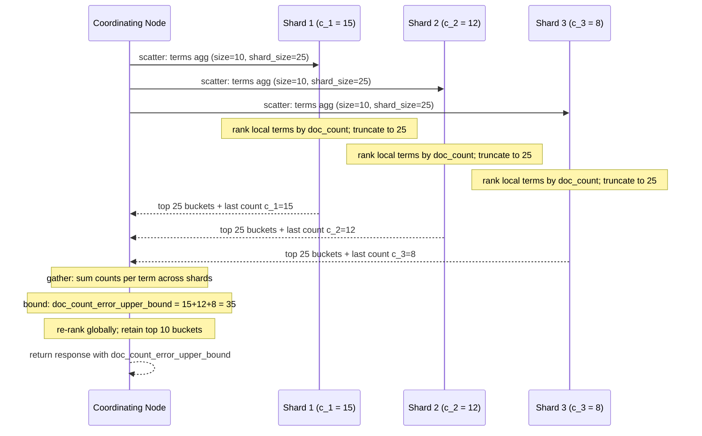

# Module 07: Aggregations

Aggregations compute summaries over the documents that match a query: counts per value, statistics, histograms, percentiles, distinct counts, and derived values over those buckets. They run **distributed**: every shard computes a partial result from doc values, and the coordinating node **reduces** the partials. Which aggregations are exact and which are approximate follows directly from whether their partial results can be merged without loss. This module develops that algebra and proves it in [`examples/07-aggregations.test.ts`](../examples/07-aggregations.test.ts), using the models in [`examples/lib/aggs.ts`](../examples/lib/aggs.ts).

> **Ownership.** HyperLogLog, Count-Min and their error mathematics are owned by `algorithms/dsa` (Bloom / HyperLogLog / Count-Min math); here we cover how Elasticsearch parameterises and merges them. Stream aggregation over unbounded data is owned by [Stream Processing and Event Logs](../../../architecture/data-systems/modules/11-stream-processing-and-event-logs.md).

---

## 1. Families and the Request Shape

```json
GET /orders/_search
{
  "size": 0,
  "query": { "range": { "@timestamp": { "gte": "now-30d/d" } } },
  "aggs": {
    "by_country": {
      "terms": { "field": "country", "size": 10 },
      "aggs": {
        "revenue": { "sum": { "field": "total" } },
        "p95_latency": { "percentiles": { "field": "latency_ms", "percents": [95] } },
        "per_day": {
          "date_histogram": { "field": "@timestamp", "calendar_interval": "1d", "time_zone": "Europe/Prague" },
          "aggs": { "daily": { "sum": { "field": "total" } } }
        },
        "best_day": { "max_bucket": { "buckets_path": "per_day>daily" } }
      }
    }
  }
}
```

| Family | Produces | Examples |
| --- | --- | --- |
| **Metric** | numbers from field values | `avg`, `sum`, `min`, `max`, `value_count`, `stats`, `extended_stats`, `cardinality`, `percentiles`, `percentile_ranks`, `median_absolute_deviation`, `weighted_avg`, `top_hits`, `top_metrics`, `geo_bounds`, `geo_centroid`, `scripted_metric` |
| **Bucket** | sets of documents, each with a `doc_count` and sub-aggregations | `terms`, `multi_terms`, `rare_terms`, `significant_terms`, `histogram`, `date_histogram`, `auto_date_histogram`, `range`, `date_range`, `ip_range`, `filter`, `filters`, `missing`, `composite`, `nested`, `reverse_nested`, `global`, `sampler`, `random_sampler`, `geohash_grid`, `geotile_grid` |
| **Pipeline** | values computed from other aggregations' output | `avg_bucket`, `max_bucket`, `sum_bucket`, `stats_bucket`, `percentiles_bucket`, `derivative`, `cumulative_sum`, `moving_fn`, `serial_diff`, `bucket_script`, `bucket_selector`, `bucket_sort` |

#### Pipeline aggregations: sibling vs parent semantics

Pipeline aggregations execute on the coordinating node after all shards have returned their partial results:

- **Sibling Pipeline Aggregations:** Sibling aggregations (`avg_bucket`, `max_bucket`, `min_bucket`, `sum_bucket`, `stats_bucket`, `percentiles_bucket`) sit alongside a multi-bucket aggregation at the same hierarchy level. They consume all generated sibling buckets to calculate a single summary metric across them (e.g., finding the maximum monthly revenue among 12 monthly date histogram buckets).
- **Parent Pipeline Aggregations:** Parent aggregations (`derivative`, `cumulative_sum`, `moving_fn`, `serial_diff`, `bucket_script`, `bucket_selector`, `bucket_sort`) are nested inside a multi-bucket parent aggregation. They compute a new metric value per bucket (such as the month-over-month rate of change) or transform the bucket list directly:
  - `bucket_selector`: Filters out buckets that fail a boolean predicate (analogous to SQL `HAVING`);
  - `bucket_sort`: Re-orders and paginates buckets based on bucket keys or computed sub-metrics.

#### `buckets_path` grammar and gap policies

- **Path Navigation:** Relative paths use `>` to descend into sub-aggregations (e.g. `per_month>revenue`).
- **Special Values:** `_count` targets the bucket's document count; `_key` targets the bucket's string or numeric key; `_bucket_count` counts the total number of sibling buckets.
- **`gap_policy`:** Dictates how the pipeline handles buckets with missing metrics:
  - `skip` (default): Ignores the empty bucket and proceeds to the next.
  - `insert_zeros`: Replaces missing metrics with 0. Essential for `cumulative_sum` and `derivative` where a null would otherwise break mathematical continuity.

```json
{
  "aggs": {
    "sales_per_month": {
      "date_histogram": { "field": "date", "calendar_interval": "1M" },
      "aggs": {
        "monthly_revenue": { "sum": { "field": "price" } },
        "revenue_derivative": {
          "derivative": { "buckets_path": "monthly_revenue", "gap_policy": "insert_zeros" }
        },
        "positive_growth_only": {
          "bucket_selector": {
            "buckets_path": { "change": "revenue_derivative" },
            "script": "params.change > 0"
          }
        }
      }
    }
  }
}
```

`"size": 0` skips the hits and lets the **shard request cache** store the aggregation result (see §8). Aggregations read **doc values** (module 03); aggregating a `text` field fails unless fielddata is enabled, which you should not do.

**`buckets_path` syntax:** `agg_name>sub_agg.metric`, with `_count` for a bucket's doc count and `_bucket_count` for the number of buckets. Pipeline aggregations run on the coordinating node after the reduce.

---

## 2. The Reduce Algebra

**Definition.** A distributed aggregation is a triple $(\mathit{map}, \oplus, \mathit{final})$: each shard $s$ computes a partial $P_s = \mathit{map}(D_s)$ over its documents, the coordinator computes $\mathit{final}(P_1 \oplus \dots \oplus P_n)$. The result is **exact** when $\oplus$ is associative and commutative **and** $\mathit{map}$ loses no information that $\mathit{final}$ needs.

| Aggregation | Partial | $\oplus$ | Exact? |
| --- | --- | --- | --- |
| `sum`, `min`, `max`, `value_count` | one number | $+$, $\min$, $\max$, $+$ | yes |
| `avg` | $(\Sigma, n)$ | pairwise $+$ | yes |
| `stats` | $(n, \Sigma, \min, \max)$ | componentwise | yes |
| `extended_stats` | $(n, \Sigma, \Sigma x^2, \min, \max)$ | componentwise | yes up to floating-point cancellation |
| `cardinality` | HyperLogLog++ sketch | register-wise $\max$ | approximate (sketch) but **merge-exact** |
| `percentiles` | TDigest (default) or HDR histogram | digest merge | approximate |
| `terms` (top $k$ by count) | top `shard_size` (term, count) per shard | sum counts, re-rank | **approximate**: truncation per shard loses information |
| `composite` | all keys after `after`, sorted | merge sorted streams | yes (exhaustive) |
| histogram, `date_histogram`, `range`, `filters` | count per fixed key | $+$ per key | yes |

The test `negative: the average of shard averages is wrong for unequal shard sizes` shows why `avg` ships $(\Sigma, n)$: shards $\{10,10,10,10\}$ and $\{100\}$ have shard averages 10 and 100, whose mean is 55, while the true average is 28. The property test proves the $(\Sigma, n)$ reduction is independent of the shard split. The same argument explains why you must never average pre-computed averages in a rollup or transform.

The batched query phase of 9.5 (module 02) adds a per-node partial reduce; it is safe for exactly the aggregations whose $\oplus$ is associative and commutative, which is all of them, but it does not make `terms` exact: truncation still happens on each shard.

---

## 3. `terms` and Its Error Bounds



### 3.1 Algorithm

1. Each shard computes counts for every term among its matching documents (using global ordinals on keyword fields) and returns its top **`shard_size`** terms. Default `shard_size = size × 1.5 + 10`.
2. The coordinator sums counts per term over the returned lists and keeps the top `size`.
3. It reports:
   - `sum_other_doc_count`: documents in terms not returned;
   - `doc_count_error_upper_bound`: $\sum_s c_s$ where $c_s$ is the count of the **last** term shard $s$ returned (0 if the shard returned all its terms): the largest count any term the shard did not return could have had there;
   - with `show_term_doc_count_error: true`, a per-bucket bound: the sum of $c_s$ over the shards that did **not** return that term.

### 3.2 The counterexample

Three shards, `size: 1`, `shard_size: 1`:

| Shard | Counts      |
| ----- | ----------- |
| 0     | x: 10, y: 9 |
| 1     | z: 10, y: 9 |
| 2     | w: 10, y: 9 |

The true top term is `y` with 27. Each shard returns only its local winner, so the coordinator sees `x`, `z`, `w` with 10 each and answers `w: 10`. The response is honest about it: `doc_count_error_upper_bound = 30` (10 + 10 + 10), and the `w` bucket's own bound is 20. The negative test asserts all of these numbers; the next test shows that the default `shard_size` (11 for `size: 1`) returns the right answer with error 0.

### 3.3 Guarantees, proven as properties

For every returned bucket $b$ with reported count $\hat{c}_b$, true count $c_b$ and per-bucket bound $e_b$:

$$\hat{c}_b \le c_b \le \hat{c}_b + e_b$$

and when `shard_size` is at least the number of distinct terms on every shard, the result is exact with zero error. Both are fast-check properties over random shard contents. A single shard is always exact (and so are indices with one primary).

### 3.4 Practical rules

- Raise `shard_size` (not `size`) when the error bound matters; the cost is network and coordinator memory.
- Do **not** order by `_count: asc`: the error on rare terms is unbounded. Use `rare_terms` (a CuckooFilter-based algorithm with bounded error) instead.
- Ordering by a sub-aggregation (e.g. `"order": {"revenue": "desc"}`) is also approximate, with no error bound for metrics other than count.
- For "all terms", use `composite` (§5), not `size: 100000`.
- `execution_hint: map` avoids building global ordinals for a terms aggregation over very few matching documents; the default `global_ordinals` is best otherwise.
- `multi_terms` combines several fields into one key; it is far slower than `terms` and is capped at 128 fields (9.5.5/9.4.8 release notes).

---

## 4. Cardinality: HyperLogLog++

`cardinality` estimates distinct values with **HyperLogLog++** (Heule, Nunkesser and Hall, 2013): hash each value, use the first $p$ bits to choose one of $m = 2^p$ registers, and store in it the maximum position of the first 1-bit in the remaining bits. The harmonic mean of $2^{-\text{register}}$ estimates cardinality with relative standard error $\approx 1.04/\sqrt{m}$ ($\approx 0.8\%$ for $p = 14$). For small cardinalities, HLL++ counts the hashes exactly (or uses linear counting).

#### Precision thresholds and sparse-to-dense representation

Under the hood, Elasticsearch hashes values using a 64-bit Murmur3 hash, providing near-zero collision probability across large datasets. The `precision_threshold` parameter controls the trade-off between JVM heap allocation and relative error:

- **Sparse Representation:** When the number of distinct values in a bucket is small, maintaining a full register array of $2^p$ bytes is wasteful. Elasticsearch begins with a memory-efficient sparse representation: an ordered set of variable-length delta-encoded 32-bit hash values. Memory overhead scales linearly with cardinality, typically consuming only tens of bytes to a few kilobytes.
- **Dense Representation:** Once the memory consumed by the sparse hash set exceeds $\frac{6 \cdot 2^p}{8}$ bytes, the aggregation transitions to a dense representation: a fixed-size byte array storing 6-bit registers (values 0–64). Memory becomes completely constant regardless of how many additional millions of documents are aggregated into that bucket.
- **Merge Exactness:** Merging HLL++ sketches across shards is purely bitwise: for dense sketches, the coordinator takes the component-wise maximum of registers across shards ($\max(R_{s1}[i], R_{s2}[i])$). The resulting merged sketch is byte-for-byte identical to a sketch produced by processing the union of all documents on a single node.

| `precision_threshold` | Precision Bits $p$ | Registers $m = 2^p$ | Dense Memory Footprint | Relative Standard Error $\sigma$ |
| --- | --- | --- | --- | --- |
| 100 | 7 | 128 | $\approx 96$ bytes | $\approx 9.20\%$ |
| 1,000 | 10 | 1,024 | $\approx 768$ bytes | $\approx 3.25\%$ |
| 3,000 (default) | 12 | 4,096 | $\approx 3$ KB | $\approx 1.62\%$ |
| 10,000 | 14 | 16,384 | $\approx 12$ KB | $\approx 0.81\%$ |
| 40,000 (maximum) | 16 | 65,536 | $\approx 48$ KB | $\approx 0.41\%$ |

Elasticsearch exposes `precision_threshold` (default 3000, max 40000): below it, counts are expected to be close to exact; memory is about `precision_threshold × 8` bytes per bucket. Tests:

- `is exact below precision_threshold`;
- `stays within 3 standard errors above the threshold`;
- `is mergeable: merging shard sketches equals the sketch of the union` (register arrays are byte-for-byte equal);
- negative: summing per-shard distinct counts double-counts values present on several shards (6 instead of 4).

Hash collisions are the residual error source even below the threshold. To make cardinality cheaper at query time on a hot field, precompute a hash at index time with the `murmur3` mapper plugin field.

### 4.1 Percentiles: TDigest and HDR

`percentiles` and `percentile_ranks` default to **TDigest** (Dunning): a sketch of weighted centroids whose size is bounded by `compression` (default 100), with centroids kept small near the tails so that extreme percentiles (p1, p99) are more accurate than the median. Digests from different shards merge by re-clustering their centroids, which is approximate but accurate to well under 1% at the tails for typical data. Consequences:

- the error depends on the data distribution and on the number of shards; it is not a fixed bound like HLL's;
- below roughly `compression × 20` values per bucket, TDigest is effectively exact;
- since 8.9 the default implementation (`execution_hint: default`) uses a faster TDigest variant; `execution_hint: high_accuracy` trades memory for accuracy.

The alternative **HDR histogram** (`"hdr": { "number_of_significant_value_digits": 3 }`) gives a fixed relative error over a fixed range of positive values (e.g. latencies) and merges exactly bucket by bucket, at a higher memory cost. Never average percentiles across shards, indices or time buckets: percentiles do not compose (the p95 of a union is not a function of the p95s of the parts). Store the raw values or a mergeable histogram (`histogram` field, `exponential_histogram`) when you need to re-aggregate later.

#### Architectural comparison: TDigest vs HDRHistogram

| Property | TDigest (Default) | HDRHistogram (`hdr`) |
| --- | --- | --- |
| Underlying data structure | 1D dynamic centroid clusters $(mean, count)$ | Pre-allocated array of logarithmic value bins |
| Memory overhead | Low ($\approx 1.5–5$ KB per bucket, bounded by compression $\delta$) | Moderate to High ($\approx 100–500$ KB per bucket) |
| Tail precision (p99, p99.9) | Exceptional (centroids constrained to tiny spans at $q \to 0, 1$) | Uniform relative error across entire configured range |
| Shard merge precision | Approximate (coordinator re-clusters shard centroid lists) | **Exact** (element-wise integer array addition) |
| Dynamic value domain | Unbounded continuous numbers (positive and negative floats) | Strict positive integers within fixed $[min, max]$ bounds |
| Primary use case | High-dynamic-range latencies, financial metrics, ad-hoc metrics | Strict latency SLO tracking with guaranteed relative error bounds |

| Need | Use |
| --- | --- |
| tail latency of a service, wide value range | TDigest (default) |
| latency SLO with a fixed relative error | HDR |
| percentiles that must be re-aggregated later | store `histogram`/`exponential_histogram` fields, aggregate those |

---

## 5. `composite`: Exhaustive, Paginated Buckets

`composite` builds buckets from one or more **sources** (`terms`, `histogram`, `date_histogram`, `geotile_grid`) and returns them in the sort order of the composite key, `size` at a time, with an `after_key` for the next page:

```json
GET /orders/_search
{
  "size": 0,
  "aggs": {
    "by_place": {
      "composite": {
        "size": 1000,
        "sources": [
          { "country": { "terms": { "field": "country" } } },
          { "city":    { "terms": { "field": "city" } } }
        ],
        "after": { "country": "CZ", "city": "Brno" }
      },
      "aggs": { "revenue": { "sum": { "field": "total" } } }
    }
  }
}
```

Because every shard can stream its keys in sorted order and the coordinator merges sorted streams, composite results are **exact** for any number of shards. It is the tool for exporting all groups, feeding transforms, and paging facets. Caveats: it cannot be ordered by a metric, it must be a top-level aggregation (or under `filter`/`nested` style single-bucket parents), and documents missing a source value are skipped unless `missing_bucket: true`. The test `pages through every bucket exactly once using after_key` enumerates the place buckets in key order.

#### Composite pagination mechanics and index-sorting optimizations

- **Streaming Priority Queue:** During execution, each shard iterates over matching documents using doc values ordinals and emits a stream of composite keys ordered lexicographically. The coordinator merges these incoming sorted streams using a small priority queue of size $K = \text{number of shards}$. It buffers only the requested `size` buckets (e.g. 1000) in coordinator memory before returning the response with an `after_key`.
- **Index-Sorting Optimization:** If the sources of the composite aggregation match the index's physical sort order (`index.sort.field: ["country", "city"]`), Lucene can stream documents directly in segment order. The shard skips sorting doc values in memory, allowing composite paging over billions of documents to execute with minimal CPU overhead.
- **Memory Safety:** Unlike `terms` with `size: 100000`, `composite` never builds an in-memory bucket tree for all unique values. Heap consumption remains constant across pages, making it the only safe aggregation mechanism for bulk export pipelines and continuous machine-learning transforms.

---

## 6. Histograms and Time

### 6.1 Numeric `histogram`

$$\mathit{key}(v) = \left\lfloor \frac{v - \mathit{offset}}{\mathit{interval}} \right\rfloor \cdot \mathit{interval} + \mathit{offset}$$

Floor, not truncation: $-1$ falls into bucket $-10$ for interval 10 (test). Empty buckets are omitted unless `min_doc_count: 0` with `extended_bounds`/`hard_bounds`.

### 6.2 `date_histogram`

- `fixed_interval` (`30s`, `1h`, `7d`): constant-length buckets in milliseconds.
- `calendar_interval` (`1d`, `1w`, `1M`, `1q`, `1y`): calendar-aware; months have 28–31 days (test `calendar months have different lengths`); days in time zones with daylight saving have 23 or 25 hours.
- `time_zone`: bucket boundaries are local midnights. At 23:30 UTC on 4 November, the `Europe/Prague` (+01:00) day bucket is already 5 November, whose key is `2026-11-04T23:00:00Z` (test `calendar_interval 1d depends on time_zone`). Reports grouped in UTC for a Czech business day are off by one or two hours.
- `offset` shifts boundaries (e.g. `+6h` for a day starting at 06:00).
- `interval` (the combined parameter) was deprecated in 7.2 and removed in 8.0; use `fixed_interval` or `calendar_interval`.

`auto_date_histogram` picks the interval to produce at most `buckets` buckets.

---

## 7. Structural Aggregations

- **`filter` / `filters`**: one or several named buckets defined by queries; the classic way to compute counts for several conditions in one pass.
- **`global`**: escapes the query and aggregates over all documents of the index (still subject to the index, not to `post_filter`).
- **`nested` / `reverse_nested`**: step into nested documents and back to the parent; required for correct counts on `nested` fields (module 03).
- **`top_hits`**: the best documents per bucket (e.g. latest event per host); expensive, prefer `collapse` or `top_metrics` when one value suffices.
- **`significant_terms` / `significant_text`**: terms unusually frequent in the foreground set relative to the background (scoring by JLH, chi-square, mutual information…).
- **`sampler` / `random_sampler`**: aggregate a sample for speed; `random_sampler` with a probability gives unbiased estimates with known error.

### 7.1 Facets with `post_filter`

For a shop UI, the selected facet should filter hits but not its own facet counts:

```json
GET /products/_search
{
  "query": { "match": { "description": "keyboard" } },
  "aggs": { "brands": { "terms": { "field": "brand" } } },
  "post_filter": { "term": { "brand": "acme" } }
}
```

`post_filter` applies after aggregations are computed. For multi-select facets, put each facet in a `filter` aggregation that applies all _other_ selections.

---

## 8. Memory, Limits and Caching

| Guard | Default | Protects against |
| --- | --- | --- |
| `search.max_buckets` | 65,536 buckets per response | runaway bucket explosions (test `search.max_buckets rejects responses with too many buckets`) |
| request circuit breaker `indices.breaker.request.limit` | 60% of heap | per-request aggregation structures |
| fielddata breaker | 40% of heap | `fielddata: true` on text |
| parent breaker `indices.breaker.total.limit` | 95% of heap (real-memory accounting) | the sum of everything |

#### Circuit breaker hierarchy and BigArrays memory accounting

Elasticsearch prevents out-of-memory errors by estimating and tracking heap allocation dynamically:

- **Circuit Breaker Hierarchy:**
  - **Parent Breaker (`indices.breaker.total.limit`):** Configured at 95% of JVM heap. Employs real-memory usage tracking: it measures actual current JVM heap usage and adds estimated memory requirements of incoming operations. If the total exceeds 95%, requests fail with `circuit_breaking_exception` (HTTP 429).
  - **Request Breaker (`indices.breaker.request.limit`):** Capped at 60% of heap. Accounts for per-search transient memory: bucket arrays, aggregators, and sort priority queues.
  - **Fielddata Breaker (`indices.breaker.fielddata.limit`):** Capped at 40% of heap. Protects against legacy un-docvalued `text` fields being loaded into memory.
  - **Accounting Breaker (`indices.breaker.accounting.limit`):** Capped at 100% of heap. Tracks persistent memory retained by Lucene segment readers, term dictionary FSTs, and global ordinals.
- **BigArrays and PageCacheRecycler:** Rather than allocating raw Java arrays (`new long[N]`) which fragment the JVM heap and trigger costly Stop-The-World GC pauses, aggregations allocate memory blocks through `BigArrays`. Memory is managed in 16 KB chunks pooled by the `PageCacheRecycler`, allowing memory pages to be reused across consecutive searches without touching the JVM garbage collector.
- **Breadth-First vs Depth-First Collection:** When nesting terms aggregations (e.g. `actors` inside `movies`), `collect_mode: depth_first` evaluates all sub-branches before pruning, resulting in $O(\text{cardinality}_1 \times \text{cardinality}_2)$ bucket explosions. By contrast, `collect_mode: breadth_first` prunes the parent aggregation to `shard_size` first and only evaluates child aggregations for the surviving top buckets.

Breadth-first versus depth-first collection: deep `terms` trees with high cardinality at each level create the product of the sizes in buckets. `collect_mode: breadth_first` prunes the first level before computing children, the default when the first level's cardinality exceeds its size.

**Shard request cache.** Results of `size: 0` requests are cached per shard, keyed by the whole request body, and invalidated at each refresh that changes the shard. Requests with `now` (unrounded) are not cacheable. On time-series data, older indices that are no longer written keep their cache forever, which is why rounded dashboards on `logs-*` are fast.

---

## 9. Then vs Now

| Concern | Then | Now |
| --- | --- | --- |
| Paging all buckets | `terms` with huge `size`, partitioned terms | `composite` (≥ 6.1) |
| Rare terms | `terms` ordered by `_count: asc` | `rare_terms` (≥ 7.3) |
| `date_histogram` interval | `interval` | `fixed_interval` / `calendar_interval` (8.0 removed `interval`) |
| Pre-aggregation | rollup jobs (deprecated in 8.x) | downsampling of TSDS, transforms |
| Sampling | `sampler` (top-scoring docs) | `random_sampler` (≥ 8.2) |
| Bucket limit | 10,000 (7.0) | 65,536 |
| Aggregation language | DSL tree only | DSL or ES\|QL `STATS … BY` (module 06) |

> **Exam delta (Elastic Certified Engineer, 9.3).** Aggregations behave the same on 9.3 and 9.5 for everything in this module, except that `multi_terms` field capping was introduced in later patch releases. Exam tasks typically ask for metric and bucket aggregations with sub-aggregations, so practise nested `terms` → `date_histogram` → metric trees and `buckets_path` syntax.

---

## 10. Production Failure Modes

1. **Wrong "top 10" in a report.** `terms` on a multi-shard index with too small `shard_size`; check `doc_count_error_upper_bound`. Raise `shard_size` or use a single shard.
2. **Cardinality reported as exact.** Product teams treat `cardinality` as a precise unique-user count. Document the error; tune `precision_threshold`; for billing use an exact method (`composite` or a transform).
3. **Average of averages** in transforms, rollups or dashboards built on pre-aggregated indices. Always store count and sum separately, dividing them at query time.
4. **Time zone bugs.** Daily buckets in UTC for a local business. Set `time_zone: "Europe/Prague"` on `date_histogram` so day boundaries match local midnight.
5. **Bucket explosion.** `terms` (size 1000) → `terms` (size 1000) → `date_histogram` trips `search.max_buckets` or the request breaker. Use `collect_mode: breadth_first` or `composite`.
6. **Aggregating text.** Someone enabled fielddata; heap usage climbs until the breaker trips. Use a `.keyword` sub-field for aggregations.
7. **Uncacheable dashboards.** `now` without rounding in every panel defeat the shard request cache. Round time ranges (`now/d`, `now-1h/m`) in dashboard panels.
8. **Parent circuit breaker trips on nested terms trees.** Running multi-level terms aggregations without `breadth_first` allocates excessive BigArrays pages on high-cardinality keys. Set `collect_mode: breadth_first` or paginate with `composite`.

---

## 11. Interview Drill

<details>
<summary><strong>Q1. Why are terms aggregation counts approximate, and what do the error fields mean?</strong></summary>

Each shard returns only its top `shard_size` terms, so a term just below the cut-off on every shard can be globally the largest yet missing or undercounted. `doc_count_error_upper_bound` sums, per shard, the count of the last term returned; the per-bucket variant sums that over shards that did not return the bucket's term, bounding how much the bucket may be undercounted.
</details>

<details>
<summary><strong>Q2. How do you get every bucket of a high-cardinality field?</strong></summary>

A `composite` aggregation with `after_key` pagination: exact, constant memory per page, streamable from shards in key order. Not `terms` with a huge size.
</details>

<details>
<summary><strong>Q3. Why can cardinality be distributed while exact distinct counting cannot be cheaply?</strong></summary>

Exact distinct counts need the set of values from every shard (memory proportional to cardinality). HLL sketches have fixed size and merge by register-wise max, so the merged sketch equals the sketch of the union; only the estimate is approximate.
</details>

<details>
<summary><strong>Q4. What does a shard return for an avg aggregation?</strong></summary>

The sum and the count. The coordinator divides total sum by total count. Returning shard averages would weight shards equally regardless of their document counts.
</details>

<details>
<summary><strong>Q5. Implement faceted navigation where selecting a brand filters hits but not the brand counts.</strong></summary>

Query for the text, `terms` aggregation on brand, and the brand selection in `post_filter`. For several facets, each facet aggregation wraps a `filter` that applies all other facets' selections.
</details>

<details>
<summary><strong>Q6. Which circuit breakers protect aggregations, and what happens when one trips?</strong></summary>

The request breaker (60% heap) for per-request structures, and the parent breaker (95%, real memory). A trip aborts the request with `circuit_breaking_exception` (HTTP 429) instead of risking an OutOfMemoryError for the whole node.
</details>

<details>
<summary><strong>Q7. When is the shard request cache used?</strong></summary>

For requests with `size: 0` (by default), keyed by the request body, per shard, invalidated when the shard refreshes with changes. Unrounded `now` defeats it; read-only indices benefit most.
</details>

<details>
<summary><strong>Q8. What is the difference between sibling and parent pipeline aggregations?</strong></summary>

Sibling pipeline aggregations (`avg_bucket`, `max_bucket`, `stats_bucket`) sit alongside a multi-bucket parent aggregation and compute a single summary value across all generated buckets. Parent pipeline aggregations (`derivative`, `cumulative_sum`, `bucket_selector`, `bucket_sort`) are nested inside a multi-bucket parent to compute a metric per bucket or filter/sort the bucket list directly.
</details>

<details>
<summary><strong>Q9. When should you choose HDRHistogram over TDigest for calculating percentiles?</strong></summary>

Choose HDRHistogram when evaluating strict service latency SLOs requiring guaranteed relative error bounds across positive integer metrics (e.g. microseconds or milliseconds) and lossless exact merging across shards. Choose TDigest when measuring arbitrary continuous metrics with extreme tail precision (p99.9+) across an unbounded range with minimal per-bucket memory overhead.
</details>

<details>
<summary><strong>Q10. Why is <code>collect_mode: breadth_first</code> critical when nesting multi-bucket aggregations on high-cardinality fields?</strong></summary>

Under the default `depth_first` collection, Elasticsearch instantiates all sub-aggregations for all candidate parent buckets before pruning, causing an $O(B_1 \times B_2)$ memory explosion. `breadth_first` prunes parent buckets to `shard_size` first and only evaluates child aggregations for surviving winners.
</details>
