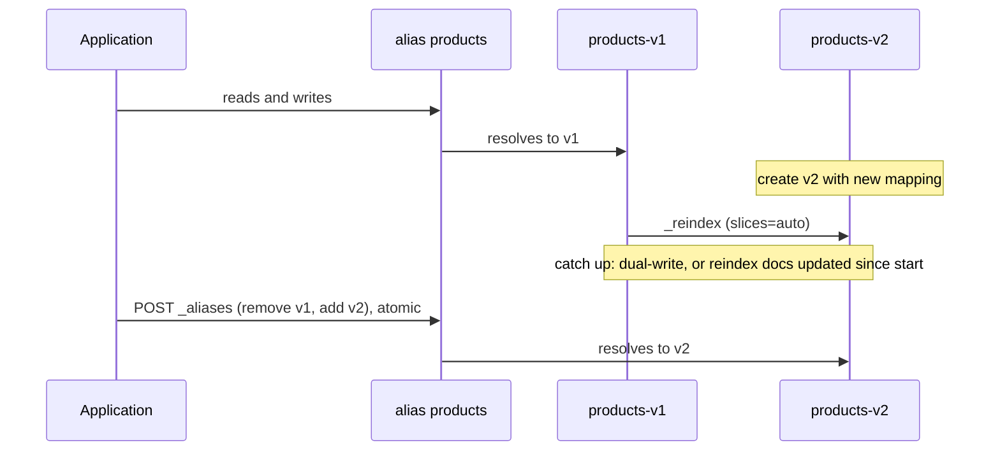

# Module 08: Ingest Pipelines, Reindexing and the Data Lifecycle

Getting data into Elasticsearch correctly (parsed, typed, enriched, in batches that the cluster can absorb) and moving it through its life (hot writes, cheaper storage, deletion) is where most operational effort goes. This module covers ingest pipelines and Painless, `_bulk`, `_reindex` and the by-query APIs, aliases for zero-downtime changes, data streams, ILM and the data stream lifecycle, data tiers, searchable snapshots, and the time-series and logs index modes. Proofs: [`examples/08-ingest-lifecycle.test.ts`](../examples/08-ingest-lifecycle.test.ts) with the models in [`examples/lib/lifecycle.ts`](../examples/lib/lifecycle.ts).

> **Ownership.** Collecting data (Elastic Agent, Beats, Logstash, OpenTelemetry/EDOT), Kibana, and observability pipelines belong to the observability track ([technologies/observability](../../observability/README.md)). This module covers the Elasticsearch storage side: pipelines, data streams, lifecycle and index modes.

---

## 1. Ingest Pipelines

An **ingest pipeline** is an ordered list of processors run on nodes with the `ingest` role, after the coordinating node receives a document and before it is routed to its shard. Formally, a pipeline is a partial function on documents:

$$\pi = p_n \circ \dots \circ p_1, \qquad p_i : \mathit{Doc} \rightharpoonup \mathit{Doc} \cup \{\bot_{\text{drop}}\}$$

where a processor may fail (undefined), and failure handling decides what happens next.

```json
PUT _ingest/pipeline/access-logs
{
  "description": "Parse access logs",
  "processors": [
    { "dissect": { "field": "message", "pattern": "%{client} [%{ts}] \"%{verb} %{path}\" %{status} %{bytes}" } },
    { "convert": { "field": "status", "type": "integer" } },
    { "convert": { "field": "bytes", "type": "long", "ignore_failure": true } },
    { "date":    { "field": "ts", "formats": ["ISO8601"], "target_field": "@timestamp" } },
    { "remove":  { "field": "ts" } },
    { "set":     { "field": "event.outcome", "value": "failure", "if": "ctx.status >= 500" } },
    { "lowercase": { "field": "verb" } }
  ],
  "on_failure": [
    { "set": { "field": "error.message", "value": "{{ _ingest.on_failure_message }}" } },
    { "set": { "field": "_index", "value": "failed-{{ _index }}" } }
  ]
}
```

The first test runs this pipeline (modelled) and asserts the parsed, typed document, including `@timestamp` normalisation and the conditional `event.outcome`.

### 1.1 Processor catalogue (the ones to know)

| Processor | Does |
| --- | --- |
| `set`, `remove`, `rename`, `append` | edit fields (`set` supports Mustache `{{field}}` and `override`) |
| `convert`, `lowercase`, `uppercase`, `trim`, `split`, `join`, `gsub` | type and string conversion |
| `dissect`, `grok`, `kv`, `json`, `csv` | parse strings into fields |
| `date`, `date_index_name` | parse timestamps; route to time-based index names |
| `geoip`, `user_agent`, `uri_parts`, `network_direction`, `registered_domain` | enrichment from bundled databases |
| `enrich` | lookup from an enrich policy (reference data) |
| `inference` | run a trained model (NER, language id, embeddings) |
| `script` | arbitrary Painless |
| `pipeline` | call another pipeline (composition) |
| `reroute` | send a document to another data stream (dataset/namespace) |
| `drop`, `fail` | discard the document or reject it with a message |
| `foreach` | apply a processor to each array element |
| `fingerprint` | hash fields (deduplication ids) |

#### Enrich policy index lifecycle and execution mechanics

The `enrich` processor enriches incoming documents with data from reference indices (such as customer profiles, server inventory, or geolocation blocks). It operates via a dedicated enrich policy:

```json
PUT /_enrich/policy/users-policy
{
  "match": {
    "indices": "users",
    "match_field": "email",
    "enrich_fields": ["user_id", "department", "country"]
  }
}

POST /_enrich/policy/users-policy/_execute
```

Mechanics, performance trade-offs, and invariants:

- **Immutable snapshot index**: `_execute` creates a specialized, read-only system index prefixed with `.enrich-<policy-name>-<timestamp>`. It performs a force merge to a single segment, optimizing it for near-instant Lucene key lookups.
- **Local execution**: Ingest nodes execute lookups locally against memory-mapped caches or local segment readers. No network RPCs or shard queries occur per ingested document.
- **Update propagation latency**: Changes to the source index (`users`) do not automatically reflect in the enrich cache. The policy must be explicitly re-executed via `POST /_enrich/policy/<name>/_execute` (often automated via cron or event-driven triggers).
- **Execution overhead**: `_execute` spawns a heavy background task running a reindex and force merge. Re-executing too frequently creates cluster I/O pressure; re-executing too rarely yields stale reference data.

### 1.2 Failure semantics

Every processor supports `if` (a Painless condition), `ignore_failure`, `on_failure` (processor-level handlers) and `tag`. Evaluation order on failure, proven by tests:

1. `ignore_failure: true`: continue with the next processor (test `ignore_failure keeps going`: a bad `bytes` value stays a string).
2. A processor-level `on_failure`: run it, continue the pipeline.
3. A pipeline-level `on_failure`: run it and stop; the document is indexed as modified, for example into a dead-letter index (test `a pipeline-level on_failure handler can route bad documents`).
4. Nothing: the document is **rejected** with the error (negative test), and in a bulk request only that item fails.

Inside handlers, `_ingest.on_failure_message`, `_ingest.on_failure_processor_type` and `_ingest.on_failure_processor_tag` describe the failure. Order matters: removing a field before a later processor reads it fails that processor (test `processor order matters`).

#### Nested `on_failure` and drop vs dead-letter routing

Processors declared inside an `on_failure` array can themselves contain nested `on_failure` blocks. If an `on_failure` processor encounters an unhandled exception, execution escalates to the enclosing handler or the top-level pipeline `on_failure`.

When handling malformed data, systems choose between **silent dropping** and **dead-letter routing**:

- **Drop processor (`drop`)**: Discards the document silently with HTTP 200 returned to the caller (`{"drop": {"if": "ctx.unrecoverable == true"}}`). While useful for filtering noise, broad drop conditions cause silent, untraceable data loss.
- **Dead-letter routing**: Rather than dropping or rejecting, bad documents are routed to a dedicated dead-letter index by mutating `ctx._index`. Crucially, inject error diagnostic metadata (`error.message`, `error.processor_type`, `error.timestamp`) while preserving the raw source (`raw_message`) so failed documents can be repaired and re-ingested with `_reindex`.

```json
PUT _ingest/pipeline/robust-logs
{
  "description": "Pipeline with nested error handling and dead-letter queue",
  "processors": [
    {
      "json": {
        "field": "raw_payload",
        "target_field": "event",
        "on_failure": [
          {
            "grok": {
              "field": "raw_payload",
              "patterns": ["%{TIMESTAMP_ISO8601:timestamp} %{LOGLEVEL:level} %{GREEDYDATA:message}"],
              "on_failure": [
                { "set": { "field": "event.parsing_strategy", "value": "unstructured" } }
              ]
            }
          }
        ]
      }
    }
  ],
  "on_failure": [
    { "set": { "field": "error.message", "value": "{{ _ingest.on_failure_message }}" } },
    { "set": { "field": "error.processor_type", "value": "{{ _ingest.on_failure_processor_type }}" } },
    { "set": { "field": "error.timestamp", "value": "{{{ _ingest.timestamp }}}" } },
    { "set": { "field": "_index", "value": "dead-letter-logs" } }
  ]
}
```

### 1.3 Attaching pipelines

| Mechanism                               | Scope                                                  |
| --------------------------------------- | ------------------------------------------------------ |
| `?pipeline=name` on index/bulk requests | per request                                            |
| `index.default_pipeline` setting        | when the request names none                            |
| `index.final_pipeline` setting          | always, after any other; cannot be bypassed by clients |
| `pipeline` processor                    | composition inside a pipeline                          |
| `_reindex` with `dest.pipeline`         | during reindexing                                      |

**Testing:** `POST _ingest/pipeline/<id>/_simulate` with sample `docs` (add `?verbose=true` for per-processor output); `POST _ingest/_simulate` simulates the full ingest path including default and final pipelines and mapping validation.

### 1.4 Painless essentials

Painless is Elasticsearch's sandboxed scripting language (Java-like syntax, compiled to JVM bytecode, method allow-listing). Context determines the variables:

| Context | Access |
| --- | --- |
| ingest `script` processor | `ctx.field` (the source map), `ctx._index` |
| `_update`, `_update_by_query` | `ctx._source.field`, `ctx.op = 'noop' \| 'delete'` |
| search scripts, `script_score`, runtime fields | `doc['field'].value` (doc values), `params._source`, `emit(...)` in runtime fields |

```json
POST /products/_update/1
{
  "script": {
    "source": "ctx._source.stock -= params.qty; if (ctx._source.stock <= 0) { ctx._source.in_stock = false }",
    "params": { "qty": 2 }
  }
}
```

Always pass variable data as `params`: each distinct source string is compiled and cached, and compilation is rate-limited (`script.max_compilations_rate`, per context). Building source strings with literal values ("`ctx._source.stock -= 2`", "`-= 3`", …) exhausts the limit and fails with `circuit_breaking_exception: too many script compilations`. Stored scripts (`PUT _scripts/<id>`) make reuse explicit.

---

## 2. The `_bulk` API

```http
POST /_bulk
{"index":{"_index":"products","_id":"1"}}
{"name":"Mechanical keyboard","price":120}
{"delete":{"_index":"products","_id":"2"}}
{"create":{"_index":"products"}}
{"name":"Wireless keyboard","price":60}
{"update":{"_index":"products","_id":"3"}}
{"doc":{"price":55}}

```

- **NDJSON:** one action line, then a source line (none for `delete`); the body must end with a newline (tests `round-trips action/source pairs` and the negative test).
- `index` creates or replaces; `create` fails if the id exists (and is the only allowed op for data streams); `update` takes `doc`, `script` or `upsert`.
- The request returns HTTP 200 even when items fail. Check `errors: true`, then inspect each item's `status` (test `per-item failures do not fail the batch`: one malformed document is rejected with 400, the others are indexed).
- **Rejections** (`429 es_rejected_execution_exception`) mean the write thread pool queue is full: retry the rejected items with exponential backoff (the official clients' bulk helpers do this).

**Sizing.** Start around 5–15 MB per request (or a few thousand documents) and measure; throughput plateaus then falls as requests grow. Parallelise with several concurrent clients rather than with huge requests. During initial loads, set `refresh_interval: -1` and `number_of_replicas: 0`, then restore them (module 02).

---

## 3. Reindex, Update by Query, Delete by Query

### 3.1 `_reindex`

```json
POST _reindex?slices=auto&wait_for_completion=false
{
  "source": { "index": "products-v1", "query": { "range": { "updated": { "gte": "2026-01-01" } } } },
  "dest":   { "index": "products-v2", "pipeline": "normalise", "op_type": "create" },
  "conflicts": "proceed"
}
```

- Reads the source with a scroll snapshot and bulk-indexes into `dest`. It copies documents only: create `dest` with its mapping and settings **first**, or it is created by dynamic mapping.
- `slices` parallelises (`auto`: one slice per shard). `wait_for_completion=false` returns a task id (`GET _tasks/<id>`, `POST _tasks/<id>/_cancel`, `_rethrottle`).
- `op_type: create` + `conflicts: proceed` makes re-runs idempotent (existing docs are skipped).
- Remote reindex (`source.remote.host`) pulls from another cluster; the host must be in `reindex.remote.whitelist`. It is the classic path for major-version migrations.

### 3.2 `_update_by_query` and `_delete_by_query`

Both run over a snapshot taken at the start. If a document changed after the snapshot, the operation hits a **version conflict** and **aborts** (already-processed documents stay changed; no rollback) unless `conflicts=proceed`, which counts and skips conflicts. `_update_by_query` with no script simply reindexes documents in place, which is how a new multi-field is back-filled (module 03). `requests_per_second` throttles both.

### 3.3 Zero-downtime mapping changes with aliases

Aliases are names that point to one or more indices, optionally with a `filter` and routing. `POST _aliases` applies a list of actions **atomically** (test `a failing action rolls back the whole _aliases request`):

```json
POST _aliases
{
  "actions": [
    { "remove": { "index": "products-v1", "alias": "products" } },
    { "add":    { "index": "products-v2", "alias": "products" } }
  ]
}
```

Writes through an alias need exactly one target: an alias over several indices must mark one with `is_write_index: true`, and at most one may be marked (negative tests). This is exactly how rollover worked before data streams.



The catch-up step is the hard part: either the application writes to both indices during the reindex, or it records the reindex start time and re-runs `_reindex` with a range query on an `updated_at` field (with `op_type: index`) before the swap, or it pauses writes for the final delta.

---

## 4. Data Streams

A **data stream** is a named, append-only sequence of hidden **backing indices** for timestamped data. Requests address the stream; writes go to the current **write index**; searches fan out to all backing indices.

```json
PUT _index_template/logs-web
{
  "index_patterns": ["logs-web-*"],
  "data_stream": {},
  "priority": 200,
  "composed_of": ["logs-mappings", "logs-settings"]
}

POST /logs-web-default/_doc
{ "@timestamp": "2026-11-04T10:00:00Z", "message": "GET /a 200" }

POST /logs-web-default/_rollover
```

Rules, all asserted in tests:

- the matching index template must contain `data_stream: {}`; the stream is created on the first write;
- every document needs `@timestamp` (mapped as `date` or `date_nanos`);
- only `op_type: create` is allowed; updates and deletes go through `_update_by_query`, `_delete_by_query`, or directly to a backing index with `if_seq_no`/`if_primary_term`;
- backing indices are named `.ds-<stream>-<yyyy.MM.dd>-<generation>`, the generation a six-digit counter incremented by each rollover;
- the Elastic naming scheme `<type>-<dataset>-<namespace>` (`logs-nginx.access-prod`) matches the built-in templates and lets permissions and retention differ per dataset and namespace.

Mapping changes to a stream's template apply at the **next rollover**; to change existing backing indices, reindex into a new stream.

#### Backing index rollover invariants

Data streams enforce strict invariants across their backing indices:

- **Generation monotonicity**: Backing indices follow `.ds-<stream>-<yyyy.MM.dd>-<generation>`, where `<generation>` is a zero-padded 6-digit decimal integer (`%06d`). Each rollover increments the generation strictly by 1 (`000001` $\to$ `000002`), ensuring absolute ordering regardless of index creation timestamp or clock drift.
- **Write index exclusivity**: Exactly one backing index in a data stream has `is_write_index: true`. All earlier backing indices are marked `is_write_index: false` and become permanently read-only for writes through the stream interface.
- **Direct index immutability**: Direct indexing against `.ds-*` backing indices bypassing the stream interface is prevented unless explicit privileges are granted.
- **Manual vs automated rollover**: `POST /<data-stream>/_rollover` manually forces generation $N+1$ immediately. Automated rollover evaluates policy conditions (`max_primary_shard_size: 50gb`, `max_age`, `max_docs`) at the lifecycle poll interval.
- **Template change boundary**: Changes to index templates matching a stream affect only backing indices created by subsequent rollovers. Pre-existing backing indices remain unchanged.

---

## 5. Index Lifecycle Management (ILM)

ILM moves indices through **phases** according to a policy; each phase has a `min_age` and **actions**.

| Phase | Typical actions | Hardware |
| --- | --- | --- |
| hot | `rollover`, `set_priority`, `forcemerge`, `shrink`, `downsample`, `readonly` | `data_hot`: fast SSD, CPU |
| warm | `allocate`/`migrate`, `shrink`, `forcemerge`, `readonly`, `set_priority` | `data_warm`: dense storage |
| cold | `searchable_snapshot` (fully mounted), `allocate`/`migrate`, `downsample` | `data_cold` |
| frozen | `searchable_snapshot` (partially mounted) | `data_frozen`: shared cache + object store |
| delete | `wait_for_snapshot`, `delete` | — |

```json
PUT _ilm/policy/logs-policy
{
  "policy": {
    "phases": {
      "hot":    { "actions": { "rollover": { "max_primary_shard_size": "50gb", "max_age": "30d" } } },
      "warm":   { "min_age": "7d",  "actions": { "shrink": { "number_of_shards": 1 }, "forcemerge": { "max_num_segments": 1 } } },
      "cold":   { "min_age": "30d", "actions": { "searchable_snapshot": { "snapshot_repository": "repo" } } },
      "delete": { "min_age": "90d", "actions": { "delete": {} } }
    }
  }
}
```

### 5.1 Rollover

Rollover creates a new write index when **any** `max_*` condition is met (`max_age`, `max_docs`, `max_size`, `max_primary_shard_size`, `max_primary_shard_docs`) **and all** `min_*` conditions hold; an empty index never rolls over (tests `rolls over when ANY max condition is met` and `never rolls over an empty index`). `max_primary_shard_size: 50gb` is the recommended primary condition: it keeps shards in the 10–50 GB sweet spot (module 10) regardless of ingest rate. Elastic's built-in policies also cap `max_primary_shard_docs` at 200 million.

### 5.2 `min_age` is relative to rollover

For a rolled-over index, `min_age` counts from the **rollover time**, not from creation (test `min_age is measured from rollover`). An index whose policy contains `rollover` but which never rolls over (no write alias or not a data stream, so the rollover step errors, or an empty index) **stays in hot forever** (negative test): a classic "my disk is full although retention is 30 days" incident. Check with `GET <index>/_ilm/explain`, which shows the phase, action, step and any `step_info` error; retry a failed step with `POST <index>/_ilm/retry`.

ILM checks run every `indices.lifecycle.poll_interval` (10 minutes by default), so phase changes are not instantaneous; tests on a real cluster lower it to seconds.

Policies with decreasing `min_age` across phases are invalid (negative test). Updating a policy affects indices at their next phase transition; an index keeps the cached phase definition of the phase it is already in.

### 5.3 Data stream lifecycle (DSL)

The **data stream lifecycle** is a simpler, built-in alternative configured on the stream (or its template):

```json
PUT _data_stream/logs-web-default/_lifecycle
{ "data_retention": "30d", "downsampling": [ { "after": "7d", "fixed_interval": "1h" } ] }
```

Elasticsearch manages rollover automatically (`max_age` derived from retention, `max_primary_shard_size: 50gb`, etc.) and deletes backing indices older than the retention. There are no phases or tier migrations in the basic form; Elasticsearch 9.5 adds `frozen_after` to move older data to the frozen tier (a paid feature). Choose DSL for "keep N days" and ILM when you need hot/warm/cold hardware tiers, shrink, force merge or searchable snapshots. A stream is managed by one of the two; `index.lifecycle.prefer_ilm` decides when both are configured.

#### ILM vs Data Stream Lifecycle state transitions

The underlying execution engines differ in state representation, mechanics, and failure modes:

- **ILM Phase-Action-Step State Machine**: ILM indices execute a deterministic finite state machine tracked in index metadata (`index.lifecycle.step`). Transitions proceed: $$\text{Phase } (\text{hot}) \longrightarrow \text{Action } (\text{rollover}) \longrightarrow \text{Step } (\text{check-rollover-ready} \to \text{attempt-rollover} \to \text{update-aliases})$$ If any step throws an uncaught exception, the index enters `step: ERROR` (`is_error_state: true`). The index halts in that error step indefinitely until an operator corrects the root cause (e.g. adds disk capacity or corrects snapshot repository settings) and triggers `POST <index>/_ilm/retry`.
- **DSL Autonomous Management**: DSL does not execute a rigid phase-action-step graph. Instead, a master node service continuously monitors data stream backing indices against configured retention (`data_retention`) and downsampling rules. Downsampling automatically generates smaller time-bucketed indices, and expired backing indices are unlinked and dropped without halting writes or requiring manual retry intervention.

| Dimension | Index Lifecycle Management (ILM) | Data Stream Lifecycle (DSL) |
| --- | --- | --- |
| Configuration scope | Attached to index or template via `index.lifecycle.name` | Attached directly to data stream (`_lifecycle`) or template |
| Architecture | 5-phase FSM (`hot` $\to$ `warm` $\to$ `cold` $\to$ `frozen` $\to$ `delete`) | Unified continuous management (rollover, downsampling, retention) |
| Rollover control | User-specified thresholds (`max_primary_shard_size`, `max_age`, `max_docs`) | Automatic adaptive rollover (derived from retention, targets 50 GB) |
| Hardware tier migration | Explicit actions migrating `_tier_preference` (`data_hot`, `data_warm`, etc.) | None in basic DSL; 9.5 adds `frozen_after` to move to frozen tier |
| Segment optimization | Explicit `forcemerge`, `shrink`, `readonly`, `set_priority` | Downsampling (`fixed_interval`) and retention deletion only |
| Failure behavior | Halts in `step: ERROR`; requires `_ilm/retry` | Non-blocking background reconciliation; resilient to transient errors |
| Precedence arbitration | Governed by `index.lifecycle.prefer_ilm: true` (default if both configured) | Active when `index.lifecycle.prefer_ilm: false` |

---

## 6. Data Tiers and Searchable Snapshots

Nodes declare tiers with roles (`data_hot`, `data_content`, `data_warm`, `data_cold`, `data_frozen`). Indices declare `index.routing.allocation.include._tier_preference` (for example `data_warm,data_hot`); ILM's `migrate` action updates it automatically at each phase. Data streams start on hot; regular indices on content.

**Searchable snapshots** (Enterprise license) serve searches directly from a snapshot repository (S3, GCS, Azure, shared FS):

| Mount type | Tier | Local disk | Replicas | Latency |
| --- | --- | --- | --- | --- |
| fully mounted | cold | full copy of the shard | not needed: the snapshot is the redundancy | close to warm |
| partially mounted | frozen | shared LRU cache of blocks | none | seconds on cache misses |

The frozen tier makes petabyte retention affordable; queries over it should be async (module 05).

---

## 7. Index Modes for Time Series and Logs

| `index.mode` | For | Key properties |
| --- | --- | --- |
| `standard` | everything | — |
| `time_series` (TSDS) | metrics | `time_series_dimension` fields form `_tsid`; documents routed by dimensions; index sorted by `_tsid`, `@timestamp`; synthetic source; `time_series_metric` fields (`gauge`, `counter`); `downsample` action |
| `logsdb` | logs | synthetic source, index sorting by `host.name` and `@timestamp`, specialised codecs: substantially less storage |
| `lookup` | ES\|QL `LOOKUP JOIN` right side | single shard (module 06) |

Elasticsearch 9.5 adds columnar index modes (`logsdb_columnar` and related) as technical previews.

TSDS restrictions: a time window per backing index (`index.time_series.start_time` and `end_time`), so documents with timestamps outside the window of any backing index are rejected; duplicate documents (same dimensions and timestamp) are rejected.

---

## 8. Then vs Now

| Concern | Then | Now |
| --- | --- | --- |
| Time-based indices | `logs-2026.11.04` + aliases + rollover with `is_write_index` (6.x) | data streams (7.9) |
| Retention | Curator cron jobs | ILM (6.6), data stream lifecycle (8.x) |
| Hot/warm | custom node attributes + `allocate` | data tier roles + `_tier_preference` + `migrate` (7.10) |
| Old data | closed indices, restore on demand | searchable snapshots, frozen tier (7.12) |
| Metrics storage | rollup jobs | TSDS + downsampling (8.x); rollups deprecated |
| Logs storage | stored `_source`, default codecs | `logsdb` index mode with synthetic source |
| Parsing | Logstash everywhere | ingest pipelines, `reroute`, ES\|QL `DISSECT`/`GROK` at query time |

Migration pitfall: moving from alias-based rollover to data streams requires reindexing or `_data_stream/_migrate` from an alias with a write index; the application must then use `create` operations only.

> **Exam delta (Elastic Certified Engineer, 9.3).** The exam objectives include ingest pipelines with Painless, reindex and update-by-query, index and data stream templates, ILM for time-series data and a hot/warm architecture. These work the same on 9.3. The data stream lifecycle's `frozen_after` (9.5) and 9.5 columnar index modes do not exist on a 9.3 exam cluster; searchable snapshots need the trial or Enterprise license present in the exam environment.

---

## 9. Production Failure Modes

1. **ILM stuck in hot.** Rollover never happens (missing write alias, empty index, error in step). Disk fills. Monitor `_ilm/explain` for `step: ERROR`.
2. **Script compilation storm.** Literal values in Painless sources; use `params`.
3. **Bulk rejections treated as success.** HTTP 200 with `errors: true` ignored; data silently missing. Always inspect items.
4. **`_update_by_query` aborted halfway** on a version conflict; part of the data changed. Use `conflicts=proceed` and re-run idempotently.
5. **Reindex without a destination mapping** creates a dynamically mapped index.
6. **Dropping documents by accident** with an over-broad `drop` condition. Test with `_simulate` and real samples.
7. **Searchable snapshot repository deleted or lifecycle-pruned**: mounted indices become unrecoverable. Never let snapshot lifecycle delete snapshots backing mounted indices.
8. **TSDS rejections** for late-arriving data outside the backing index time window.

---

## Interview Drill

<details><summary>1. How do you change the mapping of a field in a live index without downtime?</summary>

Create a new index with the new mapping, `_reindex` (sliced, async) into it, catch up writes made in the meantime, then atomically swap the alias the application uses with `POST _aliases` (remove old, add new). Delete the old index after verification.
</details>

<details><summary>2. What happens when a processor fails in an ingest pipeline?</summary>

If `ignore_failure`, the pipeline continues. Otherwise a processor-level `on_failure` runs and the pipeline continues; else a pipeline-level `on_failure` runs and ends the pipeline (often rerouting to a dead-letter index); else the document is rejected and, in a bulk request, only that item fails.
</details>

<details><summary>3. Why is my index still on hot nodes after 60 days with a 7-day warm phase?</summary>

`min_age` counts from rollover, and the index never rolled over (no write alias, empty index, or a rollover step error), or ILM is in an error step. Check `_ilm/explain`, fix the cause, `_ilm/retry`.
</details>

<details><summary>4. Data stream versus alias with rollover?</summary>

Data streams package the pattern: template-driven creation, automatic write index, `@timestamp` requirement, backing index naming, lifecycle integration. They are append-only. Use an alias with indices when documents are updated by id frequently.
</details>

<details><summary>5. ILM or data stream lifecycle?</summary>

Data stream lifecycle for retention and downsampling with minimal configuration; ILM when you need tier migration, shrink, force merge, searchable snapshots, or index-level control.
</details>

<details><summary>6. Why might <code>_update_by_query</code> leave the index half-updated?</summary>

It processes a snapshot; a concurrent change causes a version conflict, which aborts the operation without rolling back processed batches. Use `conflicts=proceed` and design the script to be idempotent.
</details>

<details><summary>7. Cold versus frozen tier?</summary>

Both use searchable snapshots. Cold fully mounts shards on local disk (no replicas needed, near-warm latency); frozen partially mounts with a shared block cache and fetches from the object store on demand (cheapest, slow on misses).
</details>
