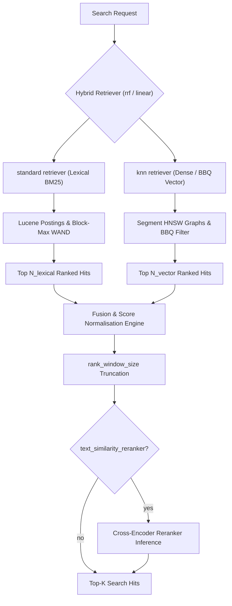

# Module 09: Vector, Semantic and Hybrid Search

Elasticsearch stores dense vectors in Lucene's HNSW graphs, quantises them to save memory, and combines vector retrieval with BM25 through **retrievers** and rank fusion. It also runs learned **sparse** retrieval (ELSER) and manages embedding inference for you with the `semantic_text` field. This module covers the Elasticsearch realisation and its operational trade-offs. Proofs: [`examples/09-vector-hybrid.test.ts`](../examples/09-vector-hybrid.test.ts) with the models in [`examples/lib/vector.ts`](../examples/lib/vector.ts), on seeded synthetic embeddings (2,000 clustered unit vectors, 64 dimensions).

> **Ownership.** Approximate nearest-neighbour theory (HNSW construction and search, IVF, product and scalar quantisation, the curse of dimensionality) is owned by [Vector Search and ANN](../../../architecture/data-systems/modules/03-indexing-theory-and-vector-search.md#4-vector-search-and-approximate-nearest-neighbors-ann), whose example suite includes a tested HNSW implementation. Read it first; this module adds Lucene and Elasticsearch specifics only.

---

## 1. Retrieval Models in Elasticsearch

| Model | Representation | Field type | Query | Strength |
| --- | --- | --- | --- | --- |
| Lexical (BM25) | terms | `text` | `match`, … | exact words, names, codes, explainable |
| Dense vector | $\mathbf{v} \in \mathbb{R}^d$ from an embedding model | `dense_vector` | `knn` | synonyms, paraphrase, cross-lingual |
| Learned sparse (ELSER) | weighted expansion terms | `sparse_vector` | `sparse_vector` | semantic recall with inverted-index efficiency and interpretability |
| Semantic, managed | dense or sparse, inferred automatically | `semantic_text` | `semantic`, `match` | zero-configuration semantic search |
| Hybrid | several of the above | — | retrievers: `rrf`, `linear` | best of both; robust default |

---

## 2. `dense_vector`

```json
PUT /docs
{
  "mappings": {
    "properties": {
      "title":     { "type": "text" },
      "embedding": {
        "type": "dense_vector",
        "dims": 768,
        "similarity": "cosine",
        "index_options": { "type": "bbq_hnsw", "m": 16, "ef_construction": 100,
                           "rescore_vector": { "oversample": 3.0 } }
      },
      "tenant": { "type": "keyword" }
    }
  }
}
```

| Parameter | Values | Notes |
| --- | --- | --- |
| `dims` | up to 4096 | fixed at mapping time (inferred from the first document if omitted) |
| `element_type` | `float` (default), `bfloat16`, `byte`, `bit` | `byte`/`bit` for pre-quantised embeddings |
| `similarity` | `cosine` (default), `dot_product`, `l2_norm`, `max_inner_product` | `l2_norm` default for `bit` |
| `index` | `true` (default) | `false` stores the vector for scripts/rescoring only |
| `index_options.type` | `hnsw`, `int8_hnsw`, `int4_hnsw`, `bbq_hnsw`, `flat`, `int8_flat`, `int4_flat`, `bbq_flat`, `bbq_disk` | quantisation and graph choice (§3) |
| `m`, `ef_construction` | 16, 100 | HNSW graph degree and build beam |

### 2.1 From similarity to `_score`

Lucene scores must be non-negative and "bigger is better", so Elasticsearch transforms each similarity:

| Similarity | `_score` |
| --- | --- |
| `cosine` | $(1 + \cos(\mathbf q, \mathbf d)) / 2$ |
| `dot_product` (float, unit vectors) | $(1 + \mathbf q \cdot \mathbf d) / 2$ |
| `l2_norm` | $1 / (1 + \lVert \mathbf q - \mathbf d \rVert_2^2)$ |
| `max_inner_product` | $1/(1 - \mathbf q\cdot\mathbf d)$ if negative, else $\mathbf q\cdot\mathbf d + 1$ |

Tests assert non-negativity for every similarity (property), the cosine endpoints (1 for identical, 0 for opposite vectors), monotonicity of the `l2_norm` transform, and that `cosine` and `dot_product` produce identical rankings on unit vectors. `dot_product` is the faster choice when your model emits normalised vectors (it skips norm computation), and Elasticsearch **rejects** non-unit float vectors under `dot_product`. Use `max_inner_product` for models whose vector magnitude carries meaning.

Knowing these transforms matters for hybrid scoring: a kNN `_score` of 0.9 under cosine means $\cos = 0.8$, and it is not comparable with a BM25 score.

---

## 3. HNSW in Lucene and Quantisation

Lucene builds **one HNSW graph per segment** (default `m = 16`, `ef_construction = 100`). Consequences that differ from a single global graph:

1. **Search visits every segment's graph** and merges results, so many small segments cost latency; force-merging read-mostly vector indices helps a lot.
2. **Merging rebuilds graphs** (Lucene reuses the largest segment's graph as a starting point), so indexing vectors is CPU-heavy and merges are expensive.
3. **Vectors and graphs live off-heap** and must fit in the **OS page cache** for good latency: a cache miss is a random disk read per graph hop.

#### HNSW graph construction: m, ef_construction, and num_candidates

HNSW (Hierarchical Navigable Small World, Malkov & Yashunin 2016) organizes high-dimensional vectors into a multi-layered geometric graph:

- **Layer assignment**: Each vector $\mathbf{v}$ is assigned a maximum layer $l_v \in [0, L_{max}]$ sampled from an exponential distribution $P(l) = \exp(-l \cdot \ln(m))$. Layer 0 contains all vectors; each layer above contains an exponentially smaller fraction ($\approx 1/m$) of vectors.
- **Entry point and greedy routing**: Graph search begins at the entry point in the highest layer $L_{max}$. At each layer $l > l_v$, search greedily hops to the adjacent neighbor closest to the query until a local minimum is reached, then steps down to layer $l-1$. This provides logarithmic $O(\log N)$ hop scaling similar to a skip-list.
- **Beam construction with $ef\_construction$**: At layers $l \le l_v$, insertion executes a priority-queue beam search of size $ef\_construction$. The closest $m$ candidates (up to $2m$ on layer 0) are connected via bidirectional edges using a heuristic that favors directional diversity over clustered near-neighbors.
- **Tuning $m$, $ef\_construction$, and $num\_candidates$**:
  - `m` (default 16, range 4–64): Maximum outgoing edges per node per layer (layer 0 supports $2m$). Higher `m` increases connectivity and recall for clustered data, but increases memory and indexing latency.
  - `ef_construction` (default 100): Explored candidate beam width during indexing. Raising to 200–400 builds a higher-quality graph with better query recall, without changing query-time RAM, at the cost of indexing CPU time.
  - `num_candidates` (query-time search beam $ef_{search}$): Size of the priority queue during kNN search. Default is $\min(1.5 \cdot k, 10000)$. Raising it improves recall on difficult queries at the cost of query latency.

### 3.1 Quantisation options

| `index_options.type` | Stored for search | Bytes/vector, $d = 1024$ | Recall cost | Notes |
| --- | --- | --- | --- | --- |
| `hnsw` (float) | float32 | 4,096 | none | the baseline |
| `int8_hnsw` | 1 byte per dim + correction | ~1,028 (4×) | very small | default for float vectors in 9.0 |
| `int4_hnsw` | half a byte per dim | ~516 (8×) | small–moderate |  |
| `bbq_hnsw` | ~1 bit per dim + corrective factors | ~142 (~32×) | needs rescoring | default for ≥ 384 dims in later 9.x per current docs |
| `bbq_disk` | BBQ in a disk-friendly IVF-style layout | ~1 bit per dim | rescoring | Enterprise; designed for vectors that do not fit in RAM |
| `*_flat` | same encodings, no graph | — | exact over quantised values | small indices or heavily filtered search |

The float vectors are **still stored** on disk (for rescoring and for re-quantisation at merge time); quantisation reduces what must be **in memory** for the graph search.

**Scalar quantisation (int8, int4)** maps each component linearly into an integer range chosen from quantiles of the segment's values (the `confidence_interval`), so outliers do not waste resolution (test `scalar quantiser clips to confidence-interval quantiles`). On our dataset, int8 keeps recall@10 ≥ 0.9 and int4 is measurably worse (tests).

**BBQ (Better Binary Quantization)**, GA since 9.0, reduces each dimension to one bit relative to a centroid, plus a few float corrective factors per vector, in the spirit of RaBitQ; queries are quantised asymmetrically (to more bits), so distance estimates are much better than plain Hamming distance. Because 1-bit estimates still mis-rank neighbours, BBQ relies on **oversampling and rescoring**: retrieve `k × oversample` candidates using the compact codes, then rescore them with the full-precision vectors. The negative test `1-bit codes alone have poor recall; oversampling + float rescoring recovers it` shows the mechanism with plain sign bits: raw recall stays below 0.8, while oversample 5 with float rescoring gains more than 0.15. Configure it with `index_options.rescore_vector.oversample` (valid values between 1 and 10, or 0 to disable) or per query.

### 3.2 Memory arithmetic

For $N$ vectors of $d$ dimensions, the memory to keep hot in the OS page cache breaks down into vector payloads and HNSW graph connectivity:

$$\text{Memory}_{\text{raw}} = N \cdot \left(4d + 4 \cdot 2m + 8\right) \text{ bytes}$$ $$\text{Memory}_{\text{int8}} = N \cdot \left(1d + 8 + 4 \cdot 2m + 8\right) \text{ bytes}$$ $$\text{Memory}_{\text{int4}} = N \cdot \left(\lceil d / 2 \rceil + 8 + 4 \cdot 2m + 8\right) \text{ bytes}$$ $$\text{Memory}_{\text{bbq}} = N \cdot \left(\lceil d / 8 \rceil + 16 + 4 \cdot 2m + 8\right) \text{ bytes}$$

Here $4 \cdot 2m = 8m$ bytes represents the 32-bit integer array of neighbors for layer 0 (with default $m=16$, this is 128 bytes per vector), plus $\approx 8$ bytes for upper-layer routing pointers. For $d=768$, `bbq_hnsw` stores 96 bytes of bit-vector plus 16 bytes of floating-point offsets, reducing vector memory from 3,072 bytes (float32) to 112 bytes—a ~27× reduction in vector payload.

| Quantisation type | Bytes/vector ($d=768$) | RAM for 10M vectors ($d=768$) | Bytes/vector ($d=1536$) | RAM for 10M vectors ($d=1536$) |
| --- | --- | --- | --- | --- |
| `hnsw` (float32) | 3,208 B | 32.1 GB | 6,280 B | 62.8 GB |
| `int8_hnsw` | 912 B | 9.1 GB | 1,680 B | 16.8 GB |
| `int4_hnsw` | 528 B | 5.3 GB | 912 B | 9.1 GB |
| `bbq_hnsw` | 248 B | 2.5 GB | 344 B | 3.4 GB |

Ten million 1024-dimensional float vectors are about 41 GB of vector data alone (test `memory: float32 vs int8 vs int4 vs ~1 bit`); int8 brings that to ~10 GB, BBQ to ~1.4 GB, plus the graph. Size data nodes so that the **quantised** vectors and graphs fit in the page cache (not the JVM heap). Raw float vectors reside on disk and are paged into cache only during the rescore phase for the top `k * oversample` hits.

---

## 4. kNN Queries

There are two forms. The top-level `knn` section and the `knn` **query**:

```json
GET /docs/_search
{
  "knn": {
    "field": "embedding",
    "query_vector": [0.12, -0.03, ...],
    "k": 10,
    "num_candidates": 100,
    "filter": { "term": { "tenant": "acme" } },
    "similarity": 0.7
  },
  "_source": ["title"]
}

GET /docs/_search
{
  "size": 10,
  "query": {
    "bool": {
      "must":   [ { "knn": { "field": "embedding", "query_vector": [ ... ], "k": 10, "num_candidates": 100 } } ],
      "filter": [ { "term": { "tenant": "acme" } } ]
    }
  }
}
```

- **`k`**: neighbours returned per shard; the coordinator merges to the global top `k`.
- **`num_candidates`**: the HNSW search beam per shard ($ef$); defaults to $\min(1.5 \cdot k, 10000)$. Raising it raises recall and latency. Tune it, measuring recall against exact search.
- **`filter`**: applied **during** the graph search (pre-filtering): the search explores the graph but only collects documents that match, so it always returns `k` matching documents if they exist. Contrast with post-filtering, which can return fewer than `k` (negative test `post-filtering the top num_candidates returns fewer than k results`) and the pre-filter test that always returns `k`. When the filter is very selective, Lucene switches to an exact scan of the matching documents, since that is cheaper than traversing a graph whose nodes mostly fail the filter.
- **`similarity`**: a minimum similarity threshold (in similarity space, not `_score`).
- **`query_vector_builder`**: compute the query vector with an inference endpoint server-side.
- `knn` hits are scored by vector similarity; in a `bool` with a `match`, scores add up like any other clause, which is rarely what you want (score scales differ). Use a retriever for hybrid (§6).
- **Exact kNN** via `script_score` with `cosineSimilarity(params.q, 'embedding') + 1.0` over a filtered set is the ground truth for measuring recall and fine for small candidate sets.

#### Pre-filtering vs post-filtering mechanics

Filtered vector search in Lucene balances graph connectivity against filter selectivity:

- **Lucene adaptive dual-mode pre-filtering**:
  1. _Filter evaluation_: Lucene executes the filter query to produce a `DocIdSet` bitset and inspects its cardinality $C$.
  2. _Exact bitset scan (high selectivity)_: If $C$ is small relative to the segment doc count ($C < num\_candidates$), Lucene bypasses HNSW graph traversal completely. It scans vectors directly for matching document IDs in the bitset. This guarantees high throughput and prevents the traversal from becoming trapped behind non-matching edges.
  3. _Graph traversal with acceptance predicate (moderate/low selectivity)_: When $C$ is large, Lucene traverses the HNSW graph starting from the entry point. Crucially, non-matching nodes are still visited and traversed as structural routing hops, but only documents present in the filter bitset are admitted into the candidate priority queue. This guarantees returning $k$ matching documents if at least $k$ matches exist in the segment.
- **Post-filtering failure mode**:
  - Unfiltered HNSW search gathers the global top $num\_candidates$ vectors, then discards candidates failing the filter.
  - If a filter matches 1% of the corpus, the global top 100 has a near-zero probability of containing 10 matching documents, resulting in result starvation (returning $< k$ hits or an empty set).

### 4.1 Multi-tenant and nested vectors

- Tenancy via `filter` works but costs recall/latency at very low selectivity. For a few large tenants, consider an index per tenant; for many small tenants, the filter falls back to exact search, which is fast because the candidate set is small.
- Passages: `nested` documents with a `dense_vector` each let kNN return parent documents scored by their best passage (`inner_hits` shows which passage). `semantic_text` does this chunking automatically.

---

## 5. Semantic Search: `semantic_text`, Inference and ELSER

### 5.1 Inference endpoints

The **inference API** (`PUT _inference/<task_type>/<id>`) wraps models: Elastic-hosted (ELSER for sparse, E5 or Jina-family dense models, rerankers), self-deployed trained models on `ml` nodes, or third-party services (OpenAI, Cohere, Azure, Google, Hugging Face, Bedrock and others). Task types include `text_embedding`, `sparse_embedding`, `rerank`, `completion` and `chat_completion`.

### 5.2 `semantic_text`

```json
PUT /kb
{ "mappings": { "properties": {
  "body": { "type": "semantic_text" }
} } }

GET /kb/_search
{ "query": { "match": { "body": "how do I rotate an API key?" } } }
```

`semantic_text` calls the configured inference endpoint (a preconfigured ELSER endpoint by default) at index time, **chunks** long text, stores the embeddings, and at query time embeds the query with the same endpoint. `match` and the `semantic` query work on it. You trade control (chunking strategy, quantisation, model versioning) for zero configuration; `inference_id` and `search_inference_id` pin endpoints explicitly.

### 5.3 ELSER and `sparse_vector`

ELSER (Elastic Learned Sparse EncodeR) expands text into a weighted bag of vocabulary terms (including terms not in the text). Stored in a `sparse_vector` field and queried with the `sparse_vector` query, it runs on the ordinary inverted index: no HNSW, natural filtering, explainable term weights. It is English-centric; use a multilingual dense model for other languages, including Czech.

```json
PUT /knowledge-base
{
  "mappings": {
    "properties": {
      "content_sparse": { "type": "sparse_vector" }
    }
  }
}

GET /knowledge-base/_search
{
  "query": {
    "sparse_vector": {
      "field": "content_sparse",
      "inference_id": ".elser_model_2_linux-x86_64",
      "query": "How do I renew cluster certificates?"
    }
  }
}
```

Mechanics and operational trade-offs:

- **Inverted index storage**: ELSER tokens are indexed as vocabulary terms with floating-point impact weights stored as payloads. Query execution uses Lucene's WAND algorithm directly over postings, skipping non-competitive documents.
- **Explainability**: Unlike opaque dense embeddings, each term's contribution to the score can be inspected via `_explain`, showing which expanded vocabulary words matched.
- **Index size**: Storing up to 200–300 non-zero token weights per passage increases inverted index disk size compared to pure lexical text, but eliminates the off-heap RAM requirements of dense HNSW graphs.

---

## 6. Hybrid Search with Retrievers

**Retrievers** compose retrieval stages as a tree in the search request:



```json
GET /docs/_search
{
  "retriever": {
    "rrf": {
      "retrievers": [
        { "standard": { "query": { "match": { "title": "rotate api key" } } } },
        { "knn": { "field": "embedding", "query_vector_builder": { "text_embedding": { "model_id": "e5", "model_text": "rotate api key" } }, "k": 50, "num_candidates": 100 } }
      ],
      "rank_window_size": 50,
      "rank_constant": 60
    }
  },
  "size": 10
}
```

| Retriever | Does |
| --- | --- |
| `standard` | a normal Query DSL query |
| `knn` | vector search |
| `rrf` | Reciprocal Rank Fusion of child retrievers |
| `linear` | weighted sum of normalised child scores (`minmax`, `l2_norm` normalisers) |
| `text_similarity_reranker` | re-ranks the top window with a cross-encoder `rerank` inference endpoint |
| `rule` | applies query rules (pin/exclude) |
| `pinned` | promotes given documents |
| `rescorer` | Query DSL rescoring as a retriever |

### 6.1 RRF

$$\mathrm{RRF}(d) = \sum_{r \in R} \frac{1}{k + \mathrm{rank}_r(d)}, \qquad k = \texttt{rank\_constant} = 60$$

(Cormack, Clarke and Büttcher, SIGIR 2009). Only ranks matter, so retrievers with incomparable score scales (BM25 ≈ 5–30, cosine-based scores in [0, 1]) combine without tuning. The rank constant $k = 60$ acts as a dampening factor. The derivative of score with respect to rank is:

$$\frac{d}{dr}\left(\frac{1}{k + r}\right) = -\frac{1}{(k + r)^2}$$

This dampening ensures score decay between adjacent ranks is smooth and bounded:

- Difference between rank 1 and 2: $1/61 - 1/62 \approx 0.000264$
- Difference between rank 10 and 11: $1/70 - 1/71 \approx 0.000201$
- Difference between rank 50 and 51: $1/110 - 1/111 \approx 0.000082$

A document ranked first by one retriever ($1/61 \approx 0.01639$) cannot outscore a document ranked second by both ($1/62 + 1/62 \approx 0.03226$). RRF guarantees consensus across retrievers over isolated rank spikes. Tests: the exact score $1/61 + 1/62$ for a document ranked first and second; that scaling one retriever's raw scores changes nothing; that documents beyond `rank_window_size` contribute nothing; and symmetry in the order of retrievers (property).

### 6.2 Linear combination

`linear` normalises each child's scores and computes a weighted sum:

$$\mathrm{Score}_{\text{linear}}(d) = \sum_{r \in R} w_r \cdot \hat{S}_r(d)$$

Score normalisation methods:

- **Min-max normaliser (`minmax`)**: Scales shard hits into $[0, 1]$ via $\hat{S}(d) = (S(d) - S_{\min}) / (S_{\max} - S_{\min})$. Sensitive to extreme outliers in BM25 scores (a single high-scoring match collapses other scores near 0).
- **L2 normaliser (`l2_norm`)**: Computes unit vector $\hat{S}(d) = S(d) / \sqrt{\sum_{i=1}^M S(d_i)^2}$, dampening isolated score spikes.

| Property | Reciprocal Rank Fusion (RRF) | Linear Combination (`linear`) |
| --- | --- | --- |
| Input | Document ranks only ($\mathrm{rank}_r(d)$) | Normalized document scores $\hat{S}_r(d)$ |
| Calibration requirements | Zero parameter tuning needed; robust default | Requires weight tuning ($w_r$) and normaliser selection |
| Scale invariance | Immune to score magnitude differences | Sensitive to outlier distributions in raw query scores |
| Relevance ceiling | Robust baseline across arbitrary domains | Can beat RRF when weights are tuned on labelled judgement sets |
| Implementation cost | Low computational complexity | Additional score extraction and normalisation pass |

### 6.3 Re-ranking

A cross-encoder reranker scores (query, document) pairs jointly, which is far more accurate than either retriever and far more expensive, so it is applied to the top `rank_window_size` only: retrieve 100 with hybrid RRF, rerank to 10.

ES|QL offers the same pipeline with `FORK` (branches), `FUSE` (RRF or linear) and `RERANK` (module 06).

---

## 7. Evaluating Vector Search

- **Recall@k against exact search**: The ground truth evaluation compares HNSW or BBQ results against an exact brute-force vector search:

$$\mathrm{Recall}@k = \frac{|\mathcal{R}_{\mathrm{ANN}} \cap \mathcal{R}_{\mathrm{Exact}}|}{k}$$

Execute exact vector search using `script_score` with `cosineSimilarity` or `dotProduct` over the test corpus. Measure recall across varying $num\_candidates$ (50, 100, 200, 500) to plot the Pareto frontier of Recall@10 versus p99 query latency.

| Configuration                    | Recall@10 | p50 Latency | p99 Latency | Graph Memory / Vector |
| -------------------------------- | --------- | ----------- | ----------- | --------------------- |
| Float32 HNSW ($ef=100$)          | 0.98      | 2.1 ms      | 6.8 ms      | 3,208 B               |
| int8 HNSW ($ef=100$)             | 0.96      | 1.8 ms      | 5.2 ms      | 912 B                 |
| int4 HNSW ($ef=100$)             | 0.88      | 1.6 ms      | 4.9 ms      | 528 B                 |
| BBQ HNSW + Rescore 3× ($ef=100$) | 0.94      | 2.4 ms      | 7.4 ms      | 248 B                 |
| Exact Script Score (Brute Force) | 1.00      | 45.0 ms     | 120.0 ms    | 0 B (disk only)       |

- **End-to-end relevance** (nDCG@10 with `_rank_eval`, module 12) for the whole hybrid pipeline: high ANN recall does not imply good relevance if the embedding model is wrong for the domain.
- **Latency percentiles** under realistic filters and concurrency, after force merge.

---

## 8. Then vs Now

| Concern | Then | Now |
| --- | --- | --- |
| Vector scoring | `script_score` exact only (7.x) | HNSW ANN `knn` (8.0), `knn` query (8.12) |
| Quantisation | none (float) | int8 (8.12), int4 (8.15), BBQ (8.16 preview, GA 9.0), `bbq_disk` (9.x, Enterprise) |
| Default index type | `hnsw` float | `int8_hnsw` (9.0), `bbq_hnsw` for ≥ 384 dims in later 9.x per current docs |
| Hybrid | `bool` of `match` + `knn`, hand-tuned boosts | `rrf` (GA 8.16), `linear` retrievers |
| Embeddings | computed by the client | inference API + `semantic_text` |
| Lucene | 9.x | Lucene 10 (ES 9): faster vector search, better parallelism |

Migration pitfall: changing `index_options` from `int8_hnsw` to `bbq_hnsw` is allowed as an in-place mapping update for some combinations, but existing segments keep their old encoding until merged or reindexed; benchmark after a force merge, not before.

> **Exam delta (Elastic Certified Engineer, 9.3).** The published exam objective areas do not emphasise vector search, but a 9.3 cluster supports everything here except features released after 9.3 (check `bbq_disk` and newer `rescore_vector` defaults against the 9.3 documentation in the exam). The Elastic search-specific certification paths are the better fit for semantic search depth.

---

## 9. Production Failure Modes

1. **Vectors do not fit in the page cache.** p99 latency explodes as graph hops become random reads. Quantise (int8/BBQ), add RAM, or use `bbq_disk`.
2. **Too many segments.** Each segment's graph is searched. Force merge read-mostly indices; avoid tiny refresh intervals during vector bulk loads.
3. **Restrictive filters.** Recall or latency degrade near the switch-over point to exact search; consider per-tenant indices or routing.
4. **Mismatched models.** Query embedded with a different model version than documents: recall silently collapses. Pin `inference_id`; version indices by model.
5. **`dot_product` with non-normalised vectors**: rejected at index time; normalise in the pipeline or use `cosine`/`max_inner_product`.
6. **Summing BM25 and kNN scores in `bool`.** One scale dominates. Use RRF or `linear` with normalisation.
7. **Inference bottleneck at ingest.** `semantic_text` makes indexing throughput depend on the inference service; size ML nodes or the external service accordingly.

---

## 10. Interview Drill

<details>
<summary><strong>Q1. Why does Elasticsearch need oversampling with BBQ?</strong></summary>

One-bit codes give coarse distance estimates, so the true neighbours are often just outside the top k by estimated distance. Retrieving `k × oversample` candidates with the codes and rescoring them with the stored float vectors restores most of the recall at a small cost.
</details>

<details>
<summary><strong>Q2. What do <code>k</code> and <code>num_candidates</code> control?</strong></summary>

`num_candidates` is the per-shard HNSW search beam (more = better recall, more latency); `k` is how many nearest neighbours each shard returns and the final hit count from kNN.
</details>

<details>
<summary><strong>Q3. How does filtered kNN work and why is it better than post-filtering?</strong></summary>

The filter is evaluated first as a bitset; the HNSW search only collects documents in it (and falls back to exact search when the set is small). It always returns `k` matching documents if they exist, whereas post-filtering the global top candidates can return fewer.
</details>

<details>
<summary><strong>Q4. Explain RRF and when you would choose a linear combination instead.</strong></summary>

RRF sums $1/(60 + \text{rank})$ over retrievers, using ranks only, so it needs no score calibration and is robust. A linear combination of normalised scores can be better when you have judgement data to tune weights and normalisation.
</details>

<details>
<summary><strong>Q5. Estimate memory for 50 M vectors of 768 dims with int8 HNSW.</strong></summary>

About $50\text{M} \times (768 + 4)$ bytes ≈ 39 GB for quantised vectors, plus the graph ($\approx 50\text{M} \times 16 \times 4$ bytes ≈ 3.2 GB at level 0, more for upper levels), plus float vectors on disk (≈ 154 GB) not needed in RAM unless rescoring touches them. Spread over data nodes' page cache.
</details>

<details>
<summary><strong>Q6. Dense vectors, ELSER or BM25 for a Czech-language knowledge base?</strong></summary>

ELSER is English-centric, so use a multilingual dense embedding model (via the inference API or `semantic_text` with that endpoint) combined with a Czech-analysed BM25 field through RRF, then evaluate with judgement lists.
</details>

<details>
<summary><strong>Q7. Why does Lucene search one HNSW graph per segment, and what does that imply?</strong></summary>

Segments are immutable and independently searchable, so each has its own graph built at flush/merge. Queries search all segment graphs and merge results: many segments mean more graph searches, merges rebuild graphs (CPU), and force merge improves query latency.
</details>
