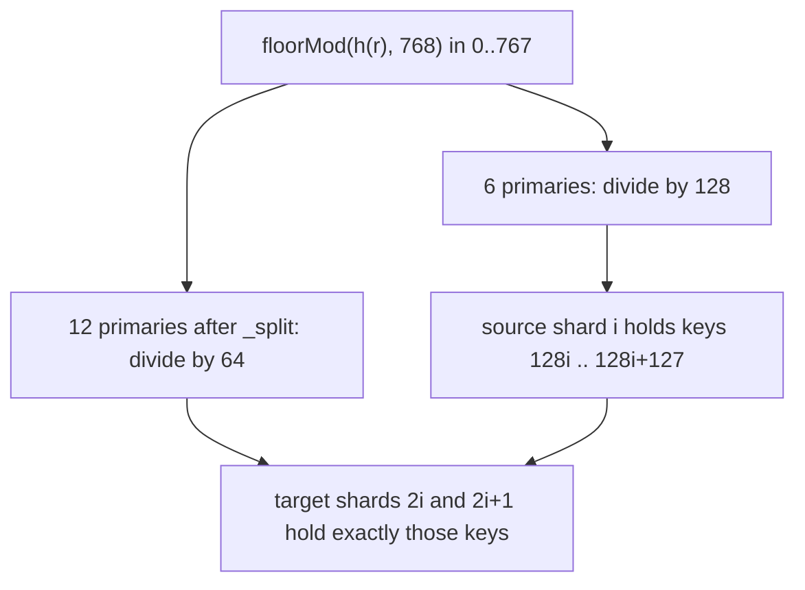

# Module 10: Scaling, Sharding, Allocation and Multiple Clusters

Elasticsearch scales by **partitioning** an index into primary shards (write and storage scale) and **replicating** each shard (read scale and availability), then letting the master **allocate** shard copies to nodes under constraints. Beyond one cluster, **cross-cluster search** (CCS) queries remote clusters and **cross-cluster replication** (CCR) copies indices between them. This module derives the routing function exactly, explains why the shard count is (almost) fixed, and gives the sizing rules, allocation controls and multi-cluster patterns. Proofs: [`examples/10-routing-sharding.test.ts`](../examples/10-routing-sharding.test.ts) with [`examples/lib/routing.ts`](../examples/lib/routing.ts).

> **Ownership.** Partitioning strategies, rebalancing theory and request routing architectures are owned by [Partitioning, Sharding and Routing](../../../architecture/data-systems/modules/08-partitioning-sharding-and-routing.md); consistent hashing algorithms by `algorithms/dsa`. Elasticsearch uses **modulo hashing with a fixed partition count**, not consistent hashing; this module explains the consequences.

---

## 1. Document Routing, Exactly

**Definition (routing function in Elasticsearch 9+).** For an index created in Elasticsearch 9+ with $P$ primary shards, a document with routing value $r$ (its `_id` unless `routing` is given) is stored on shard

$$\mathrm{shard}(r) = \mathrm{floorMod}\big(h(r),\, P\big), \qquad h(r) = \mathrm{Murmur3\_x86\_32}\big(\mathrm{UTF16LE}(r),\ \text{seed } 0\big)$$

where $h$ is interpreted as a signed 32-bit integer and $\mathrm{floorMod}$ is Java's `Math.floorMod` (result in $[0, P)$ even for negative hashes).

Details that are easy to get wrong, each asserted:

1. **The bytes hashed are UTF-16LE code units**, two bytes per Java `char`, not UTF-8. Our implementation reproduces the hash values from Elasticsearch's own `Murmur3HashFunctionTests` (for example `hello` → `0xd7c31989`), and plain MurmurHash3 reference vectors on UTF-8 bytes (`hello` → `0x248bfa47`), which differ.
2. **The worked example:** `_id` `654321` in a 6-shard index has $h = 1424940152$. Under Elasticsearch 9+ modulo routing, $\mathrm{floorMod}(1424940152, 6) = 2$ → shard 2. Under legacy 7.x/8.x routing ($R = 768$), $\mathrm{floorMod}(h, 768) = 632$, $\lfloor 632 / 128 \rfloor = 4$ → shard 4. Both calculations are asserted in tests.
3. **Negative hashes** would give negative shard numbers with Java's `%`; `floorMod` keeps every shard id in $[0, P)$ (property test).

#### Murmur3 UTF-16LE bit-level mechanics

Lucene's `StringHelper.murmurhash3_x86_32` iterates directly over Java `char[]` code units, serializing each 16-bit `char` into two little-endian bytes:

```java
char c = string.charAt(i);
byte low = (byte)(c & 0xFF);
byte high = (byte)((c >> 8) & 0xFF);
```

The algorithm processes 4-byte (two-`char`) blocks with seed 0:

- **Constants**: $c_1 = \text{0xcc9e2d51}$, $c_2 = \text{0x1b873593}$.
- **Block mixing**: $k_1 = \text{block} \times c_1$; $k_1 = \mathrm{rotl32}(k_1, 15) \times c_2$; $h = (h \oplus k_1)$; $h = \mathrm{rotl32}(h, 13) \times 5 + \text{0xe6546b64}$.
- **Avalanche finalizer (`fmix32`)**: $h = h \oplus \text{len}$; $h = (h \oplus (h \ggg 16)) \times \text{0x85ebca6b}$; $h = (h \oplus (h \ggg 13)) \times \text{0xc2b2ae35}$; $h = h \oplus (h \ggg 16)$.

This byte-level encoding explains why an external hashing utility feeding UTF-8 bytes produces completely different hash outputs and misplaces documents.

### 1.1 Then vs now: modulo routing vs routing shards

In Elasticsearch 7.x and 8.x, Elasticsearch routed documents using intermediate routing shards: $\mathrm{shard}(r) = \lfloor \mathrm{floorMod}(h(r), R) / (R/P) \rfloor$ where $R$ was `index.number_of_routing_shards` (defaulting to the largest power-of-two multiple of $P$ not exceeding 1024). This ensured that doubling $P$ kept documents on child shards $2i$ or $2i+1$, but strictly capped the maximum split target at $R$.

In Elasticsearch 9.0 (`IndexVersions.MOD_ROUTING_FUNCTION`), Elasticsearch simplified newly created indices to direct modulo routing: $\mathrm{shard}(r) = \mathrm{floorMod}(h(r), P)$.

#### Modulo routing split arithmetic and candidate sets

When splitting an index from $P$ primary shards to $P' = k \cdot P$ shards ($k \ge 2$):

$$\mathrm{shard}_{\text{new}}(r) = \mathrm{floorMod}(h(r), kP)$$

By the division theorem, any signed 32-bit hash $h$ can be expressed as $h = q(kP) + r_{\text{new}}$ where $0 \le r_{\text{new}} < kP$. Reducing both sides modulo $P$:

$$\mathrm{floorMod}(h, kP) \equiv \mathrm{floorMod}(h, P) \pmod P$$

Therefore, every document on source shard $i = \mathrm{floorMod}(h, P)$ is mapped strictly to the target candidate set:

$$\mathcal{S}_i = \{i + m \cdot P \mid m \in \{0, 1, \dots, k-1\}\}$$

No document ever migrates to an unrelated shard $j \not\equiv i \pmod P$. Modulo routing eliminates the artificial $R$ ceiling entirely, allowing arbitrary multiple splits ($P \to 2P, 3P, \dots$) as long as the target shard count is an integer multiple of the source.

| Document `_id` | Murmur3 Hash $h$ | Legacy Shard ($P=3, R=768$) | Legacy Target ($P=6, R=768$) | ES 9 Shard ($P=3$) | ES 9 Target ($P=6$) | Target Candidate Set $\mathcal{S}_i$ |
| --- | --- | --- | --- | --- | --- | --- |
| `doc-101` | `1048576` | `0` ($\lfloor 256/256 \rfloor$) | `0` or `1` | `1` ($1048576 \bmod 3$) | `4` ($1048576 \bmod 6$) | $\{1, 4\}$ |
| `doc-202` | `2097152` | `1` ($\lfloor 512/256 \rfloor$) | `2` or `3` | `2` ($2097152 \bmod 3$) | `2` ($2097152 \bmod 6$) | $\{2, 5\}$ |
| `doc-303` | `3145728` | `0` ($\lfloor 0/256 \rfloor$) | `0` or `1` | `0` ($3145728 \bmod 3$) | `0` ($3145728 \bmod 6$) | $\{0, 3\}$ |

Legacy indices created on Elasticsearch 7 or 8 preserve their original routing function via creation version gating.

### 1.2 Why you cannot just change `number_of_shards`

With modulo hashing, changing $P$ remaps most documents: from 5 to 6 primaries, more than 60% of documents move (negative test). A GET or update for an existing id would be routed to the wrong shard and miss. Hence the primary count is fixed at creation, and the options are:

| Operation | Constraint | Mechanism | Cost |
| --- | --- | --- | --- |
| `_split` | target is a multiple of source and divides $R$ | hard links + delete-by-routing | cheap; index must be read-only during the split |
| `_shrink` | target is a factor of source | all source shards copied to one node, hard-linked into fewer shards | needs a copy of every shard on one node, read-only |
| `_clone` | same shard count | hard links | new settings, same data |
| `_reindex` into a new index | none | re-index everything | full cost; the general solution |
| data stream / alias rollover | none | new backing index with new settings | the time-series answer |

```json
PUT /logs-big/_settings
{ "index.blocks.write": true }

POST /logs-big/_split/logs-big-12
{ "settings": { "index.number_of_shards": 12 } }
```



Tests `_split: target must be a multiple...` and `_shrink: target must be a factor...` check the arithmetic: 6 → 12 with $R = 768$ is allowed, 6 → 18 is not (768 is not divisible by 18).

---

## 2. Custom Routing

```json
PUT /orders/_doc/o-1001?routing=tenant-42
{ "tenant": "tenant-42", "total": 99 }

GET /orders/_doc/o-1001?routing=tenant-42

GET /orders/_search?routing=tenant-42
{ "query": { "term": { "tenant": "tenant-42" } } }
```

Benefits: a search with `?routing` touches **one shard** instead of all (test `a search with ?routing hits one shard`), and related documents are co-located (required for `join` parent/child).

Costs and traps:

- **Hot spots.** A tenant with 80% of the data puts 80% on one shard (negative test). `index.routing_partition_size` (set at creation) spreads each routing value over a subset of shards: $h(r) + \mathrm{floorMod}(h(\mathit{id}), p)$ selects one of $p$ shards (test `routing_partition_size spreads one routing value`); searches with that routing then hit $p$ shards. `join` fields cannot use it.
- **Every operation must pass the same routing.** A GET, update or delete with a different routing value goes to a different shard and does not find the document (negative test). `_id` uniqueness is only guaranteed per shard, so the same `_id` with two routing values creates two documents.
- Make routing mandatory with `"_routing": { "required": true }` in the mapping.

#### Hot-spot diagnostics and mitigation

A skewed routing key concentrates indexing and query traffic onto a single shard. Operators identify hot spots with three diagnostics:

- **Shard storage imbalance**: `GET /_cat/shards/<index>?v&s=store.size:desc` displays primary shard disk utilization. An index where shard 0 is 85 GB and shards 1–4 are 4 GB indicates severe routing key skew.
- **Thread pool queuing**: `GET /_cat/thread_pool/write?v&h=node_name,name,active,queue,rejected` exposes queuing and rejections on the node hosting the oversized shard.
- **CPU consumption**: `GET /_nodes/hot_threads` highlights CPU saturation on threads executing Lucene segment flushes (`IndexingMemoryController`) for the skewed shard.

To mitigate skew without losing routing benefits, define `index.routing_partition_size: p` at index creation (where $1 < p < P$):

$$\mathrm{shard}(r, \mathit{id}) = \mathrm{floorMod}\left(h(r) + \mathrm{floorMod}(h(\mathit{id}), p),\, P\right)$$

This formula disperses a single routing key $r$ across $p$ distinct shards using the document `_id`. Searches supplying `?routing=tenant-42` query $p$ shards instead of all $P$ shards, trading minor search fan-out for balanced cluster writes.

### 2.1 Filtered aliases for multi-tenancy

A **filtered alias** combines a filter and routing so that each tenant sees "its own index" while sharing physical shards:

```json
POST _aliases
{
  "actions": [
    { "add": {
        "index": "orders",
        "alias": "orders-tenant-42",
        "filter": { "term": { "tenant": "tenant-42" } },
        "routing": "tenant-42"
    } }
  ]
}
```

Searches through `orders-tenant-42` are routed to one shard and filtered; writes through it get the routing automatically. The filter is a convenience, not a security boundary: a user with read access to `orders` bypasses it. For isolation, use document-level security in roles (module 11) or separate indices.

---

## 3. Shard Sizing

The unit of work is the shard: each one is a Lucene index with its own segments, file handles, per-field metadata on the heap, and a thread to run a query. Too few shards limit parallelism and make recovery slow; too many waste memory and overload the master.

| Guideline (Elastic documentation) | Value |
| --- | --- |
| Shard size | 10–50 GB for search and log workloads |
| Documents per shard | below 200 million |
| Shards per node | `cluster.max_shards_per_node` default 1000 (non-frozen); 3000 for frozen |
| Heap per shard | dominated by mapped fields: budget about 1 kB of heap per mapped field per shard copy on data nodes, plus per-shard overhead |
| Primaries for a time-series index | as few as possible; roll over by `max_primary_shard_size: 50gb` |

The old rule "20 shards per GB of heap" was dropped (8.3) in favour of the field-based estimate: the per-shard heap cost fell sharply in 7.x and 8.x, while mapping size became the dominant factor.

**Oversharding** example (test `daily indices of 1 GB with 5 primaries and 1 replica`): 365 daily indices × 5 primaries × 2 copies = 3,650 shards holding 200 MB each. Cures: fewer primaries, rollover by size instead of by day, shrink old indices, longer ILM retention granularity, data streams with the default single primary.

**Undersharding** example: one 2 TB primary. Recovery copies 2 TB over the network, a force merge takes hours, and queries on it use one thread per request. Split or roll over.

#### Shard sizing trade-offs

| Dimension | Undersharded (> 50–100 GB/shard) | Sweet Spot (10–50 GB/shard) | Oversharded (< 1–5 GB/shard) |
| --- | --- | --- | --- |
| Recovery (MTTR) | Severe: transferring a 100 GB shard saturates network and takes hours | Fast: parallel peer-to-peer shard recovery completes in minutes | High overhead: master manages thousands of state transitions and file handshakes |
| Search Concurrency | Starved: single thread per shard copy caps query core utilization | Optimal: queries divide work evenly across CPU cores | Exhausted: thread pool queues fill from coordinating thousands of shard tasks |
| Heap Footprint | Low per document: minimal Lucene segment reader and FST overhead | Balanced: ~1 kB per mapped field per shard copy | Wasteful: Lucene reader structures, live doc bitsets, and cluster state drain heap |
| Merge Amplification | Heavy: background TieredMergePolicy merges generate massive disk I/O | Predictable: segments merge within size tiers without saturating IOPS | Excessive: continuous tiny merges cause high write amplification and file churn |

### 3.1 Replicas

Replicas provide **availability** (a node can fail without data loss or red status) and **read throughput** (searches are served by any copy, adaptive replica selection picks the fastest). They cost the same disk and indexing CPU as the primary, because replicas re-execute every operation (document replication, not segment copying). Rules:

- `number_of_replicas: 1` is the production minimum; more replicas only help when CPU on search nodes is the bottleneck and there are enough nodes to place them.
- `index.auto_expand_replicas: 0-all` for small, read-heavy reference indices.
- Setting replicas to 0 during a bulk load and back to 1 afterwards replaces per-document replication by one file copy (module 02).

---

## 4. Shard Allocation

The elected master runs the **allocator**: given the cluster state, it decides where every unassigned or relocating shard copy goes, subject to **deciders**. The balancer then moves shards to even out shard counts and (since 8.6) disk usage and write load (desired-balance allocator).

| Decider | Rule |
| --- | --- |
| same shard | a primary and its replica never on the same node (or host, with `cluster.routing.allocation.same_shard.host`) |
| disk threshold | low watermark 85%: no new shards; high 90%: move shards away; flood stage 95%: indices with a shard on the node become read-only (module 11) |
| awareness | spread copies across attribute values (zones, racks) |
| filtering | `index.routing.allocation.include/exclude/require.<attr>` and cluster-level equivalents |
| tier preference | `_tier_preference` (module 08) |
| shards per node | `index.routing.allocation.total_shards_per_node` |
| throttling | `cluster.routing.allocation.node_concurrent_recoveries` (2) |
| max retries | `index.allocation.max_retries` (5); retry with `_cluster/reroute?retry_failed=true` |

### 4.1 Allocation awareness and forced awareness

```yaml
# elasticsearch.yml on each node
node.attr.zone: europe-west3-a
cluster.routing.allocation.awareness.attributes: zone
```

With awareness, Elasticsearch places copies of a shard in different zones when possible, so losing one zone keeps a copy. With only awareness, if a zone fails, the replicas are **re-created in the surviving zone**, which may overload it. **Forced awareness** forbids that:

```yaml
cluster.routing.allocation.awareness.force.zone.values: europe-west3-a,europe-west3-b
```

Now, with one zone down, replicas stay unassigned (yellow) instead of doubling the load on the survivor. Choose forced awareness when each zone is sized for its own share only.

### 4.2 Allocation filtering

```json
PUT /logs-2026.10/_settings
{ "index.routing.allocation.require.box_type": "warm" }

PUT _cluster/settings
{ "persistent": { "cluster.routing.allocation.exclude._name": "es-data-07" } }
```

The second command is how you **drain a node** before decommissioning it: all shards move off, then the node can be stopped safely. Built-in attributes include `_name`, `_host_ip`, `_publish_ip`, `_ip`, `_host`, `_id`, `_tier`.

#### Allocation deciders and watermark enforcement

The master node allocates shards by evaluating an array of deterministic `AllocationDecider` implementations. Every decider returns `YES`, `NO`, or `THROTTLE`. A shard moves to a node only if all deciders return `YES`.

Disk watermark enforcement stages:

1. **Low watermark (default 85% or 150 GB free)**: Decider returns `NO` for new replica allocations and shard relocations. Brand-new primary shards for newly created indices are exempt to prevent index creation deadlocks.
2. **High watermark (default 90% or 100 GB free)**: Decider returns `NO` for all allocations, and the cluster actively generates relocation tasks to evict existing shards to data nodes below the low watermark.
3. **Flood stage watermark (default 95% or 20 GB free)**: Safety barrier. The master applies `index.blocks.read_only_allow_delete: true` to every index with at least one shard on the saturated node. All index and bulk write operations throw `cluster_block_exception ... FORBIDDEN/12/index read-only / allow delete`. Only index deletion and deletion by ID (which reclaim disk space) are permitted.

When disk usage drops below the high watermark, Elasticsearch 7.4+ automatically lifts the flood stage block. If manual unblocking is necessary after purging data:

```json
PUT /<index>/_settings
{
  "index.blocks.read_only_allow_delete": null
}
```

To diagnose why a specific shard is not allocated:

```json
POST /_cluster/allocation/explain
{
  "index": "orders",
  "shard": 0,
  "primary": false
}
```

The response outputs `can_allocate: "no"` and outlines every evaluating decider (such as `disk_threshold: [node es-data-03 has 92% disk used >= high watermark 90%]`, `same_shard: [primary shard copy already exists on node es-data-01]`, or `awareness: [attribute zone europe-west3-a has reached allocation limit]`).

---

## 5. Cross-Cluster Search (CCS)

Remote clusters are registered dynamically:

```json
PUT _cluster/settings
{
  "persistent": {
    "cluster.remote.prague.seeds": ["es-prague-1.example.com:9300"],
    "cluster.remote.brno.mode": "proxy",
    "cluster.remote.brno.proxy_address": "es-brno.example.com:9443",
    "cluster.remote.brno.skip_unavailable": true
  }
}

GET /logs-*,prague:logs-*,brno:logs-*/_search
{ "query": { "match": { "message": "timeout" } } }
```

- The local cluster's nodes need the `remote_cluster_client` role.
- **Connection modes:** `sniff` (connects to gateway nodes discovered from seeds; needs direct network access to them) or `proxy` (a single address, for load balancers and Kubernetes ingress).
- **Security models:** the newer API-key based model uses a dedicated remote cluster port (9443) and cross-cluster API keys that define what the local cluster may access; the older certificate-based model uses the transport port with matching roles on both sides.
- **`ccs_minimize_roundtrips: true`** (the default) sends one request per remote cluster, which reduces locally and returns a partial result; `false` sends shard-level requests across the WAN.
- **`skip_unavailable`** (default `true` in current versions) returns partial results with a `_clusters` section reporting skipped clusters instead of failing the search.
- ES|QL supports CCS with the same `cluster:index` syntax (module 06).

#### CCS minimize roundtrips mechanics

Cross-cluster search latency depends on network round-trips over WAN links:

- **`ccs_minimize_roundtrips: true` (default)**: The coordinating cluster sends a single search request to a selected gateway node in the remote cluster. The remote gateway fans out the query phase across its local shards, merges intermediate results into a top-$N$ candidate list, and returns that list across the WAN. The coordinating cluster merges candidates across all remote clusters and requests document source (`fetch` phase) only for hits that make the final global top-$K$. Total WAN round-trips: **2**.
- **`ccs_minimize_roundtrips: false`**: The coordinating cluster treats remote shards as if they were local, sending shard-level requests across the WAN to every remote shard independently. Total WAN round-trips: **$2 \times \text{shards}$**. While latency is substantially higher over wide-area networks, this mode allows streaming shard-level search progress and is required for legacy scroll queries.

Version compatibility: CCS works between the current major and the last minor of the previous major (and newer minors); plan upgrades so remote clusters stay within range.

---

## 6. Cross-Cluster Replication (CCR)

CCR (Platinum/Enterprise license) replicates a **leader index** to a **follower index** on another cluster by pulling **operations** (based on sequence numbers and soft deletes, retained via shard history retention leases).

```json
PUT /orders-follower/_ccr/follow
{ "remote_cluster": "prague", "leader_index": "orders" }

PUT /_ccr/auto_follow/logs
{ "remote_cluster": "prague", "leader_index_patterns": ["logs-*"], "follow_index_pattern": "{{leader_index}}-copy" }
```

- Followers are **read-only**; writes go to the leader. It is active-passive per index; "active-active" means two indices replicating in opposite directions with an alias or application logic to merge them.
- Use cases: disaster recovery (failover by pausing and unfollowing to promote the follower), geo-proximity reads, central reporting.
- Mapping changes replicate; the follower lags by the pull interval; if the follower falls behind beyond the leader's retention lease, it must be re-bootstrapped.

#### Soft-delete retention leases and replication mechanics

CCR relies on Lucene soft-delete tombstones and shard history retention leases:

- **Soft deletes**: Document updates and deletes do not immediately expunge records from Lucene segments; instead, they append soft-delete markers with monotonically increasing sequence numbers (`_seq_no`).
- **Retention leases**: When a follower shard connects to a leader shard, it establishes a named retention lease (`lease_id = "ccr:<cluster>:<follower_index>"`) indicating the minimum sequence number it has successfully replicated.
- **Merge policy coordination**: The leader shard's Lucene merge policy (`IndexWriter`) is prohibited from purging soft-delete tombstones whose sequence numbers exceed the minimum sequence number held by any active retention lease.
- **Expiration and unrecoverable gaps**: Governed by `index.soft_deletes.retention_lease.period` (default 12 hours). If the follower cluster disconnects for longer than the retention period, the leader expires the lease and purges older soft deletes during background merges. When the follower reconnects, it encounters a gap in sequence numbers that cannot be replayed. The follower halts with an unrecoverable exception and must be re-bootstrapped from a fresh snapshot.

---

## 7. Scaling Patterns

| Problem | Pattern |
| --- | --- |
| Write throughput | more primaries (more indexing parallelism), bulk tuning, `refresh_interval` 30s, faster disks, ingest nodes for pipelines |
| Read throughput | replicas, caching (filters, request cache), dedicated coordinating nodes for heavy reduces, `preference` for cache locality |
| Many tenants | shared index with routing + filter (many small tenants), index per large tenant, filtered aliases per tenant |
| Time series growth | data streams + rollover by size + ILM tiers |
| Global users | CCS for federated search, CCR for local read copies |
| Huge result exports | PIT + `search_after` with slices |

### Then vs now: scaling

| Concern | Then | Now |
| --- | --- | --- |
| Default primaries | 5 (≤ 6.x) | 1 (≥ 7.0) |
| Changing primary count | reindex only | `_split` (6.1), `_shrink` (5.0), routing shards default (7.0) |
| Heap guidance | 20 shards per GB of heap | field-count based estimate (8.3+) |
| Balancing | shard count based | desired balance allocator with disk and write-load awareness (8.6+) |
| Remote clusters | tribe node (removed in 7.0) | CCS, CCR |
| Remote cluster security | certificates, transport port | API-key based remote cluster port (8.x+) |

> **Exam delta (Elastic Certified Engineer, 9.3).** Objectives cover allocating shards to specific nodes, awareness and forced awareness, cross-cluster search configuration, and diagnosing shard issues. These are unchanged between 9.3 and 9.5. The exam may present either remote cluster security model; know both the `cluster.remote.*` settings and the `index.routing.allocation.*` settings by heart, since tasks are performed live.

---

## 8. Production Failure Modes

1. **Oversharding:** thousands of tiny shards; slow master, cluster-state bloat, heap pressure. Shrink, consolidate, rollover by size.
2. **Hot shard from custom routing:** one node's CPU at 100%. Partition size or no custom routing for skewed keys.
3. **Shrink stuck:** not all shard copies on one node, or the index is not read-only. Check `_cluster/allocation/explain`.
4. **Zone outage overloads survivors:** awareness without forced awareness.
5. **Node drained but still holding shards:** an `exclude` filter conflicting with `require` or tier preference; explain shows the decider.
6. **CCS fails entirely when one remote is down:** `skip_unavailable: false` on that remote.
7. **CCR follower must be re-bootstrapped:** follower paused too long; the leader's retention lease expired and history was merged away.

---

## Interview Drill

<details><summary>1. Give Elasticsearch's routing formula and explain number_of_routing_shards.</summary>

`shard = floorMod(murmur3(_routing), routing_shards) / (routing_shards / primaries)`, with `_routing` defaulting to `_id`, hashed as UTF-16LE. Routing shards is a multiple of the primaries (default: largest power-of-two multiple ≤ 1024), so splitting by a factor maps each source shard's documents onto a fixed set of target shards.
</details>

<details><summary>2. Why can't you change the number of primary shards of an existing index?</summary>

Routing is modulo the shard count; changing it would remap most documents, so lookups by id would go to the wrong shard. Use `_split`/`_shrink` (which respect the routing construction), reindex, or rollover.
</details>

<details><summary>3. How do you size shards for 2 TB/day of logs kept 30 days?</summary>

Roll over by `max_primary_shard_size: 50gb`; with replicas, ~2 TB/day means about 40 primaries' worth of data per day. Use enough primaries per backing index to parallelise ingest across hot nodes (e.g. equal to the number of hot nodes), and let rollover control shard size. 30 days × ~40 primaries × 2 copies ≈ 2,400 shards: acceptable across a correctly sized cluster, and ILM can shrink older indices.
</details>

<details><summary>4. Awareness versus forced awareness?</summary>

Awareness spreads copies across zones. Forced awareness additionally refuses to allocate all copies into the remaining zone when one fails, leaving replicas unassigned instead of overloading the survivor.
</details>

<details><summary>5. When is custom routing a good idea?</summary>

When most queries are scoped to a key (tenant, user) and the key distribution is not too skewed: one-shard searches and co-location. Use `routing_partition_size` or no routing for skewed keys, and require routing in the mapping.
</details>

<details><summary>6. CCS or CCR for a team in another region that needs low-latency reads?</summary>

CCR: a local read-only follower gives local latency and survives WAN outages. CCS queries the remote cluster each time, paying WAN latency, but needs no extra storage and no license.
</details>

<details><summary>7. How do you decommission a data node safely?</summary>

Exclude it with `cluster.routing.allocation.exclude._name`, wait until `_cat/shards` shows no shards on it (and the cluster is green), then stop it and remove the exclusion. If it is master-eligible, also remove it from the voting configuration with `POST _cluster/voting_config_exclusions`.
</details>
