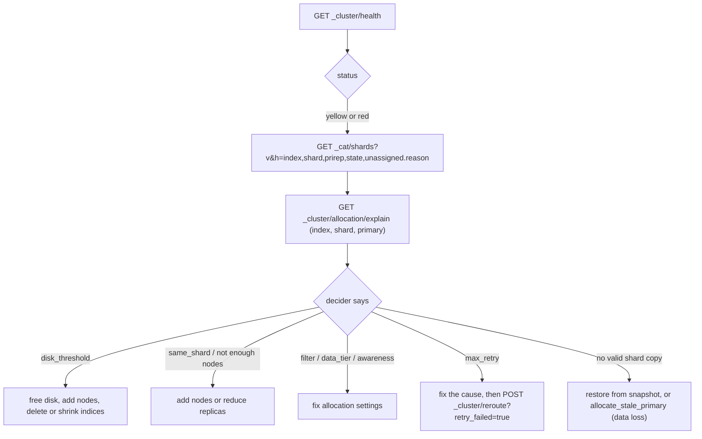
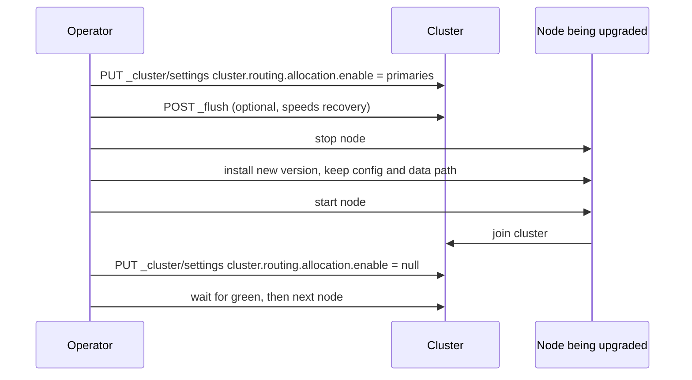

# Module 11: Operations, Security, Snapshots and Upgrades

Running Elasticsearch means keeping the cluster **green**, **secure**, **backed up**, **sized** and **current**. This module is the operator's toolkit: health and allocation diagnosis, disk watermarks, JVM and OS configuration, circuit breakers and slow logs, security (TLS, authentication, RBAC, API keys, document- and field-level security), snapshot/restore and SLM, and the rolling upgrade from 8.x to 9.x. Proofs: [`examples/11-operations.test.ts`](../examples/11-operations.test.ts) with [`examples/lib/ops.ts`](../examples/lib/ops.ts).

> **Ownership.** TLS, PKI and certificate lifecycle are owned by [architecture/security-identity](../../../architecture/security-identity/README.md); metrics, dashboards and alerting for monitoring Elasticsearch belong to the observability track ([technologies/observability](../../observability/README.md)).

---

## 1. Health: Green, Yellow, Red

**Definition.** For an index, health is **red** if some primary shard is not active, **yellow** if all primaries are active but some replica is not, **green** otherwise. A relocating copy counts as active. Cluster health is the worst index health (tests in `cluster health`).

| Colour | Means | Data at risk? | Searches |
| --- | --- | --- | --- |
| green | every copy assigned | no | full results |
| yellow | some replica unassigned | redundancy reduced | full results |
| red | some primary unassigned | that shard's data unavailable | partial results (`_shards.failed`), writes to that shard fail |

A single-node cluster with `number_of_replicas: 1` is permanently yellow: a replica can never share a node with its primary (test `a single-node cluster ... is always yellow`). Set replicas to 0 on single-node development clusters.

### 1.1 The diagnosis loop



`GET _cluster/allocation/explain` (with no body it explains the first unassigned shard) lists, per node, every decider's decision. Our model reproduces the reasons for the common deciders:

- **same_shard**: a copy already lives on that node;
- **disk_threshold**: the node is above the low watermark (a brand-new primary is exempt so that new indices can be created);
- **filter**: `require`/`include`/`exclude` settings, including `exclude._name` used for draining;
- **data_tier**: `_tier_preference` (a hot index stays off warm nodes);
- **awareness**: at most $\lceil \text{copies} / \text{zones} \rceil$ copies per zone; with forced awareness the count of zones includes the missing ones, so a replica is not squeezed into the surviving zone (tests `awareness spreads copies across zones` and `forced awareness`).

The test `tier preference keeps a hot index off warm nodes` composes three deciders into the typical yellow incident: the only other hot node is over the low watermark, so the replica cannot go anywhere.

**Red with no valid copy.** If all copies of a primary are lost, Elasticsearch will not silently create an empty one. The options are restoring from a snapshot, or `POST _cluster/reroute` with `allocate_stale_primary` (accept a possibly outdated copy) or `allocate_empty_primary` (accept total loss of that shard), both requiring `accept_data_loss: true`.

The **health API** `GET _health_report` adds indicators (shards availability, disk, ILM, SLM, master stability, repository integrity) with impacts and diagnoses.

---

## 2. Disk Watermarks

| Setting | Default | Effect |
| --- | --- | --- |
| `cluster.routing.allocation.disk.watermark.low` | 85% | no new shards allocated to the node (except new primaries) |
| `cluster.routing.allocation.disk.watermark.high` | 90% | shards are relocated away from the node |
| `cluster.routing.allocation.disk.watermark.flood_stage` | 95% | every index with a shard on the node gets `index.blocks.read_only_allow_delete: true` |

Values can be percentages or absolute free space (`50gb`); on large disks, the `max_headroom` variants (default 150 GB for low and 100 GB for high, 20 GB flood) cap how much free space a percentage would demand. Since 7.4 the flood-stage block is **released automatically** once usage falls below the high watermark (test). Before that, operators had to remove it by hand, and many runbooks still say so.

The flood stage blocks **writes** (deletes are allowed, so you can free space): ingestion pipelines start failing with `cluster_block_exception ... FORBIDDEN/12/index read-only / allow delete`. Prevention: ILM retention, monitoring of disk forecasts, autoscaling.

---

## 3. Node Configuration

### 3.1 Heap and memory

- Elasticsearch 8+ **sizes the heap automatically** from the node's roles and RAM. Set `-Xms` = `-Xmx` in `jvm.options.d/*.options` only when you have a reason.
- Rule of thumb when setting it: at most **50% of RAM**, the rest for the OS page cache that Lucene relies on (segments are memory-mapped), and **below the compressed oops threshold** (~32 GB; use ≤ 31 GB to stay safe). Above the threshold the JVM uses 64-bit references and a 40 GB heap can hold fewer objects than 31 GB (tests `half of RAM, capped below the compressed-oops threshold` and the negative test).
- **Page-cache budget arithmetic**: On a 64 GB data node, allocate 31 GB to JVM heap (`-Xms31g -Xmx31g`) and leave 33 GB unallocated for the Linux page cache. The page cache caches Lucene's memory-mapped segment files (`.tim`, `.doc`, `.dvd`, `.vec`). Setting heap to 48 GB disables compressed ordinary object pointers (`UseCompressedOops`), expanding pointer references from 4 bytes to 8 bytes and paradoxically reducing effective object capacity while stripping 17 GB of page cache away from search I/O.
- Disable swap (`bootstrap.memory_lock: true` or `vm.swappiness=1`); set `vm.max_map_count` ≥ 262144 (Lucene mmaps many files); raise file descriptors (65535+).
- Garbage collector: G1 (default with the bundled JDK). Long old-gen pauses usually mean the heap is too small for fielddata, aggregations or too many shards and fields.

### 3.2 Discovery and bootstrap

```yaml
cluster.name: prod
node.name: es-1
node.roles: [master, data_hot, ingest]
network.host: _site_
discovery.seed_hosts: ['es-1.example.com', 'es-2.example.com', 'es-3.example.com']
cluster.initial_master_nodes: ['es-1', 'es-2', 'es-3'] # first start of a new cluster only
```

Binding to a non-loopback address switches Elasticsearch into **production mode**: **bootstrap checks** (heap, file descriptors, `max_map_count`, memory lock if requested, discovery configured) become hard errors instead of warnings. `discovery.type: single-node` skips cluster formation for single-node setups.

### 3.3 Circuit breakers

| Breaker | Default limit | Guards |
| --- | --- | --- |
| parent (`indices.breaker.total.limit`) | 95% of heap (real-memory accounting) | everything |
| request | 60% | per-request structures (aggregations) |
| fielddata | 40% | text fielddata |
| in-flight requests | 100% | bytes of requests being received |
| script compilation | rate limit | `script.max_compilations_rate` |

A tripped breaker returns `429 circuit_breaking_exception`: the node protects itself instead of running out of memory. Repeated trips are a capacity or query-design problem. Circuit breakers can be tuned dynamically without node restarts:

```json
PUT _cluster/settings
{
  "persistent": {
    "indices.breaker.total.limit": "95%",
    "indices.breaker.request.limit": "60%",
    "indices.breaker.fielddata.limit": "40%"
  }
}
```

### 3.4 Thread pools and back-pressure

`GET _cat/thread_pool?v&h=node_name,name,active,queue,rejected` shows `write`, `search`, `get`, `management` pools. Rejections (`429 es_rejected_execution_exception`) on `write` mean ingestion exceeds capacity; clients must back off and retry (module 08). **Indexing pressure** (`indexing_pressure.memory.limit`, 10% of heap) rejects bulk requests whose in-flight bytes would exceed the limit.

---

## 4. Diagnosing Performance

| Tool | Use |
| --- | --- |
| **Slow logs** (`index.search.slowlog.threshold.query.warn: 2s`, `index.indexing.slowlog.threshold.index.warn: 1s`) | which queries and documents are slow, per shard |
| `GET _nodes/hot_threads` | what CPU-busy threads are doing right now (merges, queries, GC) |
| `"profile": true` | where time goes inside one query |
| `GET _tasks?detailed&actions=*search*` | long-running tasks; cancel with `_tasks/<id>/_cancel` |
| `GET _nodes/stats` | caches, breakers, GC, thread pools, disk IO |
| `GET _cat/indices?v&s=store.size:desc`, `_cat/segments`, `_cat/allocation` | sizes, segment counts, disk per node |
| `GET _index/_stats`, `_field_usage_stats`, `_disk_usage?run_expensive_tasks=true` | per-field disk usage: find fields to drop or map more cheaply |

Typical root causes, in order of frequency: expensive queries (wildcards, scripts, deep aggregations), too many shards, hot spots from routing or time-based write patterns, insufficient page cache, and merges competing with search on slow disks.

---

## 5. Security

Since 8.0, security is **on by default**: the first start generates TLS certificates for the transport and HTTP layers and a password for the `elastic` superuser, and prints an enrollment token for Kibana and new nodes.

### 5.1 Layers

| Layer | Mechanism |
| --- | --- |
| Transport (node-to-node) | mutual TLS, mandatory in production mode |
| HTTP (clients) | TLS (strongly recommended, default on new installs) |
| Authentication | realms: `native`, `file`, LDAP/AD, PKI, SAML, OIDC, Kerberos, JWT; API keys; service accounts; tokens |
| Authorization | roles with cluster privileges, index privileges, application privileges; role mapping from realm groups |
| Data-level | document-level security (DLS: a query per role) and field-level security (FLS: granted fields) |
| Auditing | audit log of authentication and access events (license-dependent) |
| Encryption at rest | filesystem or disk level (not built into Elasticsearch) |

#### TLS transport vs HTTP layer configuration

Elasticsearch separates internal cluster communication from client traffic across distinct ports and TLS configurations:

- **Transport layer (`port 9300`)**: Used for node-to-node RPC, cluster state synchronization, shard allocation, and primary-replica data replication. Mutual TLS (mTLS) is **mandatory** in production mode (`xpack.security.transport.ssl.enabled: true` and `client_authentication: required`). All nodes must authenticate each other using certificates issued by a common internal CA (or trusted via a shared PKCS#12 bundle). `verification_mode: full` validates certificate trust and hostname/SAN matching; `verification_mode: certificate` relaxes hostname checks for dynamic container networks.
- **HTTP REST layer (`port 9200`)**: Used for client SDKs, ingest agents, Kibana, and management APIs. Requires server TLS (`xpack.security.http.ssl.enabled: true`). Client authentication is optional (`client_authentication: none` or `optional`). Can use certificates from enterprise PKI or commercial public CAs (Let's Encrypt) to avoid distributing custom trust anchors to client applications.

```yaml
# elasticsearch.yml: Transport Layer (Node-to-Node, mTLS)
xpack.security.transport.ssl.enabled: true
xpack.security.transport.ssl.verification_mode: full
xpack.security.transport.ssl.key: /etc/elasticsearch/certs/transport.key
xpack.security.transport.ssl.certificate: /etc/elasticsearch/certs/transport.crt
xpack.security.transport.ssl.certificate_authorities: ['/etc/elasticsearch/certs/ca.crt']
xpack.security.transport.ssl.client_authentication: required

# elasticsearch.yml: HTTP Layer (Client-to-Node)
xpack.security.http.ssl.enabled: true
xpack.security.http.ssl.key: /etc/elasticsearch/certs/http.key
xpack.security.http.ssl.certificate: /etc/elasticsearch/certs/http.crt
xpack.security.http.ssl.certificate_authorities: ['/etc/elasticsearch/certs/ca.crt']
xpack.security.http.ssl.client_authentication: none
```

### 5.2 Roles, users and API keys

```json
POST /_security/role/orders_reader
{
  "cluster": [ "monitor" ],
  "indices": [ {
    "names": [ "orders-*" ],
    "privileges": [ "read", "view_index_metadata" ],
    "query": { "term": { "tenant": "tenant-42" } },
    "field_security": { "grant": [ "*" ], "except": [ "customer.email" ] }
  } ]
}

POST /_security/user/report-bot
{ "password": "<a strong generated secret>", "roles": [ "orders_reader" ] }

POST /_security/api_key
{
  "name": "ingest-service",
  "expiration": "30d",
  "role_descriptors": {
    "writer": { "indices": [ { "names": [ "logs-app-*" ], "privileges": [ "create_doc", "auto_configure" ] } ] }
  }
}
```

- **Least privilege**: ingestion clients need `create_doc` (append only) and `auto_configure` (create data streams from templates), not `write` or `all`.
- **API keys** are the preferred credential for services: scoped (`role_descriptors` intersect with the creator's privileges), expiring, revocable (`DELETE /_security/api_key`), sent as `Authorization: ApiKey <base64>`.
- **DLS/FLS** are enforced at search time; they disable some caching (the request cache) and can be expensive with complex role queries. They are the security boundary for multi-tenant indices (filtered aliases are not, module 10).
- Built-in roles (`superuser`, `kibana_system`, `monitoring_user`, …) are fixed; never run applications as `elastic`.
- `GET /_security/_authenticate` and `GET /_security/user/_has_privileges` debug what a credential can do.

#### DLS and FLS execution mechanics

Document-Level Security (DLS) and Field-Level Security (FLS) are enforced during Lucene execution inside `IndexSearcher`:

- **DLS bitset evaluation**: A role query (e.g. `{"term": {"tenant": "tenant-42"}}`) is compiled per segment into a Lucene `BitSet` via a `BitSetProducer`. When a user runs a search, Lucene wraps the query with a constant-score filter against the bitset. All terms, counts, score derivations, and aggregations process only documents with positive bit entries. Because bitsets are role-specific, DLS automatically invalidates the shard request cache (`indices.requests.cache`), requiring subsequent queries to evaluate the bitset filter dynamically.
- **FLS field masking**: FLS intercepts Lucene's `StoredFieldsReader` and `DocValuesProducer`. When retrieving `_source`, FLS filters out excluded or non-granted keys from the JSON tree before returning bytes over the wire. If a user search query explicitly references an unauthorized field in a query clause, Lucene rewrites the clause to `MatchNoDocsQuery`, safely preventing information leakage.

#### API key vs bearer token lifecycle

| Property | API Key (`_security/api_key`) | Bearer Token (`_security/oauth2/token`) |
| --- | --- | --- |
| Storage model | Persistent document in `.security-*` index | Ephemeral state cached in JVM memory or stateless JWT signature |
| Lifetime | Long-lived (e.g. 30–365 days) with optional explicit expiration | Short-lived (default 20–30 minutes) with refresh token rotation |
| Revocation | Instantaneous: `DELETE /_security/api_key` immediately invalidates | Instantaneous if invalidated via API; stateless JWTs expire with token lifetime |
| Scope privilege | Role descriptors define privilege subset at creation | Inherits granting user's roles at token issuance time |
| Primary use case | Server-to-server microservices, data ingest agents, CI pipelines | Interactive sessions, Kibana SSO integrations, short-lived tasks |

### 5.3 Then vs now: security

| Concern | Then | Now |
| --- | --- | --- |
| Default | security off, open HTTP on 9200 (≤ 7.x basic) | security on, TLS and passwords generated (8.0) |
| Basic license | no security (≤ 6.7) | TLS, RBAC, API keys free (6.8 / 7.1+) |
| Service credentials | users with passwords | API keys, service accounts, cross-cluster API keys |
| Kibana enrollment | manual certificates | enrollment tokens |

---

## 6. Snapshots, Restore and SLM

### 6.1 Repositories and snapshots

```json
PUT _snapshot/repo
{ "type": "s3", "settings": { "bucket": "es-snapshots", "base_path": "prod" } }

PUT _snapshot/repo/nightly-2026.11.04?wait_for_completion=false
{ "indices": "orders-*,logs-*", "include_global_state": false }

POST _snapshot/repo/nightly-2026.11.04/_restore
{
  "indices": "orders-2026.10",
  "rename_pattern": "(.+)", "rename_replacement": "restored-$1",
  "index_settings": { "index.number_of_replicas": 0 }
}
```

- Repository types: `fs` (shared filesystem, registered in `path.repo`), `s3`, `gcs`, `azure`, `url` (read-only), source-only (smaller, needs reindex on restore).
- Snapshots are **incremental at the segment-file level**: a new snapshot uploads only files not already in the repository (test `are incremental at the segment-file level`). Merges create new files, so a force-merged index is uploaded again even though no document changed.
- **Deleting** a snapshot removes only files no other snapshot references (test). Every snapshot is therefore a full logical backup that can be restored on its own.
- Snapshots capture shards **as of their start**, not a cross-index consistent point in time; writes during the snapshot are not included.
- **Never** copy data directories as a backup method, and never let two clusters write to one repository (register it `readonly: true` on the second cluster).
- Restore needs the target index closed or absent; restoring `include_global_state` replaces templates, ILM policies and persistent settings: use with care.
- **Compatibility:** a snapshot can be restored into the same or the next major version; 9.x can also mount older snapshots as read-only **archive** indices (license-dependent).

#### Repository incremental blob layout and deduplication

Snapshot repositories (`s3`, `gcs`, `fs`) store an immutable content-addressable layout of segment files:

```
repo-root/
  index-N                     # Active repository metadata manifest pointer
  index.latest                # Pointer file storing latest generation integer N
  meta-<snapshot-uuid>.dat    # Global cluster state, templates, and ILM policies
  snap-<snapshot-uuid>.dat    # Snapshot index manifest listing shard files
  indices/
    <index-uuid>/
      meta-<snapshot-uuid>.dat
      0/                      # Shard 0 directory
        snap-<snapshot-uuid>.dat
        __<segment-uuid>      # Immutable Lucene segment file blob (.tim, .doc, .dvd)
```

- **Incremental deduplication**: When taking snapshot $N+1$, Elasticsearch compares local Lucene segment file checksums against the repository shard manifest. Segments created by earlier snapshots are not re-uploaded; only new segment files created by flushes or merges are written to object storage.
- **Snapshot deletion**: Deleting a snapshot deletes its `snap-*.dat` manifest. The master performs asynchronous blob garbage collection: only segment blobs (`__<segment-uuid>`) with zero remaining snapshot references across all snapshots are deleted from storage.

#### Searchable snapshots cache tiers: Cold vs Frozen

Searchable snapshots replace local shard redundancy with cloud object storage:

- **Cold tier (`storage: full_copy`)**: Nodes with the `data_cold` role download full Lucene shard copies from the snapshot repository to local NVMe disks. Local disks provide high-throughput, low-latency search identical to warm nodes. Replica shards are set to 0; if a node fails, Elasticsearch recovers the shard directly from the snapshot repository.
- **Frozen tier (`storage: shared_cache`)**: Nodes with the `data_frozen` role mount shards without downloading full segment files. A local LRU block cache (`searchable_snapshot.shared_cache.size`) caches 16 MB segment blocks on demand during query execution. Unaccessed blocks remain in object storage, allowing petabytes of historical logs to be searched on minimal disk footprint.

### 6.2 Snapshot lifecycle management (SLM)

```json
PUT _slm/policy/nightly
{
  "schedule": "0 30 1 * * ?",
  "name": "<nightly-{now/d}>",
  "repository": "repo",
  "config": { "indices": [ "*" ], "include_global_state": true },
  "retention": { "expire_after": "30d", "min_count": 5, "max_count": 50 }
}
```

Retention deletes snapshots older than `expire_after`, but always keeps the newest `min_count` and never more than `max_count` (test `SLM retention`). The schedule is a Quartz cron expression (seconds first) in UTC.

**Restore drills** are the only proof a backup works: restore a recent snapshot into a scratch cluster on a schedule and run checks against it.

---

## 7. Rolling Upgrades from 8.x to 9.x

### 7.1 Supported paths

- To **9.1.0 or later** (including 9.5.x), the cluster must first be on **8.19.x** (latest patch). To 9.0.x, 8.18.x was also supported (test `9.1+ requires starting from 8.19`).
- Never skip a major: 7.17 → 9.x is impossible directly (upgrade to 8.19 first).
- **Indices created in 7.x or earlier** must be reindexed, deleted, or archived read-only before upgrading to 9.x (test `indices created in 7.x ...`); this includes ML results and transform destination indices. The Upgrade Assistant (in Kibana) and `GET /_migration/deprecations` list them, together with deprecated settings that would stop nodes from starting.
- Take a snapshot first: upgraded nodes cannot be downgraded.

### 7.2 Procedure (per node)



Order: upgrade **data nodes tier by tier** (frozen, cold, warm, hot) and the **master-eligible nodes last**, because newer nodes can join an older master but not vice versa. During the upgrade, shards on newer nodes cannot replicate to older nodes, so the cluster can be yellow until enough nodes are upgraded. Clients: the 9.x JavaScript client (`@elastic/elasticsearch` 9.x) talks to 9.x clusters; upgrade clients after the cluster, or use the compatibility headers the clients send.

#### Rolling upgrade sequence across major versions

A major rolling upgrade (such as 8.19 to 9.5) requires structured operational discipline:

1. **Pre-flight compatibility audits**:
   - Query `GET /_migration/deprecations` and resolve every critical deprecation finding.
   - Audit Lucene index creation versions: Lucene 10 cannot open indices created in Elasticsearch 7.x. Identify them with `GET /_cat/indices?h=index,version.created_string` and reindex them into 8.x format prior to beginning the cluster upgrade.
   - Execute an SLM backup or manual snapshot across all indices (`include_global_state: true`).
2. **Allocation protection**:
   - Disable replica allocation: `PUT _cluster/settings {"persistent": {"cluster.routing.allocation.enable": "primaries"}}`. This prevents the master from initiating high-cost recovery storms while nodes are restarting.
   - Run `POST /_flush` to flush translogs and accelerate local recovery times.
3. **Node upgrade execution order**:
   - Execute node restarts tier-by-tier: `data_frozen` $\to$ `data_cold` $\to$ `data_warm` $\to$ `data_hot` $\to$ dedicated `ingest`/`coordinating` $\to$ master-eligible nodes last.
   - Master nodes must remain on the older version until all other nodes have upgraded, ensuring backward cluster state protocol compatibility.
4. **Post-restart reconciliation**:
   - Re-enable allocation: `PUT _cluster/settings {"persistent": {"cluster.routing.allocation.enable": null}}`.
   - Poll `GET /_cluster/health?wait_for_status=green` before advancing to the next node in the upgrade inventory.

### 7.3 Notable 8 → 9 changes for operators

| Area     | Change                                                                     |
| -------- | -------------------------------------------------------------------------- |
| Lucene   | 10 (new codecs; indices created on 7.x unreadable)                         |
| JDK      | bundled JDK upgraded (9.5.6 bundles JDK 27)                                |
| Defaults | dense vectors quantised by default; several deprecated settings removed    |
| Tooling  | Upgrade Assistant, `_migration/deprecations`, `_migration/system_features` |

> **Exam delta (Elastic Certified Engineer, 9.3).** The exam's cluster administration tasks (deploy and configure nodes, secure the cluster with TLS and RBAC, diagnose and repair health, snapshot and restore, hot/warm configuration) are performed on a 9.3 cluster over SSH with only the documentation available. Practise `elasticsearch.yml` edits, `elasticsearch-certutil`, `elasticsearch-reset-password`, `_cluster/allocation/explain` and `_snapshot` APIs without Kibana.

---

## 8. Production Failure Modes

1. **Yellow forever on one node:** replicas cannot be assigned; set replicas to 0 or add nodes.
2. **Flood stage:** indices read-only, ingestion failing. Free space; the block releases automatically below the high watermark.
3. **Heap above 32 GB:** worse performance than 31 GB; GC pauses.
4. **Swap enabled:** multi-second GC pauses as heap pages are swapped; node leaves the cluster.
5. **`cluster.initial_master_nodes` left in config:** a wiped node bootstraps a second cluster with the same name.
6. **Snapshot repository shared read-write by two clusters:** repository corruption.
7. **Application runs as `elastic`:** a leaked credential is full compromise; use scoped API keys.
8. **Upgrade blocked:** 7.x-created indices discovered during the upgrade; nodes refuse to start. Run the deprecation API before starting.

---

## Interview Drill

<details><summary>1. The cluster is yellow. Walk through your diagnosis.</summary>

`_cluster/health` → `_cat/shards` filtered to UNASSIGNED with `unassigned.reason` → `_cluster/allocation/explain` for one of them → act on the decider (disk watermark, same-shard/not enough nodes, allocation filters, tier preference, awareness, max retries then `reroute?retry_failed=true`).
</details>

<details><summary>2. What happens at 85%, 90% and 95% disk usage?</summary>

Low: no new shards allocated to the node. High: shards relocate away. Flood: indices with a shard on the node get `read_only_allow_delete`, blocking writes; released automatically once usage drops below the high watermark.
</details>

<details><summary>3. How large should the JVM heap be on a 128 GB data node?</summary>

Usually leave the automatic sizing. If set by hand, ~31 GB (below the compressed-oops threshold), leaving the rest to the page cache that Lucene's mmapped files need; more heap does not speed up search and can slow it.
</details>

<details><summary>4. How do you give an ingestion service minimal permissions?</summary>

An API key with role descriptors granting `create_doc` and `auto_configure` on its data stream pattern only, with an expiration, rotated via the API. No read, no delete, no cluster privileges.
</details>

<details><summary>5. Are Elasticsearch snapshots full or incremental?</summary>

Both: each snapshot is logically complete and independently restorable, but physically only new segment files are uploaded; deleting a snapshot removes only unreferenced files.
</details>

<details><summary>6. Plan an upgrade from 8.15 to 9.5.</summary>

Snapshot. Upgrade to the latest 8.19 patch (rolling). Run the Upgrade Assistant / deprecation API, fix critical issues, reindex or archive 7.x-created indices. Snapshot again. Rolling upgrade to 9.5.x: data tiers from frozen to hot, master-eligible nodes last, disabling replica allocation per node and waiting for green between nodes. Upgrade clients last.
</details>

<details><summary>7. A primary shard has no valid copy. What are your options?</summary>

Restore that index from a snapshot (preferred). Otherwise `allocate_stale_primary` to use an outdated copy, or `allocate_empty_primary` to give up the shard's data, both with `accept_data_loss: true` and a post-mortem.
</details>
