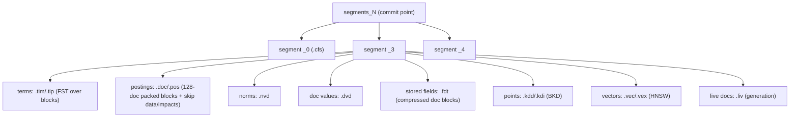

# Module 12: Lucene Internals, Relevance Engineering and the Ecosystem

This closing module opens the Lucene segment one level deeper than module 01 (files, codecs, compression, skipping), turns relevance from an opinion into a measured engineering loop with `_rank_eval`, and places Elasticsearch in its ecosystem: OpenSearch, PostgreSQL full-text search, and the release history a practitioner needs to read old answers on the internet correctly. Proofs: [`examples/12-internals-relevance.test.ts`](../examples/12-internals-relevance.test.ts) with [`examples/lib/internals.ts`](../examples/lib/internals.ts).

> **Ownership.** LSM compaction theory and columnar encodings in general are owned by [Storage Engines](../../../architecture/data-systems/modules/02-storage-engines-b-trees-and-lsm.md#5-column-oriented-storage-engines-vectorized-execution-and-compression); BKD-trees as a data structure by [Multidimensional and Spatial Indexing](../../../architecture/data-systems/modules/03-indexing-theory-and-vector-search.md#3-multidimensional-and-spatial-indexing-r-trees-and-bkd-trees). PostgreSQL FTS is owned by the postgres track ([Architectural Seam: PostgreSQL FTS vs. Elasticsearch](../../postgres/modules/05-json-jsonb-and-full-text-search.md#7-architectural-seam-postgresql-fts-vs-elasticsearch)).

---

## 1. A Segment on Disk

A Lucene 10 segment is a set of files sharing a name prefix (`_3`), written once by a **codec**, plus per-commit metadata. Elasticsearch shows them with `GET _cat/segments?v` and per-file sizes with `_disk_usage?run_expensive_tasks=true`.

| Extension | Structure | Content |
| --- | --- | --- |
| `.si` | segment info | doc count, codec, diagnostics |
| `.fnm` | field infos | field names, index options, doc-values type, vector dims |
| `.tim`, `.tip`, `.tmd` | terms dictionary and terms index (FST) | block tree of terms per field |
| `.doc`, `.pos`, `.pay` | postings | doc ids + freqs, positions, payloads and offsets |
| `.nvd`, `.nvm` | norms | one byte per doc per field (module 01) |
| `.dvd`, `.dvm` | doc values | columnar values per field |
| `.fdt`, `.fdx`, `.fdm` | stored fields | compressed blocks of documents (`_source`, `_id`) |
| `.kdd`, `.kdi`, `.kdm` | points (BKD) | numeric, date, IP, geo ranges |
| `.vec`, `.vex`, `.vem`, `.veq`, `.vemq` | vectors | raw vectors, HNSW graph, quantised vectors |
| `.liv` | live docs | deletions bitset, written per commit generation |
| `.cfs`, `.cfe` | compound file | all of the above packed into one file for small segments |
| `segments_N` | commit point | the list of segments of commit generation N |

Elasticsearch adds its own per-shard state: the translog (`translog-N.tlog`), the `_state` directory, and retention leases.

#### Deep dive: Lucene segment file formats

A Lucene segment is an immutable collection of columnar, inverted, and geometric data structures:

- **`.tim`, `.tip`, and `.tmd` (Terms Dictionary & FST Index)**:
  - `.tim`: The terms dictionary stores all unique terms for each indexed field in a BlockTree structure. Terms sharing common prefixes are clustered into compressed blocks (e.g. 25–48 terms per block) with term statistics (doc frequency, total term frequency) and metadata pointers.
  - `.tip`: An in-memory, memory-mapped Finite State Transducer (FST) indexing the block prefixes in `.tim`. Looking up a term navigates the FST in RAM to pinpoint the exact disk byte offset of the block in `.tim`, executing term lookups in $O(\text{term length})$ without disk seeks.
  - `.tmd`: Term metadata definitions per field.
- **`.doc`, `.pos`, and `.pay` (Postings Lists)**:
  - `.doc`: Stores delta-encoded document IDs and term frequencies. Gaps are bit-packed in 128-doc blocks using PFOR (Patched Frame of Reference). Skip data and block-max impact metrics are stored alongside blocks to drive Block-Max WAND early termination.
  - `.pos`: Stores term positions within each document for phrase queries (`match_phrase`) and span queries, encoded as variable-byte deltas.
  - `.pay`: Stores payload bytes (such as term boosts or sparse vector weights) and character offsets for fast highlighting.
- **`.dvd` and `.dvm` (Doc Values)**:
  - Columnar data structures optimized for sorting, aggregations, and script execution.
  - Encoded using GCD compression for integers, table-based dictionary compression for low-cardinality keywords, and bit-packing per doc block.
- **`.kdd`, `.kdi`, and `.kdm` (Points / BKD Trees)**:
  - Multidimensional block k-d trees indexing numeric, date, IP, and geospatial values.
  - `.kdd` stores point data values clustered into leaf blocks of up to 512 points. `.kdi` stores internal tree routing nodes and dimension split boundaries.
- **`.vec`, `.vex`, `.vem`, `.veq`, and `.vemq` (Vector Embeddings)**:
  - `.vec` stores raw float32 vectors. `.veq` stores quantised vector codes (int8, int4, BBQ). `.vex` stores HNSW multi-layer graph adjacency lists. `.vem` and `.vemq` hold metadata and quantisation scaling parameters.



### 1.1 Postings compression

Postings store **deltas** between consecutive doc ids (gaps), grouped in **blocks of 128** deltas; each block is bit-packed with the minimal width that fits its largest delta (frame of reference; Lucene uses a patched variant, PFOR, that stores a few large exceptions separately so that one outlier does not widen the whole block). The remainder of fewer than 128 entries is variable-length encoded. Tests:

- round-trip property `decode(encode(docs)) == docs`;
- block structure: 300 docs → 2 packed blocks + a 44-entry tail; gaps of 3 need 2 bits;
- dense postings take fewer than 3 bits per document, not 32;
- rare terms with large gaps cost more bits per posting than common terms, which is why `_disk_usage` often shows high-cardinality identifier fields dominating the inverted index.

Per block, Lucene also stores **skip data** and **impacts**: the maximum term frequency and minimum norm in the block, from which the maximum possible BM25 contribution is derived. This is what block-max WAND uses to skip non-competitive blocks (module 01) and what makes `advance(target)` cheap.

### 1.2 Conjunctions and skipping

A conjunction (`AND`, `bool.filter`, phrase pre-check) is driven by the **least costly** iterator: Lucene asks each clause for its cost (approximately its doc frequency), leads with the rarest, and calls `advance(target)` on the others, which skips whole blocks. The test `a rare term AND a common term costs ~ rare x log(common)` intersects a 3-doc list with a 100,000-doc list in fewer than 200 comparisons, against more than 50,000 for a naive merge; the property test shows both produce the same result. This is why putting a selective filter next to an expensive clause makes the whole query fast regardless of clause order in the JSON.

### 1.3 Doc values encodings

| Doc-values type | Used by | Encoding |
| --- | --- | --- |
| `NUMERIC` | single-valued numbers, dates | GCD, delta and table compression, bit-packed in blocks |
| `SORTED_NUMERIC` | multi-valued numbers | as above + per-doc counts |
| `SORTED` | single-valued keyword | ordinals (per segment) + terms dictionary |
| `SORTED_SET` | multi-valued keyword | ordinals per doc |
| `BINARY` | `binary`, some geo shapes | raw bytes |

Sorting on keyword doc values compares ordinals, not strings; across segments, Elasticsearch builds **global ordinals** lazily (module 03). Index sorting (`index.sort.field`) lets segments store documents pre-sorted, enabling early termination and better compression; `logsdb` and TSDS use it by default.

### 1.4 Stored fields

`_source` and other stored fields are written in compressed blocks of documents. `index.codec: default` favours speed (LZ4-family); `best_compression` favours size (DEFLATE historically, with newer releases moving to Zstandard). Fetching ten documents decompresses ten blocks, which is why `_source` filtering saves network but not decompression, and why synthetic source (module 03) helps disk more than CPU.

### 1.5 Points: BKD trees

Numbers, dates, IPs and geo values are indexed as **points** in a block k-d tree: leaves of up to 512 points, inner nodes splitting on the dimension of greatest spread. A range query visits only cells overlapping the range and accepts whole cells fully inside it without visiting points. Consequences: `range` on numbers is fast without doc values; `term` on a numeric field is a degenerate range; and **numeric identifiers** (order ids) are better mapped as `keyword`, because exact-match lookups on the terms dictionary beat BKD point queries for high-cardinality ids.

### 1.6 Lucene 10 in Elasticsearch 9

Elasticsearch 9.0 moved from Lucene 9 to Lucene 10 (9.5.6 ships Lucene 10.5.2). The practitioner-visible consequences:

- **Index compatibility.** Lucene reads indices from the current and previous major only, so indices created by Elasticsearch 7.x (Lucene 8) cannot be opened read-write by 9.x; they must be reindexed or archived read-only before the upgrade (module 11).
- **Java baseline.** Lucene 10 requires Java 21+; Elasticsearch bundles its own JDK, so this matters only for custom plugins and embedded use.
- **More parallelism inside a query.** Lucene 10 can split large segments into partitions searched concurrently and issues I/O prefetch hints, which helps on fast NVMe and on cold page caches; Elasticsearch uses this for concurrent segment search.
- **Sparse indexing for doc values.** A doc-values _skipper_ stores per-block min/max so range filters on sorted fields (such as `@timestamp` in `logsdb`) can skip blocks without a BKD tree, saving disk.
- **Vector improvements.** Faster HNSW search and the scalar/binary quantisation formats that back int8/int4/BBQ (module 09).

| Concern | Then (Lucene 8–9, ES 7–8) | Now (Lucene 10, ES 9) |
| --- | --- | --- |
| Readable old indices | previous major | previous major (7.x indices need reindex/archive) |
| Query parallelism | one thread per segment | intra-segment partitions, I/O prefetch |
| Range on sorted fields | BKD points always | doc-values skippers where configured (logsdb) |
| Vector formats | float HNSW, then int8/int4 | plus BBQ and disk-oriented layouts |

---

## 2. Merges in Detail

`TieredMergePolicy` (module 02) is configured through `index.merge.policy.*`:

| Setting               | Default | Meaning                                                |
| --------------------- | ------- | ------------------------------------------------------ |
| `segments_per_tier`   | 10      | allowed segments per size tier before merging          |
| `max_merge_at_once`   | 10      | segments merged together                               |
| `max_merged_segment`  | 5 GB    | segments above this are only merged to reclaim deletes |
| `floor_segment`       | 2 MB    | smaller segments are treated as this size              |
| `deletes_pct_allowed` | 20      | target upper bound on deleted docs                     |

The **merge scheduler** (`ConcurrentMergeScheduler`) runs merges on background threads (`index.merge.scheduler.max_thread_count`, derived from cores; set it to 1 for spinning disks) and throttles indexing when merges fall behind (`now throttling indexing` in the logs). Merge pressure is the hidden cost of small refresh intervals, frequent updates and vector indexing (HNSW graphs are rebuilt on merge).

#### TieredMergePolicy selection math and scoring

`TieredMergePolicy` evaluates candidate merges by computing a heuristic score for candidate segment sets:

$$\mathrm{Score} = \text{skew} \cdot (\text{size})^{\alpha} \cdot (1 - \text{pctDeletes})^{\beta}$$

Where:

- $\text{skew} = \max(\text{size}) / \sum \text{size}$ penalizes merging segments of disparate sizes. Merging 10 segments of 100 MB has $\text{skew} = 0.1$ (favored), whereas merging a 1 GB segment with nine 10 MB segments has $\text{skew} \approx 0.9$ (heavily penalized).
- $(\text{size})^{\alpha}$ (with $\alpha < 1$) favors merging smaller segments to reduce total segment count quickly.
- $(1 - \text{pctDeletes})^{\beta}$ rewards segment sets containing high percentages of deleted documents, accelerating disk space reclamation.

`segments_per_tier` defines how many segments of roughly equal size are allowed before triggering a merge. For an index of total size $S$, the steady-state segment count scales logarithmically:

$$N_{\text{segments}} \approx \text{segments-per-tier} \cdot \log_{10}\left(\frac{S}{\text{floor-segment}}\right)$$

#### OS page cache vs JVM heap budget

High-performance search relies on an exact division of host memory between the JVM heap and the Linux page cache:

- **JVM Heap Allocation (31 GB ceiling)**:
  - Dedicated to transient objects: indexing memory buffers (`indices.memory.index_buffer_size`, default 10%), active Query DSL search contexts, translog append buffers, cluster state metadata, and aggregation bucketing arrays.
  - Must remain strictly $\le 31\text{ GB}$ to retain Compressed Ordinary Object Pointers (`UseCompressedOops`). Exceeding this boundary expands object references from 32 bits to 64 bits, inflating heap consumption by 25–40% and worsening garbage collection pause times.
- **Linux OS Page Cache**:
  - Lucene accesses segments via `MMapDirectory`, memory-mapping segment files (`.tim`, `.doc`, `.dvd`, `.vec`, `.kdd`) into the operating system virtual address space.
  - Page cache hits execute at DRAM speeds (~100 nanoseconds), while page cache misses force random kernel disk I/O (50–500 microseconds on NVMe SSDs, or 5–10 milliseconds on spinning rust).
  - Sizing rule: At least 50% of node RAM must be reserved for the OS page cache. Allocating excessive heap starves the page cache, converting fast vector hops and doc values scans into blocking disk read operations.

---

## 3. Relevance Engineering

### 3.1 The loop


### 3.2 The Ranking Evaluation API

```json
GET /products/_rank_eval
{
  "requests": [
    {
      "id": "wireless_keyboard",
      "request": { "query": { "match": { "description": "wireless keyboard" } } },
      "ratings": [
        { "_index": "products", "_id": "p2", "rating": 3 },
        { "_index": "products", "_id": "p5", "rating": 2 },
        { "_index": "products", "_id": "p1", "rating": 1 }
      ]
    }
  ],
  "metric": { "dcg": { "k": 10, "normalize": true } }
}
```

Requests can also reference a search template with parameters (`templates` + `template_id`), so the evaluated query is exactly the production one. Metrics and their definitions, each implemented and checked against a hand computation in the tests:

| Metric | Definition | Parameters |
| --- | --- | --- |
| `precision` | relevant hits in top $k$ / hits in top $k$ | `k`, `relevant_rating_threshold`, `ignore_unlabeled` |
| `recall` | relevant hits in top $k$ / all relevant rated docs | `k`, `relevant_rating_threshold` |
| `mean_reciprocal_rank` | $1/\text{rank}$ of the first relevant hit, averaged | `k`, `relevant_rating_threshold` |
| `dcg` | $\sum_{i=1}^{k} (2^{r_i} - 1)/\log_2(i + 1)$; `normalize: true` divides by the ideal DCG | `k`, `normalize` |
| `expected_reciprocal_rank` | cascade model: $\sum_i \frac{1}{i} R_i \prod_{j<i}(1 - R_j)$, $R = (2^{r} - 1)/2^{r_{\max}}$ | `maximum_relevance`, `k` |

Unrated documents count as irrelevant by default; the response lists them under `unrated_docs` so you can extend the judgement list. `ignore_unlabeled: true` excludes them instead (test `precision@k counts rated-relevant hits`). nDCG is bounded in $[0, 1]$ and equals 1 for the ideal ordering (property test); ERR rewards an excellent first hit much more than the same hit at rank 3 (test).

#### `_rank_eval` evaluation response structure

The API returns the overall `metric_score` alongside per-query score breakdowns and unrated documents requiring labeling:

```json
{
  "metric_score": 0.8642,
  "details": {
    "wireless_keyboard": {
      "metric_score": 0.8642,
      "unrated_docs": [{ "_index": "products", "_id": "p8" }],
      "hits": [
        { "hit": { "_index": "products", "_id": "p2", "_score": 12.4 }, "rating": 3 },
        { "hit": { "_index": "products", "_id": "p1", "_score": 10.1 }, "rating": 1 },
        { "hit": { "_index": "products", "_id": "p5", "_score": 9.5 }, "rating": 2 }
      ]
    }
  }
}
```

This response directly reveals which unlabelled documents entered the top $k$, directing human annotators to expand the ground truth judgement set where it matters most.

#### DCG and nDCG worked calculation

Given three search results with graded relevance ratings $r_1 = 3, r_2 = 1, r_3 = 2$:

1. **Discounted Cumulative Gain ($\mathrm{DCG}@3$)**: $$\mathrm{DCG}@3 = \sum_{i=1}^3 \frac{2^{r_i} - 1}{\log_2(i + 1)} = \frac{2^3 - 1}{\log_2(2)} + \frac{2^1 - 1}{\log_2(3)} + \frac{2^2 - 1}{\log_2(4)}$$ $$\mathrm{DCG}@3 = \frac{7}{1} + \frac{1}{1.5850} + \frac{3}{2} = 7.0 + 0.6309 + 1.5 = 9.1309$$
2. **Ideal Discounted Cumulative Gain ($\mathrm{IDCG}@3$)**: Sorting ratings monotonically descending gives ideal order $(3, 2, 1)$: $$\mathrm{IDCG}@3 = \frac{2^3 - 1}{\log_2(2)} + \frac{2^2 - 1}{\log_2(3)} + \frac{2^1 - 1}{\log_2(4)} = \frac{7}{1} + \frac{3}{1.5850} + \frac{1}{2} = 7.0 + 1.8927 + 0.5 = 9.3927$$
3. **Normalized Discounted Cumulative Gain ($\mathrm{nDCG}@3$)**: $$\mathrm{nDCG}@3 = \frac{\mathrm{DCG}@3}{\mathrm{IDCG}@3} = \frac{9.1309}{9.3927} \approx 0.9721$$

### 3.3 Levers, from cheapest to most expensive

1. **Mapping and analysis**: the right analyzer per field, multi-fields (stemmed and exact), synonyms at search time, diacritic folding.
2. **Query structure**: `multi_match` type and field boosts, `combined_fields`, phrase boosting with `should` + `match_phrase`, `minimum_should_match`.
3. **Business signals**: `rank_feature` (popularity, quality), `distance_feature` (recency, proximity), `function_score` decays.
4. **Hybrid retrieval**: BM25 + vectors with RRF (module 09).
5. **Re-ranking**: cross-encoder rerankers on the top window; **learning to rank** (LTR) with an XGBoost/LightGBM model uploaded via Eland and applied as a rescorer (`learning_to_rank` rescorer, features defined as templated queries).
6. **Query rules and pinned results** for merchandising overrides.

Tools: `explain: true` and `_explain/<id>` for single documents, `profile` for cost, `_rank_eval` for quality, and A/B tests with click metrics online.

---

## 4. OpenSearch

OpenSearch is the Apache-2.0 fork of Elasticsearch 7.10.2 and Kibana 7.10.2, created by AWS in 2021 after Elastic's licence change, and governed since September 2024 by the OpenSearch Software Foundation under the Linux Foundation. Current release: **3.9.0** (2026-09-29), with 2.19.x in maintenance; 3.x is based on **Lucene 10** (since 3.0, May 2025).

### 4.1 Where they still agree

The core document, mapping, Query DSL, aggregation and cluster APIs from the 7.10 era are largely shared: `_doc` CRUD, `_bulk`, `_search` with `bool`/`match`/`term`, `terms` and `date_histogram` aggregations, `_cat`, `_cluster/health`, aliases, templates, snapshots. Much of modules 01–05, 07 and 10–11 transfers directly, as do Lucene-level behaviours (BM25, segments, merges, NRT refresh, norms).

### 4.2 Where they diverged

| Area | Elasticsearch 9.x | OpenSearch 3.x |
| --- | --- | --- |
| Licence | ELv2, SSPL or AGPLv3 (since Aug 2024); paid tiers for some features | Apache 2.0, all features |
| Query languages | Query DSL, ES\|QL, EQL, SQL | Query DSL, PPL, SQL |
| Vector search | `dense_vector` on Lucene HNSW, int8/int4/BBQ, `semantic_text`, retrievers | `knn_vector` (k-NN plugin) with Faiss and Lucene engines (NMSLIB deprecated), neural search plugin, search pipelines with hybrid normalisation |
| Lifecycle | ILM, data stream lifecycle, data tiers | Index State Management (ISM) plugin |
| Security | built in (X-Pack heritage) | Security plugin (roles, tenants, DLS/FLS) |
| Clients | `@elastic/elasticsearch` 9.x (checks the product header) | `@opensearch-project/opensearch` 3.x |
| Index modes | `logsdb`, `time_series`, `lookup` | not available; separate features (e.g. derived source for vectors, pull-based ingestion, gRPC transport in 3.x) |
| Managed | Elastic Cloud (hosted, serverless) | Amazon OpenSearch Service, OpenSearch Serverless |

#### Detailed engine and architectural divergence

The two systems have diverged structurally in their core execution engines and vector subsystems:

- **Vector search implementation**: OpenSearch relies on a separate `k-NN` plugin wrapping external C++ libraries (Faiss, and historically NMSLIB) via JNI, maintaining index structures alongside Lucene. Elasticsearch implements vector search directly within core Lucene as first-class segment files (`.vec`, `.vex`, `.veq`), enabling native Lucene merges, scalar/BBQ quantization, and unified transaction logs.
- **Pipelined query processing**: OpenSearch developed PPL (Pipelined Processing Language) using an interpreted AST visitor model. Elasticsearch built ES|QL around an in-memory vectorized columnar execution engine with SIMD-accelerated operators, block-oriented data transfer, and zero-copy string slicing.
- **Stateless storage and caching**: OpenSearch Serverless completely decouples indexing instances from search instances via shared S3 object storage. Elasticsearch maintains stateful data tiers (`hot`, `warm`, `cold`, `frozen`) powered by Searchable Snapshots with an integrated local LRU block cache.

Compatibility pitfalls: since 7.14 the official Elasticsearch clients refuse to talk to servers that do not identify as Elasticsearch, so use the OpenSearch client; snapshots are not interchangeable across the forks beyond the shared 7.10 format; mappings using newer Elasticsearch types (`semantic_text`, `match_only_text` on old OpenSearch, `flattened` vs OpenSearch's `flat_object`) do not port.

### 4.3 Choosing

Choose by required features and operating model, not by benchmark claims from either vendor: ES|QL, `logsdb`, BBQ, Elastic's AI and observability stack and Elastic Cloud on one side; Apache 2.0 licensing, AWS-managed service integration and the plugin ecosystem on the other.

---

## 5. Elasticsearch or PostgreSQL Full-Text Search?

PostgreSQL's `tsvector`/GIN full-text search (owned by the postgres track) is often enough. The decision rests on a few questions:

| Question | Points to PostgreSQL FTS | Points to Elasticsearch |
| --- | --- | --- |
| Relevance quality | basic ranking (`ts_rank`, no BM25 corpus statistics) is acceptable | BM25, field boosts, synonyms graphs, fuzzy, autocomplete, hybrid vectors, `_rank_eval` |
| Data volume and query load | fits one primary with replicas | needs horizontal partitioning of search load |
| Consistency | search must be transactionally consistent with writes | near-real-time (≈ 1 s) lag is acceptable |
| Analytics | simple counts | facets, cardinality, percentiles, histograms over large sets |
| Operational budget | one database to run | a second distributed system plus a sync pipeline (CDC, outbox) |
| Languages | built-in dictionaries suffice | rich analysis chains, ICU, per-language analyzers |

A common architecture keeps PostgreSQL as the system of record and feeds Elasticsearch through change data capture or an outbox; the index is then **rebuildable** at any time, which also simplifies mapping changes (module 08). The hard part is the sync pipeline: ordering, deletes, and backfills (data-systems owns CDC).

#### Architectural seam: Inverted index mechanics and CDC synchronization

PostgreSQL and Elasticsearch solve full-text search with fundamentally distinct data structures and consistency models:

| Architectural Seam | PostgreSQL FTS (`tsvector` / GIN) | Elasticsearch (Lucene 10) |
| --- | --- | --- |
| Inverted Index Structure | GIN (Generalized Inverted Index): B-tree of terms pointing to posting trees or bitmap pages | BlockTree terms dictionary in `.tim` indexed by memory-mapped FST (`.tip`), with 128-doc PFOR postings in `.doc` |
| Corpus Scoring | Density-based `ts_rank` / `ts_rank_cd` based on term count and distance; no global corpus statistics | BM25 with dynamic term frequency ($tf$), inverse document frequency ($idf$), and document length normalisation ($\|d\| / \text{avgdl}$) |
| Index Concurrency | Shared B-tree locking; vacuum reclaims dead index tuples; high write concurrency can cause GIN lock contention | Immutable segment architecture; writes append to in-memory buffers; background `TieredMergePolicy` merges segments asynchronously |
| Synchronization Architecture | System of record; synchronous ACID transaction commit | Change Data Capture (CDC) via PostgreSQL logical replication (WAL) $\to$ Debezium $\to$ Kafka $\to$ Elasticsearch ingest pipeline |
| Search Latency & Scaling | Vertical scaling on single primary node; expensive queries contend with transactional OLTP workloads | Distributed horizontal partitioning across data nodes; isolated search thread pools and page-cache mmap |

---

## 6. Version History for Practitioners

| Release | Date | What changed for practitioners |
| --- | --- | --- |
| 1.x | 2014 | aggregations replace facets; snapshot/restore |
| 2.x | 2015 | query/filter merged into `bool.filter`; doc values default |
| 5.0 | 2016 | `text`/`keyword`, BM25 default, ingest nodes, Painless, Lucene 6 |
| 6.0 | 2017 | one mapping type per index, sequence numbers, CCR (6.5), ILM (6.6), Lucene 7 (no coord) |
| 7.0 | 2019 | no mapping types in APIs, Zen2 coordination, 1 primary default, `track_total_hits`, adaptive replica selection, Lucene 8 (block-max WAND) |
| 7.x | 2019–2021 | data streams (7.9), searchable snapshots (7.10+), runtime fields (7.11); licence change to SSPL/ELv2 (7.11) → OpenSearch fork from 7.10.2 |
| 8.0 | 2022 | security on by default, `_doc` only, kNN (HNSW), Lucene 9 |
| 8.x | 2022–2025 | int8/int4/BBQ quantisation, ES\|QL (GA 8.14), retrievers and RRF, `semantic_text`, logsdb, LOOKUP JOIN preview (8.18); AGPLv3 option (Aug 2024) |
| 9.0 | Apr 2025 | Lucene 10, BBQ GA, 7.x indices must be reindexed or archived |
| 9.4 | May 2026 | ES\|QL views, PromQL in ES\|QL (tech preview) |
| 9.5 | Aug 2026 | batched query phase, data stream lifecycle `frozen_after`, columnar index modes (tech preview) |
| 9.5.6 | Nov 2026 | current patch at the time of writing; Lucene 10.5.2 |

When reading a blog post or Stack Overflow answer, date it against this table: anything mentioning `string`, `_type`, `filtered`, `_all`, `minimum_master_nodes` or "security is a paid add-on" predates the current architecture.

### 6.1 Then vs now: Elasticsearch 7.x/8.x vs 9.x / Lucene 10

| Architectural Concern | Elasticsearch 7.x / 8.x | Elasticsearch 9.x / Lucene 10 | Production Impact |
| --- | --- | --- | --- |
| Vector Quantisation | Unquantised float32 or int8 (`int8_hnsw` in 8.12) | BBQ (`bbq_hnsw`) default for $\ge 384$ dims; `bbq_disk` off-heap | ~27× RAM savings for vector storage; requires oversampling and float rescoring |
| Partition Routing | Routing shards: $\lfloor \mathrm{floorMod}(h, R)/(R/P) \rfloor$ | Modulo routing (`MOD_ROUTING_FUNCTION`): $\mathrm{floorMod}(h, P)$ | Splitting to $kP$ shards maps $i \to \{i + mP\}$; eliminates synthetic $R$ ceiling |
| Hybrid Retrieval | `bool` query with `match` and `knn`, manual boost tuning | `linear` and `rrf` retrievers with score normalisation (`minmax`, `l2_norm`) | Robust fusion of lexical and vector scores without manual score scale calibration |
| Relational Enrichment | Ingest pipelines with `enrich` processor or denormalisation | ES\|QL `LOOKUP JOIN` against single-shard `lookup` indices | Query-time relational joins over dimensional data directly in streaming queries |
| Deep Pagination | `scroll` API (server-side cursor holding Lucene searcher open) | Point-in-Time (PIT) + `search_after` with sliced pagination; `scroll` deprecated | Stateless pagination without segment pinning; immune to coordinator memory leaks |
| Lucene Core | Lucene 8 (ES 7) / Lucene 9 (ES 8) | Lucene 10 (Java 21+ baseline, intra-segment search concurrency, I/O prefetch) | Drops compatibility with 7.x indices; faster cold-cache search on NVMe |

> **Exam delta (Elastic Certified Engineer, 9.3).** Lucene internals, `_rank_eval`, OpenSearch and PostgreSQL comparisons are interview topics rather than exam objectives. For the exam, the parts of this module that matter are reading `_cat/segments`, knowing what force merge does, and the version-dating skill in §6 when documentation examples look different from older study material.

---

## 7. Production Failure Modes

1. **Disk dominated by one field.** `_disk_usage` shows an unused high-cardinality field indexed and with doc values. Map it `index: false, doc_values: false` or drop it.
2. **Indexing throttled by merges.** "now throttling indexing" in logs. Slower refresh, fewer updates per document, faster disks.
3. **Relevance changes shipped without measurement.** A boost tweak fixes one query and silently degrades a hundred. Keep a judgement list and gate changes on `_rank_eval`.
4. **Client/server fork mismatch.** An Elasticsearch client pointed at OpenSearch fails the product check.
5. **Numeric ids as `long`.** Point queries for exact ids are slower than keyword terms.
6. **PostgreSQL → Elasticsearch sync drift.** Missed deletes; no full rebuild path. Make the index rebuildable and reconcile counts periodically.

---

## Interview Drill

<details><summary>1. How are postings compressed, and why do rare terms cost more per posting?</summary>

Doc ids are stored as gaps in blocks of 128, each bit-packed at the width of its largest gap (PFOR, with exceptions), plus a variable-length tail. Rare terms have large gaps, so each posting needs more bits; common terms have small gaps and pack densely.
</details>

<details><summary>2. Why is <code>rare AND common</code> fast in Lucene?</summary>

The conjunction leads with the cheapest iterator and calls `advance(target)` on the others, which uses skip data to jump over whole blocks; cost is roughly proportional to the rare term's postings times a logarithmic skip cost, not to the common term's length.
</details>

<details><summary>3. How do you measure whether a relevance change is an improvement?</summary>

A graded judgement list over representative queries, `_rank_eval` with nDCG@10 (and MRR or ERR) before and after on the same data, inspection of per-query deltas and unrated docs, then an online A/B test.
</details>

<details><summary>4. Name three practical differences between Elasticsearch 9 and OpenSearch 3.</summary>

Licensing (ELv2/SSPL/AGPLv3 with paid tiers versus Apache 2.0); query languages (ES|QL versus PPL); vector stack (Lucene HNSW with BBQ, retrievers and `semantic_text` versus the k-NN plugin with Faiss/Lucene engines and neural search pipelines); lifecycle (ILM/data stream lifecycle versus ISM); and incompatible clients.
</details>

<details><summary>5. When would you not add Elasticsearch next to PostgreSQL?</summary>

When search is a small, transactionally coupled feature over data that fits one database and basic ranking is enough: PostgreSQL FTS with GIN, `pg_trgm` and `pgvector` avoids a second distributed system and its sync pipeline.
</details>

<details><summary>6. What does <code>_forcemerge?max_num_segments=1</code> change on disk, and when is it harmful?</summary>

All segments are rewritten into one, deleted documents are purged, compression and search speed improve. It is harmful on indices still being written: the huge segment exceeds `max_merged_segment` and is no longer merged normally, so new deletes accumulate, and the rewrite costs I/O and invalidates snapshot deduplication.
</details>

<details><summary>7. Why can't Elasticsearch filter stored fields on disk without decompressing the full document block?</summary>

Stored fields (`.fdt`) are compressed in multi-document blocks using LZ4 or Zstandard. Even when requesting a single field via `_source: ["title"]`, Lucene must fetch and decompress the entire compressed chunk from disk into memory before extracting the specified field. To avoid decompression overhead during search filtering or sorting, use columnar `doc_values` (`.dvd`), which are stored individually per field.
</details>
