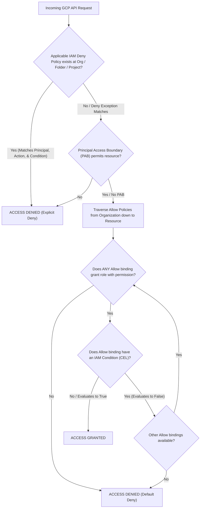

# GCP Architecture & Systems Engineering Cheatsheet

A fast-lookup engineering reference covering Google Cloud IAM inheritance and evaluation precedence, Google Cloud SDK (`gcloud`) operations, architecture patterns, and critical service quotas and performance limits across Google Cloud core services.

---

## 1. IAM Policy Evaluation & Inheritance Logic

In Google Cloud, permissions inherit strictly down the resource hierarchy: `Organization -> Folders -> Projects -> Resources`. When a principal issues an API request, the evaluation engine evaluates Deny policies across the hierarchy first, followed by Allow policies and IAM conditions. Any **Explicit Deny** immediately terminates evaluation with `Deny`.



### Precedence Hierarchy Rules

1. **Deny Trumps Allow Everywhere**: If an IAM Deny policy anywhere in the hierarchy (Organization, Folder, Project) denies the permission for the principal, the request is denied, even if an Allow policy directly on the target resource grants it.
2. **Union of Inherited Allow Permissions**: Permissions are additive down the hierarchy. An Allow role granted at the Organization or Folder level cannot be removed or restricted by an Allow policy at the Project level.
3. **IAM Conditions (CEL)**: If an Allow binding carries a Common Expression Language (CEL) condition (e.g. checking resource tags, request timestamps, or IP subnets), the permission applies only when the expression evaluates to `true`.
4. **Service Account Token Impersonation**: Generating short-lived OAuth 2.0 access tokens via `iam.serviceAccounts.getAccessToken` requires `roles/iam.serviceAccountTokenCreator` on the target service account, eliminating static JSON key leaks.
5. **Default Deny**: If no Allow policy grants the necessary permission across the entire hierarchy, access is denied by default.

---

## 2. Google Cloud SDK (`gcloud`) Essential Commands

### Identity, Authentication & Impersonation

```bash
# Verify current authenticated identity and active project
gcloud auth list
gcloud config get-value project

# Authenticate via user credentials
gcloud auth login --update-adc

# Impersonate a privileged service account without static keys
gcloud compute instances list \
  --impersonate-service-account="deployer@my-prod-project.iam.gserviceaccount.com"

# Generate a temporary OAuth2 access token for an impersonated service account
gcloud auth print-access-token \
  --impersonate-service-account="deployer@my-prod-project.iam.gserviceaccount.com"
```

### Resource Hierarchy & Organization Policies

```bash
# List folders under organization
gcloud resource-manager folders list --organization="123456789012"

# Set organization policy constraint (e.g. disable SA key creation)
gcloud org-policies set-policy policy.yaml --organization="123456789012"

# Describe project metadata and numeric project number
gcloud projects describe "my-prod-project-42" --format="value(projectNumber)"
```

### Cloud Run & Serverless

```bash
# Deploy container with instance-based billing (CPU always allocated) and concurrency 100
gcloud run deploy orders-api \
  --image="us-docker.pkg.dev/my-prod-project/apps/orders:v1.2.0" \
  --region="us-central1" \
  --no-cpu-throttling \
  --concurrency=100 \
  --min-instances=2 \
  --max-instances=50 \
  --ingress="internal-and-cloud-load-balancing"

# Execute a Cloud Run Job asynchronously
gcloud run jobs execute nightly-reconciliation --region="us-central1" --wait
```

### Cloud Storage

```bash
# Create multi-region bucket with Uniform Bucket-Level Access and Autoclass enabled
gcloud storage buckets create gs://corp-telemetry-archive \
  --location="US" \
  --uniform-bucket-level-access \
  --enable-autoclass

# Apply an immutable 30-day retention policy and lock it
gcloud storage buckets update gs://corp-compliance-vault \
  --retention-period="30d"
gcloud storage buckets lock gs://corp-compliance-vault
```

### Cloud Pub/Sub

```bash
# Create topic and dead-letter fallback topic
gcloud pubsub topics create telemetry-events
gcloud pubsub topics create telemetry-events-dlq

# Create subscription with ordering keys, 60s ack deadline, and dead-letter policy
gcloud pubsub subscriptions create telemetry-sub \
  --topic=telemetry-events \
  --ack-deadline=60 \
  --enable-message-ordering \
  --dead-letter-topic=telemetry-events-dlq \
  --max-delivery-attempts=5
```

### BigQuery Cost & Execution Safeguards

```bash
# Execute query with strict maximum bytes billed limit (e.g. 50 GiB ceiling)
bq query \
  --use_legacy_sql=false \
  --maximum_bytes_billed=53687091200 \
  --dry_run=false \
  'SELECT customer_id, SUM(order_total) FROM `my-prod-project.analytics.orders` WHERE order_date >= "2026-01-01" GROUP BY 1'

# Deterministic dry-run to estimate scanned bytes prior to running
bq query \
  --use_legacy_sql=false \
  --dry_run=true \
  'SELECT * FROM `my-prod-project.analytics.orders`'
```

---

## 3. Core Architectural Quotas, Defaults & Limits

| Service / Resource | Architectural Metric | Official Default / Upper Bound | Failure Mode if Violated |
| --- | --- | --- | --- |
| **Cloud NAT** | Minimum ports per VM (Static) | 64 ports per VM instance | Silent outbound TCP connection drops / timeouts under connection bursts. |
| **Cloud NAT** | Minimum ports per VM (Dynamic) | 32 ports per VM instance | Connection throttling if endpoints scale faster than dynamic allocation steps. |
| **Compute Engine** | Default Service Account Role | Historically `roles/editor` | Massive blast radius if instance is compromised; enforce `iam.automaticIamGrantsForDefaultServiceAccounts`. |
| **Cloud Storage** | Object Mutation Consistency | Strong read-after-write / read-after-delete | None; strongly consistent across all global regions. |
| **Cloud Storage** | Retention Policy Locking | Irreversible compliance lock | Cannot shorten retention period or delete bucket until all object holds expire. |
| **Cloud Run** | Maximum Concurrency | 80 default (up to 1,000 per container) | Head-of-line blocking if concurrency is set too high for single-threaded runtimes. |
| **Cloud Run** | CPU Throttling | CPU allocated only during request processing | Background threads, event emitters, and goroutines freeze immediately after HTTP response finishes. |
| **Cloud Spanner** | TrueTime Clock Uncertainty ($\epsilon$) | Typically $\approx 1\text{ms}$ to $7\text{ms}$ | Write transactions wait out $2\epsilon$ duration before commit release to guarantee linearizability. |
| **Cloud Spanner** | Primary Key Design | Anti-pattern: Monotonically increasing keys | Single split (tablet) overload leading to CPU saturation and severe write throttling. |
| **Cloud Pub/Sub** | Default Ack Deadline | 10 seconds (configurable 10s to 600s) | Redelivery storms and duplicated processing when long-running tasks exceed 10 seconds. |
| **Cloud Pub/Sub** | Ordering Keys + Failed Message | Strict sequence preservation | Entire ordering key stream halts (head-of-line blocking) until failed message acks or DLQ routes. |
| **BigQuery** | On-Demand Query Billing | \$6.25 per TiB scanned (minimum 10 MiB) | Unpartitioned `SELECT *` with `LIMIT 10` scans and bills the entire petabyte table dataset. |
| **Firestore** | Mode Selection (Native vs Datastore) | Permanent one-way choice per database | Cannot change database mode in place; requires project or database recreation. |
| **VPC Peering** | Route Transitivity | Strictly Non-Transitive | Peered VPC A cannot reach VPC C through intermediate VPC B without VPN or Interconnect. |
