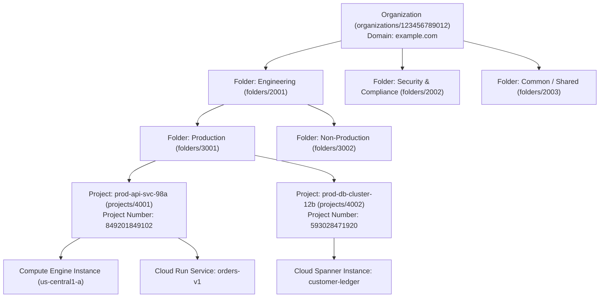
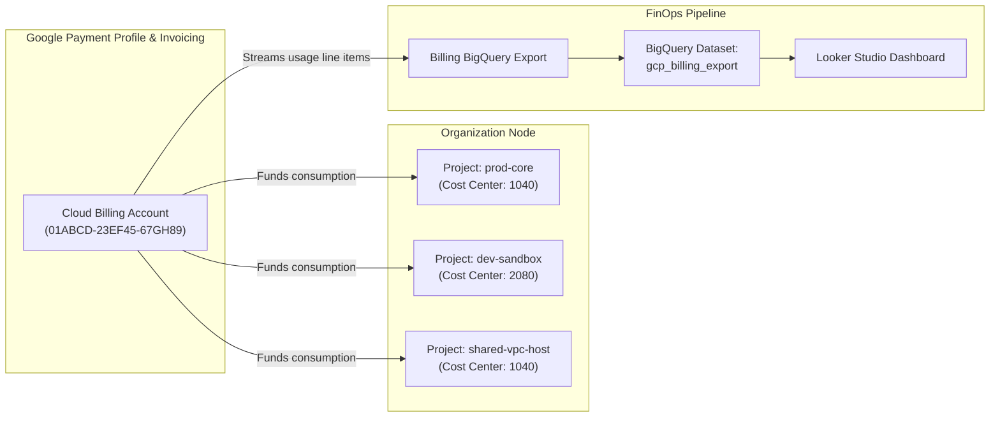
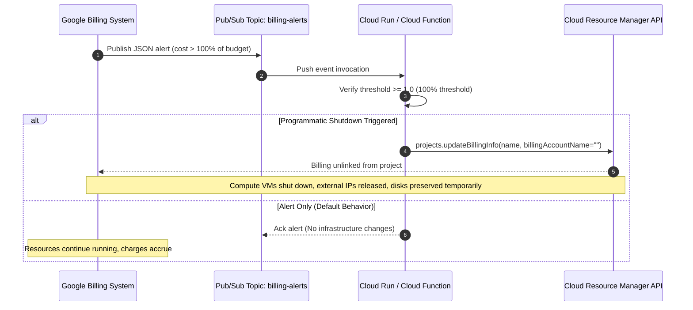
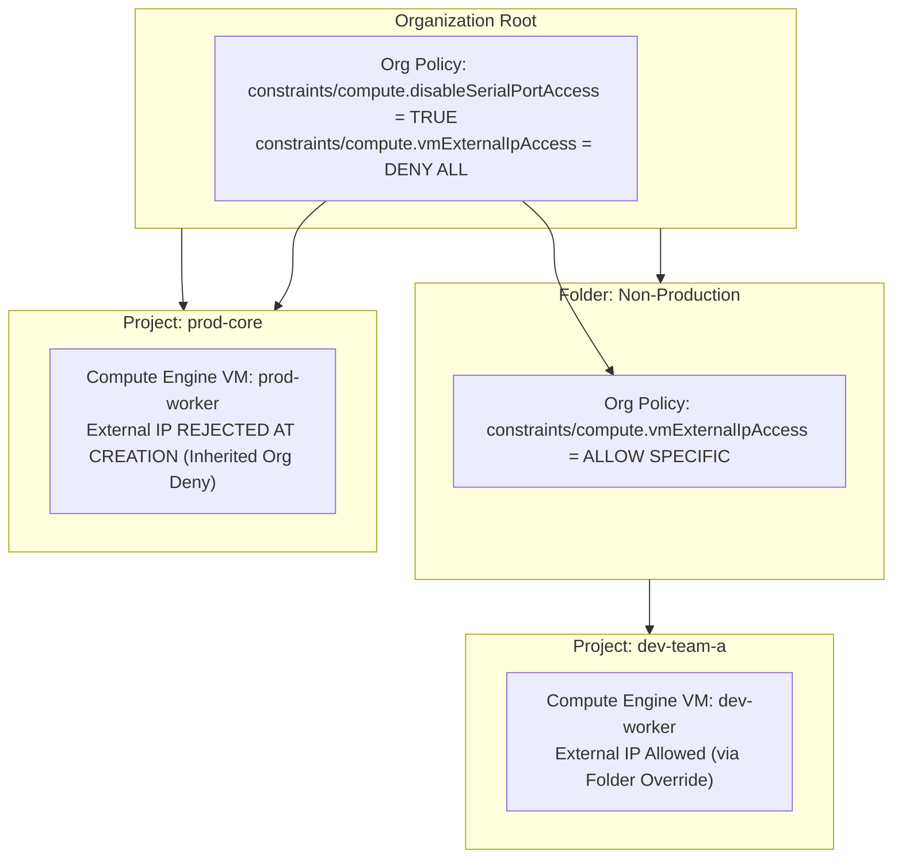
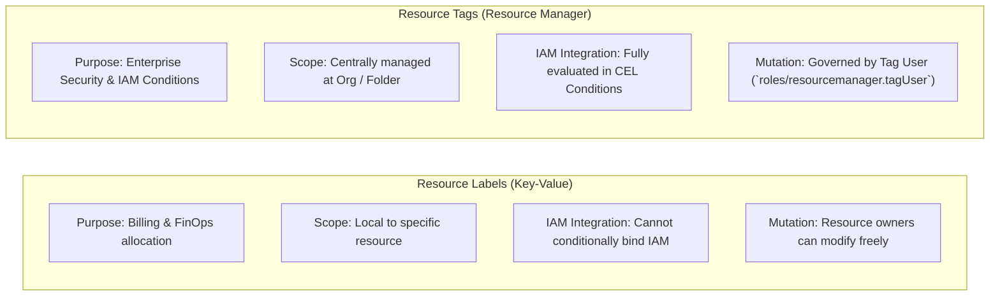
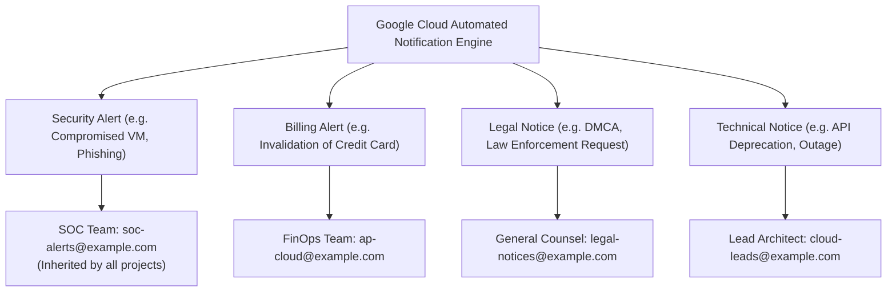

# Module 01: Resource Hierarchy, Billing, and Org Policies

Google Cloud Platform structures all computational, storage, and networking resources inside a directed tree hierarchy. Understanding the formal semantics of this resource hierarchy, billing account associations, organizational policies, and resource tagging is foundational to designing multi-tenant enterprise architectures with deterministic access control and bounded blast radiuses.

---

## 1. Formal Resource Hierarchy Architecture

In Google Cloud, resources cannot exist as orphaned entities. Every resource (Compute Engine virtual machine, Cloud Storage bucket, BigQuery dataset, Pub/Sub topic) is parented by exactly one **Project**, which in turn is parented by zero or more **Folders**, culminating in a single root **Organization** node.



### Mathematical Formulation of Resource Ancestry

Let $V$ denote the set of all nodes in a Google Cloud organizational graph, and let $E \subset V \times V$ represent the set of directed edges pointing from a parent container to a child container. The resource hierarchy forms a rooted directed tree $T = (V, E, r)$ where:

1. $r \in V$ is the unique Organization root corresponding to a verified Google Workspace or Cloud Identity domain.
2. For every child node $u \in V \setminus \{r\}$, there exists a unique in-degree of 1: $\operatorname{deg}^-(u) = 1$, defining a unique parent function $P(u) = v$ where $(v, u) \in E$.
3. The ancestry path of any resource $x \in V$ is defined as the unique sequence:

$$\operatorname{Ancestry}(x) = (x_0, x_1, \dots, x_k)$$

where $x_0 = x$, $x_k = r$, and $x_{i+1} = P(x_i)$ for all $0 \le i < k$.

### Node Types and Identifiers

Google Cloud uses three distinct identifier schemas for projects, which must not be conflated during automation or infrastructure-as-code authoring:

| Identifier Type | Mutability | Scope | Format / Constraints | Canonical Architectural Purpose |
| --- | --- | --- | --- | --- |
| **Project ID** | Immutable post-creation | Globally unique across all Google Cloud customers | 6 to 30 lowercase letters, digits, and hyphens; must start with a letter; no trailing hyphens. | Used in CLI commands (`gcloud`), API endpoints, Terraform resource declarations, and Cloud SDK configurations. |
| **Project Number** | Immutable generated value | Globally unique | 12-digit integer automatically assigned by Google upon project creation. | Used by Google internal services, Service Agents (`service-<project-number>@...`), and IAM policy conditions. |
| **Project Name** | Mutable at any time | Non-unique (display only) | 4 to 30 characters; can contain letters, numbers, spaces, quotes, and punctuation. | Human-readable console display label; never used for programmatic access control or API resolution. |

> [!IMPORTANT]
> When a project is deleted, Google Cloud places it into a 30-day soft-delete holding state during which project owners can restore it via `gcloud projects undelete`. However, once the 30-day window expires and the project is permanently expunged, its **Project ID can never be reused by any customer globally**. Automation systems must never assume project IDs can be recycled.

---

## 2. Cloud Billing Architecture & Spend Control Mechanics

A Google Cloud Billing Account is an administrative entity linked to an external payment profile (credit card, bank account, or enterprise invoiced billing agreement) that pays for the resource consumption across one or more projects.



### Billing Association Rules

1. **One-to-Many Relationship**: A Cloud Billing Account can be linked to zero, one, or thousands of projects. However, a Project can be linked to **at most one** Cloud Billing Account at any given instant.
2. **Billing Account Administrator (`roles/billing.admin`)**: Controls payment methods, invoicing parameters, and project linkage.
3. **Billing Account User (`roles/billing.user`)**: Allows an engineer to associate new or existing projects with the billing account without granting visibility into financial payment details.
4. **Project Billing Manager (`roles/billing.projectManager`)**: Allows an engineer to link or unlink the project from billing accounts, effectively stopping all billable workloads if unlinked.

### The Budget Alert Trap

A ubiquitous production failure mode in Google Cloud governance stems from a misunderstanding of Cloud Billing Budgets:

> [!WARNING]
> **Budgets and alerts DO NOT stop spend or throttle resource consumption.** Creating a budget with threshold alerts (e.g., 50%, 90%, 100% of actual or forecasted spend) only triggers email notifications to billing administrators or publishes a JSON message to a Cloud Pub/Sub topic. Google Cloud will **continue running compute workloads and racking up costs indefinitely** beyond the budget limit unless automated programmatic teardown is wired into the Pub/Sub topic.



### Automated Spend Cap Architecture

To enforce a hard cap on project spend, architects deploy an automated circuit breaker. When the Pub/Sub alert payload indicates that `costAmount >= budgetAmount`, a Cloud Function or Cloud Run service invokes the Cloud Billing API to detach the billing account:

```typescript
import { CloudBillingClient } from '@google-cloud/billing';

interface BillingAlertPayload {
  budgetDisplayName: string;
  costAmount: number;
  budgetAmount: number;
  costIntervalStart: string;
}

export async function handleBillingAlert(event: { data: string }): Promise<void> {
  const payload: BillingAlertPayload = JSON.parse(
    Buffer.from(event.data, 'base64').toString('utf-8'),
  );

  const ratio = payload.costAmount / payload.budgetAmount;
  console.log(
    `Budget [${payload.budgetDisplayName}] evaluated: ${(ratio * 100).toFixed(1)}% consumed`,
  );

  if (ratio >= 1.0) {
    const projectId = process.env.TARGET_PROJECT_ID;
    if (!projectId) throw new Error('TARGET_PROJECT_ID environment variable not set');

    const billingClient = new CloudBillingClient();
    console.warn(`CRITICAL: Hard cap exceeded for project ${projectId}. Disabling billing...`);

    // Detaching billing immediately terminates Compute Engine VMs and serverless invocations
    await billingClient.updateProjectBillingInfo({
      name: `projects/${projectId}`,
      projectBillingInfo: {
        billingAccountName: '', // Empty string detaches billing
      },
    });

    console.info(`Successfully disabled billing for project ${projectId}`);
  }
}
```

> [!CAUTION]
> Disabling billing on a production project causes immediate catastrophic service disruption: running Compute Engine VMs are terminated, Cloud Run containers scale to zero, external IP allocations may be released, and Google Cloud reserves the right to delete unbacked persistent disk data after a grace period. Hard caps should only be deployed on development, sandbox, or training environments.

---

## 3. Organization Policies Architecture & Constraints Engine

Organization Policy Service allows enterprise administrators to define centralized, deterministic guardrails across the resource hierarchy. Unlike IAM policies (which govern _who_ can execute _what_ action on a resource), Organization Policies govern _what configurations_ resources are allowed to take.



### Constraint Types

Google Cloud supports three distinct structural constraint models:

1. **Boolean Constraints**: Enforce a strict binary flag across resources (`TRUE` or `FALSE`).
   - Example: `constraints/compute.disableSerialPortAccess`: Prevents users from establishing interactive serial console sessions with Compute Engine instances.
   - Example: `constraints/iam.disableServiceAccountKeyCreation`: Prevents users from generating long-lived, downloadable JSON private keys for service accounts.
   - Example: `constraints/storage.uniformBucketLevelAccess`: Mandates that all Cloud Storage buckets within the scope enforce Uniform Bucket-Level Access (UBLA), disallowing legacy ACLs.
2. **List Constraints**: Enforce an allowlist or denylist of permitted values.
   - Example: `constraints/compute.vmExternalIpAccess`: Restricts which Compute Engine instances can be assigned external public IPv4/IPv6 addresses.
   - Example: `constraints/gcp.resourceLocations`: Restricts physical data storage and execution regions (e.g., `in:eu-locations` to satisfy GDPR data residency mandates).
3. **Custom Constraints**: User-defined constraints evaluated using Common Expression Language (CEL) expressions against Google Cloud Resource Manager API resource representations.

### List Constraint Inheritance Evaluation

When a child container inherits a list constraint from an ancestor, administrators configure how the child policy resolves using `inheritFromParent`:

$$\operatorname{EffectivePolicy}(u) = \begin{cases} \operatorname{ExplicitRules}(u), & \text{if } \text{inheritFromParent} = \text{false} \\ \operatorname{ParentPolicy}(P(u)) \cup \operatorname{ExplicitRules}(u), & \text{if } \text{inheritFromParent} = \text{true} \text{ and } \text{allowlist} \\ \operatorname{ParentPolicy}(P(u)) \setminus \operatorname{ExplicitRules}(u), & \text{if } \text{deny rules applied} \end{cases}$$

### Custom Constraint Definition with CEL

Organizations author custom constraints to enforce micro-architectural rules that Google Cloud does not provide as out-of-the-box constraints. For example, to disallow any Compute Engine instance from being provisioned with more than 8 vCPUs or with legacy machine types:

```yaml
name: organizations/123456789012/customConstraints/custom.computeMaxCpuLimit
resourceTypes:
  - compute.googleapis.com/Instance
methodTypes:
  - CREATE
  - UPDATE
condition: "resource.machineType.contains('n1-') || resource.cpuPlatform == 'Intel SandyBridge'"
actionType: DENY
displayName: 'Disallow legacy machine types and N1 series'
description: 'All new workloads must utilize modern N2, C3, or T2A compute families.'
```

---

## 4. Resource Labels vs Resource Tags

A critical architectural distinction in Google Cloud metadata management exists between **Labels** and **Tags**. Using the wrong primitive causes security misconfigurations or telemetry blind spots.



### Comparative Taxonomy: Labels vs Tags

| Architectural Dimension | Resource Labels | Resource Tags (Resource Manager) |
| --- | --- | --- |
| **Primary Use Case** | Billing aggregation, cost center tracking, log filtering, and CMDB indexing. | Conditional IAM policy enforcement, hierarchical firewall policies, and Org Policy exceptions. |
| **Inheritance Model** | **No inheritance**. Labels attached to a project or folder do not cascade down to underlying VM instances or buckets. | **Strict downward inheritance**. Tags attached to an Organization or Folder are inherited by all child projects and resources. |
| **Security & Permissions** | Governed by normal resource update permissions (e.g., `compute.instances.setLabels`). Workload engineers can change them. | Governed by centralized Tag Administrator (`roles/resourcemanager.tagAdmin`) and Tag User (`roles/resourcemanager.tagUser`) roles. |
| **IAM Condition Support** | **Not supported** in IAM CEL evaluation. Cannot condition access based on labels. | **Native CEL support** via `resource.tags['<tag-key>'] == '<tag-value>'`. |
| **Firewall Rule Binding** | **Not supported**. | Supported in Hierarchical Firewall Policies for security zone isolation. |
| **Key & Value Limits** | Lowercase letters, international characters, numbers, underscores, and dashes; max 64 keys per resource. | Centrally declared Tag Keys and Tag Values with alphanumeric characters, underscores, and periods. |

### Securing Workloads with Conditional Tag Bindings

In a zero-trust multi-tenant project, security teams tag resources with `environment = prod` or `environment = dev`. Workload developers are granted permissions conditionally based on tag values:

```json
{
  "bindings": [
    {
      "role": "roles/compute.instanceAdmin.v1",
      "members": ["group:dev-leads@example.com"],
      "condition": {
        "title": "RestrictedToDevInstances",
        "description": "Allows administrative control over Compute Engine instances tagged as dev",
        "expression": "resource.matchTag('123456789012/environment', 'dev')"
      }
    }
  ]
}
```

Even if a developer possesses `compute.instances.start` or `compute.instances.delete` permissions within the project, attempting to execute those actions against an instance inheriting or tagged with `environment: prod` results in an immediate authorization rejection.

---

## 5. Essential Contacts and Operational Governance

Enterprise Google Cloud deployments must ensure that automated platform notifications reach responsible human operators during critical operational, legal, and security incidents.

### Essential Contacts Architecture

By default, Google Cloud sends notification emails regarding billing issues, deprecations, and security violations strictly to Project Owners. In enterprise organizations where project owners may leave the company or belong to contract development teams, critical alerts go unread.

The **Essential Contacts API** allows administrators to register verified notification recipients at the Organization, Folder, or Project level across distinct functional notification categories:



### Essential Contacts Categories

| Category | Typical Events Triggered | Architectural Recommendation |
| --- | --- | --- |
| **SECURITY** | Suspected compromised credentials, malware execution in Compute Engine, DDoS attacks, Security Command Center high-severity findings. | Direct to the 24/7 Security Operations Center (SOC) email distribution list or PagerDuty integration address. |
| **BILLING** | Impending payment failures, credit card expirations, invoice generation, budget threshold notifications. | Direct to Accounts Payable / FinOps shared inbox. |
| **LEGAL** | DMCA takedown requests, law enforcement subpoenas, regulatory compliance inquiries. | Direct to corporate Legal Counsel. |
| **TECHNICAL** | Breaking API deprecations, scheduled maintenance windows affecting regional compute zones, quota limits reached. | Direct to Platform Engineering / Cloud Architecture teams. |
| **SUSPENSION** | Critical project or resource suspension warnings due to Terms of Service violations or payment default. | Direct to both SOC, Cloud Platform Lead, and Head of Infrastructure. |

```bash
# Register an enterprise SOC contact for security notifications at the Organization level
gcloud essential-contacts create \
  --organization="123456789012" \
  --email="soc-alerts@example.com" \
  --notification-categories="SECURITY,SUSPENSION" \
  --language="en"
```

---

## 6. Hands-On Verification & Testing Lab

The test suite in [`examples/01-resource-hierarchy-and-iam.test.ts`](../examples/01-resource-hierarchy-and-iam.test.ts) proves the core hierarchical inheritance mechanics programmatically.

To run the verification suite locally:

```bash
cd technologies/gcp
mise exec -- npm test
```

### Verified Test Cases

1. **Default Deny**: Evaluates that an unconfigured resource hierarchy denies all requests with a `DEFAULT_DENY` status.
2. **Downward Inheritance**: Verifies that an Allow policy binding configured on an Organization node seamlessly cascades down through Folders and Projects to grant permissions on child resources.
3. **Additive Permissions (Union)**: Proves that permissions granted at the Project level union with permissions granted at the Folder level, allowing child nodes to expand access.
4. **Deny Policy Absolute Precedence**: Validates that an Organization-level Deny policy overrides an explicit Project-level Administrator Allow policy for the same principal.
5. **Conditional Access Evaluation**: Verifies that Common Expression Language (CEL) conditions evaluate resource tags to grant or withhold access dynamically.

---

## 7. Interview Drill: Architectural Questions & Scenarios

The following drill questions prepare engineers for Associate Cloud Engineer and Professional Cloud Architect interview loops.

<details>
<summary><b>Q1: A company creates a budget alert of $10,000 for a development project. Over a weekend, an engineer launches an unconstrained MIG that incurs $45,000 in charges. Why did the budget fail to stop the instances, and how must the architecture be remediated?</b></summary>

**Answer**: Google Cloud Billing budgets and alerts are strictly **monitoring and notification tools**; they have no native capability to throttle, shut down, or block cloud infrastructure. When the $10,000 threshold was breached, the system merely sent email alerts and published a message to Pub/Sub.

**Remediation Architecture**:

1. Configure the Cloud Billing budget to publish alert messages to a designated Cloud Pub/Sub topic.
2. Subscribe a Cloud Function or Cloud Run service to that topic.
3. In the function code, parse the JSON payload to inspect `costAmount / budgetAmount`.
4. If the ratio exceeds 1.0 (100%), execute the Cloud Billing API call `projects.updateBillingInfo` with an empty billing account string (`billingAccountName: ""`).
5. This detaches billing from the project, which immediately causes Compute Engine to terminate all running VM instances and Cloud Run to scale to zero, bounding financial liability.

- Ref: [Section 2: Cloud Billing Architecture & Spend Control Mechanics](#2-cloud-billing-architecture--spend-control-mechanics), [Google Cloud Billing Programmatic Budget Notifications](https://cloud.google.com/billing/docs/how-to/notify)

</details>

<details>
<summary><b>Q2: A security auditor discovers that developers can bypass cost center allocation policies by changing the `cost-center` label on their Compute Engine instances. How should this metadata architecture be redesigned to prevent developer tampering while allowing IAM conditions?</b></summary>

**Answer**: Resource **Labels** are governed by normal resource mutation permissions (`compute.instances.setLabels`). Any engineer who has instance administrator or update access can arbitrarily add, modify, or delete labels. Furthermore, labels cannot be evaluated in IAM Conditions.

**Redesign**:

1. Replace Labels with **Resource Manager Tags**.
2. Define centralized Tag Keys (e.g., `cost-center`) and Tag Values (e.g., `cc-1040`, `cc-2080`) at the Organization root level.
3. Restrict permissions to bind tags using the `roles/resourcemanager.tagUser` role, granted exclusively to automated deployment pipelines or FinOps administrators—not to developers.
4. Developers can be given standard compute permissions, but because they lack `resourcemanager.tagUser`, they cannot alter the inherited or bound tags.
5. Tags are inherited hierarchically down to resources and can be referenced in IAM CEL conditions via `resource.matchTag()`.

- Ref: [Section 4: Resource Labels vs Resource Tags](#4-resource-labels-vs-resource-tags), [Google Cloud Resource Manager Tags Documentation](https://cloud.google.com/resource-manager/docs/tags/tags-overview)

</details>

<details>
<summary><b>Q3: A multinational enterprise with projects across the globe needs to ensure that European healthcare workloads never store data or run compute resources outside the EU to comply with GDPR. How should this be enforced across hundreds of projects?</b></summary>

**Answer**: Enforce the **Resource Location Restriction** organizational policy (`constraints/gcp.resourceLocations`) at the Folder level containing all European healthcare projects.

**Implementation**:

1. Group all European healthcare projects inside a dedicated Folder (e.g., `folders/eu-healthcare`).
2. Apply an Organization Policy on `folders/eu-healthcare` with constraint `constraints/gcp.resourceLocations`.
3. Set the policy to `allow` with the value group `in:eu-locations` (or specific locations such as `europe-west1`, `europe-west3`, `europe-west4`).
4. This constraint acts as an immutable preventive guardrail: any API request from a Terraform pipeline or engineer attempting to create a Cloud Storage bucket, Compute Engine VM, Cloud SQL instance, or BigQuery dataset in `us-central1` or `asia-east1` will be rejected immediately with an Org Policy constraint violation error.

- Ref: [Section 3: Organization Policies Architecture & Constraints Engine](#3-organization-policies-architecture--constraints-engine), [Google Cloud Resource Locations Constraint](https://cloud.google.com/resource-manager/docs/organization-policy/defining-locations)

</details>

<details>
<summary><b>Q4: A project was accidentally deleted by an administrator using `gcloud projects delete`. Exactly 12 days later, the company realizes that critical historical data was in that project. Can the project and its resources be recovered, and what happens to the Project ID during this period?</b></summary>

**Answer**: Yes, the project can be recovered. Google Cloud places deleted projects into a **30-day soft-delete holding period**.

**Recovery Steps & Semantics**:

1. A principal with the Project Deleter (`roles/resourcemanager.projectDeleter`) or Organization Administrator role executes `gcloud projects undelete <project-id>`.
2. The project and its core metadata are restored. However, any billing links were severed upon deletion and must be explicitly reassociated using `gcloud billing projects link <project-id> --billing-account=<account-id>`.
3. Some stateful resources (such as active Compute Engine instances) may have been stopped and require manual restart.
4. During the 30-day holding period, the **Project ID remains globally reserved** and cannot be claimed by any other project or customer. Once the 30 days elapse without recovery, the project is permanently destroyed, and the Project ID is retired forever (never reusable).

- Ref: [Section 1: Formal Resource Hierarchy Architecture](#1-formal-resource-hierarchy-architecture), [Google Cloud Restoring a Project Guide](https://cloud.google.com/resource-manager/docs/creating-managing-projects#restoring_a_project)

</details>

<details>
<summary><b>Q5: A security policy dictates that no developer should ever be able to delete a Cloud Storage bucket in production, even if they have been granted `roles/storage.admin` or Project Owner. How can this be guaranteed mathematically in Google Cloud?</b></summary>

**Answer**: In Google Cloud, this is guaranteed using an **IAM Deny Policy** defined at the Organization or Folder level.

**Mechanism**:

1. In Google Cloud IAM evaluation logic, **Deny policies evaluate before Allow policies**, and an explicit Deny trumps all Allow permissions across the entire ancestry tree.
2. Create an IAM Deny policy on the `Production` folder:
   - Denied permission: `storage.googleapis.com/buckets.delete`
   - Denied principals: `principalSet://goog/public:all` (or the specific developer group `group:developers@example.com`)
   - Exception principals: `group:security-admins@example.com`
3. Because permissions evaluate from Deny to Allow, even if a user is explicitly granted `roles/storage.admin` or `roles/owner` directly on a production project or bucket, the Deny policy at the Folder level terminates evaluation with `DENY`, making bucket deletion impossible for that principal.

- Ref: [Section 1: Formal Resource Hierarchy Architecture](#1-formal-resource-hierarchy-architecture), [Google Cloud IAM Deny Policies Overview](https://cloud.google.com/iam/docs/deny-overview)

</details>
