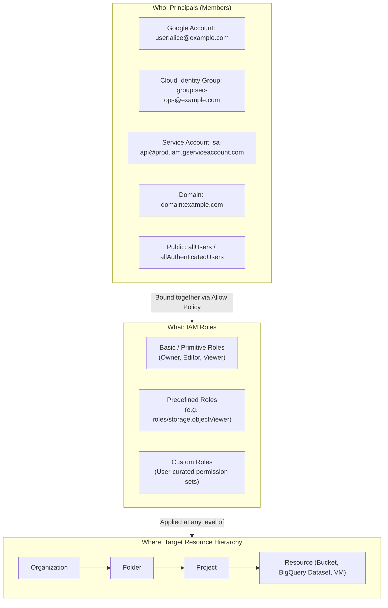
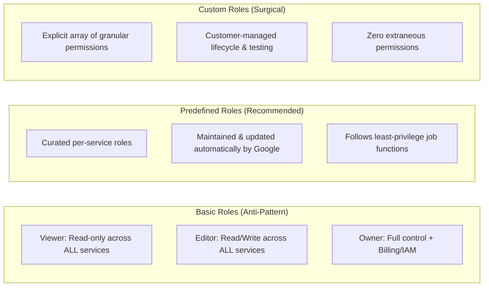
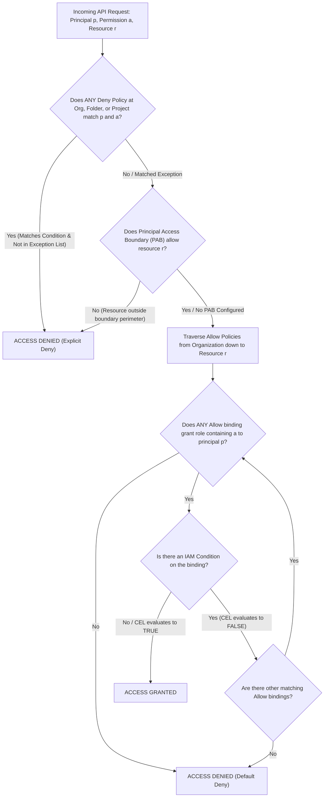
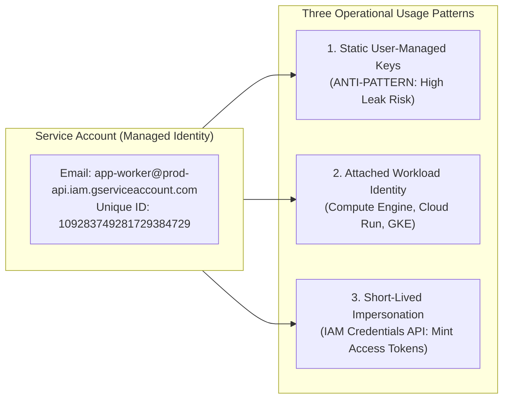
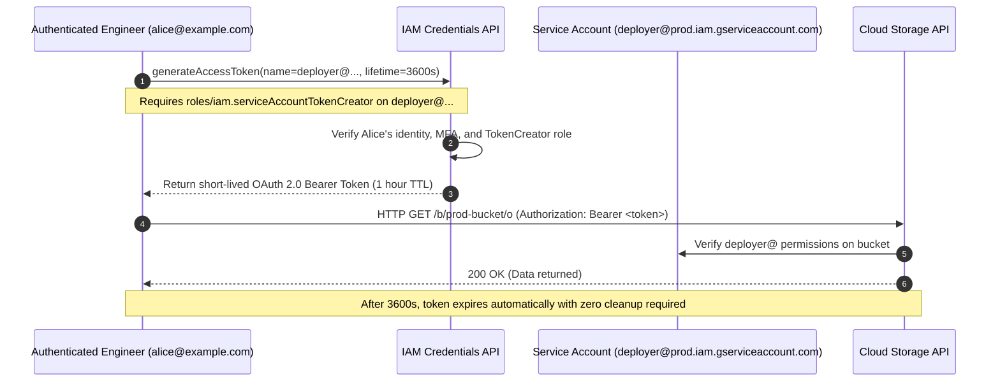
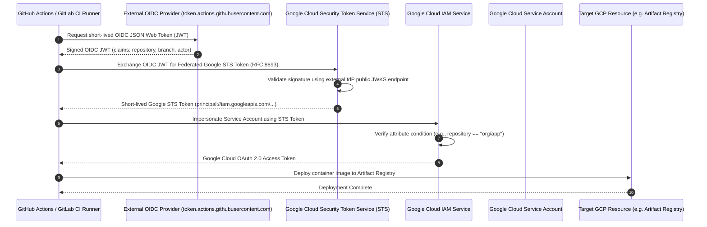
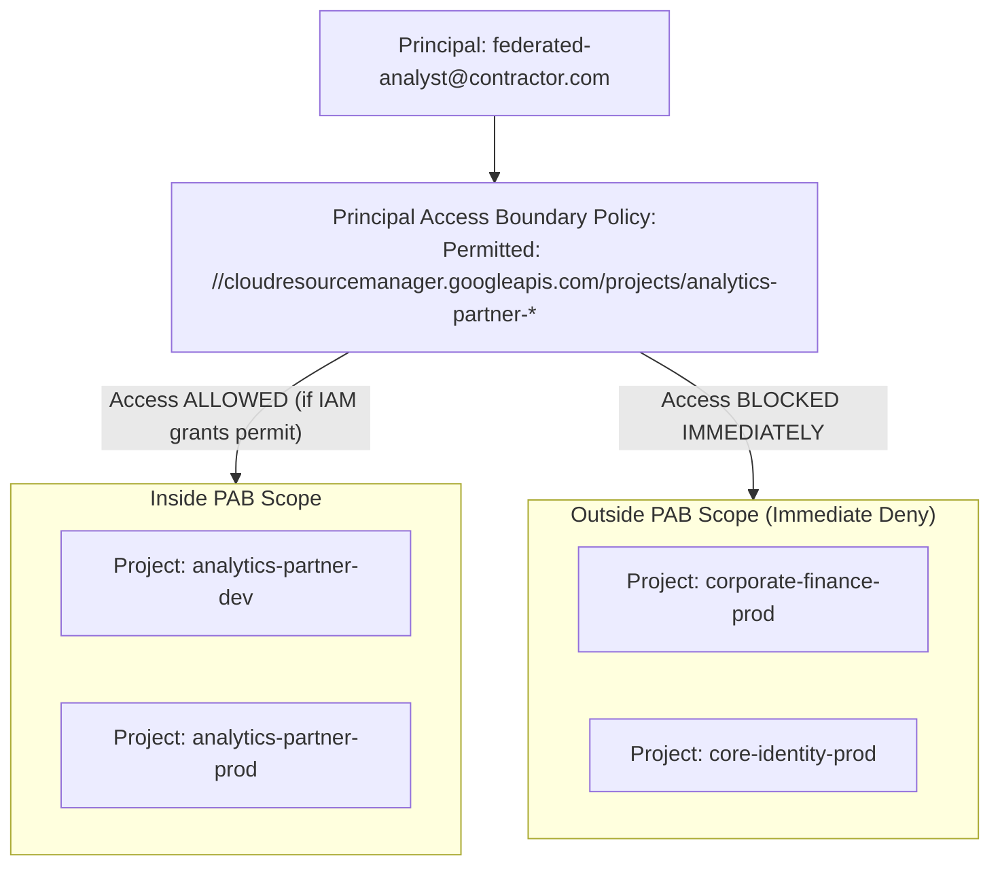

# Module 02: IAM, Service Accounts, and Workload Identity

Google Cloud Identity and Access Management (IAM) governs authentication and authorization across all cloud resources using a unified declarative policy model. Understanding the exact deterministic mechanics of IAM policy inheritance, role decomposition, service account token lifecycles, and keyless identity federation is required to design least-privilege enterprise architectures that eliminate long-lived credential risks.

---

## 1. Google Cloud IAM Conceptual Architecture

In Google Cloud, access control is governed by an authorization relation:

$$\text{Authorization}(p, a, r, c) \in \{\text{ALLOW}, \text{DENY}\}$$

where $p$ is the requesting principal (user, service account, or federated identity), $a$ is the specific fine-grained API permission (e.g., `storage.objects.get`), $r$ is the target resource, and $c$ is the environmental context (timestamp, resource tags, client IP).



### Policy Structure & Permission Model

An IAM Allow Policy is a JSON/YAML object containing an array of **bindings**. Each binding pairs a single IAM Role with one or more principals, optionally guarded by an **IAM Condition**:

```json
{
  "version": 3,
  "bindings": [
    {
      "role": "roles/storage.objectViewer",
      "members": ["user:analyst@example.com", "group:data-readers@example.com"]
    },
    {
      "role": "roles/storage.objectAdmin",
      "members": ["serviceAccount:etl-loader@analytics-prod.iam.gserviceaccount.com"],
      "condition": {
        "title": "EnforceProductionHours",
        "description": "Restricts ETL mutations to the scheduled nightly processing window",
        "expression": "request.time.getHours('America/New_York') >= 22 || request.time.getHours('America/New_York') <= 4"
      }
    }
  ],
  "etag": "BwW12345678="
}
```

The `etag` field prevents concurrent policy mutation race conditions using optimistic concurrency control: if two administrators attempt to update an IAM policy simultaneously, the second write is rejected with an HTTP 409 Conflict if its submitted `etag` does not match the current stored state.

---

## 2. Role Taxonomy: Basic vs Predefined vs Custom Roles

Google Cloud categorizes IAM roles into three tiers with distinct lifecycles, maintenance burdens, and blast radiuses:



### Comparative Analysis of Role Types

| Feature / Dimension | Basic (Primitive) Roles | Predefined Roles | Custom Roles |
| --- | --- | --- | --- |
| **Identifiers** | `roles/owner`, `roles/editor`, `roles/viewer` | E.g., `roles/storage.admin`, `roles/pubsub.publisher` | E.g., `projects/<id>/roles/customReportRunner` |
| **Scope of Authority** | Coarse-grained; applies indiscriminately across all Google Cloud services in the project. | Scoped to a specific service or functional domain (e.g., Cloud SQL Client). | Granular; explicit list of individual API permissions. |
| **Maintenance Burden** | Zero maintenance, but extreme security vulnerability. | Zero maintenance; Google automatically appends permissions when new features land. | High maintenance; customer must audit and update permissions when APIs evolve. |
| **Production Fit** | Strictly forbidden in enterprise production environments. | Recommended default for standard engineering and operational functions. | Ideal for restricted automated pipelines requiring surgical least privilege. |
| **Binding Restrictions** | Cannot be bound with IAM Conditions (CEL expressions). | Supported natively with IAM Conditions. | Supported natively with IAM Conditions. |

> [!WARNING]
> Granting `roles/editor` to an engineer or automated service account is an enterprise anti-pattern. `roles/editor` contains permissions across virtually all current and future Google Cloud APIs, including the ability to deploy compute workloads, alter firewall rules, read confidential database tables, and delete active persistent disks.

---

## 3. Deterministic Evaluation Logic: Allow vs Deny Policies

Google Cloud evaluates both **IAM Deny Policies** and **IAM Allow Policies** across the entire ancestry path of the target resource. Understanding this evaluation tree is essential for designing immutable guardrails.



### Precedence Axioms

1. **Deny Trumps Allow Everywhere**: An IAM Deny policy defined at any level of the hierarchy takes precedence over all Allow policies anywhere in the hierarchy, including Allow policies attached directly to the target leaf resource.
2. **Deny Policies Cannot Deny Admin Privileges**: Google Cloud deliberately prevents Deny policies from blocking certain critical organization management permissions (such as `resourcemanager.organizations.setIamPolicy`) to avoid locking administrators out of remediating policy misconfigurations.
3. **Allow Inheritance is Additive (Union)**: Allow policies inherit down the tree monotonically. If an engineer is granted `roles/storage.objectViewer` at the Folder level, no Project-level Allow policy beneath that Folder can strip or revoke that permission:

$$\mathrm{EffectiveAllow}(r) = \bigcup_{u \in \mathrm{Ancestry}(r)} \mathrm{AllowBindings}(u)$$

4. **Default Deny**: In the absence of an explicit Allow policy binding that matches the principal and evaluates its condition to `true`, the system denies access by default.

---

## 4. Service Accounts Architecture & Credential Hardening

A Service Account is a special Google Cloud identity that represents an application workload, microservice, or automated process rather than an individual human user. Service accounts are authenticated using cryptographic credentials and authorized via standard IAM policies.



### Service Account Taxonomy

1. **User-Managed Service Accounts**: Created by engineers (e.g., `api-worker@project-id.iam.gserviceaccount.com`). Used by applications running on Compute Engine, Cloud Run, GKE, or external systems.
2. **Default Service Accounts**: Automatically generated when certain Google Cloud APIs are enabled:
   - Compute Engine Default Service Account: `<project-number>-compute@developer.gserviceaccount.com`
   - App Engine Default Service Account: `<project-id>@appspot.gserviceaccount.com`
   - Historically, the Compute Engine default service account was automatically assigned `roles/editor` on the project upon creation.
3. **Google-Managed Service Agents**: Internal identities operated by Google services to manage background operations (e.g., Cloud Storage creating Pub/Sub notifications):
   - Pattern: `service-<project-number>@gcp-sa-<service>.iam.gserviceaccount.com`
   - Granted specific predefined service agent roles (e.g., `roles/storage.serviceAgent`).

> [!IMPORTANT]
> **Disable Automatic IAM Grants for Default Service Accounts**: Enterprise organizations must enforce the organizational policy `constraints/iam.automaticIamGrantsForDefaultServiceAccounts` at the root Organization level. When enabled, newly generated default service accounts are provisioned with **zero IAM roles**, preventing automated privilege escalation if a workload is deployed without an explicit service account configuration.

### The Static Key Vulnerability vs Short-Lived Impersonation

Downloading user-managed service account private keys (`.json` files containing an RSA-2048 private key) represents one of the most severe attack vectors in cloud security. Static keys have no expiration by default, are easily committed into Git repositories, and bypass corporate Single Sign-On (SSO) and Multi-Factor Authentication (MFA).



To eliminate static keys entirely:

1. Enforce the Organization Policy `constraints/iam.disableServiceAccountKeyCreation` across all folders and projects.
2. Require developers to use **Service Account Impersonation**:

```bash
# Grant Alice permission to impersonate the production deployment service account
gcloud iam service-accounts add-iam-policy-binding \
  deployer@prod-api.iam.gserviceaccount.com \
  --member="user:alice@example.com" \
  --role="roles/iam.serviceAccountTokenCreator"

# Alice runs commands as the service account without ever touching a private key file
gcloud compute instances list \
  --project="prod-api" \
  --impersonate-service-account="deployer@prod-api.iam.gserviceaccount.com"
```

---

## 5. Workload Identity Federation (Keyless External Authentication)

Historically, applications running outside Google Cloud (such as GitHub Actions CI/CD pipelines, GitLab runners, AWS EC2 instances, or on-premises Kubernetes clusters) required downloaded service account JSON keys to authenticate to Google Cloud APIs.

**Workload Identity Federation (WIF)** completely eliminates static keys by establishing cryptographic trust with an external OpenID Connect (OIDC) or SAML 2.0 Identity Provider (IdP) using RFC 8693 (OAuth 2.0 Token Exchange).



### Core Architecture Components of WIF

1. **Workload Identity Pool**: An administrative container that manages external identity providers and trust domains within a Google Cloud project (e.g., `projects/123/locations/global/workloadIdentityPools/github-pool`).
2. **Workload Identity Provider**: The specific external identity system registered inside the pool, configured with the external issuer URL (`https://token.actions.githubusercontent.com`) and allowed audience.
3. **Attribute Mapping**: A transformation rule that maps claims inside the external JWT into Google Cloud STS security attributes:
   - `google.subject` = `assertion.sub`
   - `attribute.repository` = `assertion.repository`
   - `attribute.ref` = `assertion.ref`
4. **Attribute Condition (CEL)**: A mandatory security filter that ensures only authorized workflows can access the pool (e.g., `assertion.repository_owner == 'my-enterprise-org'`).

### Terraform Implementation of Keyless GitHub Actions Federation

```hcl
# 1. Create the Workload Identity Pool
resource "google_iam_workload_identity_pool" "github_pool" {
  workload_identity_pool_id = "github-actions-pool"
  display_name              = "GitHub Actions Pool"
  description               = "Identity pool for enterprise CI/CD workflows"
}

# 2. Register the GitHub OIDC Provider with claim mappings and repository owner validation
resource "google_iam_workload_identity_pool_provider" "github_provider" {
  workload_identity_pool_id          = google_iam_workload_identity_pool.github_pool.workload_identity_pool_id
  workload_identity_pool_provider_id = "github-provider"
  display_name                       = "GitHub OIDC Provider"

  attribute_mapping = {
    "google.subject"             = "assertion.sub"
    "attribute.actor"           = "assertion.actor"
    "attribute.repository"      = "assertion.repository"
    "attribute.repository_owner"= "assertion.repository_owner"
  }

  attribute_condition = "assertion.repository_owner == 'my-enterprise-org'"

  oidc {
    issuer_uri = "https://token.actions.githubusercontent.com"
  }
}

# 3. Allow only the 'orders-service' repository to impersonate the deployer service account
resource "google_service_account_iam_member" "wif_binding" {
  service_account_id = google_service_account.deployer_sa.name
  role               = "roles/iam.workloadIdentityUser"
  member             = "principalSet://iam.googleapis.com/${google_iam_workload_identity_pool.github_pool.name}/attribute.repository/my-enterprise-org/orders-service"
}
```

---

## 6. Principal Access Boundaries (PAB)

When an enterprise authenticates external or workforce identities into Google Cloud, a compromised identity credential could theoretically be utilized to access any resource across the organization where that principal holds valid permissions.

**Principal Access Boundaries (PAB)** provide an orthogonal, identity-side security perimeter that restricts the maximum set of resources a principal can access, regardless of their IAM Allow policy grants.



Unlike Organization Policies (which enforce resource-side constraints) and IAM Deny Policies (which block specific permissions), PAB explicitly defines an **allowlist of resource perimeters** for designated principals. If a principal attempts an API call against a resource that does not match their assigned boundary, Google Cloud terminates authorization with an immediate `DENY` before inspecting resource-level Allow policies.

---

## 7. Hands-On Verification Lab

The test suite in [`examples/01-resource-hierarchy-and-iam.test.ts`](../examples/01-resource-hierarchy-and-iam.test.ts) proves the core IAM evaluation logic and Principal Access Boundary mechanics programmatically.

To execute the test suite:

```bash
cd technologies/gcp
mise exec -- npm test
```

### Verified Behaviors

1. **Default Deny Evaluation**: Confirms that missing policy bindings result in a deterministic `DEFAULT_DENY`.
2. **Monotonic Downward Inheritance**: Proves that policies bound at the Organization level cascade down to project resources.
3. **Deny Overrides Allow**: Validates that an Organization-level Deny policy blocks actions even when the principal holds `roles/storage.admin` at the Project level.
4. **CEL Tag Conditioning**: Evaluates that IAM Conditions correctly filter authorization based on dynamic resource context.
5. **Principal Access Boundary Enforcement**: Confirms that PAB immediately denies requests aimed at resources outside the principal's declared perimeter.

---

## 8. Interview Drill: Architectural Questions & Scenarios

<details>
<summary><b>Q1: A software development team uses downloadable service account JSON keys inside GitHub Actions CI/CD to deploy Cloud Run services. A security audit flags this as a critical finding. How do you redesign this authentication architecture to achieve zero long-lived credentials?</b></summary>

**Answer**: Migrate the CI/CD pipeline from static service account JSON keys to **Workload Identity Federation (WIF)** using GitHub's native OIDC token issuer.

**Architectural Steps**:

1. Create a **Workload Identity Pool** in the deployment project (e.g., `github-actions-pool`).
2. Add an OIDC **Workload Identity Provider** targeting `https://token.actions.githubusercontent.com`.
3. Configure **Attribute Mapping** to extract `assertion.repository` and `assertion.ref`.
4. Configure an **Attribute Condition** to enforce that only workflows originating from the organization's verified GitHub organization can authenticate: `assertion.repository_owner == 'my-company'`.
5. Bind the target deployment service account to the federated principal using `roles/iam.workloadIdentityUser`, scoped strictly to the specific GitHub repository: `principalSet://iam.googleapis.com/<pool-name>/attribute.repository/my-company/my-repo`.
6. In the GitHub Actions workflow, utilize the official `google-github-actions/auth` step with the Workload Identity Provider resource name and service account email. GitHub mints an ephemeral OIDC JWT, exchanges it with Google Security Token Service (STS) for temporary Google Cloud credentials, and provisions an access token with a 1-hour expiration.

- Ref: [Section 5: Workload Identity Federation](#5-workload-identity-federation-keyless-external-authentication), [Google Cloud Workload Identity Federation with GitHub Actions](https://cloud.google.com/iam/docs/workload-identity-federation-with-other-providers)

</details>

<details>
<summary><b>Q2: An engineer needs administrative access to Cloud Storage buckets in a development project, but company policy strictly forbids them from ever modifying or viewing production data. The engineer is accidentally granted `roles/storage.admin` at the root Organization level. What is the impact, and how can an organization architecturally prevent such accidents?</b></summary>

**Answer**: **Impact**: Because Google Cloud IAM Allow policies **inherit monotonically downward** through the resource hierarchy, granting `roles/storage.admin` at the Organization level gives the engineer full administrative control over every Cloud Storage bucket in every Folder and Project across the entire company, including all production environments. This permission **cannot be revoked or overridden by any Project-level Allow policy**.

**Architectural Remediation & Prevention**:

1. Immediately revoke the Organization-level binding.
2. Grant `roles/storage.admin` exclusively at the specific Development Project or Development Folder scope.
3. Deploy an **IAM Deny Policy** at the `Production` Folder level that denies `storage.googleapis.com/buckets.*` and `storage.googleapis.com/objects.*` to developer groups. Since Deny policies override Allow policies anywhere in the hierarchy, even if a user is mistakenly granted an Organization-level Allow role in the future, the Folder-level Deny policy will block them from accessing production data.
4. Enforce separation of duties via Privileged Access Manager (PAM) or Service Account Impersonation with time-bounded elevation.

- Ref: [Section 3: Deterministic Evaluation Logic: Allow vs Deny Policies](#3-deterministic-evaluation-logic-allow-vs-deny-policies), [Google Cloud IAM Policy Inheritance](https://cloud.google.com/iam/docs/resource-hierarchy-access-control)

</details>

<details>
<summary><b>Q3: What was the historical security flaw of the default Compute Engine service account, and what specific organizational policy must be enforced to neutralize it across an enterprise?</b></summary>

**Answer**: **Historical Flaw**: When the Compute Engine API is enabled in a project, Google Cloud automatically generates the default Compute Engine service account (`<project-number>-compute@developer.gserviceaccount.com`). Historically, Google Cloud automatically granted this service account the primitive `roles/editor` role on the project. If an engineer launched a VM without explicitly specifying a custom service account and default metadata access was enabled, any attacker or compromised script on that VM could query the Instance Metadata Service (IMDS) to obtain access tokens with full `Editor` privileges, compromising the entire project.

**Neutralization**: Enforce the organization policy **`constraints/iam.automaticIamGrantsForDefaultServiceAccounts`** at the Organization root level. When enabled, Google Cloud continues to generate the default service account for compatibility, but grants it **zero IAM roles** by default, neutralizing the automatic privilege escalation vulnerability.

- Ref: [Section 4: Service Accounts Architecture & Credential Hardening](#4-service-accounts-architecture--credential-hardening), [Disable Automatic IAM Grants for Default Service Accounts](https://cloud.google.com/iam/docs/understanding-service-accounts#default-service-accounts)

</details>

<details>
<summary><b>Q4: A third-party security contractor is granted read access to specific analytics datasets in Project A. How can security architects mathematically guarantee that even if the contractor's credentials are compromised, the attacker cannot pivot to access resources in other projects within the organization?</b></summary>

**Answer**: Implement a **Principal Access Boundary (PAB)** policy targeted to the contractor's principal identity.

**Mechanics**:

1. PAB acts as an identity-side security perimeter that restricts the resources a principal can interact with.
2. Configure a PAB policy that restricts the contractor's identity to: `//cloudresourcemanager.googleapis.com/projects/analytics-project-a`
3. If an attacker compromises the contractor's credentials and attempts an API call targeting a Cloud Storage bucket, Compute Engine instance, or BigQuery dataset in Project B (or anywhere else in the organization), Google Cloud's evaluation engine checks the PAB first.
4. Because the target resource is outside the permitted boundary set, the request is immediately denied with `DENY`, completely neutralizing cross-project lateral movement.

- Ref: [Section 6: Principal Access Boundaries (PAB)](#6-principal-access-boundaries-pab), [Google Cloud Principal Access Boundaries Documentation](https://cloud.google.com/iam/docs/principal-access-boundary-policies)

</details>

<details>
<summary><b>Q5: An organization wants to allow junior operators to view Compute Engine instances, but only during business hours (Monday through Friday, 08:00 to 18:00 UTC), and only if the instance has the resource tag `environment: non-prod`. How is this implemented?</b></summary>

**Answer**: Implement an **IAM Allow Policy Binding with an IAM Condition** written in Common Expression Language (CEL).

**Binding Specification**:

- Role: `roles/compute.viewer`
- Members: `group:junior-operators@example.com`
- Condition Expression:
  ```cel
  request.time.getDayOfWeek('UTC') >= 1 &&
  request.time.getDayOfWeek('UTC') <= 5 &&
  request.time.getHours('UTC') >= 8 &&
  request.time.getHours('UTC') < 18 &&
  resource.matchTag('123456789012/environment', 'non-prod')
  ```

**Evaluation Logic**: When an operator issues an API request to view a VM, the IAM engine evaluates the condition:

1. It validates the current UTC timestamp against the day of week and hour range.
2. It validates that the target instance inherits or directly carries the Resource Manager tag key `123456789012/environment` with value `non-prod`.
3. If both contextual checks evaluate to `true`, access is granted. Otherwise, evaluation falls through to default deny.

- Ref: [Section 1: Google Cloud IAM Conceptual Architecture](#1-google-cloud-iam-conceptual-architecture), [Google Cloud IAM Conditions Overview](https://cloud.google.com/iam/docs/conditions-overview)

</details>
