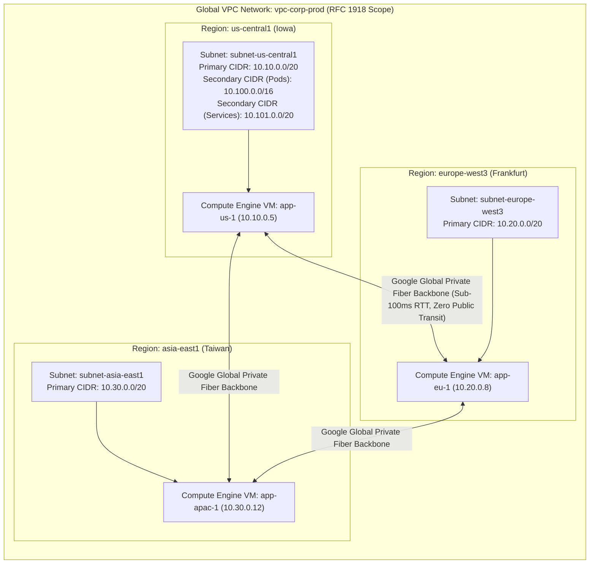
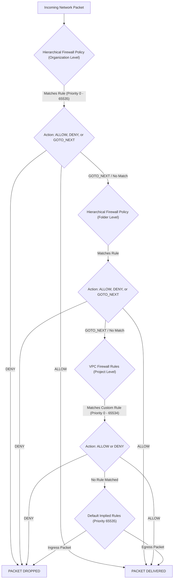
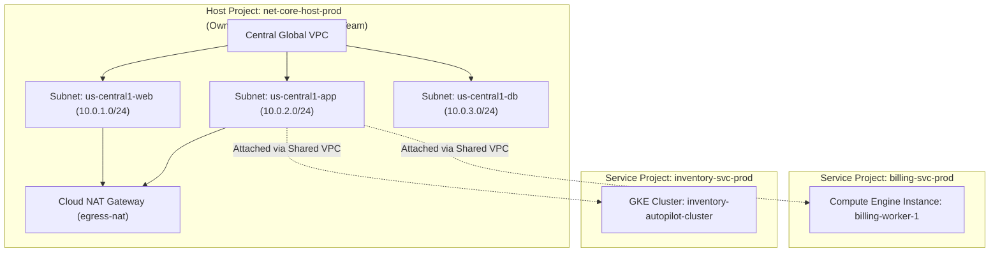
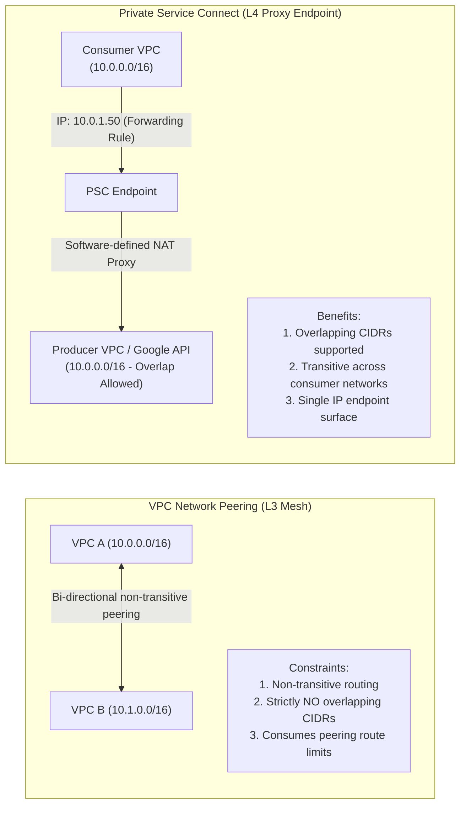
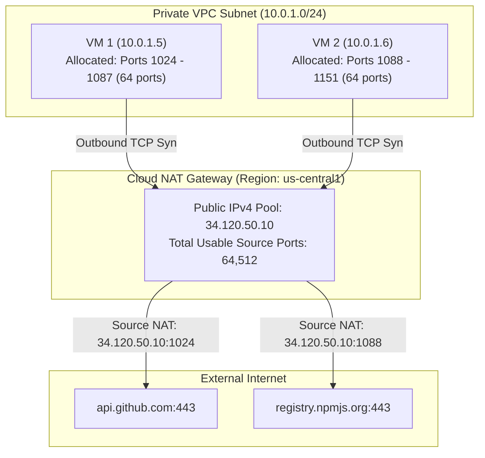
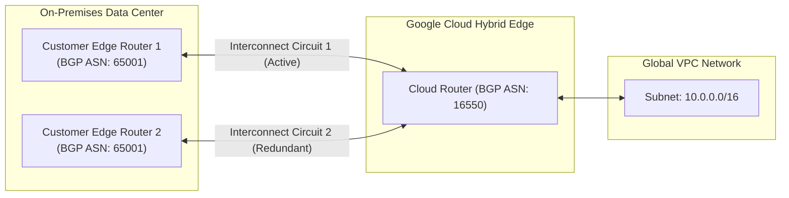

# Module 03: VPC Networking, Firewalls, and Hybrid Connectivity

Google Cloud Virtual Private Cloud (VPC) provides a software-defined, globally distributed network overlay spanning all global regions without requiring inter-region VPNs or complex mesh routing. Understanding the underlying Andromeda virtualization engine, hierarchical firewall rule resolution, Shared VPC multi-tenant governance, Private Service Connect (PSC), and Cloud NAT port allocation mechanics is essential for designing resilient enterprise network topologies.

---

## 1. Global VPC Topology and Subnet Architecture

Unlike other cloud hyperscalers whose virtual networks are confined to a single geographic region, a Google Cloud VPC is a **global resource**. A single VPC network spans every Google Cloud region across the globe simultaneously.



### Auto Mode vs Custom Mode Networks

When creating a VPC network, administrators select between two subnet provisioning modes:

| Network Mode | Subnet Allocation Behavior | Default CIDR Range | Production Viability |
| --- | --- | --- | --- |
| **Auto Mode** | Automatically provisions a `/20` subnet in every existing and future Google Cloud region. | Predefined `10.128.0.0/9` block subdivided into `/20` regional slices. | **Strictly forbidden in enterprise production**. Predefined CIDRs inevitably overlap with corporate on-premises networks and other VPCs, breaking Cloud Interconnect and VPC Peering. |
| **Custom Mode** | Zero subnets created automatically; administrators explicitly define regional subnets and CIDR blocks. | User-defined RFC 1918 blocks (`10.0.0.0/8`, `172.16.0.0/12`, `192.168.0.0/16`) or Class E (`240.0.0.0/4`). | **Mandatory enterprise standard**. Enables fine-grained IP address management (IPAM), secondary ranges for GKE, and non-overlapping hybrid routing. |

> [!CAUTION]
> You can convert an Auto Mode network to a Custom Mode network at any time using `gcloud compute networks switch-mode`. However, **this transition is strictly one-way**: a Custom Mode network can never be converted back to an Auto Mode network.

### Andromeda Software-Defined Network (SDN) Virtualization

Underneath every VPC lies **Andromeda**, Google's proprietary network virtualization platform. Andromeda operates by programming OpenFlow switching rules directly into host kernel datapath modules and custom on-host network coprocessors (ASICs/NICs).

When a VM transmits an IP packet destined for another VM in the same VPC:

1. The packet enters the virtual network interface (vNIC).
2. The on-host Andromeda packet processing engine performs a table lookup against locally cached flow tables.
3. If the destination is an internal IP address within the global VPC, Andromeda encapsulates the packet into an internal protocol envelope and forwards it directly across Google's private B4 global fiber backbone to the destination physical host.
4. The receiving host decapsulates the packet and injects it into the destination vNIC.
5. Packets travel point-to-point without traversing intermediate physical routers, virtual appliances, or software gateway bottlenecks, achieving line-rate bandwidth (up to 200 Gbps per VM) and sub-microsecond internal virtualization overhead.

---

## 2. Hierarchical Firewall Policies vs VPC Firewall Rules

Google Cloud provides two distinct firewall governance engines that evaluate ingress and egress network packets according to a strict priority hierarchy:



### Architectural Comparison: Hierarchical Policies vs VPC Rules

| Dimension | Hierarchical Firewall Policies | VPC Firewall Rules |
| --- | --- | --- |
| **Attachment Scope** | Organization or Folder nodes; inherited automatically by all child projects and VPCs. | Specific VPC network within an individual Project. |
| **Evaluation Order** | Evaluated **first**, before any VPC firewall rules in the project. | Evaluated only if hierarchical rules do not match or specify `goto_next`. |
| **Rule Delegation** | Supports `goto_next` action to explicitly delegate filtering to lower folder or project levels. | Does not support `goto_next`; actions are strictly `ALLOW` or `DENY`. |
| **Target Filtering** | Target Service Accounts, Target Network Tags, or Secure Resource Tags. | Target Service Accounts or Target Network Tags. |
| **Layer 7 Inspection** | Native integration with Cloud Next Generation Firewall (NGFW) and intrusion prevention. | Layer 3/4 filtering only (IP protocols and port ranges). |

### Priority-Based Resolution Mechanics

1. Rules are evaluated sequentially by **Priority number** ($0 \le \text{Priority} \le 65535$).
2. **Lower numbers indicate higher precedence**: a rule with Priority 100 evaluated at the Organization level trumps a Priority 1000 rule evaluated at the VPC level.
3. If two rules have identical priorities, Organization-level policies evaluate before Folder-level policies, which evaluate before VPC-level rules.
4. **Targeting by Service Account vs Network Tags**:
   - **Network Tags** are arbitrary strings attached to VMs (e.g., `web-server`). Because any user with `compute.instances.setTags` can re-tag an instance, tags present an internal security escalation risk.
   - **Service Accounts** represent cryptographic identities (e.g., `orders-sa@prod.iam.gserviceaccount.com`). Controlling service account assignment requires the privileged `roles/iam.serviceAccountUser` role, making service-account-targeted firewall rules substantially more secure.

---

## 3. Shared VPC Multi-Tenant Architecture

In an enterprise organization, managing separate VPC networks, external IP allocations, and firewall policies inside individual application projects leads to network fragmentation, security drift, and routing exhaustion.

**Shared VPC** solves this by centralizing network administration inside a single **Host Project**, while allowing multiple **Service Projects** to instantiate compute resources (VMs, GKE clusters, Cloud Run endpoints) connected directly to the host's subnets.



### Shared VPC Governance & IAM Delegation

To maintain strict operational boundaries, Google Cloud enforces role separation:

1. **Shared VPC Administrator (`roles/compute.xpnAdmin`)**: Granted exclusively to the central network team at the Organization or Folder level. Controls which projects are designated as Host Projects and links Service Projects to them.
2. **Network User (`roles/compute.networkUser`)**: Granted to service project workload service accounts or developers. This role can be granted at the **individual subnet level**:
   - Billing application developers are granted `roles/compute.networkUser` strictly on `SubnetApp` (`10.0.2.0/24`).
   - They cannot attach instances to `SubnetDb` (`10.0.3.0/24`), mathematically enforcing network tier segregation.
3. Application developers in service projects can deploy VMs, attach persistent disks, and manage internal services without holding any administrative privileges over the underlying VPC network, subnets, routers, or firewall rules.

---

## 4. VPC Network Peering vs Private Service Connect (PSC)

Enterprise architectures frequently require workloads to communicate across distinct VPC networks or to consume managed software-as-a-service (SaaS) platforms securely. Google Cloud provides two primary mechanisms with fundamentally different operational semantics:



### Comparative Analysis: VPC Peering vs Private Service Connect

| Architectural Feature | VPC Network Peering | Private Service Connect (PSC) |
| --- | --- | --- |
| **Networking Layer** | Layer 3 direct IP routing across Google's internal backbone. | Layer 4 TCP/UDP software-defined proxy (Forwarding Rule to Service Attachment). |
| **IP Overlap Requirement** | **Strictly Forbidden**. Peered VPCs cannot have any overlapping primary or secondary CIDR blocks. | **Allowed**. Consumer and producer VPCs can have identical overlapping CIDR ranges. |
| **Route Transitivity** | **Strictly Non-Transitive**. If VPC A is peered with VPC B, and VPC B is peered with VPC C, VPC A **cannot reach VPC C** through VPC B. | **Transitive**. Workloads connected to the consumer VPC via Cloud Interconnect or VPN can reach the PSC endpoint seamlessly. |
| **Blast Radius & Security** | Exposes entire network CIDR blocks across peered VPCs (subject to firewall rules). | Exposes strictly a single published service behind an internal Layer 4 load balancer endpoint. |
| **Scalability & Quotas** | Consumes peering group limits (maximum 25 peered networks per VPC). | Highly scalable; hundreds of independent consumer endpoints can bind to a single service attachment. |

### Private Google Access

By default, Compute Engine instances without external public IP addresses cannot reach public Google APIs (Cloud Storage `storage.googleapis.com`, BigQuery `bigquery.googleapis.com`, Pub/Sub `pubsub.googleapis.com`).

**Private Google Access** is a subnet-level configuration that enables private instances to reach Google APIs privately:

1. Enabled per subnet: `gcloud compute networks subnets update <subnet-name> --enable-private-ip-google-access`.
2. When private instances resolve `storage.googleapis.com`, DNS resolves to Google's internal Anycast VIP ranges (`199.36.153.8/30` for `restricted.googleapis.com` or `199.36.153.4/30` for `private.googleapis.com`).
3. Traffic never traverses the public internet or requires a Cloud NAT gateway, reducing data egress costs and eliminating public route exposure.

---

## 5. Cloud NAT Architecture & Port Allocation Mechanics

Google Cloud NAT provides managed, software-defined egress network address translation for Compute Engine virtual machines and GKE nodes that do not possess public external IP addresses.



### Port Allocation: Static vs Dynamic

Every public IPv4 address provisioned on a Cloud NAT gateway provides exactly **64,512 usable source ports** (ports 1024 through 65535, with ports 1–1023 reserved).

Google Cloud NAT manages port assignment using two distinct modes:

1. **Static Port Allocation (Default Mode)**:
   - Default allocation: **64 ports per VM instance**.
   - Each VM is allocated a fixed, contiguous block of source ports regardless of how many concurrent connections it currently opens.
   - **Production Failure Mode (Port Exhaustion)**: If a backend application (e.g., a microservice running HTTP/1.1 without connection pooling) opens more than 64 concurrent outbound TCP connections, additional connection attempts fail silently with connection timeouts:

$$\text{Max Concurrent Sockets Per VM} \le \text{min-ports-per-vm}$$

2. **Dynamic Port Allocation**:
   - Default allocation: **32 ports per VM instance**, scaling dynamically in powers of 2 up to `max-ports-per-vm` (e.g., 1024).
   - If an instance experiences a burst in concurrent outbound connections, Cloud NAT automatically allocates additional port blocks on demand, as long as the gateway's total pool has unallocated capacity.

### Mathematical Derivation of Gateway VM Capacity

Let $N_{\text{ip}}$ be the number of public IP addresses assigned to the Cloud NAT gateway, and let $P_{\text{vm}}$ be the minimum ports assigned per VM. The maximum number of concurrently supported VMs is strictly bounded by:

$$N_{\text{vm}} \le \left\lfloor \frac{N_{\text{ip}} \times 64{,}512}{P_{\text{vm}}} \right\rfloor$$

For example, a Cloud NAT gateway configured with 1 public IP ($N_{\text{ip}} = 1$) and default static allocation ($P_{\text{vm}} = 64$) can support at most:

$$N_{\text{vm}} \le \left\lfloor \frac{64{,}512}{64} \right\rfloor = 1{,}008 \text{ virtual machines}$$

If an autoscaling GKE cluster attempts to scale to 1,200 nodes, nodes beyond the 1,008th will fail to obtain outbound NAT ports, resulting in total external communication failure.

---

## 6. Hybrid Connectivity: Cloud Interconnect vs HA VPN

Enterprise hybrid cloud architectures require secure, high-bandwidth connectivity linking on-premises enterprise data centers to Google Cloud VPC networks.



### Hybrid Connectivity Decision Matrix

| Solution | Bandwidth Capacity | SLA Guarantee | Physical Prerequisites | Architectural Fit |
| --- | --- | --- | --- | --- |
| **Dedicated Interconnect** | 10 Gbps, 100 Gbps, or 400 Gbps physical circuits. | **99.9%** (2 circuits in 1 metro) or **99.99%** (4 circuits across 2 metros). | Colocation facility meeting Google colocation standards; cross-connect physical fiber. | High-throughput, mission-critical enterprise workloads, database replication, and massive data warehouse ingestion. |
| **Partner Interconnect** | 50 Mbps up to 50 Gbps per VLAN attachment. | **99.9%** or **99.99%** (multi-metro topology). | Supported service provider network connection (e.g., Equinix, Megaport). | Organizations whose data centers do not reside in a Google colocation facility. |
| **Cloud HA VPN** | Up to 3 Gbps per tunnel (scales with multiple tunnels). | **99.99%** SLA (requires dual tunnels and active-active BGP). | IPsec VPN device supporting IKEv2 and dynamic BGP routing. | Cost-effective hybrid connectivity, encrypted public internet transit, and initial migration stages. |

> [!IMPORTANT]
> **Cloud HA VPN 99.99% SLA Requirement**: Google Cloud strictly enforces that the 99.99% SLA for Cloud HA VPN applies **only** when two VPN tunnels are provisioned from the Cloud HA VPN gateway to two independent on-premises VPN gateways (or two separate interfaces on a single device), utilizing dynamic BGP routing via Cloud Router. Static routing is not supported for HA VPN.

---

## 7. Hands-On Verification Lab

The test suite in [`examples/02-vpc-firewall-and-nat.test.ts`](../examples/02-vpc-firewall-and-nat.test.ts) proves the core hierarchical firewall resolution and Cloud NAT port allocation mechanics programmatically.

To run the verification suite locally:

```bash
cd technologies/gcp
mise exec -- npm test
```

### Verified Test Cases

1. **Hierarchical Precedence**: Validates that an Organization-level rule denying public SSH (port 22) terminates evaluation before VPC allow rules can execute.
2. **Network Tag Filtering**: Confirms that firewall rules evaluate target tags correctly, allowing traffic to tagged web servers while falling through to default deny for untagged instances.
3. **Service Account Filtering**: Verifies that firewall rules targeting specific service account identities restrict access strictly to authorized workloads.
4. **Default Implied Rules**: Proves that unconfigured ingress traffic evaluates to default deny (priority 65535), while unconfigured egress evaluates to default allow (priority 65535).
5. **Cloud NAT Static vs Dynamic Allocation**: Proves mathematically that static port allocation of 64 ports drops connections under load bursts, whereas dynamic port allocation scales port blocks up to absorb high-concurrency connection spikes.

---

## 8. Interview Drill: Architectural Questions & Scenarios

<details>
<summary><b>Q1: A high-throughput microservice running on Compute Engine instances behind a Cloud NAT gateway starts experiencing intermittent 504 Gateway Timeout errors when making outbound API calls to a third-party payment gateway. Cloud Monitoring shows zero CPU or memory saturation on the VMs. What is the root cause and how do you resolve it?</b></summary>

**Answer**: The root cause is **Cloud NAT source port exhaustion**.

**Mechanics & Remediation**:

1. By default, Cloud NAT static port allocation provisions **64 ports per VM instance**.
2. If the microservice opens more than 64 concurrent outbound TCP connections (common in microservices using HTTP/1.1 without client-side connection pooling or under high burst concurrency), additional outbound SYN packets are silently dropped by Cloud NAT, leading to connection timeouts.
3. Verify via Cloud Monitoring metric `compute.googleapis.com/nat/nat_allocation_exhaustion_count`.
4. **Resolution**:
   - Reconfigure Cloud NAT to use **Dynamic Port Allocation** (`--enable-dynamic-port-allocation`), allowing instances to scale port assignments up to 1024 ports automatically during bursts.
   - Alternatively, increase static `min-ports-per-vm` to a higher threshold (e.g., 256 or 512) and ensure sufficient public IP addresses are assigned to the gateway to support the total fleet size.
   - Implement HTTP Keep-Alive and connection pooling in the microservice application runtime.

- Ref: [Section 5: Cloud NAT Architecture & Port Allocation Mechanics](#5-cloud-nat-architecture--port-allocation-mechanics), [Google Cloud NAT Port Exhaustion Troubleshooting](https://cloud.google.com/nat/docs/troubleshooting#nat-allocation-exhaustion)

</details>

<details>
<summary><b>Q2: A central network team manages an enterprise Shared VPC host project. The security operations team needs to guarantee that no application developer in any service project can accidentally create a firewall rule allowing public ingress traffic on RDP (port 3389) or SSH (port 22). How do you enforce this?</b></summary>

**Answer**: Deploy a **Hierarchical Firewall Policy** at the root Organization level (or the top-level production Folder).

**Implementation**:

1. Create a Hierarchical Firewall Policy using `gcloud compute firewall-policies create`.
2. Add an ingress rule at a high priority (e.g., Priority 100):
   - Action: `DENY`
   - Protocols/Ports: `tcp:22,3389`
   - Source IP range: `0.0.0.0/0`
3. Associate the policy with the Organization node or the top-level Folder.
4. **Evaluation Guarantee**: Hierarchical firewall policies evaluate **before** any VPC-level firewall rules in the project. Even if a service project developer possesses administrative access to their local project and attempts to author a rule with Priority 10 allowing port 22, the Organization-level rule evaluates first at Priority 100 and drops the packet.

- Ref: [Section 2: Hierarchical Firewall Policies vs VPC Firewall Rules](#2-hierarchical-firewall-policies-vs-vpc-firewall-rules), [Google Cloud Hierarchical Firewall Policies Overview](https://cloud.google.com/firewall/docs/hierarchical-firewall-policies)

</details>

<details>
<summary><b>Q3: Company A acquires Company B. Both companies run workloads in Google Cloud in Custom Mode VPCs. Both networks use the identical primary subnet range `10.0.0.0/16`. Company A needs to access a proprietary analytics API hosted in Company B's VPC without performing a multi-month IP re-addressing project. How should this be architected?</b></summary>

**Answer**: Deploy **Private Service Connect (PSC)** instead of VPC Network Peering.

**Why Peering Fails**: VPC Network Peering strictly forbids overlapping CIDR blocks. Attempting to peer two VPCs that both use `10.0.0.0/16` will fail with an immediate subnet overlap error.

**PSC Architecture**:

1. In Company B's VPC (Producer), deploy an Internal Application or Network Load Balancer in front of the analytics API.
2. Publish the service using a **Service Attachment** (`gcloud compute service-attachments create`).
3. In Company A's VPC (Consumer), create a **Private Service Connect Endpoint** (a forwarding rule with an internal IP address selected from an unallocated local subnet in Company A, e.g., `10.0.99.5`).
4. Link the PSC endpoint to Company B's Service Attachment URI.
5. Workloads in Company A send API requests to `10.0.99.5`. Google Cloud's software-defined proxy encapsulates the traffic and translates the network address transparently across the project boundary, completely bypassing CIDR overlap constraints.

- Ref: [Section 4: VPC Network Peering vs Private Service Connect (PSC)](#4-vpc-network-peering-vs-private-service-connect-psc), [Private Service Connect Overview](https://cloud.google.com/vpc/docs/private-service-connect)

</details>

<details>
<summary><b>Q4: An architect designs an enterprise hybrid cloud connectivity solution between an on-premises data center and Google Cloud. The contract specifies a 99.99% availability SLA. The team provisions a single Cloud HA VPN gateway with two tunnels connected to a single on-premises router interface. Why does this deployment fail to qualify for Google Cloud's 99.99% SLA?</b></summary>

**Answer**: Google Cloud's **99.99% HA VPN SLA** requires fault tolerance against both cloud and on-premises physical hardware failures:

**SLA Requirements**:

1. Connecting two tunnels to a **single on-premises router interface or single physical device** introduces an on-premises single point of failure (SPOF). If that physical router, power supply, or interface reboots, both tunnels drop simultaneously.
2. To qualify for the 99.99% SLA, the customer must configure:
   - Two separate Cloud HA VPN tunnels.
   - Connected to **two separate on-premises physical VPN gateways** (or two distinct physical interfaces on redundant dual-chassis routing platforms with separate power and control planes).
   - Dynamic BGP routing enabled across both tunnels with active-active or active-passive metric configurations.
   - Redundant peer IPs in distinct geographical facilities for full disaster recovery.

- Ref: [Section 6: Hybrid Connectivity: Cloud Interconnect vs HA VPN](#6-hybrid-connectivity-cloud-interconnect-vs-ha-vpn), [Google Cloud HA VPN 99.99% Topologies](https://cloud.google.com/network-connectivity/docs/vpn/concepts/topologies)

</details>

<details>
<summary><b>Q5: A Compute Engine VM in a private subnet needs to upload multi-terabyte log archives to a Cloud Storage bucket. The VM does not have an external IP address, and no Cloud NAT gateway is provisioned in the region. How does the VM reach Cloud Storage without traversing the public internet?</b></summary>

**Answer**: Enable **Private Google Access** on the VM's subnet.

**Mechanics**:

1. Execute `gcloud compute networks subnets update <subnet-name> --enable-private-ip-google-access`.
2. When the VM initiates an HTTPS request to `storage.googleapis.com`, DNS resolution directs traffic to Google's internal private Anycast VIP blocks (`199.36.153.8/30` or default Google API VIPs).
3. The underlying Andromeda SDN virtual switch identifies the destination as an internal Google API endpoint and routes the packets directly across Google's internal network to Cloud Storage.
4. Traffic never leaves Google's network, requires zero public external IP addresses, incurs no NAT translation overhead, and bypasses public internet transit.

- Ref: [Section 4: VPC Network Peering vs Private Service Connect (PSC)](#4-vpc-network-peering-vs-private-service-connect-psc), [Google Cloud Private Google Access Guide](https://cloud.google.com/vpc/docs/private-google-access)

</details>

<details>
<summary><b>Q6: Two independent applications reside in separate VPC networks within the same Google Cloud organization. Application A needs to resolve custom internal DNS records managed within Application B's private DNS zone. How do you configure DNS resolution without exposing the records publicly or deploying custom BIND proxy servers?</b></summary>

**Answer**: Deploy a **Cloud DNS Peering Zone**.

**Configuration**:

1. In VPC B, a Private DNS Zone (e.g., `services.internal`) exists containing records for Application B.
2. In VPC A, create a Cloud DNS Peering Zone for the domain `services.internal`.
3. Specify VPC A as the source network and designate VPC B as the peer network.
4. When workloads in VPC A query `orders.services.internal`, Cloud DNS identifies the peering relationship and forwards the request across Google's internal software-defined control plane directly to VPC B's private DNS resolver.
5. Resolution completes with zero compute overhead, sub-millisecond latency, and requires no custom DNS forwarders or virtual appliances.

- Ref: [Section 1: Global VPC Topology and Subnet Architecture](#1-global-vpc-topology-and-subnet-architecture), [Google Cloud DNS Peering Overview](https://cloud.google.com/dns/docs/zones/peering-zones)

</details>

<details>
<summary><b>Q7: An enterprise is migrating 500 Compute Engine instances into an existing custom mode VPC. The current subnet CIDR is `10.1.0.0/24` (254 usable IPs), which is completely saturated. How can network administrators expand the subnet's capacity to accommodate the 500 new instances without recreating the subnet or disrupting existing running workloads?</b></summary>

**Answer**: Use Google Cloud's **Subnet CIDR Range Expansion** capability.

**Mechanics**:

1. Google Cloud VPC permits expanding a subnet's primary IP range in place without destroying or recreating the subnet: `gcloud compute networks subnets expand-ip-range <subnet-name> --prefix-length=22`.
2. The prefix length can be expanded (e.g., from `/24` to `/22`, expanding capacity from 254 to 1,022 usable addresses), provided the new CIDR block (`10.1.0.0/22`) does not overlap with any existing subnet in the same VPC or peered networks.
3. Subnet expansion is non-disruptive: existing instances keep their current IP addresses and active network connections without rebooting.
4. Note that subnet range expansion is strictly one-way: **subnets can be expanded, but their IP ranges can never be shrunk**.

- Ref: [Section 1: Global VPC Topology and Subnet Architecture](#1-global-vpc-topology-and-subnet-architecture), [Google Cloud Expand Subnet IP Range Guide](https://cloud.google.com/vpc/docs/create-modify-vpc-networks#expand-subnet)

</details>
