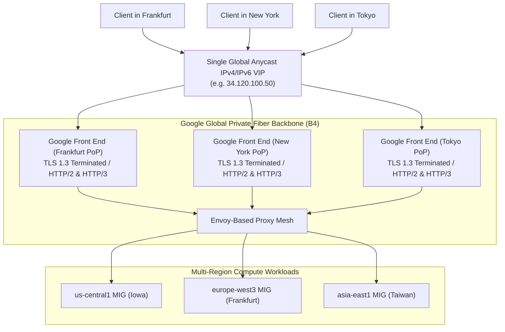
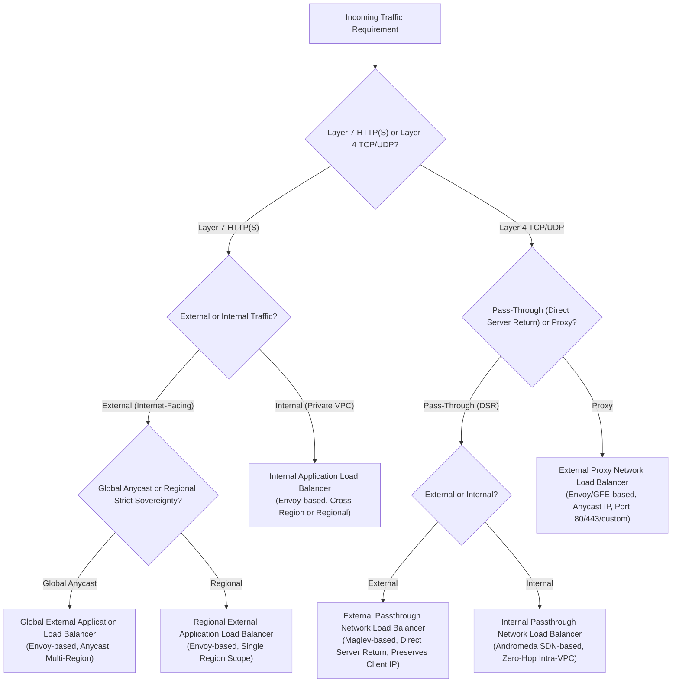
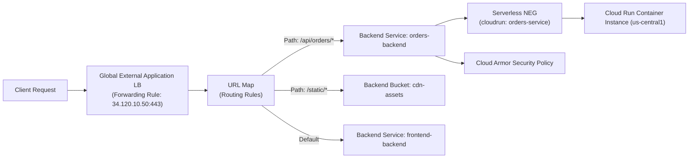
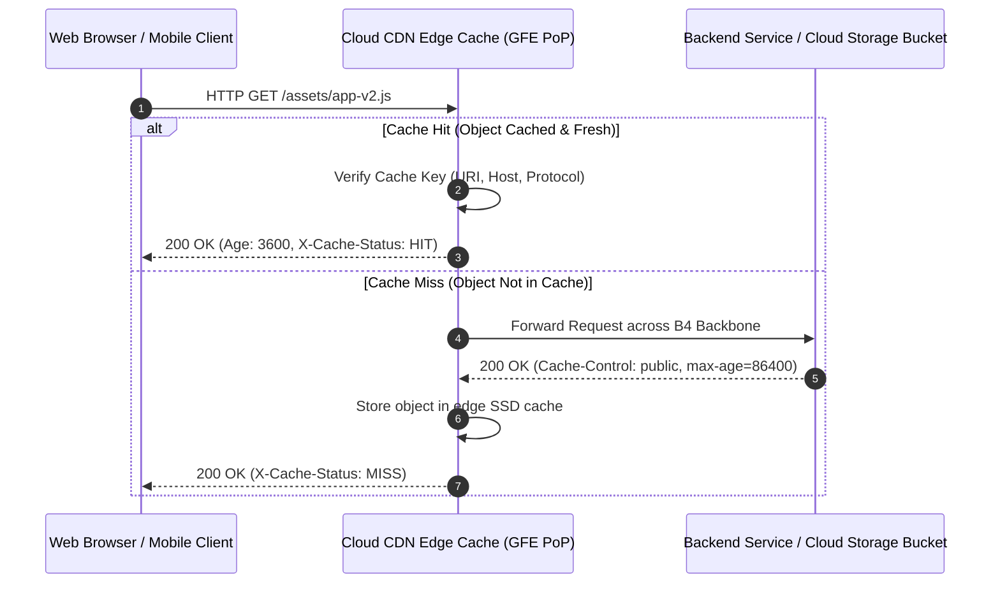
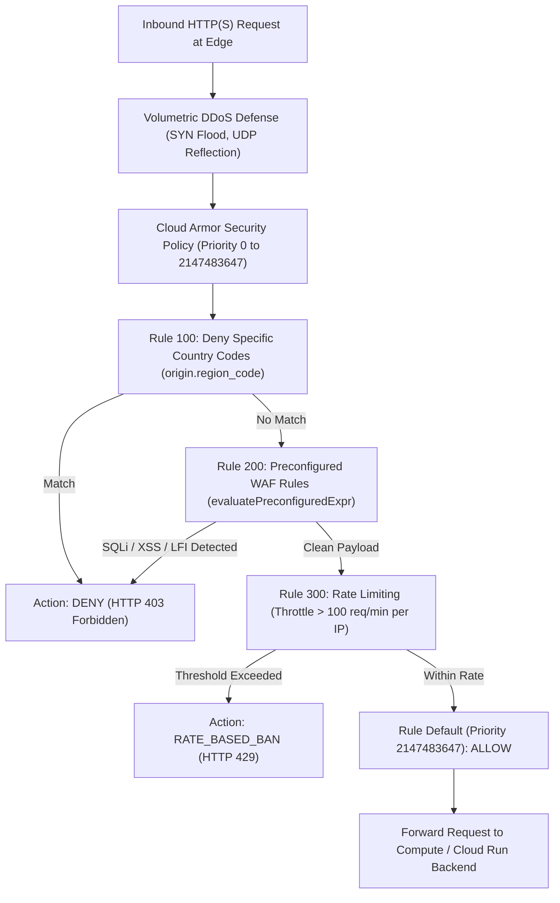
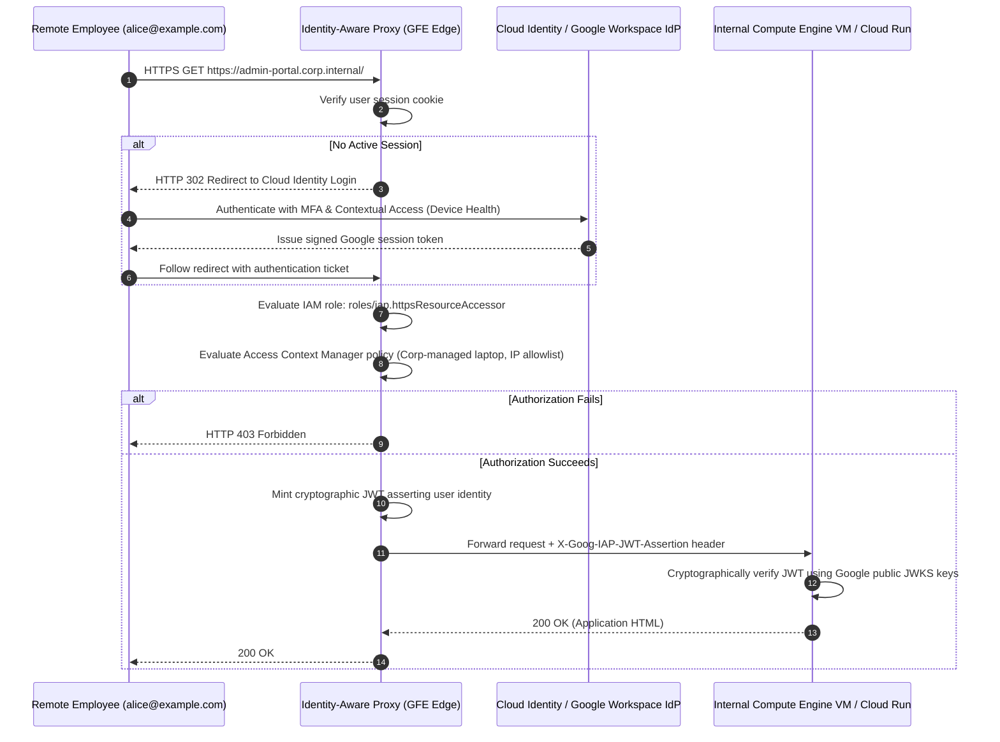
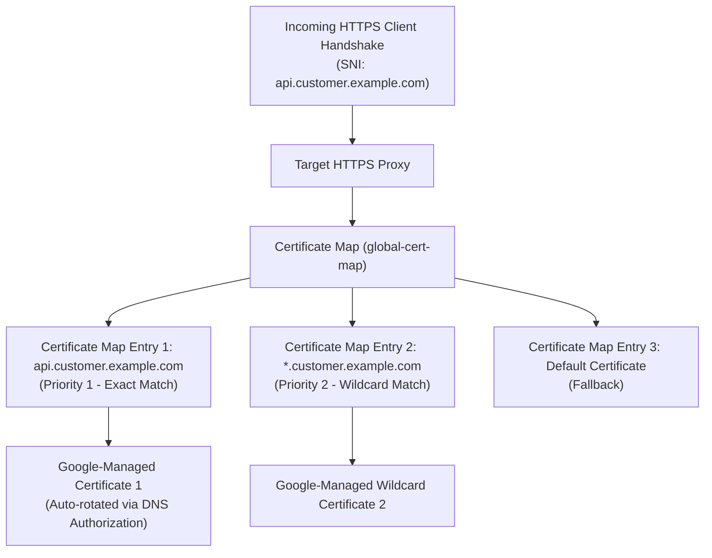

# Module 04: Load Balancing, Cloud Armor, and Edge

Google Cloud's edge network and software-defined load balancing architecture decouple traffic ingress from physical regional data centers. By terminating client connections at more than one hundred global Points of Presence (PoPs) over Anycast IP addresses, Google Front End (GFE) appliances, Cloud Armor web application firewalls, Cloud CDN caches, and Identity-Aware Proxy (IAP) deliver multi-region resilience, sub-millisecond connection setup, and automated DDoS mitigation.

---

## 1. Google Front End (GFE) and Anycast Architecture

Unlike legacy cloud architectures where external load balancers reside inside specific availability zones or regional data centers, Google Cloud's **Global External Application Load Balancer** operates at the software-defined edge.



### Anycast BGP Routing Mechanics

1. Google advertises a single virtual public IPv4 (`/32`) and IPv6 (`/128`) address block to global Internet Service Providers (ISPs) via the Border Gateway Protocol (BGP) from all Google edge Points of Presence simultaneously.
2. A client executing a TCP handshake with `34.120.100.50` is automatically routed by internet BGP hops to the nearest physical Google edge location.
3. **TCP and TLS Termination at the Edge**:
   - The TCP 3-way handshake and TLS 1.3 negotiation terminate directly on the local **Google Front End (GFE)** server within the edge PoP, minimizing the round-trip time (RTT) experienced by the client.
   - For example, a user in Frankfurt handshakes with the Frankfurt GFE in $< 5\text{ms}$, rather than waiting $90\text{ms}$ for packets to traverse the Atlantic Ocean to an origin server in Iowa.
4. **Backbone Transit**: Once the HTTP request payload is received and verified, the GFE proxies the request across Google's high-speed, private dedicated fiber backbone to the nearest healthy regional backend capable of handling the request.

---

## 2. Load Balancer Taxonomy and Decision Matrix

Google Cloud provides specialized load balancers categorized across three architectural dimensions: Layer 7 HTTP(S) vs Layer 4 TCP/UDP, Global vs Regional, and External (public internet) vs Internal (private RFC 1918 VPC traffic).



### Architectural Comparison Matrix

| Load Balancer Type | OSI Layer | Scope | Backend Types | IP Preservation & Features |
| --- | --- | --- | --- | --- |
| **Global External Application LB** | Layer 7 | Global (Anycast) | Instance Groups (MIGs), Zonal NEGs, Serverless NEGs, Internet NEGs, Cloud Storage buckets. | Client IP in `X-Forwarded-For`; Cloud Armor WAF; Cloud CDN; HTTP/3 (QUIC); mTLS. |
| **Regional External Application LB** | Layer 7 | Regional | Instance Groups, Zonal NEGs, Serverless NEGs. | Dedicated to compliance workloads requiring data and proxy termination to stay within a single region. |
| **Internal Application LB** | Layer 7 | Regional / Cross-Region | Instance Groups, Zonal NEGs, Serverless NEGs. | Private RFC 1918 VIP; Envoy proxy; internal microservice routing; header-based traffic shifting. |
| **External Passthrough Network LB** | Layer 4 | Regional | Compute Engine Instance Groups, Zonal NEGs. | **Preserves original client IP** directly in IP header (Direct Server Return); handles non-HTTP protocols; millions of QPS. |
| **Internal Passthrough Network LB** | Layer 4 | Regional | Compute Engine Instance Groups, Zonal NEGs. | Direct Andromeda SDN kernel forwarding; zero proxy latency; private RFC 1918 VIP; high-throughput database tiers. |

---

## 3. Serverless Network Endpoint Groups (Serverless NEGs)

When deploying serverless architectures using Cloud Run, App Engine, or Cloud Functions, workloads do not possess static IP addresses or virtual network interfaces that can be targeted by traditional instance groups.

A **Serverless Network Endpoint Group (NEG)** acts as an architectural adapter that binds a Cloud Run service, function, or App Engine app directly to an External or Internal Application Load Balancer.



### Key Architectural Advantages of Serverless NEGs

1. **Custom Domains with Managed SSL**: Allows Cloud Run services to serve traffic on custom enterprise domains (`api.example.com`) backed by Google-managed multi-domain SSL certificates with automatic 90-day rotation.
2. **Cloud Armor WAF Protection**: Places enterprise web application firewall defenses, IP rate limiting, and DDoS mitigation directly in front of serverless container endpoints.
3. **Multi-Region Anycast Failover**: Enables active-active multi-region serverless deployments: a single Anycast IP routes traffic to Cloud Run in `us-central1` or `europe-west3` based on client proximity and backend latency.
4. **Static Egress & Ingress Control**: By combining Serverless NEGs with Cloud Run's ingress setting (`--ingress=internal-and-cloud-load-balancing`), workloads are completely shielded from direct public invocation, forcing all traffic through the secure load balancer proxy.

---

## 4. Cloud CDN Caching Mechanics and Invalidation

Google Cloud CDN leverages the globally distributed Google Front End (GFE) network to cache static and dynamic web content at the network edge, offloading upstream compute backends and accelerating asset delivery.



### Cache Modes

Cloud CDN supports three distinct caching policies configured on the backend service or backend bucket:

1. **`CACHE_ALL_STATIC` (Default)**: Automatically caches static web assets (images, CSS, JavaScript, fonts, PDFs, media) based on file extensions, respecting origin `Cache-Control` headers.
2. **`USE_ORIGIN_HEADERS`**: Caches responses strictly according to HTTP headers emitted by the origin backend (`Cache-Control: public, max-age=...`). If the origin does not set valid caching headers, the response is not cached.
3. **`FORCE_CACHE_ALL`**: Unconditionally caches all HTTP 200 responses, overriding any origin headers (such as `no-cache`, `private`, or `max-age=0`).

> [!WARNING]
> Using `FORCE_CACHE_ALL` on a backend that serves personalized user content, authentication cookies, or dynamic API responses will cause Cloud CDN to cache confidential user data and serve it to subsequent visitors, causing a catastrophic data leak.

### Cache Keys and Invalidation Mechanics

The **Cache Key** is the unique identifier computed for each incoming request to look up cached objects:

$$\text{CacheKey} = (\text{Host}, \text{URI Path}, \operatorname{SortedQueryParameters}, \operatorname{SelectedHeaders})$$

To prevent cache fragmentation, administrators can customize cache keys to exclude irrelevant query string parameters (such as marketing tracking tags `utm_source`, `utm_medium`):

```bash
gcloud compute backend-services update orders-api-backend \
  --global \
  --enable-cdn \
  --cache-key-query-string-whitelist="category,page,sort"
```

When an asset must be purged immediately before its `max-age` expires, execute a **Cache Invalidation**:

```bash
# Invalidate all JavaScript files across all global edge PoPs
gcloud compute url-maps invalidate-cdn-cache corp-web-url-map \
  --path="/assets/*.js" \
  --async
```

---

## 5. Cloud Armor: Web Application Firewall & DDoS Defense

Cloud Armor delivers enterprise-grade Distributed Denial of Service (DDoS) protection and Layer 7 Web Application Firewall (WAF) filtering directly at the Google Front End (GFE) edge, neutralizing volumetric attacks and application exploits before packets reach compute backends.



### Preconfigured WAF Rules (OWASP Core Rule Set)

Cloud Armor provides managed rule sets based on the OWASP Top 10 Core Rule Set (CRS 3.3). These rules inspect request headers, query strings, and HTTP request bodies using regular expressions and heuristics:

| Rule Expression Identifier | Attack Vector Mitigated | Typical Trigger Pattern |
| --- | --- | --- |
| `evaluatePreconfiguredExpr('sqli-v33-stable')` | SQL Injection | `UNION SELECT`, `' OR 1=1 --`, `EXEC xp_cmdshell` |
| `evaluatePreconfiguredExpr('xss-v33-stable')` | Cross-Site Scripting | `<script>alert(1)</script>`, `javascript:void(0)` |
| `evaluatePreconfiguredExpr('lfi-v33-stable')` | Local File Inclusion | `../../../../etc/passwd`, `..\..\boot.ini` |
| `evaluatePreconfiguredExpr('rce-v33-stable')` | Remote Code Execution | `eval()`, `/bin/sh -c`, Log4Shell JNDI injection |
| `evaluatePreconfiguredExpr('scannerdetection-v33-stable')` | Vulnerability Scanners | Burp Suite, sqlmap, Nikto, Nessus scanner headers |

### Rate Limiting and Adaptive Protection

1. **IP Rate Limiting**: Restricts requests matching specific attributes (e.g. client IP address, HTTP headers, or cookies) to a maximum request rate per time interval (e.g., 100 requests per minute). Violating clients are throttled or banned for a configured ban duration (e.g., 10 minutes) with HTTP 429 Too Many Requests.
2. **Adaptive Protection**: Employs machine learning models trained on Google's global attack telemetry to analyze baseline traffic patterns for each backend. When anomalous traffic bursts occur, Adaptive Protection automatically generates a suggested Cloud Armor rule containing precise signature patterns and an estimated benign impact score, allowing operators to deploy targeted mitigation rules with a single click.

---

## 6. Identity-Aware Proxy (IAP) and Zero Trust Architecture

Legacy enterprise access models rely on Virtual Private Networks (VPNs) to grant remote employees access to internal corporate applications. Once inside the perimeter, an attacker or compromised laptop can pivot laterally across internal subnets.

**Identity-Aware Proxy (IAP)** implements the **BeyondCorp Zero Trust model**: it verifies user identity, context, and device health at the Google Cloud edge on every single request, without requiring a VPN.



### Cryptographic Identity Assertion at the Backend

When IAP approves an incoming request, it strips any client-supplied identity headers and injects trusted HTTP headers signed by Google:

- `x-goog-authenticated-user-email`: The verified email address of the authenticated principal (e.g., `accounts.google.com:alice@example.com`).
- `x-goog-authenticated-user-id`: The immutable unique directory user ID.
- `x-goog-iap-jwt-assertion`: An asymmetric JSON Web Token (JWT) signed by Google Cloud (`https://cloud.google.com/iap`).

> [!IMPORTANT]
> **Securing Backends Against Header Spoofing**: Backend application services must **never trust `x-goog-authenticated-user-email` blindly** without cryptographically validating the signature of `x-goog-iap-jwt-assertion` against Google's public JSON Web Key Set (JWKS) at `https://www.gstatic.com/iap/verify/public_key-jwk`. If an attacker discovers the internal IP of the backend or bypasses the proxy, they could easily forge fake `x-goog-authenticated-user-email` headers unless JWT signature validation is strictly enforced.

---

## 7. Certificate Manager and TLS Automation Architecture

Deploying public-facing enterprise services across multi-region external load balancers requires automated TLS certificate provisioning, validation, and zero-downtime rotation across hundreds of hostnames and wildcard subdomains.

Google Cloud **Certificate Manager** modernizes TLS management by decoupling certificate issuance from load balancer target proxies, providing centralized certificate governance through **Certificate Maps**.



### Core Architecture Components

1. **Google-Managed Certificates**: Provisioned at zero cost via Google's Certificate Authority Service or public Let's Encrypt / Google Trust Services (GTS). Automatically renewed 30 days prior to expiration.
2. **DNS Authorization**: Validates domain ownership by requiring the customer to add a specific `CNAME` record to their authoritative DNS zone (e.g. pointing `_acme-challenge.example.com` to Google Cloud). This completely eliminates the need for load balancer routing to be active before the certificate can be validated and issued.
3. **Certificate Maps**: A collection of certificate map entries that link domain patterns (exact names, wildcard prefixes, or primary hostnames) to specific certificate resources. Target HTTPS proxies bind directly to a single Certificate Map, scaling to over 100,000 domains per load balancer without reconfiguring proxy resources.

---

## 8. Hands-On Verification & Lab Exercise

To verify that the load balancing models, Cloud Armor rules, and edge routing configurations are functionally validated, execute the test runner:

```bash
cd technologies/gcp
mise exec -- npm test
```

---

## 9. Interview Drill: Architectural Questions & Scenarios

<details>
<summary><b>Q1: An enterprise deploys an internal web application on private Compute Engine instances. A junior engineer proposes deploying a VPN concentrator so remote employees can access the tool. Why is Identity-Aware Proxy (IAP) superior to a traditional VPN, and how does the backend verify the caller's identity securely?</b></summary>

**Answer**: **Why IAP is Superior to VPN**:

1. **Zero Trust vs Perimeter Trust**: A traditional VPN grants network-level access (Layer 3) to the entire subnet, allowing lateral movement if the employee's machine is compromised. IAP enforces application-level access (Layer 7) on every single HTTP request, restricting users strictly to authorized applications.
2. **Context-Aware Access**: IAP integrates with Access Context Manager, allowing security teams to enforce conditions such as requiring a corporate-managed device with disk encryption, biometric MFA, and geo-fenced IP origins.
3. **Operational Simplicity**: IAP terminates on Google's global Anycast edge, eliminating VPN appliance bandwidth bottlenecks, client software maintenance, and gateway failovers.

**Backend Identity Verification**: When IAP approves a request, it injects the signed header `x-goog-iap-jwt-assertion`. The backend application must cryptographically verify this JWT against Google's public JWKS endpoint (`https://www.gstatic.com/iap/verify/public_key-jwk`) to confirm the token's signature, issuer (`https://cloud.google.com/iap`), audience string (the backend service ID), and expiration timestamp before accepting user identity.

- Ref: [Section 6: Identity-Aware Proxy (IAP) and Zero Trust Architecture](#6-identity-aware-proxy-iap-and-zero-trust-architecture), [Google Cloud IAP Securing Your Backend Guide](https://cloud.google.com/iap/docs/signed-headers-howto)

</details>

<details>
<summary><b>Q2: A media company operates a global video streaming platform. They notice that dynamic API responses containing sensitive user profile data are occasionally being served to unauthorized users from edge locations. What Cloud CDN configuration caused this, and what is the remediation?</b></summary>

**Answer**: **Root Cause**: The Cloud CDN backend service was configured with **Cache Mode set to `FORCE_CACHE_ALL`**. When set to `FORCE_CACHE_ALL`, Cloud CDN unconditionally caches all HTTP 200 responses, deliberately ignoring HTTP origin headers such as `Cache-Control: private`, `no-cache`, or `Set-Cookie`. As a result, the first user's personalized profile response was cached at the GFE edge and subsequently served to other users requesting the same endpoint.

**Remediation**:

1. Immediately execute a global cache invalidation: `gcloud compute url-maps invalidate-cdn-cache <url-map> --path="/*"`.
2. Change the Cache Mode to **`USE_ORIGIN_HEADERS`** (or `CACHE_ALL_STATIC`), ensuring dynamic API endpoints are only cached if they explicitly advertise public cacheability.
3. On the origin backend, ensure all dynamic and authenticated responses include `Cache-Control: private, no-store, max-age=0`.
4. Separate dynamic API routes (`/api/*`) from static media routes (`/media/*`) using distinct Backend Services in the URL Map.

- Ref: [Section 4: Cloud CDN Caching Mechanics and Invalidation](#4-cloud-cdn-caching-mechanics-and-invalidation), [Google Cloud CDN Cache Modes Overview](https://cloud.google.com/cdn/docs/caching#cache-modes)

</details>

<details>
<summary><b>Q3: An e-commerce website on Google Cloud experiences a coordinated Layer 7 HTTP flood attack targeting its checkout endpoint (`/checkout/pay`), generating 15,000 requests per second from thousands of residential IP addresses. How do you mitigate this attack using Cloud Armor without blocking legitimate shoppers?</b></summary>

**Answer**: Deploy a **Cloud Armor Rate Limiting Rule** with Adaptive Protection.

**Implementation**:

1. In the Cloud Armor security policy attached to the Global External Application Load Balancer, create a rate-limiting rule (e.g. Priority 1000):
   - Match expression: `request.path.startsWith('/checkout/pay')`
   - Action: `throttle` (or `rate_based_ban`)
   - Rate limit threshold: e.g., 5 requests per 10-second interval per client IP address (`enforce_on_key: IP`).
   - Exceed action: Return `HTTP 429 (Too Many Requests)` or redirect to reCAPTCHA Enterprise.
   - Ban duration: 300 seconds (5 minutes).
2. Enable **Cloud Armor Adaptive Protection** on the security policy. Adaptive Protection uses machine learning to detect Layer 7 traffic anomalies and generates automated mitigation rules that isolate specific request headers or payload fingerprints unique to the botnet.
3. Legitimate shoppers rarely execute more than 1 or 2 checkout payments in 10 seconds, so their traffic completes normally while the botnet flood is throttled at the GFE edge.

- Ref: [Section 5: Cloud Armor: Web Application Firewall & DDoS Defense](#5-cloud-armor-web-application-firewall--ddos-defense), [Google Cloud Armor Rate Limiting Overview](https://cloud.google.com/armor/docs/rate-limiting-overview)

</details>

<details>
<summary><b>Q4: An architect needs to choose between an External Passthrough Network Load Balancer and an External Application Load Balancer for an online gaming UDP backend and an HTTPS REST API. What are the key architectural differences, and which should be selected for each?</b></summary>

**Answer**: **Key Architectural Differences**:

- **External Passthrough Network Load Balancer (Layer 4)**: Operates at Layer 4 (TCP/UDP) using Google's Maglev distributed software router. It does not proxy or terminate connections; packets are routed directly to backend VMs with **Direct Server Return (DSR)**, preserving the original client source IP address in the packet header. It has ultra-low sub-millisecond latency and supports non-HTTP protocols (including UDP).
- **External Application Load Balancer (Layer 7)**: Operates at Layer 7 (HTTP/HTTPS/HTTP/3) using Google Front End (GFE) and Envoy proxies. It terminates client TCP/TLS connections at the edge, inspects HTTP paths, headers, and cookies, and supports Cloud Armor, Cloud CDN, and Serverless NEGs.

**Selection**:

1. **Online Gaming UDP Backend**: Select the **External Passthrough Network Load Balancer**. Layer 7 load balancers cannot handle UDP traffic; the passthrough NLB delivers direct UDP packet forwarding with maximum throughput and zero proxy latency.
2. **HTTPS REST API**: Select the **Global External Application Load Balancer**. It provides Anycast edge TLS termination, Cloud Armor WAF defense, URL map routing, and multi-region failover.

- Ref: [Section 2: Load Balancer Taxonomy and Decision Matrix](#2-load-balancer-taxonomy-and-decision-matrix), [Google Cloud Load Balancing Overview](https://cloud.google.com/load-balancing/docs/load-balancing-overview)

</details>

<details>
<summary><b>Q5: A startup deploys a containerized microservice on Cloud Run. They want to expose the service to corporate users on `https://portal.internal.corp/` while strictly blocking all direct internet access to the underlying `run.app` URL. How must this architecture be configured?</b></summary>

**Answer**: Deploy a **Global External Application Load Balancer with a Serverless NEG and Ingress Restrictions**.

**Architecture Steps**:

1. Create a **Serverless Network Endpoint Group (NEG)** targeting the Cloud Run service (`gcloud compute network-endpoint-groups create ... --network-endpoint-type=serverless --cloud-run-service=portal-app`).
2. Attach the Serverless NEG as the backend service for a Global External Application Load Balancer.
3. Configure an SSL certificate in Certificate Manager for `portal.internal.corp` and bind it to the load balancer's HTTPS forwarding rule.
4. **Crucial Security Step**: Reconfigure Cloud Run ingress controls: `gcloud run services update portal-app --ingress=internal-and-cloud-load-balancing`.
5. This setting rejects any direct HTTP requests made to `portal-app-<hash>-uc.a.run.app` with an HTTP 403 Forbidden. Only requests routed through the authorized Load Balancer proxy are admitted.

- Ref: [Section 3: Serverless Network Endpoint Groups (Serverless NEGs)](#3-serverless-network-endpoint-groups-serverless-negs), [Google Cloud Run Ingress Settings](https://cloud.google.com/run/docs/securing/ingress)

</details>

<details>
<summary><b>Q6: A financial institution requires strict regional data sovereignty where financial transaction payloads must never be decrypted or proxied outside Frankfurt (`europe-west3`). How should the load balancing architecture be designed?</b></summary>

**Answer**: Deploy a **Regional External Application Load Balancer** rather than a Global External Application Load Balancer.

**Architecture**:

1. The **Global External Application Load Balancer** terminates TLS at the nearest global Google Front End (GFE) edge location (which could be London, Amsterdam, or New York depending on BGP routing).
2. The **Regional External Application Load Balancer** allocates an external IP address strictly within `europe-west3` and provisions Envoy proxy instances exclusively inside Frankfurt data centers.
3. Client TCP handshakes, TLS termination, WAF inspection (via regional Cloud Armor policies), and backend HTTP proxying occur 100% within `europe-west3`, guaranteeing compliance with regional financial data localization laws.

- Ref: [Section 2: Load Balancer Taxonomy and Decision Matrix](#2-load-balancer-taxonomy-and-decision-matrix), [Google Cloud Regional External Application Load Balancer](https://cloud.google.com/load-balancing/docs/https#regional-connections)

</details>

<details>
<summary><b>Q7: An online retail platform needs to migrate traffic from a legacy backend service (`v1`) to a new microservice backend (`v2`) deployed on GKE. They want to execute a weighted canary rollout where 90% of requests route to `v1` and 10% route to `v2`, with automatic header-based routing for internal QA testers. How is this configured?</b></summary>

**Answer**: Configure **Traffic Weighting and Header-Based Routing in the Load Balancer URL Map**.

**Implementation**:

1. In the URL Map attached to the Application Load Balancer, define routing rules under `defaultService` or specific path matchers.
2. Configure **Header-Based Route Rules**:
   - Match condition: Request contains header `X-QA-Tester: enabled`.
   - Action: Route 100% of matching requests directly to `v2-backend-service`.
3. Configure **Weighted Traffic Splitting** for general users:
   - Route action: `weightedBackendServices`.
   - `v1-backend-service`: weight 900 (90%).
   - `v2-backend-service`: weight 100 (10%).
4. As `v2` proves stable in production, administrators incrementally adjust the weights (e.g. 50/50, then 0/100) via Terraform or `gcloud` without modifying DNS records or restarting compute backends.

- Ref: [Section 2: Load Balancer Taxonomy and Decision Matrix](#2-load-balancer-taxonomy-and-decision-matrix), [Google Cloud Advanced Traffic Management URL Maps](https://cloud.google.com/load-balancing/docs/url-map-concepts)

</details>

<details>
<summary><b>Q8: A high-performance media transcoding service runs on Compute Engine instances and requires original client source IP addresses for geo-location watermarking. The application uses a custom TCP-based protocol on port 9000. Why will an External Application Load Balancer fail, and what is the correct architecture?</b></summary>

**Answer**: **Why Application Load Balancer Fails**: An External Application Load Balancer operates at Layer 7 (HTTP/HTTPS/HTTP/3). It cannot route raw custom TCP protocols on port 9000. Furthermore, because it is a terminating reverse proxy, the original client IP is rewritten to an internal proxy IP in the packet header (available only via the HTTP `X-Forwarded-For` header, which custom TCP payloads cannot inspect).

**Correct Architecture**: Deploy an **External Passthrough Network Load Balancer** (Layer 4).

1. Powered by Google's Maglev distributed software network router.
2. Operates as a non-proxy pass-through load balancer using **Direct Server Return (DSR)**.
3. Network packets on TCP port 9000 are delivered directly to the backend VM instances with the **original client IP address and source port completely intact** in the IP packet header.
4. Return traffic from the backend VM flows directly back to the client over internet routing without passing back through the load balancer, maximizing throughput.

- Ref: [Section 2: Load Balancer Taxonomy and Decision Matrix](#2-load-balancer-taxonomy-and-decision-matrix), [Google Cloud External Network Load Balancing Guide](https://cloud.google.com/load-balancing/docs/network)

</details>
