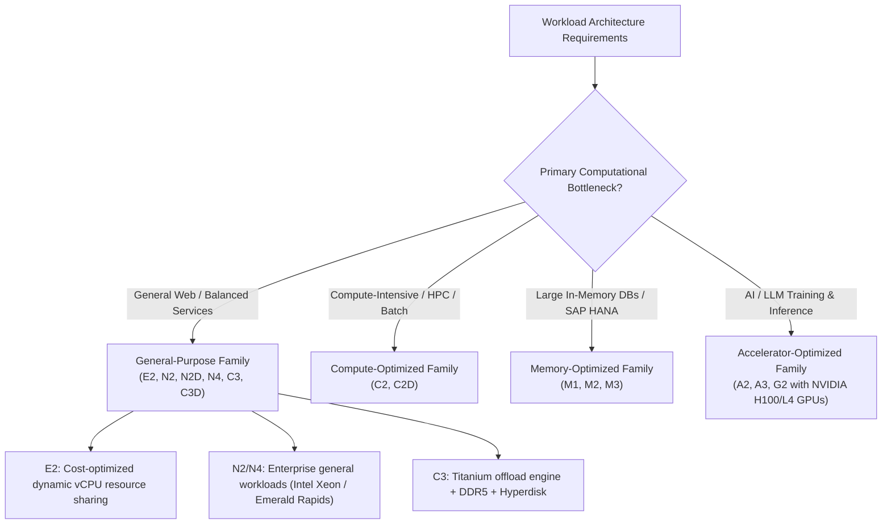
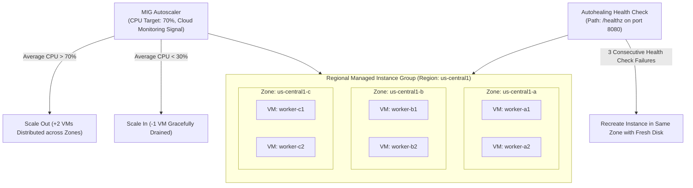
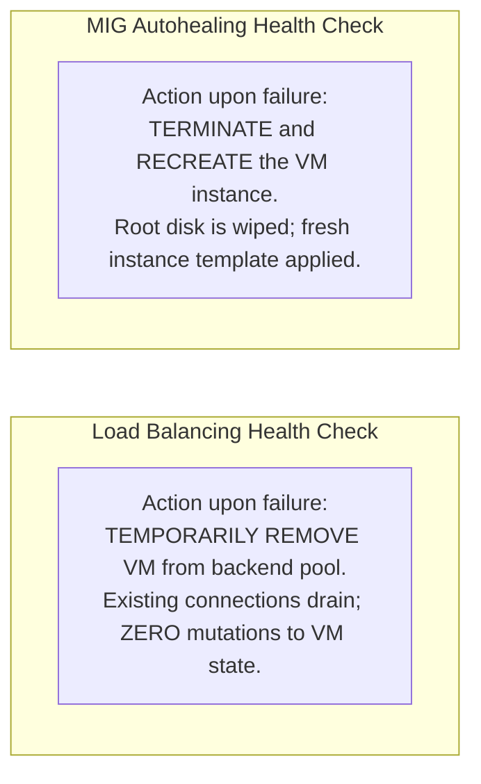
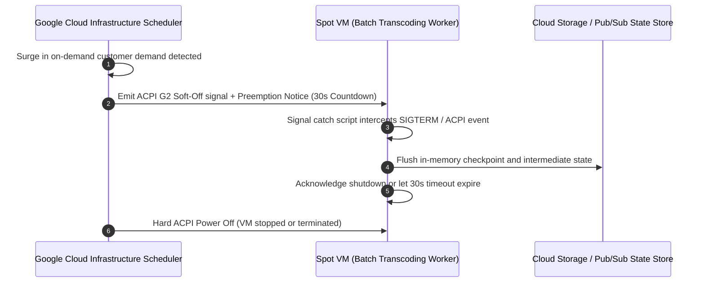
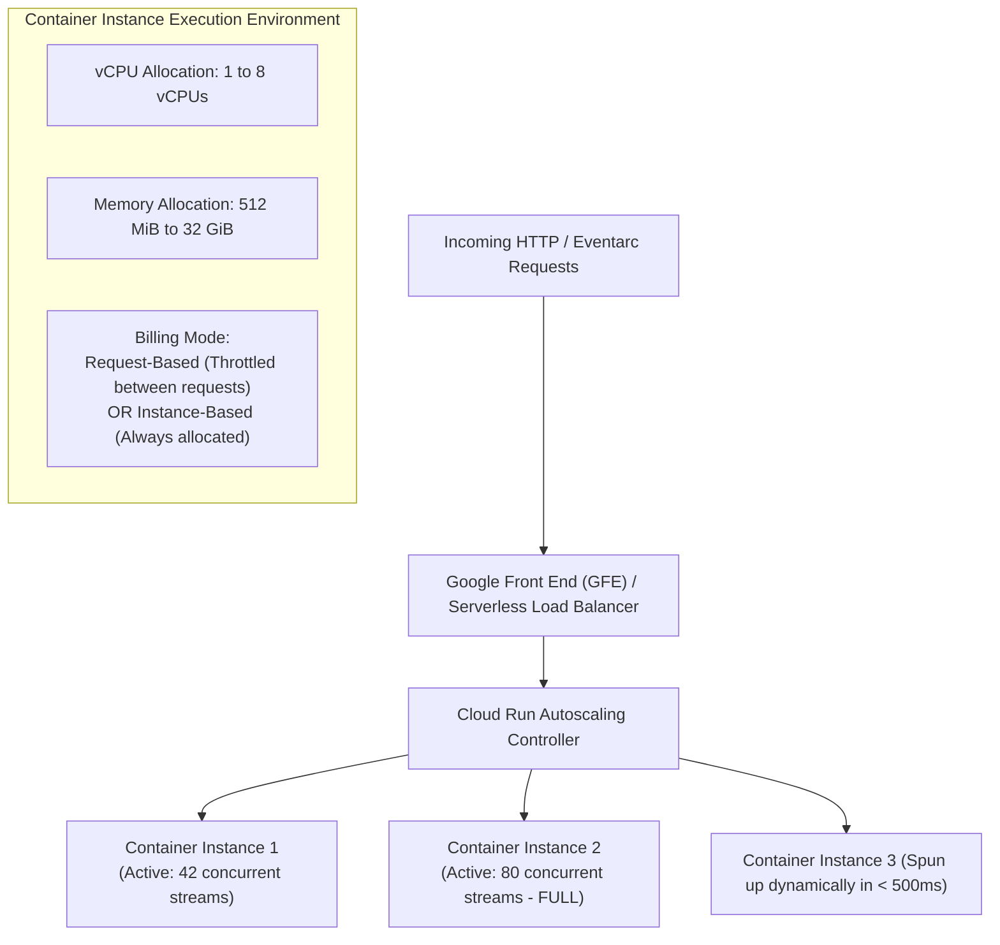
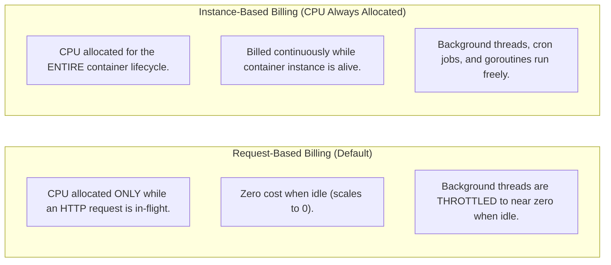
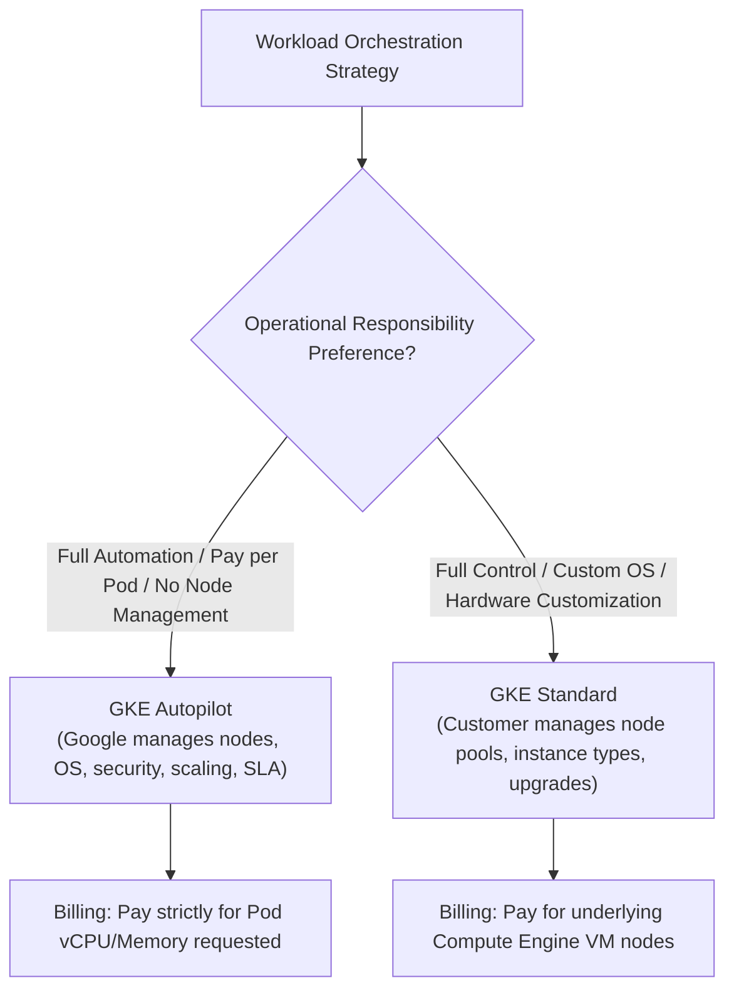
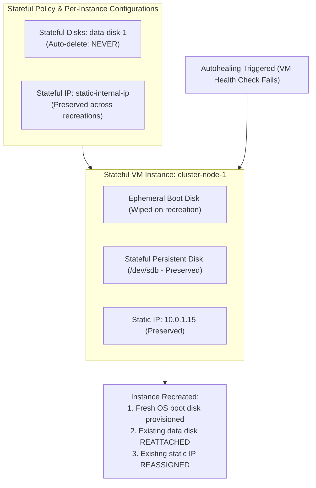
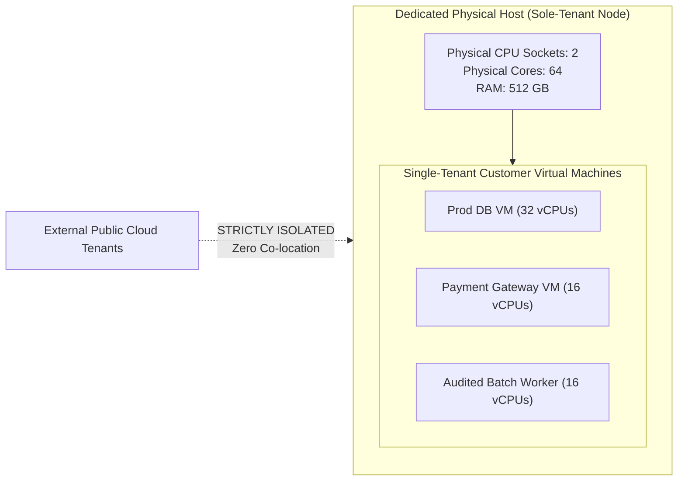

# Module 05: Compute Engine, Cloud Run, and GKE

Google Cloud's compute portfolio spans infrastructure-as-a-service (Compute Engine virtual machines and Managed Instance Groups), container-native serverless microservices (Cloud Run services and jobs), and enterprise orchestration (Google Kubernetes Engine). Understanding the underlying CPU scheduling mechanics, autohealing vs load balancing health check boundaries, Spot VM preemption dynamics, and Cloud Run request-based vs instance-based concurrency models is required to build cost-efficient, resilient compute architectures.

---

## 1. Compute Engine Architecture & Machine Families

Compute Engine delivers virtual machines running on Google's globally distributed physical infrastructure, virtualized through the KVM-based hypervisor and accelerated by Titanium system-on-chip (SoC) offload engines.



### Machine Family Taxonomy

Google Cloud categorizes Compute Engine instance types into distinct engineering tiers:

| Machine Family | Target Workloads | Underlying Hardware | Memory-to-vCPU Ratio | Key Architectural Features |
| --- | --- | --- | --- | --- |
| **E2 (Cost-Optimized)** | Development environments, lightweight web servers, internal tools. | Dynamic resource scheduling across Intel and AMD chips. | 1:1, 1:2, 1:4, 1:8, or custom. | Zero sustained use discounts (SUDs); low-cost burstable vCPUs; no local SSDs or GPUs. |
| **N2 / N2D (General-Purpose)** | Enterprise web backends, databases, microservices. | Intel Xeon Ice Lake (N2) / AMD EPYC Milan (N2D). | Typically 4 GB to 8 GB per vCPU; custom shapes supported. | Predictable performance; supports Local SSDs and confidential compute encryption. |
| **C3 / C3D (High-Performance)** | High-throughput web applications, container hosts. | Intel 4th Gen Xeon Scalable + Google Titanium SoC. | 2 GB, 4 GB, or 8 GB per vCPU. | Offloads virtualization and networking to Titanium ASICs; native Google Hyperdisk support (up to 500k IOPS). |
| **C2 / C2D (Compute-Optimized)** | High-Performance Computing (HPC), gaming, video encoding. | Intel Cascade Lake (up to 3.8 GHz all-core turbo). | 4 GB per vCPU. | Optimized for single-threaded throughput; non-uniform memory access (NUMA) architecture. |
| **M2 / M3 (Memory-Optimized)** | SAP HANA, large in-memory caching engines, heavy OLAP. | Intel Xeon Platinum (up to 416 vCPUs). | Up to 28 GB per vCPU (up to 12 TB RAM per VM). | Highest memory density in Google Cloud; certified for enterprise mission-critical databases. |
| **A3 / G2 (Accelerator)** | Generative AI, transformer LLMs, real-time graphics. | NVIDIA H100 (A3) or NVIDIA L4 (G2). | Scaled memory matching GPU tensor requirements. | GPUDirect RDMA with 3.2 Tbps inter-node networking for massive distributed training. |

---

## 2. Managed Instance Groups (MIGs): Autoscaling and Autohealing

A Managed Instance Group (MIG) provisions and maintains a pool of identical Compute Engine virtual machines created from a common **Instance Template**. MIGs operate in either a single zone (**Zonal MIG**) or distributed evenly across multiple zones within a region (**Regional MIG**).



### Autohealing vs Load Balancing Health Checks

A critical architectural distinction exists between health checks configured for **Load Balancing** versus health checks configured for **MIG Autohealing**:



> [!CAUTION]
> **The Common Autohealing Death Spiral**: If an application service takes 90 seconds to initialize its database connection pool upon VM boot, and the MIG Autohealing health check is configured with `initialDelaySec = 30`, the autohealer will declare the VM unhealthy before it finishes booting. The autohealer will terminate the VM and spawn a replacement, which also fails at second 30. This creates an infinite crash loop ("death spiral") that destroys the entire compute fleet. Always set `initialDelaySec` comfortably higher than the maximum worst-case application initialization time.

### Rolling Update Strategies: Proactive vs Opportunistic

When an engineering team updates an Instance Template to deploy new software versions, the MIG manages replacement according to its update policy:

1. **Proactive Update**: The MIG immediately begins replacing instances automatically to achieve the target version.
   - `maxSurge`: The maximum number of extra instances the group can provision above the target size during the rollout (e.g., `maxSurge = 3` on a 10-node group allows up to 13 active VMs).
   - `maxUnavailable`: The maximum number of instances that can be offline simultaneously during the update (e.g., `maxUnavailable = 0` guarantees zero capacity degradation during deployments).
2. **Opportunistic Update**: The MIG **never proactively replaces running VMs**. The new instance template is applied only when instances are recreated due to autohealing or when the autoscaler expands the group.

---

## 3. Spot VMs and Preemption Mechanics

**Spot VMs** are Compute Engine instances provisioned from surplus Google Cloud physical capacity at discounts of 60% to 91% compared to standard on-demand pricing.



### Architectural Constraints of Spot VMs

1. **Preemption Notice**: Google provides exactly **30 seconds** of advance notice via an ACPI G2 soft-off signal and metadata server query before reclaiming the instance. Workloads must catch this signal and flush state to Cloud Storage or a distributed database within 30 seconds.
2. **Zero SLA**: Spot VMs have **no availability SLA**. Google Cloud provides zero guarantee regarding when or for how long surplus capacity will be available in any given zone.
3. **Graceful Handling in MIGs**: Regional MIGs can be configured with Spot VMs. When Google preempts an instance, the regional MIG automatically attempts to provision a replacement instance in another zone where surplus capacity still exists.
4. **Ideal Workloads**: Stateless web tiers behind load balancers, batch video transcoding, genomic sequencing, CI/CD test runners, and fault-tolerant distributed compute frameworks (Apache Spark, Ray).

---

## 4. Cloud Run: Serverless Container Architecture

Google Cloud Run is a fully managed serverless execution environment that runs arbitrary container images (built on any language or runtime) that listen for HTTP requests or CloudEvent messages.



### Request-Based vs Instance-Based Billing ("CPU Always Allocated")

A fundamental architectural choice in Cloud Run configuration governs how CPU cycles are provisioned and charged:



### The Background Work Throttling Trap

In standard request-based billing, as soon as your web server finishes sending the HTTP response headers and body, **Cloud Run throttles the container's CPU allocation to near-zero**.

```typescript
// ANTI-PATTERN in Cloud Run (Request-Based Billing):
app.post('/api/orders', async (req, res) => {
  const order = await saveOrderToDatabase(req.body);

  // Send immediate HTTP response to client
  res.status(201).json({ status: 'success', orderId: order.id });

  // DANGER: Background work executed after response is sent!
  // In request-based billing, CPU is throttled immediately upon sending response.
  // This background analytics call will FREEZE and may never complete!
  sendAsyncAnalytics(order);
  generatePdfInvoice(order);
});
```

To resolve this issue:

- Wait for all asynchronous promises to settle before sending the HTTP response.
- Delegate background processing to Cloud Tasks, Pub/Sub, or Cloud Run Jobs.
- Or deploy the service with **`--no-cpu-throttling`** (Instance-based billing).

### Concurrency Tuning and Scale-to-Zero

Unlike AWS Lambda (where each microVM processes strictly **one request at a time**, requiring 100 concurrent Lambda instances for 100 concurrent requests), Cloud Run features **configurable concurrency**:

$$\text{Instances Required} = \left\lceil \frac{\text{Total Active Concurrent Requests}}{\text{Concurrency Target}} \right\rceil$$

1. **Default Concurrency**: **80 concurrent requests** per container instance (configurable from 1 to 1,000).
2. **Cold Starts & Min Instances**: When traffic drops to zero, Cloud Run scales active container instances to 0, eliminating idle costs. Setting `--min-instances=2` keeps two container instances permanently warm and ready, eliminating cold starts for latency-sensitive applications.
3. **Cloud Run Jobs**: Designed for run-to-completion batch workloads (data migration, report generation) that execute tasks in parallel until completion, supporting runtimes of up to 24 hours.

---

## 5. Google Kubernetes Engine (GKE): Autopilot vs Standard

Google Kubernetes Engine (GKE) is the premier enterprise managed container platform, built by the original creators of Kubernetes. GKE offers two operational modes:



### Comparative Analysis: Autopilot vs Standard

| Architectural Dimension | GKE Autopilot (Recommended) | GKE Standard |
| --- | --- | --- |
| **Node Management** | Fully managed by Google; nodes are invisible in Compute Engine console. | Customer configures, manages, scales, and repairs node pools. |
| **Billing Model** | Billed strictly for the CPU, memory, and ephemeral storage **requested by running Pods**. | Billed for the **underlying Compute Engine VM instances**, whether idle or fully utilized. |
| **Security Hardening** | Enforces industry-standard security baselines by default (Shielded GKE nodes, restricted Linux capabilities, no privileged pods). | Customer configures Pod Security Standards, node OS images, and kernel parameters. |
| **SLA Guarantee** | **99.95% SLA** for multi-zonal/regional control plane and **99.9% SLA** on Pod availability. | 99.95% SLA for regional control plane; customer responsible for node availability. |
| **DaemonSets & Kernels** | Restricted; custom kernel modules and host root access disallowed. | Full control; custom daemonsets, kernel drivers, and host path mounts permitted. |

---

## 6. Stateful Managed Instance Groups (Stateful MIGs)

While standard Managed Instance Groups are designed for stateless horizontal autoscaling where any instance can be terminated and replaced interchangeably, certain legacy databases, stateful microservices, and Kafka/ZooKeeper clusters require stable identities.

**Stateful MIGs** allow architecture teams to maintain persistent state (persistent disks, static internal/external IP addresses, and custom metadata) across automated instance restarts, autohealing events, and rolling updates.



### Stateful Policy vs Per-Instance Configs

1. **Stateful Policy**: Defines rules that apply uniformly to all instances in the MIG (e.g., designating that any disk named `data-disk` must be preserved and reattached whenever an instance is recreated).
2. **Per-Instance Configurations (PICs)**: Defines stateful overrides for individual designated instances in the group (e.g., assigning a specific static IP address or specific snapshot disk to `node-3`).
3. **Automated Rollouts on Stateful MIGs**: When executing a rolling update on a Stateful MIG, the MIG stops the instance, swaps the boot disk to the new template image, reattaches the existing stateful data disk without formatting it, and restarts the workload, preserving data continuity.

---

## 7. Sole-Tenant Nodes and Compliance Isolation

Certain enterprise workloads subject to strict regulatory regimes (such as HIPAA, PCI-DSS, or financial banking standards) forbid running virtual machines on physical hosts shared with other public cloud tenants. Additionally, existing enterprise software licenses (such as Microsoft Windows Server or Oracle) require licensing physical CPU cores.

**Sole-Tenant Nodes** provide dedicated physical Compute Engine server hardware reserved exclusively for a single customer's virtual machines.



### Architectural Capabilities of Sole-Tenant Nodes

1. **Host Maintenance Policies**: Control how Google Cloud handles physical host maintenance (e.g., live-migrating VMs to another dedicated sole-tenant host, or scheduling maintenance windows).
2. **Node Affinity Labels**: Compute Engine instance templates declare node affinity labels (e.g. `workload == pci-compliant`) so the scheduler places designated VMs strictly on matching sole-tenant node groups.
3. **Bring Your Own License (BYOL)**: Allows enterprises to apply existing per-core software licenses, reducing operating expenses by avoiding bundled cloud OS license premiums.

---

## 8. Hands-On Verification Lab

To verify that the compute models, Cloud Run concurrency algorithms, and MIG configurations are functionally validated, execute the test runner:

```bash
cd technologies/gcp
mise exec -- npm test
```

---

## 9. Interview Drill: Architectural Questions & Scenarios

<details>
<summary><b>Q1: A Node.js API deployed on Cloud Run with default settings accepts user orders, saves them to a database, returns an HTTP 201 response, and then triggers an asynchronous function to generate an invoice and send an email. Users complain that invoices are delayed by hours or never sent. What is the root cause and how do you remediate it?</b></summary>

**Answer**: **Root Cause**: Cloud Run defaults to **Request-Based Billing** (`--cpu-throttling`). Under this model, CPU is allocated strictly while an incoming HTTP request is actively in-flight. The moment the server sends the HTTP 201 response, Cloud Run throttles CPU allocation to near zero. Any background event loop tasks, promises, or threads scheduled after the response are paused mid-execution. They will only execute if a subsequent request happens to arrive on that same container instance before it scales to zero.

**Remediation Architecture**:

1. **Option A (Architectural Best Practice)**: Decouple background work using **Google Cloud Tasks**. The HTTP handler saves the order, enqueues an invoice generation task to a Cloud Tasks queue, and returns HTTP 201. Cloud Tasks invokes a dedicated worker endpoint with reliable retries and rate limiting.
2. **Option B (Instance-Based Billing)**: Reconfigure Cloud Run with `--no-cpu-throttling` (Instance-based billing). This allocates continuous CPU cycles for the entire container lifecycle, allowing background threads to execute even when no requests are active.
3. **Option C (Synchronous Await)**: `await` the invoice generation before returning the HTTP response, although this increases user-facing latency.

- Ref: [Section 4: Cloud Run: Serverless Container Architecture](#4-cloud-run-serverless-container-architecture), [Cloud Run Container Runtime Contract](https://cloud.google.com/run/docs/about-instance-lifecycle#cpu-allocation)

</details>

<details>
<summary><b>Q2: A high-throughput financial batch calculation job requires 2,000 vCPUs to run for 4 hours every night. The job is fault-tolerant and saves progress every 5 minutes to Cloud Storage. Cost optimization is the highest priority. How should this compute infrastructure be architected?</b></summary>

**Answer**: Deploy the workload using **Spot VMs inside a Regional Managed Instance Group (MIG)** or as a **Cloud Run Job**.

**Architectural Plan (Regional MIG with Spot VMs)**:

1. Create an Instance Template using cost-effective compute-optimized instances (e.g. `c2-standard-16`) configured as **Spot VMs** (`--provisioning-model=SPOT`). Spot VMs deliver up to a 91% discount over on-demand instances.
2. Deploy the instances inside a **Regional MIG** spanning all zones in the region. Distributing across zones maximizes the probability of securing surplus capacity if a single zone experiences preemption.
3. In the VM bootstrap script, attach a signal handler for the **30-second ACPI preemption notice**. When a preemption signal is intercepted, flush the current 5-minute batch progress to Cloud Storage and exit gracefully.
4. The Regional MIG automatically detects preempted instances and provisions replacement Spot VMs in alternative zones where surplus capacity remains available.

- Ref: [Section 3: Spot VMs and Preemption Mechanics](#3-spot-vms-and-preemption-mechanics), [Google Cloud Spot VMs Overview](https://cloud.google.com/compute/docs/instances/spot)

</details>

<details>
<summary><b>Q3: An operations team configures autohealing on a Regional MIG hosting a legacy Java enterprise application that takes 90 seconds to bootstrap and warm up its internal cache. Shortly after deployment, the entire MIG enters a continuous crash loop where instances are repeatedly deleted and recreated. Why is this occurring and how is it resolved?</b></summary>

**Answer**: **Root Cause**: The MIG **Autohealing Health Check** was configured with an **`initialDelaySec` that is shorter than the application bootstrap duration** (e.g., the default 60 seconds vs the required 90 seconds). Before the Java application can open its HTTP port and return HTTP 200 on `/healthz`, the autohealer marks the instance as unhealthy, terminates it, and provisions a replacement. The replacement also fails before second 90, creating an infinite autohealing death spiral.

**Resolution**:

1. Update the MIG autohealing policy using `gcloud compute instance-groups managed set-autohealing`.
2. Set `initialDelaySec` to a value comfortably exceeding worst-case boot time (e.g., `initialDelaySec = 180` to provide a 3-minute grace period).
3. Ensure the health check port and path (`/healthz`) specifically test basic application responsiveness, while separating it from load balancing health checks.

- Ref: [Section 2: Managed Instance Groups (MIGs): Autoscaling and Autohealing](#2-managed-instance-groups-migs-autoscaling-and-autohealing), [Google Cloud Autohealing Health Checks](https://cloud.google.com/compute/docs/instance-groups/autohealing-instances-in-migs)

</details>

<details>
<summary><b>Q4: An enterprise needs to run containerized microservices in Google Cloud. The development team has zero Kubernetes administration experience and wants to eliminate node provisioning, kernel patching, and cluster capacity planning, while paying strictly for the CPU and memory requested by running pods. Which platform should they choose?</b></summary>

**Answer**: Choose **GKE Autopilot** (or **Cloud Run** if workloads are purely HTTP/event-driven).

**Why GKE Autopilot**:

1. **Fully Managed Nodes**: Google manages all underlying Compute Engine nodes, OS patching, node upgrades, and node auto-repair; nodes are completely abstracted from the customer.
2. **Pod-Level Billing**: In GKE Autopilot, customers are billed strictly for the CPU, memory, and ephemeral storage resources requested by active Pods, rather than paying for unutilized node VM capacity.
3. **Hardened Security Baseline**: Autopilot automatically applies security best practices out of the box (Shielded GKE nodes, restricted Linux capabilities, automatic workload identity).
4. **99.95% SLA**: Provides a guaranteed SLA on both the control plane and individual pod availability.

- Ref: [Section 5: Google Kubernetes Engine (GKE): Autopilot vs Standard](#5-google-kubernetes-engine-gke-autopilot-vs-standard), [GKE Autopilot Mode Overview](https://cloud.google.com/kubernetes-engine/docs/concepts/autopilot-overview)

</details>

<details>
<summary><b>Q5: A startup expects a massive product launch that will generate 10,000 requests per second to their Cloud Run API. How does Cloud Run scale to handle this traffic, and how do you calculate the minimum number of container instances required if concurrency is configured to 50?</b></summary>

**Answer**: **Autoscaling Mechanics**: Cloud Run continuously monitors incoming request concurrency across all active container instances. If the number of concurrent requests per instance approaches the configured concurrency limit, Cloud Run's autoscaling controller immediately provisions additional container instances (scaling up in milliseconds).

**Calculation**: Given:

- Peak load: 10,000 active concurrent requests
- Concurrency limit per instance: 50 requests

$$\text{Instances Required} = \frac{10{,}000 \text{ concurrent requests}}{50 \text{ concurrent requests/instance}} = 200 \text{ container instances}$$

To ensure the launch succeeds without throttling:

1. Verify the project's Cloud Run container instance quota supports at least 200 instances (default regional quota is typically 1,000).
2. Set `--max-instances=500` to prevent unintended capping.
3. Set `--min-instances=50` before the launch to have warm capacity pre-allocated, minimizing cold starts.

- Ref: [Section 4: Cloud Run: Serverless Container Architecture](#4-cloud-run-serverless-container-architecture), [Google Cloud Run Concurrency Guide](https://cloud.google.com/run/docs/about-instance-autoscaling#concurrency)

</details>

<details>
<summary><b>Q6: A stateful legacy database runs on a Compute Engine instance in a MIG. The application requires that its IP address and attached persistent data disk remain strictly unchanged across instance updates and unexpected node crashes. How can this be accomplished without migrating to a single unmanaged VM?</b></summary>

**Answer**: Configure a **Stateful Managed Instance Group (Stateful MIG)**.

**Implementation**:

1. In the MIG configuration, define a **Stateful Policy** designating the non-boot data disk as stateful (`auto-delete: never`).
2. Configure **Per-Instance Configurations (PICs)** to bind a specific static internal IP address and persistent disk to the named instance (e.g. `db-instance-0`).
3. When the instance crashes or an autohealing event occurs, Compute Engine recreates the virtual machine, provisions a fresh boot disk from the instance template, but automatically **reattaches the identical persistent data disk** and **reassigns the identical static internal IP address**.
4. This preserves state continuity while benefiting from the MIG's automated health monitoring, autohealing, and multi-zone orchestration.

- Ref: [Section 6: Stateful Managed Instance Groups (Stateful MIGs)](#6-stateful-managed-instance-groups-stateful-migs), [Google Cloud Stateful MIGs Documentation](https://cloud.google.com/compute/docs/instance-groups/stateful-migs)

</details>

<details>
<summary><b>Q7: An enterprise with strict compliance requirements must run workloads on physical servers dedicated exclusively to their organization, ensuring that no virtual machine from any other Google Cloud customer can ever be scheduled on the same physical CPU sockets or memory buses. What Compute Engine feature satisfies this requirement?</b></summary>

**Answer**: Provision **Sole-Tenant Nodes**.

**Mechanics**:

1. Create a Sole-Tenant Node Group targeting a specific server type (e.g., `c2-node-60-240`).
2. Google allocates dedicated physical host hardware in the selected zone reserved exclusively for the customer's organization.
3. In the VM instance template, specify **Node Affinity Labels** to ensure workloads are scheduled exclusively onto the sole-tenant node group.
4. Physical CPU cores and memory are isolated from other cloud tenants, satisfying HIPAA, PCI-DSS, and regulatory hardware separation mandates while enabling Bring Your Own License (BYOL) compliance for core-licensed software.

- Ref: [Section 7: Sole-Tenant Nodes and Compliance Isolation](#7-sole-tenant-nodes-and-compliance-isolation), [Google Cloud Sole-Tenant Nodes Guide](https://cloud.google.com/compute/docs/nodes/sole-tenant-nodes)

</details>
