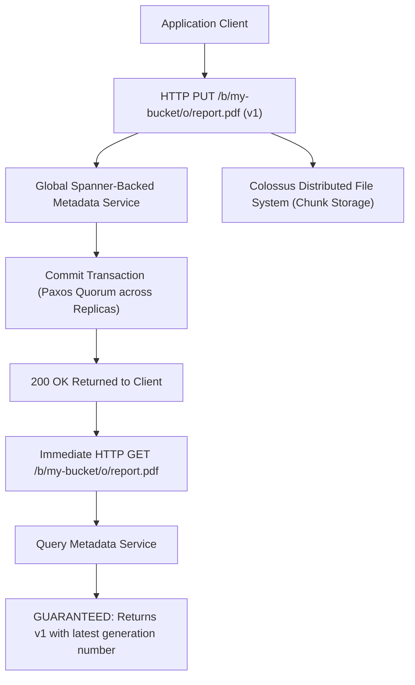
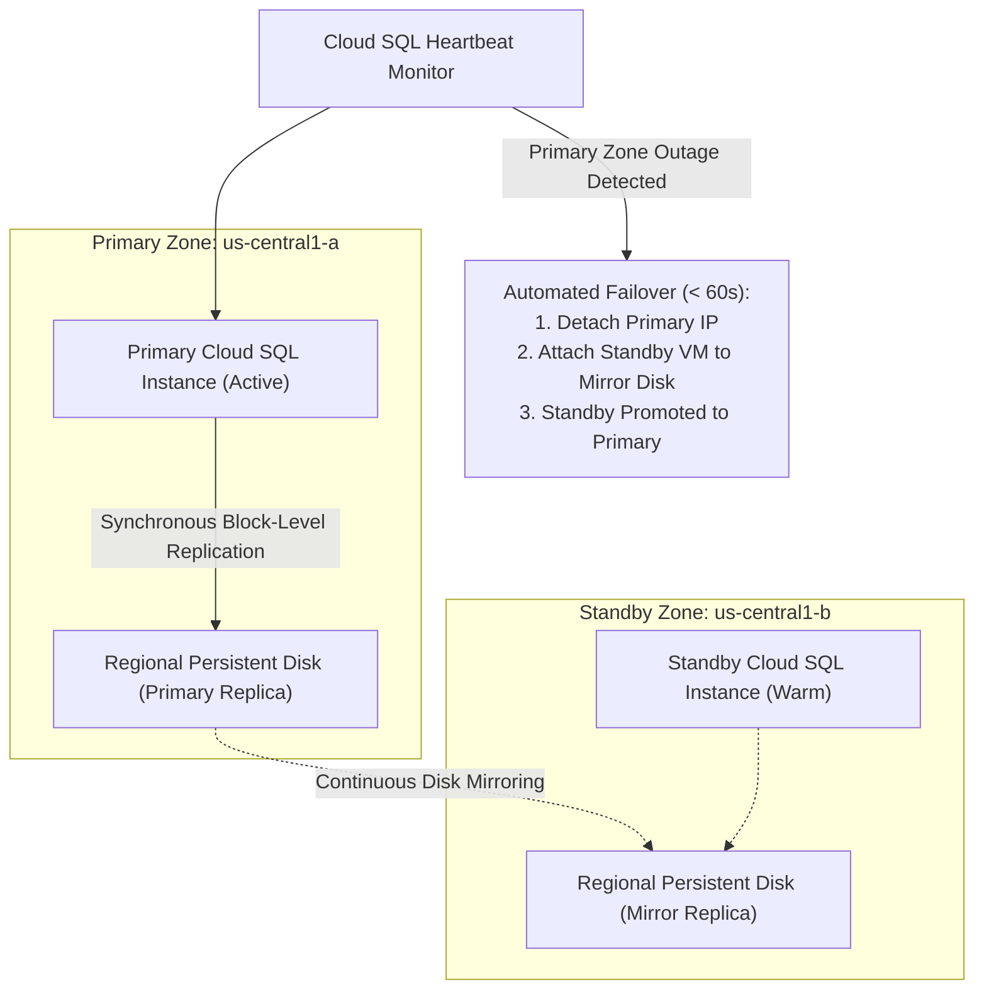
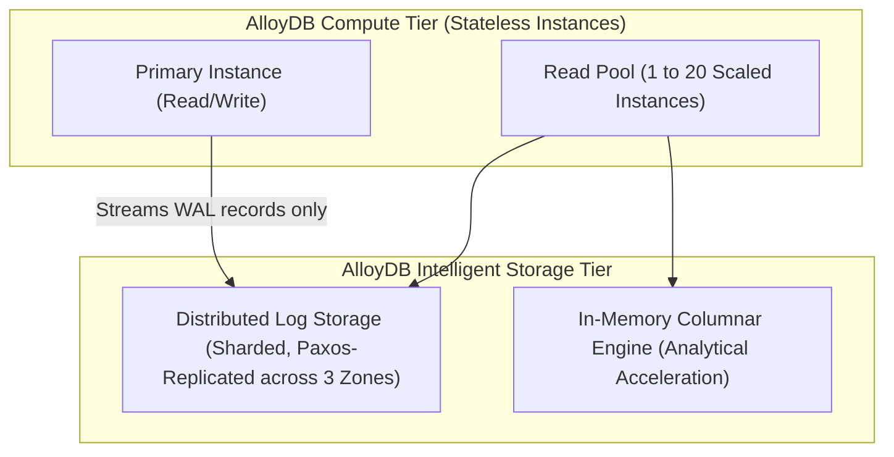
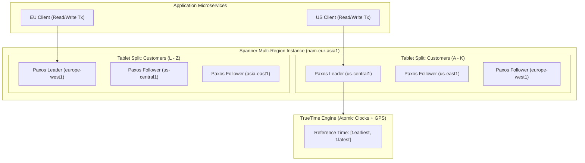
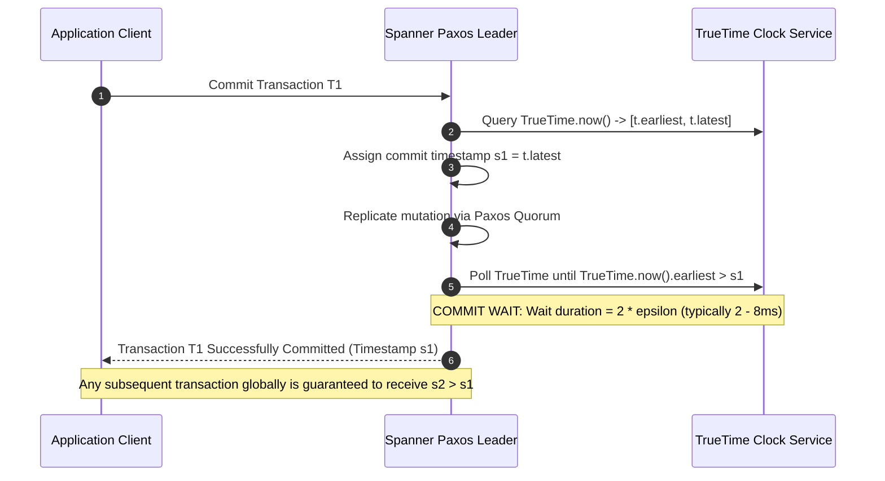
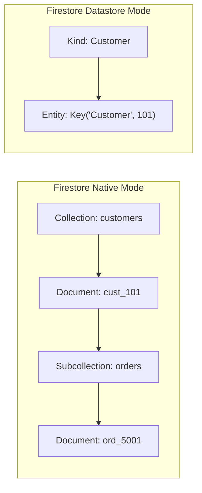
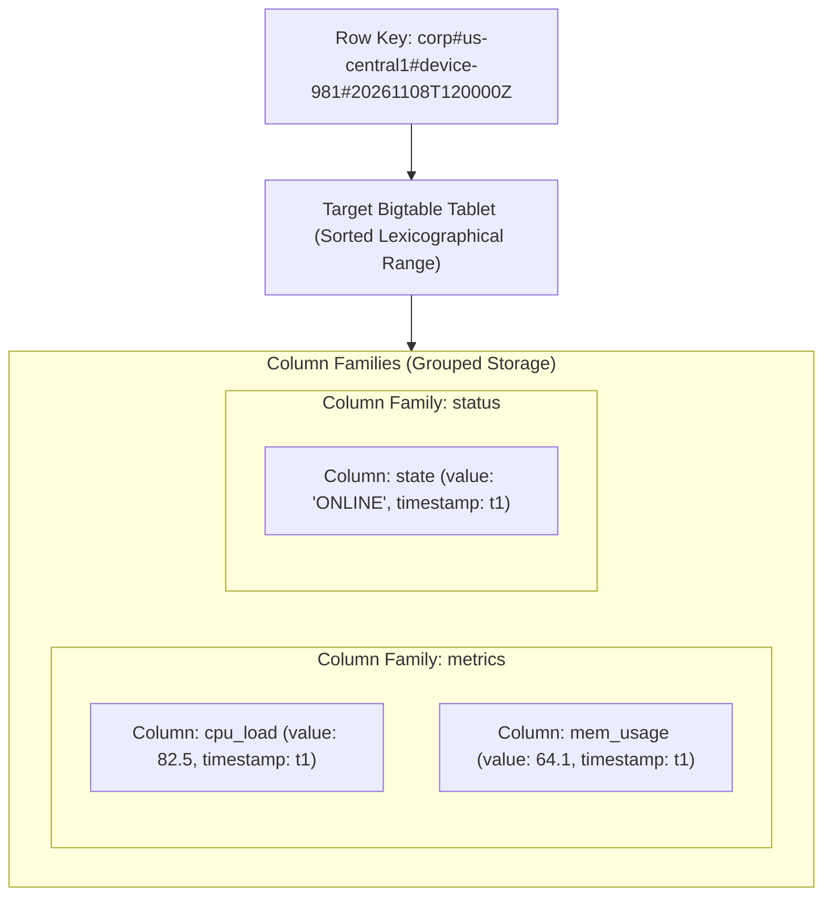

# Module 06: Storage, Cloud SQL, AlloyDB, Spanner, and Firestore

Google Cloud's storage and database ecosystem spans globally consistent object storage (Cloud Storage), managed relational databases (Cloud SQL and AlloyDB for PostgreSQL), horizontally scalable distributed SQL (Cloud Spanner), and low-latency NoSQL engines (Firestore and Cloud Bigtable). Understanding the physical storage mechanics, replication protocols, TrueTime clock uncertainty bounds, and schema design constraints is required to architect high-performance, fault-tolerant persistence tiers.

---

## 1. Cloud Storage Architecture & Global Strong Consistency

Google Cloud Storage (GCS) provides petabyte-scale, highly durable object storage accessible via global REST APIs. Unlike legacy object stores that historically exhibited eventual consistency for overwrite and delete operations, **Cloud Storage provides global strong read-after-write and read-after-delete consistency**.



### Consistency Guarantees & Generation Numbers

1. **Strong Read-After-Write**: Immediately after receiving a successful HTTP 200 upload confirmation for a new object or an overwrite, any subsequent read operation from any location worldwide is mathematically guaranteed to return the latest object content.
2. **Strong Read-After-Delete**: Immediately following a successful deletion, subsequent reads return HTTP 404 Not Found, and bucket listings omit the object immediately.
3. **Generation Numbers for Concurrency**: Every object possesses an integer `generation` number identifying the content version and a `metageneration` number identifying metadata updates. Clients use `if-generation-match` preconditions to prevent write race conditions (optimistic concurrency control).

### Storage Class Lifecycle & Autoclass

Cloud Storage organizes data into four pricing tiers based on access frequency:

| Storage Class | Minimum Retention Period | Retrieval Fees | Typical Access Frequency | Target Use Case |
| --- | --- | --- | --- | --- |
| **Standard** | None (0 days) | **$0.00** (Free) | Multiple times per day or month. | Web assets, active databases, streaming media, BigQuery raw ingestion. |
| **Nearline** | 30 days | \$0.01 per GB | Less than once per month. | Monthly backups, quarterly compliance reports, low-frequency multimedia. |
| **Coldline** | 90 days | \$0.02 per GB | Less than once per year. | Annual disaster recovery images, historical archives, legal records. |
| **Archive** | 365 days | \$0.05 per GB | Less than once every several years. | Regulatory archives, tape replacement, long-term forensic logs. |

> [!TIP]
> **Cloud Storage Autoclass**: Rather than authoring complex, brittle lifecycle rules that transition objects based on age alone, administrators enable **Autoclass**. Autoclass inspects individual object access patterns: objects not accessed for 30 days transition to Nearline, 90 days to Coldline, and 365 days to Archive. When an archived object is accessed, Autoclass transitions it back to Standard **without charging any data retrieval or transition fees**.

### Bucket Lock and Retention Policies

For enterprise compliance regimes (SEC Rule 17a-4, FINRA, HIPAA) that mandate Write Once, Read Many (WORM) storage:

1. **Retention Policy**: Enforces that objects cannot be deleted or overwritten until their age exceeds a defined retention duration (e.g. 7 years).
2. **Bucket Lock**: An irreversible compliance action that permanently locks the retention policy. Once locked:
   - The retention period **can never be reduced or removed**.
   - The bucket **can never be deleted** as long as any object within it is under active retention hold.
   - The retention period can only be increased.

---

## 2. Cloud SQL High Availability & AlloyDB Architecture

For relational workloads running on open-source database engines (PostgreSQL, MySQL, SQL Server), Google Cloud provides two managed solutions: **Cloud SQL** and **AlloyDB**.



### Cloud SQL HA vs Read Replicas

1. **High Availability (HA)**: Achieved via **Regional Persistent Disk (Regional PD)**. Every write is synchronously committed to both the primary zone and the standby zone storage before the transaction completes. If the primary VM or zone fails, Cloud SQL automatically switches the static service IP to the standby VM in $< 60$ seconds with **zero data loss (RPO = 0)**.
2. **Read Replicas**: Use asynchronous database-native replication (PostgreSQL streaming replication / MySQL binlog). Read replicas offload analytical read traffic, but failover to a read replica is manual and incurs potential data loss (RPO $> 0$).

### AlloyDB for PostgreSQL: Disaggregated Storage & Compute

AlloyDB is a fully managed, PostgreSQL-compatible relational database designed for enterprise workloads requiring 4x the transactional throughput and up to 100x the analytical query speed of standard PostgreSQL.



### Architectural Differentiators of AlloyDB

1. **Decoupled Compute and Storage**: The compute instances are completely stateless. Instead of writing full dirty memory pages to disk, primary instances stream only write-ahead log (WAL) records directly to the distributed storage layer.
2. **In-Memory Columnar Engine**: AlloyDB automatically identifies analytical query patterns and transparently caches query-relevant data in an optimized columnar format in memory, accelerating complex analytical aggregations and joins without modifying PostgreSQL SQL syntax or application drivers.

---

## 3. Cloud Spanner: Globally Distributed Relational Database

Cloud Spanner is Google's enterprise distributed relational database that delivers external consistency (strict serializability with ACID transactions) across multiple regions and continents without locking, scaling horizontally to millions of queries per second.



### The TrueTime API and Clock Uncertainty

In distributed systems, physical hardware clocks drift due to temperature and crystal variance. The foundational breakthrough of Cloud Spanner is the **TrueTime API**, which explicitly bounds clock uncertainty:

$$\text{TrueTime.now}() \implies [t.\text{earliest}, t.\text{latest}]$$

where the clock uncertainty is defined as:

$$\epsilon = \frac{t.\text{latest} - t.\text{earliest}}{2}$$

Across Google's data centers, atomic clocks and GPS receivers maintain $\epsilon$ typically between $1\text{ms}$ and $7\text{ms}$.

### The Commit Wait Protocol for External Consistency

To guarantee **External Consistency** (if transaction $T_2$ begins after transaction $T_1$ commits in physical wall-clock time, $T_2$ is guaranteed to receive a commit timestamp $s_2 > s_1$), Spanner executes the **Commit Wait Protocol**:



### Spanner Table Interleaving

In relational databases, querying parent-child relationships (e.g. `Customers` and `Orders`) requires network joins between different disk sectors or nodes. Spanner supports **Table Interleaving**, physically co-locating child rows alongside parent rows in the same distributed storage tablet:

```sql
CREATE TABLE Customers (
  CustomerId STRING(36) NOT NULL,
  Name STRING(100),
  Email STRING(100),
) PRIMARY KEY (CustomerId);

CREATE TABLE Orders (
  CustomerId STRING(36) NOT NULL,
  OrderId STRING(36) NOT NULL,
  OrderDate DATE,
  TotalAmount NUMERIC,
) PRIMARY KEY (CustomerId, OrderId),
  INTERLEAVE IN PARENT Customers ON DELETE CASCADE;
```

When an order is written for `CustomerId = '101'`, Spanner physically places the order row into the identical Colossus storage split as customer `101`. Joining `Customers` and `Orders` executes locally with zero cross-network RPC latency.

### The Monotonically Increasing Key Anti-Pattern

Spanner partitions tables into splits ordered lexicographically by primary key. A critical architectural anti-pattern is using monotonically increasing sequences (timestamps, sequential integers) as primary keys:

```sql
-- ANTI-PATTERN: Monotonically increasing primary key
CREATE TABLE DeviceTelemetry (
  Timestamp TIMESTAMP NOT NULL, -- All writes hammer the single tail split!
  DeviceId STRING(36) NOT NULL,
  MetricValue FLOAT64
) PRIMARY KEY (Timestamp, DeviceId);
```

Because `Timestamp` increases continuously, **100% of incoming writes are routed to the single tablet split that owns the highest range boundary**. Even in a 100-node Spanner instance, 99 nodes sit completely idle while the single tail node suffers CPU saturation and write throttling.

**Remediation**:

- Prepend a hash prefix to the key: `PRIMARY KEY (HashPrefix, Timestamp, DeviceId)`.
- Use a UUIDv4 or bit-reversed sequence as the primary key.
- Swap key order to place a high-cardinality identifier first: `PRIMARY KEY (DeviceId, Timestamp)`.

---

## 4. Firestore: Document-Collection Hierarchy and Permanent Mode Lock

Google Cloud Firestore is a serverless, horizontally scalable NoSQL document database that delivers ACID transactions, real-time listeners, and offline mobile data synchronization.



### Native Mode vs Datastore Mode: The Irreversible Lock

When creating a Firestore database in a Google Cloud project, administrators must select between two mutually exclusive modes:

| Dimension | Firestore in Native Mode | Firestore in Datastore Mode |
| --- | --- | --- |
| **Data Hierarchy** | Collections $\to$ Documents $\to$ Subcollections. | Kinds $\to$ Entities $\to$ Properties. |
| **Real-Time Synchronization** | Supported natively (mobile/web client listeners). | Not supported. |
| **Security Model** | Granular Firestore Security Rules and App Check. | Standard Google Cloud IAM policies only. |
| **API Support** | Firebase client SDKs, gRPC, and REST. | Legacy Cloud Datastore APIs and client libraries. |
| **Target Workload** | Modern mobile, web, and serverless applications. | High-throughput server-to-server backend migrations. |

> [!CAUTION]
> **The One-Way Mode Lock**: The decision between **Native Mode** and **Datastore Mode** is a **permanent, irreversible choice per database**. Once a database is initialized in Datastore Mode, it can **never be converted to Native Mode in place**. Changing the mode requires deleting the entire database or provisioning a brand-new Google Cloud project.

---

## 5. Cloud Bigtable: Petabyte-Scale Wide-Column Storage

Cloud Bigtable is the identical distributed wide-column database engine that powers Google Search, Google Maps, and YouTube. It is engineered for ultra-low latency reads and writes (single-digit milliseconds) across billions of rows and petabytes of data.



### Row Key Design Principles

Bigtable has strictly **one single index**: the sorted lexicographical **Row Key**. There are no secondary indexes, no foreign keys, and no cross-row transactions.

1. **Row Keys Must Avoid Monotonic Sequential Values**: Avoid leading with sequential timestamps (`2026-11-08-001`). Prepend a high-cardinality prefix (`device_id#timestamp`) or hash to distribute writes across all cluster nodes.
2. **Reverse Timestamps for Latest-First Queries**: To query the most recent telemetry readings efficiently, author row keys using reverse timestamps: $$\text{ReverseTimestamp} = \text{Long.MAX\_VALUE} - \text{TimestampMillis}$$ Scanning by `device_id#` will immediately return the latest measurements at the top of the range scan.
3. **Column Families**: Group related columns with similar access frequencies into common column families to optimize disk compression and memory caching.

---

## 6. Hands-On Verification Lab

The test suite in [`examples/03-storage-and-spanner.test.ts`](../examples/03-storage-and-spanner.test.ts) proves Cloud Storage global consistency, Bucket Lock compliance, Spanner TrueTime commit wait intervals, and monotonic key hotspotting mechanics.

To execute the test suite:

```bash
cd technologies/gcp
mise exec -- npm test
```

### Verified Behaviors

1. **Strong Read-After-Write**: Confirms that newly created Cloud Storage objects are immediately readable worldwide.
2. **Bucket Lock Immutability**: Proves that attempts to shorten retention policies on locked buckets throw exceptions.
3. **Object Retention Enforcement**: Verifies that objects under active retention hold reject premature deletion attempts.
4. **TrueTime Commit Wait Simulation**: Mathematically validates the $2\epsilon$ commit delay required for external consistency.
5. **Spanner Key Hotspotting**: Proves that monotonic chronological keys overload a single split, while hashed keys distribute load evenly across tablets.

---

## 7. Interview Drill: Architectural Questions & Scenarios

<details>
<summary><b>Q1: A software architect designs a global financial transaction processing system across North America and Europe on Cloud Spanner. Why does Cloud Spanner require atomic clocks and GPS receivers (TrueTime), and what would break if standard NTP time synchronization were used instead?</b></summary>

**Answer**: **Why TrueTime is Required**: Cloud Spanner guarantees **External Consistency (Strict Serializability)**: if Transaction $T_1$ commits before Transaction $T_2$ starts in real physical time, $T_2$ is guaranteed to receive a commit timestamp $s_2 > s_1$. To achieve this across continents without global distributed locking, Spanner uses the TrueTime API, which provides a strictly bounded clock uncertainty interval $\epsilon \approx 1\text{ms}$ to $7\text{ms}$. During commits, Spanner executes **Commit Wait**: the leader delays releasing the commit to the client by $2\epsilon$ to guarantee that real wall-clock time has passed the assigned timestamp.

**What Would Break with NTP**: Standard Network Time Protocol (NTP) has clock drift and uncertainty intervals ranging from $100\text{ms}$ to over $5{,}000\text{ms}$ (due to asymmetric network latency, packet loss, and VM virtualization scheduling jitter). If Spanner used NTP:

1. To guarantee external consistency, Spanner would have to wait $2 \times \text{NTP uncertainty} = 10 \text{ seconds}$ on every single write transaction, destroying database performance.
2. If Spanner did not wait, clock drift would cause Causality Violations: a user in Europe could execute an action based on an event that occurred in America, but the database could record the European event with an earlier timestamp, violating causal history and corrupting financial ledgers.

- Ref: [Section 3: Cloud Spanner: Globally Distributed Relational Database](#3-cloud-spanner-globally-distributed-relational-database), [Spanner: Google's Globally-Distributed Database (OSDI 2012)](https://research.google/pubs/pub39966/)

</details>

<details>
<summary><b>Q2: A development team creates a new Google Cloud project and provisions a Firestore database in Datastore Mode to migrate a legacy app. Two weeks later, the mobile engineering team demands real-time listeners and security rules available in Firestore Native Mode. How do you convert the existing database from Datastore Mode to Native Mode?</b></summary>

**Answer**: You **cannot convert the database mode in place**.

**The Constraint & Workaround**:

1. In Google Cloud, the selection between **Firestore Native Mode** and **Firestore in Datastore Mode** is a **permanent, irreversible choice per database**.
2. To achieve the mobile team's requirements, the architecture team must:
   - Export all Datastore data to Cloud Storage using `gcloud firestore export`.
   - Provision a **new Google Cloud project** (or a secondary named Firestore database if multiple databases per project are enabled).
   - Initialize the new database in **Firestore Native Mode**.
   - Transform and import the exported entities into native document-collection hierarchies.
   - Update mobile application client SDKs to point to the new project/database.

- Ref: [Section 4: Firestore: Document-Collection Hierarchy and Permanent Mode Lock](#4-firestore-document-collection-hierarchy-and-permanent-mode-lock), [Firestore Mode Selection Guide](https://cloud.google.com/firestore/docs/choosing-a-database-mode)

</details>

<details>
<summary><b>Q3: A high-throughput telemetry platform writes millions of vehicle sensor readings per minute into Cloud Bigtable. The cluster CPU utilization is pegged at 100% on a single node, while the remaining 9 nodes in the cluster sit idle at 2% CPU. What is the root cause, and how must the schema be restructured?</b></summary>

**Answer**: **Root Cause**: The Bigtable schema is suffering from **Write Hotspotting** caused by a **Monotonically Increasing Row Key**. The application is likely using keys that lead with a timestamp or sequential counter (e.g. `2026-11-08T120000Z#vehicle_101`). Because Bigtable stores rows in sorted lexicographical order across tablet splits, all writes at any given second route to the exact same tablet hosted on a single cluster node.

**Remediation**: Redesign the Row Key to distribute writes uniformly across the entire cluster:

1. **Field Salting / Promotion**: Prepend a high-cardinality identifier to the row key: `vehicle_id#timestamp` (e.g. `vin_98471#2026-11-08T120000Z`). Because VINs are uniformly distributed across the alphabet, writes are parallelized across all 10 cluster nodes simultaneously.
2. **Hash Prefixes**: Prepend a short hash prefix: `md5(vehicle_id)[0:4]#vehicle_id#timestamp`.
3. If querying the latest readings is required, use **reverse timestamps** (`Long.MAX_VALUE - timestamp`) after the vehicle ID prefix.

- Ref: [Section 5: Cloud Bigtable: Petabyte-Scale Wide-Column Storage](#5-cloud-bigtable-petabyte-scale-wide-column-storage), [Google Cloud Bigtable Row Key Schema Best Practices](https://cloud.google.com/bigtable/docs/schema-design)

</details>

<details>
<summary><b>Q4: A multinational enterprise with strict compliance requirements must retain audit logs in Cloud Storage for exactly 7 years. The compliance policy requires that neither rogue employees, compromised admin accounts, nor Google Cloud support can delete these logs before the 7-year mark. How is this implemented?</b></summary>

**Answer**: Deploy a Cloud Storage **Retention Policy with Bucket Lock**.

**Implementation**:

1. Create a dedicated audit bucket with Uniform Bucket-Level Access enabled.
2. Apply a Retention Policy specifying a duration of 7 years (220,752,000 seconds): `gcloud storage buckets update gs://audit-vault --retention-period="220752000s"`.
3. Lock the retention policy permanently: `gcloud storage buckets lock gs://audit-vault`.
4. **Compliance Guarantee**: Once locked, Bucket Lock is **irreversible**. Neither Project Owners nor Organization Administrators can shorten the retention period, remove the policy, or delete the bucket as long as any object within it has not reached its 7-year age. Deletion attempts are rejected by the Cloud Storage API at the storage engine level.

- Ref: [Section 1: Cloud Storage Architecture & Global Strong Consistency](#1-cloud-storage-architecture--global-strong-consistency), [Cloud Storage Bucket Lock Documentation](https://cloud.google.com/storage/docs/bucket-lock)

</details>

<details>
<summary><b>Q5: An application requires a PostgreSQL database that can scale analytical query performance by 50x without requiring a separate ETL pipeline to a data warehouse or rewriting standard SQL queries. What Google Cloud database should you deploy and why?</b></summary>

**Answer**: Deploy **AlloyDB for PostgreSQL**.

**Why AlloyDB**:

1. **Full PostgreSQL Compatibility**: AlloyDB is 100% compatible with PostgreSQL 14+, allowing existing application drivers, ORMs, and complex queries to run with zero code modifications.
2. **In-Memory Columnar Engine**: AlloyDB automatically identifies analytical query patterns and creates an in-memory columnar representation of query-relevant data. It evaluates aggregations, filter scans, and table joins directly in vectorized columnar format, accelerating analytical query execution by up to 100x compared to standard PostgreSQL.
3. **Decoupled Architecture**: Read Pools can scale horizontally up to 20 read instances offloading analytical reporting while the primary writer handles transactional OLTP with sub-millisecond commit latency.

- Ref: [Section 2: Cloud SQL High Availability & AlloyDB Architecture](#2-cloud-sql-high-availability--alloydb-architecture), [Google Cloud AlloyDB Columnar Engine Guide](https://cloud.google.com/alloydb/docs/columnar-engine)

</details>

<details>
<summary><b>Q6: A disaster recovery mandate requires that financial report PDFs written to Cloud Storage in Iowa (`us-central1`) be guaranteed replicated to South Carolina (`us-east1`) with an RPO of less than 15 minutes backed by a financial SLA. How should this storage bucket be architected?</b></summary>

**Answer**: Create a **Dual-Region Cloud Storage Bucket** pairing `us-central1` and `us-east1` and enable **Turbo Replication**.

**Mechanics**:

1. Standard dual-region buckets replicate asynchronously across regions, targeting 99.9% of newly written objects replicated within 12 hours without a contractual RPO SLA.
2. By enabling **Turbo Replication** (`gcloud storage buckets update gs://fin-reports-vault --turbo-replication`), Google Cloud commits to replicating 100% of newly written objects to the paired region within **15 minutes**, regardless of object size.
3. This 15-minute window is backed by an explicit Service Level Agreement (SLA). If Google fails to meet the 15-minute replication threshold during any billing month, financial credits are provided according to the Cloud Storage SLA terms.

- Ref: [Section 1: Cloud Storage Architecture & Global Strong Consistency](#1-cloud-storage-architecture--global-strong-consistency), [Cloud Storage Turbo Replication](https://cloud.google.com/storage/docs/turbo-replication)

</details>

<details>
<summary><b>Q7: In Cloud Spanner, when should an engineering team use Table Interleaving rather than standard foreign key constraints, and what are the performance implications during distributed transactions?</b></summary>

**Answer**: Use **Table Interleaving** when a strict 1:N parent-child relationship exists where child rows are frequently queried or updated alongside their parent row (such as `Customers` and `Orders`).

**Performance Implications**:

1. **Physical Co-location**: Interleaving physically co-locates child rows into the exact same Colossus tablet split alongside their parent row. Data blocks on disk are stored together in sorted primary key order (`CustomerId, OrderId`).
2. **Single-Paxos Transactions**: Queries joining `Customers` and `Orders` on `CustomerId` execute locally within a single split on a single Spanner node. Updates to both the customer and order row execute as a single-tablet Paxos mutation with zero cross-network two-phase commit (2PC) coordination overhead.
3. **Contrasted with Foreign Keys**: Standalone tables with foreign keys place `Orders` and `Customers` into independent splits distributed across different nodes. Writes to `Orders` require distributed 2PC two-phase locking across multiple Paxos groups to validate the foreign key, significantly increasing commit latency and TrueTime commit-wait overhead.

- Ref: [Section 3: Cloud Spanner: Globally Distributed Relational Database](#3-cloud-spanner-globally-distributed-relational-database), [Cloud Spanner Table Interleaving Guide](https://cloud.google.com/spanner/docs/schema-and-data-model#creating-interleaved-tables)

</details>

<details>
<summary><b>Q8: A caching tier requires sub-millisecond retrieval latency with cluster-wide replication, zero operational overhead for patching or hardware failures, and open-source Redis API protocol compatibility. Why choose Memorystore for Valkey or Redis over running Redis in Compute Engine VMs?</b></summary>

**Answer**: Deploy **Memorystore for Valkey or Redis**.

**Operational and Architectural Advantages**:

1. **Fully Managed High Availability**: Memorystore provisions a primary node and read replica across multiple availability zones. Automatic failover completes in seconds with zero manual operator intervention via an internal health-checking and sentinel control plane.
2. **Maintenance and Seamless Patching**: Infrastructure maintenance, OS updates, and memory patches execute without downtime using live migration and replica promotion.
3. **VPC Native Private IP**: Memorystore instances connect directly to your VPC network via Private Services Access (PSA) using RFC 1918 private IP addresses. No public IP exposure exists, and traffic remains entirely on Google's private fiber backbone with support for transit encryption (TLS) and Redis AUTH.

- Ref: [Section 2: Cloud SQL High Availability & AlloyDB Architecture](#2-cloud-sql-high-availability--alloydb-architecture), [Google Cloud Memorystore Overview](https://cloud.google.com/memorystore/docs/redis/memorystore-for-redis-overview)

</details>
