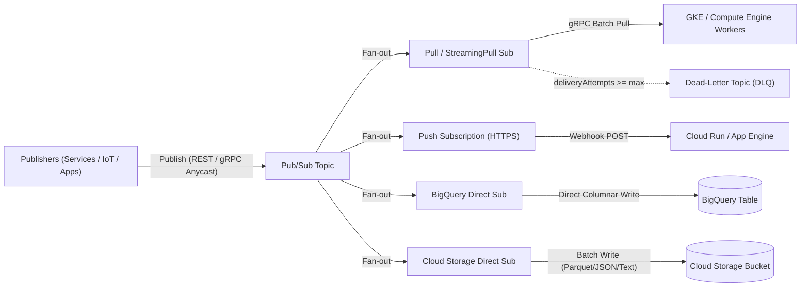
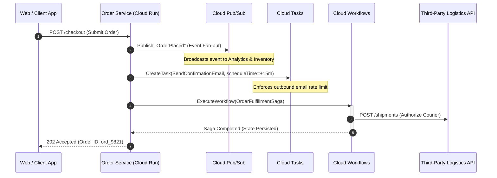
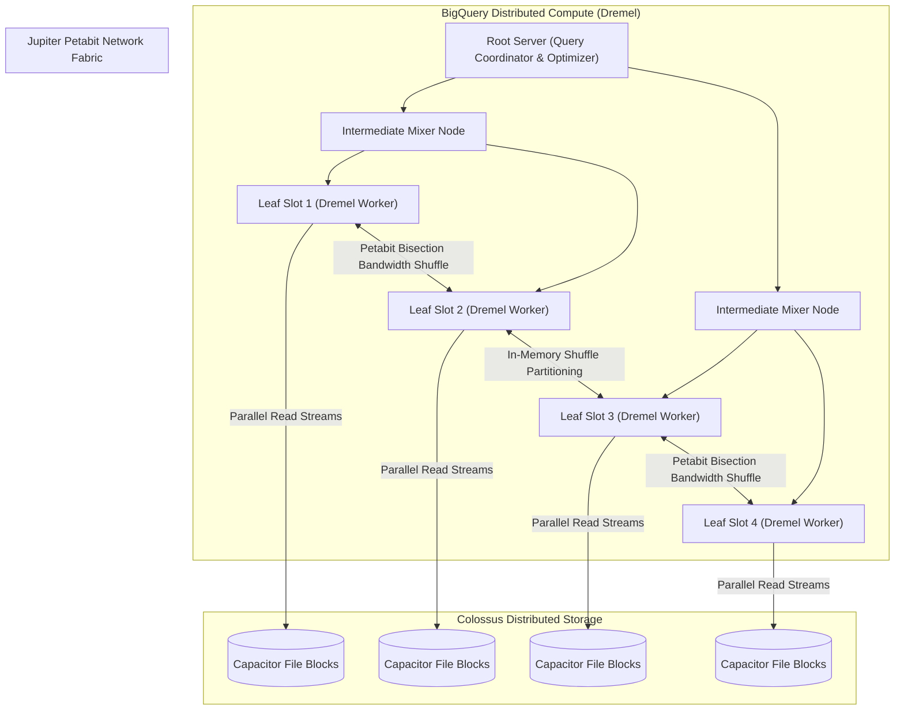
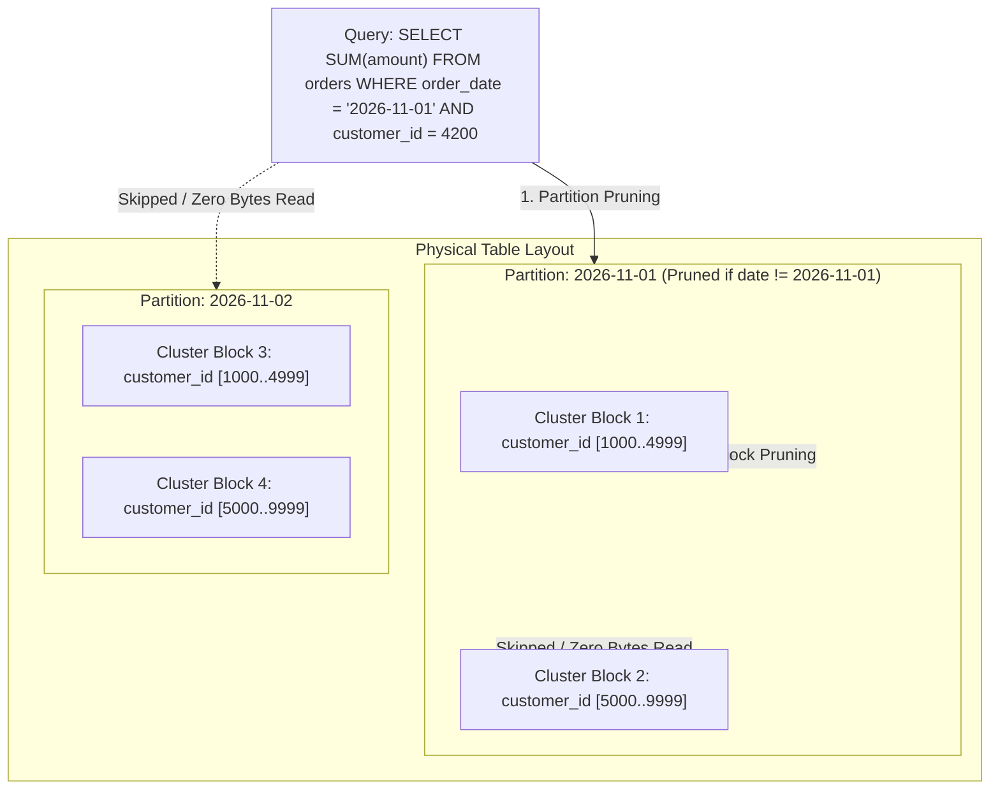
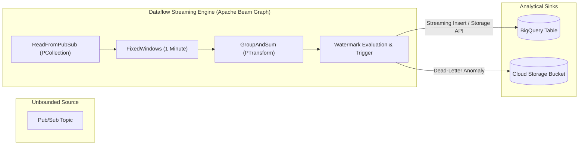

# Module 07: Pub/Sub, Eventarc, BigQuery Architecture, and Dataflow

Google Cloud decouples event ingestion, stream transport, asynchronous orchestration, and analytical query execution across purpose-built distributed services. At the data ingestion layer, **Cloud Pub/Sub** provides a horizontally scalable, multi-tenant publish/subscribe messaging backbone with global anycast endpoints and configurable consistency guarantees. For asynchronous execution and mediation, **Cloud Tasks**, **Eventarc**, and **Workflows** provide discrete rate-limited dispatch, standardized CloudEvent bus routing, and stateful multi-step orchestration. At the analytical analytics tier, **BigQuery** separates compute from storage across Google's petabit network, combining the **Dremel** distributed execution engine, **Capacitor** columnar storage, and **Jupiter** network fabric. **Cloud Dataflow** unifies stream and batch processing atop Apache Beam, managing event-time windowing, watermarks, and dynamic work rebalancing.

---

## 1. Cloud Pub/Sub: Distributed Message Bus & Ingestion Topology

Cloud Pub/Sub decouples systems that produce events from systems that process them. It operates across Google's global network without requiring cluster provisioning, partitioning pre-allocation, or broker partition sizing.



### 1.1 Topic Ingestion, Routing, and Subscription Types

When a publisher emits a message to a Pub/Sub topic, Google Cloud's anycast frontend routes the payload over the internal network to a regional message router. The router writes the message to multiple storage replicas across distinct availability zones before returning an acknowledgment (`ackId`) to the publisher.

Messages are stored once per topic and delivered independently to every subscription attached to that topic:

1. **Pull Subscriptions**: Subscribers initiate an outbound connection to Google Cloud via gRPC (`StreamingPull`) or HTTP long-polling. The subscriber requests a batch of messages, processes them locally, and sends an explicit acknowledgment (`acknowledge`) or negative acknowledgment (`nack`). Pull subscriptions provide the highest throughput and lowest latency for high-volume worker fleets running in GKE, Compute Engine, or hybrid data centers.
2. **Push Subscriptions**: Pub/Sub initiates an outbound HTTPS POST request to an arbitrary, publicly accessible HTTPS endpoint (or an authenticated Cloud Run, Cloud Functions, or internal ALB endpoint). Each message payload is delivered in the body of an HTTP request encoded in JSON. Push subscriptions are suited for serverless webhooks, eliminating idle polling instances.
3. **BigQuery Subscriptions**: Pub/Sub writes messages directly into a target BigQuery table without deploying intermediate Cloud Run services, Cloud Functions, or Dataflow pipelines. The subscription supports schema conversion, writing metadata attributes (publish time, attributes, subscription ID), and handling write errors via dead-letter routing.
4. **Cloud Storage Subscriptions**: Pub/Sub aggregates and writes incoming messages directly into Cloud Storage bucket files. You configure file batching thresholds based on elapsed duration (e.g. 5 minutes) or uncompressed byte size (e.g. 50 MB), and select output formats including raw payload text, newline-delimited JSON, or Apache Parquet.

### 1.2 Ack Deadline, Lease Management, and Redelivery Storms

Every subscription defines an **Acknowledgment Deadline** (`ackDeadlineSeconds`), ranging between 10 seconds and 600 seconds (default: 10 seconds).

When Pub/Sub delivers a message to a subscriber, an internal lease timer starts:

- If the subscriber processes the message and issues an `acknowledge(ackId)` RPC before the deadline expires, the message is marked as consumed and permanently deleted from the subscription backlog.
- If the subscriber encounters a transient processing failure, it may issue a `modifyAckDeadline(ackId, 0)` RPC (a negative acknowledgment or `nack`), which immediately resets the lease and places the message back into the deliverable pool for redelivery.
- If the subscriber crashes, hangs, or exceeds the deadline without extending the lease, Pub/Sub assumes the subscriber failed and automatically redelivers the message to another available consumer instance.

```
Lease Expiration Timeline:
t0: Message delivered to Worker A -> Ack Deadline timer starts (30s)
t0..t20s: Worker A processing payload...
t25s: Worker A still busy -> Pub/Sub Client SDK issues modifyAckDeadline(+30s)
t45s: Worker A completes processing -> issues acknowledge(ackId) -> Lease terminated, message removed
```

> [!WARNING]
> **Production Failure Mode: The Redelivery Storm**: If a worker fleet's average message processing time approaches or exceeds the subscription's `ackDeadlineSeconds`, and the client library's automatic lease extension is misconfigured or disabled, Pub/Sub redelivers the unacknowledged messages to other worker instances. Those instances also fail to acknowledge before the deadline, triggering an exponential cascade of duplicate deliveries. The fleet CPU and memory utilization surges to 100%, processing throughput collapses to zero, and downstream databases are flooded with redundant transactions. To prevent redelivery storms, set an appropriate initial ack deadline, tune client-side automatic lease management (`maxExtensionPeriod`), implement strict consumer timeouts, and attach a Dead-Letter Queue (DLQ).

### 1.3 Message Ordering, Exactly-Once Delivery, and Dead-Letter Topics

Standard Pub/Sub guarantees **at-least-once** delivery with no global message ordering. In standard topics, network retries and distributed storage partitions mean messages may arrive out of order and duplicates may occur.

For workloads requiring strict sequencing or deduplication, Pub/Sub provides specialized engine features:

1. **Ordering Keys (`orderingKey`)**:
   - When a publisher assigns a string `orderingKey` to a message, Pub/Sub guarantees that all messages published with the same key are delivered to subscribers in the exact order they were received by the service.
   - If a message with an ordering key fails or is nacked, Pub/Sub **suspends delivery** of all subsequent messages sharing that ordering key until the failed message is acknowledged or routed to a dead-letter topic. This prevents out-of-order mutations on dependent state machines.
   - Ordering keys require client-side ordering enablement (`enableMessageOrdering: true`) on both the publisher and subscriber.

2. **Exactly-Once Delivery**:
   - When enabled on a subscription (`enableExactlyOnceDelivery: true`), Pub/Sub prevents duplicate deliveries caused by transport retries and transient acknowledgment drops within the same region.
   - The subscriber client verifies whether an acknowledgment succeeded: if `acknowledge` returns an error (e.g. deadline expired and message was already reassigned), the client knows another worker owns the lease.
   - Exactly-once delivery adds a minor latency overhead and is scoped to a single Google Cloud region.

3. **Dead-Letter Topics (DLQ)**:
   - Configured with a `maxDeliveryAttempts` threshold (between 5 and 100 attempts).
   - Pub/Sub increments a delivery counter on every delivery attempt. If an unacknowledged message reaches `maxDeliveryAttempts`, Pub/Sub automatically routes the message payload and attributes to a designated Dead-Letter Topic, removing it from the primary subscription queue.
   - Subscribers to the dead-letter topic can log the poisoned payload, trigger alerts, or route it to a remediation workflow without stalling the primary pipeline.

4. **Seek and Snapshots**:
   - **Snapshots**: Capture the unacknowledged backlog state of a subscription at a specific point in time.
   - **Seek**: Allows an administrator to fast-forward or rewind subscription state. You can seek to a specific historical timestamp (replaying all messages published within the topic retention period, up to 7 days) or seek to a previously created snapshot. This enables zero-loss recovery from catastrophic application bugs by deploying a code fix and rewinding the subscription backlog.

---

## 2. Cloud Tasks vs Pub/Sub vs Eventarc vs Workflows

Architecting event-driven systems requires selecting the appropriate communication primitive. Using a broadcast messaging bus for targeted rate-limited worker invocations causes operational fragility, while using task queues for event fan-out breaks consumer decoupling.

| Dimension | Cloud Pub/Sub | Cloud Tasks | Eventarc | Cloud Workflows |
| :-- | :-- | :-- | :-- | :-- |
| **Primary Pattern** | Asynchronous Event Fan-out (Pub/Sub) | Targeted Asynchronous Work Delegation | Standardized Event Bus (CloudEvents) | Stateful Multi-Step Orchestration |
| **Consumer Topology** | 1-to-Many (Multiple subscriptions) | 1-to-1 (Specific HTTP/App Engine endpoint) | 1-to-Many (CloudEvents consumers) | 1-to-Many APIs / Microservices |
| **Delivery Model** | At-least-once (or Exactly-once) | At-least-once with configurable retries | At-least-once | At-least-once per step |
| **Rate Limiting** | None (Immediate push/pull) | Built-in Token Bucket (`maxDispatchesPerSecond`) | None (Dependent on target concurrency) | Step execution rate limits |
| **Future Scheduling** | No (Immediate availability) | Yes (`scheduleTime`, up to 30 days) | No (Immediate routing) | Yes (`sys.sleep` steps) |
| **Task Management** | Seek/Purge across entire subscription | Individual Task Inspection, Delete, Purge | Event filtering via CloudEvents attributes | Pause, Resume, Cancel execution |
| **Maximum Payload** | 10 MB per message | 100 KB (HTTP) / 100 KB (App Engine) | 512 KB per CloudEvent | 512 KB per execution state |
| **Target Endpoints** | Pull subscribers, Push HTTPS, BQ, GCS | Cloud Run, GKE, Compute Engine, App Engine | Cloud Run, Workflows, GKE, Pub/Sub | Any HTTP API, GCP Services, Connectors |



### 2.1 Cloud Tasks: Granular Rate-Limited Worker Invocation

Cloud Tasks is a dedicated asynchronous task execution service designed for point-to-point worker dispatch:

- **Token Bucket Rate Limiting**: You define queue dispatch limits using `maxDispatchesPerSecond` (maximum sustained throughput) and `maxBurstSize` (burst token capacity), protecting fragile legacy backends or downstream external APIs from sudden connection spikes.
- **Concurrent Dispatch Limiting**: `maxConcurrentDispatches` caps the maximum number of outstanding HTTP requests the queue delivers simultaneously.
- **Future Execution Scheduling**: Tasks can specify an execution timestamp (`scheduleTime`) up to 30 days in the future. The task remains securely stored in the queue until the designated time arrives, eliminating manual database polling or cron management.
- **Task De-duplication and Management**: Each task can have a unique name (`tasks.create` ID). Cloud Tasks automatically rejects duplicate task creation requests with the same name within a 1-hour window. Individual tasks can be inspected, canceled, or deleted while queued.

### 2.2 Eventarc: Enterprise CloudEvents Routing

Eventarc unifies event delivery across Google Cloud infrastructure using the open **CNCF CloudEvents v1.0** specification:

- **Event Sources**: Ingests events from over 130 Google Cloud services via **Cloud Audit Logs** (capturing control-plane mutations such as VM creation, bucket updates, or IAM changes without modifying application source code), direct **Pub/Sub topics**, and **third-party SaaS providers**.
- **Content-Based Routing**: Filters events based on standard CloudEvents metadata attributes (e.g. `type`, `serviceName`, `methodName`, `resourceName`) and routes them directly to target compute services.
- **Serverless Targets**: Routes directly to **Cloud Run** services, **Cloud Workflows**, **GKE services**, or internal HTTP services within a VPC network.
- **Security & Authentication**: Automatically attaches Google-signed OIDC identity tokens to event delivery requests, allowing target Cloud Run services to require authenticated invocation (`roles/run.invoker`) with zero open public ingress.

### 2.3 Cloud Workflows: Serverless Stateful Orchestration

Cloud Workflows coordinates microservices, Cloud Functions, Cloud Run services, and external HTTP APIs using YAML or JSON state-machine definitions:

- **Serverless Execution**: Scales to zero with no underlying cluster infrastructure. You pay strictly per executed step, with zero idle costs.
- **Built-in Connectors**: Native connectors for Google Cloud APIs (BigQuery, Pub/Sub, Cloud Storage, Firestore) simplify service integration, handling IAM authorization, paging, and long-running operation polling automatically.
- **Resilience and Error Handling**: Native `try/retry/except` blocks support configurable exponential backoff, jitter, and custom error matching.
- **Stateful Waiting**: Workflows can wait for asynchronous external callbacks or pause execution using `sys.sleep` for up to 1 year without consuming compute resources or incurring compute charges during wait states.

---

## 3. BigQuery Architecture: Dremel, Capacitor, and Jupiter

BigQuery is Google Cloud's fully managed, serverless enterprise data warehouse. Its performance and architectural characteristics stem from the complete physical separation of compute, storage, and networking across Google's hyperscale cluster infrastructure.



### 3.1 Dremel: Multi-Tier Execution Tree

When a client submits an ANSI SQL query, BigQuery compiles the query into an execution tree coordinated by **Dremel**:

1. **Root Server**: Parses the SQL query, applies logical and physical optimizations, prunes unreferenced table partitions, and divides the execution plan into discrete parallel stages.
2. **Intermediate Mixers**: Coordinate multi-stage aggregations, table joins, and intermediate data transformations. They distribute work instructions downward to leaf nodes and aggregate partial results upward toward the root.
3. **Leaf Processing Nodes (Slots)**: The unit of compute in BigQuery is a **Slot**—a virtual CPU and memory slice running on Google's Borg cluster management system. Leaf slots read columnar data blocks from storage in parallel, apply predicate filtering (`WHERE`), evaluate scalar expressions, and push transformed blocks into the shuffle network.

### 3.2 Capacitor: Proprietary Columnar Storage Format

BigQuery stores persistent table data in **Capacitor**, a proprietary columnar file format hosted on **Colossus** (Google's planetary distributed file system):

- **Columnar Segmentation**: Table data is split into column-oriented segments. Each column is stored separately on disk in contiguous blocks.
- **Adaptive Compression & Encoding**: Capacitor analyzes the data distribution within each column segment to select optimal compression algorithms: Run-Length Encoding (RLE) for low-cardinality repetitive strings, Dictionary Encoding for categorical values, and Bit-Packing for numeric ranges.
- **Predicate Pushdown & Min/Max Pruning**: Each Capacitor file block embeds rich metadata, including minimum and maximum column values, null counts, and cardinality statistics. When a query evaluates a filter expression, leaf slots inspect file headers to discard non-matching file blocks before reading data off disk.

### 3.3 Jupiter: Petabit In-Memory Shuffle Fabric

In traditional distributed databases, data shuffling during distributed joins or `GROUP BY` operations saturates top-of-rack switches and disk I/O. BigQuery solves this via the **Jupiter Network Fabric**:

- **Bisection Bandwidth**: Jupiter provides petabit-scale bisection network bandwidth, allowing tens of thousands of Dremel slots to communicate at full line rate without oversubscription.
- **Remote In-Memory Shuffle**: BigQuery offloads intermediate query state into a dedicated, disaggregated shuffle service. Slots write intermediate join keys into shuffle memory and read partitioned buckets directly across Jupiter. If a worker slot crashes during execution, another slot reads the intermediate state directly from the shuffle layer without restarting the query.

---

## 4. BigQuery Optimization: Partitioning, Clustering, and Slot Allocation

Query execution performance and cost governance in BigQuery depend on effective table layout and appropriate capacity planning.



### 4.1 Table Partitioning

Partitioning divides a large table into distinct physical segments based on a single column. When a query filters by the partition column, BigQuery skips non-matching partitions entirely (**Partition Pruning**), reducing both scanned bytes and query runtime.

BigQuery supports three partitioning types:

1. **Time-unit Partitioning**: Partitions data based on a `DATE`, `DATETIME`, or `TIMESTAMP` column (e.g. `order_date`). Granularity can be configured to hourly, daily, monthly, or yearly.
2. **Ingestion-time Partitioning**: BigQuery automatically assigns rows to partitions based on the timestamp when the data was ingested, creating a pseudo-column `_PARTITIONTIME` or `_PARTITIONDATE`.
3. **Integer-range Partitioning**: Partitions data based on an integer column using defined start, end, and interval boundaries (e.g. `customer_id` partitioned in ranges of 10,000).

```sql
-- Create an ingestion-cost optimized partitioned table
CREATE TABLE `analytics_prod.orders` (
  order_id STRING NOT NULL,
  customer_id INT64 NOT NULL,
  order_timestamp TIMESTAMP NOT NULL,
  total_amount NUMERIC(10, 2)
)
PARTITION BY DATE(order_timestamp)
CLUSTER BY customer_id
OPTIONS (
  partition_expiration_days = 730,
  require_partition_filter = true
);
```

> [!IMPORTANT]
> Setting `require_partition_filter = true` enforces that all queries touching the table must include a predicate filtering the partition column in their `WHERE` clause. Any query submitted without a valid partition filter is rejected at compile time before execution, preventing runaway analytical queries from scanning entire petabyte tables.

### 4.2 Table Clustering

Clustering sorts table data based on the contents of up to four specified columns. BigQuery collocates rows with identical or adjacent cluster keys into the same storage blocks within each partition.

- **Ordering Matters**: Clustering column order determines sorting priority (e.g. `CLUSTER BY region, customer_id` sorts primarily by `region`, then by `customer_id`).
- **Cluster Block Pruning**: When a query filters or aggregates on cluster keys, leaf slots skip blocks whose min/max metadata bounds fall outside the query range.
- **Automatic Re-clustering**: As new data is streamed or loaded into clustered tables, BigQuery runs automatic, zero-cost background re-clustering tasks to eliminate block fragmentation without manual `OPTIMIZE` or `VACUUM` maintenance.

| Feature | Partitioning | Clustering |
| :-- | :-- | :-- |
| **Cost Estimation** | Known prior to query execution (via dry run) | Approximate; actual pruned bytes determined at runtime |
| **Column Limits** | Exactly 1 column per table | Up to 4 columns per table |
| **Max Segments** | Maximum 4,000 partitions per table | Unlimited distinct cluster values |
| **Best Used For** | Coarse filtering (dates, time ranges, major cohorts) | High-cardinality filtering, joins, aggregations |

### 4.3 On-Demand vs BigQuery Editions

BigQuery offers two commercial and operational resource allocation models:

```
BigQuery Capacity Models:
1. On-Demand Pricing:
   - Scanned Bytes Billing: $6.25 per TB scanned (subject to region)
   - Dynamic Slots: Transient burst access up to 2,000 slots per project
   - Best for: Unpredictable, ad-hoc, or low-frequency query workloads

2. BigQuery Editions (Compute Capacity Commitments):
   - Capacity Metrics: Slot-hours consumed by autoscaling reservation pools
   - Editions Tiers:
     * Standard: Basic SQL, multi-region/single-region, up to 1,600 slots
     * Enterprise: VPC Service Controls, fine-grained encryption, ML, autoscale
     * Enterprise Plus: Mission-critical, 99.99% SLA, FedRAMP High, disaster recovery
```

- **Reservations & Baseline Slots**: Organizations define reservation pools (e.g. `production_pool`, `etl_pool`, `bi_dashboard_pool`) and assign baseline slots alongside autoscale maximums. Workloads can be isolated so that long-running batch transforms do not starve interactive BI dashboards.

### 4.4 Cost Governance & Guardrails

To prevent unexpected analytical bills under on-demand pricing, implement programmatic guardrails:

1. **`maximum_bytes_billed`**: Set a query-level ceiling in query job configuration. If BigQuery estimates that query execution will scan more bytes than the limit, the job aborts immediately before scanning data.
2. **Dry Run Validation**: Pass `--dry_run` via the `bq` CLI or `dryRun: true` in API requests. BigQuery parses the query, optimizes the plan, checks partition pruning, and returns `totalBytesProcessed` at zero cost.
3. **Project & User Quotas**: Apply daily scan quotas at the project or user level using Google Cloud Quotas (`bigquery.googleapis.com/quota/query/usage`).

---

## 5. Apache Dataflow Basics: Unified Stream and Batch Processing

**Cloud Dataflow** is a fully managed service for executing **Apache Beam** data processing pipelines. It manages worker provisioning, horizontal scaling, pipeline graph optimization, and state management for both bounded (batch) and unbounded (stream) datasets.



### 5.1 The Apache Beam Core Primitives

Apache Beam provides a language-agnostic data pipeline model implemented in Java, Python, and Go:

- **`Pipeline`**: Encapsulates the entire DAG (Directed Acyclic Graph) of data transformations from source inputs to sinks.
- **`PCollection`**: A distributed, immutable dataset representing bounded data (a fixed set of files in Cloud Storage) or unbounded data (a continuous event stream from Pub/Sub).
- **`PTransform`**: A processing operation that accepts one or more `PCollection` objects as input and produces one or more `PCollection` objects as output (e.g. `ParDo`, `GroupByKey`, `Combine`, `Flatten`).

### 5.2 Time Domains, Watermarks, and Handling Late Data

Processing streaming data requires distinguishing between two distinct time axes:

- **Event Time**: The timestamp when the event actually occurred on the client device or producing service (embedded in the message payload).
- **Processing Time**: The timestamp when the data processing worker observes and processes the event.

Because network latency and transient disconnections cause events to arrive out of order, Dataflow relies on **Watermarks**:

- **Watermark Definition**: A monotonically increasing temporal marker representing the pipeline's confidence that all data with an event timestamp prior to the watermark has been observed.
- **Late Data**: Any event whose event timestamp falls behind the current watermark.
- **Allowed Lateness**: Pipelines can define an allowed lateness duration (e.g. `.withAllowedLateness(Duration.standardHours(1))`). Events arriving after the watermark but within the allowed lateness window trigger an updated window calculation. Events arriving after allowed lateness are discarded or routed to a late-data sink.

### 5.3 Windowing Strategies and Triggers

Windows divide an unbounded `PCollection` into finite temporal chunks for aggregation:

1. **Tumbling (Fixed) Windows**: Discrete, non-overlapping time intervals of uniform duration (e.g. every 5 minutes).
2. **Hopping (Sliding) Windows**: Overlapping time intervals defined by a duration and a slide period (e.g. a 10-minute window calculated every 1 minute).
3. **Session Windows**: Dynamic, per-key windows that demarcate periods of activity terminated by an idle gap duration (e.g. grouping web clicks per user until 30 minutes of inactivity elapse).
4. **Triggers**: Determine precisely when the system emits aggregated window results (e.g. on watermark arrival, on element count threshold, or on processing time intervals).

### 5.4 Operational Mechanics: Streaming Engine & Dynamic Work Rebalancing

Dataflow abstracts distributed operational maintenance through runtime optimizations:

- **Streaming Engine**: Offloads pipeline worker state storage from VM local disks into a specialized, disaggregated Google-managed backend service. This reduces VM memory footprint and accelerates worker autoscaling.
- **Dynamic Work Rebalancing**: In batch execution, if a worker node processes a slow file split while other workers finish early, Dataflow splits the remaining unread range of the slow worker's partition and dynamically reassigns it to idle workers, mitigating long-tail straggler delays.

---

## 6. Production Gotchas and Failure Modes

| Service | Gotcha / Production Failure Mode | Architectural Root Cause | Remediation / Verified Best Practice |
| :-- | :-- | :-- | :-- |
| **Pub/Sub** | Cascading duplicate redelivery storm | Message processing duration exceeds `ackDeadlineSeconds`, causing automatic lease expiration and parallel re-dispatch. | Configure automatic lease extension in client SDK (`maxExtensionPeriod`), enforce strict internal worker timeouts, and attach a DLQ with `maxDeliveryAttempts`. |
| **Pub/Sub** | Blocked message partition on ordering key | A poison message with an `orderingKey` fails processing, causing Pub/Sub to halt delivery of all subsequent messages sharing that key. | Implement comprehensive client-side error handling, configure a Dead-Letter Topic to drain poisoned records, or bypass blocking via dead-letter forwarding. |
| **Pub/Sub** | Inadvertent push subscription DDoS | High-throughput publisher floods a push subscription whose target endpoint cannot handle the incoming concurrent HTTPS connections. | Replace push subscription with a pull subscription scaled via GKE HPA or KEDA, or place Cloud Tasks with token-bucket rate limiting before the consumer. |
| **BigQuery** | Astronomical billing on `SELECT *` | On-demand pricing bills by total bytes scanned across all queried columns. `LIMIT 10` does **not** reduce bytes scanned. | Query only required columns explicitly. Enforce `maximum_bytes_billed` in query jobs, and require partition filters on large analytical tables. |
| **BigQuery** | Silent query performance collapse on unpartitioned tables | Query filters on date columns across multi-terabyte tables without partition definitions, forcing full-table scans. | Re-create tables with `PARTITION BY DATE(column)` and `CLUSTER BY` high-cardinality search keys. Enable `require_partition_filter = true`. |
| **BigQuery** | Quota exhaustion from concurrent streaming inserts | Legacy `tabledata.insertAll` API hits streaming buffer rate and row size limits under burst traffic. | Migrate to the **BigQuery Storage Write API** (`BigQueryWriteClient`), which supports gRPC streaming, exactly-once stream commits, and higher throughput. |
| **Cloud Tasks** | Missing scheduled task execution due to queue pause | An administrative queue pause (`tasks.queues.pause`) stops dispatch, causing backlogs to accumulate and exceed deadlines. | Implement alerting on `cloudtasks.googleapis.com/queue/depth` and `task_attempt_delays`, and verify queue operational status during automated rollouts. |
| **Dataflow** | Worker OOM crash caused by unbounded accumulator state | Global window or long-running session window accumulates unbounded state in worker memory without periodic triggering. | Apply bounded windowing, configure accumulating/discarding triggers, and enable **Streaming Engine** to disaggregate state storage. |

---

## 7. Interview Drill: Architectural Trade-Off Scenarios

<details>
<summary><b>Q1: A retail payments platform processes 20,000 transactions per second. Order settlement messages must be processed strictly in chronological order per customer account. If a single settlement fails, subsequent transactions for that specific customer must be held, but other customers must proceed unaffected. How do you architect this on Cloud Pub/Sub?</b></summary>

**Answer**: Deploy a **Cloud Pub/Sub Topic with Ordering Keys Enabled**.

**Architecture & Implementation**:

1. When publishing settlement events, populate the `orderingKey` attribute with the unique customer account ID (`customer_id`).
2. Deploy a subscription with `enableMessageOrdering: true`. Pub/Sub routes all messages sharing the same `customer_id` to consumer instances sequentially, guaranteeing chronological in-order delivery.
3. Configure a **Dead-Letter Topic (DLQ)** on the subscription with `maxDeliveryAttempts = 5`.
4. If a settlement message consistently fails processing, Pub/Sub pauses subsequent messages for that specific `customer_id` to preserve state consistency. Once the delivery attempts reach the threshold, Pub/Sub forwards the poisoned message to the DLQ, clearing the obstruction and allowing subsequent settlement messages for that customer to resume.
5. All other customer IDs execute concurrently across the subscriber fleet without contention or head-of-line blocking.

- Ref: [Section 1.3: Message Ordering, Exactly-Once Delivery, and Dead-Letter Topics](#13-message-ordering-exactly-once-delivery-and-dead-letter-topics), [Google Cloud Pub/Sub Ordering Keys Documentation](https://cloud.google.com/pubsub/docs/ordering)

</details>

<details>
<summary><b>Q2: A financial services firm requires ingesting 100,000 events per second from mobile banking clients directly into BigQuery for fraud detection. The data engineering team proposes running a fleet of Cloud Run microservices to parse the Pub/Sub topic and perform SQL inserts into BigQuery. What is the architectural flaw in this proposal, and what is the native Google Cloud solution?</b></summary>

**Answer**: The proposal introduces unnecessary compute infrastructure, operational scaling complexity, and network serialization overhead.

**Flaws in Cloud Run Intermediary**:

- Maintaining a Cloud Run fleet to proxy messages introduces intermediate compute costs, connection pooling challenges, cold-start latency spikes, and potential data loss if worker memory limits are exceeded.
- Legacy HTTP `insertAll` calls to BigQuery incur higher costs and are subject to stringent rate quotas.

**Native Solution**: Deploy a **BigQuery Direct Subscription** in Cloud Pub/Sub.

1. Configure the Pub/Sub subscription to write directly to the target BigQuery table (`projects/.../topics/.../subscriptions/bq-direct-sub`).
2. BigQuery subscriptions stream records directly into BigQuery storage using the high-performance BigQuery Storage Write API under the hood, with zero intermediate VMs, containers, or functions.
3. The subscription automatically maps JSON payload fields to BigQuery table columns, writes publish timestamps and metadata attributes, and routes malformed records to a designated Dead-Letter Topic.

- Ref: [Section 1.1: Topic Ingestion, Routing, and Subscription Types](#11-topic-ingestion-routing-and-subscription-types), [Cloud Pub/Sub BigQuery Subscriptions](https://cloud.google.com/pubsub/docs/bigquery)

</details>

<details>
<summary><b>Q3: An ad-tech analytics platform runs thousands of daily analytical queries across a 500 TB table. Users frequently complain that queries like `SELECT * FROM events WHERE event_date = CURRENT_DATE() LIMIT 100` take several minutes and cost over $3,000 per query on an on-demand billing model. How do you re-architect the BigQuery schema and query governance to fix this?</b></summary>

**Answer**: The catastrophic cost and latency stem from full-table scans across all 500 TB on an unpartitioned table with column-scanned on-demand billing.

**Remediation Steps**:

1. **Re-create Table with Partitioning**: Partition the table by day on the date column: `PARTITION BY DATE(event_timestamp)`. This restricts queries filtering on a single day to scan only that specific partition (~1.5 TB instead of 500 TB).
2. **Cluster by Search Dimensions**: Cluster the table by high-frequency query filters: `CLUSTER BY campaign_id, user_id`. This enables block pruning within each daily partition.
3. **Eliminate `SELECT *`**: Rewrite queries to project only the explicit columns required by downstream applications, taking advantage of Capacitor's columnar format.
4. **Enforce Partition Filters**: Enable `OPTIONS (require_partition_filter = true)`. BigQuery will reject any query that does not include an explicit partition constraint in its `WHERE` clause.
5. **Set Job Guardrails**: Configure `maximum_bytes_billed` on all client job requests to prevent runaway ad-hoc queries from exceeding budget thresholds.

- Ref: [Section 4.1: Table Partitioning](#41-table-partitioning), [BigQuery Best Practices for Cost Optimization](https://cloud.google.com/bigquery/docs/best-practices-costs)

</details>

<details>
<summary><b>Q4: A media streaming platform must generate real-time metrics showing the number of active viewers per video stream. Mobile applications emit heartbeat events to Pub/Sub every 10 seconds. Network latency causes heartbeats to arrive up to 3 minutes out of order. How should the stream processing pipeline be structured in Cloud Dataflow?</b></summary>

**Answer**: Architect an **Apache Beam pipeline executed on Cloud Dataflow using Event-Time Windowing and Watermarks**.

**Pipeline Design**:

1. **Read Unbounded Stream**: Consume events from Pub/Sub using `PubsubIO.readMessagesWithAttributes()`, extracting the client-generated event timestamp from the payload metadata.
2. **Apply Fixed Windows**: Define tumbling 1-minute event-time windows (`FixedWindows.of(Duration.standardMinutes(1))`).
3. **Configure Allowed Lateness**: Set `.withAllowedLateness(Duration.standardMinutes(5))` to accommodate mobile heartbeats delayed by intermittent cell connectivity.
4. **Define Accumulating Triggers**: Use triggers that emit early speculative results upon watermark arrival and emit updated, accumulated totals when late data arrives within the 5-minute lateness window: `AfterWatermark.pastEndOfWindow().withEarlyFirings(...).withLateFirings(...)`.
5. **Sink to BigQuery / Memorystore**: Upsert the aggregated counts by `video_id` into a BigQuery metrics table or low-latency Memorystore Redis cache for real-time dashboard display.

- Ref: [Section 5.2: Time Domains, Watermarks, and Handling Late Data](#52-time-domains-watermarks-and-handling-late-data), [Cloud Dataflow Stream Processing Concepts](https://cloud.google.com/dataflow/docs/concepts/streaming-pipelines)

</details>

<details>
<summary><b>Q5: An e-commerce platform needs to send follow-up review invitation emails to customers exactly 48 hours after their order is marked "Delivered". The email gateway has a strict rate limit of 50 requests per second. Which Google Cloud asynchronous architecture should be used, and why is Cloud Pub/Sub the wrong choice?</b></summary>

**Answer**: Deploy **Cloud Tasks** targeting a dedicated Cloud Run email dispatch microservice.

**Why Cloud Tasks is the Right Choice**:

1. **Future Scheduling**: Cloud Tasks natively supports the `scheduleTime` parameter, allowing the application to enqueue a task scheduled to execute exactly 48 hours into the future. Pub/Sub does not support scheduling individual messages for future delivery.
2. **Token Bucket Rate Limiting**: Cloud Tasks queues feature built-in dispatch rate controls. Setting `maxDispatchesPerSecond = 50` guarantees that Cloud Tasks throttles outbound deliveries to never exceed the email vendor's capacity, even if 10,000 orders are delivered in the same second.
3. **Task Deduplication**: The task name can be set to `order-review-${order_id}`, preventing duplicate review emails if the order delivery status event is redelivered.

**Why Pub/Sub is the Wrong Choice**: Pub/Sub has no mechanism to delay delivery of individual messages for 48 hours, cannot rate-limit consumption to 50 requests/second without holding client leases open, and cannot prevent duplicate task creation across multiple days.

- Ref: [Section 2.1: Cloud Tasks: Granular Rate-Limited Worker Invocation](#21-cloud-tasks-granular-rate-limited-worker-invocation), [Cloud Tasks Architecture Overview](https://cloud.google.com/tasks/docs/dual-overview)

</details>

<details>
<summary><b>Q6: A microservices architecture deployed across multiple GCP projects and SaaS providers needs to trigger an internal reconciliation workflow in Cloud Run whenever an administrator modifies an IAM role or uploads a compliance file to Cloud Storage. The security team forbids modifying application source code to publish custom events. How do you implement this?</b></summary>

**Answer**: Deploy **Eventarc with Cloud Audit Logs and CloudEvents Routing**.

**Implementation**:

1. **Source Capture via Cloud Audit Logs**: Google Cloud automatically writes administrative mutations (such as `SetIamPolicy` or Cloud Storage `storage.objects.create`) to Cloud Audit Logs without application changes.
2. **Eventarc Trigger Configuration**: Create an Eventarc trigger that filters on specific audit log methods:
   - Service name: `storage.googleapis.com` or `iam.googleapis.com`.
   - Method name: `storage.objects.create` or `google.iam.admin.v1.SetIamPolicy`.
3. **Direct Delivery to Cloud Run**: Configure the Eventarc trigger destination as the private Cloud Run reconciliation service. Eventarc formats the log event as a standardized **CNCF CloudEvent v1.0** payload.
4. **Authentication**: Eventarc uses a dedicated service account with `roles/run.invoker` to generate Google-signed OIDC identity tokens, authenticating requests directly against the private Cloud Run endpoint without public internet exposure.

- Ref: [Section 2.2: Eventarc: Enterprise CloudEvents Routing](#22-eventarc-enterprise-cloudevents-routing), [Eventarc Triggers for Cloud Audit Logs](https://cloud.google.com/eventarc/docs/run/create-audit-log-trigger)

</details>

<details>
<summary><b>Q7: An enterprise data warehouse team migrates from BigQuery on-demand pricing to BigQuery Editions (Enterprise tier). How should they structure reservations, baseline slots, and autoscaling slots to guarantee that executive dashboards never experience latency degradation during month-end ETL batch runs?</b></summary>

**Answer**: Implement **BigQuery Reservation Workload Isolation with Dedicated Slot Pools**.

**Configuration**:

1. **Create Separate Reservations**:
   - Create a `bi-reporting` reservation with a guaranteed allocation of baseline slots (e.g. 500 baseline slots) and an autoscale ceiling of 1,000 slots.
   - Create an `etl-batch` reservation with 0 baseline slots and an autoscale ceiling of 2,000 slots.
2. **Assign Workloads**:
   - Assign the BI dashboard analytics GCP project or user identities to the `bi-reporting` reservation.
   - Assign the data transformation service accounts (running dbt, Dataflow, or scheduled queries) to the `etl-batch` reservation.
3. **Slot Guarantee & Preemption Protection**:
   - Baseline slots in `bi-reporting` are permanently reserved and immediately available, guaranteeing predictable query performance for executive dashboards.
   - Batch ETL queries autoscale independently within their own pool and cannot starve or preempt the compute resources allocated to reporting.

- Ref: [Section 4.3: On-Demand vs BigQuery Editions](#43-on-demand-vs-bigquery-editions), [BigQuery Editions Workload Management](https://cloud.google.com/bigquery/docs/reservations-workload-management)

</details>

<details>
<summary><b>Q8: A data analyst submits a query that joins two multi-billion row tables in BigQuery. The query fails with the error: "Resources exceeded during query execution: Your project's query exceeded the limit for memory usage." What is the technical cause within the Dremel and Jupiter architecture, and how do you resolve it?</b></summary>

**Answer**: The error indicates a **Data Skew / Memory Exhaustion Failure** during distributed shuffle join operations.

**Technical Cause**:

- When BigQuery joins two large tables, leaf slots hash join keys and stream intermediate records across the Jupiter network fabric into shuffle memory.
- If the join key suffers from severe data skew (e.g. 90% of rows contain a NULL or default `'UNKNOWN'` join key), all skewed rows route to the exact same intermediate mixer or slot for aggregation.
- That single slot exhausts its physical memory boundary while trying to build the in-memory hash table, causing the entire query job to fail.

**Resolution**:

1. **Filter Skewed Keys**: Filter out `NULL` or placeholder keys prior to the join (`WHERE join_key IS NOT NULL AND join_key != 'UNKNOWN'`).
2. **Salting**: For skewed keys that must be preserved, add random salt prefixes (e.g. `concat(key, '_', cast(rand() * 10 as int64))`) and join against an expanded dimension table to distribute the load across multiple slots.
3. **Partition & Cluster**: Pre-cluster both tables on the join key so that leaf slots read co-located, pre-sorted data blocks directly.

- Ref: [Section 3: BigQuery Architecture: Dremel, Capacitor, and Jupiter](#3-bigquery-architecture-dremel-capacitor-and-jupiter), [Troubleshooting BigQuery Resource Exceeded Errors](https://cloud.google.com/bigquery/docs/troubleshoot-queries)

</details>
