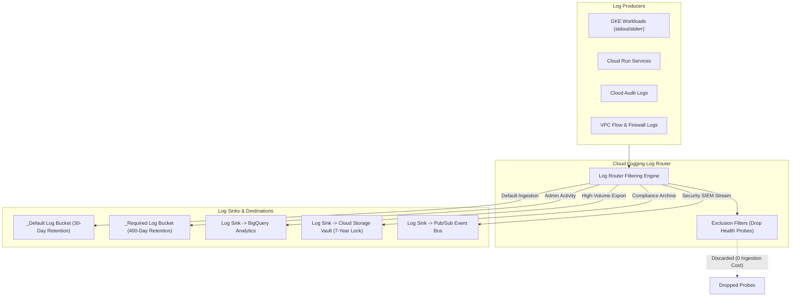
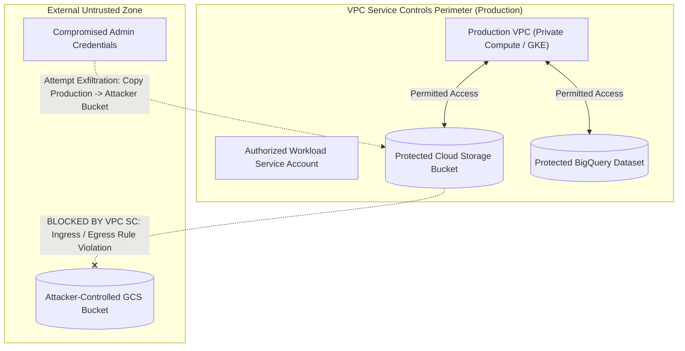
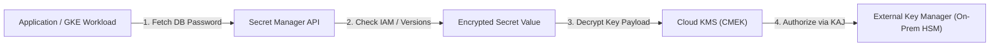
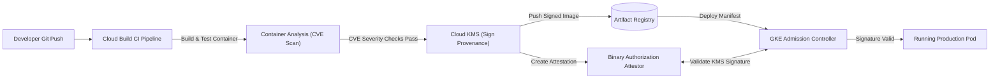

# Module 08: Observability, SRE, and VPC Service Controls

Google Cloud provides an integrated operations and security architecture designed around Site Reliability Engineering (SRE) principles and defense-in-depth security perimeters. Operating production workloads requires mastering the observability suite—**Cloud Logging**, **Cloud Monitoring**, and **Cloud Trace**—to establish measurable Service Level Objectives (SLOs), quantify error budget burn rates, and trace distributed asynchronous requests. Concurrently, enterprise security mandates establishing non-bypassable network and cryptographic boundaries. **VPC Service Controls** mitigates data exfiltration risks by enforcing perimeter authorization around multi-tenant Google APIs. Cryptographic protection is governed via **Cloud KMS** and **Customer-Managed Encryption Keys (CMEK)**, while the software supply chain is secured from code commit to container execution using **Artifact Registry** and **Binary Authorization**.

---

## 1. Google Cloud Observability & SRE Fundamentals

Observability in Google Cloud is grounded in the Site Reliability Engineering tenets pioneered by Google. Rather than alerting on transient infrastructure anomalies, reliable systems define quantifiable user happiness metrics through Service Level Indicators (SLIs), establish contractually backed Service Level Objectives (SLOs), and track error budget consumption.



### 1.1 Cloud Logging Architecture: Log Router and Sinks

Cloud Logging processes petabytes of unstructured and structured JSON log entries every second across Google Cloud. Every log entry written by an API, container, or VM passes through the **Log Router**:

- **Log Sinks**: Route incoming log entries to supported destinations based on an inclusion query filter written in Logging Query Language. Supported sink targets include:
  1. **Cloud Logging Buckets**: Internal storage buckets within Cloud Logging. The default bucket (`_Default`) retains logs for 30 days (configurable up to 3,650 days). The required bucket (`_Required`) retains Admin Activity, System Event, and Access Transparency logs for 400 days at zero cost and cannot be modified or disabled.
  2. **BigQuery Datasets**: Routes structured logs directly into partitioned BigQuery tables for high-performance forensic querying, long-term analytics, and SQL-based auditing.
  3. **Cloud Storage Buckets**: Batches logs into compressed JSON files for cost-effective multi-year compliance retention.
  4. **Cloud Pub/Sub Topics**: Streams logs in real time to third-party SIEM platforms (such as Splunk, Datadog, or Elastic) or triggers custom automated remediation pipelines.
- **Log Exclusion Filters**: Evaluated prior to ingestion into log buckets. Excluded logs are evaluated at the Log Router edge and discarded, incurring zero ingestion charges while preserving downstream exports if configured before the exclusion.
- **Log Analytics Powered by BigQuery**: Cloud Logging allows upgrading log buckets to use Log Analytics. This creates a linked BigQuery read-only view over the log data, enabling full ANSI SQL queries (`SELECT`, `JOIN`, `GROUP BY`) directly across log streams without incurring duplicate storage costs or requiring batch ETL jobs.

### 1.2 Cloud Monitoring: SLIs, SLOs, and Error Budgets

Cloud Monitoring collects system and custom metrics, powers dashboarding, and evaluates multi-condition alerting policies.

```
SRE Mathematical Framework:
SLI (Service Level Indicator) = (Good Events / Total Valid Events) * 100
SLO (Service Level Objective) = Target SLI over a rolling compliance period (e.g. 99.9% over 30 days)
Error Budget = 100% - SLO (e.g. 100% - 99.9% = 0.1% tolerated failure rate)
Burn Rate = The rate at which the error budget is consumed relative to the allowable rate
```

In modern SRE practice, alerting on static thresholds (such as CPU > 80%) generates alert fatigue. Cloud Monitoring supports **Burn Rate Alerting**:

- A burn rate of 1 consumes exactly 100% of the error budget over the compliance window (e.g. 30 days).
- A burn rate of 14.4 consumes 2% of the monthly error budget in 1 hour. Triggering a page on a 14.4x burn rate alerts engineers only when an outage poses an immediate threat to the customer-facing SLO.
- **Monitoring Query Language (MQL) and PromQL**: Cloud Monitoring natively executes PromQL queries against Google Cloud Managed Service for Prometheus and MQL queries across Google system metrics. This enables mathematical transformations such as calculating 99th percentile latencies over sliding alignment periods: `fetch k8s_container | metric 'kubernetes.io/container/cpu/core_usage_time' | align rate(1m) | every 1m | group_by [resource.cluster_name], aggregate(sum(val()))`.

### 1.3 Cloud Trace & Cloud Profiler

Distributed microservice architectures require deep transaction tracing and runtime CPU/memory profiling:

- **Cloud Trace**: Captures distributed call chains across HTTP/gRPC boundaries using the open W3C `traceparent` context header. It visualizes end-to-end latency waterfalls, identifying slow database queries, external API stalls, and microservice call amplification.
- **Cloud Profiler**: A low-overhead continuous profiling agent running inside application runtimes (Java, Go, Node.js, Python). It continuously samples call stacks to generate interactive flame graphs of CPU consumption, heap memory allocations, and lock contention without degrading production performance.

---

## 2. Cloud Audit Logs & Security Forensics

Google Cloud maintains comprehensive, immutable audit trails across every control-plane and data-plane operation. Understanding audit log types is critical for forensic readiness and regulatory compliance.

| Audit Log Type | Default Status | Ingestion Cost | Retention in `_Required` | Scope of Operations Recorded |
| :-- | :-- | :-- | :-- | :-- |
| **Admin Activity** | Always Enabled | Free (Included) | 400 Days | Control-plane metadata modifications: creating, updating, or deleting resources, modifying IAM policies, altering VPC routes. |
| **System Event** | Always Enabled | Free (Included) | 400 Days | Google-initiated administrative actions: live migration of Compute Engine VMs, automated maintenance, network link maintenance. |
| **Access Transparency** | Optional (Enterprise) | Free (Included) | 400 Days | Actions taken by Google personnel (support engineers, site reliability engineers) when accessing customer content during support tickets. |
| **Data Access: Admin Read** | Disabled by Default | Billed per GiB | 30 Days (in `_Default`) | Administrative read operations: listing buckets, reading IAM policies, retrieving project metadata. |
| **Data Access: Data Read** | Disabled by Default | Billed per GiB | 30 Days (in `_Default`) | Data-plane read operations: reading objects from Cloud Storage, retrieving secret payloads from Secret Manager. |
| **Data Access: Data Write** | Disabled by Default | Billed per GiB | 30 Days (in `_Default`) | Data-plane write mutations: uploading files to Cloud Storage, publishing messages to Pub/Sub, inserting rows into Cloud Spanner. |

> [!CAUTION]
> **Production Gotcha: The Data Access Forensic Blind Spot**: With the exception of BigQuery (where Data Access audit logs are enabled by default), Data Access audit logs are **disabled by default** across all Google Cloud services to prevent runaway ingestion costs. If an organization suffers a data exfiltration incident from a Cloud Storage bucket or Secret Manager vault without having explicitly activated `DATA_READ` audit logging in IAM Audit Config, security forensics teams will have zero log evidence of which specific files or secrets were accessed, read, or exfiltrated. Always activate Data Access audit logs on compliance-sensitive resources.

---

## 3. VPC Service Controls (VPC SC): Data Exfiltration Mitigation

Traditional network security relies on IP perimeters, but cloud PaaS services (such as Cloud Storage, BigQuery, and Pub/Sub) operate on globally routed, multi-tenant public IP endpoints (`*.googleapis.com`). Standard IAM authorizes identities, but cannot prevent an authorized employee from copying sensitive company data to an external, attacker-controlled Google Cloud project using valid enterprise credentials.

**VPC Service Controls (VPC SC)** solves this fundamental boundary problem by establishing a cryptographic perimeter around Google-managed PaaS APIs.



### 3.1 Architectural Components of VPC Service Controls

1. **Service Perimeter**: Encloses specified Google Cloud projects and protected Google APIs (e.g. `storage.googleapis.com`, `bigquery.googleapis.com`). Once a project is placed inside a perimeter, access to protected services is blocked from outside the perimeter, and data cannot be copied to projects outside the perimeter.
2. **Access Levels**: Define contextual conditions (evaluated via Google's Context-Aware Access engine) under which external traffic may penetrate the perimeter. Conditions can include source IP ranges, geographic location, client device health, and principal identity.
3. **Perimeter Bridges**: Establish bi-directional communication channels between two distinct service perimeters, enabling cross-perimeter data sharing without merging the two perimeters into a single administrative domain.
4. **Ingress and Egress Rules**: Granular, directional firewall-like policy rules that permit specific principals, projects, and methods to move data across the perimeter boundary (e.g. allowing a specific CI/CD service account to write build artifacts into a perimeter bucket from an external GitHub runner).

### 3.2 Declarative Perimeter Configuration (Terraform)

Deploying and maintaining VPC Service Controls at scale is managed declaratively using Access Context Manager:

```hcl
resource "google_access_context_manager_service_perimeter" "secure_perimeter" {
  parent = "accessPolicies/${var.access_policy_id}"
  name   = "accessPolicies/${var.access_policy_id}/servicePerimeters/prod_perimeter"
  title  = "Production Service Perimeter"

  status {
    restricted_services = [
      "storage.googleapis.com",
      "bigquery.googleapis.com",
      "pubsub.googleapis.com"
    ]

    resources = [
      "projects/${var.production_project_number}"
    ]

    access_levels = [
      google_access_context_manager_access_level.corporate_vpn.name
    ]

    egress_policies {
      egress_from {
        identity_type = "ANY_IDENTITY"
      }
      egress_to {
        resources = ["projects/${var.analytics_partner_project_number}"]
        operations {
          service_name = "bigquery.googleapis.com"
          method_selectors {
            method = "google.cloud.bigquery.v2.JobService.InsertJob"
          }
        }
      }
    }
  }
}
```

### 3.3 Dry-Run Mode and Safe Perimeter Deployment

Applying a VPC SC perimeter immediately in enforcement mode is one of the most hazardous operations in Google Cloud: it instantly severs cross-project pipelines, blocks Cloud Console web UI access, breaks Cloud Build triggers, and disconnects external BI tools.

To deploy safely, Google Cloud provides **Dry-Run Mode**:

- In dry-run mode, VPC SC evaluates every API request against the perimeter policy without blocking execution.
- If a request violates the perimeter rules, Google Cloud allows the request to succeed but logs a detailed violation record (`vpcservicecontrols.googleapis.com/dry_run_violation`) to Cloud Audit Logs.
- Engineering teams monitor dry-run violations for weeks to identify all valid dependencies, formulate necessary Ingress/Egress rules and Access Levels, and transition to enforcement mode only when dry-run violations reach zero.

---

## 4. Cryptographic Key Management & Secrets Governance

Data stored at rest in Google Cloud is encrypted by default using Google-managed encryption keys (AES-256). Enterprise security frameworks and regulatory mandates frequently require customer ownership and physical control of encryption keys.



### 4.1 Cloud KMS & Customer-Managed Encryption Keys (CMEK)

**Cloud Key Management Service (Cloud KMS)** allows organizations to generate, rotate, and control cryptographic keys:

- **Key Hierarchy**: A Key Ring contains one or more CryptoKeys, each containing multiple Key Versions. Keys can be hosted in software, hardware security modules (Cloud HSM, FIPS 140-2 Level 3 validated), or externally (Cloud EKM).
- **CMEK Integration**: Supported natively across Google Cloud services (Cloud Storage, BigQuery, Compute Engine Persistent Disks, Cloud SQL, Pub/Sub). When CMEK is enabled, the service uses your KMS key to wrap the data encryption keys (DEK).
- **Key Revocation & Destruction**: Destroying a KMS key version schedules destruction after a mandatory safety period (default 24 hours, up to 120 days). Disabling a key version takes effect immediately, rendering all encrypted persistent disks, backups, and database tables instantly unreadable across Google Cloud.

### 4.2 Key Access Justifications (KAJ) and External Key Management (EKM)

For sovereign cloud compliance and strict data privacy, Google Cloud offers **Key Access Justifications (KAJ)**:

- Whenever Google Cloud services or Google personnel attempt to use an encryption key via Cloud EKM, Google Cloud transmits an explicit justification code explaining the technical reason (e.g. customer-initiated query, automated system maintenance, disaster recovery).
- The external on-premises HSM evaluates the justification code and cryptographic request against enterprise policy. If the justification does not match enterprise policy, the external HSM rejects the key request, preventing decryption even under government subpoena.

### 4.3 Secret Manager: Secure Runtime Configuration

**Secret Manager** provides centralized, audited storage for sensitive API keys, database credentials, certificates, and tokens:

- **Versioning**: Secrets are versioned automatically (`versions/1`, `versions/2`, `versions/latest`). Applications can pin to specific versions or resolve `latest` dynamically.
- **IAM Authorization**: Access is governed by the Secret Manager Secret Accessor role (`roles/secretmanager.secretAccessor`) bound directly to workload service accounts.
- **Rotation**: Automatic rotation schedules trigger Pub/Sub topics to invoke Cloud Run services or Cloud Functions that update the credentials on downstream databases and generate a new secret version.

---

## 5. Software Supply Chain Security & Container Governance

Deploying unverified containers to production exposes clusters to supply-chain attacks, vulnerable dependencies, and malicious tampering. Google Cloud provides an end-to-end container security chain.



### 5.1 Artifact Registry vs Container Registry (GCR)

**Artifact Registry** is Google Cloud's modern, enterprise-grade package and container repository, fully replacing the retired Google Container Registry (GCR):

- **Universal Package Support**: Manages Docker and OCI container images alongside language packages (Maven, npm, Python/pip, Go, Apt, Yum, and Helm charts).
- **Regional & Multi-Regional Storage**: Enables fine-grained placement of artifacts to minimize cross-region egress and latency.
- **Automated Vulnerability Scanning**: Integrated with **Container Analysis** to scan newly pushed images automatically for Common Vulnerabilities and Exposures (CVEs), generating vulnerability reports and triggering alerts.
- **Cleanup Policies**: Configurable retention policies automatically delete untagged historical images or artifacts older than a designated duration, preventing storage cost bloat.

### 5.2 Binary Authorization: Cryptographic Deploy-Time Governance

**Binary Authorization** is a deploy-time security control for GKE and Cloud Run that ensures only verified, cryptographically signed container images can run in production:

- **Attestors**: Verification authorities configured in Binary Authorization. An attestor encapsulates a Cloud KMS public key used to verify digital signatures.
- **Attestations**: Cryptographic statements generated during the CI/CD pipeline. When Cloud Build successfully builds an image, runs automated tests, and passes vulnerability scans, a build step uses a Cloud KMS private key to sign the image's SHA256 digest and creates an attestation in the Container Analysis API.
- **Admission Controller Enforcement**: When `kubectl apply` submits a Pod specification to GKE, the Binary Authorization admission controller intercepts the request:
  - If a valid attestation signed by the required attestor exists for the container image digest, the Pod is scheduled.
  - If the attestation is missing, unsigned, or if the container image tag was mutated, the admission controller rejects the Pod creation with an HTTP 403 Forbidden error.
  - **Breakglass Override**: In life-safety emergency incidents, operators can bypass Binary Authorization by adding an annotation (`alpha.image.policy.openshift.io/break-glass: "true"` or GKE equivalent). All breakglass events trigger high-severity alerts in Cloud Audit Logs.

### 5.3 Security Command Center (SCC)

**Security Command Center (SCC)** is Google Cloud's centralized security posture and threat detection platform:

- **Tiers**: Standard (included with Google Cloud; asset inventory and basic misconfiguration detection), Enterprise / Premium (advanced threat detection, compliance reporting against CIS, NIST, ISO 27001, PCI-DSS, and container runtime threat analysis).
- **Security Health Analytics (SHA)**: Scans cloud infrastructure for configuration drift and vulnerabilities (e.g. public Cloud Storage buckets, open firewall rules on port 22, unrotated service account keys).
- **Event Threat Detection (ETD)**: Analyzes Cloud Logging audit streams in real time using machine learning models to detect active attacks (e.g. brute-force SSH, malware execution, cryptocurrency mining, anomalous data exfiltration).
- **Finding Lifecycle & Mute Rules**: Findings transition through `ACTIVE` and `INACTIVE` states. To eliminate false-positive operational noise, administrators define programmatic Mute Rules based on finding filters (e.g. muting specific CVE warnings in designated ephemeral development clusters).

---

## 6. Production Gotchas and Failure Modes

| Service | Gotcha / Production Failure Mode | Architectural Root Cause | Remediation / Verified Best Practice |
| :-- | :-- | :-- | :-- |
| **Cloud Audit Logs** | Total forensic blind spot after data leak incident | Data Access audit logs are disabled by default for all services (except BigQuery) to minimize ingestion costs. | Explicitly enable `DATA_READ` and `DATA_WRITE` audit logs in IAM Audit Config for critical storage buckets, databases, and secrets. |
| **VPC Service Controls** | Immediate catastrophic pipeline outage on perimeter activation | Perimeter applied in enforcement mode immediately blocks cross-project dependencies, Cloud Build, and Console access. | Always deploy perimeters in **Dry-Run Mode** first. Monitor `dry_run_violation` logs for weeks, formulate Ingress/Egress rules, and enforce only when violations reach zero. |
| **Cloud Logging** | Runaway monthly billing from repetitive probe logs | High-frequency container health probes (HTTP 200) write millions of entries directly to `_Default` log buckets. | Configure **Log Exclusion Filters** in the `_Default` log sink to drop status 200 health check logs at the ingestion edge. |
| **Cloud Monitoring** | Severe operational alert fatigue from static thresholds | Alerts configured on static infrastructure metrics (e.g. CPU > 80%) trigger alerts during normal autoscaling operations. | Implement **SRE Burn Rate Alerts** based on customer-facing SLOs and error budget consumption rather than raw VM utilization. |
| **Binary Authorization** | Deployment failure caused by container image tag mutability | Pipeline references mutable tags (e.g. `:latest`) rather than immutable SHA256 image digests, causing attestation lookup mismatch. | Always reference container images by immutable digest (`image@sha256:...`) throughout CI/CD and Kubernetes manifests. |
| **Cloud KMS** | Accidental permanent data loss from key destruction | Administrator destroys a KMS CryptoKey version without understanding that wrapped persistent disks or backups become unreadable. | Set long key destruction safety windows (30+ days). Use Cloud KMS IAM conditions to restrict `cloudkms.cryptoKeyVersions.destroy` permissions to two-person review. |
| **Artifact Registry** | Container image pull failure due to legacy registry shutdown | Application or Terraform configuration still references retired `gcr.io` registries that have been disabled. | Migrate all container paths to regional Artifact Registry repositories (`REGION-docker.pkg.dev/PROJECT_ID/REPOSITORY`). |
| **Secret Manager** | Production crash during automated secret rotation | Application caches stale database passwords in memory across rotation events, resulting in authentication failures. | Implement application-level dynamic secret refresh, or configure rotation pipelines to support multi-credential transition windows. |

---

## 7. Interview Drill: SRE & Security Engineering Scenarios

<details>
<summary><b>Q1: A healthcare SaaS company stores electronic health records in Cloud Storage. Compliance auditors require continuous forensic proof of who accessed or downloaded patient files. Six months after deployment, a security review reveals that no access records exist in Cloud Logging. What caused this failure, and how must the architecture be corrected?</b></summary>

**Answer**: The failure occurred because **Data Access Audit Logs are disabled by default** in Google Cloud for all services except BigQuery.

**Root Cause**:

- Google Cloud automatically enables **Admin Activity** audit logs (which record bucket creation, deletion, or permission updates), but disables **Data Access** audit logs (which record data-plane operations such as `objects.get` and `objects.list`) to prevent unexpected logging ingestion fees.

**Remediation**:

1. Navigate to **IAM & Admin -> Audit Logs** in the Google Cloud Console.
2. Select **Google Cloud Storage** (`storage.googleapis.com`).
3. Enable **Data Read** (`DATA_READ`) and **Data Write** (`DATA_WRITE`) audit logging.
4. To manage long-term compliance retention, configure a dedicated Log Sink routing these Data Access logs to a secure, locked Cloud Storage bucket or partitioned BigQuery dataset with a 7-year retention period.

- Ref: [Section 2: Cloud Audit Logs & Security Forensics](#2-cloud-audit-logs--security-forensics), [Configuring Data Access Audit Logs](https://cloud.google.com/logging/docs/audit/configure-data-access)

</details>

<details>
<summary><b>Q2: A financial services firm wants to prevent rogue employees or compromised administrative credentials from exfiltrating customer datasets from BigQuery to external personal Google Cloud accounts. Traditional IAM Allow/Deny policies and VPC firewalls have failed to prevent this vector. What is the native architectural solution and how does it operate?</b></summary>

**Answer**: Deploy **VPC Service Controls (VPC SC)** with a Service Perimeter enclosing the BigQuery project.

**Mechanics of VPC SC Defense**:

1. **PaaS API Boundary Enforcement**: While IAM verifies _who_ is performing an action, VPC SC restricts _where_ data can move. By placing the BigQuery project and API (`bigquery.googleapis.com`) inside a service perimeter, Google Cloud isolates the service from the public internet.
2. **Mitigating Data Exfiltration**: If a rogue employee with legitimate Project Owner credentials attempts to execute `EXPORT DATA OPTIONS(...)` or run a query writing data to a dataset in an external project, the BigQuery storage engine evaluates the destination.
3. Because the destination project resides outside the authorized service perimeter, VPC SC blocks the cross-perimeter request at the API gateway layer, returning a `SECURITY_POLICY_VIOLATION` error regardless of the user's IAM privileges.

- Ref: [Section 3: VPC Service Controls (VPC SC): Data Exfiltration Mitigation](#3-vpc-service-controls-vpc-sc-data-exfiltration-mitigation), [VPC Service Controls Overview](https://cloud.google.com/vpc-service-controls/docs/overview)

</details>

<details>
<summary><b>Q3: An enterprise networking team plans to enforce a VPC Service Controls perimeter around five production projects. The security team wants to activate the perimeter immediately. Why is this an anti-pattern, and what implementation procedure should be followed?</b></summary>

**Answer**: Activating a perimeter immediately in enforcement mode is a severe anti-pattern because it immediately breaks legitimate cross-project dependencies, CI/CD pipelines, Cloud Build triggers, Cloud Console access, and external data integrations.

**Verified Implementation Procedure**:

1. **Deploy in Dry-Run Mode**: Create the perimeter with all required projects and restricted services configured under `dryRun: true`.
2. **Analyze Dry-Run Audit Violations**: Dry-run mode allows all API requests to succeed, but logs violations to Cloud Audit Logs under the method `google.identity.accesscontextmanager.v1.AccessContextManager.DryRunViolation`.
3. **Formulate Ingress/Egress Rules & Access Levels**: Review the dry-run violation logs to identify legitimate traffic paths (e.g. developer IP ranges, service accounts, external CI systems) and author precise Ingress and Egress rules.
4. **Enforce at Zero Violations**: Maintain dry-run monitoring until legitimate violation entries drop to zero, then promote the dry-run configuration to active enforcement mode.

- Ref: [Section 3.3: Dry-Run Mode and Safe Perimeter Deployment](#33-dry-run-mode-and-safe-perimeter-deployment), [VPC Service Controls Dry-Run Mode Guide](https://cloud.google.com/vpc-service-controls/docs/dry-run-mode)

</details>

<details>
<summary><b>Q4: An SRE team manages an API that serves 100 million requests per month with an availability SLO of 99.9% over a rolling 30-day window. The team currently receives Slack alerts whenever error rate exceeds 1% in any 5-minute window, but suffers from severe alert fatigue due to false alarms during low-traffic periods. How should alerting be re-architected using SRE principles?</b></summary>

**Answer**: Replace static threshold alerting with **Multi-Window Multi-Burn-Rate Alerts** linked to error budget consumption.

**SRE Re-Architecture**:

1. **Quantify Error Budget**: An SLO of 99.9% over 30 days permits an error budget of 0.1% (100,000 failed requests per 100M total requests).
2. **Configure Burn Rate Alerting**:
   - **Critical Page (Fast Burn)**: Alert on a 14.4x burn rate over 1 hour (which consumes 2% of the monthly error budget in 1 hour).
   - **Ticket / Non-urgent Alert (Slow Burn)**: Alert on a 6x burn rate over 6 hours (consuming 5% of the error budget), or a 1x burn rate over 3 days (consuming 10%).
3. **Multi-Window Validation**: Require both a short window (e.g. 5 minutes) and a long window (e.g. 1 hour) to exceed the burn rate threshold before paging. This guarantees that transient, self-healing spikes do not trigger on-call pages, while genuine sustained outages page engineers immediately.

- Ref: [Section 1.2: Cloud Monitoring: SLIs, SLOs, and Error Budgets](#12-cloud-monitoring-slis-slos-and-error-budgets), [Google Cloud Alerting on SLOs](https://cloud.google.com/stackdriver/docs/solutions/slo-monitoring/alerting-on-budget-burn-rate)

</details>

<details>
<summary><b>Q5: A financial institution requires that no container image can be executed on production GKE clusters unless it has been verified by the automated security pipeline, scanned for vulnerabilities, and cryptographically proven to originate from the corporate GitHub repository. How is this enforced on Google Cloud?</b></summary>

**Answer**: Deploy **Binary Authorization with Cloud KMS Cryptographic Attestations on GKE**.

**Architecture & Workflow**:

1. **Container Build & Attestation**: In Cloud Build, after building the container image and passing automated unit tests and Container Analysis vulnerability scans, a build step signs the container image's SHA256 digest using a private key hosted in **Cloud KMS**.
2. **Create Attestation**: The pipeline posts the cryptographic signature as an **Attestation** linked to a defined Binary Authorization **Attestor** in the Container Analysis API.
3. **GKE Admission Control**: Enable Binary Authorization on the GKE cluster. The cluster admission controller intercepts all Pod creation requests.
4. **Signature Verification**: GKE queries Binary Authorization to verify whether the image digest carries a valid cryptographic signature from the required Attestor's KMS public key. Unsigned images, tampered digests, or ad-hoc container deployments are rejected with an admission error.

- Ref: [Section 5.2: Binary Authorization: Cryptographic Deploy-Time Governance](#52-binary-authorization-cryptographic-deploy-time-governance), [Binary Authorization Overview](https://cloud.google.com/binary-authorization/docs/overview)

</details>

<details>
<summary><b>Q6: A critical enterprise database running on Compute Engine with Customer-Managed Encryption Keys (CMEK) requires immediate cryptographic isolation because an intrusion has been detected. What single action renders all encrypted data disks permanently unreadable instantly across the entire infrastructure?</b></summary>

**Answer**: **Disable or Destroy the Cloud KMS CryptoKey Version** associated with the CMEK policy.

**Mechanics**:

1. In Cloud KMS, navigate to the Key Ring and CryptoKey used for the CMEK policy and set the active Key Version state to **Disabled** (`gcloud kms keys versions disable`).
2. **Immediate Effect**: Compute Engine persistently verifies the availability of the wrapping CMEK key. Disabling the key version revokes access immediately. The underlying disk encryption key (DEK) can no longer be unwrapped by Google Cloud storage controllers.
3. All I/O operations against the affected persistent disks fail immediately, and running VM instances are terminated or crash upon subsequent disk access. The data remains completely unreadable and unrecoverable until the key version is explicitly re-enabled.

- Ref: [Section 4.1: Cloud KMS & Customer-Managed Encryption Keys (CMEK)](#41-cloud-kms--customer-managed-encryption-keys-cmek), [Cloud KMS Key Lifecycle](https://cloud.google.com/kms/docs/key-states)

</details>

<details>
<summary><b>Q7: An enterprise logging bill shows an unexpected charge of $15,000 for Cloud Logging ingestion in a single month. Investigation reveals that an internal ingress controller generates millions of HTTP 200 health check logs every minute. How should this cost be eliminated immediately without losing visibility into HTTP 4xx and 5xx application errors?</b></summary>

**Answer**: Author a **Log Exclusion Filter** on the `_Default` log sink in Cloud Logging.

**Configuration**:

1. Navigate to **Log Router** and edit the `_Default` sink.
2. Add an **Exclusion Filter** with the query: `resource.type="k8s_container" AND jsonPayload.httpRequest.status=200 AND jsonPayload.httpRequest.userAgent=~"GoogleHC|kube-probe"`.
3. **Execution Edge**: Log Router evaluates exclusion filters before log entries are ingested into storage buckets. Matching HTTP 200 probe entries are discarded at the edge, reducing ingestion volume to zero for health probes while all HTTP 4xx, 5xx, application errors, and stack traces continue to be ingested normally.

- Ref: [Section 1.1: Cloud Logging Architecture: Log Router and Sinks](#11-cloud-logging-architecture-log-router-and-sinks), [Cloud Logging Exclusion Filters Guide](https://cloud.google.com/logging/docs/routing/overview#exclusions)

</details>

<details>
<summary><b>Q8: A multi-cloud distributed application needs to correlate distributed trace requests across a public internet client, an external microservice on AWS, a Google Cloud Run service, and an internal Cloud SQL database. How is end-to-end trace correlation preserved across service boundaries?</b></summary>

**Answer**: Standardize on the **W3C Trace Context Specification** (`traceparent` and `tracestate` HTTP headers) and propagate context across all services to **Cloud Trace**.

**Implementation**:

1. **Header Propagation**: The client or edge gateway generates a W3C `traceparent` header containing the standard 4-field format: `version-trace_id-parent_id-trace_flags` (e.g. `00-4bf92f3577b34da6a3ce929d0e0e4736-00f067aa0ba902b7-01`).
2. Every microservice (whether running in AWS, Cloud Run, or GKE) extracts the `trace_id`, creates a local child span, and injects the updated `traceparent` header into downstream outbound HTTP/gRPC requests.
3. Applications use OpenTelemetry instrumentation libraries to export spans directly to the Google Cloud Trace API. Cloud Trace groups all spans sharing the same `trace_id` into a unified distributed latency waterfall.

- Ref: [Section 1.3: Cloud Trace & Cloud Profiler](#13-cloud-trace--cloud-profiler), [Google Cloud Trace Context Propagation](https://cloud.google.com/trace/docs/trace-context)

</details>

<details>
<summary><b>Q9: An enterprise security team must execute complex SQL queries across petabytes of application logs to detect cross-project lateral movement during an ongoing security incident. How does Log Analytics in Cloud Logging enable this without exporting logs to an external data warehouse?</b></summary>

**Answer**: Upgrade the target Cloud Logging bucket to use **Log Analytics**.

**Architectural Capabilities**:

1. Upgrading a Cloud Logging bucket to use Log Analytics provisions an underlying linked BigQuery dataset backed directly by the log bucket's physical storage.
2. Security analysts can query the logs using standard ANSI SQL directly from the Cloud Logging console or through BigQuery Studio (`SELECT timestamp, protoPayload.authenticationInfo.principalEmail, protoPayload.methodName FROM \`my-project.global._Default._AllLogs\` WHERE protoPayload.status.code != 0`).
3. This eliminates the need to build, maintain, and pay for duplicate data export pipelines, dual-storage duplication fees, or batch ETL jobs.

- Ref: [Section 1.1: Cloud Logging Architecture: Log Router and Sinks](#11-cloud-logging-architecture-log-router-and-sinks), [Cloud Logging Log Analytics Overview](https://cloud.google.com/logging/docs/log-analytics)

</details>

<details>
<summary><b>Q10: A company needs to automatically rotate production database passwords stored in Secret Manager every 30 days without application downtime. How should the automated rotation workflow be architected across Google Cloud services?</b></summary>

**Answer**: Configure **Secret Manager Automatic Rotation with Cloud Run and Pub/Sub**.

**Workflow Architecture**:

1. Set a rotation schedule on the secret (e.g. `rotation-period = "2592000s"` / 30 days) and designate a Pub/Sub topic for rotation notifications.
2. When the rotation deadline approaches, Secret Manager publishes a message to the Pub/Sub topic containing the secret name and the rotation event type.
3. A Cloud Run service or Cloud Functions subscriber receives the message, generates a new cryptographically secure password, connects to the database to configure the new password alongside the old password, and creates a new secret version in Secret Manager (`versions.add`).
4. Applications dynamically pull the updated secret version, and once verified, the rotation function deactivates the older secret version on the database.

- Ref: [Section 4.3: Secret Manager: Secure Runtime Configuration](#43-secret-manager-secure-runtime-configuration), [Secret Manager Automatic Rotation Guide](https://cloud.google.com/secret-manager/docs/rotating-secrets)

</details>
