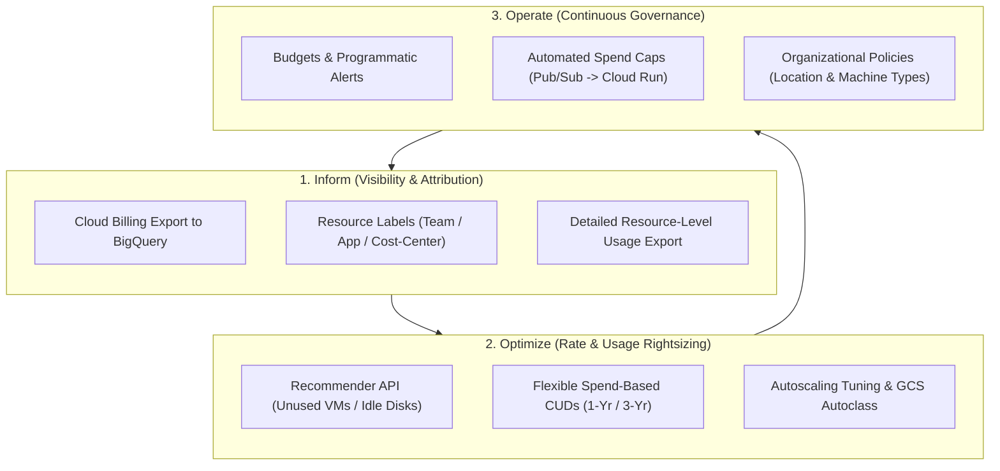
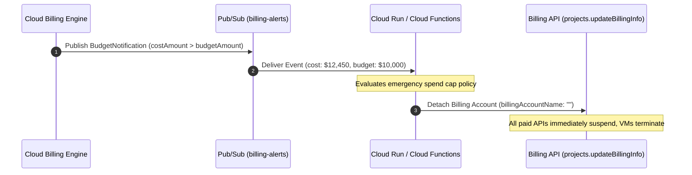
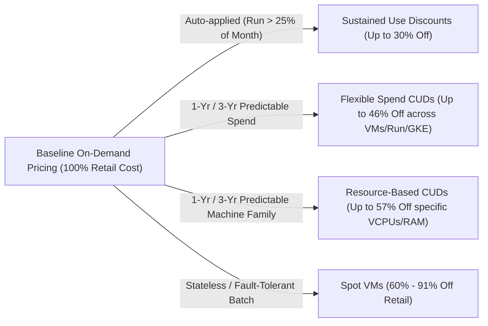

# Module 10: Cost Optimization, FinOps, and Version History

Cloud financial engineering—**FinOps**—is the operational discipline of maximizing business value in the cloud through granular cost attribution, dynamic commitment planning, and automated resource rightsizing. In Google Cloud, effective spend governance requires orchestrating the complete lifecycle: ingesting detailed billing exports into **BigQuery**, modeling **Sustained Use Discounts (SUDs)** against **Committed Use Discounts (CUDs)**, and configuring programmatic spend caps. Concurrently, enterprise architectures must adapt to platform deprecations and paradigm shifts. This module delivers the definitive FinOps operational playbook, examines the complete **"Then vs Now"** evolution of Google Cloud technologies, and details the verified platform version history.

---

## 1. Google Cloud FinOps: The Inform, Optimize, and Operate Lifecycle

FinOps in Google Cloud operates across three continuous phases defined by the FinOps Foundation: **Inform** (visibility and allocation), **Optimize** (rates and usage), and **Operate** (continuous organizational alignment).



### 1.1 Cloud Billing Export to BigQuery

The foundation of Google Cloud cost visibility is the **Cloud Billing Export to BigQuery**. While the Cloud Console reports high-level aggregations, BigQuery export provides micro-dollar, per-resource consumption records updated continuously:

1. **Standard Usage Cost Export**: Ingests project-level SKU consumption, invoice dates, currency conversion rates, and applied credit adjustments (such as free tiers and promotional credits).
2. **Detailed Usage Cost Export**: Ingests line-item resource-level metrics, including Compute Engine VM instance IDs, persistent disk device names, Cloud Storage bucket names, and attached resource labels. This enables multi-tenant chargebacks down to individual container pods or git commit tags.
3. **Pricing Export**: Ingests the organization's specific SKU catalog pricing, including negotiated contract discounts and volume tier thresholds.

```sql
-- Query daily compute spend by engineering team using BigQuery Detailed Export
SELECT
  labels.value AS engineering_team,
  DATE(usage_start_time) AS billing_day,
  service.description AS service_name,
  ROUND(SUM(cost), 2) AS gross_cost_usd,
  ROUND(SUM(IFNULL((SELECT SUM(c.amount) FROM UNNEST(credits) c), 0)), 2) AS credits_usd,
  ROUND(SUM(cost + IFNULL((SELECT SUM(c.amount) FROM UNNEST(credits) c), 0)), 2) AS net_spend_usd
FROM
  `billing_export_prod.gcp_billing_export_resource_v1_01A2B3_4C5D6E_7F8G9H`,
  UNNEST(labels) AS labels
WHERE
  labels.key = "team"
  AND usage_start_time >= TIMESTAMP_SUB(CURRENT_TIMESTAMP(), INTERVAL 30 DAY)
GROUP BY
  engineering_team, billing_day, service_name
ORDER BY
  net_spend_usd DESC;
```

### 1.2 Programmatic Anomaly Detection & Anomaly Queries

Real-time cost anomaly detection queries run on a scheduled basis against BigQuery billing exports to identify runaway workloads before monthly invoice generation:

```sql
-- Detect SKUs experiencing greater than 50% week-over-week spend surges
WITH weekly_spend AS (
  SELECT
    service.description AS service_name,
    sku.description AS sku_description,
    EXTRACT(WEEK FROM usage_start_time) AS week_num,
    SUM(cost) AS total_cost
  FROM
    `billing_export_prod.gcp_billing_export_resource_v1_01A2B3_4C5D6E_7F8G9H`
  WHERE
    usage_start_time >= TIMESTAMP_SUB(CURRENT_TIMESTAMP(), INTERVAL 14 DAY)
  GROUP BY
    service_name, sku_description, week_num
)
SELECT
  w1.service_name,
  w1.sku_description,
  w1.total_cost AS prior_week_cost,
  w2.total_cost AS current_week_cost,
  ROUND(((w2.total_cost - w1.total_cost) / w1.total_cost) * 100, 1) AS percentage_increase
FROM
  weekly_spend w1
JOIN
  weekly_spend w2
ON
  w1.sku_description = w2.sku_description
  AND w1.week_num = w2.week_num - 1
WHERE
  w1.total_cost > 100.0
  AND ((w2.total_cost - w1.total_cost) / w1.total_cost) > 0.50
ORDER BY
  percentage_increase DESC;
```

### 1.3 Programmatic Spend Caps & The Budget Trap

A critical failure mode among cloud practitioners is assuming that setting a Google Cloud Billing Budget automatically stops workloads when costs exceed thresholds.

> [!WARNING]
> **The Budget Alert Trap**: Google Cloud Budgets and threshold alert notifications are purely informative. Exceeding 100% of a budget does **not** stop running VMs, does **not** throttle BigQuery scans, and does **not** suspend billing accounts. To enforce a hard spend cap, an automated event-driven architecture must be wired from the budget's Pub/Sub notification topic to a programmatic remediation function.



Detaching a billing account stops all paid services immediately and terminates running Compute Engine instances. In production, softer remediation actions (such as revoking public IP routes, halting development clusters, or scaling Managed Instance Groups to zero) are preferred.

---

## 2. Compute & Database Commitment Models: CUDs vs SUDs vs Spot

Google Cloud provides three complementary commitment mechanisms to discount compute resources below on-demand retail rates.



### 2.1 Sustained Use Discounts (SUDs)

Sustained Use Discounts are automatic discounts applied by Google Cloud when compute instances run for a significant portion of a billing month:

- **Zero Commitment**: Requires no upfront payment, reservation contract, or administrative configuration.
- **Tiers**: When an N1 or N2 VM runs for more than 25% of a month, incremental usage receives escalating discounts, reaching up to 30% discount for instances running 100% of the month.
- **Limitation**: Newer machine families (such as C3, T2D, and Tau) do not support SUDs, relying exclusively on CUDs.

### 2.2 Committed Use Discounts (CUDs)

Committed Use Discounts offer deep discounts in exchange for a contractual commitment to purchase a minimum level of resources for a 1-year or 3-year duration:

1. **Resource-Based CUDs**:
   - Tied to a specific machine family (e.g. N2) in a specific Google Cloud region.
   - Ideal for stable, steady-state workloads (databases, core GKE node pools).
   - Provides up to 57% discount for general compute, and up to 70% for memory-optimized instances.
2. **Flexible Spend-Based CUDs**:
   - Commits to a minimum dollar-per-hour spend across all compute services (e.g. committing to spend \$50/hour).
   - Applies automatically across multiple machine families (N1, N2, N2D, C2, C3), Google Kubernetes Engine (Standard and Autopilot), and Cloud Run worldwide.
   - Provides up to 28% discount for 1-year commitments, and up to 46% discount for 3-year commitments.

### 2.3 Mathematical Break-Even Analysis: CUDs vs On-Demand

Purchasing a Committed Use Discount creates a contractual liability: you pay for the committed baseline whether you run workloads or leave instances idle.

$$\text{Effective Hourly Cost}_{\text{On-Demand}} = \text{Utilization Fraction} \times \text{Retail Rate}$$

$$\text{Effective Hourly Cost}_{\text{CUD}} = 1.0 \times \text{Discounted CUD Rate}$$

$$\text{Break-Even Utilization} = \frac{\text{Discounted CUD Rate}}{\text{Retail Rate}} = 1 - \text{Discount Percentage}$$

For a 3-Year Resource-Based CUD with a 57% discount: $$\text{Break-Even Utilization} = 1 - 0.57 = 0.43 \quad (43\%)$$

If your workload runs for more than 43% of the hours in a month (approximately 310 hours out of 720 hours), purchasing a 3-Year CUD is mathematically cheaper than running on-demand instances, even if the workload is powered off for the remaining 57% of the month.

| Commitment Mechanism | Commitment Duration | Upfront Payment | Workload Flexibility | Discount Potential | Break-Even Utilization |
| :-- | :-- | :-- | :-- | :-- | :-- |
| **On-Demand** | None (Hourly / By Second) | None | Absolute (Scale to zero anytime) | 0% (Base retail pricing) | 100% |
| **Sustained Use (SUD)** | None (Automatic) | None | Scoped to supported families (N1, N2) | Up to 30% | Automatic (> 25% run) |
| **Resource-Based CUD (1-Yr)** | 1 Year | Optional | Scoped to specific machine family & region | Up to 37% (Compute) | ~63% run time |
| **Resource-Based CUD (3-Yr)** | 3 Years | Optional | Scoped to specific machine family & region | Up to 57% (Compute) / 70% (Mem) | ~43% run time |
| **Flexible Spend CUD (1-Yr)** | 1 Year | Optional | Global across VM families, GKE, Cloud Run | Up to 28% | ~72% run time |
| **Flexible Spend CUD (3-Yr)** | 3 Years | Optional | Global across VM families, GKE, Cloud Run | Up to 46% | ~54% run time |
| **Spot VMs** | None (Preemptible) | None | Fault-tolerant, stateless batch workloads | 60% – 91% | Zero commitment |

---

## 3. Storage & Analytics Cost Optimization

Uncontrolled data growth and poorly structured analytical queries frequently drive the largest unexpected costs in enterprise cloud budgets.

### 3.1 Cloud Storage Autoclass & The Early Deletion Trap

Cloud Storage offers multiple storage classes designed for varying access frequencies: Standard, Nearline (access < once a month), Coldline (access < once a quarter), and Archive (access < once a year).

To automate optimization, Google Cloud provides **Cloud Storage Autoclass**:

- **Mechanism**: Autoclass inspects read patterns on individual objects and transitions them to colder tiers as they age without access. If an object in Archive storage is read, Autoclass transitions it back to Standard storage automatically at zero retrieval cost.
- **Management Fee**: Autoclass charges an operational fee (\$0.0025 per 1,000 objects enabled per month).

> [!CAUTION]
> **The Early Deletion Minimum Duration Trap**: Storage classes colder than Standard enforce mandatory minimum storage durations: **30 days for Nearline**, **90 days for Coldline**, and **365 days for Archive**. If an application or lifecycle rule creates an object in Coldline and deletes or overwrites it after 10 days, Google Cloud charges for the remaining 80 days of Coldline storage as an early deletion fee. Writing short-lived, transient files directly to Coldline or Archive storage results in massive cost amplification.

### 3.2 BigQuery FinOps: On-Demand vs Editions Governance

BigQuery pricing operates on two discrete economic models:

- **On-Demand Pricing**: Billed at \$6.25 per TB of data scanned across queried columns.
  - Optimization: Replace `SELECT *` with explicit column projections; enforce `PARTITION BY` and `require_partition_filter = true`; configure `maximum_bytes_billed` in query job configurations.
- **BigQuery Editions (Capacity Commitments)**: Billed per slot-hour across compute reservation pools (Standard, Enterprise, Enterprise Plus).
  - Optimization: Isolate interactive executive reporting from batch ETL pipelines using separate reservation pools; set baseline slots to handle average daily load; enable autoscaling slots with strict maximum limits to absorb transient peak queries.

---

## 4. "Then vs Now": Evolutionary Paradigm Shifts in Google Cloud

Architecting modern systems requires abandoning legacy Google Cloud patterns that have been deprecated or superseded by superior cloud-native primitives.

| Architectural Domain | The Legacy Approach ("Then") | The Modern Cloud-Native Standard ("Now") | Why Practice Changed / Technical Drivers |
| :-- | :-- | :-- | :-- |
| **Container Registry** | Google Container Registry (`gcr.io`) hosted in Cloud Storage buckets. | **Artifact Registry** (`REGION-docker.pkg.dev`) with regional repositories. | GCR was deprecated; write traffic was shut down on March 18, 2025, and pull traffic was completely cut off on May 20, 2025. Artifact Registry supports multiple package types (Docker, npm, Maven, Python), fine-grained IAM, cleanup policies, and customer-managed encryption keys (CMEK). |
| **Workload Authentication** | Downloading long-lived service account JSON private keys to GitHub/GitLab secrets. | **Workload Identity Federation (WIF)** exchanging OIDC tokens for short-lived access tokens. | Static private keys are vulnerable to exfiltration, git repository leaks, and credential compromise. WIF provides keyless authentication with zero credential storage and short-lived, cryptographically bounded tokens. |
| **Serverless Functions** | Cloud Functions (1st gen) running on proprietary legacy runtimes. | **Cloud Run Functions (2nd gen)** and Cloud Run Services. | 1st gen functions had 9-minute timeouts, strict concurrency limits (1 request per container), and inflexible networking. 2nd gen functions run natively on Cloud Run, providing up to 60-minute timeouts, configurable concurrency, and full container flexibility. |
| **Default Service Accounts** | Compute Engine default service account automatically assigned `roles/editor` on project creation. | Least-privilege custom service accounts; org policy `iam.automaticIamGrantsForDefaultServiceAccounts`. | Granting project Editor to the default VM service account allowed any compromised VM to modify all project resources, create backdoor accounts, and access all databases. Least privilege requires disabling automatic grants and assigning minimal roles. |
| **Firewall Target Selection** | Target Tags (strings) on Compute Engine VMs to match firewall rules. | **Service Accounts** and **Hierarchical Network Firewall Policies**. | String tags can be added or modified by VM administrators, allowing unauthorized privilege escalation through firewall bypass. Service Accounts enforce cryptographic IAM boundaries that developers cannot alter without administrative permissions. |
| **Private PaaS Access** | VPC Network Peering with Service Networking for every managed database. | **Private Service Connect (PSC)** using consumer forwarding rules and producer service attachments. | VPC peering is non-transitive, consumes peering connection quotas, and requires complex, non-overlapping IP space allocation. PSC treats services as discrete Layer 4 endpoints with private consumer IPs, eliminating IP overlap constraints. |
| **Block Storage Architecture** | Persistent Disk (`pd-standard`, `pd-ssd`) with fixed IOPS per GB. | **Hyperdisk** (`hyperdisk-extreme`, `hyperdisk-balanced`, `hyperdisk-throughput`). | Legacy Persistent Disks coupled IOPS and bandwidth strictly to provisioned disk gigabytes. Hyperdisk decouples storage capacity from performance, allowing operators to scale IOPS and throughput independently without paying for unneeded disk capacity. |
| **Cloud IAM Governance** | Primitive / Basic Roles (`Owner`, `Editor`, `Viewer`) applied at project root. | **Predefined Granular Roles** and **Custom Roles** with CEL Conditions. | Primitive roles violate the principle of least privilege, granting excessive broad permissions across all project services. Modern security standards mandate granular roles restricted by resource tags and time-bounded conditions. |

---

## 5. Version History & Platform Milestones

The following timeline details the major platform milestones, runtime version transitions, API deprecations, and service evolutions relevant to Google Cloud practitioners.

| Release Date | Service / Component | Version / Milestone | Architectural Significance & Impact |
| :-- | :-- | :-- | :-- |
| **2020-03** | Cloud Spanner | Multi-Region Paxos Instances (99.999% SLA) | Introduced planetary active-active relational consistency with zero RPO and TrueTime-coordinated cross-continent transactions. |
| **2021-02** | Google Kubernetes Engine | **GKE Autopilot** General Availability | Shifted Kubernetes operations to a hands-off, fully managed operational model with per-Pod resource billing and hardened security. |
| **2021-11** | Cloud Compute | **Spot VMs** replace Preemptible VMs | Removed the hard 24-hour runtime limitation of legacy preemptible VMs, providing 60-91% discounts for long-running batch and container jobs. |
| **2022-04** | Cloud Functions | **Cloud Functions (2nd gen)** GA | Unified serverless functions on Cloud Run infrastructure, expanding request timeouts to 60 minutes and supporting concurrent requests. |
| **2022-12** | AlloyDB | **AlloyDB for PostgreSQL** GA | Introduced disaggregated storage engine with transparent columnar execution, accelerating analytical queries on PostgreSQL by up to 100x. |
| **2023-04** | BigQuery | **BigQuery Editions** (Standard, Enterprise, Enterprise Plus) | Transitioned BigQuery from flat-rate slot commitments to dynamic, autoscaling reservation pools with tier-specific security controls. |
| **2023-05** | Artifact Registry | Container Registry (`gcr.io`) Deprecation Announced | Initiated the mandatory migration from legacy GCR to Artifact Registry, establishing enterprise artifact lifecycle governance. |
| **2024-03** | VPC Service Controls | Principal Access Boundaries (PAB) GA | Introduced cryptographic perimeter boundaries that restrict identity credentials to specific organization-owned resources. |
| **2024-11** | Infrastructure Manager | Managed Terraform Engine GA | Provided fully managed Terraform execution with automated remote state locking, service account impersonation, and Git integration. |
| **2025-03** | Container Registry | **GCR Write Traffic Terminated** (March 18, 2025) | Google Cloud terminated all image push mutations to `gcr.io`, requiring all CI/CD pipelines to target Artifact Registry. |
| **2025-05** | Container Registry | **GCR Pull Traffic Terminated** (May 20, 2025) | Google Cloud severed all pull and read traffic to legacy `gcr.io` endpoints, completing the multi-year container migration. |
| **2026-04** | Cloud Compute | Hyperdisk Extreme & Storage Pools GA | Next-generation block storage providing up to 500,000 IOPS per volume with dynamically scalable IOPS and throughput decoupled from disk size. |

---

## 6. Production Gotchas and Failure Modes

| Service | Gotcha / Production Failure Mode | Architectural Root Cause | Remediation / Verified Best Practice |
| :-- | :-- | :-- | :-- |
| **Cloud Billing** | Catastrophic billing overrun after budget alert | Budget notification emails were sent, but workloads continued running because budgets do not enforce spend caps. | Wire budget alert Pub/Sub topics to an automated Cloud Run function that detaches the billing account or scales MIGs to zero. |
| **Cloud Storage** | Excessive early deletion fees on Archive storage | Automated lifecycle rule or backup job created files in Archive storage and deleted them 5 days later. | Respect the 365-day minimum retention rule for Archive storage. Use Standard or Nearline storage for files with lifetimes under 365 days. |
| **Committed Use** | Massive financial waste from overlapping CUDs | Team purchased Resource-Based CUDs for N2 instances, then migrated architecture to C3 instances without modifying commitments. | Model workload lifecycle before purchasing commitments. Use **Flexible Spend-Based CUDs** for workloads subject to architecture or machine changes. |
| **BigQuery** | Unbounded analytical query billing spikes | Analyst executes ad-hoc analytical queries using `SELECT *` on unpartitioned petabyte-scale tables under on-demand pricing. | Enforce `maximum_bytes_billed` on all client queries, require partition filters (`require_partition_filter = true`), and project only needed columns. |
| **Artifact Registry** | Automated build failure due to repository storage quota | Docker images pushed on every git commit accumulate indefinitely, exhausting Artifact Registry storage limits and inflating bills. | Define **Cleanup Policies** in Artifact Registry to automatically delete untagged images or keep only the N most recent versions. |
| **Cloud Run** | Runaway cloud bill due to unbounded autoscaling | Public endpoint under high traffic or DDoS autoscales to 1,000 instances, processing millions of malicious requests. | Set `--max-instances` to enforce a hard scale ceiling, and place Cloud Armor rate limiting at the external load balancer ingress. |
| **Compute Engine** | Unexpected egress fees on inter-zone VM communication | Microservices in the same VPC communicate across different availability zones using public IP addresses. | Communicate using internal RFC 1918 private IPs. Inter-zone traffic over private IPs incurs lower costs than public IP routing. |
| **Cloud SQL** | Cost bloat from over-provisioned disk storage | Storage auto-increase enabled on Cloud SQL continuously grows disk size during a one-time data load; disk cannot be shrunk. | Cloud SQL disk sizes can only scale up, never down. Size initial storage deliberately and monitor transaction log growth before imports. |

---

## 7. Interview Drill: FinOps & Architectural Modernization Scenarios

<details>
<summary><b>Q1: An enterprise cloud bill shows an unexpected charge of $45,000 for a single BigQuery analytical query run by a data scientist under an on-demand billing model. How did this happen technically, and what three programmatic guardrails must be implemented to prevent recurrence?</b></summary>

**Answer**: The astronomical charge resulted from scanning petabytes of uncompressed columnar data under BigQuery on-demand pricing ($6.25 per TB scanned).

**Technical Cause**:

- The query ran `SELECT *` across an unpartitioned table containing hundreds of terabytes of data, forcing Dremel slots to read every single column off Colossus storage. Specifying `LIMIT 100` did not reduce the cost, because `LIMIT` is evaluated _after_ slots read and filter the entire dataset.

**Three Programmatic Guardrails**:

1. **Set `maximum_bytes_billed`**: Configure the `maximum_bytes_billed` parameter on all query job configurations (via CLI, API, or BI connectors). If BigQuery estimates that query execution will scan more bytes than this threshold, the query job aborts immediately before scanning data.
2. **Require Partition Filters**: Alter the table definition to enable `OPTIONS (require_partition_filter = true)`. BigQuery rejects any query submitted without a valid partition predicate in its `WHERE` clause.
3. **Migrate to BigQuery Editions**: For high-volume analytical workloads, purchase dedicated slot reservations under BigQuery Editions (Enterprise tier), converting variable per-byte billing into predictable hourly compute slot capacity.

- Ref: [Section 3.2: BigQuery FinOps: On-Demand vs Editions Governance](#32-bigquery-finops-on-demand-vs-editions-governance), [BigQuery Best Practices for Cost Optimization](https://cloud.google.com/bigquery/docs/best-practices-costs)

</details>

<details>
<summary><b>Q2: A SaaS startup runs 200 Compute Engine VMs hosting a stateless API. The VMs run 24 hours a day with consistent baseline CPU utilization. The CFO wants to reduce compute costs by at least 50% without altering machine types or application code. What commitment strategy should be adopted?</b></summary>

**Answer**: Purchase a **3-Year Resource-Based Committed Use Discount (CUD)** covering the baseline vCPU and memory capacity.

**FinOps Strategy**:

1. **Predictability**: Because the workload is stateless, predictable, and runs continuously (24/7/365) in a designated Google Cloud region and machine family (e.g. N2), Resource-Based CUDs provide the maximum available discount.
2. **Discount Magnitude**: A 3-year commitment on resource-based CUDs provides up to a **57% discount** off on-demand retail pricing for standard compute shapes.
3. **Execution**: Calculate the minimum baseline vCPU count (e.g. 80% of peak capacity) and execute the commitment via Cloud Billing in the Google Cloud Console. For transient traffic peaks above the baseline, allow instances to autoscale using on-demand pricing or Spot VMs.

- Ref: [Section 2.2: Committed Use Discounts (CUDs)](#22-committed-use-discounts-cuds), [Resource-Based Committed Use Discounts Guide](https://cloud.google.com/compute/docs/instances/signing-up-committed-use-discounts)

</details>

<details>
<summary><b>Q3: A data engineering team writes temporary daily batch ETL output files (50 TB/day) directly to a Cloud Storage Coldline bucket to take advantage of Coldline's lower storage pricing. A downstream cleanup script deletes these temporary files after 48 hours. Why does this strategy result in severe cost overruns?</b></summary>

**Answer**: The strategy violates the **Minimum Storage Duration Rule**, incurring catastrophic **Early Deletion Penalties**.

**Cost Mechanics**:

- Cloud Storage Coldline storage enforces a **90-day minimum storage duration**.
- When an object is uploaded to Coldline and deleted after only 2 days (48 hours), Google Cloud charges the standard 2 days of Coldline storage _plus_ an **early deletion charge** equal to the remaining 88 days of Coldline storage for all 50 TB.
- **Remediation**: Temporary, ephemeral data must be written to **Cloud Storage Standard** storage. Standard storage has zero minimum storage duration; files can be created and deleted within seconds without early deletion penalties.

- Ref: [Section 3.1: Cloud Storage Autoclass & The Early Deletion Trap](#31-cloud-storage-autoclass--the-early-deletion-trap), [Cloud Storage Storage Classes and Pricing](https://cloud.google.com/storage/docs/storage-classes#coldline)

</details>

<details>
<summary><b>Q4: An application team's automated CI/CD pipeline suddenly fails with HTTP 403 Forbidden errors when pushing container images to `gcr.io/my-project/api:v1.2`. What platform milestone caused this failure, and how must the deployment pipeline be remediated?</b></summary>

**Answer**: The failure was caused by the **Google Container Registry (GCR) Permanent Shutdown**.

**Historical Timeline & Remediation**:

1. **Platform Deprecation**: Google Cloud deprecated Container Registry (`gcr.io`) in May 2023. Write/push traffic to legacy `gcr.io` registries was completely severed on **March 18, 2025**, and read/pull traffic was shut down on **May 20, 2025**.
2. **Remediation Steps**:
   - Provision a standard Docker repository in **Artifact Registry**: `gcloud artifacts repositories create app-repo --repository-format=docker --location=us-central1`.
   - Update container build scripts and Dockerfiles to tag images with the Artifact Registry URI: `us-central1-docker.pkg.dev/my-project/app-repo/api:v1.2`.
   - Grant the CI/CD service account the **Artifact Registry Writer** role (`roles/artifactregistry.writer`) on the repository.
   - Update Kubernetes/Cloud Run manifests to pull from the Artifact Registry endpoint.

- Ref: [Section 4: "Then vs Now": Evolutionary Paradigm Shifts in Google Cloud](#4-then-vs-now-evolutionary-paradigm-shifts-in-google-cloud), [Transitioning from Container Registry to Artifact Registry](https://cloud.google.com/artifact-registry/docs/transition/transition-from-gcr)

</details>

<details>
<summary><b>Q5: A security auditor discovers that a company's developers have generated 50 long-lived service account JSON keys and stored them inside CI/CD environment secrets on GitHub. What risks does this create, and what modern keyless architecture replaces it?</b></summary>

**Answer**: Static JSON keys create severe **Credential Exfiltration and Leakage Risks**; they must be replaced with **Workload Identity Federation (WIF)**.

**Risks of Static Keys**:

- Service account JSON keys are long-lived bearer tokens that do not expire automatically. If a developer's laptop is compromised, or if a repository is made public, an attacker gains unrestricted administrative access to Google Cloud without triggering multi-factor authentication.

**Keyless Replacement Architecture (WIF)**:

1. Create a **Workload Identity Pool** and an OIDC Provider configured to trust GitHub's token issuer (`https://token.actions.githubusercontent.com`).
2. Map GitHub OIDC token claims (such as `repository`, `workflow`, and `ref`) to Google Cloud attributes.
3. Configure an IAM policy binding granting the deployment service account's `roles/iam.workloadIdentityUser` role strictly to the authorized GitHub repository attribute condition: `assertion.repository == 'org/repo' && assertion.ref == 'refs/heads/main'`.
4. The GitHub Actions runner exchanges its native short-lived OIDC token for a short-lived Google Cloud OAuth2 access token on the fly, storing zero static secrets in GitHub.

- Ref: [Section 4: "Then vs Now": Evolutionary Paradigm Shifts in Google Cloud](#4-then-vs-now-evolutionary-paradigm-shifts-in-google-cloud), [Workload Identity Federation Overview](https://cloud.google.com/iam/docs/workload-identity-federation)

</details>

<details>
<summary><b>Q6: A technology firm operates microservices across Compute Engine VMs, GKE Autopilot clusters, and Cloud Run services in three continents. The engineering leadership wants to lock in a 3-year commitment discount, but anticipates migrating 50% of VM workloads to Cloud Run and GKE over the next 18 months. What commitment model should they purchase?</b></summary>

**Answer**: Purchase a **3-Year Flexible Spend-Based Committed Use Discount (Flexible CUD)**.

**Why Flexible CUDs are Required**:

- **Resource-Based CUDs are Rigid**: Resource-based CUDs are bound to a specific machine family (e.g. N2) in a specific region. If the team purchases an N2 resource CUD in `us-central1` and migrates the workload to Cloud Run or to a different region, the N2 commitment continues to be billed, resulting in complete financial waste.
- **Flexible Spend CUD Versatility**: Flexible CUDs commit to a minimum dollar-per-hour spend (e.g. $100/hour) rather than physical hardware. The commitment automatically and dynamically applies across Compute Engine VM families (N1, N2, N2D, C2, C3), GKE Autopilot Pod vCPUs, and Cloud Run compute invocations worldwide, providing up to a 46% discount while granting complete architectural freedom to modernize services over time.

- Ref: [Section 2.2: Committed Use Discounts (CUDs)](#22-committed-use-discounts-cuds), [Flexible Committed Use Discounts](https://cloud.google.com/compute/docs/instances/signing-up-committed-use-discounts#flexible)

</details>

<details>
<summary><b>Q7: An enterprise with 50 Google Cloud projects notices that developers frequently launch expensive GPU and TPU instances in staging projects, exhausting project quotas and budgets. How can the enterprise cloud governance team prevent the provisioning of high-cost compute instances organization-wide without modifying individual project IAM policies?</b></summary>

**Answer**: Enforce an **Organization Policy Constraint on Allowed Machine Types**.

**Implementation**:

1. Identify the Organization Policy constraint for restricting machine types: `constraints/compute.vmMachineType`.
2. Define a hierarchical policy rule at the root **Organization** or **Folder** level.
3. Configure an allowlist specifying only authorized, cost-effective general-purpose machine families (e.g. `is:e2-*`, `is:n2-standard-*`).
4. **Preventive Control**: Once applied, any attempt by developers or automated Terraform scripts to create or update an instance using an unauthorized high-cost GPU or accelerator-optimized machine type (such as `a2-highgpu-*` or `g2-standard-*`) is rejected immediately by the Compute Engine API before resources are allocated.

- Ref: [Section 1.3: Programmatic Spend Caps & The Budget Trap](#13-programmatic-spend-caps--the-budget-trap), [Restricting Machine Types via Organization Policies](https://cloud.google.com/compute/docs/instances/restricting-machine-types)

</details>

<details>
<summary><b>Q8: A high-throughput batch media processing platform processes millions of video encoding tasks every night. The encoding software is completely stateless, checkpoints progress to Cloud Storage every 60 seconds, and can tolerate individual VM terminations without data loss. How should the compute fleet be architected to achieve an 80% cost reduction?</b></summary>

**Answer**: Deploy a **Compute Engine Managed Instance Group (MIG) composed entirely of Spot VMs**.

**Architecture & Operational Mechanics**:

1. **Spot VM Economics**: Spot VMs utilize Google's excess compute capacity, providing **60% to 91% discounts** off standard on-demand retail rates for identical vCPU and memory shapes.
2. **Preemption Handling**: When Google Cloud requires capacity back, Spot VMs receive a 30-second ACPI shutdown notification. The application's local daemon catches the signal, flushes active video encoding progress chunks to Cloud Storage, and gracefully exits.
3. **MIG Auto-Recovery**: Configure the Managed Instance Group to target 100% Spot instances with autohealing enabled. If Google Cloud terminates a Spot VM, the MIG controller automatically requests a replacement Spot VM in another zone within the region, ensuring batch pipeline throughput completes before business hours at a fraction of standard cost.

- Ref: [Section 2: Compute & Database Commitment Models: CUDs vs SUDs vs Spot](#2-compute--database-commitment-models-cuds-vs-suds-vs-spot), [Spot Virtual Machines Documentation](https://cloud.google.com/compute/docs/instances/spot)

</details>

<details>
<summary><b>Q9: An enterprise infrastructure team with thousands of Compute Engine instances wants to automate the discovery and remediation of idle virtual machines and unattached persistent disks across all company projects. How does Google Cloud Recommender API facilitate this?</b></summary>

**Answer**: Deploy an automated FinOps pipeline using the **Google Cloud Recommender API**.

**Operational Implementation**:

1. **Automated Discovery**: The Recommender API runs continuous machine-learning heuristics across Compute Engine telemetry, identifying VMs with < 1% CPU utilization over 14 days (`google.compute.instance.IdleResourceRecommender`) and unattached persistent disks (`google.compute.disk.IdleResourceRecommender`).
2. **Programmatic Querying**: Query recommendations across the organization via the Recommender REST API or BigQuery export: `SELECT recommender, state, primary_impact.cost_projection FROM \`billing_project.recommender_export\``.
3. **Automated Remediation**: Wire high-confidence recommendations to a Cloud Run remediation service that takes a final disk snapshot, notifies instance owners via Slack, and terminates the idle resources automatically, reclaiming wasted spend.

- Ref: [Section 1: Google Cloud FinOps: The Inform, Optimize, and Operate Lifecycle](#1-google-cloud-finops-the-inform-optimize-and-operate-lifecycle), [Recommender Documentation](https://cloud.google.com/recommender/docs/overview)

</details>

<details>
<summary><b>Q10: An organization has 30 Google Cloud projects linked to a single Cloud Billing account. Team A in Project 1 purchases a 3-year Committed Use Discount for 100 vCPUs, but only utilizes 60 vCPUs. Can Team B in Project 2 utilize the remaining 40 unconsumed vCPUs from Team A's commitment?</b></summary>

**Answer**: Yes, by enabling **Commitment Discount Sharing** at the Cloud Billing account level.

**Mechanics of Commitment Sharing**:

1. **Billing Account Scope**: In Google Cloud, Committed Use Discounts are purchased within a specific project but can be shared across all projects linked to the same parent Cloud Billing account.
2. **Discount Allocation**: When Discount Sharing is enabled in Cloud Billing settings, Google Cloud first applies the commitment discount to the purchasing project's eligible usage.
3. Any remaining, unconsumed commitment capacity is automatically distributed across eligible compute usage in other linked projects within the same region and machine family. This maximizes commitment utilization to 100% and prevents wasted commitment spend across organizational silos.

- Ref: [Section 2.2: Committed Use Discounts (CUDs)](#22-committed-use-discounts-cuds), [Sharing Committed Use Discounts](https://cloud.google.com/billing/docs/how-to/committed-use-discounts#discount-sharing)

</details>
