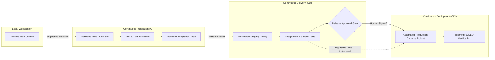
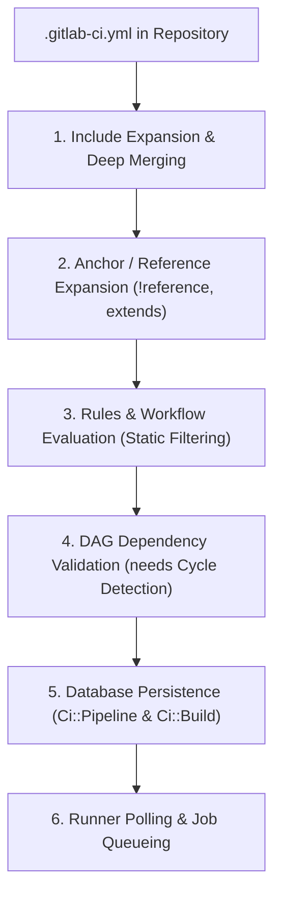
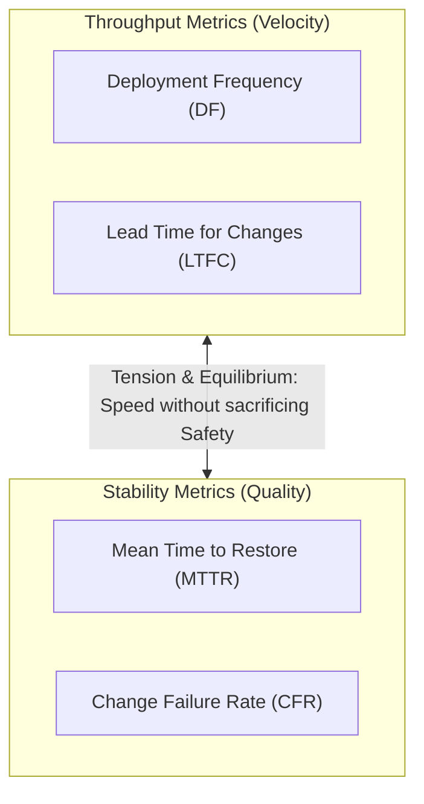

# Module 01: CI/CD Fundamentals, Trunk-Based Development, Pipeline-as-Code, and DORA Engineering Metrics

> **Primary sources:** Jez Humble & David Farley, _Continuous Delivery: Reliable Software Releases through Build, Test, and Deployment Automation_ (Addison-Wesley, 2010); Dr. Nicole Forsgren, Jez Humble, & Gene Kim, _Accelerate: The Science of Lean Software and DevOps_ (IT Revolution, 2018); Martin Fowler, _Continuous Integration_ (2006) and _Patterns for Managing Source Code Branches_ (2020); GitLab Documentation (_Value Stream Analytics and DORA Metrics_, GitLab 19.x).
>
> **Executable proof:** [`examples/ts/01-cicd-fundamentals-and-dora.test.ts`](../examples/ts/01-cicd-fundamentals-and-dora.test.ts) asserts pipeline event triggering state machines, DORA metric statistical aggregation engines, and branch divergence conflict models.

---

## 1. Formal Foundations: Continuous Integration, Continuous Delivery, and Continuous Deployment

The software delivery lifecycle transitions code from developer ideation to production runtime. Historically, software integration was treated as a distinct, serialized project phase conducted weeks or months after code authoring. Modern software engineering models the delivery cycle as an automated, continuous state machine governed by formal invariants.



### 1.1 Formal Definitions

1. **Continuous Integration (CI)**: A software development discipline where members of a team integrate their work into the mainline repository (the "trunk") frequently—at minimum once per developer per day. Each integration is verified by an automated build system that executes compilation, packaging, and hermetic regression test suites. _Invariant_: The trunk branch must at all times reside in an unbroken, passing state where all regression suites succeed. Any commit that breaks trunk is an immediate stopping condition requiring either an instant forward-fix or an automatic rollback.

2. **Continuous Delivery (CD)**: A software engineering approach in which teams produce software in short cycles, ensuring that software can be reliably released to production at any given moment. In Continuous Delivery, every passing commit on mainline produces a verified, signed release candidate artifact deployed to staging-like production environments. _Invariant_: The deployment mechanism to production is fully automated, deterministic, and proven, but the actual trigger to promote the artifact into production is a deliberate business or manual decision.

3. **Continuous Deployment (CD\*)**: An extension of Continuous Delivery where every change that passes all stages of the production-readiness pipeline is automatically deployed to the production environment without human intervention or approval gates. _Invariant_: The automated verification pipeline possesses 100% confidence authority over production fitness; human gatekeeping is completely removed from the steady-state path.

### 1.2 Mathematical State Machine of Integration Verification

Let a repository be modeled as an append-only directed acyclic graph of commits $G = (V, E)$, where $V$ is the set of commit nodes and $E$ is the set of parent-child pointers. Let $T \subseteq V$ represent the ordered chain of commits integrated into the mainline trunk:

$$T = (c_1, c_2, \dots, c_k)$$

Let $\mathcal{P}: V \to \{\text{SUCCESS}, \text{FAILED}\}$ be the automated verification pipeline function comprising compilation, unit testing, security linting, and integration suites. Under formal Continuous Integration:

$$\forall c_i \in T, \quad \mathcal{P}(c_i) = \text{SUCCESS}$$

When a developer authors a branch $B$ diverging from trunk at commit $c_m$ ($m \le k$):

$$B = (c_m, b_1, b_2, \dots, b_n)$$

The integration latency $\Delta t_{\text{diverge}} = t(b_n) - t(c_m)$ represents the duration during which branch $B$ drifts from trunk evolution. The probability of an integration failure $\mathbb{P}(\text{Conflict} \mid \Delta t)$ increases non-linearly with respect to $\Delta t$ and the velocity of commits integrated into $T \setminus \{c_1, \dots, c_m\}$.

---

## 2. Branching Strategies and Trunk-Based Development

The topology of a team's Git branching model directly dictates the throughput, lead time, and failure probability of the software delivery pipeline.

### 2.1 GitFlow vs. GitHub Flow vs. Trunk-Based Development

```mermaid
flowchart TD
    subgraph GitFlow["GitFlow: High Divergence Topology"]
        GF_Main["main (Production Only)"]
        GF_Develop["develop (Integration)"]
        GF_Feature["feature/user-auth (Multi-week lifespan)"]
        GF_Release["release/v2.1 (Frozen branch)"]
        GF_Hotfix["hotfix/CVE-patch"]
        GF_Feature -->|"Merge after weeks"| GF_Develop
        GF_Develop -->|"Branch off"| GF_Release
        GF_Release -->|"Merge back"| GF_Main
        GF_Release -.->|"Backmerge"| GF_Develop
        GF_Hotfix -->|"Dual merge"| GF_Main
        GF_Hotfix -.->|"Dual merge"| GF_Develop
    end

    subgraph TBD["Trunk-Based Development: Low Divergence Topology"]
        TBD_Trunk["main / trunk (Always Releasable)"]
        TBD_Feat1["short-lived branch (<24h)"]
        TBD_Feat2["short-lived branch (<24h)"]
        TBD_Feat1 -->|"Fast-forward / Squash Rebase"| TBD_Trunk
        TBD_Feat2 -->|"Fast-forward / Squash Rebase"| TBD_Trunk
        TBD_Trunk -->|"Tag / Continuous Release"| TBD_Prod["Production Deploy"]
    end
```



In **GitFlow**, the presence of long-lived intermediate branches (`develop`, `release/*`, `feature/*`, `hotfix/*`) creates multiple synchronization barriers. Features developed over weeks accumulate structural divergence. When merged back into `develop`, merge conflicts require manual, error-prone resolution. More critically, testing on `develop` does not guarantee production parity on `main`, leading to the infamous "works in develop, broken in release" failure mode.

In **Trunk-Based Development (TBD)**:

1. Developers commit directly to `main` (for small teams) or author short-lived feature branches that merge into `main` within 24 hours.
2. Long-lived feature branches are strictly prohibited.
3. Incomplete features are decoupled from deployment using **Feature Flags** (toggles) or the **Branch by Abstraction** pattern.
4. Every commit to `main` triggers a complete, automated CI/CD pipeline. Releases are cut directly from `main` or via lightweight release tags.

### 2.2 Branch by Abstraction Mechanics

When refactoring a foundational subsystem or building a large feature under Trunk-Based Development, developers cannot hide behind a private branch for months. They use Branch by Abstraction:

```mermaid
flowchart TD
    subgraph Step1["Phase 1: Existing Monolithic Call"]
        Client1["Consumer Module"] -->|"Direct Call"| LegacySys["Legacy Implementation"]
    end

    subgraph Step2["Phase 2: Introduce Abstraction Layer"]
        Client2["Consumer Module"] -->|"Calls Interface"| Interface["Abstract Seam / Interface"]
        Interface -->|"Delegates (Default)"| LegacySys2["Legacy Implementation"]
    end

    subgraph Step3["Phase 3: Implement New Engine Behind Interface"]
        Client3["Consumer Module"] --> Interface3["Abstract Seam / Interface"]
        Interface3 -->|"Feature Flag = FALSE"| LegacySys3["Legacy Implementation"]
        Interface3 -->|"Feature Flag = TRUE"| NewSys3["New High-Performance Engine"]
    end

    subgraph Step4["Phase 4: Deprecate and Remove Legacy"]
        Client4["Consumer Module"] --> Interface4["Abstract Seam / Interface"]
        Interface4 -->|"100% Traffic"| NewSys4["New High-Performance Engine"]
    end
```



By introducing an abstract seam, both the legacy and new implementations co-exist in mainline production code. The transition is governed by runtime configuration or feature flags, allowing incremental, daily commits to trunk without breaking production behavior.

---

## 3. Pipeline-as-Code and Declarative Execution Models

Modern CI/CD treats delivery workflows as first-class software systems governed by source control, code review, automated testing, and immutability.

### 3.1 Imperative vs. Declarative Pipeline Architectures

1. **Imperative Pipelines (e.g., Early Jenkins Scripted Pipelines, Shell Scripts)**:
   - Defined as sequential procedures and imperative loops (`for`, `while`, dynamic execution threads).
   - The engine executes arbitrary code to determine what to build next.
   - _Weakness_: Static analysis of the execution graph prior to running is impossible; failure recovery cannot safely resume arbitrary intermediate nodes; difficult to audit for deterministic reproducible builds.

2. **Declarative Pipelines-as-Code (e.g., GitLab CI `.gitlab-ci.yml`, Kubernetes Job Manifests)**:
   - Defined as a structured, declarative data model (YAML/JSON) specifying jobs, stages, dependencies (`needs`), artifacts, and execution rules.
   - The pipeline engine compiles the declarative specification into an immutable Directed Acyclic Graph (DAG) before dispatching any work to runners.
   - _Strengths_: Enables pre-flight linting, automated validation, deterministic dependency graphs, dynamic parallelization, and topological optimization.

### 3.2 Compilation and Lifecycle of `.gitlab-ci.yml`

When a Git reference update event arrives, the GitLab backend compiles the declarative configuration through five rigorous stages:



1. **Include Expansion**: All `include:local`, `include:project`, `include:remote`, and `include:component` directives are recursively fetched, validated, and merged into a single internal configuration tree.
2. **Inheritance & Reference Expansion**: YAML anchors (`<<: *default`), `extends` blocks, and `!reference` tags are resolved and compiled into concrete job specifications.
3. **Workflow Rules Evaluation**: Top-level `workflow:rules` and job-level `rules:` are evaluated against event metadata (commit message, branch name, merge request status, CI environment variables). Jobs whose rules evaluate to `when: never` are pruned from the pipeline graph.
4. **DAG Graph Validation**: The engine inspects all `needs:` relationships, asserting that:
   - No cyclic dependencies exist ($\nexists$ cycle $J_1 \to J_2 \dots \to J_1$).
   - All targeted jobs in `needs:` exist and are not pruned by rules.
   - Maximum dependency depth limits are respected.
5. **Database Transaction**: The pipeline record (`ci_pipelines`) and its constituent jobs (`ci_builds`) are created in PostgreSQL in a single atomic transaction.

---

## 4. Internal Mechanics: Event-Driven Pipeline Triggering and Scheduling

The trigger cycle of GitLab CI translates low-level operating system network packets and Git ref updates into asynchronous, distributed worker tasks.

### 4.1 The Git Push to Job Dispatch Control Loop

When a developer runs `git push origin feature/auth`:

1. **SSH / HTTPS Handshake**: The push terminates at `gitlab-shell` (or NGINX/Workhorse for HTTPS).
2. **Gitaly Hook Execution**: The Git binary on the Gitaly storage node executes the `pre-receive` and `post-receive` server-side Git hooks.
3. **Internal API Notification**: The `post-receive` hook issues an authenticated HTTP call to the GitLab Rails backend (`/api/v4/internal/post_receive`).
4. **Asynchronous Sidekiq Enqueueing**: The Rails application enqueues a `PipelineProcessWorker` job onto Redis.
5. **Pipeline Creation Service (`Ci::CreatePipelineService`)**:
   - Parses and compiles the repository's `.gitlab-ci.yml` at the pushed commit SHA.
   - Evaluates variable precedence (system variables, group variables, project variables).
   - Generates the set of runnable jobs and transitions the pipeline state from `created` to `pending`.
6. **Delivery Semantics & Idempotency**:
   - To guarantee that network drops or webhook retries do not spawn duplicate pipelines for the same commit, GitLab checks pipeline idempotency using unique idempotency tokens and commit SHA references. For deep theoretical background on at-least-once delivery, event queues, and idempotency guarantees, see [Distributed Systems: Messaging, Logs, and Delivery Semantics](../../../architecture/distributed-systems/modules/10-messaging-logs-and-delivery-semantics.md).
7. **Runner Lease Acquisition**:
   - Registered GitLab Runners poll the server via long-polling HTTP requests (`POST /api/v4/jobs/request`).
   - The scheduler assigns eligible jobs to runners matching runner tags, access level (protected vs. unprotected), and concurrency limits.

---

## 5. CLRS-Style Pseudocode: Pipeline Creation & DORA Metric Calculation

Below are formal algorithms detailing the pipeline creation graph compiler and the empirical calculation of DORA metrics over commit and deployment event streams.

### 5.1 Pipeline Creation Service with DAG Cycle Detection

```text
CREATE-PIPELINE(Repo, CommitSHA, EventContext)
1   rawConfig = FETCH-FILE-AT-REF(Repo, CommitSHA, ".gitlab-ci.yml")
2   if rawConfig == NIL
3       return NIL
4   resolvedConfig = EXPAND-INCLUDES-AND-COMPONENTS(rawConfig, Repo, CommitSHA)
5   resolvedConfig = EXPAND-REFERENCES-AND-EXTENDS(resolvedConfig)
6
7   // Step 1: Filter jobs based on workflow and job rules
8   runnableJobs = EMPTY-SET()
9   for each jobDef in resolvedConfig.JOBS
10      verdict = EVALUATE-RULES(jobDef.RULES, EventContext)
11      if verdict != "never"
12          jobDef.WHEN = verdict
13          INSERT(runnableJobs, jobDef)
14
15  // Step 2: Validate DAG acyclicity using Tarjan's or Kahn's algorithm
16  adjList = BUILD-ADJACENCY-LIST(runnableJobs)
17  inDegree = COMPUTE-IN-DEGREES(adjList, runnableJobs)
18  queue = EMPTY-FIFO-QUEUE()
19  for each job in runnableJobs
20      if inDegree[job.ID] == 0
21          ENQUEUE(queue, job)
22
23  visitedCount = 0
24  // Loop invariant: queue contains all jobs whose dependencies have been completely resolved
25  // and visitedCount equals the number of nodes processed without cycle detection.
26  while not IS-EMPTY(queue)
27      currJob = DEQUEUE(queue)
28      visitedCount = visitedCount + 1
29      for each neighbor in adjList[currJob.ID]
30          inDegree[neighbor.ID] = inDegree[neighbor.ID] - 1
31          if inDegree[neighbor.ID] == 0
32              ENQUEUE(queue, neighbor)
33
34  if visitedCount != SIZE(runnableJobs)
35      error "Circular dependency detected in CI/CD pipeline DAG specification"
36
37  // Step 3: Persist Pipeline and Builds atomically
38  pipeline = ATOMIC-PERSIST-PIPELINE(Repo, CommitSHA, runnableJobs, EventContext)
39  NOTIFY-RUNNERS-READY(pipeline)
40  return pipeline
```

### 5.2 DORA Metrics Statistical Aggregator

```text
CALCULATE-DORA-METRICS(Deployments, Incidents, Commits, WindowStart, WindowEnd)
1   // Filter events within observation window
2   validDeploys = FILTER(Deployments, d -> d.TIMESTAMP >= WindowStart and d.TIMESTAMP <= WindowEnd and d.ENV == "production")
3   validIncidents = FILTER(Incidents, i -> i.OPENED_AT >= WindowStart and i.OPENED_AT <= WindowEnd and i.ENV == "production")
4
5   // 1. Deployment Frequency (DF)
6   totalDays = (WindowEnd - WindowStart) / (24 * 3600)
7   successfulDeploys = FILTER(validDeploys, d -> d.STATUS == "success")
8   deploymentFrequency = SIZE(successfulDeploys) / totalDays
9
10  // 2. Change Failure Rate (CFR)
11  if SIZE(validDeploys) == 0
12      cfr = 0.0
13  else
14      failedDeploysCount = COUNT(validDeploys, d -> d.CAUSED_INCIDENT == TRUE or d.STATUS == "failed")
15      cfr = failedDeploysCount / SIZE(validDeploys)
16
17  // 3. Lead Time for Changes (LTFC) - Median duration from commit to production deployment
18  leadTimes = EMPTY-LIST()
19  // Loop invariant: leadTimes holds the exact elapsed durations from initial commit timestamp
20  // to deployment timestamp for all processed successful production releases.
21  for each deploy in successfulDeploys
22      for each commitSha in deploy.COMMITS
23          commit = FIND(Commits, c -> c.SHA == commitSha)
24          if commit != NIL
25              APPEND(leadTimes, deploy.TIMESTAMP - commit.AUTHORED_TIMESTAMP)
26  SORT(leadTimes)
27  medianLTFC = MEDIAN(leadTimes)
28
29  // 4. Mean Time to Recovery (MTTR) - Average duration to restore service after an incident
30  recoveryTimes = EMPTY-LIST()
31  // Loop invariant: recoveryTimes contains all duration intervals (RESOLVED_AT - OPENED_AT)
32  // for valid production outages in the window.
33  for each incident in validIncidents
34      if incident.RESOLVED_AT != NIL
35          APPEND(recoveryTimes, incident.RESOLVED_AT - incident.OPENED_AT)
36  if SIZE(recoveryTimes) == 0
37      mttr = 0.0
38  else
39      mttr = SUM(recoveryTimes) / SIZE(recoveryTimes)
40
41  return { DF: deploymentFrequency, CFR: cfr, LTFC: medianLTFC, MTTR: mttr }
```

---

## 6. DORA Metrics Deep Dive: Definitions, Mathematical Formulations, and Performance Clusters

The DevOps Research and Assessment (DORA) metrics represent the empirical gold standard for software engineering efficiency and operational stability. Discovered through rigorous statistical cluster analysis over tens of thousands of global engineering organizations, these four metrics uniquely correlate with organizational velocity, market responsiveness, and system reliability.

### 6.1 The Four Core Metrics



1. **Deployment Frequency (DF)**: Measures how often an organization successfully releases software to production. It reflects batch size reduction and continuous release capabilities.

2. **Lead Time for Changes (LTFC)**: The elapsed clock time from code commit authoring to that code successfully executing in production. It is calculated as:

   $$\text{LTFC} = t_{\text{production\_deploy}} - t_{\text{commit\_authored}}$$

3. **Change Failure Rate (CFR)**: The percentage of deployments to production that subsequently require remediation (hotfix, rollback, immediate patch, or incident declaration):

   $$\text{CFR} = \frac{N_{\text{failed\_deploys}}}{N_{\text{total\_deploys}}} \times 100\%$$

4. **Mean Time to Recovery / Restore (MTTR)**: The average or median time taken to restore full service availability following an unexpected production impairment or outage:

   $$\text{MTTR} = \frac{1}{M} \sum_{i=1}^M \left( t_{\text{incident\_resolved}, i} - t_{\text{incident\_opened}, i} \right)$$

### 6.2 Industry Performance Clusters

Based on longitudinal research, engineering organizations cluster into four performance profiles:

| Dimension | Elite Performers | High Performers | Medium Performers | Low Performers |
| :-- | :-- | :-- | :-- | :-- |
| **Deployment Frequency (DF)** | Multiple deploys per day (on-demand) | Once per day to once per week | Once per week to once per month | Between once per month and once per six months |
| **Lead Time for Changes (LTFC)** | Less than one hour (< 1h) | Between one day and one week | Between one week and one month | More than one month (> 1mo) |
| **Mean Time to Recovery (MTTR)** | Less than one hour (< 1h) | Less than one day (< 1d) | Between one day and one week | More than one week (> 1w) |
| **Change Failure Rate (CFR)** | 0% – 5% | 6% – 15% | 16% – 30% | Greater than 30% (> 30%) |

> [!IMPORTANT]
> A common misconception is that throughput and stability are a zero-sum trade-off (i.e., that deploying faster causes more outages). DORA empirical research mathematically proves the opposite: **Elite performers achieve both the highest velocity and the highest stability simultaneously.** Small batch sizes reduce the cognitive blast radius of every change, making failures rare, trivial to diagnose, and rapid to roll back.

---

## 7. Then vs. Now: Historical Paradigms vs. Modern GitLab CI/CD

| Dimension | Legacy CI/CD Paradigm (Pre-2020) | Modern GitLab 19+ Paradigm | Technical Rationale for Paradigm Shift |
| :-- | :-- | :-- | :-- |
| **Branching Strategy** | GitFlow (long-lived `develop`, `release/*`, `feature/*` branches) | Trunk-Based Development with feature toggles and short-lived branches (<24h) | Eliminates $O(n^2)$ merge conflict explosions and eliminates integration freezes before release windows. |
| **Pipeline Definition** | Imperative Groovy scripts / procedural Jenkinsfiles | Declarative YAML with CI/CD Components (`spec:inputs`) and Catalog | Enables compile-time AST validation, deterministic DAG scheduling, and isolated component testing. |
| **Job Selection Logic** | Imperative `only / except` directives with regex matching | Declarative `rules:` and `workflow:rules:` with variable boolean expressions | `only/except` had ambiguous precedence, silent overrides, and could not dynamically evaluate pipeline-level event state. |
| **Pipeline Structure** | Rigid synchronous stages (`build` $\to$ `test` $\to$ `deploy`) blocking all subsequent jobs | Asynchronous Directed Acyclic Graphs (`needs:`) with stage-skipping | Fast unit jobs no longer wait for slow integration jobs in the same stage; dramatically reduces total lead time. |
| **Release Gating** | Manual Change Advisory Boards (CAB) meeting weekly | Automated Quality Gates (JUnit, Coverage $\ge$ threshold, SAST, SBOM, Cosign) | CABs create batching bottlenecks without improving stability; automated policy-as-code enforces invariant verification. |
| **Performance Measurement** | Agile Story Points, Lines of Code, Velocity burndown charts | Empirical DORA Metrics (DF, LTFC, CFR, MTTR) via native telemetry APIs | Story points measure estimation effort, not delivered business value; DORA measures concrete system performance. |

---

## 8. Exam Delta: GitLab Certified CI/CD Associate & Modern GitLab 19

> [!NOTE]
> **Exam Delta: Certification vs. Modern GitLab 19.x Architecture**
>
> Engineers preparing for the **GitLab Certified CI/CD Associate** examination or enterprise platform interviews must be aware of critical version differences between historical exam questions and modern GitLab 19:
>
> 1. **`only` and `except` Deprecation**: Historical certification guides heavily emphasized `only: [branches, tags]` and `except: [merge_requests]`. In modern GitLab, `only/except` is legacy; mixing `only/except` with `rules` in the same job is strictly rejected by the pipeline compiler. All modern pipelines must use `rules:`.
> 2. **CI Templates vs. CI/CD Components**: Older exams reference `include: template: Auto-DevOps.gitlab-ci.yml`. Modern GitLab 19 elevates the **CI/CD Catalog** and `include: component: ...` with typed `spec:inputs` as the enterprise standard for reusable pipeline modules.
> 3. **Native DORA Tracking**: In earlier GitLab releases, DORA metrics were accessible only via custom API polling or Ultimate dashboard add-ons. GitLab 19 natively exposes DORA telemetry across project and group value streams, calculating lead time automatically when GitLab Deployments and GitLab Issues are linked to commit SHAs.

---

## 9. Production Failure Modes & Operational Gotchas

### 9.1 Long-Lived Branch Divergence and the "Merge Hell" Explosion

- **Symptom**: A developer creates a feature branch that remains unmerged for three weeks. Upon opening a Merge Request to `main`, hundreds of merge conflicts occur, and after manual resolution, production integration tests silently fail.
- **Root Cause**: The developer branched at commit $c_{10}$. While they authored 15 commits, trunk advanced by 120 commits. The developer's mental model and unit test assertions were anchored on an obsolete system state.
- **Remediation**: Enforce Trunk-Based Development policies. Configure branch protection to reject MRs whose branch age exceeds 48 hours. Implement Merge Trains with "Pipelines for Merged Results" so every MR is tested against the projected tip of `main` before integration.

### 9.2 Webhook and Event Retry Storms Spawning Duplicate Pipelines

- **Symptom**: During a network blip between GitLab Shell/Workhorse and the Rails backend, developers observe 4 to 8 identical pipelines triggered simultaneously for the exact same Git commit push.
- **Root Cause**: The `post-receive` Git hook encountered a timeout waiting for the Rails API and retried the HTTP request three times. Because the endpoint lacked strict idempotency token deduplication at the database layer, each retry spawned a distinct `Ci::Pipeline` record.
- **Remediation**: Use idempotent webhook and event handling. In custom webhook receivers or API triggers, enforce deduplication on the unique tuple `(project_id, commit_sha, event_type)`. Configure GitLab's `workflow:rules` to avoid spawning redundant branch pipelines when merge request pipelines are active:

```yaml
# Prevent duplicate pipelines on push when an MR is open
workflow:
  rules:
    - if: '$CI_PIPELINE_SOURCE == "merge_request_event"'
    - if: '$CI_COMMIT_BRANCH && $CI_OPEN_MERGE_REQUESTS'
      when: never
    - if: '$CI_COMMIT_BRANCH'
```

### 9.3 Vanity DORA Metrics Distortion

- **Symptom**: An engineering group reports "Elite" DORA status with 40 deployments per day and an LTFC of 15 minutes, yet customers experience constant broken features and slow delivery.
- **Root Cause**: The team configured their DORA deployment tracking against a `dev` or `staging` environment instead of actual customer-facing production. Alternatively, automated dependency bots (e.g., Renovate/Dependabot) submit 30 automated PRs daily for patch releases, artificially inflating deployment counts while masking stagnant core product delivery.
- **Remediation**: Configure DORA metrics strictly against environments marked `environment:name: production` with `tier: production`. Filter out bot-authored commits when calculating human velocity metrics.

### 9.4 Silent Pipeline Bypass via `[ci skip]`

- **Symptom**: A critical bug bypasses testing and reaches production when an engineer commits with `git commit -m "fix(typo): update docs [ci skip]"`, unaware that their commit also modified an application source file.
- **Root Cause**: GitLab CI natively respects `[ci skip]` or `[skip ci]` in commit messages, aborting pipeline creation entirely.
- **Remediation**: Disable `[ci skip]` for protected production branches. In project settings, enforce that protected branches reject pushes that do not generate a passing pipeline.

---

## Interview Drill

<details><summary>1. Explain the operational and technical difference between Continuous Delivery and Continuous Deployment.</summary>

Continuous Delivery ensures that every change integrated into the mainline repository is automatically built, tested, packaged, and verified in a staging environment such that it is continuously in a production-releasable state. However, the final deployment trigger to production remains a deliberate, manual business decision (such as an approval click or scheduled release window). In Continuous Deployment, there is zero human gatekeeping: every commit that successfully traverses the automated pipeline is deployed directly into production immediately. Continuous Deployment requires comprehensive automated verification (unit, integration, contract, security, smoke, and canary telemetry) to safely delegate full release authority to the pipeline.
</details>

<details><summary>2. Why does Trunk-Based Development scale better than GitFlow in high-velocity platform engineering teams?</summary>

GitFlow relies on long-lived branches (`develop`, `feature/*`, `release/*`) that accumulate structural drift over days or weeks. This drift creates an $O(n^2)$ merge conflict probability curve, leads to painful "merge hell," and introduces integration freezes before releases. Furthermore, testing against `develop` does not guarantee stability on `main` due to disparate commit histories. Trunk-Based Development eliminates drift by requiring all developers to integrate short-lived branches (<24h) directly into `main`. Incomplete features are managed via feature flags or Branch by Abstraction. Every integration is verified against the true trunk state, dramatically shrinking batch size, reducing lead time, and enabling continuous production deployments.
</details>

<details><summary>3. How does GitLab CI prevent duplicate pipelines from running when a developer pushes a commit to a branch that has an active Merge Request?</summary>

By default, without custom workflow rules, pushing to a branch with an open Merge Request can trigger two separate pipelines: a branch pipeline (`CI_PIPELINE_SOURCE == "push"`) and a merge request pipeline (`CI_PIPELINE_SOURCE == "merge_request_event"`). To eliminate this waste, modern GitLab configurations implement top-level `workflow:rules`. By specifying an explicit rule checking `$CI_OPEN_MERGE_REQUESTS`, the pipeline compiler detects whether an MR exists for the branch. If an MR exists, the branch pipeline evaluation yields `when: never`, ensuring only the Merge Request pipeline executes.
</details>

<details><summary>4. How is Lead Time for Changes (LTFC) formally calculated in DORA, and what are common pitfalls in measuring it?</summary>

DORA defines Lead Time for Changes as the total elapsed duration from the moment code is committed (the Git authored timestamp) until that specific commit is running successfully in production. A common pitfall is measuring only the pipeline execution time (e.g., 20 minutes of CI/CD runtime) while ignoring the days the code sat unmerged in code review or waiting for a deployment freeze window. Another pitfall is taking a simple arithmetic mean instead of the median; an outlier PR that sat stagnant for six months will severely distort the mean, whereas the median accurately captures typical engineering cycle time.
</details>

<details><summary>5. What is the "Branch by Abstraction" pattern, and what problem does it solve in CI/CD?</summary>

Branch by Abstraction is a technique used in Trunk-Based Development to make large, complex architectural changes or subsystem replacements without creating long-lived feature branches. The developer introduces an abstract interface (seam) in front of the existing legacy implementation, integrates it directly into `main`, and then builds the new implementation behind that same interface in small, daily commits. A runtime toggle or feature flag routes traffic between the old and new engines. Once the new engine is verified in production, the toggle is permanently switched, the legacy implementation is deleted, and the interface is simplified—all without ever branching off trunk for more than a day.
</details>

<details><summary>6. Describe the internal event chain within GitLab from the moment a Git push is received on the server to the execution of a job on a runner.</summary>

When a push hits `gitlab-shell` or GitLab Workhorse, the server initiates Git hooks managed by Gitaly. The `post-receive` hook notifies the GitLab Rails internal API, which enqueues an asynchronous `PipelineProcessWorker` job in Redis. Sidekiq picks up the job and invokes `Ci::CreatePipelineService`. This service fetches `.gitlab-ci.yml`, recursively resolves `include` files and components, expands references/extends, evaluates `rules:` logic, and builds an adjacency list of jobs to check for DAG cycles. Upon cycle validation, it commits the `ci_pipelines` and `ci_builds` database records in PostgreSQL. Finally, registered GitLab Runners long-polling the `/api/v4/jobs/request` endpoint match eligible jobs based on tags and concurrency limits, lease the job build token, and pull the job payload for execution.
</details>

<details><summary>7. How do Change Failure Rate (CFR) and Mean Time to Recovery (MTTR) balance Deployment Frequency (DF) in engineering health analysis?</summary>

Deployment Frequency is a throughput (velocity) metric, whereas CFR and MTTR are stability (quality) metrics. If an organization optimizes solely for Deployment Frequency, developers might release broken code in rapid micro-batches, resulting in high velocity but disastrous customer availability. CFR ensures that speed does not compromise quality by tracking the proportion of releases that cause production degradation. MTTR ensures that when incidents inevitably occur, automated rollback, telemetry, and low lead times allow the team to restore service almost instantaneously. Together, they form an equilibrium demonstrating true engineering maturity.
</details>

---

## 11. Proof Map and Verification

The claims, state machines, and mathematical formulations presented in this module are verified by executable test suites in [`examples/ts/01-cicd-fundamentals-and-dora.test.ts`](../examples/ts/01-cicd-fundamentals-and-dora.test.ts):

- **State Machine Verification**: Tests model the continuous integration transition states (`created` $\to$ `pending` $\to$ `running` $\to$ `success`/`failed`), verifying that non-passing intermediate commits block delivery promotion.
- **DORA Aggregation Logic**: Tests execute the exact `CALCULATE-DORA-METRICS` algorithm over synthetic datasets of commits, deploys, and incidents, validating median LTFC calculation and CFR percentage bounds against edge cases (zero deploys, unresolved incidents).
- **Branch Divergence Conflict Simulation**: Tests verify the mathematical model of branch drift, demonstrating that merge conflict probability correlates with branch age and commit volume.
- **DAG Acyclicity Enforcement**: Tests execute Kahn's topological sort on declarative job dependency graphs, asserting that circular dependencies are caught and rejected prior to job scheduling.
