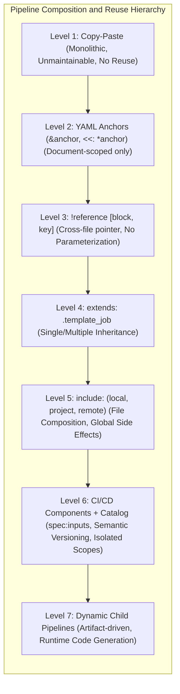
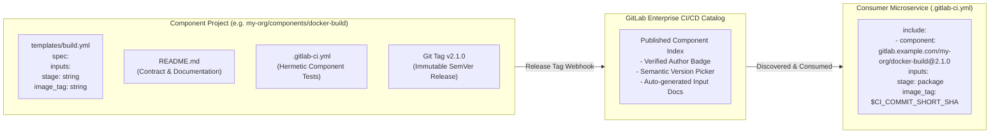
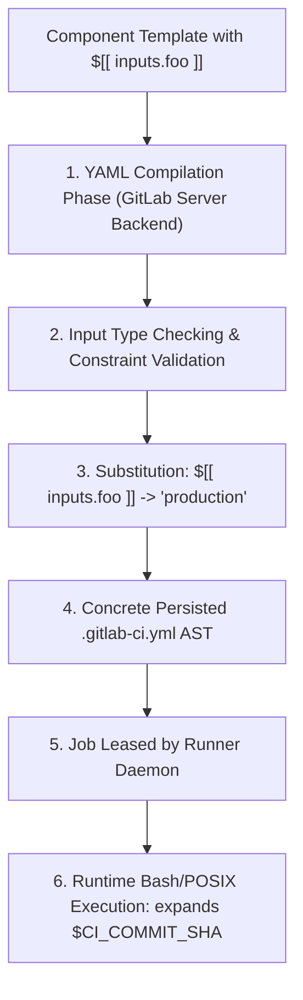
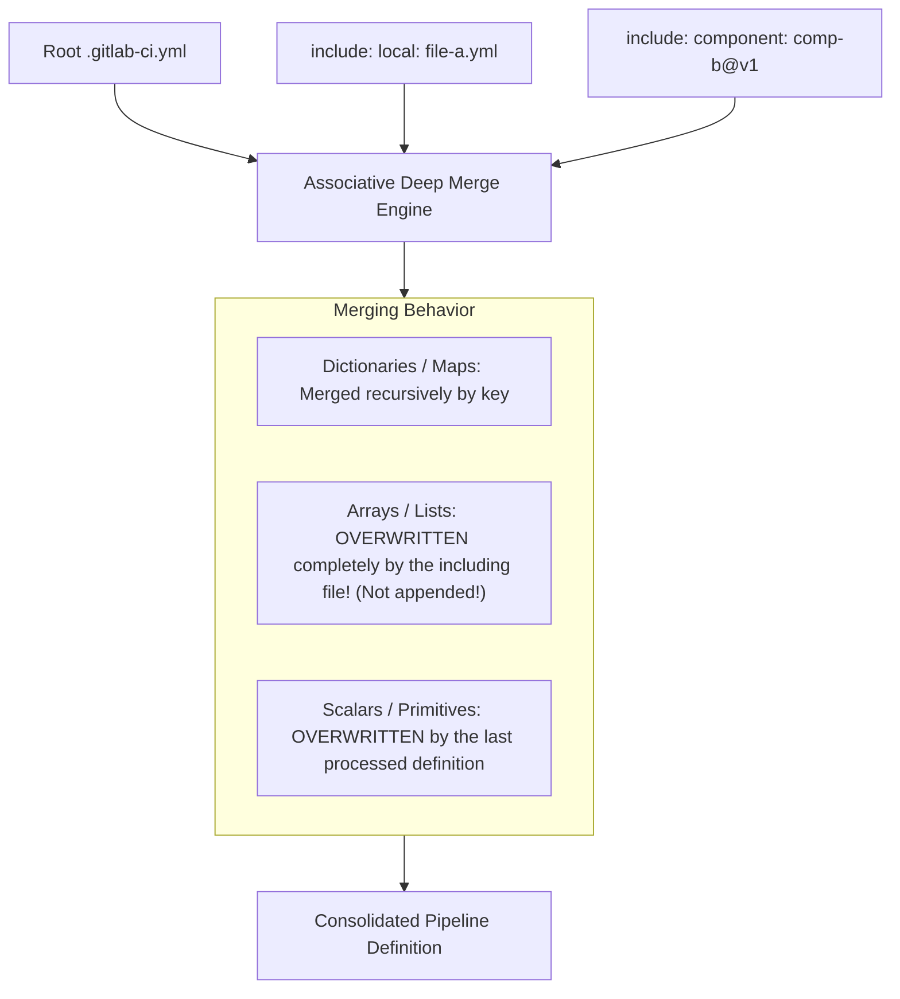
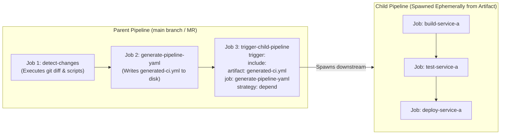

# Module 03: Pipeline Reuse and Composition: CI/CD Components, Catalog, Spec Inputs, Includes, and Dynamic Child Pipelines

> **Primary sources:** GitLab CI/CD Components & Catalog Documentation (GitLab 19.x); GitLab YAML Reference ([`include`, `spec:inputs`, `trigger:include:artifact`](https://docs.gitlab.com/ci/yaml/)); Continuous Delivery Architecture Standards for Monorepos and Enterprise Governance.
>
> **Executable proof:** [`examples/ts/03-pipeline-reuse-components-and-child-pipelines.test.ts`](../examples/ts/03-pipeline-reuse-components-and-child-pipelines.test.ts) asserts component input interpolation engines, recursive deep-merging algorithms, array-override semantics, and dynamic child pipeline YAML generation.

---

## 1. Formal Foundations: The Pipeline Composition and Reuse Spectrum

As an enterprise engineering organization grows from a single service to hundreds of microservices, software delivery configurations inevitably duplicate across repositories. Managing pipeline logic through copy-paste creates maintenance debt, version fragmentation, and security compliance blind spots. GitLab CI provides a progressive hierarchy of abstraction mechanisms to compose, reuse, and enforce pipeline specifications.



### 1.1 Structural Limitations of Legacy Composition Primitives

Before adopting modern components, engineers attempted composition via YAML anchors, `!reference` tags, and `extends`:

1. **YAML Anchors (`&anchor` and `<<: *anchor`)**:
   - Anchors are an internal feature of the YAML 1.2 specification.
   - _Limitation_: Anchors are strictly **document-scoped**. An anchor defined in an included file cannot be referenced in the parent `.gitlab-ci.yml`. Furthermore, YAML merge keys (`<<:`) perform shallow merges: nested dictionaries inside an anchored block completely overwrite downstream nested dictionaries rather than merging them recursively.
2. **`!reference [block, key]` Tags**:
   - A GitLab-specific custom YAML tag allowing jobs to inherit specific array or string blocks from another job across `include` boundaries.
   - _Limitation_: `!reference` cannot accept inputs or arguments. It is a static, read-only pointer to an arbitrary block in the compiled AST.
3. **`extends: .base_job`**:
   - GitLab's declarative inheritance construct, performing a deep merge of job properties from one or more base hidden jobs (names prefixed with `.`).
   - _Limitation_: Hidden jobs share the global namespace of the including repository; variable collision is frequent, and base jobs cannot declare strict interface types or validate inputs prior to execution.

---

## 2. The GitLab CI/CD Components Architecture and the CI/CD Catalog

GitLab 19 establishes **CI/CD Components** and the **CI/CD Catalog** as the enterprise standard for pipeline modularity, replacing legacy GitLab-managed templates.



### 2.1 Anatomy of a CI/CD Component

A CI/CD Component is stored in a dedicated Git repository (or within a monorepo's `templates/` directory) and strictly adheres to a standard layout:

```text
├── README.md                      # Comprehensive documentation of inputs and outputs
├── LICENSE.md                     # Open source or enterprise license
├── .gitlab-ci.yml                 # Pipeline used to test the component itself
└── templates/
    ├── build.yml                  # Component entrypoint: `component/docker-build/build@v1`
    └── scan.yml                   # Sub-component: `component/docker-build/scan@v1`
```

Every component template file MUST begin with a formal `spec:inputs` declaration header:

```yaml
spec:
  inputs:
    stage:
      type: string
      default: build
      description: 'Pipeline stage in which the container build job executes.'
    dockerfile:
      type: string
      default: 'Dockerfile'
      description: 'Relative path to the application Dockerfile.'
    push_image:
      type: boolean
      default: true
      description: 'Flag indicating whether to push the built image to the container registry.'
    target_architectures:
      type: array
      default: ['linux/amd64']
      description: 'List of target architectures for multi-arch manifest generation.'
---
# The concrete job definition follows the YAML triple-dash separator
build-container-$[[ inputs.stage ]]:
  stage: $[[ inputs.stage ]]
  image: quay.io/buildah/stable:v1.38.0
  script:
    - echo "Building $[[ inputs.dockerfile ]] for architectures: $[[ inputs.target_architectures ]]"
    - buildah build --platform $(echo "$[[ inputs.target_architectures ]]" | tr ' ' ',') -f $[[ inputs.dockerfile ]] -t my-app:$CI_COMMIT_SHA .
    - |
      if [ "$[[ inputs.push_image ]]" = "true" ]; then
        echo "Pushing image to registry..."
      fi
```

### 2.2 Compilation and Interpolation Mechanics: `$[[ inputs.x ]]` vs. `$CI_VAR`

A foundational architectural distinction in GitLab CI is the separation between **compile-time component interpolation** and **runtime runner variable expansion**:



1. **`$[[ inputs.key ]]` (Compile-Time Interpolation)**:
   - Evaluated on the GitLab Rails server during pipeline compilation, before YAML validation and database persistence.
   - Can interpolate structural YAML keys (job names, stage names, `when:` conditions, array elements).
   - Validated against the component's declared `spec:inputs` schema.
2. **`$VARIABLE` / `${VARIABLE}` (Runtime Shell Expansion)**:
   - Handled directly inside the runner's container/shell process when executing the job's `script:` or `before_script:` arrays.
   - Cannot modify the pipeline's structural topology (e.g., setting `stage: $MY_STAGE` in YAML fails or defaults to literal string `$MY_STAGE`).

---

## 3. Include Mechanisms and Deep Merging Semantics

GitLab CI allows pipeline composition through five primary `include` methods.

### 3.1 The Five Include Directives

```yaml
include:
  # 1. Local: Include a file from the same repository and ref
  - local: 'ci/lint-jobs.yml'

  # 2. Project: Include a file from another repository within the same GitLab instance
  - project: 'platform-engineering/security-policies'
    ref: 'v3.4.1' # Pinned Git Tag
    file: 'templates/sast.gitlab-ci.yml'

  # 3. Remote: Include an unauthenticated file via HTTPS
  - remote: 'https://compliance.internal.net/rules/soc2-audit.yml'

  # 4. Component: Modern CI/CD Catalog Component with typed inputs
  - component: 'gitlab.com/gitlab-org/components/secret-detection/secret-detection@1.2.0'
    inputs:
      stage: security-audit

  # 5. Template: Legacy bundled GitLab templates (Deprecated in favor of Components)
  - template: 'Jobs/Dependency-Scanning.gitlab-ci.yml'
```

### 3.2 Recursive Deep-Merge Conflict Resolution

When multiple files are included, GitLab applies an associative deep-merging algorithm to reconcile identical keys:



> [!CAUTION]
> A critical failure mode in GitLab CI merging is the **Array Overwrite Rule**. If an included base job defines `before_script: [echo "init DB", setup_certs]`, and your local job definition specifies `before_script: [export FOO=BAR]`, GitLab does **not** concatenate the two lists. The local array completely wipes out and replaces the base array! To append commands without destroying upstream logic, use custom script entrypoints or `!reference` tags.

---

## 4. Dynamic Child Pipelines and Parent-Child Architecture

In massive monorepos housing dozens or hundreds of independent applications and microservices, defining all pipeline jobs in a single root `.gitlab-ci.yml` is an architectural anti-pattern.

### 4.1 Monolithic Monorepo Failure Modes vs. Child Pipelines

| Architectural Bottleneck | Monolithic Pipeline (`.gitlab-ci.yml`) | Parent-Child Pipeline Architecture |
| :-- | :-- | :-- |
| **YAML Parsing Overhead** | Hits GitLab YAML parsing size limit (5MB / 100k lines), causing pipeline timeouts. | Root pipeline is ultra-lightweight (<50 lines); child pipelines parsed independently on demand. |
| **Pipeline Visualization** | Graph UI becomes unusable with 500+ jobs displayed simultaneously. | Modular, collapsible sub-pipeline graphs for each microservice. |
| **Runner Resource Contention** | Evaluates rules across all 500 jobs on every push, saturating Sidekiq and Redis. | Trigger jobs spawn child pipelines only for microservices with detected changes. |
| **Security Blast Radius** | Single syntax error in one service blocks pipeline execution for the entire monorepo. | Failures are strictly scoped to the offending microservice's child pipeline. |

### 4.2 Dynamic Child Pipeline Mechanics

A **Dynamic Child Pipeline** does not read a static YAML file from Git. Instead, a parent generator job inspects the repository (e.g., executing `git diff`, evaluating JSON files, running Helm/Jsonnet/CUE), generates a `.gitlab-ci.yml` file on the fly, uploads it as an artifact, and triggers a child pipeline using that artifact.



### 4.3 Concrete Dynamic Child Pipeline Implementation

```yaml
# Parent .gitlab-ci.yml
stages:
  - analyze
  - execute

generate-monorepo-pipeline:
  stage: analyze
  image: node:26-alpine
  script:
    - node scripts/generate-dynamic-pipeline.mjs > generated-ci.yml
  artifacts:
    paths:
      - generated-ci.yml
    expire_in: 1 hour

run-child-pipeline:
  stage: execute
  needs:
    - job: generate-monorepo-pipeline
      artifacts: true
  trigger:
    include:
      artifact: generated-ci.yml
      job: generate-monorepo-pipeline
    strategy: depend
```

> [!IMPORTANT]
> Always specify `strategy: depend` on the `trigger:` job. Without `strategy: depend`, the parent job succeeds the microsecond the child pipeline is successfully created in the database, ignoring whether the child jobs subsequently fail! With `strategy: depend`, the parent trigger job stays in the `running` state, mirrors the child pipeline's execution progress, and fails if the child pipeline fails.

---

## 5. CLRS-Style Pseudocode: Component Interpolation & Deep Merge Engine

Below are formal algorithms detailing compile-time component input substitution and recursive associative dictionary merging.

### 5.1 Component Input AST Interpolator

```text
INTERPOLATE-SPEC-INPUTS(ComponentAST, InputDeclarations, PassedInputs)
1   // Step 1: Validate input types and assign defaults
2   resolvedInputs = EMPTY-DICTIONARY()
3   // Loop invariant: For every declared input key processed, resolvedInputs[key]
4   // holds a value that strictly conforms to its declared type schema.
5   for each (inputName, inputSpec) in InputDeclarations
6       if inputName in PassedInputs
7           val = PassedInputs[inputName]
8           if TYPE-OF(val) != inputSpec.TYPE
9               error "Type mismatch for input: " + inputName
10          resolvedInputs[inputName] = val
11      else if inputSpec.DEFAULT != NIL
12          resolvedInputs[inputName] = inputSpec.DEFAULT
13      else
14          error "Missing required input without default: " + inputName
15
16  // Step 2: Recursive traversal and string interpolation
17  return RECURSIVE-SUBSTITUTE(ComponentAST, resolvedInputs)

RECURSIVE-SUBSTITUTE(Node, ResolvedInputs)
1   if TYPE-OF(Node) == SCALAR_STRING
2       // Replace all occurrences of $[[ inputs.<key> ]]
3       pattern = REGEX('\$\[\[\s*inputs\.([a-zA-Z0-9_-]+)\s*\]\]')
4       interpolatedString = Node
5       for each match in FIND-ALL(pattern, Node)
6           varName = match.GROUP(1)
7           if varName in ResolvedInputs
8               interpolatedString = REPLACE(interpolatedString, match.FULL_MATCH, STRING(ResolvedInputs[varName]))
9           else
10              error "Unknown component input reference: " + varName
11      return interpolatedString
12  else if TYPE-OF(Node) == DICTIONARY
13      newDict = EMPTY-DICTIONARY()
14      for each (k, v) in Node
15          interpKey = RECURSIVE-SUBSTITUTE(k, ResolvedInputs)
16          interpVal = RECURSIVE-SUBSTITUTE(v, ResolvedInputs)
17          newDict[interpKey] = interpVal
18      return newDict
19  else if TYPE-OF(Node) == ARRAY
20      newArr = EMPTY-LIST()
21      for each item in Node
22          APPEND(newArr, RECURSIVE-SUBSTITUTE(item, ResolvedInputs))
23      return newArr
24  else
25      return Node
```

### 5.2 Associative Deep Merge Engine

```text
DEEP-MERGE-CONFIG(TargetMap, SourceMap)
1   // Merges SourceMap into TargetMap with GitLab CI precedence rules
2   // Invariant: TargetMap retains non-overlapping keys; overlapping keys are reconciled
3   // according to type semantics (maps are merged recursively, arrays/scalars are replaced).
4   for each (key, sourceVal) in SourceMap
5       if key not in TargetMap
6           TargetMap[key] = CLONE(sourceVal)
7       else
8           targetVal = TargetMap[key]
9           if TYPE-OF(targetVal) == DICTIONARY and TYPE-OF(sourceVal) == DICTIONARY
10              DEEP-MERGE-CONFIG(targetVal, sourceVal)
11          else if TYPE-OF(targetVal) == ARRAY and TYPE-OF(sourceVal) == ARRAY
12              // GitLab CI Semantic: Arrays are completely overwritten, NOT concatenated!
13              TargetMap[key] = CLONE(sourceVal)
14          else
15              // Primitive/Scalar override
16              TargetMap[key] = sourceVal
17  return TargetMap
```

---

## 6. Then vs. Now: Evolution of Pipeline Composition

| Capability | Legacy GitLab CI (< 16.0) | Modern GitLab 19+ Paradigm | Technical Rationale |
| :-- | :-- | :-- | :-- |
| **Pipeline Reuse** | Global `include: template: Auto-DevOps.gitlab-ci.yml` | Granular **CI/CD Components** published to enterprise **CI/CD Catalog** | Templates had unpinned versions, untracked breaking changes, and global variable pollution. |
| **Parameterization** | Global CI/CD variables (`variables: { DOCKER_BUILD_TAG: "v1" }`) | Formally typed, scoped `spec:inputs` with default values and validation | Global variables cause namespace collisions across multi-include pipelines; inputs are strictly scoped. |
| **Monorepo Scaling** | Massive single `.gitlab-ci.yml` (thousands of lines, fragile regex) | Dynamic Child Pipelines generated via artifact YAML handoff | Prevents pipeline compiler timeouts and isolates failures to affected sub-projects. |
| **Cross-file Anchors** | Complex workarounds using `extends` chains across dozens of files | Modern `!reference` tags and scoped component inclusions | YAML anchors cannot cross file boundaries; `extends` creates tight coupling. |
| **Downstream Monitoring** | Fire-and-forget multi-project triggers (`trigger: project: ...`) | Dependent multi-project triggers with `strategy: depend` | Prevents false-positive pipeline successes where upstream succeeds while downstream silently crashes. |

---

## 7. Exam Delta: GitLab Certified CI/CD Associate & Modern GitLab 19

> [!NOTE]
> **Exam Delta: Components and Catalog vs. Legacy Templates**
>
> 1. **Component Inputs vs. Environment Variables**: Legacy certification questions frequently ask how to customize included templates (the answer was: "Override global variables in `variables:`"). In modern GitLab 19, the correct architectural answer is: **"Pass typed arguments via the `inputs:` block of `include:component`."**
> 2. **Version Pinning Syntax**: Components use the `@` delimiter to specify versions: `@~latest` (latest release in current minor range), `@1.2.0` (exact SemVer Git tag), or `@1` (floating major). Unpinned components are flagged as security anti-patterns in enterprise compliance audits.
> 3. **Parent-Child Pipeline State Reflection**: Legacy exams focus on `trigger: project: group/repo`. In modern architecture, you must recognize the mandatory use of `strategy: depend` to ensure parent pipelines accurately reflect child execution status for protected merge gates.

---

## 8. Production Failure Modes & Operational Gotchas

### 8.1 Compile-Time `$[[ inputs.x ]]` vs. Runtime `$VARIABLE` Expansion Failure

- **Symptom**: An engineer authors a component specifying `image: $[[ inputs.registry ]]/app:$CI_COMMIT_SHA`. The pipeline compilation fails with `YAML syntax error: $[[ inputs.registry ]] is valid, but $CI_COMMIT_SHA cannot be evaluated during component interpolation`.
- **Root Cause**: The developer attempted to mix compile-time component interpolation syntax with runner runtime environment variables inside a structural YAML block evaluated by the server prior to runner dispatch.
- **Remediation**: Understand the boundary. `$[[ inputs.x ]]` is evaluated on the GitLab Rails server during pipeline generation. Standard `$VARIABLES` are evaluated inside the runner container shell. If a value depends on Git commit runtime state, pass it as a shell argument in `script:`, not as a structural YAML key.

### 8.2 The Array Overwrite Trap in Deep Merging

- **Symptom**: A team includes an organizational compliance template that defines mandatory security audits in `before_script`. The local project defines `before_script: [setup_local_env]`. The pipeline runs, and the security audit never executes!
- **Root Cause**: In GitLab's YAML deep-merge algorithm, arrays do **not** append; the including file's array completely replaces the included array.
- **Remediation**: Never override `before_script` directly when inheriting compliance baselines. Use `!reference [.base_job, before_script]` to explicitly pull in the parent commands:

```yaml
my-job:
  extends: .compliance_job
  before_script:
    - !reference [.compliance_job, before_script]
    - echo "Executing local initialization..."
```

### 8.3 Infinite Dynamic Child Pipeline Recursion

- **Symptom**: A developer writes a script that generates a dynamic child pipeline. Due to a bug in the directory detection logic, the child pipeline executes the same generator script, which spawns another child pipeline, until the GitLab runner queue is overwhelmed by 500 queued pipelines.
- **Root Cause**: Lack of recursion termination conditions on pipeline source triggers.
- **Remediation**: Gate generator jobs with explicit `rules:` verifying that the pipeline source is a parent trigger event, preventing re-triggering within child contexts:

```yaml
generate-pipeline:
  rules:
    - if: '$CI_PIPELINE_SOURCE == "parent_pipeline"'
      when: never
    - if: '$CI_PIPELINE_SOURCE == "merge_request_event"'
      when: on_success
```

### 8.4 Supply-Chain Compromise via Floating Remote Includes

- **Symptom**: An enterprise pipeline suddenly begins exfiltrating environment variables to an external IP address after an external URL defined under `include:remote` was hijacked or updated by an attacker.
- **Root Cause**: Using unauthenticated, unpinned `include:remote: https://external.io/ci.yml`.
- **Remediation**: Ban `include:remote` in enterprise security settings. Enforce all external dependencies through the internal GitLab CI/CD Catalog, signed via Git tags and mirrored locally in internal repositories.

---

## Interview Drill

<details><summary>1. Explain why YAML anchors cannot be used across multiple files with `include:`, and how `!reference` tags solve this limitation.</summary>

YAML anchors (`&anchor` and `*anchor`) are a specification feature of the standard YAML parser operating on a single document stream. When GitLab processes `include:` statements, each file is parsed into a discrete memory AST before the custom deep-merging engine combines them. Because the anchor dictionary is cleared between individual file parses, an anchor defined in `included.yml` does not exist in the parser's symbol table when `main.yml` is parsed, resulting in an "unknown anchor" syntax error. The `!reference [job, key]` tag is a custom GitLab extension that operates on the consolidated, post-merge GitLab configuration tree. It allows a job to query and copy any arbitrary dictionary or array block from another job anywhere in the merged pipeline hierarchy, successfully crossing file boundaries.
</details>

<details><summary>2. What is the fundamental difference between component interpolation syntax (`$[[ inputs.key ]]`) and runner variable expansion (`$KEY`)?</summary>

Component interpolation (`$[[ inputs.key ]]`) occurs strictly at compile time on the GitLab server (Rails backend) before the YAML configuration is validated, persisted to the database, or dispatched. It allows dynamic manipulation of structural YAML tokens—such as job names, stage assignments, rules conditions, or list elements—based on strongly typed schema inputs declared in `spec:inputs`. Runner variable expansion (`$KEY` or `${KEY}`) occurs at execution time inside the runner worker process (within the container or shell environment). Runner variables cannot alter pipeline structure or DAG dependencies; they are accessible only within job lifecycle scripts (`before_script`, `script`, `after_script`).
</details>

<details><summary>3. How does GitLab CI's deep-merge algorithm handle array fields versus dictionary fields when combining included files?</summary>

GitLab CI's deep-merge algorithm distinguishes sharply between associative maps (dictionaries) and lists (arrays):

1. **Dictionaries**: Merged recursively. If both the base template and the extending job declare a dictionary (such as `variables:`), keys from both dictionaries are combined. If a key collision occurs, the extending (higher-level) job's value overwrites the base value.
2. **Arrays**: Overwritten completely. If a base template defines `script:` or `before_script:` with five commands, and the extending job defines `script:` with one command, the extending array completely discards and replaces the base array. Arrays are never automatically concatenated.

</details>

<details><summary>4. What is a Dynamic Child Pipeline, and what architectural problem does it solve in large-scale monorepos?</summary>

A Dynamic Child Pipeline is a pipeline whose configuration YAML is not committed to source control as a static file, but is instead generated programmatically at runtime by an upstream parent job (using tools like Node.js, Python, or Helm) and stored as a job artifact. The parent pipeline then invokes `trigger: include: artifact: generated.yml, job: generate_job` to instantiate the child pipeline dynamically. In large monorepos, this solves multiple architectural bottlenecks: it bypasses GitLab's static YAML parsing size limits (5MB), eliminates the visual clutter of hundreds of un-executed jobs, drastically cuts down Sidekiq queue contention, and allows teams to dynamically construct pipelines containing only the microservices affected by the specific Git diff.
</details>

<details><summary>5. Why is the `strategy: depend` directive critical when configuring downstream or child pipelines?</summary>

By default, when a parent job defines a `trigger:` to launch a downstream child or multi-project pipeline, the trigger job operates in a "fire-and-forget" mode: as soon as the child pipeline is successfully created in the database, the parent trigger job immediately transitions to `status = success`. If any jobs inside the child pipeline subsequently crash or fail quality gates, the parent pipeline remains marked as successful, allowing broken code to be merged into protected branches. Specifying `strategy: depend` forces the parent trigger job to remain in the `running` state, mirroring the child pipeline's lifecycle in real-time, and propagating a failure or cancellation from the child back up to the parent.
</details>

<details><summary>6. How does the CI/CD Catalog enforce semantic versioning and immutability for enterprise components?</summary>

The CI/CD Catalog treats component repositories as versioned software packages. When a component project is tagged with a Git tag conforming to Semantic Versioning (e.g., `v1.2.0`), GitLab's release orchestrator indexes the component in the organization's Catalog. Consumers reference the component using explicit version specifiers: exact tags (`@1.2.0`), minor ranges (`@~latest`), or major floating tags (`@1`). Because Git tags on protected catalog repositories are immutable, platform teams can guarantee that upstream updates do not introduce silent breaking changes into downstream pipelines.
</details>

<details><summary>7. Describe a failure mode that occurs when combining `extends` with `before_script` in an organizational compliance pipeline.</summary>

Platform security teams often define a base hidden job (e.g., `.compliance_base`) that runs mandatory security checks and credential isolation in `before_script`. When application development teams extend this job (`extends: .compliance_base`) and define their own local `before_script` (e.g., `before_script: [npm install]`), GitLab CI's array-overwrite merge rule activates: the local application's `before_script` array completely overrides the compliance `before_script` array. As a result, the compliance commands never execute, creating a silent security vulnerability. The remediation is to use `!reference [.compliance_base, before_script]` to explicitly chain scripts, or to move compliance enforcement into mandatory pipeline components or scan execution policies.
</details>

---

## 10. Proof Map and Verification

The algorithmic behaviors, AST interpolation, and merge semantics detailed in this module are proven by executable test suites in [`examples/ts/03-pipeline-reuse-components-and-child-pipelines.test.ts`](../examples/ts/03-pipeline-reuse-components-and-child-pipelines.test.ts):

- **Component Input Interpolation**: Tests execute `INTERPOLATE-SPEC-INPUTS`, verifying that compile-time tokens (`$[[ inputs.var ]]`) are replaced with strongly typed strings, booleans, and arrays while enforcing schema constraints and erroring on missing inputs.
- **Deep Merge Engine Assertions**: Tests execute `DEEP-MERGE-CONFIG`, asserting that nested dictionary keys merge associatively while array fields follow strict replacement semantics, validating the array overwrite rule.
- **Dynamic YAML Generation**: Tests verify the dynamic pipeline generator engine, generating valid `.gitlab-ci.yml` artifacts based on simulated Git diff change vectors and asserting correct parent-child trigger structures.
- **Reference Resolution**: Tests model `!reference` resolution across isolated job definitions, confirming that cross-job script references resolve cleanly without global variable leakage.
