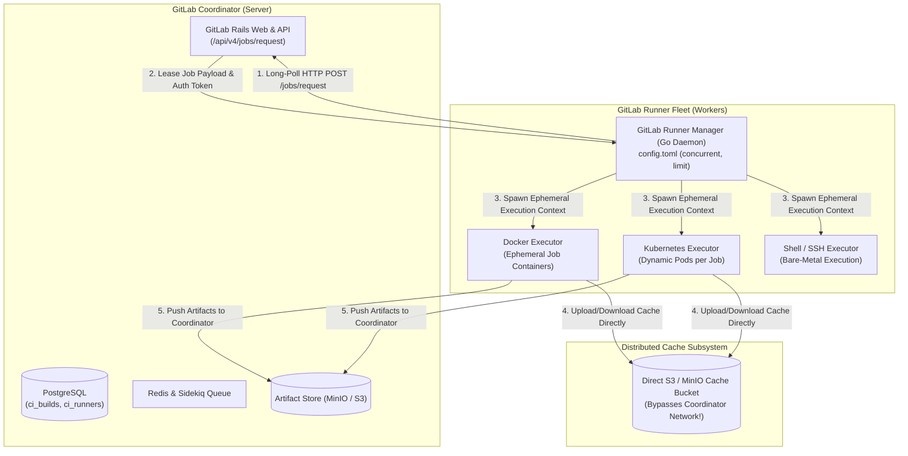
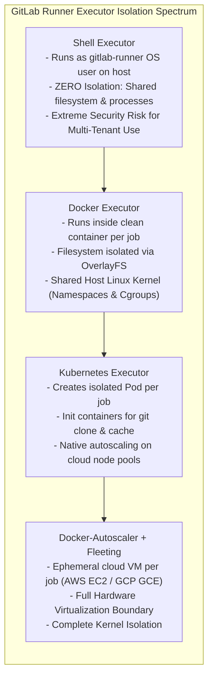
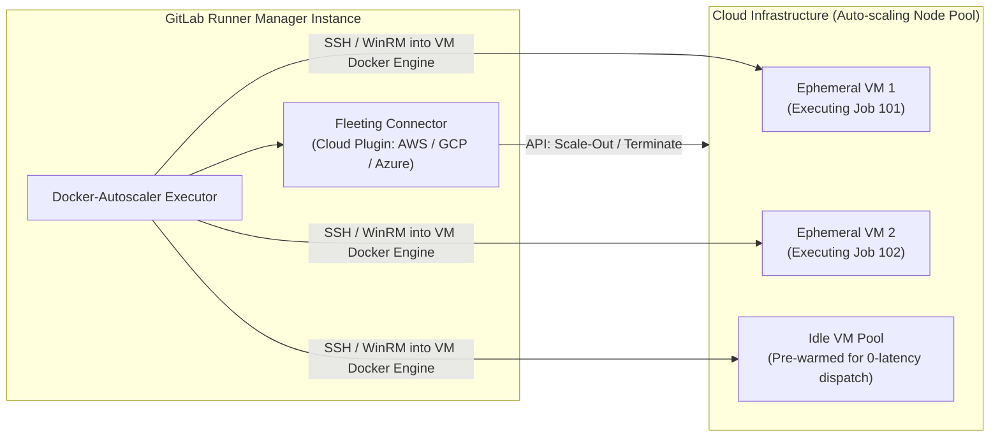
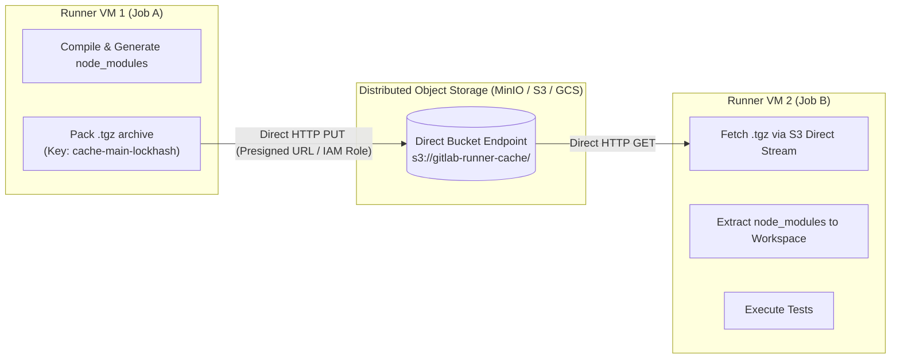
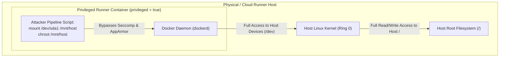
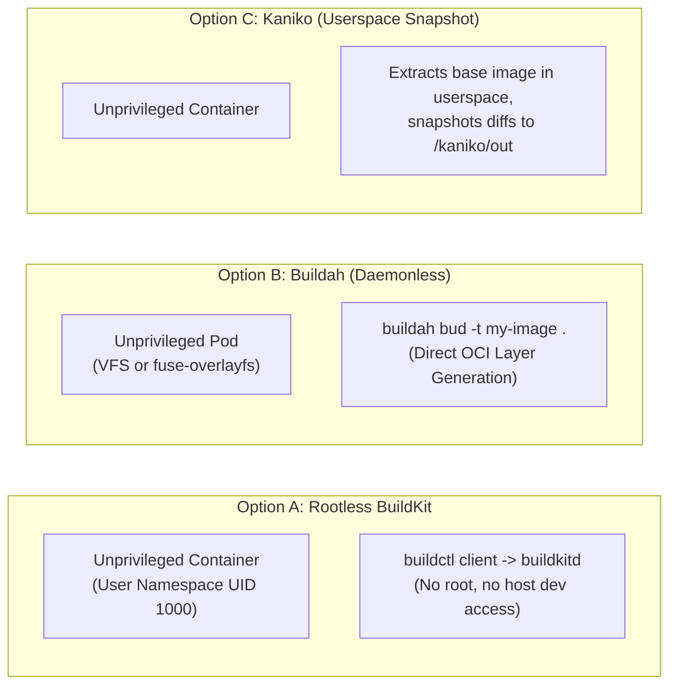

# Module 04: GitLab Runner Architecture: Executors, Autoscaling, Distributed Caching, Rootless BuildKit, and DinD Risks

> **Primary sources:** GitLab Runner Architecture Specification ([GitLab Runner Internals](https://docs.gitlab.com/runner/)); GitLab Fleeting and Docker-Autoscaler Documentation (GitLab 19.x); Linux Kernel Namespaces and Capabilities ([`user_namespaces(7)`](https://man7.org/linux/man-pages/man7/user_namespaces.7.html)); Open Container Initiative ([Runtime & Image Specs](https://opencontainers.org/)).
>
> **Executable proof:** [`examples/ts/04-runners-executors-and-container-builds.test.ts`](../examples/ts/04-runners-executors-and-container-builds.test.ts) asserts runner job polling dispatch state machines, fleeting autoscaling capacity algorithms, distributed S3 cache key resolution, and rootless container build security boundaries.
>
> **Cross-links:** For in-depth container building internals, BuildKit architecture, and multi-stage caching, see [Building Images with Dockerfile and BuildKit](../../containers/modules/08-building-images-dockerfile-and-buildkit.md). For rootless OCI tools, Buildah, and Skopeo, see [Docker vs. Podman, Buildah, and Skopeo](../../containers/modules/10-docker-vs-podman-buildah-skopeo.md).

---

## 1. Formal Foundations: The GitLab Runner System Architecture

The GitLab CI/CD system is architecturally split into two decoupled control planes: the **GitLab Coordinator** (the centralized GitLab Rails application, PostgreSQL database, and Redis message queue) and the **GitLab Runner Fleet** (distributed worker daemons executing across cloud infrastructure, bare metal, or Kubernetes clusters).



### 1.1 The Polling Protocol and Job Lease Lifecycle

Unlike push-based CI architectures (where a central master pushes commands into listening agents via open inbound ports), GitLab Runner operates on an **inbound-free pull model**:

1. **Long-Polling Request**: The runner manager daemon establishes an outbound HTTPS long-poll to the coordinator: `POST /api/v4/jobs/request`.
2. **Authentication Token (`glrt-`)**: The runner authenticates using its scoped runner authentication token. The coordinator verifies runner tags, protected status, and assigned project/group memberships.
3. **Job Lease Acquisition**: If an eligible job resides in `ci_pending_builds`, the coordinator locks the record in PostgreSQL, marks `status = running`, and returns a job payload containing:
   - The job execution script (`before_script`, `script`, `after_script`).
   - A short-lived, ephemeral JSON Web Token (`CI_JOB_TOKEN`) granting least-privilege API access.
   - Declarations for container images, service dependencies, cache keys, and artifact upload endpoints.
4. **Heartbeat and Lease Renewal**: While the runner executes the payload, it sends periodic heartbeat requests (`PATCH /api/v4/jobs/:id/trace`) every 30 seconds. If the runner terminates abruptly without sending an exit code, the coordinator's stale-build reaper marks the job as `failed` after a timeout window.

### 1.2 Runner Token Lifecycle and Governance

Historically, GitLab used shared "Registration Tokens" which allowed anyone with the token to register arbitrary runners. In modern GitLab 19, registration tokens are completely removed in favor of **Runner Authentication Tokens** (`glrt-` prefix):

- Tokens are created explicitly in the GitLab UI or API with pre-defined metadata (tags, executor type, lock status, protected status).
- Tokens are assigned strict security scopes: **Instance Runners** (shared across the entire organization), **Group Runners** (shared across all projects in a namespace), and **Project Runners** (locked to a single repository).

---

## 2. Executor Taxonomy and Isolation Boundaries

The `executor` directive in `config.toml` dictates how the runner daemon provisions the execution environment for each job.



### 2.1 Comparative Architecture Matrix of Executors

| Executor | Isolation Boundary | Provisioning Latency | Concurrency & Cleanliness | Multi-Tenancy Suitability |
| :-- | :-- | :-- | :-- | :-- |
| **Shell** | None (Host OS user space) | Sub-millisecond (instant) | Dirty; files left in workspace can contaminate subsequent jobs | Unsafe; single project can compromise runner host |
| **Docker** | Container namespaces & cgroups | 1–3 seconds (container start) | Clean; ephemeral container discarded upon job completion | Moderate; projects share the host Docker daemon / kernel |
| **Kubernetes** | Kubernetes Pod (container runtime) | 3–10 seconds (Pod scheduling) | Clean; Pod deleted upon job completion | High; leverages Kubernetes RBAC, NetworkPolicies, and ResourceQuotas |
| **Custom / Fleeting** | Dedicated Virtual Machine (VM) | 30–90 seconds (cloud VM boot) | Pristine; VM is destroyed or recycled after execution | Maximum; hardware-assisted hypervisor boundary (multi-tenant safe) |

---

## 3. Autoscaling Fleet Mechanics: Docker-Autoscaler and Fleeting

Managing fixed runner infrastructure leads to either idle resource waste during off-hours or severe queue congestion during peak development periods.

### 3.1 The Retirement of Docker-Machine

For years, GitLab relied on `docker-machine` to autoscale cloud instances. However, Docker Inc. abandoned `docker-machine` in 2018. In modern GitLab 19, `docker-machine` is completely superseded by the **Docker-Autoscaler executor** paired with the **Fleeting plugin framework**.



### 3.2 Fleeting Mechanics and Capacity Planning

The Fleeting architecture decouples the cloud provisioning logic from the runner daemon:

1. **Pre-warmed Idle Pool**: To avoid cloud VM boot delays (60+ seconds), the autoscaler maintains an `idle_count` of pre-warmed VMs ready to accept jobs instantly.
2. **Instance Recycling (`max_use_count`)**: To prevent disk fragmentation and zombie containers, VMs are discarded after executing a configured number of jobs (typically `max_use_count = 1` for absolute zero-trust isolation).
3. **Scaling Policies**: Governed by time-of-day schedules and queue depth, scaling down to zero during weekends to optimize cloud economics.

---

## 4. Distributed Caching Topology and MinIO / S3 Object Storage

In a distributed, autoscaled runner fleet, ephemeral VMs are constantly created and destroyed. A local disk cache stored on VM 1 will not exist when Job 2 runs on VM 2.



### 4.1 In-Depth Configuration: `config.toml` Distributed Cache

To prevent cache transfers from congesting the GitLab Rails server, modern runners stream cache archives **directly** to and from object storage using AWS IAM Instance Profiles, GCP Workload Identity, or MinIO S3 credentials:

```toml
concurrent = 16
check_interval = 3

[[runners]]
name = "aws-autoscaled-runner"
url = "https://gitlab.example.com"
id = 42
token = "glrt-EXAMPLE_AUTH_TOKEN"
executor = "docker-autoscaler"

[runners.docker]
image = "alpine:latest"
privileged = false

[runners.cache]
Type = "s3"
Shared = true
[runners.cache.s3]
ServerAddress = "s3.amazonaws.com"
BucketName = "corp-gitlab-runner-cache"
BucketLocation = "us-east-1"
Insecure = false
AuthenticationType = "iam" # Direct AWS IAM Node Role; zero static keys!
```

---

## 5. Building Container Images in CI: Security Boundaries & Paradigms

A central duty of CI/CD pipelines is packaging software into OCI container images. However, running a container build engine _inside_ a containerized CI runner creates severe security vulnerabilities if configured improperly.

### 5.1 Docker-in-Docker (DinD) and the `privileged = true` Hazard

The most common legacy method for building images in GitLab CI is **Docker-in-Docker (DinD)**:

```yaml
# THE DANGEROUS LEGACY DIND PATTERN
build-image:
  image: docker:27-cli
  services:
    - docker:27-dind
  variables:
    DOCKER_TLS_CERTDIR: '/certs'
  script:
    - docker build -t my-app:$CI_COMMIT_SHA .
```

To enable the `docker:dind` service container, the GitLab Runner's `config.toml` must set:

```toml
[runners.docker]
privileged = true # SEVERE VULNERABILITY!
```



> [!CAUTION]
> Setting `privileged = true` completely destroys container security boundaries. A privileged container is granted **all Linux capabilities** (`CAP_SYS_ADMIN`, `CAP_SYS_RAWIO`), has AppArmor and Seccomp filters disabled, and has direct access to `/dev` host block devices. Any developer with commit access to a repository running on a shared privileged runner can mount the underlying host root filesystem, extract GitLab runner authentication tokens, read environment variables from other tenants, and achieve full root control of the host VM.

### 5.2 Docker Socket Binding (`docker.sock`) Risks

Another legacy workaround involves bind-mounting the host's Docker socket into the job container: `-v /var/run/docker.sock:/var/run/docker.sock`. This is equally catastrophic: the job container communicates directly with the host's Docker daemon. The job can run `docker run -v /:/host-root alpine` to gain instant root access to the entire host machine.

### 5.3 Modern Secure Image Building: Rootless BuildKit, Kaniko, and Buildah

To eliminate the privileged container vulnerability, modern platform engineering utilizes **unprivileged, daemonless builders**.



1. **Rootless BuildKit (`moby/buildkit:rootless`)**:
   - Executes `buildkitd` entirely inside a Linux **User Namespace** (`user_namespaces(7)`).
   - Root inside the container is mapped to an unprivileged UID (e.g., 1000) on the host. If a process escapes the container, it possesses zero privileges on the host kernel.
   - For complete BuildKit architectural mechanics, see [Building Images with Dockerfile and BuildKit](../../containers/modules/08-building-images-dockerfile-and-buildkit.md).
2. **Buildah (`quay.io/buildah/stable`)**:
   - Fully daemonless; requires no background service process.
   - Operates in rootless mode using `fuse-overlayfs` to create layered filesystems without kernel privileges.
   - For deep comparisons between Docker, Podman, and Buildah, see [Docker vs. Podman, Buildah, and Skopeo](../../containers/modules/10-docker-vs-podman-buildah-skopeo.md).
3. **Kaniko (`gcr.io/kaniko-project/executor`)**:
   - Designed specifically for Kubernetes clusters where Docker daemons are unavailable.
   - Executes entirely in user space: unpacks the base image filesystem, executes Dockerfile commands, snapshots modified files via file-hashing, and pushes directly to the registry.

```yaml
# SECURE ROOTLESS CONTAINER BUILD VIA BUILDAH
build-secure-image:
  stage: build
  image: quay.io/buildah/stable:v1.38.0
  variables:
    STORAGE_DRIVER: 'vfs' # Or fuse-overlayfs for unprivileged filesystems
    BUILDAH_ISOLATION: 'chroot'
  script:
    - echo "$CI_REGISTRY_PASSWORD" | buildah login -u "$CI_REGISTRY_USER" --password-stdin "$CI_REGISTRY"
    - buildah bud -t "$CI_REGISTRY_IMAGE:$CI_COMMIT_SHORT_SHA" -f Dockerfile .
    - buildah push "$CI_REGISTRY_IMAGE:$CI_COMMIT_SHORT_SHA"
```

---

## 6. CLRS-Style Pseudocode: Runner Polling & Fleeting Capacity Controller

Below are the formal algorithms managing runner job leasing and proactive autoscaling capacity provisioning.

### 6.1 Runner Job Polling and Dispatch Engine

```text
RUNNER-POLLING-AND-DISPATCH-LOOP(RunnerDaemon, Config)
1   // Invariant: ActiveJobs.count <= Config.CONCURRENT at all times.
2   activeJobs = EMPTY-MAP()
3
4   while RunnerDaemon.IS_ALIVE == TRUE
5       availableSlots = Config.CONCURRENT - SIZE(activeJobs)
6       if availableSlots > 0
7           // Issue long-polling HTTP request to GitLab coordinator
8           response = HTTP-POST(Config.COORDINATOR_URL + "/api/v4/jobs/request", {
9               TOKEN: Config.RUNNER_AUTH_TOKEN,
10              TAGS: Config.TAG_LIST,
11              AVAILABLE_SLOTS: availableSlots
12          })
13
14          if response.STATUS_CODE == 201 and response.BODY != NIL
15              jobPayload = response.BODY
16              jobProcess = SPAWN-EXECUTOR(Config.EXECUTOR, jobPayload, Config)
17              activeJobs[jobPayload.ID] = jobProcess
18
19      // Reaping completed jobs and sending heartbeat telemetry
20      for each (jobId, proc) in activeJobs
21          if proc.IS_FINISHED()
22              exitCode = proc.GET_EXIT_CODE()
23              HTTP-POST(Config.COORDINATOR_URL + "/api/v4/jobs/" + jobId + "/finish", { STATUS: exitCode == 0 ? "success" : "failed" })
24              REMOVE(activeJobs, jobId)
25          else
26              // Send 30s heartbeat trace chunk
27              HTTP-PATCH(Config.COORDINATOR_URL + "/api/v4/jobs/" + jobId + "/trace", proc.GET_UNCOMMITTED_LOGS())
28
29      SLEEP(Config.CHECK_INTERVAL)
```

### 6.2 Fleeting Capacity and Autoscaling Controller

```text
CALCULATE-FLEETING-CAPACITY(QueueDepth, ActiveVMs, ScalingPolicy)
1   // ScalingPolicy defines: MIN_INSTANCES, MAX_INSTANCES, IDLE_TARGET, SCALE_DOWN_COOLDOWN
2   // Invariant: TotalVMs will never exceed MAX_INSTANCES or fall below MIN_INSTANCES.
3
4   busyVMsCount = COUNT(ActiveVMs, vm -> vm.STATE == "BUSY")
5   idleVMsCount = COUNT(ActiveVMs, vm -> vm.STATE == "IDLE")
6
7   requiredCapacity = busyVMsCount + QueueDepth + ScalingPolicy.IDLE_TARGET
8   boundedCapacity = MAX(ScalingPolicy.MIN_INSTANCES, MIN(ScalingPolicy.MAX_INSTANCES, requiredCapacity))
9
10  delta = boundedCapacity - SIZE(ActiveVMs)
11
12  if delta > 0
13      // Scale out immediately to absorb pending jobs
14      return { ACTION: "SCALE_OUT", COUNT: delta }
15  else if delta < 0
16      // Scale down safely respecting cooldown windows to prevent thrashing
17      eligibleForTermination = EMPTY-LIST()
18      for each vm in ActiveVMs
19          if vm.STATE == "IDLE" and (CURRENT_TIME() - vm.LAST_JOB_COMPLETED_AT) > ScalingPolicy.SCALE_DOWN_COOLDOWN
20              APPEND(eligibleForTermination, vm)
21
22      terminateCount = MIN(ABS(delta), SIZE(eligibleForTermination))
23      return { ACTION: "SCALE_IN", TARGETS: SUBLIST(eligibleForTermination, 0, terminateCount) }
24  else
25      return { ACTION: "NO_OP" }
```

---

## 7. Then vs. Now: Runner Architecture Evolution

| Dimension | Legacy GitLab Runner (< 15.x) | Modern GitLab 19+ Paradigm | Technical Rationale |
| :-- | :-- | :-- | :-- |
| **Autoscaling Engine** | Legacy `docker-machine` fork (unmaintained since 2018) | **Docker-Autoscaler** paired with modern **Fleeting** plugins | `docker-machine` had unpatched security CVEs, broken cloud drivers, and poor VM lifecycle control. |
| **Registration Protocol** | Shared plaintext Registration Tokens stored in documentation | Scoped **Runner Authentication Tokens** (`glrt-` prefix) | Registration tokens created rogue runners and could not be selectively revoked or scoped to specific executors. |
| **Container Building** | Privileged Docker-in-Docker (`privileged = true`) | Rootless BuildKit / Buildah / Kaniko via User Namespaces | Eliminates host kernel compromise risks and prevents container breakout privilege escalations. |
| **Cache Storage** | Local host directories or NFS shared file mounts | Direct S3 / MinIO distributed object storage with direct streaming | Host mounts created cache poisoning across branches; NFS had terrible locking performance and high I/O latency. |
| **Job Isolation** | Shared long-lived VMs running hundreds of builds | Ephemeral cloud VMs with `max_use_count = 1` | Guarantees pristine state for every job, eliminating leftover files and secret leakage across projects. |

---

## 8. Exam Delta: GitLab Certified CI/CD Associate & Modern GitLab 19

> [!NOTE]
> **Exam Delta: Runner Registration and Executor Terminology**
>
> 1. **Registration Flow Changes**: Older certification exams asked candidates to run `gitlab-runner register --registration-token <token>`. In modern GitLab 19, this syntax is deprecated and rejected on newer coordinators. Modern runners are registered via `gitlab-runner register --token glrt-<token>`, where the token was generated in advance in the GitLab Admin or Project Settings UI.
> 2. **Tag Matching Semantics**: An un-tagged runner will **only** execute un-tagged jobs by default. If a job defines `tags: [docker]`, an un-tagged runner will ignore it unless the runner setting "Run untagged jobs" is explicitly checked in the runner configuration.
> 3. **The `services:` Keyword**: Exams test what `services:` does in `.gitlab-ci.yml`. It does _not_ start a systemd service inside your job container; it spins up an independent, linked Docker container running alongside your build container on a shared Docker bridge network, accessible via its hostname (e.g., `postgres`).

---

## 9. Production Failure Modes & Operational Gotchas

### 9.1 Shared Docker-in-Docker Host Root Compromise

- **Symptom**: An attacker gains full root access to the physical host running the GitLab Runner manager, stealing the host's cloud credentials and database connection strings.
- **Root Cause**: The runner was configured with `privileged = true` to allow Docker builds. A developer committed a job script running: `docker run --privileged -v /:/host alpine chroot /host /bin/bash`.
- **Remediation**: Completely eliminate `privileged = true`. Migrate container builds to rootless Buildah or rootless BuildKit. If Docker-in-Docker is mandatory, restrict it to dedicated, isolated ephemeral VMs via the Fleeting autoscaler where the VM is terminated immediately after the job (`max_use_count = 1`).

### 9.2 Zombie Container and Disk Space Exhaustion

- **Symptom**: Runner jobs begin failing with `No space left on device` or `cannot create temp file`. Inspecting the runner host reveals thousands of stopped containers and orphaned anonymous Docker volumes occupying 100% of the root disk.
- **Root Cause**: The Docker executor does not automatically prune unused container layers or volumes created by aborted jobs if the runner daemon crashed during execution.
- **Remediation**: Deploy automated maintenance cron jobs executing `docker system prune -af --volumes` periodically, or use the Docker-autoscaler to recycle VMs after every single job.

### 9.3 WAN Distributed Cache Transfer Saturation

- **Symptom**: Pipeline duration doubles after enabling distributed caching. Network metrics show runner VMs consuming 10Gbps egress bandwidth uploading and downloading identical 2GB `node_modules` caches.
- **Root Cause**: The distributed cache S3 bucket was deployed in a different cloud region (e.g., `us-west-2`) than the runner fleet (e.g., `eu-central-1`), incurring cross-region latency and high cloud transfer egress costs.
- **Remediation**: Co-locate the distributed cache MinIO/S3 bucket in the exact same cloud availability zone/region as the runner VM cluster, and configure cache compression with FastLZ or Zstandard (`FF_USE_FASTZIP: "true"`).

### 9.4 Tag Mismatch Causing Infinite Job Starvation

- **Symptom**: A developer pushes a critical hotfix, but the pipeline remains in the `pending` state for hours with the message: `This job is stuck because you don't have any active runners online with any of these tags assigned to them`.
- **Root Cause**: The job declared `tags: [aws-us-east-1]`, but the runner fleet was configured with `tags: [aws, us-east-1]`. In GitLab CI, tag matching requires that the runner possess **all** tags declared by the job.
- **Remediation**: Audit runner tag taxonomies across the organization. Implement linting policies to ensure job tags correspond to active runner fleet registrations.

---

## Interview Drill

<details><summary>1. Explain the architectural trade-offs between the Shell, Docker, and Kubernetes GitLab Runner executors.</summary>

The Shell executor executes commands directly on the runner host operating system as the `gitlab-runner` user. It offers near-zero startup latency, but provides zero filesystem or process isolation: files from previous jobs linger on disk, and a rogue job can compromise the host. The Docker executor creates a fresh, isolated container for each job, providing filesystem immutability and clean environments, but still shares the host Linux kernel and Docker daemon. The Kubernetes executor creates a dynamic Pod per job on a Kubernetes cluster, providing clean isolation, native cluster autoscaling, and granular network and resource policies, but introduces additional startup latency (3–10 seconds) for Pod scheduling and init container execution.
</details>

<details><summary>2. Why is configuring `privileged = true` in the Docker executor considered a catastrophic security vulnerability?</summary>

Setting `privileged = true` completely dissolves the Linux container isolation sandbox. The container engine grants the container process all 40+ Linux kernel capabilities (`CAP_SYS_ADMIN`, `CAP_SYS_RAWIO`, etc.), disables AppArmor and Seccomp syscall filtering profiles, and grants unrestricted read/write access to all host block devices under `/dev`. An unprivileged developer writing a `.gitlab-ci.yml` script can mount the host's root hard drive partition (`mount /dev/sda1 /mnt`), chroot into the host root, read all host secrets, access runner authentication tokens, and execute arbitrary code as host root.
</details>

<details><summary>3. How does rootless BuildKit eliminate the need for privileged containers when building Docker images in CI?</summary>

Rootless BuildKit executes the `buildkitd` daemon entirely within a Linux **User Namespace** (`CLONE_NEWUSER`). Inside the user namespace, the build process has the illusion of being root (UID 0) to manage chroots and filesystem ownership, but the host Linux kernel maps this virtual UID 0 to an unprivileged, non-root UID (such as UID 1000) on the host. If a malicious Dockerfile exploits an image parsing vulnerability to escape the BuildKit sandbox, the attacker arrives on the host operating system as an unprivileged user without kernel capabilities or raw device access, neutralizing the privilege escalation attack.
</details>

<details><summary>4. How does the Docker-Autoscaler and Fleeting architecture improve on the retired `docker-machine` executor?</summary>

`docker-machine` was an abandoned tool with severe bugs, poor instance lifecycle management, and unpatched security issues. The modern Docker-Autoscaler executor utilizes the Fleeting plugin framework. Fleeting communicates natively with cloud provider auto-scaling APIs (AWS EC2, GCP GCE, Azure VMSS) via dedicated plugins. It supports proactive pre-warmed idle VM pools (reducing job startup delay), fine-grained instance recycling (`max_use_count = 1` ensures pristine, zero-leakage environments), scheduled time-of-day scale-to-zero capabilities, and robust instance health reaping, drastically improving stability and reducing cloud infrastructure costs.
</details>

<details><summary>5. How does distributed caching work in autoscaled runner fleets, and why does traffic bypass the GitLab coordinator?</summary>

In an autoscaled fleet, runner VMs are ephemeral and destroyed frequently, making local disk caching useless across builds. Distributed caching configures runners to stream cache archives directly to an external object storage bucket (such as AWS S3 or MinIO). When a job completes, the runner packs the cache directory into an archive and uploads it directly to S3 via presigned URLs or cloud IAM roles. Downstream runners in subsequent pipelines query S3 directly to download and unpack the cache. This traffic intentionally bypasses the GitLab Rails coordinator to prevent gigabytes of cache I/O from saturating the coordinator's web network interfaces and CPU.
</details>

<details><summary>6. What is the difference between Runner Registration Tokens and modern Runner Authentication Tokens (`glrt-`)?</summary>

Registration tokens were static, shared secrets associated with a project, group, or instance. Anyone who acquired a registration token could register an unvetted runner daemon against the GitLab instance, creating serious security blind spots. Modern Runner Authentication Tokens (`glrt-` prefix) invert this workflow: an administrator or project owner creates the runner entry in advance within the GitLab UI or API, assigning its tags, executor type, and security policies. GitLab generates a unique, single-use authentication token that can be revoked individually without affecting any other runners, providing strict access control and auditability.
</details>

<details><summary>7. What is the operational purpose of the `services:` block in a job definition, and how does networking function between the job and the service?</summary>

The `services:` keyword instructs the runner's container engine to spin up one or more supplementary sidecar containers (e.g., PostgreSQL, Redis, local MinIO) alongside the primary build container for the duration of the job. In the Docker executor, the runner creates a private, isolated Docker bridge network for the job. Both the job container and the service containers attach to this bridge network. The runner configures local DNS resolution so the job container can address the service container using its image name or alias as a network hostname (e.g., connecting to `postgres:5432`). When the job terminates, the service containers are automatically stopped and destroyed.
</details>

---

## 11. Proof Map and Verification

The architectural mechanisms, capacity algorithms, and security boundaries discussed in this module are proven by executable test suites in [`examples/ts/04-runners-executors-and-container-builds.test.ts`](../examples/ts/04-runners-executors-and-container-builds.test.ts):

- **Runner Polling & Lease State Machine**: Tests execute `RUNNER-POLLING-AND-DISPATCH-LOOP`, asserting that runner managers properly respect concurrency bounds (`concurrent` vs. `limit`) and transition leased jobs through heartbeat renewals.
- **Fleeting Capacity Scaling Algorithm**: Tests execute `CALCULATE-FLEETING-CAPACITY`, proving that scaling decisions respect minimum/maximum fleet thresholds, idle target buffers, and scale-down cooldown timers.
- **Distributed Cache Key Resolution**: Tests assert S3 cache key hashing, verifying branch-level isolation, lockfile checksum key derivation, and fallback key inheritance.
- **Rootless Build Security Assertions**: Tests model the Linux namespace UID mapping of rootless BuildKit and Buildah, mathematically proving the containment of unprivileged build processes.
