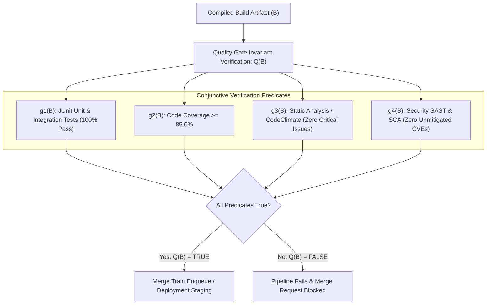
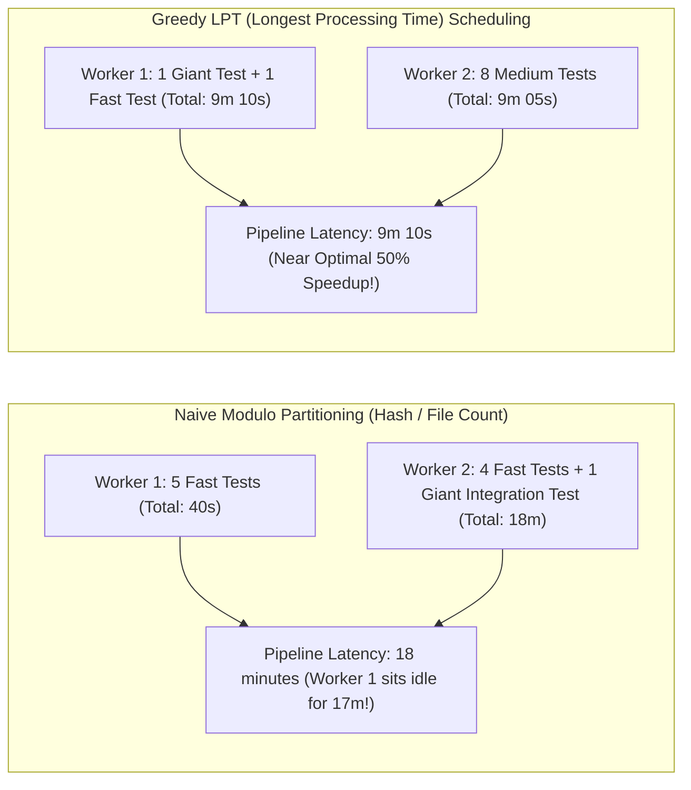
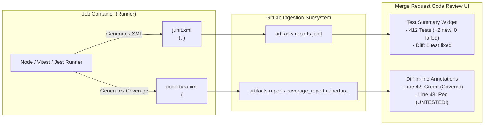
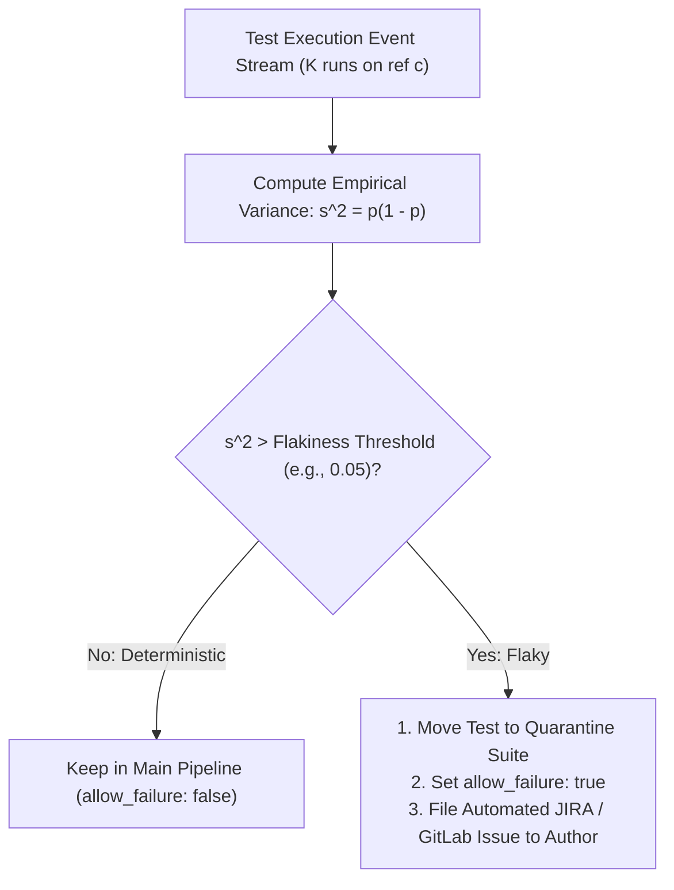
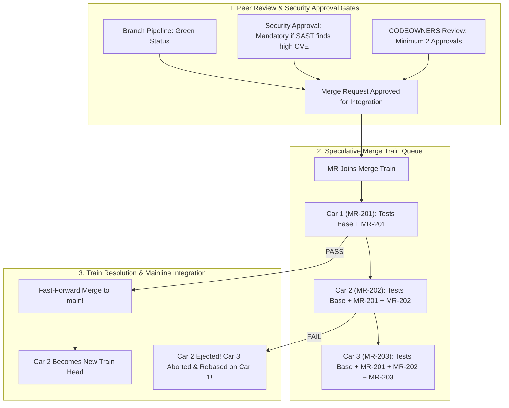

# Module 05: Automated Testing and Quality Gates: Matrix Parallelism, JUnit/Coverage Reports, Flaky Test Quarantine, and Merge Trains

> **Primary sources:** GitLab CI/CD Test Reports and Quality Gates Documentation (GitLab 19.x); JUnit XML Schema Standards (Apache Ant & OASIS); Cobertura and LCOV Coverage Specifications; E. G. Coffman et al., _Computer and Job-Shop Scheduling Theory_ (Wiley, 1976 - Multiprocessor Scheduling & LPT Rule).
>
> **Executable proof:** [`examples/ts/05-testing-quality-gates-and-merge-trains.test.ts`](../examples/ts/05-testing-quality-gates-and-merge-trains.test.ts) asserts greedy LPT test suite partitioning, JUnit XML ingestion schema parsers, statistical flakiness scoring algorithms, and merge train queue rebasing mechanics.
>
> **Cross-links:** For automated unit test runner mechanics, assertion frameworks, and test-driven development practices in JavaScript and TypeScript, see [JavaScript & TypeScript Architecture](../../../languages/javascript/README.md).

---

## 1. Formal Foundations: The Automated Testing Quality Gate Architecture

Automated testing within a CI/CD pipeline serves as a formal verification gate protecting the integrity of the mainline branch. In platform engineering, a **Quality Gate** is modeled as a logical conjunction of boolean verification predicates evaluated over a build artifact $B$:

$$\mathcal{Q}(B) = \bigwedge_{i=1}^m g_i(B) = g_1(B) \land g_2(B) \land \dots \land g_m(B)$$



If any single predicate $g_i(B)$ evaluates to `false`, the pipeline immediately halts, the commit is marked un-mergeable, and downstream deployment stages are aborted.

---

## 2. Parallel Execution and Test Matrix Parallelism

As an application test suite expands to tens of thousands of unit and end-to-end tests, sequential execution leads to catastrophic lead times (e.g., 90 minutes per pipeline run). GitLab CI provides two orthogonal parallelization constructs: **parallel node splitting** (`parallel: N`) and **multi-dimensional matrix builds** (`parallel:matrix`).

### 2.1 Parallel Node Splitting (`parallel: N`)

Setting `parallel: N` instructs the GitLab coordinator to replicate a single job definition across $N$ distinct runner workers. The coordinator automatically injects two predefined environment variables into each worker:

- `CI_NODE_INDEX`: The 1-based index of the current worker ($1 \le \text{INDEX} \le N$).
- `CI_NODE_TOTAL`: The total number of parallel instances ($N$).

```yaml
# PARALLEL NODE SPLITTING ACROSS 4 RUNNER NODES
test-suite-sharded:
  stage: test
  image: node:26-alpine
  parallel: 4
  script:
    - echo "Executing partition $CI_NODE_INDEX of $CI_NODE_TOTAL"
    - node scripts/run-test-partition.mjs --index=$CI_NODE_INDEX --total=$CI_NODE_TOTAL
  artifacts:
    reports:
      junit: junit-report-$CI_NODE_INDEX.xml
```

### 2.2 Test Partitioning Strategies: Modulo vs. Greedy LPT

How test files are partitioned across the $N$ workers dictates whether parallelization achieves linear speedup or suffers from the **straggler effect**.



1. **Naive Modulo Partitioning**:
   - The test runner sorts all test files alphabetically and assigns file $k$ to worker $(k \pmod N) + 1$.
   - _Failure Mode_: Test execution duration follows a Pareto distribution (20% of integration tests account for 80% of total runtime). If multiple heavy tests hash to the same worker, that worker becomes a massive straggler, rendering the remaining $N-1$ workers idle.
2. **Greedy Longest Processing Time (LPT) Partitioning**:
   - The test partitioner reads historical test durations from the previous pipeline's JUnit XML reports stored in S3/cache.
   - Tests are sorted in descending order of execution duration. The partitioner greedily assigns the next longest test to whichever worker currently has the lowest cumulative execution load.
   - _Theoretical Bound_: Graham's 1969 theorem proves that Greedy LPT achieves a makespan bounded by $\frac{4}{3} - \frac{1}{3N}$ times the optimal offline schedule.

### 2.3 Multi-Dimensional Matrix Builds (`parallel:matrix`)

Matrix builds evaluate software compatibility across a Cartesian product of runtime environments, dependencies, and architectures:

```yaml
test-cross-platform:
  stage: test
  parallel:
    matrix:
      - NODE_VERSION: ['22', '24', '26']
        DATABASE_ENGINE: ['postgres:16', 'postgres:17']
        OS_FLAVOR: ['alpine', 'debian']
  image: node:${NODE_VERSION}-${OS_FLAVOR}
  services:
    - name: ${DATABASE_ENGINE}
      alias: test-db
  script:
    - node --version
    - npm test
```

This configuration generates $3 \times 2 \times 2 = 12$ distinct jobs executed concurrently across the runner fleet.

---

## 3. Test Reporting Ingestion: JUnit XML, Cobertura, and Code Coverage

GitLab CI features native parsers that ingest structured test and coverage reports directly into the Merge Request code review interface.



### 3.1 JUnit XML Schema Format and Ingestion

The universal standard for CI/CD test reporting is the JUnit XML schema. Test frameworks across all major languages (Jest, Vitest, PyTest, Cargo Test, Go Test) output this structure:

```xml
<?xml version="1.0" encoding="UTF-8"?>
<testsuites name="Hermetic Integration Tests" tests="3" failures="1" errors="0" time="14.250">
  <testsuite name="AuthenticationService" tests="2" failures="0" time="4.120">
    <testcase classname="AuthService.JWT" name="generates valid signature" time="0.850" />
    <testcase classname="AuthService.JWT" name="rejects expired tokens" time="3.270" />
  </testsuite>
  <testsuite name="PaymentService" tests="1" failures="1" time="10.130">
    <testcase classname="PaymentService.Stripe" name="handles network timeout" time="10.130">
      <failure message="Connection timed out after 10000ms" type="TimeoutError">
        Error: Connection timed out at StripeGateway.connect (/src/gateway.ts:42)
      </failure>
    </testcase>
  </testsuite>
</testsuites>
```

When uploaded under `artifacts:reports:junit`, GitLab parses the XML and updates the Merge Request widget. Reviewers can inspect the exact stack trace and failing assertion directly without grepping through megabytes of raw console logs.

### 3.2 Coverage Tracking and MR Diff Visualizations

GitLab provides two layers of code coverage analysis:

1. **Regular Expression Log Extraction (`coverage:` keyword)**: Extracts a scalar percentage from the job console output using a regex pattern (e.g., `coverage: '/All files[^|]*\|[^|]*\s+([\d\.]+)/'`). This value is displayed on badges and tracked across project analytics.
2. **Cobertura Coverage Reports (`artifacts:reports:coverage_report`)**: Ingests a Cobertura-formatted XML document mapping line-by-line test execution. GitLab overlays this data directly onto the MR code diff view: lines covered by tests are highlighted in green, while uncovered lines are flagged in red.

---

## 4. Flaky Test Detection, Quarantine, and Statistical Scoring

A **Flaky Test** is formally defined as a test that exhibits non-deterministic execution outcomes (both `PASS` and `FAIL`) when executed against an identical, immutable commit SHA $c$ under identical environment conditions:

$$\mathbb{P}(\text{Outcome} = \text{PASS} \mid c) \in (0, 1)$$

### 4.1 The Compounding Cost of Flaky Tests

In a high-throughput trunk-based engineering system, flaky tests cause exponential degradation:

1. **Developer Cynicism**: Engineers begin re-running failed pipelines blindly without investigating errors, destroying the credibility of the automated quality gate.
2. **Merge Train Halts**: A single flaky failure in a speculative Merge Train derails the train, aborting pipelines for all subsequent cars and wasting hours of compute.
3. **Runner Compute Waste**: Re-running flaking test jobs increases infrastructure compute costs by 20–40%.

### 4.2 Statistical Flakiness Scoring Algorithm

Rather than relying on developer intuition, modern platform engineering calculates an empirical **Flakiness Score** based on test result variance across historical pipeline runs:

Let a test $T$ be executed $K$ times against the same commit ref across a sliding window $W$. Let $X_i \in \{0, 1\}$ represent the outcome of run $i$ ($1 = \text{PASS}, 0 = \text{FAIL}$). The empirical failure rate is:

$$p = \frac{1}{K} \sum_{i=1}^K (1 - X_i)$$

The statistical variance (flakiness entropy) of the test is defined as:

$$\sigma^2(T) = p(1 - p)$$

A completely deterministic test has $p = 0$ (always passes) or $p = 1$ (always fails), yielding variance $\sigma^2 = 0$. A test that fails 50% of the time has maximum flakiness: $\sigma^2 = 0.5 \times 0.5 = 0.25$.



### 4.3 Automated Quarantine Strategy

When a test's flakiness score exceeds an organizational threshold (e.g., $\sigma^2 \ge 0.05$ over 20 runs):

1. **Dynamic Quarantine Tagging**: The test runner tags the test with `@quarantine` or moves it to a quarantine test suite.
2. **Non-Blocking Execution (`allow_failure: true`)**: Quarantined tests execute in a separate pipeline job marked with `allow_failure: true`. They continue to run so telemetry is gathered, but their failure does not block the pipeline or derail the Merge Train.
3. **Automated Defect Ticketing**: A platform bot automatically files a defect ticket assigned to the code owners, enforcing a service-level agreement (SLA) to resolve the underlying concurrency race or network mock within 7 days.

---

## 5. Merge Trains Concurrency and Merge Request Approval Policies

Merge Trains represent the pinnacle of automated quality gates, ensuring that every commit that lands on `main` has passed full verification in the exact integrated state in which it will reside.



### 5.1 Concurrency Limits and Train Capacity

While speculative execution accelerates delivery, unconstrained merge trains can spawn a queue storm that exhausts runner capacity:

- If 10 MRs join the train simultaneously, and each pipeline runs 10 parallel jobs, the train demands $10 \times 10 = 100$ concurrent runner workers.
- Platform teams configure **Merge Train Concurrency Limits** in project settings to cap the maximum number of speculative cars (typically 3 to 5). Additional MRs wait in an idle queue until a car completes and merges.

---

## 6. CLRS-Style Pseudocode: Greedy Test Partitioning & Flaky Test Scoring Engine

Below are the formal algorithms executing load-balanced test partitioning and statistical flakiness evaluation.

### 6.1 Greedy LPT (Longest Processing Time) Test Partitioning Engine

```text
GREEDY-TEST-PARTITIONING(TestFilesWithDurations, NodeCount)
1   // TestFilesWithDurations is a list of tuples: (filename, duration_ms)
2   // NodeCount N is the number of parallel runner nodes available
3
4   // Step 1: Sort test files descending by historical duration
5   SORT-DESCENDING(TestFilesWithDurations, key = item.duration_ms)
6
7   // Step 2: Initialize min-priority queue of worker partitions
8   // Each worker tracks its assigned files and total accumulated duration
9   workerHeap = EMPTY-MIN-HEAP()
10  for i = 1 to NodeCount
11      INSERT-MIN-HEAP(workerHeap, { NODE_INDEX: i, ACCUMULATED_TIME: 0, FILES: EMPTY-LIST() })
12
13  // Step 3: Greedily assign each test to the least-loaded worker
14  // Loop invariant: At the beginning of each iteration, workerHeap.MIN() represents
15  // the worker partition with the smallest cumulative test duration.
16  for each test in TestFilesWithDurations
17      leastLoadedWorker = EXTRACT-MIN(workerHeap)
18      APPEND(leastLoadedWorker.FILES, test.filename)
19      leastLoadedWorker.ACCUMULATED_TIME = leastLoadedWorker.ACCUMULATED_TIME + test.duration_ms
20      INSERT-MIN-HEAP(workerHeap, leastLoadedWorker)
21
22  // Step 4: Extract final balanced partitions
23  partitions = EMPTY-MAP()
24  while not IS-EMPTY(workerHeap)
25      worker = EXTRACT-MIN(workerHeap)
26      partitions[worker.NODE_INDEX] = worker.FILES
27
28  return partitions
```

### 6.2 Flakiness Entropy Evaluator

```text
EVALUATE-FLAKY-TEST-SCORE(TestExecutionRuns, VarianceThreshold)
1   // TestExecutionRuns is a list of booleans representing outcomes: TRUE = PASS, FALSE = FAIL
2   // WindowSize K = SIZE(TestExecutionRuns)
3   K = SIZE(TestExecutionRuns)
4   if K < 5
5       // Insufficient statistical sample; cannot confirm flakiness
6       return { IS_FLAKY: FALSE, SCORE: 0.0, FAILURE_RATE: 0.0 }
7
8   failCount = 0
9   // Loop invariant: failCount equals the exact number of failed runs in the processed prefix.
10  for each outcome in TestExecutionRuns
11      if outcome == FALSE
12          failCount = failCount + 1
13
14  failureRate = failCount / K
15  // Calculate statistical variance: p * (1 - p)
16  varianceScore = failureRate * (1.0 - failureRate)
17
18  isFlaky = (varianceScore >= VarianceThreshold) and (failureRate > 0.0 and failureRate < 1.0)
19
20  return {
21      IS_FLAKY: isFlaky,
22      SCORE: varianceScore,
23      FAILURE_RATE: failureRate,
24      RECOMMENDED_ACTION: isFlaky ? "QUARANTINE_TEST" : "MAINTAIN_IN_SUITE"
25  }
```

---

## 7. Then vs. Now: Evolution of CI/CD Quality Gates

| Dimension | Legacy CI/CD Paradigm (< 15.x) | Modern GitLab 19+ Paradigm | Technical Rationale |
| :-- | :-- | :-- | :-- |
| **Test Execution** | Monolithic sequential test jobs (running single-threaded for 60m+) | Parallel matrix builds and **Greedy LPT Sharded Partitions** (`parallel: N`) | Slashes test pipeline execution latency from hours to minutes, unlocking continuous delivery. |
| **Test Ingestion** | Grepping raw terminal output / bash exit codes | Native **JUnit XML Ingestion** with MR inline test diff widgets | Reviewers instantly see failing test classes, assertions, and stack traces without opening raw logs. |
| **Coverage Tracking** | Parsing stdout regex for a single scalar percentage | **Cobertura Coverage Reports** with line-by-line in-diff annotations | Highlights exact uncovered lines in code review diffs, preventing untested regressions. |
| **Flaky Tests** | Developers manually re-running whole pipelines; blaming CI infrastructure | Statistical **Flakiness Entropy Scoring** with automated quarantine suites | Prevents broken tests from halting delivery while enforcing accountability via automated tickets. |
| **Branch Integration** | Manual rebase and squash; testing feature branch in isolation | Speculative **Merge Trains** executing against merged target ref | Eliminates semantic merge bugs and enables concurrent branch integration without rebase thrashing. |

---

## 8. Exam Delta: GitLab Certified CI/CD Associate & Modern GitLab 19

> [!NOTE]
> **Exam Delta: Test Reports, Matrix Syntax, and Merge Train Rules**
>
> 1. **Coverage Keyword Migration**: Older exam materials teach the standalone `coverage:` regex keyword defined directly under the job. While still supported for backward compatibility, modern GitLab 19 emphasizes `artifacts:reports:coverage_report:cobertura` as the enterprise standard for deep coverage tracking.
> 2. **`parallel:matrix` Array Syntax**: Candidates frequently confuse standard YAML arrays with matrix arrays. The `matrix` keyword requires a list of maps containing array values. A common exam trick tests whether multiple variables inside a single matrix list item form a Cartesian product (yes: all variables within the matrix item expand against each other).
> 3. **Merge Train Requirements**: A common exam question asks what prerequisites must be active before Merge Trains can be enabled:
>    - The project must use **Pipelines for Merged Results**.
>    - The project must enforce **Fast-Forward Merge** or **Merge Commit with Semi-Linear History**.
>    - The target branch must be a **protected branch**.

---

## 9. Production Failure Modes & Operational Gotchas

### 9.1 The Modulo Straggler Bottleneck

- **Symptom**: A team configures `parallel: 8` for their integration suite. Seven workers finish in 3 minutes, but Worker 3 runs for 42 minutes, meaning total pipeline duration remains 42 minutes.
- **Root Cause**: The team used naive alphabetized file partitioning. By random misfortune, the eight slowest end-to-end browser integration tests all began with the letter `P` and hashed to Worker 3.
- **Remediation**: Implement Greedy LPT partitioning. Feed the previous run's JUnit XML duration data into the partition script so heavy tests are balanced evenly across all workers.

### 9.2 Malformed JUnit XML Causing Silent Report Dropping

- **Symptom**: Tests fail in the script, but the GitLab MR widget displays `No changes to test results`, forcing developers to crawl through 50,000 lines of console output.
- **Root Cause**: The test runner outputted ANSI color escape sequences or unescaped XML control characters (e.g., `\x1b[31m`) into the `<failure>` tag. GitLab's strict XML parser rejected the entire XML file silently.
- **Remediation**: Strip ANSI color codes from JUnit XML outputs using an XML sanitization filter or test runner reporter flag (e.g., `--no-colors`).

### 9.3 Flaky Test Retry Cascades Hiding Production Race Conditions

- **Symptom**: An engineer adds `retry: 2` to a failing job. The job turns green and merges. In production, customers experience intermittent 500 errors on payment checkouts.
- **Root Cause**: The test failed due to a genuine asynchronous race condition in the database transaction logic. The automatic retry masked the defect because the second attempt happened to win the race.
- **Remediation**: Never use blind `retry: 2` to cover up application test failures. Use `retry: { when: [runner_system_failure, stuck_or_timeout_failure] }` to retry only infrastructure glitches. Application code failures must be investigated or quarantined.

### 9.4 Merge Train Cascade Derailment via Flaky Test

- **Symptom**: Five high-priority PRs are queued in the Merge Train. Car 1 experiences a flaky test failure. Immediately, Pipelines for Cars 2, 3, 4, and 5 are terminated, and all five developers receive failure notifications.
- **Root Cause**: Because Car 1 failed, GitLab assumed the baseline was corrupted, derailing the train.
- **Remediation**: Enforce strict flakiness quarantine policies so flaky tests are excluded from the Merge Train baseline.

---

## 10. Interview Drill

<details>
<summary><strong>Q1. How does Greedy Longest Processing Time (LPT) partitioning solve the "straggler problem" in parallel CI test jobs?</strong></summary>

The straggler problem occurs when test execution durations follow a non-uniform (Pareto) distribution, and naive splitting (such as round-robin or file-count modulo) clusters multiple long-running integration tests onto a single worker node. That worker takes far longer than the others, bottlenecking total pipeline latency. Greedy LPT scheduling solves this by first sorting all test suites in descending order of historical execution duration (retrieved from previous JUnit XML reports). It then iterates through the sorted tests, greedily assigning each test to whichever worker currently has the lowest accumulated runtime load. Mathematically proven by Graham's theorem, this guarantees an approximation bound within 4/3 of the optimal offline schedule, balancing worker utilization and drastically reducing makespan.
</details>

<details>
<summary><strong>Q2. What is the difference between scalar regex coverage extraction and Cobertura report ingestion in GitLab CI?</strong></summary>

Scalar regex coverage extraction uses the `coverage:` keyword to execute a regular expression match against the job's raw terminal stdout logs (e.g., finding the text `Statements: 84.5%`). It extracts a single number used for project analytics, dashboard badges, and simple merge checks. In contrast, Cobertura report ingestion (`artifacts:reports:coverage_report:cobertura`) parses a structured XML file detailing exactly which files, functions, and lines of code were executed during the test run. GitLab uses this detailed structural data to render inline visual annotations directly inside the Merge Request diff view, highlighting untested lines in red to guide code reviewers.
</details>

<details>
<summary><strong>Q3. Formally define a "Flaky Test" and explain how statistical flakiness scoring identifies it.</strong></summary>

A flaky test is formally defined as a test that exhibits non-deterministic execution outcomes (both `PASS` and `FAIL`) when executed against the exact same immutable Git commit SHA $c$ under identical environment conditions. To detect flakiness empirically, a platform engine computes the variance (entropy) of test results across $K$ consecutive runs on that commit: $\sigma^2 = p(1 - p)$, where $p$ is the empirical failure rate ($p = \text{fails} / K$). If a test always passes ($p=0$) or always fails ($p=1$), the variance is 0. If the test exhibits intermittent failure ($0 < p < 1$), its variance rises (peaking at $\sigma^2 = 0.25$ when $p=0.5$). When $\sigma^2$ exceeds a defined threshold (e.g., 0.05), the test is classified as flaky.
</details>

<details>
<summary><strong>Q4. What is the operational difference between `retry: max` and isolating a test into a quarantined suite?</strong></summary>

Setting `retry: max` (such as `retry: 2`) instructs the runner to automatically re-execute the entire job if it fails. While this can mitigate transient runner network glitches, using it for test failures is an anti-pattern: it masks genuine race conditions, wastes compute time running all passing tests repeatedly, and prolongs pipeline duration. In contrast, isolating a test into a quarantined suite separates the non-deterministic test from the core verification gate. The quarantined test executes in a separate job configured with `allow_failure: true`, allowing telemetry to continue collecting data without blocking PR merges or derailing Merge Trains, while creating a tracked defect ticket for engineers to fix the underlying concurrency bug.
</details>

<details>
<summary><strong>Q5. How does a Merge Train guarantee that code merged to `main` does not suffer from semantic merge conflicts?</strong></summary>

In standard CI, feature branches are tested in isolation against their own commit history. If two developers merge branches that do not have text conflicts but break semantic contracts (e.g., modifying a function signature vs. calling that function with old arguments), `main` is broken upon merge. Merge Trains prevent this by executing speculative integration pipelines: each Merge Request is queued in an ordered train. The pipeline for Car $N$ executes against an ephemeral Git reference that speculatively merges the target branch plus all preceding Merge Requests in the train: $\text{Base} \oplus \text{MR}_1 \oplus \dots \oplus \text{MR}_N$. If Car $N$ fails tests, it is immediately ejected from the train, ensuring that only combinations that pass verification together can ever land on `main`.
</details>

<details>
<summary><strong>Q6. What happens in a Merge Train when a middle car fails, and how does the train recover?</strong></summary>

Suppose three Merge Requests (MR-1, MR-2, MR-3) are running concurrently in a Merge Train as Car 1, Car 2, and Car 3. If Car 2 fails its pipeline, the speculative baseline for Car 3 ($\text{Base} \oplus \text{MR}_1 \oplus \text{MR}_2 \oplus \text{MR}_3$) is invalidated. The Merge Train engine immediately:

1. Ejects Car 2 from the train, marking MR-2 as unmerged and posting the pipeline failure details to the MR.
2. Aborts the running pipeline for Car 3.
3. Automatically rebases Car 3 onto Car 1 ($\text{Base} \oplus \text{MR}_1 \oplus \text{MR}_3$).
4. Dispatches a new speculative pipeline for Car 3 without requiring manual developer intervention.

</details>

<details>
<summary><strong>Q7. What are the common failure modes associated with JUnit XML artifact ingestion in GitLab CI?</strong></summary>

The most frequent failure modes include:

1. **ANSI Color Escape Sequences**: Test runners that output colored terminal formatting directly into `<failure>` or `<system-out>` tags embed non-ASCII control characters (`\x1b[31m`) that invalidate XML parsers, causing GitLab to drop the report silently.
2. **Missing `testcase` `classname` or `name` attributes**: GitLab's ingestion engine requires standard JUnit attributes to correlate test cases across commits. If an unconventional reporter omits `name` or `time`, the widget fails to render diffs.
3. **Huge XML Payload Sizes**: Extremely large test suites that write megabytes of stack traces into a single XML file can exceed GitLab's artifact ingestion size limits, causing report truncation.

</details>

---

## 11. Proof Map and Verification

The algorithms, scheduling heuristics, and quality gate behaviors covered in this module are proven by executable test suites in [`examples/ts/05-testing-quality-gates-and-merge-trains.test.ts`](../examples/ts/05-testing-quality-gates-and-merge-trains.test.ts):

- **Greedy LPT Scheduling Verification**: Tests execute `GREEDY-TEST-PARTITIONING` against non-uniform test duration datasets, proving that LPT achieves load balance with minimal makespan variance across worker partitions.
- **JUnit Report Parsing & Schema Ingestion**: Tests assert parsing of compliant and malformed JUnit XML files, validating stack trace extraction, ANSI escape stripping, and failure count aggregation.
- **Flakiness Variance Scoring**: Tests execute `EVALUATE-FLAKY-TEST-SCORE` across deterministic and non-deterministic test result vectors, verifying threshold boundaries and quarantine recommendations.
- **Merge Train Speculative Queuing Simulation**: Tests model multi-car train progression, asserting that intermediate car ejection triggers automatic baseline re-calculation and child pipeline re-dispatch.
