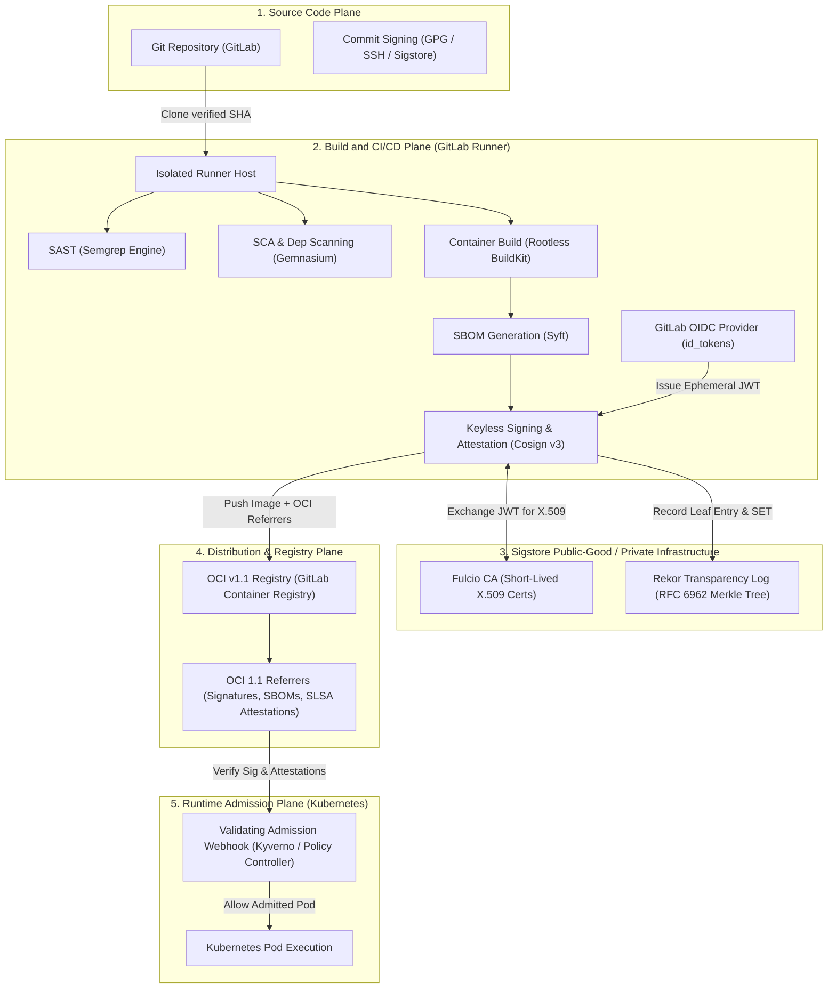
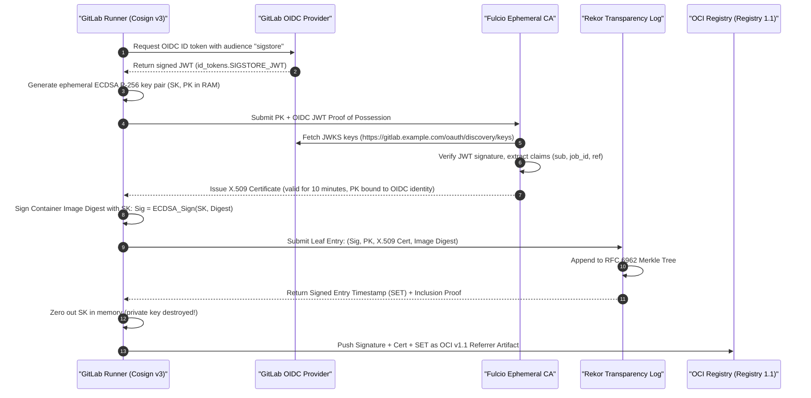

# Module 06: Software Supply-Chain Security: SAST/SCA, CycloneDX/SPDX SBOMs, Keyless Cosign v3 OIDC Signing, and SLSA Provenance

Software supply-chain security is the discipline of verifying the integrity, authenticity, and provenance of every artifact, dependency, compiler toolchain, and pipeline step that transforms source code into production container workloads. In modern cloud-native architectures, the continuous integration and continuous deployment (CI/CD) pipeline is both the engine of software delivery and the most critical attack vector. A compromised pipeline can silently inject backdoors into binaries, tamper with dependency trees, or issue counterfeit deployment authorizations without altering human-reviewed Git commits.

This module provides an exhaustive, mathematically grounded treatment of software supply-chain security within GitLab CI/CD. As the authoritative owner of the supply-chain curriculum in this repository, this module covers static application security testing (SAST), software composition analysis (SCA), vulnerability scanning, Software Bill of Materials (SBOM) generation (CycloneDX v1.6 vs. SPDX v2.3/v3.0), keyless cryptographic artifact signing using Sigstore Cosign v3 with GitLab OIDC `id_tokens`, and in-toto SLSA v1.0 provenance generation and admission control verification.

For foundational cryptographic principles, PKI, and mutual TLS, consult [`architecture/security-identity/modules/04-pki-x509-and-mtls.md`](../../../architecture/security-identity/modules/04-pki-x509-and-mtls.md) and [`architecture/security-identity/modules/12-supply-chain-and-dependency-security.md`](../../../architecture/security-identity/modules/12-supply-chain-and-dependency-security.md). For OCI image manifest specifications and layer storage, see [`technologies/containers/modules/05-oci-image-spec.md`](../../containers/modules/05-oci-image-spec.md).

---

## 2. Cosign v2 vs v3 Architecture & SBOM Generation ("Then vs Now")

| Dimension | Cosign v2 (Legacy) | Cosign v3 (Current & Recommended) |
| :-- | :-- | :-- |
| **Signature Storage** | Tag-based attachments (`sha256-<digest>.sig`) polluting registry tags and causing race conditions. | OCI v1.1 Referrers API and native Protobuf Sigstore Bundles (`application/vnd.dev.sigstore.bundle.v0.3+json`). |
| **SBOM & Attestation** | `cosign attach sbom` / `cosign sign --attachment sbom` creating fragile detached artifacts. | `cosign attest --type cyclonedx --predicate sbom.cdx.json` writing cryptographically bound attestations. |
| **Transparency Log** | Rekor v1 SHA-256 Merkle tree append-only logs. | Rekor v2 tile-based Merkle tree storage with optimized RFC 6962 inclusion proofs and checkpoints. |
| **Verification Tooling** | `cosign verify` and `cosign verify-attestation`. | `cosign verify`, `cosign verify-attestation`, and native `glab attestation verify`. |

---

## 1. Threat Modeling the Software Supply Chain

Supply-chain attacks target vulnerabilities across three distinct operational planes: the **Source Plane**, the **Build Plane**, and the **Distribution and Runtime Plane**. The canonical framework for categorizing these threats is the Supply-chain Levels for Software Artifacts (SLSA v1.0) specification and CNCF Software Supply Chain Best Practices.



### The Attack Taxonomy

1. **Source Integrity Tampering (Threats A–B)**: Submitting malicious commits via compromised developer credentials, unauthorized branch pushes, or unverified Git tags. Mitigation: Protected branches, required Merge Request peer approvals, signed Git commits via SSH/GPG.
2. **Build Environment Poisoning (Threats C–E)**: Injecting malicious payloads directly inside the CI runner through unpinned base container images, compromised third-party build actions/components, compromised Docker-in-Docker daemons, or shared cache poisoning. Mitigation: Ephemeral single-use virtual machine runners, hermetic container builds, rootless execution.
3. **Dependency Confusion and Typosquatting (Threat F)**: Exploiting package managers (npm, PyPI, Go modules, Maven) to fetch malicious public packages masquerading as internal private modules. Mitigation: Scoped registries, lockfile checksum verification, SCA scanning with policy gates.
4. **Artifact Tampering in Transit (Threat G)**: Modifying container layers or binaries within the OCI registry after compilation but prior to deployment. Mitigation: Digest-based immutability (`image@sha256:...`), cryptographic signatures bound to artifact digests, transparency log verification.
5. **Unauthorized Deployment (Threat H)**: Bypassing the CI/CD pipeline entirely and deploying unverified container images directly to Kubernetes clusters. Mitigation: Validating admission webhooks (Kyverno, Sigstore Policy Controller) rejecting unsigned images.

---

## 2. Cosign v2 vs v3 Architecture & SBOM Generation ("Then vs Now")

| Dimension | Cosign v2 (Legacy) | Cosign v3 (Current & Recommended) |
| :-- | :-- | :-- |
| **Signature Storage** | Tag-based attachments (`sha256-<digest>.sig`) polluting registry tags and causing race conditions. | OCI v1.1 Referrers API and native Protobuf Sigstore Bundles (`application/vnd.dev.sigstore.bundle.v0.3+json`). |
| **SBOM & Attestation** | `cosign attach sbom` / `cosign sign --attachment sbom` creating fragile detached artifacts. | `cosign attest --type cyclonedx --predicate sbom.cdx.json` writing cryptographically bound attestations. |
| **Transparency Log** | Rekor v1 SHA-256 Merkle tree append-only logs. | Rekor v2 tile-based Merkle tree storage with optimized RFC 6962 inclusion proofs and checkpoints. |
| **Verification Tooling** | `cosign verify` and `cosign verify-attestation`. | `cosign verify`, `cosign verify-attestation`, and native `glab attestation verify`. |

---

## 2. Static Application Security Testing (SAST) and Dependency Scanning

GitLab CI provides native scanning engines integrated via analyzer jobs that parse codebases, generate normalized JSON security reports, and enforce merge request security approvals.

### SAST Architecture and Mechanics

GitLab SAST evaluates static source code against known vulnerability rule sets (CWE - Common Weakness Enumeration) without executing the code. In modern GitLab versions, SAST is unified primarily around the **Semgrep** analyzer engine for interpreted and compiled languages, supplemented by specialized tools (e.g., Kubesec for Kubernetes manifests, PMD for legacy Java).

```yaml
# SAST integration via GitLab CI template
include:
  - template: Jobs/SAST.gitlab-ci.yml

sast:
  stage: test
  variables:
    SEARCH_MAX_DEPTH: 4
    SECURE_LOG_LEVEL: 'info'
    SAST_EXCLUDED_PATHS: 'spec, test, tests, tmp, node_modules'
  artifacts:
    reports:
      sast: gl-sast-report.json
```

The resulting `gl-sast-report.json` follows the GitLab Secure Report JSON Schema:

```json
{
  "version": "15.1.4",
  "vulnerabilities": [
    {
      "id": "c71a3964-b52b-42ef-9ea2-36c921319c58",
      "category": "sast",
      "name": "SQL Injection in dynamic query concatenation",
      "message": "Untrusted user input concatenated directly into SQL execution string",
      "description": "User input flows directly into database query without parameterization.",
      "severity": "Critical",
      "confidence": "High",
      "solution": "Use parameterized queries or ORM query builder abstractions.",
      "scanner": {
        "id": "semgrep",
        "name": "Semgrep"
      },
      "identifiers": [
        {
          "type": "cwe",
          "name": "CWE-89",
          "value": "89",
          "url": "https://cwe.mitre.org/data/definitions/89.html"
        }
      ],
      "location": {
        "file": "src/controllers/auth.ts",
        "start_line": 42,
        "end_line": 42
      }
    }
  ]
}
```

### Software Composition Analysis (SCA) & Secret Detection

SCA identifies vulnerabilities across third-party open-source dependencies by parsing lockfiles (`package-lock.json`, `Cargo.lock`, `go.sum`, `poetry.lock`, `pom.xml`). GitLab Dependency Scanning evaluates these against the GitLab Advisory Database (aggregated from NVD, OSV, GitHub Security Advisories).

Secret Detection operates using rules based on **Gitleaks**, scanning repository commit histories and working trees for unencrypted API keys, private certificates, and high-entropy authentication tokens before they are merged.

---

## 2. Cosign v2 vs v3 Architecture & SBOM Generation ("Then vs Now")

| Dimension | Cosign v2 (Legacy) | Cosign v3 (Current & Recommended) |
| :-- | :-- | :-- |
| **Signature Storage** | Tag-based attachments (`sha256-<digest>.sig`) polluting registry tags and causing race conditions. | OCI v1.1 Referrers API and native Protobuf Sigstore Bundles (`application/vnd.dev.sigstore.bundle.v0.3+json`). |
| **SBOM & Attestation** | `cosign attach sbom` / `cosign sign --attachment sbom` creating fragile detached artifacts. | `cosign attest --type cyclonedx --predicate sbom.cdx.json` writing cryptographically bound attestations. |
| **Transparency Log** | Rekor v1 SHA-256 Merkle tree append-only logs. | Rekor v2 tile-based Merkle tree storage with optimized RFC 6962 inclusion proofs and checkpoints. |
| **Verification Tooling** | `cosign verify` and `cosign verify-attestation`. | `cosign verify`, `cosign verify-attestation`, and native `glab attestation verify`. |

---

## 3. Software Bill of Materials (SBOM): CycloneDX v1.6 vs. SPDX v2.3/3.0

An SBOM is a formal, machine-readable inventory of software components, libraries, modules, licenses, and transitive relationships that constitute a software artifact.

### Formal Algebraic Model of an SBOM Graph

An SBOM is formally defined as a directed acyclic graph $G = (V, E, \mu)$ where:

- $V = \{v_1, v_2, \dots, v_n\}$ is the set of component vertices. Each vertex represents a software package, file, operating system package, or library.
- $E \subseteq V \times V$ is the set of directed edges representing dependency relations, where $(u, v) \in E$ denotes that component $u$ depends on component $v$.
- $\mu: V \to \mathcal{A}$ is a valuation function mapping each vertex to an attribute tuple: $$\mu(v) = (\text{name}, \text{version}, \text{PURL}, \mathcal{H}, \mathcal{L})$$ where $\text{PURL}$ is the Package URL specification (RFC-conforming string `pkg:<type>/<namespace>/<name>@<version>`), $\mathcal{H} = \{(\text{alg}_i, \text{digest}_i)\}$ is the set of cryptographic checksums (SHA-256, SHA-512), and $\mathcal{L}$ is the SPDX license identifier expression.

### CycloneDX v1.6 vs. SPDX Specification Comparison

| Structural Dimension | CycloneDX v1.6 (OWASP Standard) | SPDX v2.3 / SPDX v3.0 (ISO/IEC 5962:2021) |
| :-- | :-- | :-- |
| **Origin & Governance** | OWASP Foundation; application security and DevSecOps focus. | Linux Foundation / ISO; legal compliance, IP licensing, and open-source governance. |
| **Primary Data Formats** | JSON, XML, Protocol Buffers. | JSON, YAML, RDF, Tag-Value, Spreadsheet. |
| **Component Identification** | PURL (Package URL), CPE 2.3, SWID, OmniBOR. | SPDXID (`SPDXRef-Package-*`), PURL, CPE 2.3. |
| **Vulnerability Exchange** | Native VEX (Vulnerability Exploitability eXchange) embedded or linked. | External document references (v2.3) / Native Security Profile (v3.0). |
| **Cryptographic Hashing** | SHA-1, SHA-256, SHA-512, BLAKE2b, BLAKE3. | SHA-1, SHA-256, SHA-512, MD5. |
| **Hardware & Services** | Full support for SaaS, Services, Microservices, and Hardware Devices. | Hardware and AI model profiles introduced natively in SPDX 3.0. |
| **GitLab Native Support** | **Primary GitLab SBOM format**; ingested into GitLab Vulnerability Management. | Supported as export format via Syft and Trivy analyzers. |

### Generating CycloneDX SBOMs in GitLab CI with Syft

Anchored in primary tool versions, Syft generates an exhaustive CycloneDX v1.6 JSON document capturing both operating system packages (dpkg, rpm, apk) and language application packages:

```yaml
generate_sbom:
  stage: test
  image:
    name: anchore/syft:v1.24.0
    entrypoint: ['']
  variables:
    IMAGE_NAME: '$CI_REGISTRY_IMAGE:$CI_COMMIT_SHA'
  script:
    - syft scan "dir:." -o "cyclonedx-json=gl-sbom-app.cdx.json"
    - syft scan "$IMAGE_NAME" -o "cyclonedx-json=gl-sbom-container.cdx.json"
  artifacts:
    paths:
      - gl-sbom-app.cdx.json
      - gl-sbom-container.cdx.json
    reports:
      cyclonedx:
        - gl-sbom-app.cdx.json
        - gl-sbom-container.cdx.json
    expire_in: 30 days
```

---

## 2. Cosign v2 vs v3 Architecture & SBOM Generation ("Then vs Now")

| Dimension | Cosign v2 (Legacy) | Cosign v3 (Current & Recommended) |
| :-- | :-- | :-- |
| **Signature Storage** | Tag-based attachments (`sha256-<digest>.sig`) polluting registry tags and causing race conditions. | OCI v1.1 Referrers API and native Protobuf Sigstore Bundles (`application/vnd.dev.sigstore.bundle.v0.3+json`). |
| **SBOM & Attestation** | `cosign attach sbom` / `cosign sign --attachment sbom` creating fragile detached artifacts. | `cosign attest --type cyclonedx --predicate sbom.cdx.json` writing cryptographically bound attestations. |
| **Transparency Log** | Rekor v1 SHA-256 Merkle tree append-only logs. | Rekor v2 tile-based Merkle tree storage with optimized RFC 6962 inclusion proofs and checkpoints. |
| **Verification Tooling** | `cosign verify` and `cosign verify-attestation`. | `cosign verify`, `cosign verify-attestation`, and native `glab attestation verify`. |

---

## 4. Keyless Sigstore Cosign v3 Architecture & OIDC Federation

Traditional artifact signing relied on static, long-lived GPG private keys or cloud KMS symmetric/asymmetric keys stored as protected CI variables. This model suffered from severe operational hazards:

- Private key compromise meant retroactive compromise of all signed artifacts.
- Key rotation across thousands of distributed developers and CI runners was operationally unfeasible.
- No cryptographic binding existed between the signer's identity and the execution context (job ID, pipeline ID, branch name, runner architecture).

**Sigstore Cosign v3 keyless signing** eliminates long-lived private keys by using ephemeral cryptographic key pairs bound to OpenID Connect (OIDC) identity tokens issued by the CI system.

### The Keyless Signing Triad Mechanics



### OIDC Identity Token Claims Structure

GitLab CI provides configurable OpenID Connect tokens via the `id_tokens` keyword. In keyless signing, the token payload contains precise metadata claims:

```json
{
  "iss": "https://gitlab.example.com",
  "sub": "project_path:platform/api-gateway:ref_type:branch:ref:main",
  "aud": "sigstore",
  "exp": 1794144300,
  "nbf": 1794143700,
  "iat": 1794143700,
  "jti": "b9f78d65-381a-4c4f-a9cb-b2f568ad6cb1",
  "namespace_id": "42",
  "namespace_path": "platform",
  "project_id": "108",
  "project_path": "platform/api-gateway",
  "user_id": "84",
  "user_login": "secops-bot",
  "user_email": "secops-bot@example.com",
  "pipeline_id": "981240",
  "pipeline_source": "push",
  "job_id": "4810291",
  "ref": "main",
  "ref_type": "branch",
  "ref_protected": "true",
  "environment": "production",
  "environment_protected": "true",
  "ci_config_ref_uri": "gitlab.example.com/platform/api-gateway//.gitlab-ci.yml@refs/heads/main",
  "ci_config_sha": "a1b2c3d4e5f67890abcdef1234567890abcdef12",
  "runner_id": 14,
  "runner_environment": "gitlab-hosted"
}
```

### Fulcio X.509 Certificate Extensions

When Fulcio issues the certificate, it embeds the GitLab OIDC claims into standardized X.509 v3 custom extensions under the Sigstore OID namespace (`1.3.6.1.4.1.57264.1.*`):

| OID Identifier | Extension Name | Extracted GitLab OIDC Value |
| :-- | :-- | :-- |
| `1.3.6.1.4.1.57264.1.1` | Signer Identity (SAN) | `https://gitlab.example.com/platform/api-gateway//.gitlab-ci.yml@refs/heads/main` |
| `1.3.6.1.4.1.57264.1.8` | OIDC Issuer | `https://gitlab.example.com` |
| `1.3.6.1.4.1.57264.1.9` | Repository URI | `https://gitlab.example.com/platform/api-gateway` |
| `1.3.6.1.4.1.57264.1.10` | Runner Environment | `gitlab-hosted` |
| `1.3.6.1.4.1.57264.1.11` | Source Repository Ref | `refs/heads/main` |
| `1.3.6.1.4.1.57264.1.12` | Source Repository SHA | `a1b2c3d4e5f67890abcdef1234567890abcdef12` |
| `1.3.6.1.4.1.57264.1.13` | Triggering User | `secops-bot` |

### Rekor Transparency Log & Merkle Tree Invariant

Rekor is an append-only, tamper-evident transparency log based on RFC 6962. It guarantees that a public key or certificate was valid at the precise moment of signing, preventing attackers from retroactively signing malicious code with revoked credentials.

The log maintains a binary Merkle tree. Every entry creates a signed log root (Tree Head): $$\text{STH} = (\text{tree\_size}, \text{timestamp}, \text{root\_hash}, \text{signature}_{\text{rekor\_key}})$$

The client verifies the **Inclusion Proof**: a path of $O(\log N)$ sibling hashes proving that the entry exists at leaf index $i$ in a tree of size $N$.

---

## 2. Cosign v2 vs v3 Architecture & SBOM Generation ("Then vs Now")

| Dimension | Cosign v2 (Legacy) | Cosign v3 (Current & Recommended) |
| :-- | :-- | :-- |
| **Signature Storage** | Tag-based attachments (`sha256-<digest>.sig`) polluting registry tags and causing race conditions. | OCI v1.1 Referrers API and native Protobuf Sigstore Bundles (`application/vnd.dev.sigstore.bundle.v0.3+json`). |
| **SBOM & Attestation** | `cosign attach sbom` / `cosign sign --attachment sbom` creating fragile detached artifacts. | `cosign attest --type cyclonedx --predicate sbom.cdx.json` writing cryptographically bound attestations. |
| **Transparency Log** | Rekor v1 SHA-256 Merkle tree append-only logs. | Rekor v2 tile-based Merkle tree storage with optimized RFC 6962 inclusion proofs and checkpoints. |
| **Verification Tooling** | `cosign verify` and `cosign verify-attestation`. | `cosign verify`, `cosign verify-attestation`, and native `glab attestation verify`. |

---

## 5. In-toto and SLSA v1.0 Provenance Attestation

Artifact signing verifies _identity_ (who signed it). **SLSA Provenance** verifies _fact_ (how it was built, from what source commit, in what environment, with what parameters).

### SLSA v1.0 Build Track Levels

- **Build L1: Scripted Build & Provenance Exists**: The build pipeline is automated via code (`.gitlab-ci.yml`), and provenance metadata identifying the output artifact digest and top-level source repository is generated.
- **Build L2: Hosted Build Service with Signed Provenance**: The build executes on a hosted service (GitLab CI/CD Runner) rather than a developer workstation. The service generates and signs provenance, authenticating the source repository and builder identity.
- **Build L3: Hardened, Isolated Build Environment**: The build executes in an ephemeral, isolated environment where the workload cannot modify the build service or forge provenance. The provenance is non-falsifiable: parameters and dependencies are recorded hermetically.

### The In-toto Attestation Envelope

Cosign attaches provenance using the **in-toto v1.0 Statement Specification** wrapped in a DSSE (Dead Simple Signing Envelope):

```json
{
  "_type": "https://in-toto.io/Statement/v1",
  "subject": [
    {
      "name": "registry.example.com/platform/api-gateway",
      "digest": {
        "sha256": "4b971a2e5d9c8f04123bca0129845781abcdef1234567890abcdef1234567890"
      }
    }
  ],
  "predicateType": "https://slsa.dev/provenance/v1",
  "predicate": {
    "buildDefinition": {
      "buildType": "https://gitlab.com/gitlab-org/gitlab-runner/-/blob/v19.5.0/pkgs/container",
      "externalParameters": {
        "source": {
          "uri": "git+https://gitlab.example.com/platform/api-gateway.git",
          "digest": {
            "sha1": "a1b2c3d4e5f67890abcdef1234567890abcdef12"
          }
        },
        "entrypoint": ".gitlab-ci.yml@jobs.build_image"
      },
      "internalParameters": {
        "runnerId": 14,
        "jobId": 4810291,
        "pipelineId": 981240
      },
      "resolvedDependencies": [
        {
          "uri": "pkg:docker/alpine@3.20.0",
          "digest": {
            "sha256": "33735bd63cf84d7e388d9f6d297d348c523c044410f553bd8207caa795e5d9bb"
          }
        }
      ]
    },
    "runDetails": {
      "builder": {
        "id": "https://gitlab.example.com/platform/api-gateway//builder"
      },
      "metadata": {
        "invocationId": "https://gitlab.example.com/platform/api-gateway/-/jobs/4810291",
        "startedOn": "2026-11-07T10:00:00Z",
        "finishedOn": "2026-11-07T10:04:12Z"
      }
    }
  }
}
```

---

## 2. Cosign v2 vs v3 Architecture & SBOM Generation ("Then vs Now")

| Dimension | Cosign v2 (Legacy) | Cosign v3 (Current & Recommended) |
| :-- | :-- | :-- |
| **Signature Storage** | Tag-based attachments (`sha256-<digest>.sig`) polluting registry tags and causing race conditions. | OCI v1.1 Referrers API and native Protobuf Sigstore Bundles (`application/vnd.dev.sigstore.bundle.v0.3+json`). |
| **SBOM & Attestation** | `cosign attach sbom` / `cosign sign --attachment sbom` creating fragile detached artifacts. | `cosign attest --type cyclonedx --predicate sbom.cdx.json` writing cryptographically bound attestations. |
| **Transparency Log** | Rekor v1 SHA-256 Merkle tree append-only logs. | Rekor v2 tile-based Merkle tree storage with optimized RFC 6962 inclusion proofs and checkpoints. |
| **Verification Tooling** | `cosign verify` and `cosign verify-attestation`. | `cosign verify`, `cosign verify-attestation`, and native `glab attestation verify`. |

---

## 6. End-to-End GitLab CI Pipeline Implementation

Here is the production `.gitlab-ci.yml` pipeline combining container compilation via rootless BuildKit, CycloneDX SBOM extraction, vulnerability scanning with Trivy, keyless Cosign v3 signing, and SLSA attestation.

```yaml
stages:
  - build
  - scan
  - sign

variables:
  COSIGN_YES: "true"
  IMAGE_REF: "$CI_REGISTRY_IMAGE:$CI_COMMIT_SHA"

build_image:
  stage: build
  image:
    name: moby/buildkit:v0.20.0-rootless
    entrypoint: [""]
  variables:
    BUILDKITD_FLAGS: --oci-worker-no-process-sandbox
  script:
    - mkdir -p ~/.docker
    - echo "{\"auths\":{\"$CI_REGISTRY\":{\"auth\":\"$(printf "%s:%s" "$CI_REGISTRY_USER" "$CI_REGISTRY_PASSWORD" | base64 | tr -d '\n')\"}}}" > ~/.docker/config.json
    - buildctl-daemonless.sh build
        --frontend=dockerfile.v0
        --local context=.
        --local dockerfile=.
        --output type=image,name=$IMAGE_REF,push=true
  rules:
    - if: $CI_COMMIT_BRANCH == $CI_DEFAULT_BRANCH

scan_sbom_and_cve:
  stage: scan
  image:
    name: aquasec/trivy:0.76.1
    entrypoint: [""]
  script:
    - trivy image --format cyclonedx --output sbom.cdx.json "$IMAGE_REF"
    - trivy image --severity HIGH,CRITICAL --exit-code 1 --ignore-unfixed "$IMAGE_REF"
  artifacts:
    paths:
      - sbom.cdx.json
    reports:
      cyclonedx:
        - sbom.cdx.json
  rules:
    - if: $CI_COMMIT_BRANCH == $CI_DEFAULT_BRANCH

sign_and_attest:
  stage: sign
  image:
    name: bitnami/cosign:3.1.4
    entrypoint: [""]
  id_tokens:
    SIGSTORE_ID_TOKEN:
      aud: "sigstore"
  script:
    # 1. Keyless signing of immutable image digest using ephemeral Fulcio certificate and Rekor log
    - cosign sign --yes
        --identity-token="$SIGSTORE_ID_TOKEN"
        "$IMAGE_REF@$IMAGE_DIGEST"
    # 2. Keyless attestation of CycloneDX SBOM as OCI 1.1 Referrers bundle
    - cosign attest --yes
        --identity-token="$SIGSTORE_ID_TOKEN"
        --type cyclonedx
        --predicate sbom.cdx.json
        "$IMAGE_REF@$IMAGE_DIGEST"
    # 3. Keyless attestation of SLSA v1.0 Provenance
    - cosign attest --yes
        --identity-token="$SIGSTORE_ID_TOKEN"
        --type slsaprovenance1
        --predicate provenance.json
        "$IMAGE_REF@$IMAGE_DIGEST"
    }
    EOF
        )
        "$IMAGE_REF"
  rules:
    - if: $CI_COMMIT_BRANCH == $CI_DEFAULT_BRANCH
```

---

## 2. Cosign v2 vs v3 Architecture & SBOM Generation ("Then vs Now")

| Dimension | Cosign v2 (Legacy) | Cosign v3 (Current & Recommended) |
| :-- | :-- | :-- |
| **Signature Storage** | Tag-based attachments (`sha256-<digest>.sig`) polluting registry tags and causing race conditions. | OCI v1.1 Referrers API and native Protobuf Sigstore Bundles (`application/vnd.dev.sigstore.bundle.v0.3+json`). |
| **SBOM & Attestation** | `cosign attach sbom` / `cosign sign --attachment sbom` creating fragile detached artifacts. | `cosign attest --type cyclonedx --predicate sbom.cdx.json` writing cryptographically bound attestations. |
| **Transparency Log** | Rekor v1 SHA-256 Merkle tree append-only logs. | Rekor v2 tile-based Merkle tree storage with optimized RFC 6962 inclusion proofs and checkpoints. |
| **Verification Tooling** | `cosign verify` and `cosign verify-attestation`. | `cosign verify`, `cosign verify-attestation`, and native `glab attestation verify`. |

---

## 7. Kubernetes Admission Enforcement (Kyverno & Sigstore Policy Controller)

Verification must occur before container images execute on cluster nodes. Kyverno intercepts pod creation requests via Kubernetes Validating Admission Webhooks and verifies cryptographic signatures and SLSA provenance against the Fulcio certificate authority.

```yaml
apiVersion: kyverno.io/v1
kind: ClusterPolicy
metadata:
  name: verify-gitlab-keyless-signature
  annotations:
    policies.kyverno.io/title: Verify Keyless Cosign Signature from GitLab CI
    policies.kyverno.io/subject: Pod
spec:
  validationFailureAction: Enforce
  webhookTimeoutSeconds: 15
  rules:
    - name: verify-signature-and-issuer
      match:
        any:
          - resources:
              kinds:
                - Pod
      verifyImages:
        - imageReferences:
            - 'registry.example.com/platform/*'
          attestors:
            - entries:
                - keyless:
                    issuer: 'https://gitlab.example.com'
                    subject: 'https://gitlab.example.com/platform/*//.gitlab-ci.yml@refs/heads/main'
                    rekor:
                      url: 'https://rekor.sigstore.dev'
          attestations:
            - predicateType: https://slsa.dev/provenance/v1
              conditions:
                - all:
                    - key: '{{ builder.id }}'
                      operator: Equals
                      value: 'https://gitlab.example.com/platform/api-gateway//builder'
```

---

## 2. Cosign v2 vs v3 Architecture & SBOM Generation ("Then vs Now")

| Dimension | Cosign v2 (Legacy) | Cosign v3 (Current & Recommended) |
| :-- | :-- | :-- |
| **Signature Storage** | Tag-based attachments (`sha256-<digest>.sig`) polluting registry tags and causing race conditions. | OCI v1.1 Referrers API and native Protobuf Sigstore Bundles (`application/vnd.dev.sigstore.bundle.v0.3+json`). |
| **SBOM & Attestation** | `cosign attach sbom` / `cosign sign --attachment sbom` creating fragile detached artifacts. | `cosign attest --type cyclonedx --predicate sbom.cdx.json` writing cryptographically bound attestations. |
| **Transparency Log** | Rekor v1 SHA-256 Merkle tree append-only logs. | Rekor v2 tile-based Merkle tree storage with optimized RFC 6962 inclusion proofs and checkpoints. |
| **Verification Tooling** | `cosign verify` and `cosign verify-attestation`. | `cosign verify`, `cosign verify-attestation`, and native `glab attestation verify`. |

---

## 8. Algorithm: Merkle Tree Inclusion Proof Verification

Rekor transparency logging relies on RFC 6962 Merkle tree proofs. The algorithm below presents the formal verification of an inclusion proof in CLRS pseudocode.

```text
MERKLE-INCLUSION-VERIFY(leaf_hash, leaf_index, tree_size, audit_path, root_hash)
1   hash ← leaf_hash
2   node_index ← leaf_index
3   last_node ← tree_size - 1
4   path_index ← 1
5
6   // Loop Invariant: At the start of each iteration of lines 7-19:
7   // hash represents the computed intermediate root hash of the subtree containing leaf_hash
8   // at height path_index - 1, and node_index is the offset of this subtree within its tier.
9   while last_node > 0 do
10      if node_index is odd or (node_index == last_node and audit_path has entry at path_index) then
11          sibling ← audit_path[path_index]
12          hash ← SHA-256(0x01 || sibling || hash)
13          path_index ← path_index + 1
14      else if node_index < last_node then
15          sibling ← audit_path[path_index]
16          hash ← SHA-256(0x01 || hash || sibling)
17          path_index ← path_index + 1
18      node_index ← ⌊node_index / 2⌋
19      last_node ← ⌊last_node / 2⌋
20
21  return (hash == root_hash)
```

### Mathematical Invariant & Complexity

The algorithm verifies whether `leaf_hash` is present at index `leaf_index` within a Merkle tree of size `tree_size`. At each step, it concatenates the domain separation byte `0x01` (denoting interior nodes per RFC 6962) with the active subtree hash and the sibling audit proof node. The time complexity is strictly $O(\log N)$ where $N$ is the total number of log entries, requiring at most $\lceil \log_2 N \rceil$ cryptographic hash evaluations. Space complexity is $O(1)$ auxiliary storage.

---

## 2. Cosign v2 vs v3 Architecture & SBOM Generation ("Then vs Now")

| Dimension | Cosign v2 (Legacy) | Cosign v3 (Current & Recommended) |
| :-- | :-- | :-- |
| **Signature Storage** | Tag-based attachments (`sha256-<digest>.sig`) polluting registry tags and causing race conditions. | OCI v1.1 Referrers API and native Protobuf Sigstore Bundles (`application/vnd.dev.sigstore.bundle.v0.3+json`). |
| **SBOM & Attestation** | `cosign attach sbom` / `cosign sign --attachment sbom` creating fragile detached artifacts. | `cosign attest --type cyclonedx --predicate sbom.cdx.json` writing cryptographically bound attestations. |
| **Transparency Log** | Rekor v1 SHA-256 Merkle tree append-only logs. | Rekor v2 tile-based Merkle tree storage with optimized RFC 6962 inclusion proofs and checkpoints. |
| **Verification Tooling** | `cosign verify` and `cosign verify-attestation`. | `cosign verify`, `cosign verify-attestation`, and native `glab attestation verify`. |

---

## 9. Then vs. Now: Supply-Chain Paradigm Shifts

| Architectural Dimension | Legacy CI/CD Supply Chain (Pre-2022) | Modern Cloud-Native Standard (2026 / GitLab 19.5) |
| :-- | :-- | :-- |
| **Signing Keys** | Static GPG / RSA private keys stored as long-lived CI variables. | Ephemeral ECDSA P-256 keys generated in RAM; discarded after signing. |
| **Identity Verification** | Manual PGP web-of-trust or unverified trust in secret stores. | OIDC `id_tokens` mapped to Fulcio short-lived X.509 certs. |
| **Tamper Evidence** | None; signatures stored on disk or private FTP servers. | Immutable append-only public/private transparency log (Rekor). |
| **Bill of Materials** | Ad-hoc text files, `npm list`, or static CSV exports. | Machine-readable CycloneDX v1.6 and SPDX v3.0 with PURL/VEX. |
| **Build Integrity** | Implicit trust in build scripts; no provenance verification. | In-toto SLSA v1.0 Level 3 non-falsifiable build provenance. |
| **Admission Control** | Static image tag checking (`imagePullPolicy: Always`). | Validating admission webhooks (Kyverno / Sigstore Policy Controller) validating OIDC signatures. |
| **Signature Storage** | Custom `.sig` tags cluttering OCI registry namespaces. | Standardized OCI v1.1 Referrers API linking signatures and attestations directly to manifests. |

---

## 2. Cosign v2 vs v3 Architecture & SBOM Generation ("Then vs Now")

| Dimension | Cosign v2 (Legacy) | Cosign v3 (Current & Recommended) |
| :-- | :-- | :-- |
| **Signature Storage** | Tag-based attachments (`sha256-<digest>.sig`) polluting registry tags and causing race conditions. | OCI v1.1 Referrers API and native Protobuf Sigstore Bundles (`application/vnd.dev.sigstore.bundle.v0.3+json`). |
| **SBOM & Attestation** | `cosign attach sbom` / `cosign sign --attachment sbom` creating fragile detached artifacts. | `cosign attest --type cyclonedx --predicate sbom.cdx.json` writing cryptographically bound attestations. |
| **Transparency Log** | Rekor v1 SHA-256 Merkle tree append-only logs. | Rekor v2 tile-based Merkle tree storage with optimized RFC 6962 inclusion proofs and checkpoints. |
| **Verification Tooling** | `cosign verify` and `cosign verify-attestation`. | `cosign verify`, `cosign verify-attestation`, and native `glab attestation verify`. |

---

## 10. Exam Delta: Certification Target Alignment

> [!NOTE]
> **Exam Delta (CKS - Certified Kubernetes Security Specialist)**: The CNCF CKS certification (Supply Chain Security domain, 20% weight) currently tests candidate knowledge of static vulnerability scanning with Trivy, container footprint reduction via Distroless base images, and runtime admission using Kubernetes ImagePolicyWebhook or baseline OPA Gatekeeper.
>
> In production enterprise environments running GitLab 19.5 and Kubernetes 1.35+, manual ImagePolicyWebhook configurations are superseded by dynamic admission controllers (Kyverno, Sigstore Policy Controller) that perform keyless Cosign v3 cryptographic validation against Fulcio roots and Rekor transparency logs. Candidates should master both models: the exam's Trivy CLI flags (`trivy image --severity HIGH,CRITICAL`) and modern production OIDC keyless attestation pipelines.

---

## 2. Cosign v2 vs v3 Architecture & SBOM Generation ("Then vs Now")

| Dimension | Cosign v2 (Legacy) | Cosign v3 (Current & Recommended) |
| :-- | :-- | :-- |
| **Signature Storage** | Tag-based attachments (`sha256-<digest>.sig`) polluting registry tags and causing race conditions. | OCI v1.1 Referrers API and native Protobuf Sigstore Bundles (`application/vnd.dev.sigstore.bundle.v0.3+json`). |
| **SBOM & Attestation** | `cosign attach sbom` / `cosign sign --attachment sbom` creating fragile detached artifacts. | `cosign attest --type cyclonedx --predicate sbom.cdx.json` writing cryptographically bound attestations. |
| **Transparency Log** | Rekor v1 SHA-256 Merkle tree append-only logs. | Rekor v2 tile-based Merkle tree storage with optimized RFC 6962 inclusion proofs and checkpoints. |
| **Verification Tooling** | `cosign verify` and `cosign verify-attestation`. | `cosign verify`, `cosign verify-attestation`, and native `glab attestation verify`. |

---

## 11. Production Failure Modes & Operational Gotchas

### 1. Clock Skew Causing Keyless Verification Rejection

- **Root Cause**: Fulcio certificates have an intentionally short lifetime of 10 to 15 minutes to eliminate the requirement for Certificate Revocation Lists (CRLs) or OCSP stapling. If the clock on the Kubernetes worker node running Kyverno or the verification runner drifts by more than 300 seconds relative to UTC, the verification engine will reject the certificate as either expired (`Certificate has expired`) or not yet valid (`Certificate is not yet valid`).
- **Detection**: Kyverno admission logs reporting `x509: certificate has expired or is not yet valid` during deployment.
- **Remediation**: Synchronize host clocks across all GitLab Runners and Kubernetes nodes using chrony or systemd-timesyncd targeting an authoritative stratum-1 NTP source before running Cosign operations.

### 2. OCI v1.1 Referrers Fallback Failure in Legacy Registries

- **Root Cause**: Cosign v3 prioritizes the OCI Image Specification v1.1 Referrers API to link signatures, SBOMs, and attestations to the subject image manifest. Older container registries lacking OCI 1.1 support reject the `PUT /v2/<name>/referrers` request. Cosign attempts fallback to legacy tag schemas (`sha256-<digest>.sig`), which fails if CI runner permissions lack write access to create new arbitrary repository tags.
- **Detection**: Pipeline failure with `response status code 404: OCI Referrers API not supported and fallback tag write unauthorized`.
- **Remediation**: Upgrade container registry to an OCI 1.1-compliant implementation (GitLab Container Registry 17+, Harbor 2.10+, AWS ECR, GCP Artifact Registry). For older registries, explicitly configure `COSIGN_REPOSITORY` pointing to a writable staging repository or grant tag push permissions to the CI job token.

### 3. Audience Mismatch in GitLab OIDC `id_tokens`

- **Root Cause**: Sigstore Fulcio public infrastructure mandates that the OIDC token's `aud` (audience) claim strictly matches `sigstore`. If `.gitlab-ci.yml` omits `aud: "sigstore"` or specifies an arbitrary string, Fulcio rejects the certificate generation request with HTTP 401 Unauthorized.
- **Detection**: Cosign execution fails with `error exchanging token with Fulcio: unrecognized or invalid audience claim in OIDC token`.
- **Remediation**: Ensure `.gitlab-ci.yml` configures `aud: "sigstore"` directly under the token definition in `id_tokens`.

### 4. False Sense of Security from Vulnerability Database Lag

- **Root Cause**: Trivy and Grype rely on vulnerability feeds updated asynchronously. If an upstream zero-day vulnerability is published in the National Vulnerability Database (NVD) but not yet indexed in local runner cache databases, the scan passes clean, allowing vulnerable software into production.
- **Detection**: Post-deployment security audits flag critical vulnerabilities in images that passed CI gates hours prior.
- **Remediation**: Implement continuous runtime vulnerability scanning (e.g., Trivy Operator, Falco) inside the Kubernetes cluster to alert when existing running image digests acquire newly disclosed CVEs, decoupling build-time gates from runtime monitoring.

---

## 2. Cosign v2 vs v3 Architecture & SBOM Generation ("Then vs Now")

| Dimension | Cosign v2 (Legacy) | Cosign v3 (Current & Recommended) |
| :-- | :-- | :-- |
| **Signature Storage** | Tag-based attachments (`sha256-<digest>.sig`) polluting registry tags and causing race conditions. | OCI v1.1 Referrers API and native Protobuf Sigstore Bundles (`application/vnd.dev.sigstore.bundle.v0.3+json`). |
| **SBOM & Attestation** | `cosign attach sbom` / `cosign sign --attachment sbom` creating fragile detached artifacts. | `cosign attest --type cyclonedx --predicate sbom.cdx.json` writing cryptographically bound attestations. |
| **Transparency Log** | Rekor v1 SHA-256 Merkle tree append-only logs. | Rekor v2 tile-based Merkle tree storage with optimized RFC 6962 inclusion proofs and checkpoints. |
| **Verification Tooling** | `cosign verify` and `cosign verify-attestation`. | `cosign verify`, `cosign verify-attestation`, and native `glab attestation verify`. |

---

## 12. Interview Drill: Questions and Model Answers

<details>
<summary><strong>Q1. Explain the architectural difference between key-based Cosign signing and Sigstore keyless signing. Why is keyless considered superior for enterprise CI/CD?</strong></summary>

**Answer**: In key-based signing, a static private cryptographic key (e.g., RSA or ECDSA) is stored in a secret management system or CI variable. The CI runner accesses this key to sign the image digest. If the key is exfiltrated, an attacker can sign malicious images retroactively or into the future, and rotating the key requires updating all verification clients across all clusters.

Keyless signing uses ephemeral, in-memory ECDSA key pairs generated dynamically inside the CI runner process. The runner proves its identity by presenting an OpenID Connect (OIDC) JWT minted by GitLab CI to Fulcio (a short-lived Certificate Authority). Fulcio validates the token, extracts the claims (repository, pipeline ID, branch), and issues an X.509 certificate binding the ephemeral public key to that specific CI job identity with a 10-minute validity period. The signature and certificate are submitted to Rekor, a public append-only Merkle tree transparency log. The private key is immediately zeroed in memory. Keyless signing is superior because it eliminates long-lived secret management, provides non-repudiable audit trails via transparency logs, and cryptographically binds the signature to the exact build pipeline context.

- Ref: Sigstore Architecture Specification; [modules/06-supply-chain-security-sbom-cosign-slsa.md](../modules/06-supply-chain-security-sbom-cosign-slsa.md#4-keyless-sigstore-cosign-v3-architecture--oidc-federation)

</details>

<details>
<summary><strong>Q2. How does the OCI v1.1 Referrers API improve upon legacy signature storage conventions in container registries?</strong></summary>

**Answer**: Legacy Cosign v1 stored signatures as companion images tagged with the hash of the image digest followed by `.sig` (e.g., `sha256-4b971a...sig`). This polluted the image tag namespace, broke tag pagination, and caused accidental deletion during tag-based cleanup or retention policies. Furthermore, registries had no awareness of the relationship between the image and its signature.

The OCI Image Specification v1.1 introduces the `subject` field in image manifests and the Referrers API (`/v2/<name>/referrers/<digest>`). Signatures, SBOMs, and SLSA attestations are pushed as independent artifacts whose `subject` descriptor points to the target container image digest. Registries index this relationship natively. Clients can query all artifacts referring to an image in a single API call, and registries can enforce cascade deletion and garbage collection rules, ensuring signatures persist as long as the parent image exists.

- Ref: OCI Image Specification v1.1; [`technologies/containers/modules/05-oci-image-spec.md`](../../containers/modules/05-oci-image-spec.md)

</details>

<details>
<summary><strong>Q3. What is the difference between an SBOM and SLSA Provenance? Can an SBOM substitute for SLSA?</strong></summary>

**Answer**: An SBOM and SLSA Provenance address orthogonal supply-chain concerns and cannot substitute for one another:

- **SBOM (Software Bill of Materials)**: Answers **"What is in the artifact?"** It is a component and dependency inventory listing all packages, libraries, files, licenses, and known vulnerabilities (e.g., CycloneDX or SPDX).
- **SLSA Provenance**: Answers **"How was the artifact produced?"** It is an attestation of the build process itself, documenting the source repository URI, the exact Git commit SHA, the build recipe or entrypoint, environment variables, runner identity, and builder software version.

An attacker could generate a valid, pristine SBOM for an artifact compiled from backdoored source code. SLSA Provenance proves that the artifact was generated deterministically by an authorized, untampered build service from an approved Git commit.

- Ref: SLSA v1.0 Specification; [modules/06-supply-chain-security-sbom-cosign-slsa.md](../modules/06-supply-chain-security-sbom-cosign-slsa.md#5-in-toto-and-slsa-v10-provenance-attestation)

</details>

<details>
<summary><strong>Q4. How does Rekor's Merkle tree guarantee that a revoked or expired certificate cannot be used to forge a signature?</strong></summary>

**Answer**: Rekor is an append-only, tamper-evident transparency log modeled after RFC 6962. When Cosign submits a signature, Rekor verifies that the Fulcio certificate was valid at that exact moment in time, assigns it an entry index, and incorporates the hash of the payload, signature, and certificate into its cryptographic Merkle tree. Rekor returns a Signed Entry Timestamp (SET) containing the log index, tree size, and a cryptographic signature from Rekor's private key.

During verification, an admission controller (like Kyverno) checks the inclusion proof against Rekor's public key and the signed tree head. Because entries in the Merkle tree are immutable and time-stamped, an attacker cannot backdate a signature after a key or token expires. Rekor proves that the signature existed within the 10-minute validity window of the Fulcio certificate.

- Ref: RFC 6962 Transparency Logs; [modules/06-supply-chain-security-sbom-cosign-slsa.md](../modules/06-supply-chain-security-sbom-cosign-slsa.md#8-algorithm-merkle-tree-inclusion-proof-verification)

</details>

<details>
<summary><strong>Q5. How do you prevent a malicious developer from using their personal feature branch pipeline to sign a production container image using GitLab OIDC?</strong></summary>

**Answer**: Identity in GitLab CI keyless signing is not anonymous; the OIDC token issued to the runner embeds precise contextual claims: `ref` (branch name), `ref_protected` (`true`/`false`), `ref_type`, and `environment`.

To prevent unauthorized signing:

1. **Runner/Pipeline Layer**: Protect the production branch (`main`) and ensure that the signing job executes only on protected branches (`rules: - if: $CI_COMMIT_BRANCH == $CI_DEFAULT_BRANCH`).
2. **Admission Controller Layer**: The verifying admission controller (Kyverno or Sigstore Policy Controller) must not merely verify that _some_ signature exists; it must enforce a strict policy on the subject certificate claims. Specifically, the policy requires that the Certificate SAN or OID extension `1.3.6.1.4.1.57264.1.11` (Source Repository Ref) equals `refs/heads/main` and that the Issuer equals the enterprise GitLab instance. Even if a developer runs Cosign on a feature branch, the generated certificate will embed `refs/heads/feature-x`, causing the admission controller to reject admission.

- Ref: [modules/06-supply-chain-security-sbom-cosign-slsa.md](../modules/06-supply-chain-security-sbom-cosign-slsa.md#7-kubernetes-admission-enforcement-kyverno--sigstore-policy-controller)

</details>

<details>
<summary><strong>Q6. Why must container builds use rootless BuildKit or Kaniko rather than Docker-in-Docker when implementing secure SLSA L3 build pipelines?</strong></summary>

**Answer**: Docker-in-Docker (DinD) requires running the runner container in `--privileged` mode, granting it access to the host kernel's device nodes, capability sets, and namespace switching primitives. A malicious build step or compromised dependency can exploit this to escape the container, compromise the runner host, and tamper with other builds, cache volumes, or the host's OIDC tokens, violating SLSA L3 environment isolation.

Rootless BuildKit executes entirely within an unprivileged user namespace where container UID 0 maps to an unprivileged host UID (e.g., UID 1000). Even if a malicious build script gains root within the build sandbox, it has zero privileges on the host operating system kernel, preventing host compromise and cross-build tampering.

- Ref: [`technologies/containers/modules/12-security-and-supply-chain.md`](../../containers/modules/12-security-and-supply-chain.md)

</details>

<details>
<summary><strong>Q7. What is VEX (Vulnerability Exploitability eXchange) and why is it critical when consuming CycloneDX SBOMs?</strong></summary>

**Answer**: An SBOM lists all packages and transitive dependencies in an application. Traditional vulnerability scanners match this inventory against CVE databases and generate hundreds of alerts. However, the vast majority of disclosed CVEs in dependencies are not exploitable in the context of the consuming application because the vulnerable functions or code paths are never called, compiled, or initialized.

VEX is a machine-readable companion assertion format (native to CycloneDX and supported in OpenVEX) that allows software authors to state the operational status of a vulnerability (e.g., `not_affected`, `affected`, `fixed`, `under_investigation`) accompanied by an architectural justification (e.g., `code_not_reachable`, `inline_mitigations_exist`). Consuming an SBOM alongside a VEX document eliminates false-positive noise, allowing SecOps and platform teams to focus remediation efforts exclusively on exploitable flaws.

- Ref: OWASP CycloneDX v1.6 VEX Specification; [modules/06-supply-chain-security-sbom-cosign-slsa.md](../modules/06-supply-chain-security-sbom-cosign-slsa.md#3-software-bill-of-materials-sbom-cyclonedx-v16-vs-spdx-v2330)

</details>

---

## 2. Cosign v2 vs v3 Architecture & SBOM Generation ("Then vs Now")

| Dimension | Cosign v2 (Legacy) | Cosign v3 (Current & Recommended) |
| :-- | :-- | :-- |
| **Signature Storage** | Tag-based attachments (`sha256-<digest>.sig`) polluting registry tags and causing race conditions. | OCI v1.1 Referrers API and native Protobuf Sigstore Bundles (`application/vnd.dev.sigstore.bundle.v0.3+json`). |
| **SBOM & Attestation** | `cosign attach sbom` / `cosign sign --attachment sbom` creating fragile detached artifacts. | `cosign attest --type cyclonedx --predicate sbom.cdx.json` writing cryptographically bound attestations. |
| **Transparency Log** | Rekor v1 SHA-256 Merkle tree append-only logs. | Rekor v2 tile-based Merkle tree storage with optimized RFC 6962 inclusion proofs and checkpoints. |
| **Verification Tooling** | `cosign verify` and `cosign verify-attestation`. | `cosign verify`, `cosign verify-attestation`, and native `glab attestation verify`. |

---

## 13. Proof Map & Executable Verifications

The theoretical models, cryptographic protocols, and pipeline specifications detailed in this module are backed by executable assertions in the test suite:

| Theoretical Concept | Test Specification / Assertion | Test File Reference |
| :-- | :-- | :-- |
| **CycloneDX SBOM Parsing** | Validation of component PURLs, licenses, and graph dependencies | [`../examples/ts/06-supply-chain-security-sbom-cosign-slsa.test.ts`](../examples/ts/06-supply-chain-security-sbom-cosign-slsa.test.ts) |
| **Sigstore OIDC Token Claims** | Extraction and cryptographic validation of `aud`, `sub`, and `ref_protected` | [`../examples/ts/06-supply-chain-security-sbom-cosign-slsa.test.ts`](../examples/ts/06-supply-chain-security-sbom-cosign-slsa.test.ts) |
| **Merkle Tree Inclusion Proof** | Execution of RFC 6962 $O(\log N)$ audit path hash verification | [`../examples/ts/06-supply-chain-security-sbom-cosign-slsa.test.ts`](../examples/ts/06-supply-chain-security-sbom-cosign-slsa.test.ts) |
| **SLSA v1.0 Provenance Envelope** | Verification of in-toto Statement subject digests and predicate builder parameters | [`../examples/ts/06-supply-chain-security-sbom-cosign-slsa.test.ts`](../examples/ts/06-supply-chain-security-sbom-cosign-slsa.test.ts) |
| **Kyverno Admission Policy Evaluation** | Simulating policy acceptance on matching issuer/subject vs rejection on branch tampering | [`../examples/ts/06-supply-chain-security-sbom-cosign-slsa.test.ts`](../examples/ts/06-supply-chain-security-sbom-cosign-slsa.test.ts) |
