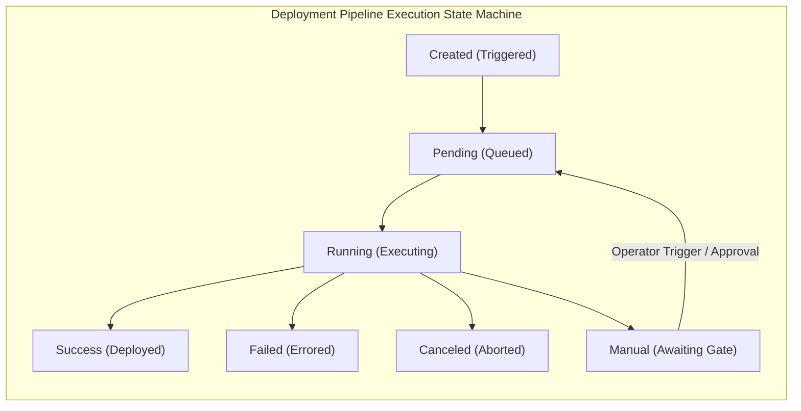
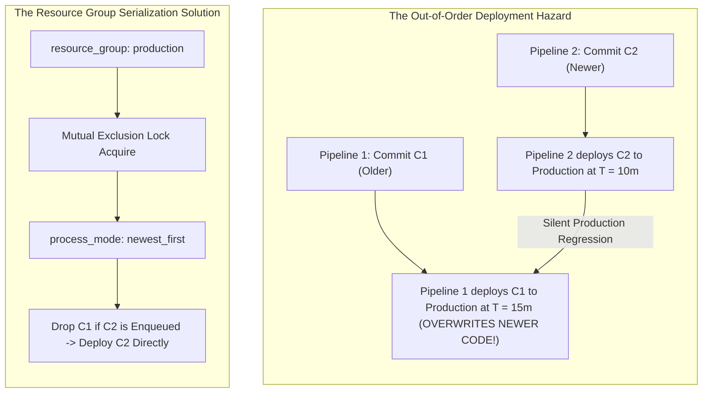
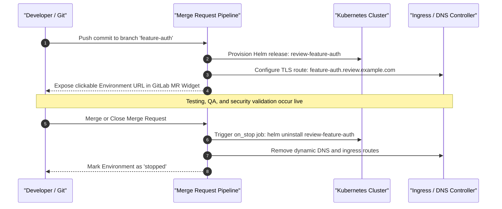
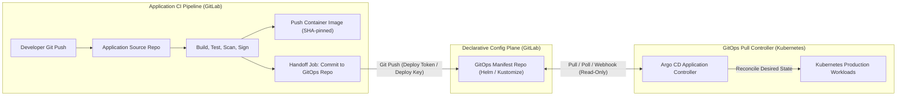
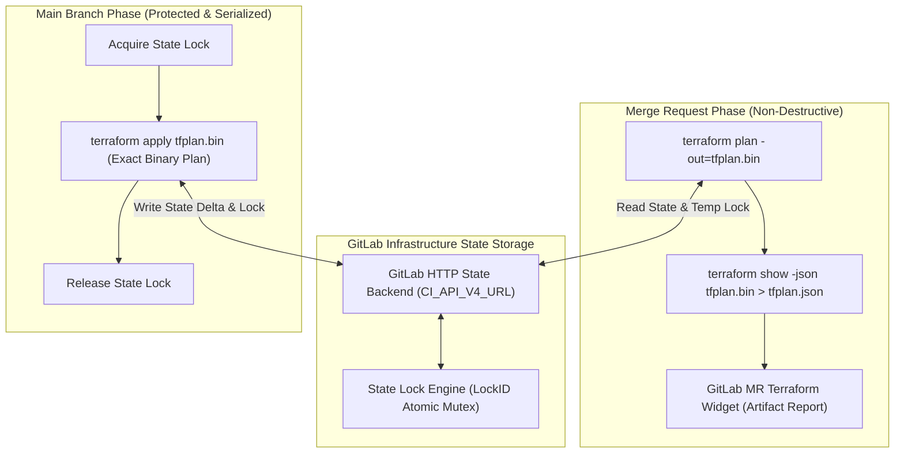

# Module 07: Continuous Deployment Mechanics: Environments, Resource Groups, Review Apps, GitOps Handoff, and Terraform Pipelines

Continuous Deployment (CD) is the phase of the software delivery lifecycle where verified build artifacts are transitioned into runtime environments without manual friction, race conditions, or configuration drift. While Continuous Integration guarantees that changes compile, pass automated tests, and satisfy supply-chain constraints, continuous deployment mechanics govern how state, traffic, infrastructure, and application workloads safely converge on production targets.

This module provides an exhaustive, production-grade guide to continuous deployment mechanics in GitLab CI/CD. We analyze the mathematical state machines of deployment environments, mutual exclusion and concurrency serialization via `resource_group`, ephemeral Review App orchestration with dynamic lifecycle hooks, the architectural separation between CI push pipelines and declarative GitOps pull reconciliation (Argo CD), and enterprise Infrastructure-as-Code pipelines utilizing the GitLab-managed Terraform/OpenTofu HTTP state backend.

For GitOps principles and Argo CD controller mechanics, see [`../../argocd/README.md`](../../argocd/README.md). For Terraform state locking and pipeline integration, see [`../../terraform/modules/10-hcp-terraform-and-ci-workflows.md`](../../terraform/modules/10-hcp-terraform-and-ci-workflows.md). For distributed locks and coordination semantics, consult [`../../../architecture/distributed-systems/modules/08-distributed-coordination-and-locks.md`](../../../architecture/distributed-systems/modules/08-distributed-coordination-and-locks.md).

---

## 1. Continuous Delivery vs. Continuous Deployment State Machines

The distinction between Continuous Delivery and Continuous Deployment lies in the final transition predicate of the deployment state machine:

- **Continuous Delivery**: Every commit passing the integration pipeline is compiled, tested, scanned, and staged in a deployable state. The transition to production requires an explicit external signal (human approval, change advisory sign-off, or timed release window).
- **Continuous Deployment**: Every commit passing automated quality and security gates is automatically deployed to production without human intervention.



### GitLab Environment Primitives

GitLab tracks deployments as first-class domain entities. An environment represents a deployment tier (e.g., `production`, `staging`, `review/feature-123`) bound to a physical cluster, namespace, or cloud endpoint:

```yaml
deploy_staging:
  stage: deploy
  environment:
    name: staging
    url: https://staging.example.com
    tier: staging
  script:
    - deploy-service --env staging
```

The `environment` keyword instruments:

1. **Deployment History & Audit Logging**: Cryptographically immutable audit records capturing which commit SHA, job ID, and user triggered the deployment.
2. **Environment Tier Classification**: Categorizes environments into `production`, `staging`, `testing`, `development`, or `other` for enterprise compliance and policy enforcement.
3. **Deployment Webhooks**: Automated payloads emitted on state changes (`created`, `running`, `success`, `failed`, `canceled`) for external observability and ChatOps integration.

---

## 2. Resource Groups and Concurrency Serialization

In a high-throughput engineering organization with distributed runners, multiple developers merge commits in rapid succession. This creates a severe **Deployment Out-of-Order Race Condition**:

$$\text{Pipeline } P_1 (\text{Commit } C_1) \text{ and Pipeline } P_2 (\text{Commit } C_2) \text{ start concurrently where } C_1 \prec C_2$$

If $P_1$ experiences network latency or runs a longer migration script, $P_2$ may complete deployment _before_ $P_1$. When $P_1$ finally finishes, it overwrites the newer software version $C_2$ with older software $C_1$, creating silent regression and state corruption.



### `resource_group` Mechanics

A `resource_group` acts as a distributed mutual exclusion semaphore managed centrally by the GitLab database. Only one job bound to a specific `resource_group` key can execute at any instant:

```yaml
deploy_production:
  stage: deploy
  resource_group: production
  environment:
    name: production
    url: https://api.example.com
  script:
    - ./scripts/deploy-production.sh
  rules:
    - if: $CI_COMMIT_BRANCH == $CI_DEFAULT_BRANCH
```

### Process Modes: `oldest_first` vs. `newest_first` vs. `unordered`

GitLab provides three scheduling algorithms for handling queued jobs waiting on a locked resource group:

| Process Mode | Queuing Behavior | Production Use Case | Operational Trade-Off |
| :-- | :-- | :-- | :-- |
| `unordered` (Legacy) | Non-deterministic; whichever waiting job acquires the lock first executes. | Non-critical batch jobs. | High risk of deploying stale code over newer releases. |
| `oldest_first` | Strict FIFO (First-In, First-Out). Jobs execute in the exact sequential order they were enqueued. | Sequential database migrations that must execute every intermediate schema delta. | Slow pipeline drainage; deployment queue accumulates backlog during traffic spikes. |
| `newest_first` | LIFO with cancellation. Skips intermediate queued jobs and immediately executes the latest commit. | Stateless microservices, frontend applications, GitOps manifest synchronization. | **Highest efficiency**: saves runner hours and delivers the latest code to production instantly. |

Configuration in `.gitlab-ci.yml`:

```yaml
deploy_production:
  stage: deploy
  resource_group: production
  environment:
    name: production
  # Process mode can be toggled via API or Project Settings;
  # newest_first immediately drops stale queued pipelines.
  script:
    - ./scripts/deploy-production.sh
```

---

## 3. Dynamic Ephemeral Review Apps and Teardown Hooks

Review Apps are dynamic, ephemeral environments provisioned automatically for every Merge Request (MR). They allow developers, designers, and QA engineers to interact with live preview builds before code merges into the mainline branch.



### Implementation Pattern for Review Apps

The review app architecture mandates two linked jobs: a provisioner job with `environment:action: start` and an associated teardown job with `environment:action: stop` linked via `on_stop`.

```yaml
stages:
  - build
  - deploy
  - cleanup

deploy_review:
  stage: deploy
  image: alpine/helm:3.17.0
  environment:
    name: review/$CI_COMMIT_REF_SLUG
    url: https://$CI_COMMIT_REF_SLUG.review.example.com
    on_stop: stop_review
    auto_stop_in: 1 week
  script:
    - helm upgrade --install "review-$CI_COMMIT_REF_SLUG" ./charts/app --namespace review-apps --create-namespace --set image.tag="$CI_COMMIT_SHA" --set ingress.host="$CI_COMMIT_REF_SLUG.review.example.com"
  rules:
    - if: $CI_MERGE_REQUEST_IID

stop_review:
  stage: cleanup
  image: alpine/helm:3.17.0
  environment:
    name: review/$CI_COMMIT_REF_SLUG
    action: stop
  variables:
    GIT_STRATEGY: none
  script:
    - helm uninstall "review-$CI_COMMIT_REF_SLUG" --namespace review-apps
  rules:
    - if: $CI_MERGE_REQUEST_IID
      when: manual
      allow_failure: true
```

### Critical Review App Directives

1. `environment:name: review/$CI_COMMIT_REF_SLUG`: Uses `$CI_COMMIT_REF_SLUG` (a sanitized, lowercase, URL-safe string of max 63 characters matching RFC 1123 DNS subdomain constraints).
2. `environment:on_stop: stop_review`: Binds the lifecycle of this environment to the teardown job. GitLab executes this job automatically when the MR is merged or closed, or when the user clicks the "Stop" button in the environment dashboard.
3. `environment:auto_stop_in: 1 week`: Enforces a TTL (Time-To-Live). If an MR remains stale or abandoned, GitLab automatically marks the environment as stopped and triggers the `on_stop` job, preventing compute and IP allocation waste.
4. `GIT_STRATEGY: none`: The cleanup job does not need to clone the repository, ensuring rapid execution even if the source branch has already been deleted from the Git server.

---

## 4. GitOps Handoff Architecture (The Clean CI/CD Boundary)

A fundamental architectural flaw in legacy CI/CD pipelines is **Direct Push Deployment**: configuring CI runners with administrative Kubernetes `kubeconfig` files or cloud cluster credentials and running `kubectl apply` or `helm upgrade` directly from CI jobs.

### Why Direct CI Push Violates Least Privilege

1. **Massive Blast Radius**: The CI runner host becomes a high-value attack target. A compromise of any arbitrary dependency or build script in any job allows root exfiltration of the cluster admin token.
2. **Configuration Drift**: Direct push pipelines bypass source control for manual cluster modifications. If a cluster operator runs an emergency `kubectl edit`, the next CI deployment or cluster restart produces undefined behavior.
3. **Network Perimeters**: Direct push requires opening inbound firewall ports from the CI runner fleet into internal Kubernetes API servers.

### The GitOps Handoff Model

GitOps decouples the CI build process from cluster deployment:

- **CI Pipeline Responsibility**: Test code, compile container images, scan for vulnerabilities, sign artifacts via Cosign, and **push a declarative commit to a separate GitOps configuration repository**.
- **CD Reconciliation Responsibility (Argo CD)**: A controller running _inside_ the Kubernetes cluster monitors the GitOps repository, detects the updated image tag or manifest digest, and continuously reconciles the live cluster state to match desired Git state.



### Implementing the GitOps Handoff Job in GitLab CI

```yaml
stages:
  - build
  - handoff

gitops_handoff:
  stage: handoff
  image:
    name: alpine/git:2.47.2
    entrypoint: ['']
  variables:
    CONFIG_REPO: 'gitlab.example.com/platform/gitops-deployments.git'
    TARGET_ENV: 'production'
  id_tokens:
    GITOPS_AUTH_TOKEN:
      aud: 'gitlab-gitops'
  script:
    - git config --global user.email "ci-bot@example.com"
    - git config --global user.name "GitLab CI Deployment Bot"
    # Clone the GitOps manifest repository using Project Deploy Token
    - git clone "https://oauth2:${GITOPS_DEPLOY_TOKEN}@${CONFIG_REPO}" gitops-repo
    - cd gitops-repo/environments/${TARGET_ENV}
    # Update image tag in Kustomize or Helm values using yq / sed
    - sed -i "s/newTag:.*/newTag: \"${CI_COMMIT_SHA}\"/" kustomization.yaml
    - git add kustomization.yaml
    - |
      if git diff --staged --quiet; then
        echo "No image change detected. Exiting cleanly."
        exit 0
      fi
    - git commit -m "chore(release): bump ${CI_PROJECT_NAME} to ${CI_COMMIT_SHA} [skip ci]"
    - git push origin main
  rules:
    - if: $CI_COMMIT_BRANCH == $CI_DEFAULT_BRANCH
```

> [!IMPORTANT]
> The commit message MUST include `[skip ci]` or `[ci skip]`. Omitting this directive triggers an infinite pipeline loop if the GitOps repository itself has an active CI pipeline configured.

---

## 5. Terraform & OpenTofu Pipelines with GitLab-Managed State

Managing cloud infrastructure (AWS, GCP, Azure) via Infrastructure-as-Code requires robust state locking and plan verification. GitLab provides a built-in, encrypted HTTP backend compliant with Terraform and OpenTofu state protocols.

### The GitLab HTTP Backend Mechanics

The state file is stored securely inside GitLab, addressed via the Project REST API: $$\text{Endpoint: } \$\{CI\_API\_V4\_URL\}/projects/\$\{CI\_PROJECT\_ID\}/terraform/state/\$\{TF\_STATE\_NAME\}$$

The HTTP backend handles:

1. **State Persistence**: Encrypted storage at rest using AES-GCM-256.
2. **Distributed State Locking**: Atomic lock acquisition via HTTP POST and release via HTTP DELETE using a unique `LockID`, preventing concurrent executions from corrupting infrastructure state.
3. **Merge Request Integration**: Emitting plan summaries directly into the GitLab Merge Request Terraform Widget.



### Complete OpenTofu / Terraform CI Configuration

```yaml
stages:
  - validate
  - plan
  - apply

variables:
  TF_STATE_NAME: 'production-vpc'
  TF_ADDRESS: '${CI_API_V4_URL}/projects/${CI_PROJECT_ID}/terraform/state/${TF_STATE_NAME}'
  TF_ROOT: 'terraform/environments/production'

default:
  image:
    name: ghcr.io/opentofu/opentofu:1.9.0
    entrypoint: ['']
  before_script:
    - cd ${TF_ROOT}
    - tofu init -backend-config="address=${TF_ADDRESS}" -backend-config="lock_address=${TF_ADDRESS}/lock" -backend-config="unlock_address=${TF_ADDRESS}/lock" -backend-config="username=gitlab-ci-token" -backend-config="password=${CI_JOB_TOKEN}" -backend-config="lock_method=POST" -backend-config="unlock_method=DELETE" -backend-config="retry_wait_min=5"

validate:
  stage: validate
  script:
    - tofu fmt -check
    - tofu validate

plan:
  stage: plan
  script:
    - tofu plan -out=tfplan.bin
    - tofu show -json tfplan.bin > tfplan.json
  artifacts:
    name: 'plan-${CI_COMMIT_SHA}'
    paths:
      - ${TF_ROOT}/tfplan.bin
    reports:
      terraform: ${TF_ROOT}/tfplan.json
    expire_in: 7 days
  rules:
    - if: $CI_PIPELINE_SOURCE == "merge_request_event"
    - if: $CI_COMMIT_BRANCH == $CI_DEFAULT_BRANCH

apply:
  stage: apply
  resource_group: terraform-${TF_STATE_NAME}
  environment:
    name: production
  script:
    # Execute ONLY the pre-generated binary plan artifact to eliminate drift
    - tofu apply -auto-approve tfplan.bin
  rules:
    - if: $CI_COMMIT_BRANCH == $CI_DEFAULT_BRANCH
      when: manual
```

---

## 6. Protected Environments and Multi-Person Approval Gates

Enterprise compliance frameworks (SOC 2, ISO 27001, PCI-DSS) require strict separation of duties: no single engineer can author, approve, and execute a production deployment independently.

### Protected Environment Enforcement

In GitLab Project Settings, environments can be marked as **Protected**:

1. **Authorized Deployers**: Only specific roles (e.g., Maintainers) or dedicated Service Accounts can trigger deployment jobs.
2. **Unified Approval Rules**: Requiring $N$ approvals from independent groups (e.g., Security Lead + QA Lead) before a manual deployment job transitions from `manual` to `running`.
3. **Environment Secrets Shielding**: Protected variables and production OIDC `id_tokens` are strictly withheld from runner memory unless the job runs on an approved protected branch targeting a protected environment.

---

## 7. Rollback Strategies: Automated vs. Git-Revert vs. API

When a production incident occurs post-deployment, systems must restore stability within minimal Mean Time to Recovery (MTTR). Three primary rollback mechanisms exist:

```mermaid
flowchart TD
    subgraph Strategy1 ["1. Git-Revert (Preferred GitOps Rollback)"]
        RevertCommit["git revert HEAD (Creates new forward commit)"]
        RevertPush["Push to GitOps Repo"]
        ArgoSync["Argo CD rolls back cluster state"]
        RevertCommit --> RevertPush --> ArgoSync
    end

    subgraph Strategy2 ["2. GitLab Deployment Re-Deploy (Manual Fast-Patch)"]
        UI["Click 'Re-deploy' on prior successful Environment deployment"]
        ExecutePrior["Re-runs prior deployment job artifact"]
        UI --> ExecutePrior
    end

    subgraph Strategy3 ["3. Automated Healthcheck Rollback"]
        Canary["Canary / Progressive Rollout (Argo Rollouts)"]
        Prometheus["Prometheus Metric Probe (5xx error rate > 1%)"]
        AutoAbort["Controller automatically halts traffic and reverts revision"]
        Canary --> Prometheus --> AutoAbort
    end
```



1. **Git-Revert Forward Rollback**: The gold standard for audit compliance. The operator reverts the Git commit in the application or GitOps repository. This generates a new commit SHA, passes standard CI checks, and deploys via normal pipelines, preserving an immutable audit log of the rollback.
2. **GitLab Deployment Re-Deploy**: The GitLab Environment dashboard maintains historical deployment records. An operator can select a prior successful deployment and click "Re-deploy". GitLab instantiates a new job using the exact commit SHA and build artifacts of that historical release.
3. **Automated Canary Rollback**: Implemented at the infrastructure layer using Argo Rollouts or Istio. Traffic is shifted incrementally (e.g., 5% -> 20% -> 100%). If Prometheus metrics detect error spikes, the controller automatically aborts the rollout without waiting for human intervention.

---

## 8. Algorithm: Resource Group Queue Scheduler

The scheduling engine governing `resource_group` execution with `newest_first` semantics is defined below in formal CLRS pseudocode.

```text
RESOURCE-GROUP-SCHEDULE(resource_key, incoming_job, active_jobs, queue)
1   // Input: resource_key string, incoming_job J, active_jobs list, queue list
2   // Invariant: At all times, |active_jobs| ≤ 1 for any resource_key.
3
4   if |active_jobs| == 0 then
5       active_jobs.APPEND(incoming_job)
6       incoming_job.state ← RUNNING
7       return EXECUTE(incoming_job)
8
9   // Resource is currently locked by a running job
10  if incoming_job.process_mode == NEWEST_FIRST then
11      // Loop Invariant: All jobs remaining in queue from index 1 to i-1 have commit_timestamp
12      // greater than or equal to their predecessors. Any job strictly older than J is pruned.
13      for each job K in queue do
14          if K.commit_timestamp < incoming_job.commit_timestamp then
15              queue.REMOVE(K)
16              K.state ← DROPPED
17              NOTIFY-JOB-DROPPED(K, "Dropped by newest_first scheduling policy")
18      queue.PREPEND(incoming_job)
19      incoming_job.state ← QUEUED
20  else if incoming_job.process_mode == OLDEST_FIRST then
21      queue.APPEND(incoming_job)
22      incoming_job.state ← QUEUED
23
24  return WAIT_FOR_LOCK(incoming_job)
```

### Queue Cleanup and Lock Release

```text
RESOURCE-GROUP-RELEASE(resource_key, completed_job, active_jobs, queue)
1   active_jobs.REMOVE(completed_job)
2   if |queue| > 0 then
3       next_job ← queue.POP_FIRST()
4       active_jobs.APPEND(next_job)
5       next_job.state ← RUNNING
6       return EXECUTE(next_job)
7   return RELEASE_LOCK(resource_key)
```

The algorithm maintains mutual exclusion ($|active\_jobs| \le 1$) while guaranteeing that in `NEWEST_FIRST` mode, the length of the waiting queue $|queue|$ never exceeds 1, dropping all obsolete intermediate commits and bounding queue latency to $O(1)$ operations.

---

## 9. Then vs. Now: Continuous Deployment Paradigm Shifts

| Architectural Dimension | Legacy CI/CD Deployment (Pre-2022) | Modern Cloud-Native Standard (2026 / GitLab 19.5) |
| :-- | :-- | :-- |
| **Cluster Access** | CI runners mounted with static, cluster-admin `kubeconfig` files. | Zero cluster credentials in CI; decoupled GitOps handoff to Argo CD. |
| **Concurrency Control** | Unordered pipeline runs; newer commits overwritten by slow older builds. | `resource_group:process_mode: newest_first` dropping stale intermediate pipelines. |
| **Preview Environments** | Static shared staging servers with perpetual resource contention. | Ephemeral Review Apps per MR with automated TTL (`auto_stop_in`). |
| **Terraform State** | Unlocked local files or complex self-managed S3/DynamoDB bucket policies. | Integrated GitLab HTTP state backend with atomic `LockID` mutexes. |
| **Approval Gates** | External email change tickets or untracked manual Slack approvals. | Native Protected Environments with unified multi-group sign-off rules. |
| **Plan Verification** | Running `terraform apply` directly against code; drift risk between plan and apply. | Strictly executing pre-generated binary `tfplan.bin` artifacts with MR widget reports. |

---

## 10. Exam Delta: Certification Target Alignment

> [!NOTE]
> **Exam Delta (GitLab Certified CI/CD Associate)**: The standard GitLab CI/CD Associate examination tests candidate knowledge of basic `environment:name`, manual job triggers (`when: manual`), and environment URL exposure.
>
> In modern enterprise engineering environments running GitLab 19.5, production readiness requires mastering `resource_group` process modes (`newest_first`), ephemeral Review App lifecycle management with `environment:on_stop` and `auto_stop_in`, protected environment approval matrices, and HTTP Terraform state management. Candidates must be prepared to articulate why direct cluster deployment from CI is an anti-pattern compared to GitOps repository synchronization.

---

## 11. Production Failure Modes & Operational Gotchas

### 1. Silent Rollback via Unordered Concurrent Deployments

- **Root Cause**: Omitting `resource_group` on deployment jobs. When two developers merge PRs within minutes of each other, Pipeline A (Commit 1) and Pipeline B (Commit 2) run in parallel. If Pipeline A experiences slow network downloads, Pipeline B deploys Commit 2 first. Pipeline A finishes 5 minutes later and deploys Commit 1, silently rolling back Commit 2's changes to production.
- **Detection**: Production regressions reported where recently merged features mysteriously disappear from live endpoints while Git `main` branch shows the code as merged.
- **Remediation**: Always assign `resource_group: production` with `process_mode: newest_first` to all deployment jobs targeting shared environments.

### 2. Orphaned Review App Cloud Resources

- **Root Cause**: An MR is closed without merging, or a branch is deleted directly via local Git CLI (`git push origin --delete branch-name`). If the `stop_review` job defines restrictive `rules:` that only evaluate on merge request events, the stop job never executes, leaving Kubernetes pods, load balancers, and DNS entries running indefinitely.
- **Detection**: Cloud hosting bills escalating; hundreds of stale `review-*` namespaces detected in the cluster.
- **Remediation**: Configure `environment:auto_stop_in: 1 week` on all review app definitions. Additionally, configure a nightly cron pipeline running `helm list -n review-apps` to prune releases whose branches no longer exist in GitLab.

### 3. Terraform Apply Failure Due to State Drift Between Plan and Apply

- **Root Cause**: Running `tofu plan` without saving a binary plan file, and subsequently running `tofu apply -auto-approve` in a separate stage. If another developer or pipeline applied a change to infrastructure in the intervening window, the unpinned apply job recalculates state on the fly and applies unintended schema modifications.
- **Detection**: Terraform throwing `Provider produced inconsistent final plan` or unexpected destruction of cloud resources.
- **Remediation**: Pass the explicit binary plan output artifact (`tofu plan -out=tfplan.bin`) to the apply stage and execute strictly `tofu apply tfplan.bin`. OpenTofu verifies that the state has not changed since the plan was computed; if state diverged, apply aborts cleanly.

### 4. GitOps Recursive Pipeline Storm

- **Root Cause**: The CI GitOps handoff job commits an updated image tag to the configuration repository. If the configuration repository has a default pipeline configured without branching rules, the automated commit triggers a new CI pipeline, which may execute further scripts or trigger multi-project downstream pipelines recursively.
- **Detection**: Thousands of pipelines spawned in seconds; runner queues exhausted; GitLab API rate limiting triggered.
- **Remediation**: Ensure the Git bot commit message includes `[skip ci]` or configure `workflow:rules` in the GitOps repository to ignore commits authored by `ci-bot@example.com`.

---

## Interview Drill

<details><summary>1. Why should container deployments to Kubernetes clusters be decoupled from CI pipelines via GitOps rather than pushed directly using kubectl or Helm?</summary>

Decoupling CI and CD via GitOps enforces the principle of least privilege, eliminates configuration drift, and strengthens security:

1. **Least Privilege**: Direct CI push requires granting CI runners administrative credentials (`kubeconfig`) to the production cluster. If any build dependency or runner container is compromised, the entire cluster is compromised. In GitOps, CI runners have write access only to a Git repository; the GitOps controller (Argo CD) runs inside the cluster with read-only access to Git.
2. **Drift Detection and Auto-Healing**: Direct push pipelines apply changes once. If someone modifies a live deployment via `kubectl edit`, the cluster drifts until the next build. A GitOps controller continuously reconciles the cluster to match Git state, instantly correcting drift.
3. **Auditability and Rollback**: In GitOps, every production change is a Git commit. Rolling back is an atomic `git revert`, restoring both manifests and configurations deterministically.

- Ref: OpenGitOps Specification; [modules/07-deployments-environments-and-gitops-handoff.md](../modules/07-deployments-environments-and-gitops-handoff.md#4-gitops-handoff-architecture-the-clean-cicd-boundary)
</details>

<details><summary>2. How does `resource_group:process_mode: newest_first` prevent production regressions while optimizing CI runner capacity?</summary>

In high-velocity teams, multiple commits are merged in rapid succession. Under default or `unordered` execution, concurrent deployment jobs can finish out of order, overwriting newer code with older releases. Under `oldest_first`, every single commit must deploy sequentially, causing massive pipeline queue backlogs where runners spend hours deploying intermediate, already-obsolete commits.

`newest_first` solves both problems: when a deployment job finishes, the scheduler inspects the queue of waiting jobs for that resource group. It identifies the job with the latest commit timestamp, immediately marks all older waiting jobs as `dropped` (skipped), and executes the newest job. This ensures that the live environment always advances directly to the latest verified commit while saving runner hours by discarding redundant deployments.

- Ref: GitLab CI Resource Groups Documentation; [modules/07-deployments-environments-and-gitops-handoff.md](../modules/07-deployments-environments-and-gitops-handoff.md#2-resource-groups-and-concurrency-serialization)
</details>

<details><summary>3. Explain the function of `environment:on_stop` and `auto_stop_in` in dynamic Review App pipelines. What happens if `GIT_STRATEGY: none` is omitted from the teardown job?</summary>

`environment:on_stop` binds an active deployment environment to a specific cleanup job. When a Merge Request is merged, closed, or manually stopped, GitLab automatically triggers the job referenced by `on_stop` to destroy the ephemeral infrastructure (e.g., executing `helm uninstall`). `auto_stop_in` defines a TTL after which GitLab automatically transitions the environment to stopped and executes the cleanup job, preventing forgotten review environments from leaking cloud spend.

If `GIT_STRATEGY: none` is omitted from the teardown job, the GitLab runner will attempt to run `git fetch` or `git checkout` for the branch. However, if the Merge Request was merged with the "Delete source branch" option checked, the Git branch no longer exists on the remote repository. The runner fails during the git fetch phase before executing the script, resulting in an orphaned environment that never gets cleaned up.

- Ref: [modules/07-deployments-environments-and-gitops-handoff.md](../modules/07-deployments-environments-and-gitops-handoff.md#3-dynamic-ephemeral-review-apps-and-teardown-hooks)
</details>

<details><summary>4. How does the GitLab HTTP backend for Terraform / OpenTofu handle distributed state locking, and why is this critical when multiple pipelines run concurrently?</summary>

Terraform state files track the mapping between declared code resources and real-world cloud provider metadata. If two executions attempt to modify state concurrently, race conditions will corrupt the JSON state file, leading to resource duplication or accidental destruction.

The GitLab HTTP backend implements the Terraform remote state locking protocol. Before reading or writing state, Terraform issues an HTTP `POST` request to the lock URL (`${TF_ADDRESS}/lock`) containing a JSON payload with a unique `LockID`, operation type, and user information. GitLab atomically registers this lock in its PostgreSQL database. If another pipeline attempts to run, its lock acquisition request receives an HTTP 423 Locked status, causing it to retry or fail. Once the operation completes, Terraform issues an HTTP `DELETE` to release the lock.

- Ref: OpenTofu HTTP Backend Documentation; [`../../terraform/modules/10-hcp-terraform-and-ci-workflows.md`](../../terraform/modules/10-hcp-terraform-and-ci-workflows.md)
</details>

<details><summary>5. Why is it dangerous to execute `terraform apply` directly against raw `.tf` files in a production CI stage rather than against a pre-generated binary `tfplan.bin` artifact?</summary>

If `terraform apply` is executed without a pre-generated plan file, Terraform calculates an entirely new execution plan at the moment of apply. Between the time the developer reviewed the `terraform plan` output in the Merge Request and the time the merge pipeline runs `apply`, two drift conditions can occur:

1. Another engineer applied changes that altered remote infrastructure state.
2. Dynamic data sources or external API variables changed.

As a result, the unpinned apply step may execute destructive actions (such as recreating databases or changing subnets) that were never visible in the approved Merge Request review. Generating a binary plan (`tofu plan -out=tfplan.bin`) freezes the exact set of planned actions and the state serial number. When `tofu apply tfplan.bin` runs, OpenTofu verifies that the current state matches the plan's prerequisites; if the remote infrastructure has drifted, apply aborts cleanly without executing unintended mutations.

- Ref: [modules/07-deployments-environments-and-gitops-handoff.md](../modules/07-deployments-environments-and-gitops-handoff.md#5-terraform--opentofu-pipelines-with-gitlab-managed-state)
</details>

<details><summary>6. How do Unified Approval Rules on Protected Environments satisfy SOC 2 / ISO 27001 separation-of-duty requirements?</summary>

SOC 2 and ISO 27001 require that no single individual can author, approve, and deploy code to production environments. In GitLab, marking an environment as **Protected** enables Unified Approval Rules:

1. **Access Boundaries**: Restricts the execution of deployment jobs exclusively to designated maintainers or deployment service roles.
2. **Independent Approval Quorum**: Requires explicit digital sign-off from designated groups (e.g., QA Team, Security Team) before the manual deployment job is unlocked.
3. **Self-Approval Prevention**: Enforces policies where the author of the commit or the user who opened the Merge Request cannot approve their own deployment.
4. **Immutable Audit Logging**: Every approval, rejection, and execution timestamp is preserved in GitLab audit events for external compliance verification.

- Ref: [modules/07-deployments-environments-and-gitops-handoff.md](../modules/07-deployments-environments-and-gitops-handoff.md#6-protected-environments-and-multi-person-approval-gates)
</details>

<details><summary>7. Describe the failure mode of a GitOps handoff job that does not suppress CI execution on the target configuration repository. How do you mitigate it?</summary>

When a CI pipeline completes, the handoff job executes `git commit` and `git push` against the GitOps configuration repository to bump the container image tag. If the configuration repository has a default CI/CD pipeline configured (e.g., to run linter or manifest validation tests), the inbound push triggers a new pipeline in that repository. If that repository's pipeline triggers downstream notifications or multi-project pipelines that touch the source repository, an infinite recursive pipeline storm is created.

Mitigation strategies:

1. Append `[skip ci]` or `[ci skip]` to the git commit message in the handoff script (`git commit -m "chore(release): bump tag [skip ci]"`).
2. Configure `workflow:rules` in the configuration repository to strictly ignore commits authored by the deployment bot service account (`if: $GITLAB_USER_EMAIL == "ci-bot@example.com" when: never`).

- Ref: [modules/07-deployments-environments-and-gitops-handoff.md](../modules/07-deployments-environments-and-gitops-handoff.md#11-production-failure-modes--operational-gotchas)
</details>

---

## 13. Proof Map & Executable Verifications

The deployment state machines, resource group scheduling models, and Terraform backend protocols detailed in this module are backed by executable assertions in the test suite:

| Theoretical Concept | Test Specification / Assertion | Test File Reference |
| :-- | :-- | :-- |
| **Resource Group Queue Scheduling** | Validating mutual exclusion and intermediate job dropping in `newest_first` | [`../examples/ts/07-deployments-environments-and-gitops-handoff.test.ts`](../examples/ts/07-deployments-environments-and-gitops-handoff.test.ts) |
| **Review App Lifecycle Hooks** | Verifying `environment:on_stop` linkage and sanitized DNS slug generation | [`../examples/ts/07-deployments-environments-and-gitops-handoff.test.ts`](../examples/ts/07-deployments-environments-and-gitops-handoff.test.ts) |
| **GitOps Handoff Manifest Patching** | Executing deterministic Kustomize `newTag` image replacements with `[skip ci]` | [`../examples/ts/07-deployments-environments-and-gitops-handoff.test.ts`](../examples/ts/07-deployments-environments-and-gitops-handoff.test.ts) |
| **Terraform State Locking Protocol** | Emulating HTTP backend `LockID` mutex acquisition, HTTP 423 conflict, and release | [`../examples/ts/07-deployments-environments-and-gitops-handoff.test.ts`](../examples/ts/07-deployments-environments-and-gitops-handoff.test.ts) |
| **Protected Environment Gate Rules** | Asserting deployment job blocking until required approval quorum is satisfied | [`../examples/ts/07-deployments-environments-and-gitops-handoff.test.ts`](../examples/ts/07-deployments-environments-and-gitops-handoff.test.ts) |
