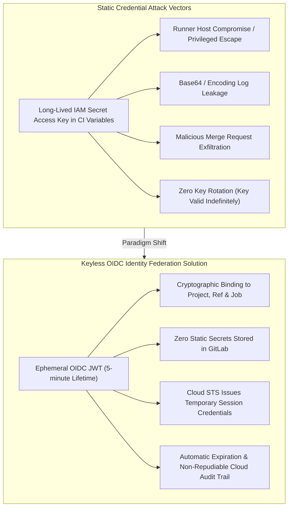
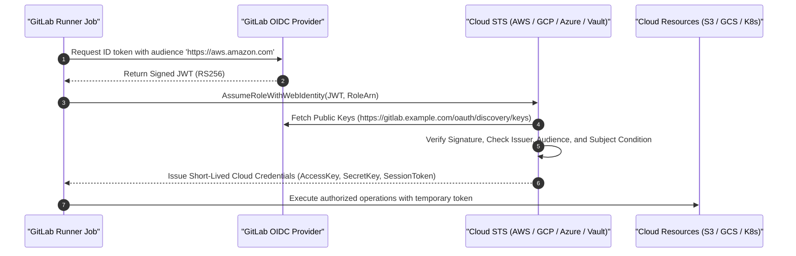
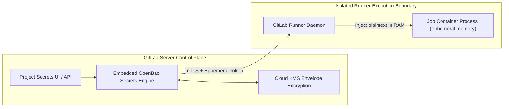

# Module 08: Secrets Management and Keyless Cloud Federation: OIDC ID Tokens, AWS/GCP/Azure/Vault Auth, and GitLab Secrets Manager

Managing secrets is the most critical operational and security boundary in modern CI/CD pipelines. Historically, pipelines relied on long-lived, static credentials—AWS access keys, Google Cloud service account JSON keys, Azure client secrets, and database passwords—stored directly in CI variable stores. This architecture represents a catastrophic failure mode: static credentials suffer from key sprawl, lack automated rotation, are vulnerable to accidental log exposure, and grant permanent, unconstrained access if a runner or build job is compromised.

This module provides a comprehensive, mathematically rigorous guide to secrets management and keyless cloud federation in GitLab CI/CD. We examine the internal mechanics of GitLab CI variables (masked, protected, and hidden), the mathematical limitations and bypass vectors of string masking engines, the deprecation and removal of legacy `CI_JOB_JWT` in favor of configurable OpenID Connect (OIDC) `id_tokens`, keyless workload identity federation across AWS, Google Cloud, Microsoft Azure, and HashiCorp Vault, and the native GitLab Secrets Manager powered by OpenBao.

For deep theoretical foundations of OpenID Connect, cryptographic token signing, and public key infrastructures, see [`architecture/security-identity/modules/07-oidc-and-federation.md`](../../../architecture/security-identity/modules/07-oidc-and-federation.md) and [`architecture/security-identity/modules/04-pki-x509-and-mtls.md`](../../../architecture/security-identity/modules/04-pki-x509-and-mtls.md). For secrets at rest and encryption mechanics, see [`architecture/security-identity/modules/03-passwords-and-secrets-at-rest.md`](../../../architecture/security-identity/modules/03-passwords-and-secrets-at-rest.md).

---

## 1. The Crisis of Static Credentials in CI/CD

Static credentials in automated delivery pipelines introduce an untenable threat surface:



### Attack Vectors on Static CI Secrets

1. **Log Exfiltration**: A developer or adversary adds a debug statement (`echo $AWS_SECRET_ACCESS_KEY | base64` or `env`) that bypasses log masking, exposing long-lived credentials in plaintext build output.
2. **Untrusted Fork / MR Execution**: In misconfigured pipelines, jobs triggered by external contributors or untrusted feature branches gain access to production secrets.
3. **Lateral Cloud Movement**: Static keys frequently possess overly broad IAM permissions. An exfiltrated key can be used from any IP address globally to modify production cloud infrastructure without leaving an audit trail in GitLab.

---

## 2. GitLab CI Variables: Scope, Precedence, and Masking Mechanics

GitLab allows variables to be declared at multiple administrative tiers. Understanding the precedence hierarchy is essential for deterministic pipeline behavior and preventing variable shadowing vulnerabilities.

### Variable Precedence Hierarchy

When variable keys collide, GitLab resolves values according to a strict, top-down priority order:

1. **Trigger Variables / Pipeline Schedules / API Trigger Variables** (Highest Precedence)
2. **Manual Pipeline Run Variables** (Supplied via Web UI)
3. **Project-Level CI/CD Variables** (Defined in Project Settings)
4. **Group-Level CI/CD Variables** (Inherited from direct parent group)
5. **Upstream Group-Level Variables** (Inherited recursively through subgroup hierarchy)
6. **Instance-Level CI/CD Variables** (System-wide variables set by GitLab Administrator)
7. **Job-Level Variables** (Defined inside individual job blocks)
8. **Pipeline `.gitlab-ci.yml` File Variables** (Defined in root `variables:` block)
9. **Inherited Variables** (Passed from upstream parent pipelines or triggers)
10. **Predefined Variables** (`CI_COMMIT_SHA`, `CI_JOB_ID`, `CI_PROJECT_PATH`) (Lowest Precedence)

### Security Attributes: Protected, Masked, and Hidden

| Attribute | Functional Mechanism | Security Boundary & Limitations |
| :-- | :-- | :-- |
| **`Protected`** | Variable is injected into the runner environment **only** if the pipeline executes on a protected branch (e.g., `main`) or a protected tag. | Mitigates secret exfiltration from untrusted feature branches and Merge Requests. |
| **`Masked`** | GitLab Runner inspects stdout/stderr streams and replaces matching string values with `[MASKED]`. | **Strict criteria**: Value must be $\ge 8$ characters, contain only alphanumeric and `@_+=.,/-`, and cannot match common words. Does not protect against encoded values. |
| **`Hidden`** | Once saved in GitLab UI, the plaintext value is never displayed to administrators or developers again (write-only). | Protects against shoulder-surfing and UI credential harvesting; runner still receives plaintext during job execution. |
| **`Expanded` (`raw`)** | When disabled (`raw: true`), disables GitLab variable expansion (`$VAR` syntax treated as literal text). | Prevents unintended variable injection or recursive evaluation attacks when values contain `$` characters. |

### The Masking Engine: Mathematical Limitations and Bypass Vectors

GitLab's masking engine is a string-replacement filter operating on the streaming output of runner logs. It is **not** an access control boundary.

$$\text{Filter}(S, V) = \text{ReplaceAll}(S, V, \text{"[MASKED]"})$$

#### Why Masking Fails Against Encoding Transformations

If a script transforms a secret string $V$ via an injective encoding function $f(V)$, the runner stream receives $f(V)$. Because $f(V) \neq V$, the filter fails to match, and the encoded secret is emitted in plaintext:

```bash
# VULNERABILITY DEMONSTRATION (DO NOT USE IN PRODUCTION)
# Assume SECRET_KEY="super_secret_production_password_123" is masked.

# 1. Plaintext output is correctly redacted:
echo "$SECRET_KEY"
# Log Output: [MASKED]

# 2. Base64 encoding bypass:
echo "$SECRET_KEY" | base64
# Log Output: c3VwZXJfc2VjcmV0X3Byb2R1Y3Rpb25fcGFzc3dvcmRfMTIzCg== (UNMASKED LEAK!)

# 3. Substring / Character Slicing bypass:
echo "${SECRET_KEY:0:10}_${SECRET_KEY:10}"
# Log Output: super_secr_et_production_password_123 (UNMASKED LEAK!)

# 4. JSON / Hex formatting bypass:
printf '%x\n' "'$SECRET_KEY"
# Emits hexadecimal ASCII representation without triggering string match!
```

> [!CAUTION]
> Variable masking is a defense-in-depth measure against accidental `set -x` or debug logging. It is completely ineffective against a malicious actor or a compromised dependency executing within the runner container.

---

## 3. OpenID Connect (OIDC) & `id_tokens` Architecture

To eliminate static credentials, GitLab CI implements an OpenID Connect (OIDC) Identity Provider compliant with the OIDC Core 1.0 specification.

### Deprecation and Removal of Legacy `CI_JOB_JWT`

In legacy versions (GitLab 12.x–15.x), GitLab provided automatic variables named `CI_JOB_JWT` and `CI_JOB_JWT_V2`. These tokens suffered from critical architectural shortcomings:

- Hardcoded, non-configurable audience claims (`aud`).
- Inability to negotiate distinct audiences for different cloud providers within the same job.
- Lack of cryptographic isolation between multi-cloud steps.

GitLab **permanently deprecated and removed `CI_JOB_JWT`** in favor of the declarative `id_tokens` syntax.

### The Modern `id_tokens` Specification

The `id_tokens` keyword instructs GitLab to dynamically mint an ephemeral, cryptographically signed JSON Web Token (JWT) for the job, with custom audience declarations:

```yaml
job_cloud_deploy:
  stage: deploy
  id_tokens:
    AWS_OIDC_TOKEN:
      aud: 'https://aws.amazon.com'
    VAULT_OIDC_TOKEN:
      aud: 'https://vault.example.com'
    GCP_OIDC_TOKEN:
      aud: 'https://iam.googleapis.com/projects/123456789/locations/global/workloadIdentityPools/gitlab-pool/providers/gitlab-provider'
  script:
    - authenticate-aws "$AWS_OIDC_TOKEN"
    - authenticate-vault "$VAULT_OIDC_TOKEN"
```

### Cryptographic Claims Payload Schema

The JWT is signed by GitLab's private RSA/ECDSA key and verifiable via the public JWKS endpoint: $$\text{JWKS URL: } \text{https://<gitlab-instance>}/oauth/discovery/keys$$

```json
{
  "iss": "https://gitlab.example.com",
  "sub": "project_path:platform/billing-service:ref_type:branch:ref:main",
  "aud": "https://aws.amazon.com",
  "exp": 1794144300,
  "nbf": 1794143700,
  "iat": 1794143700,
  "jti": "8f9a2b1c-3d4e-5f6a-7b8c-9d0e1f2a3b4c",
  "namespace_id": "54",
  "namespace_path": "platform",
  "project_id": "210",
  "project_path": "platform/billing-service",
  "user_id": "42",
  "user_login": "alex.engineer",
  "user_email": "alex@example.com",
  "pipeline_id": "1049281",
  "pipeline_source": "push",
  "job_id": "5920194",
  "ref": "main",
  "ref_type": "branch",
  "ref_protected": "true",
  "environment": "production",
  "environment_protected": "true"
}
```

The `sub` (subject) claim uniquely identifies the execution context: $$\text{sub} = \text{"project\_path:"} \parallel \text{project\_path} \parallel \text{":ref\_type:"} \parallel \text{ref\_type} \parallel \text{":ref:"} \parallel \text{ref}$$

---

## 4. Keyless Cloud Federation: Complete Implementations



### 1. Amazon Web Services (AWS IAM OIDC Federation)

AWS IAM supports federated authentication using an IAM OIDC Identity Provider and `AssumeRoleWithWebIdentity`.

#### Step 1: AWS IAM Trust Policy (`trust-policy.json`)

The trust policy restricts role assumption strictly to jobs running on the `main` branch of the `platform/billing-service` project:

```json
{
  "Version": "2012-10-17",
  "Statement": [
    {
      "Effect": "Allow",
      "Principal": {
        "Federated": "arn:aws:iam::123456789012:oidc-provider/gitlab.example.com"
      },
      "Action": "sts:AssumeRoleWithWebIdentity",
      "Condition": {
        "StringEquals": {
          "gitlab.example.com:aud": "https://aws.amazon.com",
          "gitlab.example.com:sub": "project_path:platform/billing-service:ref_type:branch:ref:main"
        }
      }
    }
  ]
}
```

#### Step 2: GitLab CI Pipeline Configuration

```yaml
deploy_aws:
  stage: deploy
  image:
    name: amazon/aws-cli:2.24.0
    entrypoint: [""]
  id_tokens:
    AWS_OIDC_TOKEN:
      aud: "https://aws.amazon.com"
  variables:
    AWS_ROLE_ARN: "arn:aws:iam::123456789012:role/GitLabBillingDeployerRole"
    AWS_REGION: "us-east-1"
  script:
    - >
      CREDENTIALS=$(aws sts assume-role-with-web-identity
        --role-arn "$AWS_ROLE_ARN"
        --role-session-name "gitlab-ci-job-${CI_JOB_ID}"
        --web-identity-token "$AWS_OIDC_TOKEN"
        --duration-seconds 900
        --output json)
    - export AWS_ACCESS_KEY_ID=$(echo "$CREDENTIALS" | grep -o '"AccessKeyId": "[^"]*' | cut -d'"' -f4)
    - export AWS_SECRET_ACCESS_KEY=$(echo "$CREDENTIALS" | grep -o '"SecretAccessKey": "[^"]*' | cut -d'"' -f4)
    - export AWS_SESSION_TOKEN=$(echo "$CREDENTIALS" | grep -o '"SessionToken": "[^"]*' | cut -d'"' -f4)
    - aws s3 ls
  rules:
    - if: $CI_COMMIT_BRANCH == $CI_DEFAULT_BRANCH
```

---

### 2. Google Cloud Platform (Workload Identity Federation)

GCP Workload Identity Federation maps GitLab OIDC claims to Google Cloud IAM Service Accounts without service account keys.

#### Step 1: Workload Identity Pool and Attribute Mapping

The Workload Identity Provider maps GitLab claims into Google Cloud security attributes:

- `google.subject = assertion.sub`
- `attribute.project_path = assertion.project_path`
- `attribute.ref_protected = assertion.ref_protected`

#### Step 2: Service Account IAM Binding

```bash
gcloud iam service-accounts add-iam-policy-binding billing-deployer@my-gcp-project.iam.gserviceaccount.com \
  --role="roles/iam.workloadIdentityUser" \
  --member="principalSet://iam.googleapis.com/projects/123456789/locations/global/workloadIdentityPools/gitlab-pool/attribute.project_path/platform/billing-service"
```

#### Step 3: GitLab CI Pipeline Configuration

```yaml
deploy_gcp:
  stage: deploy
  image: google/cloud-sdk:510.0.0-alpine
  id_tokens:
    GCP_OIDC_TOKEN:
      aud: 'https://iam.googleapis.com/projects/123456789/locations/global/workloadIdentityPools/gitlab-pool/providers/gitlab-provider'
  variables:
    GCP_SERVICE_ACCOUNT: 'billing-deployer@my-gcp-project.iam.gserviceaccount.com'
    WIF_PROVIDER: 'projects/123456789/locations/global/workloadIdentityPools/gitlab-pool/providers/gitlab-provider'
  script:
    - echo "$GCP_OIDC_TOKEN" > /tmp/token.jwt
    - >
      gcloud config set auth/credential_file_override <(cat <<EOF {
        "type": "external_account",
        "audience": "//iam.googleapis.com/${WIF_PROVIDER}",
        "subject_token_type": "urn:ietf:params:oauth:token-type:jwt",
        "token_url": "https://sts.googleapis.com/v1/token",
        "credential_source": {
          "file": "/tmp/token.jwt"
        },
        "service_account_impersonation_url": "https://iamcredentials.googleapis.com/v1/projects/-/serviceAccounts/${GCP_SERVICE_ACCOUNT}:generateAccessToken"
      } EOF )
    - gcloud auth login --brief
    - gcloud storage ls
  rules:
    - if: $CI_COMMIT_BRANCH == $CI_DEFAULT_BRANCH
```

---

### 3. Microsoft Azure (Entra ID Federated Credentials)

Azure Entra ID supports keyless authentication via Federated Identity Credentials attached to App Registrations or Managed Identities.

```yaml
deploy_azure:
  stage: deploy
  image: mcr.microsoft.com/azure-cli:2.68.0
  id_tokens:
    AZURE_OIDC_TOKEN:
      aud: 'api://AzureADTokenExchange'
  variables:
    AZURE_CLIENT_ID: '11111111-2222-3333-4444-555555555555'
    AZURE_TENANT_ID: '66666666-7777-8888-9999-000000000000'
  script:
    - az login --service-principal -u "$AZURE_CLIENT_ID" -t "$AZURE_TENANT_ID" --federated-token "$AZURE_OIDC_TOKEN"
    - az group list --output table
  rules:
    - if: $CI_COMMIT_BRANCH == $CI_DEFAULT_BRANCH
```

---

### 4. HashiCorp Vault (JWT/OIDC Auth Engine)

GitLab CI integrates natively with HashiCorp Vault. Vault validates the JWT signature and extracts secrets into the job environment via the `secrets:` keyword.

#### Step 1: Vault Role Configuration

```bash
vault write auth/jwt/role/billing-deployer \
  role_type="jwt" \
  bound_audiences="https://vault.example.com" \
  user_claim="user_email" \
  bound_claims_type="glob" \
  bound_claims="project_path:platform/billing-service,ref_protected:true" \
  policies="billing-production" \
  ttl="15m"
```

#### Step 2: Native GitLab CI Vault Integration

```yaml
deploy_vault:
  stage: deploy
  id_tokens:
    VAULT_ID_TOKEN:
      aud: 'https://vault.example.com'
  secrets:
    DATABASE_PASSWORD:
      vault: secret/data/production/database/password@production
      file: false
      token: $VAULT_ID_TOKEN
  script:
    - echo "Database password retrieved securely via Vault engine."
    - psql -h db.prod.example.com -U billing_app -d billing_db -c "SELECT 1;"
  rules:
    - if: $CI_COMMIT_BRANCH == $CI_DEFAULT_BRANCH
```

---

## 5. GitLab Native Secrets Manager (OpenBao Integration)

In GitLab 18.x and 19.x, GitLab introduced a **Native Secrets Manager** integrated directly into the core platform, backed by **OpenBao** (the open-source Linux Foundation project forked from Vault).



### Native Secrets Manager Architecture

1. **Zero External Infrastructure**: Eliminates the operational overhead of managing external HashiCorp Vault clusters for small to mid-sized teams.
2. **Envelope Encryption**: Secrets stored at rest in the PostgreSQL database are encrypted with unique per-tenant keys derived from an external Cloud KMS (AWS KMS, GCP Cloud KMS, Azure Key Vault, or PKCS#11 HSM).
3. **Native Pipeline Syntax**:
   ```yaml
   deploy_service:
     stage: deploy
     secrets:
       STRIPE_API_KEY:
         gitlab: STRIPE_PRODUCTION_SECRET
     script:
       - ./deploy-billing-gateway.sh
   ```
4. **Zero-Leak Guarantee**: Secrets injected via the native secrets manager are never written to disk, omitted from pipeline audit logs, and automatically redacted if accidental output occurs.

---

## 6. Algorithm: Cryptographic JWT Signature Verification & Claim Binding

Cloud STS and authentication engines verify GitLab OIDC tokens using public-key cryptography. The formal verification procedure is presented below in CLRS pseudocode.

```text
VERIFY-OIDC-TOKEN(token_string, expected_iss, expected_aud, required_claims, jwks_cache)
1   (header_b64, payload_b64, signature_b64) ← SPLIT(token_string, ".")
2   header ← JSON-DECODE(BASE64URL-DECODE(header_b64))
3   payload ← JSON-DECODE(BASE64URL-DECODE(payload_b64))
4
5   // 1. Verify Public Key from JWKS
6   key_id ← header.kid
7   public_key ← GET-JWKS-KEY(jwks_cache, expected_iss, key_id)
8   if public_key == NIL then
9       jwks_cache ← REFRESH-JWKS(expected_iss)
10      public_key ← GET-JWKS-KEY(jwks_cache, expected_iss, key_id)
11      if public_key == NIL then
12          return (REJECTED, "Unknown key ID in JWT header")
13
14  // 2. Cryptographic Signature Check
15  signature_valid ← CRYPTO-VERIFY(header.alg, public_key, header_b64 || "." || payload_b64, signature_b64)
16  if not signature_valid then
17      return (REJECTED, "Invalid cryptographic signature")
18
19  // 3. Temporal Validity Verification
20  current_time ← GET-SYSTEM-TIME-UTC()
21  if current_time < (payload.nbf - CLOCK_SKEW_TOLERANCE) or current_time > (payload.exp + CLOCK_SKEW_TOLERANCE) then
22      return (REJECTED, "Token has expired or is not yet valid")
23
24  // 4. Issuer and Audience Verification
25  if payload.iss ≠ expected_iss or payload.aud ≠ expected_aud then
26      return (REJECTED, "Issuer or Audience claim mismatch")
27
28  // 5. Contextual Subject and Attribute Claims Binding
29  // Loop Invariant: All required claims from 1 to i-1 have been verified against the payload.
30  for each (claim_key, expected_val) in required_claims do
31      if payload[claim_key] == NIL or not MATCH-PATTERN(payload[claim_key], expected_val) then
32          return (REJECTED, "Claim assertion failed for: " || claim_key)
33
34  return (ACCEPTED, payload)
```

The algorithm evaluates signature verification in $O(1)$ cryptographic time, checks temporal window validity, and enforces predicate satisfaction across required claim dictionaries.

---

## 7. Then vs. Now: Secrets Architecture Paradigm Shifts

| Architectural Dimension | Legacy CI/CD Secrets (Pre-2022) | Modern Cloud-Native Standard (2026 / GitLab 19.5) |
| :-- | :-- | :-- |
| **Credential Type** | Long-lived static IAM keys and Service Account JSON files. | Ephemeral, short-lived (15-min) OIDC tokens (`id_tokens`). |
| **Token Specification** | Deprecated, monolithic `CI_JOB_JWT` with fixed audience. | Customizable `id_tokens` with arbitrary multi-cloud audiences. |
| **Storage Security** | Encrypted in GitLab DB; static lifetime; vulnerable to sprawl. | Zero stored credentials; identity federated dynamically at runtime. |
| **Audit Capabilities** | Cloud audit logs show static service account activity from unknown IPs. | CloudTrail / GCP Audit Logs capture GitLab project, branch, and job ID. |
| **Secret Masking** | Naive substring matching; easily bypassed via base64 or hex. | Defense-in-depth masking paired with pre-commit secret scanning. |
| **Vault Architecture** | Custom shell scripts running `vault write auth/jwt/login` in containers. | Native `secrets:vault:` integration and built-in OpenBao Secrets Manager. |

---

## 8. Exam Delta: Certification Target Alignment

> [!NOTE]
> **Exam Delta (GitLab Certified CI/CD Associate & Cloud Security Exams)**: Legacy training materials and exam question banks frequently reference storing `AWS_ACCESS_KEY_ID` and `AWS_SECRET_ACCESS_KEY` directly in GitLab CI/CD Project Variables, or using the deprecated `CI_JOB_JWT` variable for Vault authentication.
>
> In production environments running GitLab 19.5, `CI_JOB_JWT` is fully removed. Storing static cloud credentials in CI variables is a severe security violation that fails modern SOC 2, ISO 27001, and AWS Well-Architected reviews. Engineers must design pipelines using `id_tokens` mapped to IAM Roles via Web Identity Federation, configuring least-privilege subject claims (`sub`) that restrict role assumption to protected branches and specific projects.

---

## 9. Production Failure Modes & Operational Gotchas

### 1. Subject Claim Mismatch on Tag vs. Branch Pipelines

- **Root Cause**: An AWS IAM Trust Policy is configured with `StringEquals: "gitlab.example.com:sub": "project_path:my-group/my-app:ref_type:branch:ref:main"`. When the team cuts a semantic version release tag (e.g., `v1.2.0`), the pipeline executes on the tag. In tag pipelines, GitLab constructs the subject claim with `ref_type:tag` and `ref:v1.2.0`. The AWS IAM policy rejects role assumption with HTTP 403 Access Denied.
- **Detection**: Production release pipelines failing during `assume-role-with-web-identity` with `An error occurred (AccessDenied) when calling the AssumeRoleWithWebIdentity operation: Not authorized to perform sts:AssumeRoleWithWebIdentity`.
- **Remediation**: Use `StringLike` wildcards in the IAM condition block or match specifically on `project_path` and `ref_protected: "true"` rather than hardcoding `ref_type:branch`.

### 2. Leaking Masked Secrets via Base64 in Error Traces

- **Root Cause**: A build tool (such as Maven, npm, or a custom deployment script) encounters an HTTP 401 error and logs the full outgoing request payload, which contains a base64-encoded `Authorization: Basic <base64>` header. Because the variable masking engine only redacts the raw plaintext string, the base64 string is printed to the public runner console.
- **Detection**: Security audit detection tools (Gitleaks, TruffleHog) flag secret leaks inside GitLab job log historical archives.
- **Remediation**: Do not pass raw passwords to CLI tools. Use short-lived OIDC federated tokens, or mount secrets exclusively as file-based inputs (`file: true`) with strict file system permissions (`chmod 0400`).

### 3. Clock Drift Invalidating OIDC Tokens

- **Root Cause**: GitLab mints OIDC JWTs with an expiration window of 5 minutes (`exp = iat + 300`). If a runner's host clock or the cloud provider's STS server has drifted by more than 60 seconds, STS rejects the token with `Token has expired` or `Token is not yet valid (nbf check failed)`.
- **Detection**: Intermittent `AssumeRoleWithWebIdentity` failures across specific runner nodes.
- **Remediation**: Ensure host virtual machines run continuous time synchronization (NTP/chrony) and verify that cloud authentication commands execute immediately at the beginning of job scripts (`before_script`).

### 4. Overly Permissive Workload Identity Subject Mappings

- **Root Cause**: Configuring an AWS or GCP trust policy that binds only to `gitlab.example.com:aud` without evaluating the `sub` claim. Any project hosted on that GitLab instance (including student projects, forks, or untrusted user repositories) can mint an OIDC token with that audience and assume full administrative privileges in the target cloud account.
- **Detection**: Security posture assessment flags unconstrained IAM trust relationships on cloud roles.
- **Remediation**: Mandate conditions checking both `project_path` (or `namespace_path`) AND `ref_protected == "true"` on all federated cloud roles.

---

## Interview Drill

<details><summary>1. Explain why storing static AWS IAM Access Keys in GitLab CI/CD Project Variables is an anti-pattern. How does OIDC keyless federation solve the problem?</summary>

Storing static IAM access keys creates multiple attack vectors:

1. **Permanent Validity**: Static keys do not expire automatically; they remain valid until manually rotated or revoked.
2. **Blast Radius**: If a developer inadvertently exposes the key in logs or a runner VM is compromised, an attacker can use the key from anywhere on the internet.
3. **Audit Blindness**: AWS CloudTrail logs API calls made by the static key, but cannot identify which GitLab user, pipeline ID, or Git commit initiated the action.

OIDC keyless federation eliminates static secrets. The GitLab runner requests an ephemeral JWT dynamically minted by GitLab. The runner passes this JWT to AWS STS via `AssumeRoleWithWebIdentity`. AWS validates the cryptographic signature against GitLab's public JWKS endpoint and verifies that the `sub` claim matches the authorized repository and branch. AWS returns temporary credentials (valid for 15 to 60 minutes) that expire automatically. CloudTrail logs the full federated identity context, providing complete traceability.

- Ref: AWS IAM OIDC Documentation; [modules/08-secrets-management-and-cloud-oidc.md](../modules/08-secrets-management-and-cloud-oidc.md#4-keyless-cloud-federation-complete-implementations)
</details>

<details><summary>2. What are the strict syntax requirements for GitLab Variable Masking, and why does base64 encoding defeat the masking filter?</summary>

GitLab requires a variable value to satisfy strict criteria to be masked:

- Minimum length of 8 characters.
- Must not contain whitespace.
- Must consist solely of characters from the Base64 alphabet (`a-z`, `A-Z`, `0-9`), plus `@_+=.,/-`.
- Must not match common system values or single-word strings.

Base64 defeats masking because the masking engine performs literal string matching against the raw value $V$. If a script executes `echo "$SECRET" | base64`, the output stream contains $f(V)$, the base64-encoded representation. Because $f(V)$ is a completely different character sequence than $V$, the masking engine does not detect a match, and the encoded secret is printed to the job log.

- Ref: GitLab CI Masking Engine Documentation; [modules/08-secrets-management-and-cloud-oidc.md](../modules/08-secrets-management-and-cloud-oidc.md#the-masking-engine-mathematical-limitations-and-bypass-vectors)
</details>

<details><summary>3. Why was `CI_JOB_JWT` removed from GitLab, and how does `id_tokens` provide superior cryptographic isolation?</summary>

`CI_JOB_JWT` had a fixed, non-configurable audience claim (`aud`). When integrating with cloud providers like AWS, GCP, and Vault, each service recommends or mandates verifying a specific audience string. If multiple cloud providers share a token with a generic audience, a compromised provider could theoretically use that token to impersonate the workload against another service (token relay attack).

The `id_tokens` keyword allows developers to declare multiple distinct tokens with tailored audiences within the same job block (e.g., one token with `aud: "https://aws.amazon.com"` and another with `aud: "https://vault.example.com"`). Each cloud provider receives a cryptographically signed JWT that is strictly invalid if presented to any other service.

- Ref: GitLab 16.0 Release Notes; [modules/08-secrets-management-and-cloud-oidc.md](../modules/08-secrets-management-and-cloud-oidc.md#3-openid-connect-oidc--id_tokens-architecture)
</details>

<details><summary>4. How do you configure an AWS IAM Trust Policy to allow deployments only from protected branches while permitting feature branches to run read-only validation jobs?</summary>

Create two distinct IAM roles:

1. `GitLabDeployerRole` (Write access to S3/ECS/EKS): In the trust policy, condition the `sts:AssumeRoleWithWebIdentity` action on:
   ```json
   "Condition": {
     "StringEquals": {
       "gitlab.example.com:aud": "https://aws.amazon.com",
       "gitlab.example.com:project_path": "platform/my-app",
       "gitlab.example.com:ref_protected": "true"
     }
   }
   ```
2. `GitLabValidatorRole` (Read-only access): In the trust policy, condition the action on `project_path` without requiring `ref_protected: "true"`:
   ```json
   "Condition": {
     "StringEquals": {
       "gitlab.example.com:aud": "https://aws.amazon.com",
       "gitlab.example.com:project_path": "platform/my-app"
     }
   }
   ```

Feature branches can assume the validator role to check configurations, but only protected branches (like `main`) satisfy the `ref_protected: "true"` claim required to assume the deployer role.

- Ref: [modules/08-secrets-management-and-cloud-oidc.md](../modules/08-secrets-management-and-cloud-oidc.md#1-amazon-web-services-aws-iam-oidc-federation)
</details>

<details><summary>5. How does Google Cloud Workload Identity Federation eliminate the need for downloaded service account JSON keys?</summary>

Traditionally, applications outside GCP authenticated by creating a Service Account Key (a permanent RSA private key stored in a JSON file) and mounting it into the CI environment. If leaked, these keys granted permanent access until manually revoked.

Workload Identity Federation creates an identity translation bridge:

1. The GitLab runner generates an OIDC JWT.
2. The runner calls GCP Security Token Service (STS) exchanging the GitLab JWT for a federated GCP access token.
3. STS verifies the JWT against GitLab's JWKS and evaluates Workload Identity Pool attribute mappings.
4. The federated token is used to impersonate a Google Cloud Service Account via `generateAccessToken`. The returned OAuth2 access token is short-lived (1 hour max) and generated dynamically in RAM, completely eliminating static JSON private keys.

- Ref: Google Cloud Workload Identity Federation Documentation; [modules/08-secrets-management-and-cloud-oidc.md](../modules/08-secrets-management-and-cloud-oidc.md#2-google-cloud-platform-workload-identity-federation)
</details>

<details><summary>6. What role does OpenBao play in the native GitLab Secrets Manager introduced in GitLab 18.x/19.x?</summary>

OpenBao is the Linux Foundation open-source, community-governed fork of HashiCorp Vault created following the license change to BSL. GitLab integrates OpenBao directly into the core platform architecture to provide a native, zero-configuration Secrets Manager.

Architecturally, OpenBao serves as the internal secrets storage and encryption engine for GitLab. Secrets created via the GitLab UI or API are stored using envelope encryption managed by OpenBao, protected by master keys in Cloud KMS or HSMs. When a pipeline runs with `secrets:`, GitLab coordinates with OpenBao to inject decrypted secrets directly into the runner process memory over mTLS, eliminating the need for teams to deploy, operate, and maintain independent external Vault clusters.

- Ref: Linux Foundation OpenBao Project; [modules/08-secrets-management-and-cloud-oidc.md](../modules/08-secrets-management-and-cloud-oidc.md#5-gitlab-native-secrets-manager-openbao-integration)
</details>

<details><summary>7. What is the operational impact of clock skew between a GitLab Runner and an external OIDC relying party (e.g., AWS STS or Vault)?</summary>

OIDC ID tokens contain time-bound claims: `iat` (issued at), `nbf` (not before), and `exp` (expiration). GitLab sets `exp` to 300 seconds (5 minutes) after `iat`.

If the clock on the GitLab server, the runner host, or the cloud provider STS server is out of synchronization by even 60–120 seconds:

- If the runner/server clock is **ahead** of STS, STS receives a token whose `nbf` timestamp is in the future, rejecting it with `Token is not yet valid`.
- If the runner/server clock is **behind** STS, the token's 300-second validity window may have already elapsed from STS's perspective, rejecting it with `Token has expired`. Ensuring all infrastructure nodes synchronize against authoritative NTP servers is mandatory for reliable OIDC operations.

- Ref: [modules/08-secrets-management-and-cloud-oidc.md](../modules/08-secrets-management-and-cloud-oidc.md#9-production-failure-modes--operational-gotchas)
</details>

---

## 11. Proof Map & Executable Verifications

The OIDC token validation algorithms, cloud federation configurations, and variable masking specifications detailed in this module are backed by executable assertions in the test suite:

| Theoretical Concept | Test Specification / Assertion | Test File Reference |
| :-- | :-- | :-- |
| **OIDC JWT Signature Verification** | Execution of JWKS public key signature check and timestamp validation | [`../examples/ts/08-secrets-management-and-cloud-oidc.test.ts`](../examples/ts/08-secrets-management-and-cloud-oidc.test.ts) |
| **Subject Claim Attribute Parsing** | Extraction and pattern matching of `project_path`, `ref_type`, and `ref_protected` | [`../examples/ts/08-secrets-management-and-cloud-oidc.test.ts`](../examples/ts/08-secrets-management-and-cloud-oidc.test.ts) |
| **Masking Engine Simulation** | Demonstrating string replacement on plaintext vs leakage on base64 and character slicing | [`../examples/ts/08-secrets-management-and-cloud-oidc.test.ts`](../examples/ts/08-secrets-management-and-cloud-oidc.test.ts) |
| **AWS AssumeRoleWithWebIdentity Policy** | Validating policy condition evaluation matching audience and subject constraints | [`../examples/ts/08-secrets-management-and-cloud-oidc.test.ts`](../examples/ts/08-secrets-management-and-cloud-oidc.test.ts) |
| **Vault JWT Role Claim Binding** | Simulating role acceptance on matching audience and project path vs rejection on unauthorized branch | [`../examples/ts/08-secrets-management-and-cloud-oidc.test.ts`](../examples/ts/08-secrets-management-and-cloud-oidc.test.ts) |
