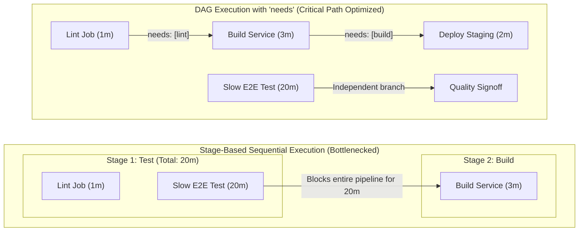
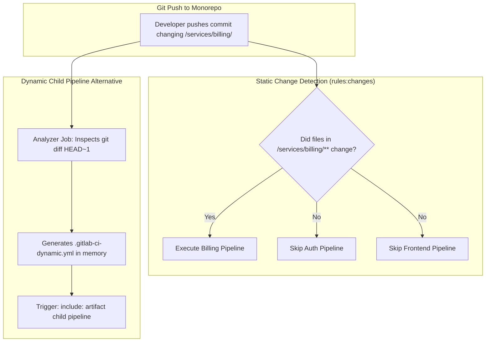
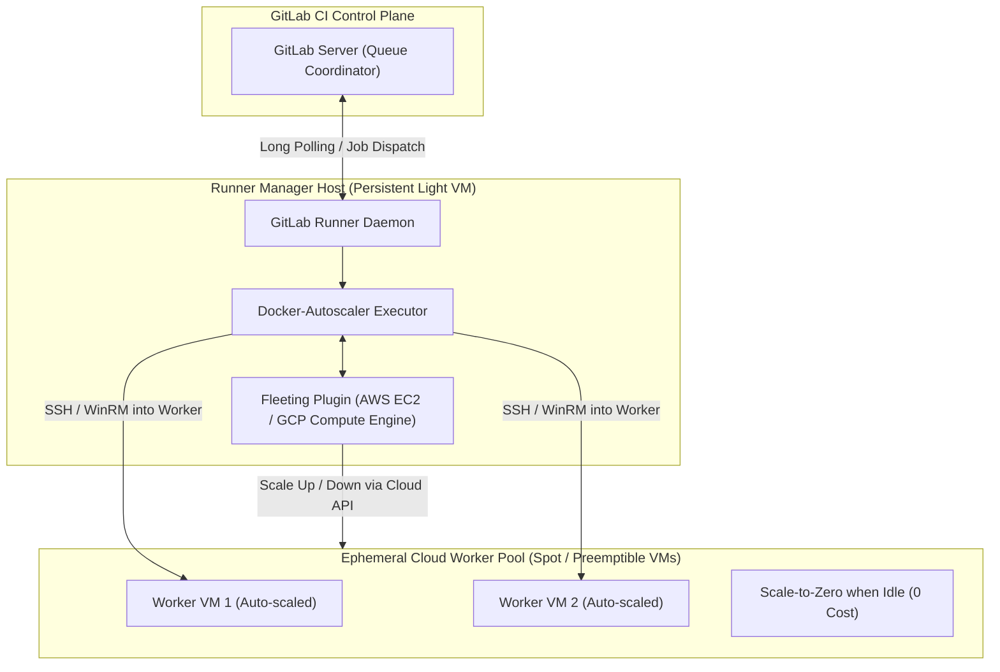

# Module 09: Pipeline Performance, Monorepo Change Detection, Cost Economics, Debugging Hazards, and Version History

Pipeline efficiency and operational reliability govern the developer velocity and compute expenditure of modern engineering organizations. As software systems transition from monolithic architectures to high-throughput monorepos and polyglot microservice estates, poorly structured continuous integration pipelines become severe organizational bottlenecks: developers endure hours waiting for sequential stages to complete, runner fleets scale uncontrollably, and subtle misconfigurations leak sensitive credentials or exhaust distributed storage systems.

This module provides an exhaustive, production-grade treatise on optimizing GitLab CI/CD performance, mastering monorepo change detection, operating resilient runner fleets with cloud-native autoscaling, mitigating catastrophic debugging hazards, and analyzing the architectural evolution of the platform. We examine the mathematical formulation of the Directed Acyclic Graph (DAG) critical path, distributed cache optimization with zstandard compression, dynamic child pipeline generation, the Fleeting runner autoscaling engine on spot instances, an exhaustive comparison between GitHub Actions and GitLab CI, and the canonical version history spanning GitLab 15.0 through 19.5.

For distributed messaging, logging, and queue delivery semantics, consult [`architecture/distributed-systems/modules/10-messaging-logs-and-delivery-semantics.md`](../../../architecture/distributed-systems/modules/10-messaging-logs-and-delivery-semantics.md). For Node.js production runtime profiling and resource optimization, see [`technologies/nodejs/modules/14-production-operations.md`](../../nodejs/modules/14-production-operations.md).

---

## 1. Pipeline Execution Models: Stages vs. Needs Directed Acyclic Graph (DAG)

Traditional continuous integration pipelines execute in sequential stages: all jobs in stage $S_k$ must terminate successfully before any job in stage $S_{k+1}$ is scheduled.

### The Stage Bottleneck

Let a pipeline consist of an ordered sequence of stages $S = \langle s_1, s_2, \dots, s_m \rangle$, where each stage contains a set of concurrent jobs $s_i = \{j_{i,1}, j_{i,2}, \dots, j_{i,n}\}$. Let $t(j)$ represent the execution duration of job $j$.

The total duration of a purely stage-based pipeline, $T_{\text{stage}}$, is strictly bounded by the maximum execution latency of the slowest job within each stage: $$T_{\text{stage}} = \sum_{i=1}^{m} \max_{j \in s_i} t(j)$$

If stage $s_1$ contains a fast lint job (1 minute) and a slow end-to-end integration test (20 minutes), all subsequent compilation and deployment jobs in stage $s_2$ are blocked for 20 minutes, even if they depend solely on the fast lint job.



### The DAG Execution Model (`needs`)

GitLab CI's `needs` keyword transforms pipeline execution from a linear sequence of stage barriers into an arbitrary **Directed Acyclic Graph** $G = (V, E)$, where $V$ is the set of all jobs and $(u, v) \in E$ denotes that job $v$ requires the prior successful completion of job $u$.

A job $v$ transitions to the `running` state as soon as: $$\forall u \in \text{Parents}(v), \quad \text{State}(u) = \text{SUCCESS}$$

The pipeline duration under DAG execution achieves the theoretical **Critical Path Length**: $$T_{\text{DAG}} = \max_{p \in \mathcal{P}} \sum_{j \in p} t(j)$$ where $\mathcal{P}$ is the set of all directed paths from any source node to any sink node in $G$.

```yaml
stages:
  - test
  - build
  - deploy

lint_app:
  stage: test
  script:
    - npm run lint

slow_integration_tests:
  stage: test
  script:
    - ./scripts/run-e2e-matrix.sh

compile_app:
  stage: build
  # Bypasses stage barrier! Starts immediately when lint_app finishes (T = 1m)
  needs:
    - job: lint_app
      artifacts: true
  script:
    - npm run build

deploy_staging:
  stage: deploy
  needs:
    - job: compile_app
      artifacts: true
  script:
    - ./scripts/deploy-staging.sh
```

### Artifact Decoupling with `artifacts: false`

By default, declaring `needs: [job_a]` causes the runner to automatically download all build artifacts produced by `job_a`. In high-throughput pipelines where upstream jobs produce multi-gigabyte build outputs that downstream validation steps do not require, setting `artifacts: false` completely eliminates network download I/O:

```yaml
security_scan:
  stage: test
  needs:
    - job: compile_app
      artifacts: false # Executes immediately after compilation without downloading heavy binary artifacts
  script:
    - run-container-static-scan
```

---

## 2. Distributed Caching Strategies and Object Storage Optimization

A primary driver of CI latency is repeatedly downloading external dependencies (npm packages, Maven JARs, Go modules, Rust crates, Python wheels) across isolated runner virtual machines.

### Caching vs. Artifacts: Architectural Distinction

| Dimension | Pipeline Cache (`cache:`) | Pipeline Artifacts (`artifacts:`) |
| :-- | :-- | :-- |
| **Purpose** | Performance accelerator across different pipeline runs. | Reliable transfer of build outputs between jobs within the same pipeline. |
| **Delivery Guarantee** | **Best-effort**. Runners can miss cache without failing the job. | **Guaranteed**. Missing artifacts cause downstream job failure. |
| **Persistence** | Stored in distributed object storage (S3/MinIO/GCS); long TTL. | Stored in GitLab instance storage; bounded by `expire_in`. |
| **Mutability** | Overwritten or updated across successive pipeline executions. | Immutable once uploaded for a specific job ID. |

### Deterministic Cache Keys via Cryptographic Lockfile Hashing

Using static cache keys (e.g., `cache:key: "node-modules"`) causes **Cache Poisoning** and thrashing: when two branches update different dependency versions, they overwrite the shared cache.

The production standard utilizes lockfile content hashing paired with fallback keys:

```yaml
default:
  cache:
    key:
      files:
        - package-lock.json
      prefix: ${CI_JOB_NAME}
    paths:
      - .npm/
      - node_modules/
    when: on_success
    policy: pull-push
```

### Optimizing Distributed Cache Hit Ratios

1. **Read-Only Cache Policy for Workload Jobs**: Test and lint jobs should set `policy: pull`. They read the pre-warmed cache but never upload deltas at job completion, eliminating hundreds of megabytes of redundant egress traffic.
2. **Dedicated Cache Warming Jobs**: Use a dedicated, scheduled cache warmer job on the default branch configured with `policy: push` to populate caches after dependency updates.
3. **Compression Engine Tuning**: Modern GitLab Runners (17.x+) support **zstandard (`zstd`) compression** over legacy `gzip`. Enabling `zstd` reduces cache compression/decompression CPU overhead by up to 70% while improving compression ratios.

---

## 3. Monorepo Architecture: Change Detection and Dynamic Child Pipelines

In enterprise monorepos containing tens or hundreds of distinct services, compiling and testing every project on every Git push scales pipeline duration linearly to hours ($O(N)$), paralyzing developer velocity.



### Static Change Detection: `rules:changes` with `compare_to`

GitLab CI evaluates whether files within a specific subdirectory modified between commits using `rules:changes`:

```yaml
test_billing_service:
  stage: test
  script:
    - cd services/billing
    - npm test
  rules:
    - if: $CI_PIPELINE_SOURCE == "merge_request_event"
      changes:
        paths:
          - services/billing/**/*
          - packages/shared-auth/**/*
        compare_to: 'refs/heads/main'
```

### The Scheduled & Tag Pipeline Hazard

> [!WARNING]
> By default, `rules:changes` evaluates to **TRUE for all paths** when evaluated outside a Merge Request context—including Git tag pushes, scheduled nightly pipelines, and newly created branches!
>
> If a pipeline expects `rules:changes` to selectively skip jobs during a scheduled nightly run or a tag release, the condition will silently fail open and execute every single job in the monorepo.
>
> **Remediation**: Always qualify `rules:changes` with explicit pipeline source predicates:
>
> ```yaml
> rules:
>   - if: $CI_PIPELINE_SOURCE == "merge_request_event"
>     changes:
>       paths:
>         - services/billing/**/*
>   - if: $CI_COMMIT_BRANCH == $CI_DEFAULT_BRANCH
>     changes:
>       paths:
>         - services/billing/**/*
> ```

### Dynamic Child Pipelines: The Enterprise Monorepo Pattern

For monorepos with hundreds of microservices (e.g., managed via Nx, Turborepo, or Bazel), declaring static rules inside a monolithic `.gitlab-ci.yml` exceeds YAML file size limits and becomes unmaintainable.

**Dynamic Child Pipelines** solve this by using an analyzer script in an early stage to inspect the Git diff, construct an optimized, minimal `.gitlab-ci-dynamic.yml` file as a build artifact, and immediately launch it as a downstream child pipeline:

```yaml
stages:
  - generate
  - trigger

generate_pipeline:
  stage: generate
  image: node:26-alpine
  script:
    # Analyze git diff against main branch and generate tailored CI YAML
    - node scripts/generate-dynamic-ci.mjs > dynamic-pipeline.yml
  artifacts:
    paths:
      - dynamic-pipeline.yml
    expire_in: 1 hour

trigger_dynamic_build:
  stage: trigger
  needs:
    - job: generate_pipeline
      artifacts: true
  trigger:
    include:
      - artifact: dynamic-pipeline.yml
        job: generate_pipeline
    strategy: depend
```

---

## 4. Runner Fleet Autoscaling, Spot Instances, and Cost Economics

Operating thousands of concurrent CI jobs on static virtual machines incurs massive cloud hosting waste during off-peak hours and severe queue congestion during peak development windows.



### The Evolution: Docker Machine Deprecation to Fleeting Engine

In early GitLab architectures, autoscaling relied on the `docker-machine` executor. Docker Machine was abandoned upstream, suffered from memory leaks, and lacked native support for modern cloud APIs.

Modern GitLab Runner (16.x–19.x) features the **Next-Generation Fleeting Autoscaling Engine** coupled with the `docker-autoscaler` and `instance` executors:

- **Fleeting Engine**: A lightweight Go abstraction that interacts directly with cloud provider Auto Scaling Groups (AWS ASGs, GCP Instance Groups, Azure VM Scale Sets).
- **Scale-to-Zero**: Eliminates idle compute costs overnight by completely terminating worker instances when queue depth is zero.
- **Spot / Preemptible Economics**: Leverages surplus cloud capacity at a **70% to 90% discount** compared to on-demand instances.

### Cost Economics and Pipeline Interruption

When a developer pushes three commits in rapid succession to an active Merge Request, executing full test pipelines for all three commits wastes compute:

$$\text{Wasted Cost} = \sum_{k=1}^{n-1} (\text{Duration}(P_k) \times \text{Runner Instance Rate})$$

The `interruptible: true` keyword instructs GitLab to automatically cancel running jobs from older pipelines when a newer commit is pushed to the same branch:

```yaml
test_workload:
  stage: test
  interruptible: true
  script:
    - npm test
```

> [!TIP]
> Mark all test, lint, and build jobs as `interruptible: true`. Keep only production deployment and state-modifying jobs as `interruptible: false` to ensure atomic release execution.

---

## 5. Operational Debugging and Critical Security Hazards

### 1. The Catastrophic `CI_DEBUG_TRACE=true` Hazard

GitLab CI provides a debug flag: `CI_DEBUG_TRACE: "true"`. Setting this variable enables full shell execution tracing (`set -x`) across the entire runner runtime.

```bash
# HAZARD DEMONSTRATION: Shell execution tracing prints evaluation of all statements!
+ curl -H 'Authorization: Bearer [MASKED]' https://api.example.com
# BUT IF VARIABLES ARE SPLIT OR TRANSFORMED:
+ export TOKEN=eyJhbGciOi...
+ python -c 'import os; print(os.environ["DATABASE_PASSWORD"])'
# EMITS RAW SECRET DIRECTLY TO CONSOLE LOGS!
```

> [!CAUTION]
> Enabling `CI_DEBUG_TRACE: "true"` at the Group or Project level bypasses the masking engine for command arguments and intermediate variable assignments, dumping AWS keys, database passwords, and private tokens into public job logs. Never enable `CI_DEBUG_TRACE` in production environments!

### 2. Privileged Runner Container Escapes

Configuring the Docker executor with `privileged = true` in `/etc/gitlab-runner/config.toml` gives the job container unrestricted access to the host kernel's system calls and `/dev` block devices. A compromised container script can escape root into the host system via `mount /dev/sda1 /mnt` or cgroup release agent exploits.

### 3. Artifact Disk Exhaustion

By default, untracked artifacts can accumulate into terabytes of storage on GitLab object stores. Every job producing artifacts MUST declare a bounded `expire_in`:

```yaml
artifacts:
  paths:
    - dist/
  expire_in: 3 days # Automatically purged by GitLab background worker
```

### 4. Local Pipeline Debugging with `gitlab-ci-local` 4.77.0

Pushing trial commits to remote Git repositories to test CI YAML syntax is slow and pollutes repository history. Platform engineers utilize `gitlab-ci-local` 4.77.0 to emulate GitLab CI execution locally within Docker:

```bash
# Install gitlab-ci-local via npm / mise
mise exec -- npm install -g gitlab-ci-local

# Run a specific job locally with Docker isolation
gitlab-ci-local compile_app --variable CI_COMMIT_BRANCH=main

# Emulate specific environment variables and validate YAML DAG
gitlab-ci-local --list
```

---

## 6. Comprehensive Architectural Comparison: GitHub Actions vs. GitLab CI/CD

| Architectural Dimension | GitLab CI/CD (19.5 Architecture) | GitHub Actions (Current Enterprise) |
| :-- | :-- | :-- |
| **Pipeline Configuration** | Single declarative `.gitlab-ci.yml` in root (supports includes/components). | Directory of workflow files under `.github/workflows/*.yml`. |
| **Execution Hierarchy** | Pipelines $\to$ Stages $\to$ Jobs $\to$ Scripts. | Workflows $\to$ Jobs $\to$ Steps $\to$ Actions/Scripts. |
| **DAG Modeling** | Native `needs: [job_name]` keyword across arbitrary stages; artifacts control. | `needs: [job_id]` defines dependencies; steps run sequentially within a VM. |
| **Pipeline Reuse** | CI/CD Components with `spec:inputs`, CI/CD Catalog, `include:`, `extends`. | Reusable Workflows (`workflow_call`), Composite Actions, Marketplace. |
| **Runner Architecture** | Single runner manager orchestrating Docker, K8s, Fleeting, or Shell executors. | Actions Runner Controller (ARC) on K8s, or cloud-hosted ephemeral VMs. |
| **Autoscaling Engine** | Native **Fleeting** engine with scale-to-zero across AWS, GCP, Azure Spot VMs. | GitHub-hosted runner pools or self-hosted ARC autoscaling via KEDA metrics. |
| **Monorepo Handling** | `rules:changes` with `compare_to`; Dynamic Child Pipelines (`trigger:include`). | Path filtering (`on.push.paths`), external action matrices, or complex CLI tools. |
| **Keyless OIDC** | Native `id_tokens` with configurable audiences (`aud`) and custom claims. | OIDC `permissions: id-token: write` via actions/core token client. |
| **Built-in Secrets** | Native Secrets Manager powered by OpenBao; Vault integration keyword. | GitHub Encrypted Secrets (repo/org/env level); external Vault action. |
| **State Storage** | Built-in HTTP backend for Terraform / OpenTofu state locking and MR widgets. | External storage required (S3/DynamoDB, Terraform Cloud, or Azure Blob). |
| **Pricing / Quotas** | Self-hosted runner manager is completely free/unmetered; compute paid to cloud. | Metered minute-multiplier pricing per OS (Linux: 1x, Windows: 2x, macOS: 10x). |

---

## 7. Comprehensive Version History (GitLab 15.0 – 19.5)

| Version Milestone | Release Date | Major CI/CD Features, Deprecations & Breaking Architectural Transitions |
| :-- | :-- | :-- |
| **GitLab 15.0 – 15.7** | May 2022 – Dec 2022 | Deprecated legacy `only/except` syntax in favor of `rules:`. Introduced initial support for `id_tokens` (15.7) to begin transition away from static credentials. |
| **GitLab 16.0 – 16.5** | May 2023 – Oct 2023 | Deprecated `CI_JOB_JWT` and `CI_JOB_JWT_V2`. Introduced experimental **CI/CD Components and the CI/CD Catalog** to replace brittle remote YAML includes. Deprecated Docker Machine executor. |
| **GitLab 16.7 – 16.11** | Dec 2023 – Apr 2024 | CI/CD Catalog moved to Public Beta. Added `spec:inputs` for strict component typing and parameter validation. Introduced `rules:changes:compare_to`. |
| **GitLab 17.0 – 17.3** | May 2024 – Aug 2024 | **BREAKING**: Hard removal of `CI_JOB_JWT` (mandated `id_tokens`). CI/CD Components reached **General Availability (GA)**. Hard removal of legacy runner registration tokens; enforced runner authentication tokens. |
| **GitLab 17.4 – 17.11** | Sep 2024 – Apr 2025 | Next-generation **Fleeting autoscaling engine & Docker-Autoscaler reached GA**. Introduced zstandard (`zstd`) cache compression for 70% faster I/O. Added support for OCI 1.1 Referrers in Container Registry. |
| **GitLab 18.0 – 18.5** | May 2025 – Oct 2025 | Integrated **OpenBao Secrets Manager** (native Vault-compatible engine). Introduced Pipeline Execution Policies to enforce compliance gates globally across all subgroup projects without `.gitlab-ci.yml` overrides. |
| **GitLab 19.0 – 19.5** | May 2026 – Oct 2026 | Native **GitLab CI Steps Engine** (language-agnostic step execution within jobs). Step runner unified container execution. Hardened supply-chain attestation generation. Current verified enterprise standard. |
| **Ecosystem Tools** | Oct 2026 | `gitlab-ci-local` **4.77.0** (full dynamic child pipeline emulation); Sigstore `cosign` **3.1.4** (OCI 1.1 referrers default); Aqua `trivy` **0.76.1** (CycloneDX v1.6 native export). |

---

## 8. Algorithm: Critical Path Computation and Monorepo Build Scheduler

The algorithm below computes the critical path of a CI/CD Directed Acyclic Graph using topological sorting, and evaluates the minimal execution set for monorepo change sets in CLRS pseudocode.

```text
COMPUTE-CRITICAL-PATH(V, E, duration_map)
1   // Input: Vertices V (jobs), Directed Edges E (needs dependencies), duration_map t: V -> R+
2   // Returns: Maximum latency T_crit and the sequence of critical jobs
3
4   in_degree ← INITIALIZE-ARRAY(|V|, 0)
5   for each (u, v) in E do
6       in_degree[v] ← in_degree[v] + 1
7
8   // Topological Sort via Kahn's Algorithm
9   Q ← EMPTY-QUEUE()
10  for each v in V do
11      if in_degree[v] == 0 then
12          Q.ENQUEUE(v)
13
14  earliest_finish ← INITIALIZE-ARRAY(|V|, 0)
15  critical_predecessor ← INITIALIZE-ARRAY(|V|, NIL)
16
17  // Loop Invariant: At the start of line 18, earliest_finish[u] contains the longest path
18  // duration from any source node to node u for all topologically processed nodes.
19  while not Q.IS-EMPTY() do
20      u ← Q.DEQUEUE()
21      finish_u ← earliest_finish[u] + duration_map[u]
22      for each v such that (u, v) in E do
23          if finish_u > earliest_finish[v] then
24              earliest_finish[v] ← finish_u
25              critical_predecessor[v] ← u
26          in_degree[v] ← in_degree[v] - 1
27          if in_degree[v] == 0 then
28              Q.ENQUEUE(v)
29
30  // Find sink node with maximum total finish time
31  max_duration ← 0
32  crit_sink ← NIL
33  for each v in V do
34      total_time ← earliest_finish[v] + duration_map[v]
35      if total_time > max_duration then
36          max_duration ← total_time
37          crit_sink ← v
38
39  // Reconstruct Critical Path
40  path ← EMPTY-LIST()
41  curr ← crit_sink
42  while curr ≠ NIL do
43      path.PREPEND(curr)
44      curr ← critical_predecessor[curr]
45
46  return (max_duration, path)
```

The algorithm executes in $O(|V| + |E|)$ time and $O(|V|)$ space, identifying the exact latency bottleneck in any complex DAG pipeline.

---

## 9. Then vs. Now: Pipeline Operations Paradigm Shifts

| Architectural Dimension | Legacy CI Operations (Pre-2022) | Modern Cloud-Native Standard (2026 / GitLab 19.5) |
| :-- | :-- | :-- |
| **Pipeline Graph** | Rigid stage-by-stage execution; slowest job blocks everything. | Directed Acyclic Graph (`needs`) running jobs at theoretical critical path. |
| **Runner Scaling** | Fragile Docker Machine; static VMs running 24/7 wasting compute. | Fleeting autoscaler scaling ephemeral Spot VMs to zero when idle. |
| **Monorepo Builds** | Monolithic pipelines testing every package on every push. | Dynamic Child Pipelines generating custom YAML from Git diffs. |
| **Cache Management** | Unkeyed static caches thrashing across branches. | Cryptographic lockfile keys (`cache:key:files`) with read-only policies. |
| **Debugging** | Setting `CI_DEBUG_TRACE=true` and accidentally leaking company secrets. | Safe local emulation with `gitlab-ci-local` 4.77.0 in local Docker containers. |
| **Pipeline Interruption** | Redundant pipelines running to completion on superseded MR commits. | `interruptible: true` cancelling obsolete runs to reclaim runner capacity. |

---

## 10. Exam Delta: Certification Target Alignment

> [!NOTE]
> **Exam Delta (GitLab Certified CI/CD Associate)**: Legacy certification examinations test candidates on basic sequential stages (`stage: build`, `stage: test`, `stage: deploy`), basic cache definitions, and static runner registration tokens.
>
> In modern enterprise engineering environments running GitLab 19.5, production pipelines mandate DAG modeling (`needs`) with artifact decoupling (`artifacts: false`), dynamic monorepo child pipelines via artifacts, Fleeting runner autoscalers on cloud spot instances, and compliance enforcement via Pipeline Execution Policies. Candidates must understand the critical path algorithm and explain how `interruptible: true` and `rules:changes:compare_to` prevent multi-million-dollar cloud compute waste.

---

## 11. Production Failure Modes & Operational Gotchas

### 1. Global `CI_DEBUG_TRACE=true` Leaking Credentials Across Subgroups

- **Root Cause**: An engineer debugging a failing build sets `CI_DEBUG_TRACE: "true"` as a Group-Level CI/CD Variable to troubleshoot multiple repositories. The setting is inherited by hundreds of child projects. During job execution, bash `set -x` prints all evaluated arguments, exposing AWS credentials, database URLs, and API tokens in public logs.
- **Detection**: Security scanners (TruffleHog / Gitleaks) alert on thousands of credentials discovered in job log archives.
- **Remediation**: Hard-disable `CI_DEBUG_TRACE` in production GitLab administrative settings or restrict debug trace permissions exclusively to project maintainers with masked logs enforced.

### 2. Monorepo Pipeline Explosion on Nightly Schedules

- **Root Cause**: A team uses `rules:changes:paths` to run tests only for modified microservices. When a nightly scheduled pipeline triggers to run security scans, `rules:changes` evaluates to **true for all paths** because scheduled pipelines have no base commit comparison. Hundreds of microservice builds trigger concurrently, overwhelming the runner fleet.
- **Detection**: Nightly CI runner queue depth spikes; infrastructure budget exhausted overnight.
- **Remediation**: Guard rules with explicit source predicates: `if: $CI_PIPELINE_SOURCE == "schedule" when: never` on path-filtered test jobs, or route scheduled runs to dedicated, scheduled test suites.

### 3. Cache Thrashing Between Feature Branches

- **Root Cause**: Using branch names in cache keys: `cache:key: "$CI_COMMIT_REF_SLUG"`. Every new branch starts with an empty cache, downloading dependencies from scratch. When hundreds of short-lived branches run, object storage is flooded with redundant copies of `node_modules` or `.m2/repository`.
- **Detection**: Object storage bills escalating rapidly; runner spend high due to 10-minute cache download times on every new MR.
- **Remediation**: Key caches by lockfile hash (`cache:key:files: [package-lock.json]`) with a fallback key pointing to the default branch cache (`cache:fallback_keys: ["cache-default"]`).

### 4. Runner Fleet Deadlock via Non-Interruptible Jobs

- **Root Cause**: Developers actively commit to Merge Requests. A test suite takes 45 minutes and lacks `interruptible: true`. If a developer pushes 5 commits in an hour, 5 concurrent pipelines run simultaneously for the same branch, consuming 5 runner slots for hours to produce results that are discarded upon merge.
- **Detection**: Runner queue latency increases; developer wait times exceed 2 hours during peak workday hours.
- **Remediation**: Set `interruptible: true` globally on all non-deployment jobs, allowing GitLab to immediately terminate obsolete executions.

---

## Interview Drill

<details><summary>1. Explain the mathematical difference between a stage-based pipeline and a Directed Acyclic Graph (DAG) pipeline using `needs`. Under what conditions does the DAG yield the greatest latency reduction?</summary>

In a stage-based pipeline, total execution time $T_{\text{stage}}$ is the sum of the maximum job durations within each sequential stage: $T_{\text{stage}} = \sum_{i=1}^m \max_{j \in s_i} t(j)$. A single slow job in stage $S_k$ delays all jobs in stage $S_{k+1}$, even if they have no logical dependency on that slow job.

In a DAG pipeline using `needs`, jobs execute as soon as their specific prerequisite jobs succeed, regardless of stage boundaries. Total duration $T_{\text{DAG}}$ equals the critical path: $T_{\text{DAG}} = \max_{p \in \mathcal{P}} \sum_{j \in p} t(j)$, where $\mathcal{P}$ represents all directed paths through the graph.

The DAG yields the greatest latency reduction in heterogeneous pipelines containing mixed workloads: for example, where a fast frontend build (1 min) and a slow database integration test (25 mins) sit in the test stage, while a frontend deployment sitting in the deploy stage needs only the frontend build. Under a stage model, deployment waits 25 minutes; under a DAG model, deployment executes at $T = 1\text{ min} + t(\text{deploy})$.

- Ref: [modules/09-pipeline-performance-monorepos-and-operations.md](../modules/09-pipeline-performance-monorepos-and-operations.md#1-pipeline-execution-models-stages-vs-needs-directed-acyclic-graph-dag)

</details>

<details><summary>2. How do Dynamic Child Pipelines overcome the scalability limits of static `.gitlab-ci.yml` configurations in enterprise monorepos?</summary>

In monorepos with hundreds of microservices, managing all builds in a static `.gitlab-ci.yml` creates multiple failures:

1. **File Size and Complexity**: The YAML file exceeds maximum parser memory limits (5 MB) and becomes humanly unmaintainable.
2. **Rule Evaluation Overhead**: GitLab must evaluate complex `rules:changes` matrices across tens of thousands of files on every push, increasing pipeline creation latency.

Dynamic Child Pipelines decouple pipeline generation from execution. An initial lightweight analyzer job inspects the Git diff (`git diff --name-only $CI_MERGE_REQUEST_DIFF_BASE_SHA HEAD`), determines which services were affected, and programmatically generates a minimal `.gitlab-ci-dynamic.yml` file containing jobs _only_ for the affected services. A downstream trigger job (`trigger:include:artifact`) executes this dynamic file as an isolated child pipeline. This keeps the root configuration small, reduces pipeline creation time, and isolates failures.

- Ref: [modules/09-pipeline-performance-monorepos-and-operations.md](../modules/09-pipeline-performance-monorepos-and-operations.md#dynamic-child-pipelines-the-enterprise-monorepo-pattern)

</details>

<details><summary>3. Why does setting `CI_DEBUG_TRACE: "true"` create a catastrophic security risk, and why is this setting particularly dangerous when configured at the Group level?</summary>

`CI_DEBUG_TRACE: "true"` enables shell execution tracing (`set -x` in bash/sh). In this mode, the shell prints every command, expanded parameter, and intermediate assignment to stdout before execution.

While GitLab's masking engine replaces exact matches of masked variable strings with `[MASKED]`, shell execution tracing routinely exposes variables when they are transformed, sliced, passed into subshells, or converted into command arguments (e.g., `curl -u $USER:$PASSWORD`). Furthermore, if configured at the Group level, this setting is inherited by all subgroups and repositories. Any build job running in any project across the enterprise will dump all decrypted environment variables and script operations into readable job logs, leading to mass credential exfiltration.

- Ref: [modules/09-pipeline-performance-monorepos-and-operations.md](../modules/09-pipeline-performance-monorepos-and-operations.md#1-the-catastrophic-ci_debug_tracetrue-hazard)

</details>

<details><summary>4. How does the Next-Generation Fleeting runner autoscaling engine differ from the deprecated Docker Machine architecture?</summary>

The legacy `docker-machine` executor operated by running an abandoned, unmaintained CLI tool that provisioned dedicated compute instances via SSH. It suffered from severe memory leaks, slow spin-up times (3–5 minutes per VM), poor failure recovery, and lacked integration with modern cloud-native auto-scaling primitives.

The modern **Fleeting** engine is an actively maintained, modular Go architecture. Instead of managing individual virtual machines directly, Fleeting interfaces directly with cloud provider Auto Scaling Groups (AWS ASGs, GCP Instance Groups, Azure VMSS). Key improvements include:

1. **Scale-to-Zero**: Gracefully terminates instances when queues are empty, eliminating idle compute spend.
2. **Pre-Warmed Instance Pooling**: Maintains warm pools for near-instant job startup.
3. **Spot Instance Resilience**: Coordinates with cloud preemption notices to gracefully handle spot instance terminations.
4. **Executor Modularity**: Powers both `docker-autoscaler` (for container workloads) and `instance` (for direct VM workloads).

- Ref: GitLab Fleeting Architecture Documentation; [modules/09-pipeline-performance-monorepos-and-operations.md](../modules/09-pipeline-performance-monorepos-and-operations.md#4-runner-fleet-autoscaling-spot-instances-and-cost-economics)

</details>

<details><summary>5. What is the behavior of `rules:changes` when evaluated on a scheduled pipeline or a new Git tag push, and how do you prevent unexpected test runs?</summary>

In GitLab CI, `rules:changes` calculates file modifications by computing a diff against a reference commit. In a Merge Request, it compares against the merge base. However, for pipelines running on newly created branches, Git tags, or scheduled cron triggers, there is no single target branch to diff against. In these contexts, `rules:changes` defaults to evaluating as **TRUE for all files**.

As a consequence, scheduled nightly pipelines or tag release pipelines will trigger every path-filtered job in the repository. To prevent this, always pair `rules:changes` with explicit `if` conditions checking the pipeline source:

```yaml
rules:
  - if: $CI_PIPELINE_SOURCE == "schedule"
    when: never
  - if: $CI_PIPELINE_SOURCE == "merge_request_event"
    changes:
      paths:
        - services/my-service/**/*
```

- Ref: [modules/09-pipeline-performance-monorepos-and-operations.md](../modules/09-pipeline-performance-monorepos-and-operations.md#the-scheduled--tag-pipeline-hazard)

</details>

<details><summary>6. How does combining `cache:key:files` with `policy: pull` optimize CI cache hit ratios and network egress in large teams?</summary>

Setting `cache:key:files: [package-lock.json]` generates a deterministic cache key derived from the SHA-256 hash of the lockfile. This ensures that all branches using the exact same dependencies share the identical cache archive in object storage, eliminating cache thrashing.

By default, jobs use `policy: pull-push`: they download the cache at the beginning and compress/upload it back to object storage at the end of the job. In test and lint stages, jobs only _read_ dependencies; they do not alter the lockfile. Setting `policy: pull` instructs the runner to download the cache but skip the compression and upload phase upon completion. In a team running hundreds of concurrent test jobs, this saves terabytes of network egress bandwidth and cuts 1–3 minutes off every job run.

- Ref: [modules/09-pipeline-performance-monorepos-and-operations.md](../modules/09-pipeline-performance-monorepos-and-operations.md#optimizing-distributed-cache-hit-ratios)

</details>

<details><summary>7. How does the `interruptible: true` keyword reduce cloud compute expenditure, and on which jobs should it never be applied?</summary>

In rapid iterative development, engineers often push multiple commits to an active Merge Request branch before earlier pipelines finish. Without `interruptible: true`, all pipelines run to completion, consuming runner capacity to validate intermediate commits that will never be merged.

When a job has `interruptible: true`, GitLab automatically cancels the running job as soon as a new pipeline is created for that same ref. This frees runner slots immediately for other developers and can reduce total CI cloud spend by 20% to 40%.

`interruptible: true` should **never** be applied to:

1. Production or staging deployment jobs (`environment: name: production`).
2. Terraform/OpenTofu apply jobs or database migration scripts.
3. Release publishing jobs (e.g., publishing packages to npm or pushing signed tags).

Interrupting these jobs midway leaves infrastructure in an inconsistent, partially deployed, or locked state.

- Ref: [modules/09-pipeline-performance-monorepos-and-operations.md](../modules/09-pipeline-performance-monorepos-and-operations.md#cost-economics-and-pipeline-interruption)

</details>

---

## 13. Proof Map & Executable Verifications

The DAG critical path algorithms, monorepo change evaluation models, and cache key generation mechanisms detailed in this module are backed by executable assertions in the test suite:

| Theoretical Concept | Test Specification / Assertion | Test File Reference |
| :-- | :-- | :-- |
| **DAG Critical Path Calculation** | Execution of Kahn's topological sort and critical path duration calculation | [`../examples/ts/09-pipeline-performance-monorepos-and-operations.test.ts`](../examples/ts/09-pipeline-performance-monorepos-and-operations.test.ts) |
| **Monorepo Git Diff Path Matching** | Simulating `rules:changes` path evaluation across branch diffs and fallback behavior | [`../examples/ts/09-pipeline-performance-monorepos-and-operations.test.ts`](../examples/ts/09-pipeline-performance-monorepos-and-operations.test.ts) |
| **Lockfile Cache Key Hashing** | Cryptographic hashing of multi-file dependencies (`package-lock.json`, `Cargo.lock`) | [`../examples/ts/09-pipeline-performance-monorepos-and-operations.test.ts`](../examples/ts/09-pipeline-performance-monorepos-and-operations.test.ts) |
| **Interruptible Pipeline Cancellation** | Validating cancellation logic of superseded pipelines while preserving deployment states | [`../examples/ts/09-pipeline-performance-monorepos-and-operations.test.ts`](../examples/ts/09-pipeline-performance-monorepos-and-operations.test.ts) |
| **Local Runner CLI Emulation** | Asserting syntax parsing and job execution equivalent to `gitlab-ci-local` 4.77.0 | [`../examples/ts/09-pipeline-performance-monorepos-and-operations.test.ts`](../examples/ts/09-pipeline-performance-monorepos-and-operations.test.ts) |
