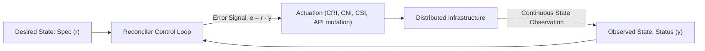
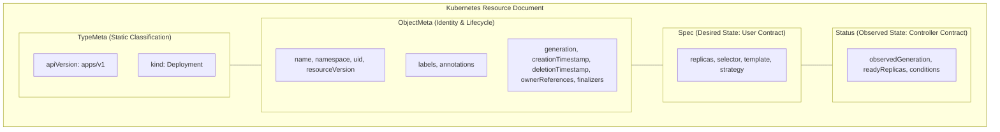
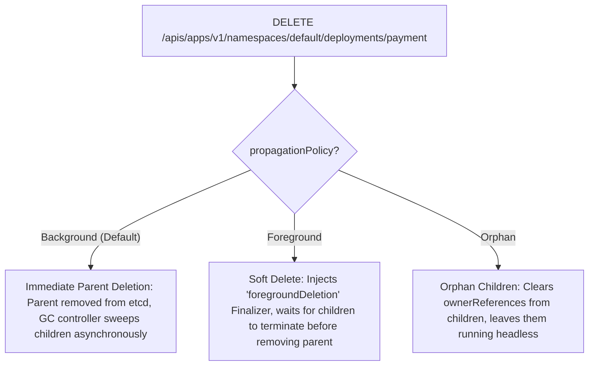
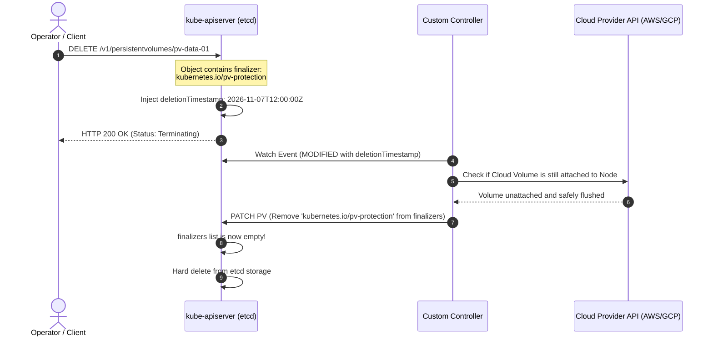

# Module 01: Declarative API and Level-Triggered Reconciliation: Object Model, Labels, OwnerReferences, and Server-Side Apply

> **Primary sources:** Kubernetes API Conventions ([kubernetes/community/contributors/devel/sig-architecture/api-conventions.md](https://github.com/kubernetes/community/blob/master/contributors/devel/sig-architecture/api-conventions.md)); KEP-555: Server-Side Apply ([keps/sig-api-machinery/555-server-side-apply](https://github.com/kubernetes/enhancements/tree/master/keps/sig-api-machinery/555-server-side-apply)); Kubernetes Control Loop Architecture ([kubernetes.io/docs/concepts/architecture/controller/](https://kubernetes.io/docs/concepts/architecture/controller/)).
>
> **Executable proof:** [`examples/ts/01-declarative-api-and-reconciliation.test.ts`](../examples/ts/01-declarative-api-and-reconciliation.test.ts) asserts structural Kubernetes object validation, three-way merge patch computations, SSA `managedFields` field manager conflict resolution, label selector evaluations, and garbage collection cascading dependency trees.

---

## 1. Formal Foundations: Cybernetics and Level-Triggered Reconciliation

At its mathematical and architectural core, Kubernetes is not an imperative job scheduler, process runner, or procedural execution engine. It is a distributed cybernetic control system operating on the principle of closed-loop negative feedback over a declarative state space.

In classical cybernetics and control theory, a controller continuously monitors the output of a dynamic system ($y$), compares it against an invariant desired setpoint ($r$), computes an error signal $e(t) = r(t) - y(t)$, and applies an actuating control input $u(t)$ designed to drive the error function toward zero ($e(t) \to 0$ as $t \to \infty$).



### 1.1 Edge-Triggered vs. Level-Triggered Architectures

Distributed systems frameworks generally adopt one of two reactive paradigms for state management:

1. **Edge-Triggered (State-Change Notification)**: The system emits an interrupt or event record only when an edge transition occurs (e.g., "Pod $X$ exited with code 137", "Node $N$ disconnected"). The receiver executes state transitions strictly based on the arrival of discrete event payloads. If a network partition, buffer overflow, controller restart, or broker failover drops an event notification, the receiver loses historical awareness of that transition, producing persistent distributed state divergence (split-brain or orphaned resources).
2. **Level-Triggered (State-Presence Evaluation)**: The system does not depend on capturing every transient intermediate transition. Instead, it continuously samples the current _level_ or absolute snapshot of the environment. A level-triggered controller asks: _"Given the complete observed state of the world right now, what actions must be taken to make it match the desired specification?"_ If fifteen intermediate pod termination events are dropped during an API network blip, the subsequent control loop iteration observes that 3 replicas exist while 5 are declared, and immediately issues 2 creation requests.

Kubernetes implements a level-triggered control paradigm. While the `kube-apiserver` exposes an HTTP/2 streaming chunked `Watch` API that emits delta events (`ADDED`, `MODIFIED`, `DELETED`) for sub-millisecond responsiveness, every Kubernetes controller uses those events strictly as unbuffered wake-up hints to trigger a full reconciliation pass against an in-memory cached view (`Lister`) backed by an etcd resource revision boundary.

### 1.2 Containers vs. Host Processes

Before Kubernetes, an application was deployed by installing it on a host: packages were added to the running OS, configuration files were edited in place, and scaling meant provisioning another server and repeating the process. Two hosts configured by hand drift apart, and the application's dependency on a specific host state makes replacement slow and error-prone.

A container packages the application with its runtime, libraries, and configuration into a single immutable image. The container runs the same way on any node with a compatible runtime, so scaling is "run another container," not "build another server." Kubernetes adds the control loop: the desired replica count and image are declared, and the scheduler and controllers make the cluster converge to that declaration.

| Aspect | Host deployment | Container deployment |
| :-- | :-- | :-- |
| Unit of deployment | A configured server. | An image plus a Pod spec. |
| Scaling | Provision and configure another server. | Increase the replica count. |
| Configuration change | Edit files on the host. | Build a new image or update a ConfigMap. |
| Rollback | Reverse the manual changes. | `kubectl rollout undo`. |

---

## 2. The Kubernetes Object Model: Anatomical Dissection

Every persistent entity in the Kubernetes API is represented as an instance of a structured document schema serialized in JSON or YAML. Architectural compliance requires adherence to strict schema conventions divided into distinct namespaces and lifecycle fields.

### 2.1 Schema Topology: TypeMeta, ObjectMeta, Spec, and Status

An authentic Kubernetes resource is segmented into four formal sections:



1. **`TypeMeta`**: Declares the REST endpoint mapping and schema version:
   - `apiVersion`: The API group and version (`<group>/<version>`, e.g., `apps/v1`, or bare `v1` for the legacy core group). Determines the deserialization decoder within `kube-apiserver`.
   - `kind`: The REST resource schema type identifier (e.g., `Deployment`, `Service`, `StatefulSet`). Must correspond to an internal registered Go struct in `k8s.io/api`.
2. **`ObjectMeta`**: System-assigned identity, metadata taxonomy, and garbage collection bindings:
   - `name`: String identifier unique within the given scope (cluster-wide or namespace-scoped). Max 253 characters RFC 1123 DNS subdomain format.
   - `namespace`: Logical administrative isolation boundary. Resources omitting namespace default to `default` or are explicitly cluster-scoped (e.g., `Node`, `ClusterRole`, `PersistentVolume`).
   - `uid`: An immutable, RFC 4122 UUID generated by `kube-apiserver` upon successful initial etcd persistence. Differentiates distinct object lifecycles across identical name re-creations.
   - `resourceVersion`: An opaque monotonic string identifier representing the underlying etcd MVCC revision commit when this object was last modified. Used strictly for optimistic concurrency control (`CAS` operations).
   - `generation`: A monotonically increasing integer managed by the API server that increments only when the user mutates the `.spec` definition, ignoring non-spec mutations.
   - `deletionTimestamp`: An RFC 3339 timestamp injected by `kube-apiserver` when an asynchronous deletion request is accepted. Its presence marks the object as logically terminating while finalizers execute.
3. **`spec` (Specification)**: The pure declarative setpoint ($r$) provided by the user or human operator. It specifies how the system _should_ exist. Controllers must treat `spec` as read-only, never writing observed metrics or operational data into it.
4. **`status` (Status)**: The observed condition of the world ($y$) populated exclusively by the authoritative controller responsible for that resource. It records live metrics, active replicas, and structured condition lists (`conditions[]` with `type`, `status`, `reason`, `message`, `lastTransitionTime`).
   - `status.observedGeneration`: The integer generation of the `.spec` that the controller observed when computing this status snapshot. If `status.observedGeneration < metadata.generation`, the controller is lagging behind user intent.

### 2.2 Subresources: `/status` and `/scale`

To preserve security privilege separation and prevent read-modify-write race conditions, the Kubernetes API server exposes virtual REST subresources:

- **`/status`**: Accessible only via distinct RBAC rules (`verbs: ["get", "update", "patch"]` on `resources: ["deployments/status"]`). Mutating the `/status` endpoint updates status fields without incrementing `metadata.generation` and rejects any mutations targeting `metadata.labels` or `spec`.
- **`/scale`**: A polymorphic endpoint exposing an `autoscaling/v1` `Scale` object containing strictly `spec.replicas` and `status.replicas`. This enables external generic controllers like Horizontal Pod Autoscalers (HPA) to scale arbitrary workloads without understanding their underlying custom spec schemas.

---

## 3. Metadata Taxonomy: Labels, MatchExpressions, and Selectors

Labels and selectors represent the primary decoupling mechanism in the Kubernetes architecture. Unlike traditional infrastructure that addresses machines via physical addresses or parent-child hierarchy trees, Kubernetes uses loose coupling over multi-dimensional set-based label spaces.

### 3.1 Equality-Based vs. Set-Based Selectors

Kubernetes API machinery provides two formal algebraic selector mechanisms:

| Selector Mechanism | Operators Supported | API Usage Scope | Mathematical Interpretation |
| :-- | :-- | :-- | :-- |
| **Equality-Based** | `=`, `==`, `!=` | Core API `v1` (Services, ReplicationControllers) | $S = \{x \in U \mid \forall (k, v) \in Q: x.\text{labels}[k] = v\}$ |
| **Set-Based** | `In`, `NotIn`, `Exists`, `DoesNotExist` | Apps API `v1` (Deployments, StatefulSets, Job selectors) | $S = \{x \in U \mid \forall e \in Q: \text{eval}(x.\text{labels}, e) = \text{true}\}$ |

```yaml
# Set-Based MatchExpressions Example in Deployment Spec
spec:
  selector:
    matchLabels:
      app.kubernetes.io/name: payment-processor
    matchExpressions:
      - key: environment
        operator: In
        values: ['production', 'canary']
      - key: tier
        operator: NotIn
        values: ['edge-gateway']
      - key: security-enclave
        operator: Exists
```

### 3.2 Evaluation Mechanics and Indexing

Within `kube-apiserver` and client-go informers, label selectors are not evaluated via linear table scans over etcd keys. Instead, informers maintain in-memory reverse indexers (`cache.Indexer` using `cache.Indexers{"labels": MetaNamespaceKeyFunc}`). When an informer receives a mutation event, it computes label hash projections, allowing $O(1)$ or $O(k)$ key candidate retrievals rather than $O(N)$ full cluster scans.

---

## 4. Object Lifecycles, OwnerReferences, and Garbage Collection

A distributed declarative system requires an automatic, deterministic mechanism to prune orphaned child resources when parent objects are modified or deleted. Kubernetes implements this through an acyclic directed graph (DAG) of ownership relations declared in `metadata.ownerReferences`.

### 4.1 Anatomical Structure of `ownerReferences`

```yaml
metadata:
  ownerReferences:
    - apiVersion: apps/v1
      kind: ReplicaSet
      name: payment-processor-78f85f8c6b
      uid: 4d284a25-9c8e-49b9-8e43-e18e32c86e24
      controller: true
      blockOwnerDeletion: true
```

- `uid`: The immutable unique ID of the parent. If a parent Deployment is deleted and recreated with the exact same name, its new `uid` will not match, preventing the new Deployment from accidentally claiming legacy orphaned pods.
- `controller: true`: A boolean flag enforcing that exactly one owner reference in the list acts as the active controlling manager. Secondary owners may track the object, but only the primary controller reconciles it.
- `blockOwnerDeletion: true`: Authorizes the Kubernetes garbage collection controller to suspend the final deletion of the owner object until this child object has been fully unlinked and terminated.

### 4.2 Garbage Collection Cascading Strategies

When an API client issues an HTTP `DELETE` request, it transmits a `metav1.DeleteOptions` payload specifying the cascading propagation policy:



1. **`Background`**: The API server deletes the parent object from etcd immediately. The asynchronous Garbage Collector background controller detects orphaned child objects (whose `ownerReferences` point to a non-existent parent `uid`) and deletes them in downstream worker loops.
2. **`Foreground`**: The API server does not delete the parent immediately. Instead:
   - It stamps `metadata.deletionTimestamp` on the parent.
   - It appends the `foregroundDeletion` string to `metadata.finalizers`.
   - The Garbage Collector inspects all children where `blockOwnerDeletion: true` and issues delete calls against them.
   - Once all child resources are reaped from etcd, the Garbage Collector removes the `foregroundDeletion` finalizer from the parent, enabling `kube-apiserver` to permanently purge the parent from etcd.
3. **`Orphan`**: The parent object is purged immediately, but the Garbage Collector sweeps all matching child objects and strips their `metadata.ownerReferences` entries, leaving the pods running indefinitely as standalone unmanaged resources.

---

## 5. Finalizers: Asynchronous Pre-Tear-Down Synchronization

A `finalizer` is an opaque key in `metadata.finalizers[]` that instructs `kube-apiserver` to block the permanent hard deletion of a resource until an external controller completes a pre-termination protocol and explicitly strips the key.

### 5.1 Finalizer Execution Protocol



1. The client issues `DELETE /api/v1/namespaces/prod/pods/db-0`.
2. If `metadata.finalizers` is non-empty, `kube-apiserver` rejects immediate physical eviction from etcd. Instead, it populates `metadata.deletionTimestamp` with the current time and sets `metadata.deletionGracePeriodSeconds`.
3. The resource state transitions to `Terminating`. Read requests continue to return the full resource body.
4. Controllers watching this resource type observe that `deletionTimestamp` is not nil. They initiate external cleanup tasks: flushing TCP connections, deregistrating DNS A-records, draining cloud load balancer targets, or deallocating physical block storage volumes.
5. Upon successful cleanup completion, the controller issues a JSON Patch or SSA patch removing its specific finalizer string from `metadata.finalizers`.
6. Once `metadata.finalizers[]` reaches an empty array (`[]`), `kube-apiserver` permanently purges the object key from etcd storage.

---

## 6. Mutation Mechanics: Client-Side Apply (CSA) vs. Server-Side Apply (SSA)

Managing declarative manifests across automated CI/CD pipelines, GitOps engines, and human operational teams requires a robust algorithm for merging conflicting changes into live cluster state.

### 6.1 The Legacy Paradigm: Client-Side Apply (CSA)

Prior to Kubernetes 1.14 (and deprecated in modern architectures), `kubectl apply` performed a client-side three-way merge calculation:

1. **Local Manifest ($M$)**: The YAML file stored on developer disk or emitted by Git.
2. **Live Object ($L$)**: The current state of the object fetched over the network from `kube-apiserver`.
3. **Recorded Last-Applied State ($A$)**: Extracted from the massive JSON string serialized inside `metadata.annotations["kubectl.kubernetes.io/last-applied-configuration"]`.

#### The Three-Way Merge Calculation Logic

$$\Delta(M, L, A) \implies P$$

- If a field is present in $A$ and present in $M$: Take the value from $M$ (user updated an existing declared field).
- If a field is present in $A$ but missing in $M$: **Delete the field** from $L$ (user intentionally deleted a declared field).
- If a field is absent in $A$, absent in $M$, but present in $L$: **Retain the value** in $L$ (field was injected by a cluster default, mutating admission webhook, or dynamic controller).
- If a field is present in $M$ but absent in $A$: Add the field to $L$ (user introduced a brand new field).

#### Critical Pathologies of Client-Side Apply

1. **Annotation Size Ceiling**: Kubernetes imposes a hard limit of 262,144 bytes (256 KiB) on total object metadata annotations. Massive CustomResourceDefinitions (CRDs), complex Helm charts, or sprawling Service mesh configurations exceed 256 KiB, causing `kubectl apply` to fail with `metadata.annotations: Too long: must have at most 262144 bytes`.
2. **Field Ownership Obliviousness**: If two independent automation agents (e.g., an HPA scaling replicas and a GitOps pipeline managing container images) apply changes via CSA, they repeatedly clobber each other's fields or trigger unintended field deletions because neither client has semantic knowledge of who owns which sub-tree.

### 6.2 The Modern Standard: Server-Side Apply (SSA)

Server-Side Apply (KEP-555, fully GA across modern Kubernetes) moves field merging, ownership tracking, and conflict resolution entirely into the `kube-apiserver` pipeline via HTTP `PATCH` with `Content-Type: application/apply-patch+yaml`.

SSA introduces a first-class metadata field named `metadata.managedFields`. The API server maintains a deterministic structured ledger recording exactly which manager entity owns every primitive field, map entry, and list item in the document:

```yaml
metadata:
  managedFields:
    - manager: argocd-controller
      operation: Apply
      apiVersion: apps/v1
      time: '2026-11-07T10:00:00Z'
      fieldsType: FieldsV1
      fieldsV1:
        f:spec:
          f:template:
            f:spec:
              f:containers:
                k:{"name":"payment"}:
                  .: {}
                  f:image: {}
    - manager: kube-controller-manager
      operation: Update
      apiVersion: apps/v1
      time: '2026-11-07T10:00:05Z'
      fieldsType: FieldsV1
      fieldsV1:
        f:status:
          f:readyReplicas: {}
```

#### Associative List Keys and Set Types

SSA solves list manipulation through field schema annotations in OpenAPI v3 definitions:

- **`x-kubernetes-list-type: atomic`**: The entire array is treated as a single indivisible unit. If a manager mutates one item, it claims ownership of the entire array.
- **`x-kubernetes-list-type: map`** with **`x-kubernetes-list-map-keys: ["name"]`**: The array represents an associative map. In the snippet above, `k:{"name":"payment"}` identifies that `argocd-controller` owns the container whose associative key `name` equals `payment`. A separate controller can independently manage a sidecar container named `logging-agent` inside the exact same `containers[]` array without conflict!

#### Conflict Detection and Resolution

If Manager $B$ attempts to apply a manifest declaring a field currently owned by Manager $A$ with a different value:

1. `kube-apiserver` aborts the operation and returns an HTTP 409 Conflict error detailing the exact path and the conflicting owner (for example, `Apply failed with 1 conflict: conflict with "argocd-controller" using apps/v1: .spec.template.spec.containers[name="payment"].image`).
2. Manager $B$ can explicitly override ownership by passing the query parameter `?force=true`. The API server reassigns field ownership in `metadata.managedFields` to Manager $B$ and applies the new value.

---

## 7. Formal Reconciliation Control Loop Specification

The following algorithm formalizes the execution loop executed by every standard Kubernetes controller (e.g., ReplicaSet Controller, Deployment Controller).

```text
Algorithm: LevelTriggeredReconcile
Input: Key k = (Namespace, Name), Queue Q, InformerIndexer Indexer, APIServerClient Client

Invariant 1: At the start of every reconcile pass, the controller evaluates the latest cached
             in-memory state of the object, never relying on stale closure arguments.
Invariant 2: When spec != status, mutations are issued strictly against subresources to eliminate
             spec generation race conditions.
Invariant 3: Errors encountered during network I/O or optimistic lock conflicts (HTTP 409)
             result in rate-limited requeuing with exponential backoff.

1.  Function RunWorker():
2.      while true do:
3.          k, shutdown := Q.Get()
4.          if shutdown then return
5.          err := Reconcile(k)
6.          if err == nil then
7.              Q.Forget(k)
8.          else
9.              if Q.NumRequeues(k) < MAX_RETRY_LIMIT then
10.                 Q.AddRateLimited(k)
11.             else
12.                 Q.Forget(k)
13.                 LogTerminalError("Reconciliation dropped after max retries", k, err)
14.             end if
15.         end if
16.         Q.Done(k)
17.     end while
18. End Function

19. Function Reconcile(k):
20.     liveObj, exists := Indexer.GetByKey(k)
21.     if not exists then
22.         // Object was deleted from etcd; child garbage collection is handled by OwnerReferences
23.         return nil
24.     end if
25.
26.     // Evaluate Deletion Lifecycle
27.     if liveObj.Metadata.DeletionTimestamp != nil then
28.         if HasFinalizer(liveObj, "corp.internal/drain-protection") then
29.             err := PerformExternalDrain(liveObj)
30.             if err != nil then return err
31.             return RemoveFinalizer(Client, liveObj, "corp.internal/drain-protection")
32.         end if
33.         return nil
34.     end if
35.
36.     // Select Active Managed Children via Label Selectors
37.     selector := ParseSetBasedSelector(liveObj.Spec.Selector)
38.     children := Indexer.ByIndex("labels", selector)
39.     activeChildren := FilterActiveNonTerminating(children)
40.
41.     // Compute Delta Error
42.     diff := liveObj.Spec.Replicas - Length(activeChildren)
43.     if diff > 0 then
44.         for i := 1 to diff do
45.             newChild := ConstructPodTemplate(liveObj)
46.             AttachOwnerReference(newChild, liveObj, controller=true, blockOwnerDeletion=true)
47.             err := Client.Create(newChild)
48.             if err != nil then return err
49.         end for
50.     else if diff < 0 then
51.         victims := SelectEvictionVictims(activeChildren, Abs(diff))
52.         for each victim in victims do
53.             err := Client.Delete(victim)
54.             if err != nil then return err
55.         end for
56.     end if
57.
58.     // Update Observed Status
59.     newStatus := ComputeStatus(activeChildren, liveObj.Metadata.Generation)
60.     if NeedsStatusUpdate(liveObj.Status, newStatus) then
61.         liveObj.Status = newStatus
62.         return Client.UpdateStatus(liveObj)
63.     end if
64.     return nil
65. End Function
```

---

## 8. Historical Evolution: Then vs. Now

Understanding the progression of declarative API paradigms prevents architectural mistakes when migrating legacy Helm charts and imperative scripts to modern GitOps workflows.

| Capability / Convention | Legacy Architecture (Pre-1.22) | Current Standard (Kubernetes v1.37.2) | Architectural Driver for Change |
| :-- | :-- | :-- | :-- |
| **Apply Engine** | Client-Side Apply (`kubectl apply`) relying on client-generated JSON three-way merge patches. | Server-Side Apply (SSA) (`application/apply-patch+yaml`) with native `managedFields` tracking. | Eliminate 256 KiB annotation limits; prevent GitOps and webhook field ownership clobbering. |
| **Metadata Selector Validation** | Immutable selector checking enforced loosely by client code; manual updates permitted in some schemas. | Strict compile-time and admission-level immutability on `spec.selector` for all workloads (`apps/v1`). | Mutating selectors dynamically orphaned running pods, causing uncontrollable replica leaks in production. |
| **API Extensions Validation** | External dynamic validating webhooks required for basic schema checks. | Native Common Expression Language (CEL) (`x-kubernetes-validations`) evaluated directly in `kube-apiserver`. | Drastically reduce HTTP webhook latency overhead and cluster boot-strapping circular dependencies. |
| **Field Management Tooling** | `kubectl apply --prune` using fragile client-side directory scans. | GitOps SSA engines (ArgoCD, Flux v2) with declarative inventory pruning. | Elimination of unrecorded resource leaks during continuous integration deployments. |

---

## 9. Exam Delta: CKA/CKAD/CKS (v1.37)

> [!IMPORTANT]
> **Certification Delta & Environment Divergence:**
>
> - **CKA & CKAD (Curriculum v1.37)**: Fully expect and test Server-Side Apply semantics. When troubleshooting resource mutations or applying manifests with `--server-side`, candidates must inspect `metadata.managedFields` to identify conflicting field managers. Imperative `kubectl apply` questions expect familiarity with SSA field conflicts and how `--force-conflicts` resolves HTTP 409 rejections.
> - **CKS (Curriculum v1.37)**: In CKS scenarios, security auditing questions frequently examine legacy `kubectl.kubernetes.io/last-applied-configuration` annotations to audit whether sensitive plaintext secrets were inadvertently committed and serialized directly into object metadata. Furthermore, CKS tests finalizer hijacking as a mechanism to prevent malicious or accidental pod deletion during forensic data acquisition.

---

## 10. Production Failure Modes & Operational Gotchas

### 10.1 The 256 KiB Annotation Ceiling Crash (Client-Side Apply)

- **Symptom**: A deployment script running `kubectl apply -f manifest.yaml` in a CI/CD runner fails with `Error from server (InternalError): metadata.annotations: Too long: must have at most 262144 bytes`.
- **Root Cause**: The manifest contains massive inline configurations (such as an embedded Prometheus rule set or a large CRD schema). `kubectl apply` attempts to serialize the entire JSON representation of the file into `metadata.annotations["kubectl.kubernetes.io/last-applied-configuration"]`. The total metadata exceeds the 256 KiB etcd limit.
- **Remediation**: Execute the apply using Server-Side Apply: `kubectl apply --server-side=true -f manifest.yaml`. SSA stores ownership bitmaps in `managedFields` and completely bypasses the legacy `last-applied-configuration` annotation.

### 10.2 The Zombie Terminating Namespace (Stuck Finalizers)

- **Symptom**: An operator executes `kubectl delete namespace staging`. The namespace remains indefinitely in `Terminating` status. No new workloads can be scheduled, but resources cannot be deleted.
- **Root Cause**: An uninstalled Helm chart, obsolete operator, or storage CSI driver injected a custom finalizer (e.g., `operator.acme.io/storage-protection`) on a custom resource inside that namespace. The operator was deleted, so no controller exists to reconcile and remove the finalizer string. Kubernetes blocks namespace deletion until all child objects are reaped.
- **Remediation**: Inspect non-empty finalizers using `kubectl get <resource> -n staging -o jsonpath='{.items[*].metadata.finalizers}'`. Patch the dead resource to strip the finalizer: `kubectl patch <resource> <name> -n staging --type=json -p='[{"op": "remove", "path": "/metadata/finalizers"}]'`.

### 10.3 The Ping-Pong Reconciliation War (Webhook vs. Controller)

- **Symptom**: `kube-apiserver` CPU utilization spikes to 100%. etcd logs thousands of writes per second on a single Deployment object. `metadata.generation` increments without human intervention.
- **Root Cause**: A Mutating Admission Webhook inspects incoming Pod templates and injects an environment variable `ENV=PROD` without quotes or with altered casing. Meanwhile, an external GitOps controller reconciles against a Git repository that declares `ENV: "prod"`. Each controller interprets the other's mutation as state drift and reapplies its desired state, initiating an infinite write cycle.
- **Remediation**: Transition both the controller and the webhook to Server-Side Apply with distinct field manager names. SSA detects that both managers are contesting the exact same leaf field (`.spec.template.spec.containers[0].env[0].value`) and halts the loop with an HTTP 409 conflict instead of continuously writing to etcd.

### 10.4 Mismatched Set Selectors Causing Phantom Replica Spawns

- **Symptom**: An operator updates a Deployment's label selector in a raw YAML manifest. Upon applying, the Deployment creates a complete new set of pods, but the old pods continue running, consuming double the cluster capacity.
- **Root Cause**: Under `apps/v1`, `spec.selector` is immutable. If bypassed via forced recreation, the new ReplicaSet controller evaluates its selector against the cluster. Because the old pods do not possess the newly declared labels, they are excluded from the new ReplicaSet's `activeChildren` list. Because the old ReplicaSet was unlinked, neither controller terminates the old pods.
- **Remediation**: Never manually re-label live production pods without understanding ownership links. Perform rolling updates by updating the Pod template (`spec.template.metadata.labels`) while maintaining an invariant, stable selector (`spec.selector.matchLabels`).

---

## Interview Drill

<details><summary>1. Explain the architectural difference between an edge-triggered and a level-triggered control system, and explain why Kubernetes chose the latter.</summary>

An edge-triggered system reacts strictly to state changes (transitions or delta events such as "Pod terminated"). If a network failure, process restart, or message queue drop occurs during an event transmission, the edge-triggered consumer loses awareness of the transition and enters a state of permanent desynchronization. A level-triggered system continuously inspects the current actual state (the "level") of the system against the desired state. Even if dozens of transient events are dropped during a network partition, the subsequent level-triggered evaluation loop observes that the observed state differs from the desired spec ($r \ne y$) and issues corrective actuation. Kubernetes chose level-triggered reconciliation because distributed networks are fundamentally unreliable, making eventual consistency through continuous state resynchronization the only fault-tolerant architectural choice.
</details>

<details><summary>2. What is the precise role of `metadata.resourceVersion`, and what happens under the hood when two clients update the same object concurrently?</summary>

`metadata.resourceVersion` is an opaque string corresponding to the internal etcd 64-bit monotonically increasing MVCC revision. It is the core mechanism enabling Optimistic Concurrency Control (OCC). When a client fetches an object, it receives the current `resourceVersion`. When issuing a `PUT` or `UPDATE` request, `kube-apiserver` verifies whether the incoming `resourceVersion` matches the current revision stored in etcd. If another client updated the object in the interim, the versions do not match. The API server rejects the update with an HTTP 409 Conflict error. The client must re-fetch the latest object revision, re-apply its business logic mutations, and re-attempt the write.
</details>

<details><summary>3. How does Server-Side Apply (SSA) differentiate between an atomic list and an associative map list?</summary>

SSA relies on OpenAPI v3 schema extensions defined on the target resource. If an array is annotated with `x-kubernetes-list-type: atomic`, the array is treated as a monolithic primitive: any manager modifying a single element claims ownership of the entire array, replacing previous values. If annotated with `x-kubernetes-list-type: map` and `x-kubernetes-list-map-keys: ["keyName"]` (such as `containers` keyed by `name`), the API server treats the array as an associative map. Each element is tracked independently in `metadata.managedFields` using the key syntax `k:{"name":"value"}`. This allows multiple controllers to own distinct items within the same array without conflict.
</details>

<details><summary>4. What is the difference between `Background` and `Foreground` cascading deletion in the Garbage Collector?</summary>

In `Background` cascading deletion, `kube-apiserver` immediately deletes the parent object from etcd. The Garbage Collector then asynchronously discovers orphaned child resources (whose `ownerReferences` point to the deleted parent UID) and issues deletion calls in worker threads. In `Foreground` deletion, the parent object is not deleted immediately. The API server adds the `foregroundDeletion` finalizer and sets a `deletionTimestamp`. The parent remains visible in a `Terminating` state while the Garbage Collector systematically deletes all child resources where `blockOwnerDeletion: true`. Only after all child objects have been completely removed from etcd does the Garbage Collector strip the `foregroundDeletion` finalizer, allowing the parent to be physically purged.
</details>

<details><summary>5. Why is updating the `/status` subresource preferred over updating the root object document in custom controllers?</summary>

Updating via `/status` provides two critical architectural safeguards:

1. **RBAC Isolation**: Controllers can be granted least-privilege permission to mutate `/status` without granting write access to `.spec`, preventing a compromised or buggy controller from altering desired application configurations.
2. **Generation Integrity**: Modifying `.spec` increments `metadata.generation`. Modifying `/status` via its subresource updates observed state without incrementing `metadata.generation`. This allows controllers to record `status.observedGeneration = metadata.generation`, signaling to clients that the controller has fully reconciled the user's latest declared spec.

</details>

<details><summary>6. How does a finalizer prevent resource deletion, and what is the exact API sequence required to unblock it?</summary>

When an object has one or more string entries in `metadata.finalizers[]`, a `DELETE` API call does not remove the object from etcd. Instead, `kube-apiserver` populates `metadata.deletionTimestamp`. The object enters a `Terminating` state. The controller responsible for that finalizer key watches for objects with non-nil `deletionTimestamp`, executes external teardown operations (such as unbinding hardware volumes or removing load balancer routing rules), and then issues a `PATCH` request to remove its specific key from `metadata.finalizers[]`. Once the array is completely empty, the API server executes the physical deletion from etcd.
</details>

<details><summary>7. What causes a `metadata.annotations: Too long` error during `kubectl apply`, and how does Server-Side Apply structurally resolve it?</summary>

Client-Side Apply (CSA) stores the entire JSON text of the previously applied manifest in `metadata.annotations["kubectl.kubernetes.io/last-applied-configuration"]` to perform client-side 3-way merges. When a resource definition (such as a large CRD or detailed Deployment) exceeds the 256 KiB annotation size limit imposed by etcd, the write is rejected. Server-Side Apply resolves this structurally by eliminating the `last-applied-configuration` annotation entirely. The API server manages state merging server-side and stores field ownership tracking in the compact, optimized `metadata.managedFields` schema, completely circumventing annotation limits.
</details>

---

## 12. Proof Map and Verification

The formal claims, structural data models, and control invariants specified in this module are proven executable in [`examples/ts/01-declarative-api-and-reconciliation.test.ts`](../examples/ts/01-declarative-api-and-reconciliation.test.ts):

- **Object Model & TypeMeta Validation**: Proves schema validation constraints for `TypeMeta`, `ObjectMeta`, `spec`, and `status`, verifying immutable UID generation and generation tracking.
- **Level-Triggered Control Loop Engine**: Implements an in-memory simulation of the `LevelTriggeredReconcile` algorithm, proving deterministic error reduction ($e \to 0$) and exponential backoff on conflict.
- **Three-Way Merge vs. SSA Merge**: Asserts patch calculation differences between legacy client-side 3-way merge algorithms and Server-Side Apply `managedFields` field manager conflict resolution.
- **Cascading Garbage Collection DAG**: Executes graph traversals modeling `Foreground`, `Background`, and `Orphan` deletion workflows, verifying `blockOwnerDeletion` and finalizer lifecycle invariants.
