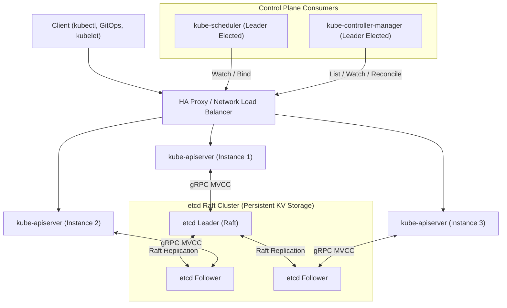
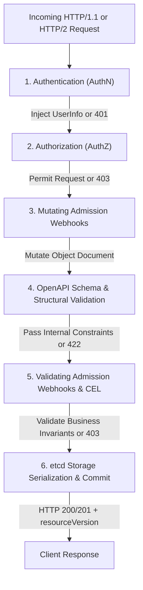
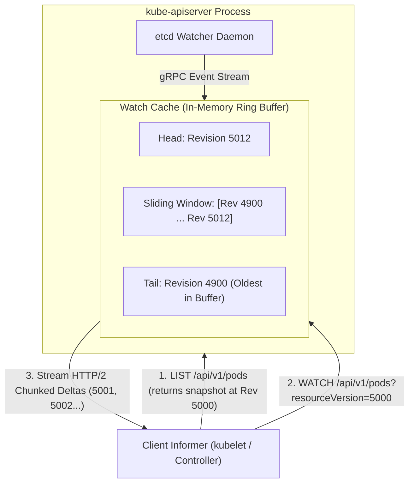
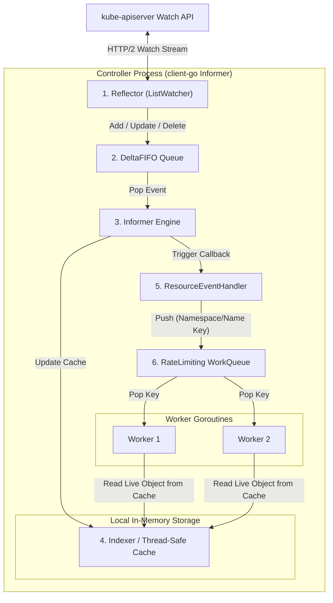
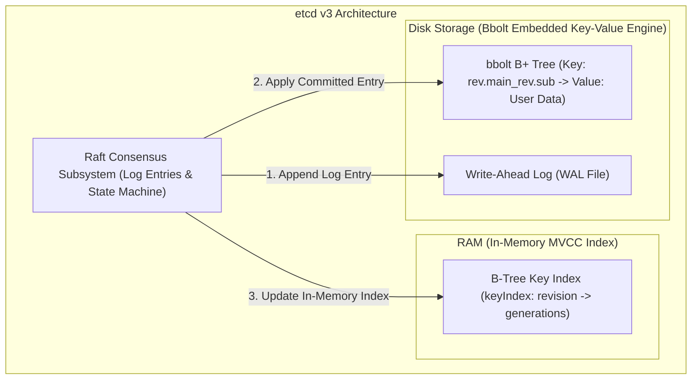

# Module 02: Control Plane Internals: kube-apiserver Request Pipeline, Watch Cache, Informers, and etcd MVCC

> **Primary sources:** Kubernetes API Server Internal Architecture ([kubernetes.io/docs/concepts/overview/kubernetes-api/](https://kubernetes.io/docs/concepts/overview/kubernetes-api/)); KEP-548: API Server Watch Cache ([keps/sig-api-machinery/548-watch-cache](https://github.com/kubernetes/enhancements/tree/master/keps/sig-api-machinery/548-watch-cache)); KEP-1040: Watch Bookmarks ([keps/sig-api-machinery/1040-watch-bookmarks](https://github.com/kubernetes/enhancements/tree/master/keps/sig-api-machinery/1040-watch-bookmarks)); etcd v3 Storage Engine Architecture ([etcd.io/docs/v3.7/learning/data_model/](https://etcd.io/docs/v3.7/learning/data_model/)).
>
> **Executable proof:** [`examples/ts/02-control-plane-internals.test.ts`](../examples/ts/02-control-plane-internals.test.ts) asserts the 6-stage API server filter pipeline, DeltaFIFO and Informer caching mechanics, etcd MVCC revision indexing, and etcd database quota exhaustion recovery.

---

## 1. Formal Foundations: The Control Plane Topology

The Kubernetes control plane is a distributed state machine designed to maintain consistent cluster operations across unreliable networks and server instances. It separates stateless compute processing (`kube-apiserver`, `kube-scheduler`, `kube-controller-manager`) from state persistence (`etcd`).



Because all state transitions must be serialized through a single consensus boundary, `kube-apiserver` acts as the exclusive gatekeeper to `etcd`. No component in the cluster—not even the scheduler, controller-manager, or kubelet—ever establishes a direct network connection to `etcd`.

For the formal distributed consensus mechanics governing etcd's Raft state machine, see [`../../../architecture/distributed-systems/modules/07-raft-consensus-deep-dive.md`](../../../architecture/distributed-systems/modules/07-raft-consensus-deep-dive.md). For distributed leases, leader election locks, and fencing tokens, see [`../../../architecture/distributed-systems/modules/08-distributed-coordination-and-locks.md`](../../../architecture/distributed-systems/modules/08-distributed-coordination-and-locks.md).

---

## 2. The `kube-apiserver` Request Pipeline

Every incoming HTTP request to `kube-apiserver` traverses an ordered, synchronous 6-stage execution pipeline before any mutation is committed to persistent storage. If a request fails or is rejected at any stage, execution halts immediately and an HTTP error code is returned.



### 2.1 Stage 1: Authentication (AuthN)

The API server authenticates the caller's identity, mapping network credentials to a canonical `user.Info` struct containing:

- `Username`: String identifier (e.g., `system:node:worker-1`, `admin@example.com`, `system:serviceaccount:prod:default`).
- `UID`: System-assigned unique user identifier.
- `Groups`: Array of string security groups (e.g., `system:authenticated`, `system:masters`).
- `Extra`: Map of string slices holding authorization metadata (such as OIDC claims or certificate extensions).

Kubernetes evaluates authenticators sequentially in an ordered chain until the first authenticator succeeds:

1. **X.509 Client Certificates**: Validates client certificates against the cluster CA bundle specified by `--client-ca-file`. The Common Name (`CN`) maps to `Username`, while Organization fields (`O`) map to `Groups`.
2. **Bearer Tokens**:
   - _Bound ServiceAccount Tokens_: Signed JSON Web Tokens (JWT) verified via RS256/ES256 public keys against `--service-account-key-file`. Tokens carry bound audience (`aud`), namespace, and pod identity claims per KEP-1205.
   - _Bootstrap Tokens_: Short-lived tokens used during `kubeadm join` operations stored in `kube-system/bootstrap-token-*` secrets.
3. **OpenID Connect (OIDC)**: Validates external identity tokens emitted by identity providers (Okta, Keycloak, Google Workspace, Entra ID) using discovery endpoints (`.well-known/openid-configuration`).
4. **Webhook Token Authenticator**: Forwards the bearer token via HTTP POST to an external verification service.
5. **Anonymous Authenticator**: If enabled (`--anonymous-auth=true`), unauthenticated requests are assigned identity `system:anonymous` with group `system:unauthenticated`.

### 2.2 Stage 2: Authorization (AuthZ)

Once authenticated, the API server evaluates whether the identity possesses permissions to perform the requested verb on the target resource. Evaluation proceeds through configured authorizer modules (`--authorization-mode=Node,RBAC,Webhook`):

1. **Node Authorization**: A specialized authorizer that inspects requests originating from `system:nodes` group members. It enforces graph-based boundary rules: a worker node can only read and write Pods, Secrets, and ConfigMaps that the scheduler has officially bound to that specific node.
2. **Role-Based Access Control (RBAC)**: Computes permissions using `Roles`, `ClusterRoles`, `RoleBindings`, and `ClusterRoleBindings`. If any binding grants access, authorization succeeds immediately (short-circuit boolean OR evaluation).
3. **Webhook Authorization**: Forwards an `authorization.k8s.io/v1` `SubjectAccessReview` payload to an external decision service (such as OPA or an enterprise authorization gate).

If all authorizers deny or abstain, the API server rejects the request with HTTP 403 Forbidden.

### 2.3 Stage 3: Mutating Admission

Admission control acts exclusively on modifying requests (`POST`, `PUT`, `DELETE`, `PATCH`). It does not run for read-only `GET` or `LIST` operations.

Mutating admission controllers execute first. These plugins can alter the requested object before persistence:

- **Defaulting Controllers**: Injects standard system defaults (e.g., setting `imagePullPolicy: Always` if image tag is `:latest`, injecting default ServiceAccount tokens).
- **MutatingAdmissionWebhook**: Calls external HTTPS endpoints registered via `MutatingWebhookConfiguration`.
- **Re-invocation Policy**: Because Webhook $B$ might mutate an object in a manner that requires Webhook $A$ to re-evaluate its logic, `kube-apiserver` supports `reinvocationPolicy: Needed`. Mutating plugins are executed in a loop until convergence is reached, bounded by a maximum iteration ceiling to prevent infinite loops.

### 2.4 Stage 4: Schema & Structural Validation

The incoming JSON/YAML document is decoded into an internal Go struct representation (`k8s.io/apimachinery`). The API server verifies:

1. Conformance to the OpenAPI v3 schema registered for that specific `apiVersion` and `kind`.
2. Immutability constraints (e.g., verifying that `spec.clusterIP` on a Service or `spec.selector` on a Deployment has not been modified).
3. Field formatting constraints (RFC 1123 label formats, port range integer boundaries, valid protocol identifiers).

If validation fails, the API server rejects the write with HTTP 422 Unprocessable Entity, bypassing all subsequent stages.

### 2.5 Stage 5: Validating Admission

Validating admission controllers evaluate the structurally valid document to enforce operational and business rules:

- **Built-in Plugins**: For example, `LimitRanger`, `ResourceQuota`, `PodSecurityAdmission`.
- **ValidatingAdmissionWebhook**: Invokes external HTTPS services to audit or reject objects.
- **ValidatingAdmissionPolicy (CEL)**: Evaluates high-performance Common Expression Language (CEL) boolean expressions compiled directly into `kube-apiserver` memory, avoiding external network hops.

If any validating plugin rejects the object, the transaction aborts and returns HTTP 403 Forbidden.

### 2.6 Stage 6: etcd Serialization & Commit

Upon passing all validation stages:

1. The internal Go struct is converted into the versioned storage representation configured in `--storage-versions` (e.g., `apps/v1`).
2. The payload is serialized into Google Protocol Buffers (or JSON) for compact binary storage.
3. The API server executes an atomic `etcdv3.Txn` (compare-and-swap) transaction. If `metadata.resourceVersion` matches the current etcd revision, the object is committed, the global revision increments, and the API server returns HTTP 201 Created or 200 OK.

---

## 3. The Watch Cache and List/Watch Mechanics

Kubernetes achieves real-time responsiveness across thousands of distributed nodes through the `List/Watch` HTTP API pattern.



### 3.1 Semantics of `resourceVersion` on List and Watch Requests

When an API client queries `kube-apiserver`, the query string parameter `resourceVersion` completely dictates the consistency and routing semantics:

| `resourceVersion` Parameter | Consistency Level | Source of Data | Architectural Mechanics |
| :-- | :-- | :-- | :-- |
| **Omitted (unset)** | Most Recent (Linearizable) | **Direct etcd Quorum Read** | Bypasses watch cache; forces etcd to execute a linearizable Raft read transaction. High latency and CPU cost. |
| **`resourceVersion = "0"`** | Any Version (Eventually Consistent) | **API Server In-Memory Cache** | Returns the latest state available in the watch cache, regardless of whether it is slightly stale relative to etcd. Extremely fast. |
| **`resourceVersion = "<exact>"`** (e.g., `"45210"`) | Exact or Newer at Minimum | **Watch Cache / etcd** | Guarantees that the returned data is at least as fresh as the specified revision. If the watch cache has not yet caught up to that revision, the server waits or falls back to etcd. |

### 3.2 Watch Streaming and HTTP/2 Chunked Framing

The Watch API relies on long-lived HTTP/2 streams using `Content-Type: application/json;stream=watch` or protobuf framing. The server emits JSON objects structured as:

```json
{
  "type": "MODIFIED",
  "object": {
    "kind": "Pod",
    "apiVersion": "v1",
    "metadata": {
      "name": "worker-42",
      "resourceVersion": "5004"
    },
    "status": {
      "phase": "Running"
    }
  }
}
```

### 3.3 Watch Bookmarks (KEP-1040)

In a massive cluster, an operator might watch an infrequently changing resource (e.g., watching Pods filtered by label `tier=rare`). If thousands of other pods on the cluster change, the cluster-wide etcd revision advances from 1,000 to 100,000, but no events match the rare selector.

If the client disconnects and attempts to reconnect using its last observed event revision (`resourceVersion="1000"`), the watch cache will reject the connection because revision 1,000 was already compacted out of the in-memory ring buffer! The client is forced into an expensive relist of all resources.

**Watch Bookmarks** resolve this problem. `kube-apiserver` periodically injects synthetic heartbeat events:

```json
{
  "type": "BOOKMARK",
  "object": {
    "kind": "Pod",
    "apiVersion": "v1",
    "metadata": {
      "resourceVersion": "98500"
    }
  }
}
```

The client updates its local tracking pointer to 98,500. When it reconnects, it requests `resourceVersion="98500"`, which is well within the active cache window, preventing cache evictions.

### 3.4 Compaction and the "410 Gone" Recovery Flow

The API server's watch cache ring buffer has a fixed capacity (default 100 rolling updates per resource type, or bounded by memory limits). Furthermore, etcd periodically executes physical compaction to truncate historical revisions.

If a client's network connection drops for longer than the buffer duration, its requested `resourceVersion` falls behind the oldest revision retained in storage. When the client attempts to resume the watch:

1. `kube-apiserver` returns `HTTP 410 Gone: Too old resource version: 4210 (latest: 95000)`.
2. The client must abort the watch stream.
3. The client drops its local cache, initiates a full `LIST` request to establish a new baseline snapshot, and resumes watching from the `resourceVersion` returned in the new `ListMeta`.

---

## 4. Client-Go Shared Informers Architecture

Controllers do not query `kube-apiserver` via ad-hoc polling. Polling 5,000 controllers across 1,000 nodes would overwhelm the API server and crash etcd. Instead, Kubernetes applications use the **SharedIndexInformer** architecture provided by `k8s.io/client-go`.



### 4.1 Pipeline Components and Mechanics

1. **Reflector**: Runs a continuous loop. It executes an initial `LIST` call against the API server, populates the initial snapshot into the `DeltaFIFO`, and immediately opens an HTTP/2 `WATCH` stream from the returned `resourceVersion`. It automatically manages reconnection, bookmark tracking, and 410 Gone error recovery.
2. **DeltaFIFO**: A thread-safe, deduplicating FIFO queue that pairs each object identifier with a slice of state mutations (`Added`, `Updated`, `Deleted`, `Sync`). If multiple updates occur before the queue is drained, DeltaFIFO compresses redundant deltas to minimize redundant processing.
3. **Indexer (Local Store)**: An in-memory, lock-guarded cache storing complete, deserialized Go object pointers. It maintains indices based on arbitrary projection functions (e.g., indexing Pods by `spec.nodeName` or `metadata.namespace`). Controllers read strictly from this cache, generating zero network traffic to the API server during lookups.
4. **ResourceEventHandler**: Callbacks registered by the developer (`OnAdd`, `OnUpdate`, `OnDelete`). Crucially, event handlers **must never execute business logic or network I/O directly**. Doing so would block the Informer engine and cause the DeltaFIFO to back up.
5. **WorkQueue**: The event handler extracts the unique key of the object (formatted as `"namespace/name"`, e.g., `"default/my-app"`) and pushes the string key into a `workqueue.RateLimitingInterface`.
6. **Worker Loop**: A pool of concurrent worker threads pops keys from the WorkQueue, retrieves the latest object snapshot from the local `Indexer`, and executes the level-triggered reconciliation loop.

---

## 5. etcd v3 Internal Storage Engine

Kubernetes relies on `etcd` as its single source of truth. etcd v3 is a strongly consistent, distributed key-value store using the Raft consensus algorithm.



### 5.1 The MVCC Data Model and Revisions

Unlike relational databases that overwrite rows in place, etcd v3 implements a purely append-only Multi-Version Concurrency Control (MVCC) data model. Every mutation (create, update, delete) increments a global 64-bit cluster counter known as the **Revision**:

- A revision is represented as a composite key: `(main, sub)`:
  - `main`: The global transaction counter incremented once per batch commit.
  - `sub`: The intra-transaction offset incremented when a single transaction modifies multiple keys.
- **Physical Key Representation**: In the underlying disk storage engine (bbolt), the key written to disk is **not** the Kubernetes object key (e.g., `/registry/pods/default/nginx`). The bbolt key is the binary representation of the `revision`!
- **In-Memory `treeIndex`**: etcd maintains a memory-resident B-Tree (`treeIndex`) mapping the human-readable string key to its history of physical revisions (`generations`).

### 5.2 Key Lifecycle and Tombstone Mechanics

When a Kubernetes object is deleted:

1. etcd does not purge the record from disk immediately.
2. It assigns a new global revision and appends a **Tombstone** record marking the key as deleted at that specific revision.
3. Historical queries querying revisions prior to the tombstone can still read the historical state of the object, which is how the API server serves historical watch replays.

### 5.3 Compaction, Defragmentation, and DB Quota

Because every update appends a new revision, the database file (`member/snap/db`) grows continuously over time:

1. **Compaction**: The `kube-apiserver` periodically instructs etcd to compact historical revisions older than a retention threshold (e.g., `--etcd-compaction-interval=5m`). Compaction purges obsolete revision references from the in-memory `treeIndex` and marks old bbolt disk pages as free for reuse.
2. **Database Quota**: etcd enforces a hard disk storage quota (default `--quota-backend-bytes=2147483648`, or 2 GiB; maximum recommended production limit is 8 GiB).
3. **Alarm Activation**: If physical database size exceeds the quota, etcd raises the `NOSPACE` alarm:
   - etcd transitions to **read-only mode**.
   - All subsequent write and update requests from `kube-apiserver` fail with `etcdserver: mvcc: database space exceeded`.
   - The entire Kubernetes control plane halts write operations!
4. **Defragmentation**: Compaction frees logical pages inside the bbolt file, but does not return physical disk space to the host Linux filesystem. Freeing space requires running `etcdctl defrag` across each member node sequentially.

---

## 6. Formal Algorithm: Informer Reflector and DeltaFIFO Queue

The following pseudocode formalizes the client-go Reflector event synchronization and DeltaFIFO deduplication engine.

```text
Algorithm: InformerReflectorSync
Input: ListerWatcher LW, DeltaFIFO Queue, Int SyncPeriod

Invariant 1: When ListAndWatch executes, the Reflector establishes a linearizable baseline
             via List, followed by a continuous streaming Watch from the exact List revision.
Invariant 2: DeltaFIFO compresses redundant updates for the same object identifier,
             preventing duplicate worker queue thrashing.
Invariant 3: Any HTTP 410 Gone error triggers an immediate cache flush and relist sequence.

1.  Function StartReflector():
2.      while true do:
3.          err := ListAndWatch()
4.          if err != nil then
5.              LogWarn("Reflector connection lost, backing off", err)
6.              Sleep(ExponentialBackoff(100ms, 10s))
7.          end if
8.      end while
9.  End Function

10. Function ListAndWatch():
11.     // Step 1: Establish baseline snapshot via LIST
12.     listResult, listMeta := LW.List(ResourceVersion="0")
13.     items := listResult.Items
14.     Queue.Replace(items, listMeta.ResourceVersion)
15.     currentRV := listMeta.ResourceVersion
16.
17.     // Step 2: Stream updates via WATCH
18.     while true do:
19.         watchStream, err := LW.Watch(ResourceVersion=currentRV, SendBookmarks=true)
20.         if err != nil then return err
21.
22.         for event in watchStream.NextEvent() do:
23.             switch event.Type do:
24.                 case "ADDED":
25.                     Queue.Append(DeltaType="Added", Object=event.Object)
26.                     currentRV = event.Object.Metadata.ResourceVersion
27.                 case "MODIFIED":
28.                     Queue.Append(DeltaType="Updated", Object=event.Object)
29.                     currentRV = event.Object.Metadata.ResourceVersion
30.                 case "DELETED":
31.                     Queue.Append(DeltaType="Deleted", Object=event.Object)
32.                     currentRV = event.Object.Metadata.ResourceVersion
33.                 case "BOOKMARK":
34.                     // Update internal pointer without enqueuing user delta
35.                     currentRV = event.Object.Metadata.ResourceVersion
36.                 case "ERROR":
37.                     if event.Status.Code == 410 then
38.                         // Compaction occurred; must trigger full Relist
39.                         return ErrCompacted
40.                     end if
41.                     return ErrUnknownAPIError
42.             end switch
43.         end for
44.     end while
45. End Function
```

---

## 7. Historical Evolution: Then vs. Now

| Mechanism | Legacy Kubernetes (v1.20) | Current Architecture (Kubernetes v1.37.2) | Architectural Driver |
| :-- | :-- | :-- | :-- |
| **Admission Governance** | External HTTP Webhooks (`ValidatingWebhookConfiguration`) required for custom business policies. | Native in-process Common Expression Language (CEL) (`ValidatingAdmissionPolicy`). | Webhooks add 50–200ms network latency per request and cause boot-loop deadlocks if webhook pods crash. |
| **Watch Cache Reliability** | Raw Watch streams; idle watchers suffered 410 Gone errors when revisions rolled over. | Mandatory Watch Bookmarks (`BOOKMARK` events) enabled by default across all core resources. | Eliminate thundering-herd relisting storms when thousands of kubelets watch stagnant namespaces. |
| **ServiceAccount Tokens** | Unbounded, non-expiring JWT Secret tokens stored indefinitely in namespace Secrets. | Bound ServiceAccount Tokens (TokenRequest API) short-lived, audience-scoped, and tied to Pod UID. | Mitigate credential theft vulnerabilities where compromised tokens lived forever across clusters. |
| **etcd Storage Encoding** | Plain JSON or unoptimized protobuf; manual storage migrations required external scripts. | Optimized Protocol Buffers with native GA `StorageVersionMigration` controller. | Drastically reduce disk I/O, memory allocations, and automate etcd schema version transitions. |

---

## 8. Exam Delta: CKA/CKAD (v1.37) vs. CKS (v1.34)

> [!IMPORTANT]
> **Certification Delta & Environment Divergence:**
>
> - **CKA (Curriculum v1.37)**: Requires mastery of the API server configuration flags (`/etc/kubernetes/manifests/kube-apiserver.yaml`). Candidates must configure `--enable-admission-plugins` and configure etcd encryption at rest (`--encryption-provider-config`). Questions heavily test troubleshooting API server crashes caused by malformed manifest syntax or expired control plane certificates.
> - **CKS (Curriculum v1.34)**: Focuses heavily on the control plane security boundary. Candidates are tested on configuring Kubernetes Advanced Audit Policies (`--audit-policy-file` and `--audit-log-path`) to log request stages (`RequestReceived`, `ResponseStarted`, `ResponseComplete`). Furthermore, CKS tests configuring Node Restriction and ImagePolicyWebhook admission plugins, which target older webhook configurations rather than the newer CEL ValidatingAdmissionPolicies introduced in v1.30+.

---

## 9. Production Failure Modes & Operational Gotchas

### 9.1 The Unpaginated Full Cluster List Bomb (`LIST /api/v1/pods`)

- **Symptom**: `kube-apiserver` memory usage spikes exponentially from 4 GiB to 48 GiB within 30 seconds, triggering the Linux kernel Out-Of-Memory (OOM) killer. The control plane crashes and drops all client connections.
- **Root Cause**: A rogue operator script, monitoring tool, or poorly authored custom controller executes `kubectl get pods -A` or invokes client-go `List()` without setting `limit` or `resourceVersion="0"`. The API server must pull 50,000 pod objects from etcd, deserialize them into memory, allocate massive JSON strings, and transmit them across a single HTTP response.
- **Remediation**: Enforce API Priority and Fairness (APF) flow schemas to throttle bulk LIST requests. Enforce chunked pagination in client scripts (`limit=500` with `continue` tokens). When reading from informers, always read from the local cache `Lister` rather than issuing client-go `List()` calls directly to the API server.

### 9.2 The Catch-22 Admission Webhook Outage

- **Symptom**: All pod creation across the entire cluster halts with `Internal error occurred: failed calling webhook "validate.corp.internal": Post "https://webhook-svc.default.svc:443/validate": dial tcp 10.96.0.10:443: connect: connection refused`. No new pods can start, including ingress controllers, DNS pods, and the webhook itself!
- **Root Cause**: A `ValidatingWebhookConfiguration` was configured with `failurePolicy: Fail` targeting a webhook service running inside the same cluster. During a node reboot or power outage, the webhook pods were terminated. When the scheduler attempts to reschedule the webhook pods, the API server sends the pod creation request to the webhook service, which is offline. The webhook blocks its own recovery!
- **Remediation**: In production, always configure `namespaceSelector` to exempt critical infrastructure (`kube-system`, ingress controllers). Use `failurePolicy: Ignore` for non-critical compliance checks. Ensure webhook pods run with high availability, PodDisruptionBudgets, and hostNetwork/priorityClass configurations if they must validate system pods.

### 9.3 etcd `mvcc: database space exceeded` Panic

- **Symptom**: All write operations against Kubernetes fail with `Error from server (InternalError): etcdserver: mvcc: database space exceeded`. Cluster enters a hard read-only lockdown.
- **Root Cause**: Automated etcd compaction was disabled or failed to run. The physical bbolt database file reached the configured quota (default 2 GiB). etcd triggered its internal `NOSPACE` alarm.
- **Remediation**:
  1. Determine current revision: `etcdctl --endpoints=https://127.0.0.1:2379 endpoint status -w table`.
  2. Compact old revisions: `etcdctl compact <REVISION>`.
  3. Defragment the physical bbolt file: `etcdctl defrag`.
  4. Disarm the alarm: `etcdctl alarm disarm`.

### 9.4 The Informer 410 Gone Death Spiral

- **Symptom**: A custom operator or daemon crashes repeatedly with logs indicating `too old resource version`. The operator continuously reconnects and relists, saturating the API server CPU.
- **Root Cause**: The operator's event handling callbacks perform slow, blocking operations (e.g., synchronous HTTP calls to third-party APIs). The Informer's internal DeltaFIFO backs up. By the time the worker attempts to process an event, the API server's watch cache and etcd have already compacted that revision out of existence.
- **Remediation**: Never perform network I/O or heavy computations inside Informer event callbacks (`OnAdd`, `OnUpdate`). Handlers must strictly extract the resource key and enqueue it into a rate-limiting `WorkQueue` for decoupled processing by background worker goroutines.

---

## 10. Interview Drill

<details>
<summary><strong>Q1. Walk through the complete lifecycle of an HTTP POST request to create a Pod, tracing through every control plane stage.</strong></summary>

1. **Transport**: The request arrives over TLS at `kube-apiserver`.
2. **Authentication**: Authenticators inspect the request (client certs, OIDC, or bound service account JWT). A canonical `user.Info` identity is established.
3. **Authorization**: Authorizers (Node, RBAC, Webhook) verify whether the caller has the `create` verb on the `pods` resource.
4. **Mutating Admission**: Mutating webhooks and plugins run, injecting default fields (e.g., default securityContext, service account tokens, sidecars).
5. **Schema Validation**: The API server decodes the payload into an internal Go struct and validates it against the OpenAPI v3 schema and structural constraints.
6. **Validating Admission**: Validating webhooks, Pod Security Standards, and CEL ValidatingAdmissionPolicies evaluate business invariants.
7. **Storage**: The object is serialized into Protocol Buffers and committed via an atomic `etcdv3.Txn`. If etcd commits successfully, `kube-apiserver` returns HTTP 201 Created to the client and broadcasts the `ADDED` event across its active Watch streams.

</details>

<details>
<summary><strong>Q2. What is the fundamental difference between `resourceVersion=""`, `resourceVersion="0"`, and `resourceVersion="<exact>"` on a LIST query?</strong></summary>

- `resourceVersion=""` (omitted): Guarantees linearizable, strongly consistent reads. The API server bypasses its in-memory watch cache and executes a full quorum read against etcd.
- `resourceVersion="0"`: Guarantees eventual consistency. The API server fulfills the request directly from its in-memory watch cache. The data is returned with ultra-low latency, but may be slightly behind etcd if the watch cache is catching up.
- `resourceVersion="<exact>"`: Directs the API server to return data at least as fresh as the specified revision. If the watch cache is at or ahead of that revision, it serves from cache; otherwise, it waits or queries etcd.

</details>

<details>
<summary><strong>Q3. Why does etcd use an append-only B+ tree (bbolt) where keys are revisions rather than Kubernetes resource paths?</strong></summary>

By indexing records by `(revision.main, revision.sub)` rather than string keys, etcd natively implements Multi-Version Concurrency Control (MVCC). Every write operation is simply an append to the end of the bbolt tree, eliminating expensive in-place page rewrites. This enables fast, non-blocking snapshot reads and streaming watch replays: a client can ask for "all events that occurred between revision 5,000 and 6,000", which corresponds to a simple, sequential range scan over the bbolt disk pages. The mapping from human-readable keys (`/registry/pods/...`) to revisions is maintained in an in-memory B-Tree (`treeIndex`).
</details>

<details>
<summary><strong>Q4. How does the `SharedIndexInformer` prevent thousands of controllers from overwhelming the API server?</strong></summary>

The SharedIndexInformer multiplexes API server connections. Instead of each controller establishing its own independent HTTP watch connection and maintaining separate memory copies, a SharedInformer maintains a single watch connection per resource type. It populates a single, shared, thread-safe in-memory cache (`Indexer`). Individual controllers register lightweight event callbacks against the shared informer, reading objects from the shared local cache via pointer lookups with zero network overhead.
</details>

<details>
<summary><strong>Q5. What is the purpose of Watch Bookmarks (KEP-1040), and what pathology do they solve?</strong></summary>

When a client watches resources with a specific label selector, and cluster activity occurs on other resources, the global etcd revision advances while the client observes zero events. If the client disconnects and reconnects using its last observed revision, that revision may have already been compacted out of the API server's cache window, causing an HTTP 410 Gone error and forcing an expensive full relist. Watch Bookmarks solve this by periodically emitting synthetic bookmark events containing the latest global `resourceVersion`. This advances the client's tracking pointer even when no user-visible resources have changed, keeping its reconnect revision within the active cache window.
</details>

<details>
<summary><strong>Q6. What happens when etcd reaches its storage quota, and how do you recover?</strong></summary>

When the bbolt database file reaches the configured `--quota-backend-bytes` limit (default 2 GiB), etcd triggers the `NOSPACE` alarm and drops into read-only mode. All write, update, and delete requests from `kube-apiserver` fail with `etcdserver: mvcc: database space exceeded`. To recover:

1. Compact historical revisions via `etcdctl compact <latest_rev>`.
2. Reclaim physical disk space by running `etcdctl defrag` on each etcd node.
3. Disarm the alarm via `etcdctl alarm disarm`.

</details>

<details>
<summary><strong>Q7. Why should event handlers inside a custom controller never perform network I/O or blocking operations?</strong></summary>

Event handlers (`OnAdd`, `OnUpdate`, `OnDelete`) execute synchronously on the informer's event dispatch goroutine. If a handler blocks on a slow network call, database query, or sleep loop, it halts the entire informer pipeline. The internal `DeltaFIFO` stops draining, the reflector queue fills up, and the API server watch connection may time out. If the delay exceeds the compaction threshold, the watch connection crashes with an HTTP 410 Gone error. Handlers must only extract the resource key and enqueue it into a `WorkQueue` for asynchronous processing by worker goroutines.
</details>

---

## 11. Proof Map and Verification

The architectural mechanisms and control plane invariants detailed in this module are formally proven in [`examples/ts/02-control-plane-internals.test.ts`](../examples/ts/02-control-plane-internals.test.ts):

- **6-Stage API Server Pipeline Engine**: Models sequential execution of Authentication, Authorization, Mutating Webhooks, Schema Validation, Validating Admission, and Storage commit, asserting HTTP error codes at each boundary.
- **Informer Reflector & DeltaFIFO Queue**: Simulates event streaming, bookmark tracking, and DeltaFIFO update compression, proving that redundant events for a single key are consolidated.
- **etcd MVCC Revision & TreeIndex Engine**: Emulates etcd's dual-tier storage engine (in-memory key index mapping to revision-indexed storage), proving optimistic concurrency checks (`resourceVersion` CAS) and compaction behavior.
- **Quota Alarm & Recovery Lifecycle**: Simulates database quota exhaustion, verifying that writes are rejected with `mvcc: database space exceeded` until a compaction, defragmentation, and alarm disarm sequence executes.
