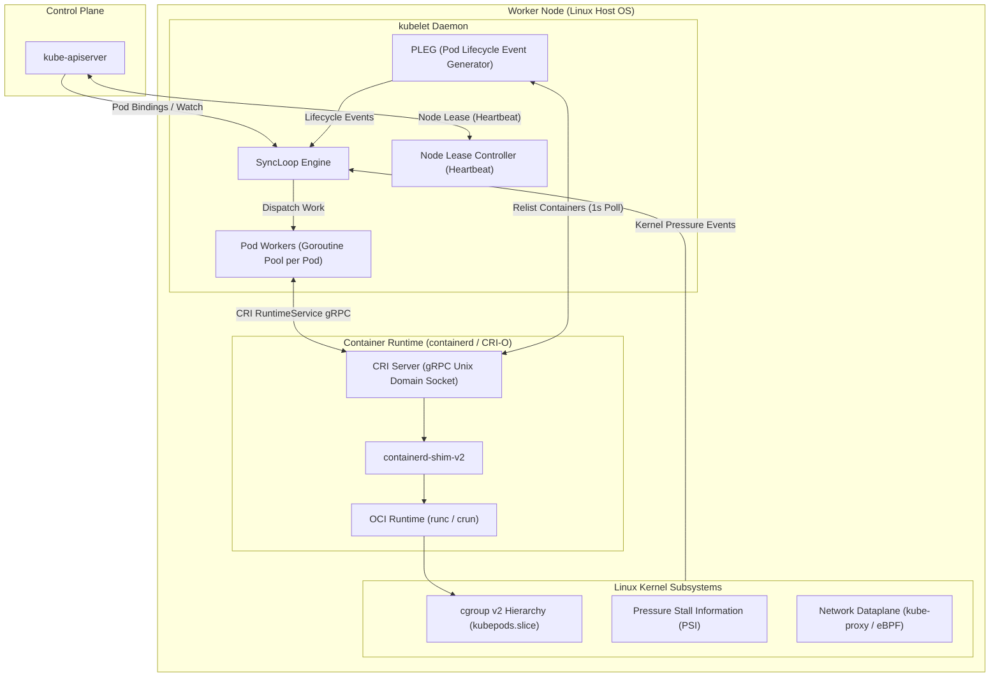
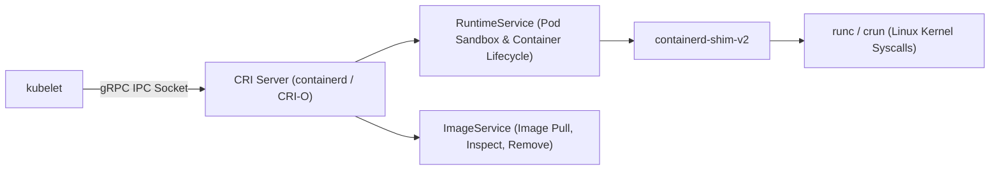
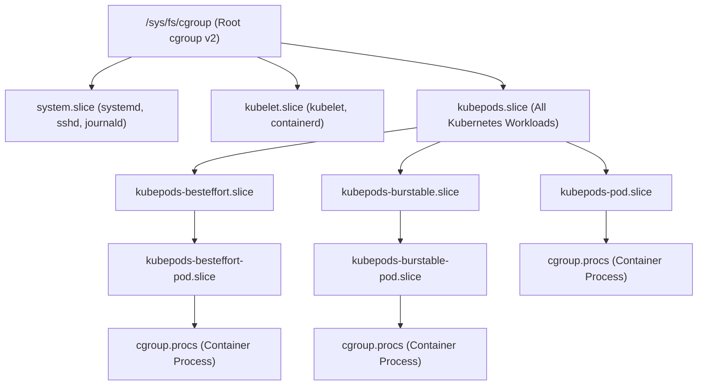

# Module 03: Node Internals: kubelet Lifecycle, PLEG, CRI, cgroup v2 QoS, PSI Eviction, and kube-proxy vs eBPF

> **Primary sources:** KEP-5573: FailCgroupV1 ([keps/sig-node/5573-fail-cgroupv1](https://github.com/kubernetes/enhancements/tree/master/keps/sig-node/5573-fail-cgroupv1)); Container Runtime Interface (CRI) Specification ([k8s.io/cri-api](https://github.com/kubernetes/cri-api)); KEP-3386: Kubelet Evented PLEG ([keps/sig-node/3386-evented-pleg](https://github.com/kubernetes/enhancements/tree/master/keps/sig-node/3386-evented-pleg)); Linux Kernel PSI Documentation ([kernel.org/doc/html/latest/accounting/psi.html](https://docs.kernel.org/accounting/psi.html)).
>
> **Executable proof:** [`examples/ts/03-node-internals.test.ts`](../examples/ts/03-node-internals.test.ts) asserts PLEG event generation loops, cgroup v2 slice hierarchies, OOM score adjust computations across QoS tiers, and CRI gRPC message structures.

---

## 1. Formal Foundations: The Node Architecture and kubelet Daemon

The worker node is the physical or virtual execution host in a Kubernetes cluster. The authoritative agent managing the node is the **kubelet**. Unlike standard system daemons, the kubelet bridges the distributed Kubernetes control plane with the local Linux OS kernel.



For the fundamental Linux kernel isolation mechanisms governing containers, see [`../../containers/modules/03-cgroups-v2.md`](../../containers/modules/03-cgroups-v2.md) and [`../../containers/modules/06-oci-runtime-spec-and-runtimes.md`](../../containers/modules/06-oci-runtime-spec-and-runtimes.md).

---

## 2. The kubelet Control Loop and PLEG Mechanics

The kubelet is structured around a centralized event-driven control loop known as the **`SyncLoop`**.

### 2.1 The SyncLoop Event Sources

The `SyncLoop` multiplexes events arriving across five primary input channels:

1. **Config Channel**: Receives desired pod state from three sources: the API server watch stream, local filesystem directory watch (for Static Pods), and an HTTP endpoint.
2. **PLEG Channel**: Receives notifications when container runtimes start, stop, or terminate containers.
3. **Probe Channel**: Receives outcomes from startup, liveness, and readiness probe executions.
4. **Housekeeping Channel**: Periodic ticker (default every 2 seconds) enforcing node cleanup, log rotation, and pod eviction sweeps.
5. **Node Status Channel**: Periodic ticker updating node resource capacity, allocatable figures, and condition flags.

### 2.2 PLEG (Pod Lifecycle Event Generator)

Historically, container runtimes did not emit push notifications when container states shifted. To detect container terminations, the kubelet introduced **PLEG**:

- Every 1 second, PLEG invokes the CRI `ListContainers` RPC over the local UNIX domain socket.
- It compares the returned container slice against an in-memory cache of the previous iteration's state.
- If a container was running in iteration $t-1$ but is absent or stopped in iteration $t$, PLEG generates an internal event: `ContainerDied(PodID, ContainerID)`.
- The event is sent to the `SyncLoop`, which routes it to the dedicated **Pod Worker** responsible for that pod UID.

#### The "PLEG is not healthy" Pathology

If CRI calls hang (e.g., due to saturated disk I/O when containerd attempts to flush logs, or kernel deadlocks in overlayfs), the PLEG relist iteration exceeds its 3-minute health check threshold. The kubelet reports `PLEG is not healthy`, stops renewing its Node Lease, and the control plane marks the node as `NotReady`.

### 2.3 Static Pods and Mirror Pods

A **Static Pod** is managed directly by the kubelet on a specific node without API server scheduling:

- The kubelet watches a local host filesystem path configured via `--pod-manifest-path` (typically `/etc/kubernetes/manifests/`).
- Whenever a YAML file is placed or modified in this directory, the kubelet creates and manages the pod locally.
- To make Static Pods visible to cluster operators and schedulers, the kubelet creates an ephemeral read-only **Mirror Pod** in the `kube-apiserver`.
- Crucially, deleting the Mirror Pod via `kubectl delete pod` does not stop the static container; the kubelet immediately recreates the Mirror Pod unless the underlying YAML file is removed from the host node's disk.
- All core Kubernetes control plane components (`kube-apiserver`, `etcd`, `kube-controller-manager`, `kube-scheduler`) in `kubeadm` clusters run as Static Pods.

### 2.4 Node Heartbeats and Leases

In modern Kubernetes clusters, the kubelet reports health using the **Node Lease** API (`coordination.k8s.io/v1` in the `kube-node-lease` namespace):

- Every 10 seconds (default `--node-status-update-frequency`), the kubelet sends an HTTP `PUT` request updating its dedicated `Lease` object.
- Because a Lease is a lightweight 1 KiB document, updating it requires minimal etcd I/O and zero deserialization overhead.
- Full `NodeStatus` heartbeats (reporting full disk, network, and memory metrics) are transmitted only when conditions change or every 5 minutes (default `--node-status-report-frequency`).
- If the control plane fails to receive a Lease renewal within `node-monitor-grace-period` (default 40 seconds), the node controller marks the node `Ready=Unknown` and initiates pod eviction.

---

## 3. The Container Runtime Interface (CRI)

The Container Runtime Interface (CRI) is a set of gRPC interfaces over a local UNIX domain socket (`/run/containerd/containerd.sock` or `/run/crio/crio.sock`) that decouples the kubelet from specific container runtime implementations.



### 3.1 CRI Services: RuntimeService and ImageService

The CRI specification defines two independent gRPC service contracts:

```protobuf
service RuntimeService {
    rpc RunPodSandbox(RunPodSandboxRequest) returns (RunPodSandboxResponse);
    rpc StopPodSandbox(StopPodSandboxRequest) returns (StopPodSandboxResponse);
    rpc RemovePodSandbox(RemovePodSandboxRequest) returns (RemovePodSandboxResponse);
    rpc PodSandboxStatus(PodSandboxStatusRequest) returns (PodSandboxStatusResponse);
    rpc ListPodSandbox(ListPodSandboxRequest) returns (ListPodSandboxResponse);

    rpc CreateContainer(CreateContainerRequest) returns (CreateContainerResponse);
    rpc StartContainer(StartContainerRequest) returns (StartContainerResponse);
    rpc StopContainer(StopContainerRequest) returns (StopContainerResponse);
    rpc RemoveContainer(RemoveContainerRequest) returns (RemoveContainerResponse);
    rpc ListContainers(ListContainersRequest) returns (ListContainersResponse);
    rpc ContainerStatus(ContainerStatusRequest) returns (ContainerStatusResponse);

    rpc ExecSync(ExecSyncRequest) returns (ExecSyncResponse);
    rpc Exec(ExecRequest) returns (ExecResponse);
    rpc Attach(AttachRequest) returns (AttachResponse);
    rpc PortForward(PortForwardRequest) returns (PortForwardResponse);
}

service ImageService {
    rpc ListImages(ListImagesRequest) returns (ListImagesResponse);
    rpc ImageStatus(ImageStatusRequest) returns (ImageStatusResponse);
    rpc PullImage(PullImageRequest) returns (PullImageResponse);
    rpc RemoveImage(RemoveImageRequest) returns (RemoveImageResponse);
    rpc ImageFsInfo(ImageFsInfoRequest) returns (ImageFsInfoResponse);
}
```

### 3.2 Pod Sandbox Initialization Sequence

When a new Pod is scheduled to a node:

1. `kubelet` invokes `RunPodSandbox()`: The runtime creates the Linux network namespace, configures loopback interfaces, calls CNI network plugins to assign an IP address, and spawns the pause container process.
2. `kubelet` invokes `CreateContainer()`: The runtime prepares the container's rootfs (unpacking OCI image layers) and constructs the OCI `config.json` bundle.
3. `kubelet` invokes `StartContainer()`: The runtime launches the container process inside the namespaces and cgroups created during sandbox setup.

### 3.3 Streaming Server Mechanics: `exec`, `attach`, and `port-forward`

Direct container I/O operations cannot pass through standard gRPC message buffers without saturating the kubelet process memory. Therefore, CRI implements an out-of-band streaming server:

1. Client executes `kubectl exec -it my-pod -- /bin/sh`.
2. The request hits `kube-apiserver`, which proxies it to the node's `kubelet` on port 10250.
3. The kubelet calls `RuntimeService.Exec()` via CRI gRPC.
4. The CRI runtime (containerd) does not stream data back over gRPC. Instead, it starts an internal HTTP/WebSocket streaming server and returns an authenticated redirect URL (e.g., `https://node-1.internal:10010/exec/token-xyz`).
5. The kubelet sends an HTTP redirect back to the `kube-apiserver`, which initiates a direct long-lived bidirectional streaming connection to the runtime's stream server.

---

## 4. cgroup v2 Unified Hierarchy and Kubernetes QoS Classes

With Kubernetes v1.35+, the kubelet strictly requires Linux **cgroup v2** unified hierarchy via **KEP-5573 (FailCgroupV1)**. The kubelet will refuse to boot if booted against a legacy cgroup v1 system unless explicitly overridden, with total code removal scheduled for future releases.



### 4.1 cgroup v2 Control Files Mapped to Kubernetes Resources

| Kubernetes Manifest Field | cgroup v2 File | Kernel Semantics | Mathematical / Algorithmic Effect |
| :-- | :-- | :-- | :-- |
| `spec.containers[].resources.requests.cpu` | `cpu.weight` | Proportional CPU share allocation | Normalized scale $[1, 10000]$. $\text{weight} = \left\lfloor \frac{\text{request\_milli} \times 10000}{1000 \times \text{cores}} \right\rfloor$. |
| `spec.containers[].resources.limits.cpu` | `cpu.max` | Hard CFS quota limit per period | Format: `"$MAX $PERIOD"`. E.g., `200000 100000` limits execution to 200ms per 100ms wall-clock period (2 CPU cores). |
| `spec.containers[].resources.requests.memory` | `memory.min` / `memory.low` | Hard & soft memory guarantees | `memory.min` protects pages from reclaim under pressure; `memory.low` provides best-effort protection against background reclaim. |
| `spec.containers[].resources.limits.memory` | `memory.max` | Hard memory boundary | If `memory.current > memory.max`, the Linux kernel invokes OOM-killer immediately against processes in that cgroup. |

### 4.2 The Three Quality of Service (QoS) Classes

Kubernetes classifies every Pod into one of three QoS classes based strictly on its container resource requests and limits:

1. **Guaranteed**:
   - Condition: Every container in the Pod must have both CPU and memory requests and limits explicitly defined, and `requests.cpu == limits.cpu` and `requests.memory == limits.memory`.
   - cgroup Placement: Placed directly in the top-level `kubepods.slice/kubepods-pod<UID>.slice`.
   - OOMScoreAdjust: `-997`. Extremely resilient against host OOM eviction.
2. **Burstable**:
   - Condition: Pod does not meet Guaranteed criteria, but at least one container has a memory or CPU request defined.
   - cgroup Placement: Placed in `kubepods.slice/kubepods-burstable.slice/kubepods-burstable-pod<UID>.slice`.
   - OOMScoreAdjust: Dynamically computed based on the ratio of requested memory to node capacity: $$\text{OOMScoreAdjust} = 1000 - \left\lfloor \frac{\text{Pod Memory Request}}{\text{Node Allocatable Memory}} \times 1000 \right\rfloor$$ Yields an integer score in the range $[2, 999]$. Workloads requesting 90% of node capacity receive score $\approx 100$, while workloads requesting 5% receive score $\approx 950$.
3. **BestEffort**:
   - Condition: No container in the Pod defines any CPU or memory requests or limits.
   - cgroup Placement: Placed in `kubepods.slice/kubepods-besteffort.slice/kubepods-besteffort-pod<UID>.slice`.
   - OOMScoreAdjust: `1000`. The absolute first processes targeted for termination by the Linux kernel OOM-killer during host memory exhaustion.

---

## 5. Pressure Stall Information (PSI) and Eviction Thresholds

When a node experiences resource depletion, the kubelet enforces **Eviction Thresholds** to terminate workloads gracefully before the Linux kernel triggers uncoordinated OOM panics.

### 5.1 Pressure Stall Information (PSI) Metrics

Linux kernel cgroup v2 introduces PSI (`/proc/pressure/{cpu,memory,io}`), which tracks the exact percentage of wall-clock time that tasks spend stalled waiting for physical hardware:

- **`some`**: The percentage of time in which at least one task was stalled waiting for the resource (indicates emerging contention).
- **`full`**: The percentage of time in which **all** non-idle tasks were simultaneously stalled waiting for the resource (indicates catastrophic system freeze and live-lock).

The kubelet uses PSI threshold events to trigger early pod eviction before disk or memory subsystems completely stall.

### 5.2 Hard vs. Soft Eviction Thresholds

The kubelet evaluates node health against configured eviction boundaries:

- **Hard Eviction**: Immediate eviction without grace period. If available memory drops below `memory.available < 100Mi`, the kubelet terminates pods immediately (`terminationGracePeriodSeconds = 0`).
- **Soft Eviction**: Eviction triggered only after a grace period. For example, if `memory.available < 500Mi` continuously for `eviction-soft-grace-period = 90s`, the kubelet initiates graceful pod termination.

### 5.3 Eviction Candidate Ordering Algorithm

When an eviction threshold is breached (e.g., `MemoryPressure` or `DiskPressure`), the kubelet sorts and evicts pods according to the following strict priority hierarchy:

1. **BestEffort Pods**: Pods that consume memory without declaring requests are terminated first.
2. **Burstable Pods Exceeding Requests**: Burstable pods whose current memory utilization exceeds their declared `requests.memory` are sorted by the absolute volume of excess consumption.
3. **Burstable Pods Below Requests**: If pressure persists, Burstable pods running within their requests are terminated, prioritized by lowest `PriorityClass`.
4. **Guaranteed Pods**: Guaranteed workloads are protected and terminated only as an absolute last resort if all other workloads have been reaped.

---

## 6. Network Dataplane: `kube-proxy` vs. eBPF

Routing network traffic from virtual Service ClusterIPs to dynamically shifting pod endpoints requires packet manipulation within the Linux host kernel.

```mermaid
flowchart TD
    subgraph KubeProxyIPTables["Legacy: kube-proxy (iptables mode)"]
        PacketIn1["Packet Arrives"] --> KUBE_SERVICES["PREROUTING -> KUBE-SERVICES"]
        KUBE_SERVICES --> LinearScan["Linear Chain Traversal: Rule 1 -> Rule 2 -> Rule N"]
        LinearScan --> MatchDest1["Match Service ClusterIP -> Jump to Endpoint"]
        MatchDest1 --> PacketOut1["SNAT / DNAT via netfilter"]
    end

    subgraph EBPFDataplane["Modern: eBPF Dataplane (Cilium / Calico eBPF)"]
        PacketIn2["Packet Arrives at NIC"] --> XDP["eBPF XDP Hook (Driver / TC Layer)"]
        XDP --> BPFMap["O(1) BPF Hash Map Lookup (ClusterIP -> Pod Endpoint)"]
        BPFMap --> FastPath["Direct Socket Translation (sock_ops bypasses TCP/IP stack)"]
        FastPath --> PacketOut2["Forward Directly to Container veth"]
    end
```



### 6.1 `kube-proxy` Modes

1. **Userspace Mode (Obsolete)**: Traffic traversed kernel netfilter to user space proxy daemon and back to kernel. Severe context-switch latency.
2. **iptables Mode**:
   - `kube-proxy` watches Services and Endpoints and writes thousands of sequential `iptables` rules into the kernel `nat` table.
   - Routing uses pseudo-random probability chains (e.g., rule 1 matches with 33% probability, rule 2 with 50%, rule 3 with 100% to achieve equal load balancing across 3 endpoints).
   - **Pathology**: Evaluating iptables is $O(N)$ where $N$ is the number of services and endpoints. In clusters with 20,000 services, sequential rule traversal adds measurable latency and full iptables syncs can freeze the kernel networking stack for several seconds.
3. **IPVS Mode**:
   - Uses the Linux kernel IP Virtual Server (IPVS) transport-layer load balancer.
   - Service lookups use IP set hash tables (`ipset`), reducing lookup time to $O(1)$.
   - Supports advanced balancing algorithms (Least Connection, Round Robin, Weighted).

### 6.2 eBPF-Based Dataplanes (Cilium / Calico eBPF)

Modern enterprise architectures replace `kube-proxy` entirely with eBPF programs loaded directly into kernel hook points:

- **XDP (eXpress Data Path)**: Evaluates incoming packets directly at the network interface card (NIC) driver layer before the kernel allocates an `sk_buff` memory struct, dropping or redirecting packets with minimal CPU overhead.
- **Socket-Layer Translation (`sock_ops`)**: Intercepts the `connect()` syscall within the container process. The virtual Service IP is rewritten to the real Pod IP at the socket layer before the packet is even serialized into a TCP stream, bypassing the entire netfilter and conntrack subsystem.

---

## 7. Formal Algorithm: PLEG and Pod Worker Control Loop

```text
Algorithm: PLEGAndPodSyncWorkerLoop
Input: CRIClient CRI, PodChannel ConfigChan, WorkQueue PodWorkerQueue

Invariant 1: PLEG relists container states every RelistPeriod (1000ms),
             emitting events only when observed state != cached state.
Invariant 2: Each unique Pod UID is processed by exactly one active PodWorker goroutine,
             preventing concurrent lifecycle race conditions.
Invariant 3: If PLEG relist duration exceeds 3 minutes, the kubelet flags itself unhealthy.

1.  Function RunPLEG():
2.      cachedContainers := Map()
3.      while true do:
4.          startTime := CurrentTime()
5.          liveContainers, err := CRI.ListContainers(Filter=All)
6.          if err != nil then
7.              RecordMetric("pleg_relist_errors")
8.              continue
9.          end if
10.
11.         // Compare Live State vs Cached State
12.         for each c in liveContainers do:
13.             prev := cachedContainers[c.ID]
14.             if prev == nil and c.State == "Running" then
15.                 EmitEvent(EventType="ContainerStarted", PodID=c.PodID, ContainerID=c.ID)
16.             else if prev != nil and prev.State == "Running" and c.State == "Exited" then
17.                 EmitEvent(EventType="ContainerDied", PodID=c.PodID, ContainerID=c.ID)
18.             end if
19.             cachedContainers[c.ID] = c
20.         end for
21.
22.         relistDuration := CurrentTime() - startTime
23.         if relistDuration > 180000ms then
24.             MarkNodeCondition("PLEGUnhealthy", true)
25.         else
26.             MarkNodeCondition("PLEGUnhealthy", false)
27.         end if
28.
29.         Sleep(Max(0, 1000ms - relistDuration))
30.     end while
31. End Function

32. Function SyncLoop():
33.     while true do:
34.         select:
35.             case event := <-PLEGChan:
36.                 PodWorkerQueue.Enqueue(event.PodID)
37.             case config := <-ConfigChan:
38.                 UpdateDesiredPodSpec(config.PodID, config.Spec)
39.                 PodWorkerQueue.Enqueue(config.PodID)
40.             case tick := <-EvictionTicker:
41.                 CheckPressureThresholdsAndEvict()
42.         end select
43.     end while
44. End Function
```

---

## 8. Historical Evolution: Then vs. Now

| Capability / Setting | Legacy Kubernetes (v1.24) | Current Standard (Kubernetes v1.37.2) | Architectural Driver |
| :-- | :-- | :-- | :-- |
| **cgroup Subsystem** | cgroup v1 dual hierarchy (`cpu`, `memory` in separate hierarchies). | cgroup v2 unified hierarchy mandatory via **FailCgroupV1** (KEP-5573). | cgroup v1 suffered memory accounting leaks, poor OOM coordination, and lacked unified I/O pressure metrics. |
| **Node Heartbeats** | Frequent, heavy `NodeStatus` API writes updating all cluster status fields. | Lightweight `coordination.k8s.io/v1` `Lease` renewals every 10s. | Drastically reduced etcd write contention and serialized snapshot sizes on large clusters. |
| **PLEG Implementation** | Polling-only PLEG issuing CRI `ListContainers` every 1000ms. | Evented PLEG (KEP-3386) subscribing to runtime container push events with fallback polling. | Eliminates 80% of unnecessary gRPC poll traffic between kubelet and containerd. |
| **Service Dataplane** | Standard `kube-proxy` iptables mode with linear rule searches. | eBPF host routing (Cilium/Calico) with direct $O(1)$ socket load balancing. | Eliminates network latency degradation and connection tracking churn at enterprise scale. |

---

## 9. Exam Delta: CKA (v1.37) vs. CKS (v1.34)

> [!IMPORTANT]
> **Certification Delta & Node Security Configuration:**
>
> - **CKA (Curriculum v1.37)**: Requires mastery of the kubelet configuration file (`/var/lib/kubelet/config.yaml`). Candidates are expected to diagnose failed nodes where cgroup drivers are mismatched (`cgroupDriver: systemd`), inspect PLEG errors via `journalctl -u kubelet`, and configure eviction thresholds (`evictionHard: {"memory.available": "500Mi"}`).
> - **CKS (Curriculum v1.34)**: Focuses strictly on node hardening and API lockdown. Questions test disabling the unauthenticated read-only port (`readOnlyPort: 0`, which historically ran on port 10255), enforcing webhook authentication and authorization on the kubelet server (`authentication.anonymous.enabled: false` and `authorization.mode: Webhook`), and auditing file permissions on `/var/lib/kubelet/config.yaml` (`600` owned by `root:root`).

---

## 10. Production Failure Modes & Operational Gotchas

### 10.1 CFS CPU Throttling Despite Low Average Utilization

- **Symptom**: An API service experiences periodic latency spikes (e.g., p99 jumps from 15ms to 850ms), yet Prometheus reports average CPU utilization across the container is only 30% of its declared limit.
- **Root Cause**: Completely misunderstood Completely Fair Scheduler (CFS) bandwidth quota mechanics. CFS evaluates CPU consumption in microscopic 100ms periods (`cpu.cfs_period_us = 100000`). If a multi-threaded Node.js or Go application receives a burst of 10 concurrent requests, it utilizes 8 threads simultaneously for 15ms, consuming 120ms of CPU time. The kernel halts all threads for the remaining 85ms of the period until the quota refreshes, causing severe latency degradation.
- **Remediation**: Eliminate CPU limits (`limits.cpu`) on latency-critical workloads, configuring strictly `requests.cpu` to guarantee fair shares while permitting unconstrained bursting.

### 10.2 The BestEffort Memory Hog OOM Cascade

- **Symptom**: A developer deploys a data processing script without configuring `resources`. Under load, other critical application pods on the same node suddenly crash, followed by the node transitioning into memory pressure.
- **Root Cause**: The data processing pod is classified as `BestEffort`. It consumes memory rapidly until host memory is exhausted. While the Linux kernel properly assigns it `OOMScoreAdjust: 1000` and eventually kills it, the sudden surge triggers page cache thrashing across all pods on the node, inducing timeouts and cascade failures before the OOM-killer acts.
- **Remediation**: Enforce a namespace `LimitRange` declaring default requests and limits for any container that omits them, preventing rogue BestEffort workloads from destabilizing production nodes.

### 10.3 Node NotReady Due to Disk I/O Saturation

- **Symptom**: A node suddenly switches to `NotReady`. `kubectl describe node` reveals `Kubelet stopped posting node status`.
- **Root Cause**: An application container writes unbounded debug logs to `/var/log` or stdout, saturating the host disk I/O queues. Because the kubelet, containerd, and systemd journal write to the same physical disk, containerd hangs when attempting to process container logs. PLEG relists freeze, causing PLEG health checks to fail, and the kubelet drops its node lease renewals.
- **Remediation**: Mount dedicated disk partitions for container storage (`imagefs` on `/var/lib/containerd`) separated from root OS logs (`nodefs` on `/var/log`). Configure log rotation in containerd (`max_size = "10MB"`, `max_files = 3`).

### 10.4 Mismatched cgroup Drivers (`systemd` vs. `cgroupfs`)

- **Symptom**: After a host reboot or cluster upgrade, the kubelet fails to start, logging `failed to run Kubelet: misconfigured cgroup driver: expected systemd but got cgroupfs`.
- **Root Cause**: On modern Linux distributions using systemd as init (Ubuntu, RHEL, Debian), systemd manages the cgroup hierarchy. If containerd or kubelet is configured with `cgroupDriver: cgroupfs`, two independent software managers attempt to control the cgroup structure, leading to state inconsistencies and boot rejections.
- **Remediation**: Ensure both containerd (`[plugins."io.containerd.grpc.v1.cri".containerd.runtimes.runc.options] SystemdCgroup = true`) and kubelet (`/var/lib/kubelet/config.yaml` `cgroupDriver: systemd`) explicitly use the `systemd` cgroup driver.

---

## 11. Interview Drill

<details>
<summary><strong>Q1. Explain why a Pod with low average CPU utilization can still suffer heavy CFS CPU throttling.</strong></summary>

The Linux kernel Completely Fair Scheduler (CFS) enforces CPU limits over short time windows called quota periods (typically 100ms or `100,000 microseconds`). A CPU limit of `1000m` equates to 100ms of CPU execution time per 100ms period. If a multi-threaded application spawns 8 threads to process a traffic burst, those 8 threads running concurrently can exhaust the 100ms budget in just 12.5 milliseconds (8 threads $\times$ 12.5ms = 100ms). For the remaining 87.5 milliseconds of that period, the Linux kernel completely suspends all process execution for that container. Even though average utilization over a 1-minute Prometheus sampling window appears low (e.g., 20%), the application suffered severe latency stalls during the throttled portion of each 100ms cycle.
</details>

<details>
<summary><strong>Q2. What is PLEG, how does it detect container transitions, and what is the consequence when it becomes unhealthy?</strong></summary>

PLEG (Pod Lifecycle Event Generator) is the internal subsystem within the kubelet responsible for maintaining an accurate, timely model of container states. Because container runtimes historically lacked push notifications, PLEG queries the CRI runtime via `ListContainers()` every 1 second, compares the returned container states against its previous in-memory cache, and emits lifecycle events (e.g., `ContainerStarted`, `ContainerDied`) to the kubelet's `SyncLoop`. If container runtime calls block (due to disk I/O saturation or kernel lockups) and PLEG cannot complete its relist loop within 3 minutes, the kubelet marks itself unhealthy, terminates node lease renewals, and the control plane flags the node as `NotReady`, evicting its pods.
</details>

<details>
<summary><strong>Q3. How is the OOMScoreAdjust calculated for Burstable pods, and how does it compare to Guaranteed and BestEffort pods?</strong></summary>

- **Guaranteed**: Hardcoded to `OOMScoreAdjust = -997`. It is virtually immune to OOM termination unless host system daemons face complete starvation.
- **BestEffort**: Hardcoded to `OOMScoreAdjust = 1000`. It is the first target killed by the kernel during memory exhaustion.
- **Burstable**: Dynamically calculated using the formula: $$\text{OOMScoreAdjust} = 1000 - \left\lfloor \frac{\text{Pod Memory Request}}{\text{Node Allocatable Memory}} \times 1000 \right\rfloor$$ This yields a score between 2 and 999. Workloads that reserve a large portion of node memory receive a lower score (e.g., reserving 80% yields 200), ensuring they are protected over workloads that reserve only a tiny fraction of node memory.

</details>

<details>
<summary><strong>Q4. What is the fundamental difference between `kube-proxy` in iptables mode versus an eBPF-based dataplane like Cilium?</strong></summary>

`kube-proxy` in iptables mode relies on writing thousands of sequential packet filtering rules into the Linux kernel `nat` table. Because iptables rules are evaluated sequentially ($O(N)$ complexity), packet processing latency increases significantly as the number of Services and Endpoints grows, and regenerating the rule table under rapid pod churn consumes heavy CPU. An eBPF dataplane bypasses iptables entirely. It attaches eBPF bytecode directly to network driver hooks (XDP) or socket operations (`sock_ops`), performing $O(1)$ hash map lookups to translate Service IPs directly to Pod IPs. Socket-level load balancing rewrites the destination address during the initial `connect()` syscall, avoiding connection tracking (conntrack) and netfilter packet traversal overhead entirely.
</details>

<details>
<summary><strong>Q5. What is a Static Pod, how does the kubelet manage it without an API server, and what happens if you delete its Mirror Pod?</strong></summary>

A Static Pod is defined by placing a manifest file directly in the node's local filesystem directory (e.g., `/etc/kubernetes/manifests/`), monitored by the kubelet's directory file watcher. The kubelet reads the manifest, binds it directly to the local node, and manages its lifecycle through the CRI runtime without involving the `kube-scheduler`. To provide visibility, the kubelet creates an ephemeral, read-only "Mirror Pod" in `kube-apiserver`. If an administrator runs `kubectl delete pod` against the Mirror Pod, the API server deletes the mirror record, but the kubelet observes that the local manifest file still exists on disk and immediately recreates the Mirror Pod. The pod can only be stopped by deleting the YAML file from the node's host filesystem.
</details>

<details>
<summary><strong>Q6. Why did Kubernetes mandate cgroup v2 via KEP-5573 (FailCgroupV1)?</strong></summary>

cgroup v1 suffered from critical architectural limitations: resource controllers (CPU, memory, blkio) operated in separate, uncoordinated hierarchies; memory used by kernel page cache during block I/O was not properly charged to container cgroups; and OOM management was fragmented. cgroup v2 provides a unified single hierarchy where all controllers act on the exact same process tree. This enables accurate memory accounting (including kernel structures and page caches), Pressure Stall Information (PSI) metrics, rootless container security, and predictable OOM killer semantics.
</details>

<details>
<summary><strong>Q7. How do hard and soft eviction thresholds differ during node memory pressure?</strong></summary>

Hard eviction thresholds (e.g., `memory.available < 100Mi`) trigger immediate, ungraceful termination. The kubelet does not honor `terminationGracePeriodSeconds`, setting it to 0 and instructing the CRI runtime to kill container processes immediately to prevent a kernel-level panic. Soft eviction thresholds (e.g., `memory.available < 500Mi`) require the condition to persist for a configured duration (`eviction-soft-grace-period`, e.g., 90s). If the condition persists throughout that window, the kubelet initiates eviction while honoring the pod's configured graceful termination period.
</details>

---

## 12. Proof Map and Verification

The node mechanics, cgroup invariants, and lifecycle loops detailed in this module are proven in [`examples/ts/03-node-internals.test.ts`](../examples/ts/03-node-internals.test.ts):

- **PLEG Event Loop Engine**: Simulates periodic container polling, verifying delta event generation (`ContainerStarted`, `ContainerDied`) and PLEG latency tracking.
- **cgroup v2 Hierarchy & QoS Classifier**: Analyzes Pod resource requests and limits, asserting placement into `kubepods.slice` sub-slices and mathematically verifying OOMScoreAdjust calculations.
- **Pressure Stall Information & Eviction Ordering**: Evaluates eviction algorithms against multiple workloads during memory pressure, asserting that BestEffort and over-consuming Burstable pods are selected before Guaranteed pods.
- **CRI gRPC Protocol Validation**: Validates message serialization contracts for `RuntimeService` and `ImageService` endpoints.
