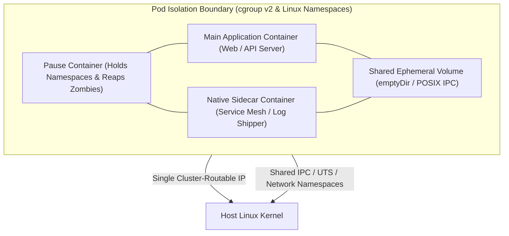
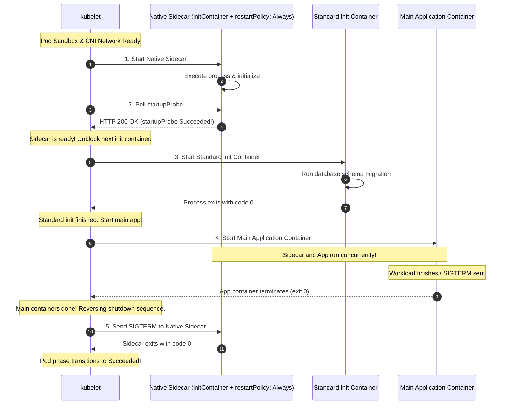
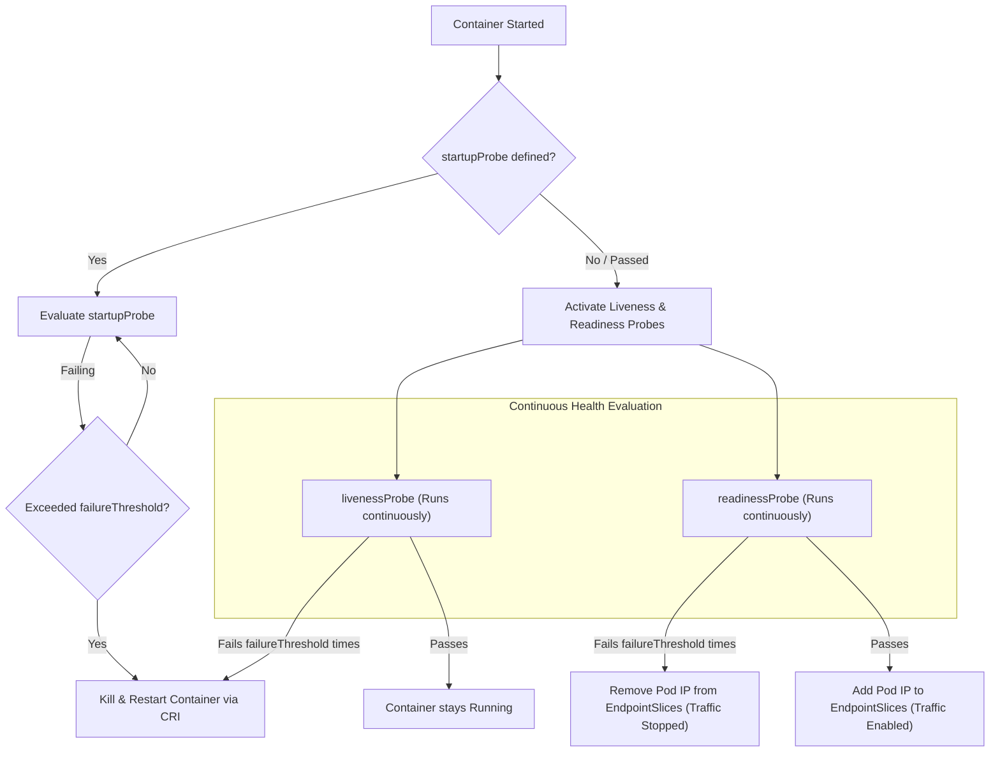
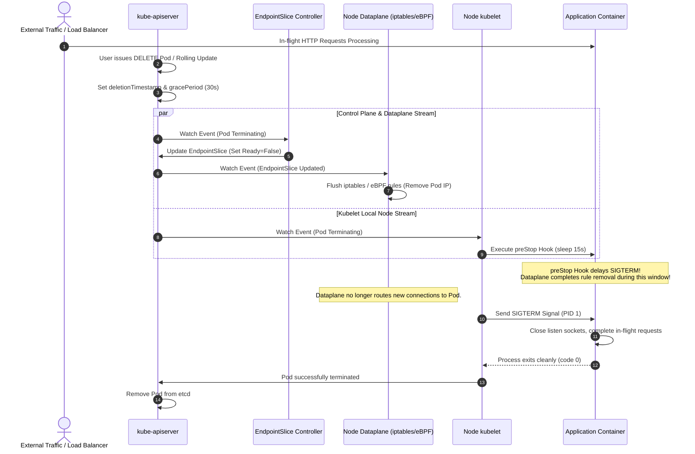
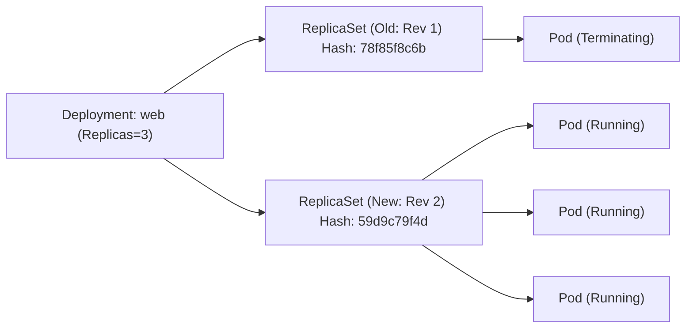

# Module 04: Pods and Workloads: Native Sidecars, Probes, Graceful Termination, Deployments, StatefulSets, DaemonSets, and Jobs

> **Primary sources:** KEP-753: In-Place Sidecar Containers ([keps/sig-node/753-sidecar-containers](https://github.com/kubernetes/enhancements/tree/master/keps/sig-node/753-sidecar-containers)); KEP-3993: Pod Failure Policy ([keps/sig-apps/3993-pod-failure-policy](https://github.com/kubernetes/enhancements/tree/master/keps/sig-apps/3993-pod-failure-policy)); Kubernetes Workload API Specifications ([kubernetes.io/docs/concepts/workloads/](https://kubernetes.io/docs/concepts/workloads/)).
>
> **Executable proof:** [`examples/ts/04-pods-and-workloads.test.ts`](../examples/ts/04-pods-and-workloads.test.ts) asserts Pod lifecycle condition transitions, native sidecar startup/shutdown sequencing, Deployment rolling update surge/unavailable math, StatefulSet ordinal identity indexing, and Job pod failure policy evaluations.

---

## 1. Formal Foundations: The Pod as the Atomic Unit of Scheduling

In Kubernetes, the smallest deployable compute entity is not an individual container process, but a **Pod**. Formally, a Pod is an atomic co-located allocation of physical resources (CPU, memory, storage) and Linux kernel isolation boundaries shared across one or more tightly coupled containers.



All containers inside a single Pod share:

1. **Network Namespace**: They share a single cluster-routable IPv4/IPv6 address. Containers communicate with each other over the loopback interface (`localhost`) with zero network encapsulation latency. Port namespaces are shared, meaning two containers in the same Pod cannot bind to the same TCP port.
2. **IPC Namespace**: Containers can communicate via standard System V IPC and POSIX shared memory segments.
3. **UTS Namespace**: Containers share a common hostname (matching the Pod name).
4. **Volumes**: Containers can mount shared storage volumes (such as memory-backed `emptyDir` volumes), enabling lockless filesystem data exchange.

For the underlying Linux kernel namespace architecture and the role of the pause container, see [`../../containers/modules/02-linux-namespaces.md`](../../containers/modules/02-linux-namespaces.md).

---

## 2. Pod Lifecycle, Phases, and Conditions

A Pod's lifecycle is modeled as a state machine characterized by its high-level `status.phase` and fine-grained `status.conditions[]`.

### 2.1 Pod Phases

The `status.phase` represents an aggregated, high-level summary of the Pod's lifecycle state:

- **`Pending`**: The Pod manifest has been accepted and committed by `kube-apiserver`, but one or more containers cannot run yet. This includes time spent waiting for the scheduler to select a node, downloading container images over the network, or waiting for CSI volume attachments.
- **`Running`**: The Pod has been bound to a node, all containers have been created, and at least one container is currently executing, starting, or restarting.
- **`Succeeded`**: All containers in the Pod have terminated with exit code 0 (standard completion for batch Jobs). Containers will not be restarted.
- **`Failed`**: All containers have terminated, and at least one container terminated with a non-zero exit code or was terminated by the system (e.g., OOMKilled by the kernel).
- **`Unknown`**: The state could not be obtained, typically because the kubelet failed to communicate with the control plane (e.g., node network partition).

### 2.2 Pod Conditions

While `phase` is a coarse enum, Kubernetes controllers make automated routing and scheduling decisions based on boolean **Conditions**:

```yaml
status:
  conditions:
    - type: PodScheduled
      status: 'True'
    - type: PodHasNetwork
      status: 'True'
    - type: Initialized
      status: 'True'
    - type: ContainersReady
      status: 'True'
    - type: Ready
      status: 'True'
```

- **`PodScheduled`**: The scheduler successfully identified a qualifying node and committed a `Binding` object.
- **`PodHasNetwork`**: The node runtime successfully initialized the pod network sandbox via CNI and assigned an IP address.
- **`Initialized`**: All sequential init containers completed successfully with exit code 0.
- **`ContainersReady`**: All containers declared in `spec.containers[]` have passed their readiness probes.
- **`Ready`**: The Pod is operational and eligible to receive traffic. When `Ready=True`, the EndpointSlice controller adds the Pod's IP address to Service endpoints.

---

## 3. Native Sidecar Containers (KEP-753)

Prior to Kubernetes v1.28 (and GA in modern clusters), sidecars were simply additional containers declared in `spec.containers[]`. This design suffered from fatal architectural flaws:

1. **Startup Race Conditions**: There was no guarantee that a sidecar (e.g., a service mesh proxy or vault credential agent) would start before the main application container, leading to immediate connection failures on app boot.
2. **Job Termination Deadlock**: In batch workloads, when the main calculation container completed, the sidecar container kept running indefinitely, preventing the Pod from entering the `Succeeded` phase and causing batch Jobs to hang forever.

### 3.1 Syntax and Sequencing Mechanics

**Native Sidecars (KEP-753)** are declared inside `spec.initContainers[]` with `restartPolicy: Always`:

```yaml
spec:
  initContainers:
    - name: vault-agent
      image: hashicorp/vault:1.15
      restartPolicy: Always
      startupProbe:
        httpGet:
          path: /v1/sys/health
          port: 8200
        periodSeconds: 1
        failureThreshold: 30
    - name: schema-migration
      image: postgres-migrator:v2
  containers:
    - name: api-server
      image: my-service:v1
```



### 3.2 Formal Execution Rules

1. **Sequential Init Gating**: The kubelet executes init containers in strict array order. When it encounters an init container with `restartPolicy: Always`, it starts the container and waits for its `startupProbe` to succeed.
2. **Unblocking Subsequent Stages**: Only after the native sidecar's `startupProbe` passes does the kubelet proceed to the next init container or main application container.
3. **Graceful Teardown Inversion**: When the Pod terminates (or when all main containers exit in a Job), the shutdown sequence runs in **reverse order**: main containers are terminated first. The native sidecars remain fully operational during main app shutdown, allowing the application to flush logs or complete active database transactions before the sidecar receives `SIGTERM`.

---

## 4. Health Probes: Startup, Liveness, and Readiness

Kubernetes provides three distinct probing mechanisms to evaluate container operational health.



### 4.1 Probe Taxonomy and Responsibilities

| Probe Type | Primary Responsibility | Action Taken Upon Failure | Typical Production Use Case |
| :-- | :-- | :-- | :-- |
| **`startupProbe`** | Protects slow-starting workloads during initialization. | Suspends liveness and readiness evaluation until passing; restarts container if `failureThreshold` is exceeded. | Legacy Java/Spring applications or large machine learning models loading weights into memory (e.g., 90s startup window). |
| **`livenessProbe`** | Detects unrecoverable deadlocks or internal thread panics. | Kills the container process via CRI and restarts it according to `restartPolicy`. | Catching thread deadlocks in application runtimes where the process is running but cannot process events. |
| **`readinessProbe`** | Determines whether the container can accept incoming network traffic. | Strips the Pod's IP from all matching Service `EndpointSlices`. Container process is **never killed**. | Circuit breaking during transient CPU saturation or cache warming, allowing the app to recover without restart thrashing. |

### 4.2 Probing Mechanisms

1. **`httpGet`**: Sends an HTTP GET request. Status codes $\ge 200$ and $< 400$ indicate success.
2. **`tcpSocket`**: Attempts to establish a TCP handshake. Successful socket connection indicates health.
3. **`grpc`**: Evaluates the official gRPC Health Checking Protocol (`grpc.health.v1.Health`).
4. **`exec`**: Executes an arbitrary command inside the container namespace. Exit code 0 indicates success. _Warning_: Spawning processes (`/bin/sh -c`) every second incurs heavy fork-exec CPU overhead and should be avoided in production.

---

## 5. Graceful Termination & Zero-Downtime Draining

When a Pod is deleted, updated, or evicted, Kubernetes initiates a coordinated multi-system teardown protocol designed to achieve zero dropped client connections.

For building service applications with graceful connection draining and HTTP keep-alive management, see [`../../nodejs/modules/08-building-services.md`](../../nodejs/modules/08-building-services.md).



### 5.1 The Race Condition and the `preStop` Sleep Mandatory Pattern

Notice the concurrent parallel streams in the sequence diagram:

1. Stream 1 (Dataplane Propagation): `kube-apiserver` $\to$ `EndpointSlice Controller` $\to$ `kube-apiserver` $\to$ `kube-proxy / Cilium` $\to$ Kernel netfilter flush. This distributed propagation takes between 1 and 5 seconds across a large cluster.
2. Stream 2 (Local Kubelet Execution): `kube-apiserver` $\to$ `kubelet` $\to$ Container termination. This takes milliseconds!

If the application handles `SIGTERM` immediately by closing its listening TCP socket, incoming connections routed by nodes that have not yet updated their local iptables rules will hit a closed port, returning **HTTP 502 Bad Gateway** or `ECONNREFUSED` to users!

To prevent this, production workloads must inject a `preStop` hook:

```yaml
lifecycle:
  preStop:
    exec:
      command: ['/bin/sh', '-c', 'sleep 15']
```

The `sleep 15` forces the kubelet to wait 15 seconds before transmitting `SIGTERM`, providing ample time for all cluster nodes to remove the Pod IP from their local routing tables before the application begins tearing down sockets.

---

## 6. Workload Controllers

Kubernetes delegates workload lifecycle management to specialized controllers that reconcile higher-level abstractions down to bare Pods.

### 6.1 Deployments and ReplicaSets

A **Deployment** manages stateless applications by declaratively controlling underlying **ReplicaSets**:

- **`pod-template-hash`**: When a Deployment creates a ReplicaSet, it computes a 32-bit FNV-1a hash of the `spec.template` and appends it to the ReplicaSet name (e.g., `web-78f85f8c6b`). This guarantees deterministic ownership tracking.
- **RollingUpdate Parameters**:
  - `maxSurge`: The maximum number of pods that can be created above the desired replica count during an update (e.g., `25%` or `1`).
  - `maxUnavailable`: The maximum number of pods that can be unavailable during the update (e.g., `0` or `25%`).

$$\text{Max Allowed Pods} = \text{Replicas} + \text{maxSurge}$$ $$\text{Min Available Pods} = \text{Replicas} - \text{maxUnavailable}$$



### 6.2 StatefulSets

A **StatefulSet** manages stateful, distributed applications (databases, consensus clusters, message brokers) requiring:

1. **Stable Network Identity**: Each Pod receives a deterministic hostname formatted as `$(statefulset-name)-$(ordinal)` (e.g., `kafka-0`, `kafka-1`, `kafka-2`). These hostnames resolve to stable internal DNS records when paired with a **Headless Service** (`spec.clusterIP: None`): $$\text{kafka-0.kafka-headless.prod.svc.cluster.local}$$
2. **Persistent Storage Binding**: Through `volumeClaimTemplates`, the StatefulSet controller dynamically generates a unique `PersistentVolumeClaim` for each ordinal index (e.g., `data-kafka-0`). When a StatefulSet pod is rescheduled or deleted, it is reattached to the exact same physical storage volume.
3. **Ordered Rollouts and Scaling**: By default, scaling and rolling updates execute in strict ordinal order: $N-1 \to N-2 \to \dots \to 0$. Pod $i$ will not start until Pod $i-1$ is fully `Running` and `Ready`.
4. **Partitioned Updates**: Allows canary deployments of stateful clusters using `spec.updateStrategy.rollingUpdate.partition`:
   - If `partition = 2` on a 5-replica StatefulSet, only pods with ordinal $\ge 2$ (`kafka-2`, `kafka-3`, `kafka-4`) are updated. Pods 0 and 1 remain on the old version!

### 6.3 DaemonSets

A **DaemonSet** ensures that all (or some subset of) nodes run a single copy of a Pod:

- **Scheduling Mechanics**: Modern Kubernetes uses the default scheduler for DaemonSets. The DaemonSet controller injects a `NodeAffinity` term matching the target nodes, allowing standard scheduler plugins (taints, resources) to govern placement.
- **Standard Use Cases**: Node-level infrastructure agents, including CNI network plugins (Cilium, Calico), log shippers (Fluent Bit), and storage daemons (Ceph CSI).

### 6.4 Jobs and CronJobs

- **Non-Indexed vs. Indexed Jobs (KEP-2214)**:
  - Non-Indexed: Replicas pull work items from an external queue until `spec.completions` succeed.
  - **Indexed Jobs** (`completionMode: Indexed`): Each Pod receives an environment variable `JOB_COMPLETION_INDEX` in the range $[0, \text{completions}-1]$. Ideal for parallel scientific computing, parameter sweeps, and distributed model training.
- **Pod Failure Policies (KEP-3993)**: Allows granular rules based on container exit codes:
  ```yaml
  spec:
    podFailurePolicy:
      rules:
        - action: FailJob
          onExitCodes:
            containerName: data-cruncher
            operator: In
            values: [42, 100] # Unrecoverable application error: do not retry!
        - action: Ignore
          onPodConditions:
            - type: DisruptionTarget # Node was drained by cloud autoscaler: do not count against backoffLimit!
  ```
- **CronJob Concurrency Policies**:
  - `Allow` (default): Concurrent job runs are permitted.
  - `Forbid`: If a previous job is still executing, the new scheduled run is skipped.
  - `Replace`: If a previous job is running, it is terminated and replaced by the new execution.

---

## 7. Formal Algorithm: Deployment Rolling Update Reconciliation

```text
Algorithm: ReconcileDeploymentRollingUpdate
Input: Deployment D, ListOfReplicaSets AllRS

Invariant 1: Total live pods across all RS never exceeds D.Spec.Replicas + D.Spec.Strategy.RollingUpdate.MaxSurge.
Invariant 2: Total ready pods across all RS never drops below D.Spec.Replicas - D.Spec.Strategy.RollingUpdate.MaxUnavailable.
Invariant 3: Rolling updates complete only when TargetRS.Replicas == D.Spec.Replicas and TargetRS.ReadyReplicas == D.Spec.Replicas.

1.  Function Reconcile(D, AllRS):
2.      targetRS := FindOrCreateReplicaSetForTemplate(D, D.Spec.Template)
3.      oldRSList := FilterNonTargetReplicaSets(AllRS, targetRS)
4.
5.      desired := D.Spec.Replicas
6.      maxSurge := CalculateSurge(D.Spec.Strategy.RollingUpdate.MaxSurge, desired)
7.      maxUnavailable := CalculateUnavailable(D.Spec.Strategy.RollingUpdate.MaxUnavailable, desired)
8.
9.      currentTotal := SumPodCount(AllRS)
10.     currentReady := SumReadyPodCount(AllRS)
11.
12.     // Step 1: Scale Up Target ReplicaSet within Surge Boundaries
13.     maxAllowedPods := desired + maxSurge
14.     if currentTotal < maxAllowedPods and targetRS.Spec.Replicas < desired then
15.         scaleUp := Min(maxAllowedPods - currentTotal, desired - targetRS.Spec.Replicas)
16.         targetRS.Spec.Replicas += scaleUp
17.         return Client.UpdateReplicaSet(targetRS)
18.     end if
19.
20.     // Step 2: Scale Down Old ReplicaSets within Availability Boundaries
21.     minRequiredAvailable := desired - maxUnavailable
22.     if currentReady > minRequiredAvailable then
23.         availableScaleDown := currentReady - minRequiredAvailable
24.         for each oldRS in SortOldestFirst(oldRSList) do
25.             if oldRS.Spec.Replicas > 0 then
26.                 scaleDown := Min(availableScaleDown, oldRS.Spec.Replicas)
27.                 oldRS.Spec.Replicas -= scaleDown
28.                 availableScaleDown -= scaleDown
29.                 Client.UpdateReplicaSet(oldRS)
30.                 if availableScaleDown == 0 then break end if
31.             end if
32.         end for
33.     end if
34.     return nil
35. End Function
```

### 7.1 Immutable Infrastructure: Replace, Do Not Patch

**Definition.** Immutable infrastructure treats a deployed unit as read-only: configuration and code changes are never applied in place. Instead, a new unit is built and the old unit is replaced. In Kubernetes, the unit is the Pod (and, at the node level, the node image).

| Aspect | Mutable pattern | Immutable pattern |
| :-- | :-- | :-- |
| Application update | `kubectl exec` into a Pod and edit files, or copy a new binary to the node. | Build a new image, push it, and roll the Deployment. |
| Configuration change | Edit a file inside a running container. | Update the ConfigMap or Secret and roll the workload. |
| Node patching | SSH into the node and apply OS packages. | Replace the node with a new instance from an updated image. |
| Rollback | Reverse the in-place edit manually. | `kubectl rollout undo` to the previous ReplicaSet or image tag. |

The Deployment controller is the mechanism that makes this safe: a rolling update creates new Pods, waits for readiness, and only then terminates old Pods. If the new version fails, the old ReplicaSet remains available for an immediate rollback.

> [!NOTE]
> **Why it matters:** in-place mutations are invisible to the desired state, so a subsequent `kubectl apply` silently reverts them. Immutable replacement keeps the observed state aligned with the declared state and makes rollbacks deterministic.

---

## 8. Historical Evolution: Then vs. Now

| Workload Primitive | Legacy Architecture (Pre-1.28) | Current Standard (Kubernetes v1.37.2) | Architectural Driver |
| :-- | :-- | :-- | :-- |
| **Sidecar Containers** | Standard containers inside `spec.containers[]` with ad-hoc startup scripts. | Native Sidecars inside `spec.initContainers[]` with `restartPolicy: Always` (KEP-753). | Eliminates app/sidecar startup race conditions and solves the Job termination hang bug. |
| **Batch Parallelism** | Unindexed Jobs requiring external coordination queues (Redis/RabbitMQ). | Indexed Jobs (`completionMode: Indexed`) with deterministic `JOB_COMPLETION_INDEX`. | Native high-performance computing, distributed AI model training, and parameter sweeps. |
| **Job Error Handling** | Blunt `backoffLimit` counter; any pod failure counted toward job failure. | Structured `podFailurePolicy` distinguishing application bugs from infrastructure evictions. | Prevents spot instance node drains or cloud preemptions from failing production batch jobs. |
| **StatefulSet Upgrades** | Coarse rolling update replacing all ordinals sequentially. | Partitioned rolling updates (`spec.updateStrategy.rollingUpdate.partition`). | Enables zero-downtime canary rollouts and manual migration gates for stateful database clusters. |

---

## 9. Exam Delta: CKA/CKAD/CKS (v1.37)

> [!IMPORTANT]
> **Certification Delta & Workload Constraints:**
>
> - **CKAD & CKA (Curriculum v1.37)**: Heavily tests Native Sidecars syntax (`restartPolicy: Always` in `initContainers`), rollout management (`kubectl rollout undo`, `kubectl rollout pause/resume`), and debugging CrashLoopBackOff states caused by failing startup/liveness probes. Candidates are required to author multi-container pods with shared `emptyDir` volumes.
> - **CKS (Curriculum v1.37)**: Focuses strictly on Workload Security Profiles. Questions require securing Pod specifications by enforcing `securityContext`: configuring `readOnlyRootFilesystem: true`, dropping all Linux capabilities (`capabilities: drop: ["ALL"]`), setting `runAsNonRoot: true`, and assigning `seccompProfile: type: RuntimeDefault`. CKS tests preventing privilege escalation and host namespace leaks (`hostPID: true`, `hostNetwork: true`).

---

## 10. Production Failure Modes & Operational Gotchas

### 10.1 The Liveness Probe Cascading Restart Storm

- **Symptom**: An external database experiences a 30-second network blip. Suddenly, all 50 replicas of an API microservice transition into `CrashLoopBackOff` simultaneously. When the database recovers, the microservice remains completely down!
- **Root Cause**: The developer configured the `livenessProbe` to execute an HTTP endpoint `/healthz` that queries the downstream database: `SELECT 1`. When the database blinked, all 50 containers failed their liveness probes concurrently. The kubelets killed all 50 containers. Upon restart, all 50 containers booted simultaneously, slammed the recovering database with hundreds of new connection handshakes, causing the database to fail again and trapping the cluster in an infinite restart loop.
- **Remediation**: Never check external dependencies in a `livenessProbe`. Liveness probes must strictly evaluate internal process liveness (e.g., verifying that the internal HTTP event loop is responding). External dependency health belongs exclusively in `readinessProbes`.

### 10.2 The Missing `preStop` 502 Bad Gateway Wave

- **Symptom**: During a routine Deployment rolling update with `maxUnavailable: 0`, users report waves of HTTP 502 Bad Gateway errors.
- **Root Cause**: When a pod enters termination, the kubelet sends `SIGTERM` immediately. The application terminates its HTTP listener. However, the EndpointSlice controller and node iptables dataplanes require 2 to 5 seconds to propagate the deletion. For several seconds, load balancers continue routing client requests to the terminating pod's IP address, hitting closed sockets.
- **Remediation**: Add a lifecycle hook: `lifecycle: { preStop: { exec: { command: ["/bin/sh", "-c", "sleep 15"] } } }`. The hook delays process termination until the cluster dataplane has fully removed the Pod from routing tables.

### 10.3 StatefulSet Split-Brain via Forceful Deletion

- **Symptom**: A worker node hosting `db-0` becomes partitioned (`NotReady`). An impatient operator runs `kubectl delete pod db-0 --force --grace-period=0`. Two instances of `db-0` run simultaneously, corrupting underlying storage!
- **Root Cause**: StatefulSets guarantee that at most **one** instance of an ordinal identity runs at any time. When a node is partitioned, the control plane cannot verify whether `db-0` is actually dead or simply unable to communicate with the API server. Force-deleting the pod bypasses the kubelet termination confirmation, causing the StatefulSet controller to schedule a second `db-0` on an active node while the first `db-0` continues writing to disk on the partitioned node.
- **Remediation**: Never force-delete StatefulSet pods during node partitions. Resolve the partition or drain the node cleanly using `kubectl drain` so the node's kubelet can confirm process termination.

### 10.4 CronJob Thread Saturation with `Allow` Concurrency

- **Symptom**: A database backup CronJob scheduled to run every 5 minutes hangs due to an unindexed database query. Over the weekend, 500 concurrent instances of the backup job spawn, exhausting cluster memory and CPU.
- **Root Cause**: The CronJob used the default `concurrencyPolicy: Allow`. When an iteration failed to complete within the 5-minute schedule interval, the CronJob controller spawned a new job on schedule, creating an unbounded accumulation of hanging pods.
- **Remediation**: Always specify `concurrencyPolicy: Forbid` or `concurrencyPolicy: Replace` on batch CronJobs, and set a hard `activeDeadlineSeconds` (e.g., `activeDeadlineSeconds: 1800`) to terminate hung executions automatically.

---

## Interview Drill

<details><summary>1. How do Native Sidecars (KEP-753) resolve the batch Job termination deadlock problem?</summary>

Under the legacy model, sidecars were standard containers declared in `spec.containers[]`. When a batch computation completed in the primary container, the sidecar container continued running indefinitely, preventing the Pod from entering the `Succeeded` phase. Native Sidecars are declared inside `spec.initContainers[]` with `restartPolicy: Always`. The kubelet understands their lifecycle semantics: when all standard containers in `spec.containers[]` have terminated with exit code 0, the kubelet automatically sends a `SIGTERM` signal to the native sidecar containers in reverse order, allowing them to terminate cleanly and enabling the Pod to enter the `Succeeded` phase.
</details>

<details><summary>2. What is the exact sequence of events when a Pod is terminated, and why is a `preStop` sleep hook necessary in production?</summary>

When a Pod is deleted:

1. `kube-apiserver` sets `metadata.deletionTimestamp` and `metadata.deletionGracePeriodSeconds`.
2. Two parallel streams execute simultaneously: Stream A (the EndpointSlice controller detects the termination timestamp, marks the Pod as not ready, and updates the `EndpointSlice`, causing cluster nodes to flush iptables/eBPF rules) and Stream B (the local node's kubelet executes the Pod's `preStop` hook if defined, waits for completion, sends `SIGTERM` to container processes, waits up to the grace period, and sends `SIGKILL` if processes persist).

Because Stream A requires several seconds to propagate across all cluster nodes, sending `SIGTERM` immediately causes the application to shut down while external load balancers and internal proxies are still routing traffic to its IP. A `preStop: exec: command: ["sleep", "15"]` delays `SIGTERM` by 15 seconds, ensuring the dataplane has completely stopped routing traffic to the Pod before the application closes its listening sockets.
</details>

<details><summary>3. Explain the difference between `livenessProbe`, `readinessProbe`, and `startupProbe`, and give a dangerous anti-pattern for liveness probes.</summary>

- `startupProbe`: Protects slow-starting containers. It disables liveness and readiness probes until it passes, preventing early container termination during warm-up.
- `livenessProbe`: Evaluates internal process health. Failure restarts the container process via the CRI runtime.
- `readinessProbe`: Evaluates whether the container can accept traffic. Failure removes the Pod's IP address from Service `EndpointSlices` without restarting the process.

**Anti-Pattern**: Checking downstream external dependencies (such as a database or external cache) in a `livenessProbe`. If the database suffers a brief network blip, all microservice replicas fail their liveness probes simultaneously, triggering a catastrophic cascading restart storm across the entire fleet.
</details>

<details><summary>4. How does a StatefulSet guarantee stable network identities, and what role does a Headless Service play?</summary>

A StatefulSet assigns a deterministic, ordinal-indexed hostname to each Pod (`$(name)-$(ordinal)`). When paired with a Headless Service (`spec.clusterIP: None`), CoreDNS creates an `A` record for each individual Pod pointing directly to the Pod's IP address (`$(pod-name).$(headless-service-name).$(namespace).svc.cluster.local`). Unlike standard Services that route to a virtual ClusterIP and balance traffic across arbitrary healthy pods, the Headless Service enables direct point-to-point addressing of specific cluster members (e.g., targeting the primary vs replica nodes in a database cluster).
</details>

<details><summary>5. What mathematical constraints govern `maxSurge` and `maxUnavailable` during a Deployment rolling update?</summary>

During a rolling update of a Deployment with desired replica count $R$:

- Maximum simultaneous pods running at any point: $$\text{Max Allowed Pods} = R + \text{maxSurge}$$
- Minimum available pods guaranteed to be operational at any point: $$\text{Min Available Pods} = R - \text{maxUnavailable}$$ For example, if $R=4$, `maxSurge=1`, and `maxUnavailable=0`, the Deployment controller creates 1 new pod before terminating any old pods, ensuring total active pods never exceeds 5 and ready pods never drops below 4.

</details>

<details><summary>6. How do Indexed Jobs differ from standard Jobs, and what parameter exposes the index to application code?</summary>

In standard non-indexed Jobs, all pods execute an identical specification, typically coordinating work items through an external message queue until the total completions count is met. In Indexed Jobs (`spec.completionMode: Indexed`), each Pod is assigned an explicit, deterministic integer index in the range $[0, \text{spec.completions}-1]$. The kubelet injects this index into the container environment as `JOB_COMPLETION_INDEX`. This allows each worker to deterministically partition datasets, shards, or parameter sets without external coordination.
</details>

<details><summary>7. What is a StatefulSet Partitioned Rolling Update, and when would you use it?</summary>

In a StatefulSet, `spec.updateStrategy.rollingUpdate.partition` defines an ordinal boundary. When an update is applied, only pods with an ordinal index greater than or equal to the partition value are updated. Pods with an ordinal less than the partition remain on the previous template version. This enables canary releases on stateful distributed systems (e.g., updating only `cassandra-4` on a 5-node cluster to verify schema stability and disk format changes before rolling out to the remaining nodes).
</details>

---

## 12. Proof Map and Verification

The lifecycle models, probing behaviors, and rollout algorithms presented in this module are verified executable in [`examples/ts/04-pods-and-workloads.test.ts`](../examples/ts/04-pods-and-workloads.test.ts):

- **Pod Lifecycle & Condition Transitions**: Verifies sequential condition progressions (`PodScheduled` $\to$ `PodHasNetwork` $\to$ `Initialized` $\to$ `ContainersReady` $\to$ `Ready`).
- **Native Sidecar Lifecycle Execution**: Proves that native sidecars (`restartPolicy: Always`) must pass startup probes before standard init containers run, and asserts reverse-order teardown upon pod completion.
- **Deployment Rolling Update Reconciler**: Implements the `ReconcileDeploymentRollingUpdate` algorithm, asserting that active and ready pods strictly adhere to `maxSurge` and `maxUnavailable` bounds.
- **StatefulSet Ordinal Identity & Partitioning**: Validates deterministic DNS name formatting and partitioned canary rollout simulations.
- **Job Pod Failure Policy**: Asserts rule-matching logic against container exit codes and infrastructure disruption conditions.
